<!-- manuscript:book {"title": "Spatial Data Analysis", "subtitle": "A Linear Models and Matrix Approach", "author": "Jonathan Navarrete", "status": "Working draft", "tagline": "Spatial statistics, translated into the linear models you already know.", "stamp": "October 2026", "parts": [{"label": "Getting Started", "title": "", "description": "", "chapters": [{"number": 0, "title": "The Big Picture and the Math You Already Know", "description": "Why ordinary statistics misleads in space, the one equation behind the book, and a quick review of five tools you already know."}]}, {"label": "Part I", "title": "Matrix Foundations and Spatial Covariance", "description": "How spatial dependence enters the linear model you already know, and how to build and simulate it.", "chapters": [{"number": 1, "title": "Spatial Dependence Through the Lens of Linear Models", "description": "What happens to least squares when neighbors resemble each other, and how many independent observations your data are really worth."}, {"number": 2, "title": "The Spatial Linear Model, Covariance, and Simulation", "description": "The one model equation, covariance functions and variograms, and simulating spatial fields whose truth you know."}]}, {"label": "Part II", "title": "Geostatistical Models and Generalized Least Squares", "description": "Continuous surfaces: estimate the covariance, predict at new locations, and fit the whole model by likelihood.", "chapters": [{"number": 3, "title": "Empirical Variography and Weighted Least Squares Fitting", "description": "Estimating and fitting the variogram, and why an unmodeled trend contaminates it."}, {"number": 4, "title": "Spatial Prediction: Kriging as Linear Model BLUP", "description": "Best linear unbiased prediction at new locations in simple, ordinary, and universal form, plus block kriging and cross-validation."}, {"number": 5, "title": "Likelihood Inference, Model Selection, and Diagnostics", "description": "Maximum likelihood and REML for the spatial model, comparing models, and checking diagnostics."}]}, {"label": "Part III", "title": "Discrete Spatial Models (Lattice and Areal Data)", "description": "Data on regions such as counties or tracts: neighborhoods as matrices, spatial regression, and models for counts.", "chapters": [{"number": 6, "title": "Areal Units, Spatial Weights, and Quadratic Form Tests", "description": "Spatial weights, Moran's I as a quadratic form, and the modifiable areal unit problem."}, {"number": 7, "title": "Simultaneous Autoregressive Models: Spatial Regression with Feedback", "description": "Regression with spatial feedback, and what a coefficient means when effects spread."}, {"number": 8, "title": "Conditional Autoregressive Models and Sparse Precision Matrices", "description": "Sparse precision matrices, and the view from a single region and its neighbors."}, {"number": 9, "title": "Generalized Linear Mixed Models for Spatial Count Data", "description": "Poisson regression with a spatial random effect, from the basic model to BYM2."}]}, {"label": "Part IV", "title": "Spatial Point Patterns", "description": "Data that are the locations themselves: where events happen, and why.", "chapters": [{"number": 10, "title": "Exploring Point Patterns: Intensity, Randomness, and Interaction", "description": "Intensity, complete spatial randomness, and the summary functions that reveal clustering and regularity."}, {"number": 11, "title": "Point Processes as Generalized Linear Models", "description": "Intensity models with covariates, fit as an ordinary GLM with the Berman-Turner device."}, {"number": 12, "title": "Models for Clustering and Inhibition", "description": "Why points cluster or repel, and how to fit and check a model for each."}]}, {"label": "Part V", "title": "Matrix Scalability for Large Spatial Systems", "description": "What to do when the matrices no longer fit.", "chapters": [{"number": 13, "title": "Matrix Approximations and Fast Algorithms for Large $n$", "description": "Low-rank, tapered, and neighbor-based approximations, sparse precision methods, and when each is worth using."}]}]} -->

---

<!-- manuscript:front:begin -->
<div align="center">

# Spatial Data Analysis

### A Linear Models and Matrix Approach

**Jonathan Navarrete**

Working draft, October 2026

*Spatial statistics, translated into the linear models you already know.*

</div>

---

## Contents

### Getting Started

- **[Chapter 0: The Big Picture and the Math You Already Know](#ch0)**
  <br>Why ordinary statistics misleads in space, the one equation behind the book, and a quick review of five tools you already know.

### Part I: Matrix Foundations and Spatial Covariance

*How spatial dependence enters the linear model you already know, and how to build and simulate it.*

- **[Chapter 1: Spatial Dependence Through the Lens of Linear Models](#ch1)**
  <br>What happens to least squares when neighbors resemble each other, and how many independent observations your data are really worth.
- **[Chapter 2: The Spatial Linear Model, Covariance, and Simulation](#ch2)**
  <br>The one model equation, covariance functions and variograms, and simulating spatial fields whose truth you know.

### Part II: Geostatistical Models and Generalized Least Squares

*Continuous surfaces: estimate the covariance, predict at new locations, and fit the whole model by likelihood.*

- **[Chapter 3: Empirical Variography and Weighted Least Squares Fitting](#ch3)**
  <br>Estimating and fitting the variogram, and why an unmodeled trend contaminates it.
- **[Chapter 4: Spatial Prediction: Kriging as Linear Model BLUP](#ch4)**
  <br>Best linear unbiased prediction at new locations in simple, ordinary, and universal form, plus block kriging and cross-validation.
- **[Chapter 5: Likelihood Inference, Model Selection, and Diagnostics](#ch5)**
  <br>Maximum likelihood and REML for the spatial model, comparing models, and checking diagnostics.

### Part III: Discrete Spatial Models (Lattice and Areal Data)

*Data on regions such as counties or tracts: neighborhoods as matrices, spatial regression, and models for counts.*

- **[Chapter 6: Areal Units, Spatial Weights, and Quadratic Form Tests](#ch6)**
  <br>Spatial weights, Moran's I as a quadratic form, and the modifiable areal unit problem.
- **[Chapter 7: Simultaneous Autoregressive Models: Spatial Regression with Feedback](#ch7)**
  <br>Regression with spatial feedback, and what a coefficient means when effects spread.
- **[Chapter 8: Conditional Autoregressive Models and Sparse Precision Matrices](#ch8)**
  <br>Sparse precision matrices, and the view from a single region and its neighbors.
- **[Chapter 9: Generalized Linear Mixed Models for Spatial Count Data](#ch9)**
  <br>Poisson regression with a spatial random effect, from the basic model to BYM2.

### Part IV: Spatial Point Patterns

*Data that are the locations themselves: where events happen, and why.*

- **[Chapter 10: Exploring Point Patterns: Intensity, Randomness, and Interaction](#ch10)**
  <br>Intensity, complete spatial randomness, and the summary functions that reveal clustering and regularity.
- **[Chapter 11: Point Processes as Generalized Linear Models](#ch11)**
  <br>Intensity models with covariates, fit as an ordinary GLM with the Berman-Turner device.
- **[Chapter 12: Models for Clustering and Inhibition](#ch12)**
  <br>Why points cluster or repel, and how to fit and check a model for each.

### Part V: Matrix Scalability for Large Spatial Systems

*What to do when the matrices no longer fit.*

- **[Chapter 13: Matrix Approximations and Fast Algorithms for Large $n$](#ch13)**
  <br>Low-rank, tapered, and neighbor-based approximations, sparse precision methods, and when each is worth using.

<details>
<summary><strong>Detailed contents</strong> (every section)</summary>

- **[Chapter 0: The Big Picture and the Math You Already Know](#ch0)**
  - [0.1 What Is Spatial Statistics?](#s0-1)
  - [0.2 One Equation for the Whole Book](#s0-2)
  - [0.3 Three Ways Classical Statistics Misleads in Space](#s0-3)
  - [0.4 The Math Inventory: Five Tools You Already Know](#s0-4)
  - [0.5 How This Book Works](#s0-5)
  - [0.6 Setting Up](#s0-6)
  - [0.7 Warm-Up Exercises](#s0-7)
  - [What Comes Next](#ch0-what-comes-next)
- **[Chapter 1: Spatial Dependence Through the Lens of Linear Models](#ch1)**
  - [1.1 Reviewing the Classical Linear Model](#s1-1)
  - [1.2 What Is a Spatial Process?](#s1-2)
  - [1.3 Why We Cannot Ignore Space: OLS When $\operatorname{Var}(\mathbf{Y}) = \boldsymbol{\Sigma}$](#s1-3)
  - [1.4 Effective Sample Size](#s1-4)
  - [1.5 The Three Spatial Data Structures as Matrix Geometries](#s1-5)
  - [1.6 Coordinates and Distance](#s1-6)
  - [1.7 Walkthrough and Lab 1](#s1-7)
  - [Exercises](#ch1-exercises)
  - [What Comes Next](#ch1-what-comes-next)
- **[Chapter 2: The Spatial Linear Model, Covariance, and Simulation](#ch2)**
  - [2.1 One Model Equation](#s2-1)
  - [2.2 Stationarity Expressed With Moments](#s2-2)
  - [2.3 Reading the Variogram: Decoding the Jargon on the Curve](#s2-3)
  - [2.4 What Makes a Covariance Matrix Valid?](#s2-4)
  - [2.5 Parametric Correlation Families](#s2-5)
  - [2.6 Geometric Anisotropy Through Coordinate Transformations](#s2-6)
  - [2.7 Simulating Spatial Random Fields From First Principles](#s2-7)
  - [2.8 Walkthrough and Lab 2](#s2-8)
  - [Exercises](#ch2-exercises)
  - [What Comes Next](#ch2-what-comes-next)
- **[Chapter 3: Empirical Variography and Weighted Least Squares Fitting](#ch3)**
  - [3.1 Estimating the Empirical Semivariogram](#s3-1)
  - [3.2 Robust Estimation: The Cressie-Hawkins Estimator](#s3-2)
  - [3.3 Fitting Parametric Curves to Empirical Variograms](#s3-3)
  - [3.4 The Trend-Contamination Pitfall](#s3-4)
  - [3.5 Walkthrough and Lab 3](#s3-5)
  - [Exercises](#ch3-exercises)
  - [What Comes Next](#ch3-what-comes-next)
- **[Chapter 4: Spatial Prediction: Kriging as Linear Model BLUP](#ch4)**
  - [4.1 Demystifying "Kriging": It Is Best Linear Unbiased Prediction](#s4-1)
  - [4.2 Simple Kriging (Known Mean)](#s4-2)
  - [4.3 Ordinary Kriging (Unknown Constant Mean)](#s4-3)
  - [4.4 Universal Kriging (Spatial Regression With Covariates)](#s4-4)
  - [4.5 Two Targets, and Interpolation Versus Smoothing](#s4-5)
  - [4.6 Change of Support: Block Kriging](#s4-6)
  - [4.7 Evaluating Predictions: Leave-One-Out Cross-Validation](#s4-7)
  - [4.8 Walkthrough and Lab 4](#s4-8)
  - [Exercises](#ch4-exercises)
  - [What Comes Next](#ch4-what-comes-next)
- **[Chapter 5: Likelihood Inference, Model Selection, and Diagnostics](#ch5)**
  - [5.1 The Multivariate Normal Log-Likelihood](#s5-1)
  - [5.2 Profile Maximum Likelihood](#s5-2)
  - [5.3 Restricted Maximum Likelihood (REML)](#s5-3)
  - [5.4 Numerical Optimization and Asymptotic Standard Errors](#s5-4)
  - [5.5 Model Selection and Tests for Spatial Structure](#s5-5)
  - [5.6 Spatial Regression Diagnostics and Confounding](#s5-6)
  - [5.7 Walkthrough and Lab 5](#s5-7)
  - [Exercises](#ch5-exercises)
  - [What Comes Next](#ch5-what-comes-next)
- **[Chapter 6: Areal Units, Spatial Weights, and Quadratic Form Tests](#ch6)**
  - [6.1 Areal Units Are a Choice: The Modifiable Areal Unit Problem](#s6-1)
  - [6.2 Building a Spatial Weights Matrix](#s6-2)
  - [6.3 Representing Regions as Graphs](#s6-3)
  - [6.4 Moran's I as a Ratio of Quadratic Forms](#s6-4)
  - [6.5 Exact Null Moments of I Under Normality](#s6-5)
  - [6.6 Moran's I on Regression Residuals](#s6-6)
  - [6.7 Geary's C and Local Indicators](#s6-7)
  - [6.8 Distribution-Free Inference: Permutation Tests](#s6-8)
  - [6.9 Walkthrough and Lab 6](#s6-9)
  - [Exercises](#ch6-exercises)
  - [What Comes Next](#ch6-what-comes-next)
- **[Chapter 7: Simultaneous Autoregressive Models: Spatial Regression with Feedback](#ch7)**
  - [7.1 The Simultaneous Idea](#s7-1)
  - [7.2 The Spatial Error Model](#s7-2)
  - [7.3 The Spatial Lag Model](#s7-3)
  - [7.4 The Parameter Space](#s7-4)
  - [7.5 Maximum Likelihood](#s7-5)
  - [7.6 Choosing Between the Error and Lag Models](#s7-6)
  - [7.7 Interpreting the Lag Model: Direct, Indirect, and Total Impacts](#s7-7)
  - [7.8 Walkthrough and Lab 7](#s7-8)
  - [Exercises](#ch7-exercises)
  - [What Comes Next](#ch7-what-comes-next)
- **[Chapter 8: Conditional Autoregressive Models and Sparse Precision Matrices](#ch8)**
  - [8.1 The Conditional Idea](#s8-1)
  - [8.2 The Proper CAR Model](#s8-2)
  - [8.3 The Intrinsic CAR Model](#s8-3)
  - [8.4 Computing With Precision Matrices](#s8-4)
  - [8.5 SAR Versus CAR](#s8-5)
  - [8.6 Walkthrough and Lab 8](#s8-6)
  - [Exercises](#ch8-exercises)
  - [What Comes Next](#ch8-what-comes-next)
- **[Chapter 9: Generalized Linear Mixed Models for Spatial Count Data](#ch9)**
  - [9.1 Reviewing GLMs in the Style of Dobson and Barnett](#s9-1)
  - [9.2 Spatial Poisson Regression for Regional Counts](#s9-2)
  - [9.3 Shrinkage and Spatial Random Effects](#s9-3)
  - [9.4 Fitting Spatial GLMMs by Penalized Quasi-Likelihood](#s9-4)
  - [9.5 The Laplace Approximation of the Marginal Likelihood](#s9-5)
  - [9.6 Walkthrough and Lab 9](#s9-6)
  - [Exercises](#ch9-exercises)
  - [What Comes Next](#ch9-what-comes-next)
- **[Chapter 10: Exploring Point Patterns: Intensity, Randomness, and Interaction](#ch10)**
  - [10.1 What Changes in a Point Pattern](#s10-1)
  - [10.2 The Homogeneous Poisson Process: Complete Spatial Randomness](#s10-2)
  - [10.3 Simulating Point Patterns From First Principles](#s10-3)
  - [10.4 First-Order Exploration: Kernel Intensity Estimation](#s10-4)
  - [10.5 Distance Methods](#s10-5)
  - [10.6 Second-Order Summaries](#s10-6)
  - [10.7 Multitype Patterns](#s10-7)
  - [10.8 Boundary Truncation](#s10-8)
  - [10.9 Monte Carlo Envelopes and Tests](#s10-9)
  - [10.10 Walkthrough and Lab 10](#s10-10)
  - [Exercises](#ch10-exercises)
  - [What Comes Next](#ch10-what-comes-next)
- **[Chapter 11: Point Processes as Generalized Linear Models](#ch11)**
  - [11.1 Intensity as a Regression Function](#s11-1)
  - [11.2 The Exact Likelihood From a Refining Grid](#s11-2)
  - [11.3 The Berman-Turner Quadrature Device](#s11-3)
  - [11.4 Offsets: Modeling Excess Over a Known Baseline](#s11-4)
  - [11.5 Case-Control Data and the Logistic Bridge](#s11-5)
  - [11.6 Where Is the Excess? Spatial Scan Statistics](#s11-6)
  - [11.7 Separating Trend From Interaction](#s11-7)
  - [11.8 Inference Under Clustering](#s11-8)
  - [11.9 Walkthrough and Lab 11](#s11-9)
  - [Exercises](#ch11-exercises)
  - [What Comes Next](#ch11-what-comes-next)
- **[Chapter 12: Models for Clustering and Inhibition](#ch12)**
  - [12.1 Three Explanations for a Departure From CSR](#s12-1)
  - [12.2 Cluster Processes](#s12-2)
  - [12.3 The Log-Gaussian Cox Process](#s12-3)
  - [12.4 Inhibition](#s12-4)
  - [12.5 Checking a Fitted Point Process Model](#s12-5)
  - [12.6 Walkthrough and Lab 12](#s12-6)
  - [Exercises](#ch12-exercises)
  - [What Comes Next](#ch12-what-comes-next)
- **[Chapter 13: Matrix Approximations and Fast Algorithms for Large $n$](#ch13)**
  - [13.1 The $O(n^3)$ Bottleneck](#s13-1)
  - [13.2 Low-Rank Spatial Models](#s13-2)
  - [13.3 Covariance Tapering](#s13-3)
  - [13.4 Vecchia's Approximation](#s13-4)
  - [13.5 The Bridge Between Parts II and III: Matérn Fields as Markov Fields](#s13-5)
  - [13.6 Kronecker Products for Separable Space-Time Data](#s13-6)
  - [13.7 Walkthrough and Lab 13](#s13-7)
  - [Exercises](#ch13-exercises)
  - [What Comes Next](#ch13-what-comes-next)

</details>
<!-- manuscript:front:end -->

---

<a id="ch0"></a>

# Chapter 0: The Big Picture and the Math You Already Know

Most statistics courses rest on one quiet assumption: the rows of a data set are independent. Each observation is a fresh draw, unrelated to the one before it. That assumption is what makes $\sigma^2/n$ the variance of a sample mean, what makes regression standard errors correct, and what makes a p-value mean what it says. (Here $\sigma^2$ is just the variance of one observation. From Chapter 1 on, this book writes the variance of independent errors as $\tau^2$ and keeps $\sigma^2$ for the variance of the spatial random effect introduced in Section 0.2.)

Spatial data breaks that assumption in a predictable way. Two apartments on the same block rent for similar amounts, because they share schools, transit, and street noise. Two neighboring census tracts share employers, clinics, and commuters. Traffic crashes pile up at a few badly designed intersections instead of scattering at random. When observations near each other are related, the familiar formulas still produce numbers, but the numbers overstate how much the data know.

This chapter has two jobs. The first is to show, with small simulations and no heavy algebra, what spatial statistics is and why it is needed. The second is to take stock of the mathematics you already have. Almost everything in this book is built from five tools you met in linear algebra, regression, and mathematical statistics. If you can use those five tools, you can follow every derivation in the chapters ahead.

> **Chapter at a Glance**
>
> - **What Spatial Statistics Is (§0.1):** Statistics for data where location matters and nearby observations are dependent. We meet the three kinds of spatial data and the question each one asks.
> - **One Equation for the Whole Book (§0.2):** Every model in the book is a version of $Y = \mu + u + \varepsilon$: a trend, a spatial random effect, and independent noise.
> - **Three Ways Classical Statistics Misleads (§0.3):** Simulations show inflated sample sizes, correlation between unrelated maps, and rate maps dominated by small populations.
> - **The Math Inventory (§0.4):** Five tools you already know, each shown at work on a spatial problem, and a list of what the book builds on top of them.
> - **How the Book Works (§0.5–§0.7):** What we leave out and why, the rhythm of each chapter, a map of the book, a software check, and warm-up exercises.

---

<a id="s0-1"></a>

## 0.1 What Is Spatial Statistics?

### 0.1.1 When Rows Are Not Independent

Picture a data frame of apartment listings. Each row is an apartment: an identifier, two coordinates, and a monthly rent. In a regression course you would fit a model to this table and treat the rows as independent. Row 4 and row 5 would be unrelated draws.

Now suppose apartments 4 and 5 are in the same building. They share a location, a school zone, and a walk to the same train station. If apartment 4 rents for more than its size and condition predict, because the block has quietly become desirable, apartment 5 probably does too. Their errors are not independent. They share information.

This is the observation behind what geographers call Tobler's first law: everything is related to everything else, but near things are more related than distant things. Spatial statistics is the part of statistics that takes this seriously. It treats location as part of the data, describes how dependence changes with distance, and adjusts estimation, prediction, and testing to account for it.

The cost of ignoring dependence is not that estimates become wrong on average. A regression coefficient fitted by ordinary least squares is still unbiased when the errors are spatially correlated. The cost is that we misjudge how precise our estimates are. Positively correlated observations repeat each other, so a data set of $n$ correlated rows carries less information than $n$ independent rows. Formulas that assume independence count every row as new information, and so they report standard errors that are too small and p-values that are too optimistic. Section 0.3 shows how large the effect can be.

### 0.1.2 One World, One Map

Classical statistics leans on replication. To learn about a distribution, we observe many independent draws from it. Spatial data rarely offers that. We observe one set of rents in one city in one month, one arrangement of immune cells on one tissue slide, one set of overdose counts for one set of counties. There is no second planet to sample.

So where does replication come from? The answer, developed in Chapter 2, is an assumption about the process: that the rules generating the data are the same everywhere in the region. If the relationship between two locations depends only on the separation between them (how far apart they are and in which direction), and not on where they are, then every pair of locations 100 meters apart in the same direction is a replicate of "two locations 100 meters apart." A single map then contains many replicates of each separation, and that is enough to estimate how dependence decays. Chapter 2 refines this by separating a version in which direction matters from one in which only distance matters.

This assumption is called stationarity. It is useful and it is checkable, but it is an assumption. Much of the practical skill in spatial statistics lies in deciding which parts of a map can reasonably be treated as following the same rules, and in modeling the parts that cannot (for example, with a trend in the mean).

### 0.1.3 Three Kinds of Spatial Data, Three Questions

Spatial data comes in three broad forms. They differ in what is random, and so they lead to different questions and different models.

| Data type | What is random | Example | The central question | Where in the book |
| :--- | :--- | :--- | :--- | :--- |
| Geostatistical (continuous space) | The measured value, at fixed locations | Rents at listed apartments; noise levels at street monitors | What is the value where we did not measure, and how sure are we? | Part II (Chapters 3–5) |
| Areal or lattice (regions) | The value attached to each region of a fixed map | Overdose deaths by county; median income by census tract | Does a region differ from its neighbors by more than chance, and what explains it? | Part III (Chapters 6–9) |
| Point pattern (events) | The locations themselves | Immune cells on a tumor slide; addresses of disease cases; traffic crashes | Are events clustered, regular, or random, and what drives their density? | Part IV (Chapters 10–12) |

The first type is about a quantity that varies smoothly across space, like the rent level of a city or the noise level of its streets, and that we have measured at a finite number of points. The second is about quantities that only make sense for whole regions, like a county's mortality rate. The third is different in kind: there is no measured value at all, only a list of where things happened. The same three types turn up far from geography. Gene expression measured on a grid of spots across a tissue slide is areal data. The locations of a basketball player's shot attempts are a point pattern. The book treats all three with one modeling framework, which is the subject of the next section.

---

<a id="s0-2"></a>

## 0.2 One Equation for the Whole Book

Every model in this book is a variation on a single equation. For a location $\mathbf{s}$,

$$
Y(\mathbf{s}) = \mu(\mathbf{s}) + u(\mathbf{s}) + \varepsilon(\mathbf{s})
$$

In words, an observation is a trend, plus a spatial random effect, plus independent noise.

- **The trend $\mu(\mathbf{s})$** is the part explained by covariates, written as a regression: $\mu(\mathbf{s}) = \mathbf{x}(\mathbf{s})'\boldsymbol{\beta}$. For rents, square footage, distance to a transit stop, or the coordinates themselves can all enter $\mathbf{x}(\mathbf{s})$. This is the linear model you already know.
- **The spatial random effect $u(\mathbf{s})$** is the part that is not explained by covariates but is shared by nearby locations. It is random, it has mean zero, and its values at two locations are correlated, more strongly the closer the locations are. Its variance is written $\sigma^2$.
- **The noise $\varepsilon(\mathbf{s})$** is independent from location to location. It includes measurement error and any variation at scales finer than the spacing of the data. Its variance is written $\tau^2$.

If you have seen mixed models, $u$ will feel familiar. In a study of students nested in schools, each school gets a random intercept, and two students in the same school are correlated because they share it. A spatial random effect works the same way, with one change: there are no discrete schools. Every location has its own effect, and the effects of nearby locations are correlated, with the correlation fading smoothly with distance. A spatial model is a mixed model in which the random effect is a surface.

Collect $n$ observations into a vector $\mathbf{Y}$. Because $u$ and $\varepsilon$ are independent of each other, their variances add, and the whole spatial structure of the data sits in one covariance matrix:

$$
\operatorname{Var}(\mathbf{Y}) = \boldsymbol{\Sigma} = \sigma^2\mathbf{R}(\phi) + \tau^2\mathbf{I}_n
$$

Here $\mathbf{R}(\phi)$ holds the correlations of the random effect between every pair of locations, and $\phi$ sets how quickly correlation fades with distance. If $\sigma^2 = 0$, this collapses to $\tau^2\mathbf{I}_n$, the independent-errors model of ordinary regression. Everything spatial in this book is about what happens when $\sigma^2 > 0$: how to estimate $\boldsymbol{\Sigma}$, how to do regression with it, and how to predict with it.

The parts of the book change one piece of the equation at a time:

- **Part II** treats $u$ as a continuous surface and describes it through a covariance function of distance.
- **Part III** defines $u$ on a map of regions, describing each region's effect through its neighbors. Chapter 9 places the same equation inside a generalized linear model for counts.
- **Part IV** uses the equation for the logarithm of the density of events, connecting point patterns back to everything before.
- **Part V** keeps the equation and asks how to compute with it when $n$ is in the tens of thousands.

---

<a id="s0-3"></a>

## 0.3 Three Ways Classical Statistics Misleads in Space

This section uses three small simulations to show what goes wrong when spatial dependence is ignored. You do not need to follow the simulation code in detail yet. Chapter 2 explains exactly how it works, using a Cholesky factorization of $\boldsymbol{\Sigma}$. For now, treat it as a way to draw random maps whose true properties we know.

All three simulations use a regular grid of locations in the unit square and the exponential correlation function $r(h;\phi) = \exp(-h/\phi)$, where $h$ is the distance between two locations. A larger $\phi$ means correlation persists over longer distances. The helper functions below build the grid and the matrix of pairwise distances.

```python
import numpy as np
from scipy import stats

def grid(m):
    """Centers of an m-by-m grid of cells in the unit square, as (m*m, 2)."""
    g = (np.arange(m) + 0.5) / m
    xx, yy = np.meshgrid(g, g)
    return np.column_stack([xx.ravel(), yy.ravel()])

def dist(S):
    """Matrix of Euclidean distances between the rows of S."""
    q = np.sum(S**2, axis=1)
    H2 = q[:, None] - 2 * S @ S.T + q[None, :]
    H = np.sqrt(np.maximum(H2, 0.0))  # rounding fix, see Section 1.6.1
    np.fill_diagonal(H, 0.0)
    return H
```

### 0.3.1 More Data Is Not Always More Information

Suppose a city installs noise monitors on an $m \times m$ grid across a district, here the unit square, to estimate the district's average noise level. For simplicity take $\mu$ constant, $\sigma^2 = 1$, and $\tau^2 = 0$. The estimate is the sample mean $\bar{Y} = \frac{1}{n}\mathbf{1}'\mathbf{Y}$.

The variance of $\bar{Y}$ follows from Tool 1 in Section 0.4: for a fixed vector $\mathbf{a}$, $\operatorname{Var}(\mathbf{a}'\mathbf{Y}) = \mathbf{a}'\boldsymbol{\Sigma}\mathbf{a}$. With $\mathbf{a} = \frac{1}{n}\mathbf{1}$,

$$
\operatorname{Var}(\bar{Y}) = \frac{1}{n^2}\,\mathbf{1}'\boldsymbol{\Sigma}\mathbf{1} = \frac{1}{n^2}\sum_{i=1}^n\sum_{j=1}^n \Sigma_{ij}
$$

If the observations were independent, $\boldsymbol{\Sigma} = \mathbf{I}_n$ and this would be the familiar $1/n$. With correlation, every off-diagonal entry adds to the variance. A useful summary is the **effective sample size**, the number of independent observations that would give the same precision:

$$
n_{\text{eff}} = \frac{\sigma^2}{\operatorname{Var}(\bar{Y})}
$$

The code below computes $\operatorname{Var}(\bar{Y})$ and $n_{\text{eff}}$ exactly, with no simulation needed, for grids of 100, 400, and 1,600 locations and three values of $\phi$.

```python
for m in (10, 20, 40):
    S = grid(m)
    n = len(S)
    H = dist(S)
    for phi in (0.05, 0.1, 0.2):
        R = np.exp(-H / phi)
        var_mean = R.sum() / n**2
        print(f"n={n:5d}  phi={phi:4.2f}  Var(mean)={var_mean:.4f}  "
              f"iid={1/n:.5f}  n_eff={1/var_mean:6.1f}")
```

| $n$ | $\phi = 0.05$ | $\phi = 0.1$ | $\phi = 0.2$ |
| :--- | :--- | :--- | :--- |
| 100 | $n_{\text{eff}} = 54.5$ | $n_{\text{eff}} = 19.6$ | $n_{\text{eff}} = 6.9$ |
| 400 | $n_{\text{eff}} = 69.3$ | $n_{\text{eff}} = 20.6$ | $n_{\text{eff}} = 7.0$ |
| 1,600 | $n_{\text{eff}} = 72.1$ | $n_{\text{eff}} = 20.8$ | $n_{\text{eff}} = 7.0$ |

Two things stand out. First, the losses are large. With $\phi = 0.2$, a grid of 1,600 monitors estimates the district average about as well as 7 independent measurements would. A confidence interval built on $n = 1{,}600$ would be roughly $\sqrt{1600/7} \approx 15$ times too narrow.

Second, adding monitors inside the same district barely helps. Going from 400 to 1,600 monitors quadruples the data and leaves $n_{\text{eff}}$ almost unchanged. New monitors placed between old ones mostly repeat what their neighbors already report.

This does not mean dense sampling is useless. It depends on the question. For predicting the noise level at an unmonitored address, a nearby monitor is very valuable, and Section 4.8.5 shows that the prediction error falls steadily as sampling gets denser. What dense sampling cannot do is make a district average more precise than the field's own variability allows. Chapter 1 develops this argument and extends it to regression coefficients.

### 0.3.2 Correlation Out of Nothing

Now simulate two maps on the same $20 \times 20$ grid, completely independently of each other, each with $\phi = 0.2$. Then do what an analyst might do with two real maps, such as neighborhood rents and childhood asthma rates: compute the correlation across the 400 locations and test whether it differs from zero with the usual Pearson test.

```python
rng = np.random.default_rng(2026)
S = grid(20)
n = len(S)
# tiny jitter on the diagonal; explained in Section 2.5.1
L = np.linalg.cholesky(np.exp(-dist(S) / 0.2) + 1e-10 * np.eye(n))

reps = 1000
rs = np.empty(reps)
rejections = 0
for b in range(reps):
    y1 = L @ rng.standard_normal(n)   # first map
    y2 = L @ rng.standard_normal(n)   # second, independent map
    r, p = stats.pearsonr(y1, y2)
    rs[b] = r
    rejections += p < 0.05

print("median |r|:", np.median(np.abs(rs)))
print("share with |r| > 0.3:", np.mean(np.abs(rs) > 0.3))
print("naive test rejects:", rejections / reps)

# The same test on independent, non-spatial data
rej_iid = sum(
    stats.pearsonr(rng.standard_normal(n), rng.standard_normal(n))[1] < 0.05
    for _ in range(reps)
)
print("naive test rejects (independent data):", rej_iid / reps)
```

The two maps are unrelated by construction, so a test at the 5% level should reject about 5% of the time. It rejects in 59.4% of the 1,000 simulations. (Repeating the experiment with independent, non-spatial data gives a rejection rate of 5.1%, as it should.)

The sample correlations themselves are usually modest: the median $\lvert r \rvert$ is 0.12, and only 9.2% exceed 0.3. The problem is the test, not the size of $r$. The Pearson test assumes 400 independent pairs and judges $r$ against the tiny sampling variability that 400 independent pairs would have. But a smooth map has only a handful of independent "ups and downs" across the region, as Section 0.3.1 showed, so two smooth maps line up by chance far more often than the test expects.

The same mechanism affects regression. Chapter 1 shows that ordinary least squares standard errors fail most severely when a covariate is itself spatially smooth, which is the usual situation with real covariates such as income, air quality, or distance to downtown.

### 0.3.3 Small Populations Make Loud Maps

The third simulation involves no spatial correlation at all, and it still misleads. Take 100 counties with very different populations, as real counties have. In this simulation populations range from 244 to 55,143, with a median of 4,349. Count overdose deaths over five years, and give every county exactly the same risk, $\theta = 0.001$ (one death per 1,000 residents), so the true rate is identical everywhere. Draw each county's count from a Poisson distribution with mean $\theta \cdot \text{pop}_i$, compute the raw rate $Y_i / \text{pop}_i$, and ask which counties look most extreme.

```python
rng = np.random.default_rng(7)
n_counties = 100
pop = np.round(np.exp(rng.normal(np.log(5000), 1.2, n_counties))).astype(int)
smallest_quarter = pop <= np.quantile(pop, 0.25)
theta = 0.001

reps = 1000
top_small = bottom_small = 0.0
for b in range(reps):
    y = rng.poisson(theta * pop)
    order = np.argsort(y / pop)
    top_small += smallest_quarter[order[-10:]].mean()
    bottom_small += smallest_quarter[order[:10]].mean()

print("top 10 rates from the smallest quarter:", top_small / reps)
print("bottom 10 rates from the smallest quarter:", bottom_small / reps)
```

If population size had nothing to do with which counties look extreme, about 25% of the ten highest rates would come from the smallest quarter of counties. In fact, on average 55% of the ten highest rates and 80% of the ten lowest come from that quarter. Many of the lowest are small counties with zero deaths.

The reason is the variance of a rate. Since $\operatorname{Var}(Y_i) = \theta \cdot \text{pop}_i$ for a Poisson count,

$$
\operatorname{Var}\!\left(\frac{Y_i}{\text{pop}_i}\right) = \frac{\theta}{\text{pop}_i}
$$

A county with 300 people has a rate about 180 times more variable than a county with 55,000. A map of raw rates therefore highlights small counties at both ends, and a reader looking for hot spots will find them in the least populated places, even though the true risk is flat. Chapter 9 fixes this by borrowing strength: estimating each county's rate partly from its own data and partly from its neighbors, using the spatial random effect $u$ from Section 0.2.

---

<a id="s0-4"></a>

## 0.4 The Math Inventory: Five Tools You Already Know

Most derivations in this book use some combination of five tools from earlier courses. This section reviews each one briefly and shows it doing spatial work. If a tool feels rusty, the warm-up exercises in Section 0.7 and the review of the five tools in Appendix A will help.

### 0.4.1 Tool 1: Linear Transformations of Random Vectors

If $\mathbf{Y}$ is a random vector with mean $\boldsymbol{\mu}$ and covariance matrix $\boldsymbol{\Sigma}$, and $\mathbf{B}$ is a fixed matrix, then

$$
\operatorname{E}[\mathbf{B}\mathbf{Y}] = \mathbf{B}\boldsymbol{\mu}, \qquad \operatorname{Var}(\mathbf{B}\mathbf{Y}) = \mathbf{B}\boldsymbol{\Sigma}\mathbf{B}'
$$

When $\mathbf{B}$ is a single row $\mathbf{a}'$, the second formula gives the variance of a linear combination: $\operatorname{Var}(\mathbf{a}'\mathbf{Y}) = \mathbf{a}'\boldsymbol{\Sigma}\mathbf{a}$. That is how Section 0.3.1 found the variance of the sample mean.

This one rule does an enormous amount of work in the book. Here is a preview of how it explains simulation. Let $\mathbf{Z}$ be a vector of independent standard normals, so $\operatorname{Var}(\mathbf{Z}) = \mathbf{I}_n$, and let $\mathbf{L}$ be any matrix with $\mathbf{L}\mathbf{L}' = \boldsymbol{\Sigma}$. Then

$$
\operatorname{Var}(\mathbf{L}\mathbf{Z}) = \mathbf{L}\,\mathbf{I}_n\,\mathbf{L}' = \boldsymbol{\Sigma}
$$

So multiplying independent noise by $\mathbf{L}$ produces a vector with exactly the covariance we want. That is the entire idea behind the line `L @ rng.standard_normal(n)` in Section 0.3.2. Chapter 2 finds $\mathbf{L}$ with the Cholesky factorization.

The same rule gives the variance of OLS estimates under spatial correlation (Chapter 1) and the error of a kriging prediction (Chapter 4).

### 0.4.2 Tool 2: Quadratic Forms, and Why Variances Cannot Be Negative

A quadratic form is a scalar of the form

$$
\mathbf{y}'\mathbf{M}\mathbf{y} = \sum_{i=1}^n\sum_{j=1}^n M_{ij}\,y_i\,y_j
$$

for a symmetric matrix $\mathbf{M}$. You have used them without the name. The residual sum of squares is one. So is the centered sum of squares: with the centering matrix $\mathbf{P}_c = \mathbf{I}_n - \frac{1}{n}\mathbf{1}\mathbf{1}'$, we have $\mathbf{y}'\mathbf{P}_c\mathbf{y} = \sum_i (y_i - \bar{y})^2$. In spatial statistics, Moran's $I$ (Chapter 6) and the smoothness penalty of the intrinsic CAR model (Chapter 8) are both quadratic forms, and much of their behavior follows from that fact.

Quadratic forms also explain a requirement that can look like a technicality. For any covariance matrix $\boldsymbol{\Sigma}$ and any vector $\mathbf{a}$, Tool 1 says $\mathbf{a}'\boldsymbol{\Sigma}\mathbf{a} = \operatorname{Var}(\mathbf{a}'\mathbf{Y})$. A variance cannot be negative, so

$$
\mathbf{a}'\boldsymbol{\Sigma}\mathbf{a} \ge 0 \quad \text{for every } \mathbf{a}
$$

This is what "positive semi-definite" means. It is not an extra assumption. It is a property every genuine covariance matrix has.

It also rules out matrices that look reasonable. Suppose we claim that variable 1 is strongly positively correlated with variables 2 and 3 (correlation 0.9 each), while variables 2 and 3 are strongly negatively correlated with each other (correlation $-0.9$):

$$
\boldsymbol{\Sigma} = \begin{bmatrix} 1 & 0.9 & 0.9 \\ 0.9 & 1 & -0.9 \\ 0.9 & -0.9 & 1 \end{bmatrix}
$$

Take $\mathbf{a} = (1, -1, -1)'$. Then $\mathbf{a}'\boldsymbol{\Sigma}\mathbf{a} = -2.4$, a negative "variance." No three random variables can have these correlations. Chapter 2 shows that the same trap catches natural-looking functions of distance, which is why spatial statistics works with a short list of proven covariance functions.

### 0.4.3 Tool 3: The Multivariate Normal Density, Read in Two Parts

If $\mathbf{Y} \sim N(\boldsymbol{\mu}, \boldsymbol{\Sigma})$ with $n$ components, its log density is

$$
\log f(\mathbf{y}) = -\frac{n}{2}\log(2\pi) \;-\; \frac{1}{2}\log\lvert\boldsymbol{\Sigma}\rvert \;-\; \frac{1}{2}(\mathbf{y} - \boldsymbol{\mu})'\boldsymbol{\Sigma}^{-1}(\mathbf{y} - \boldsymbol{\mu})
$$

The formula is easier to read as two competing parts.

- **The determinant term** $-\frac{1}{2}\log\lvert\boldsymbol{\Sigma}\rvert$ measures spread. A covariance matrix that allows a lot of variability has a large determinant, and this term penalizes it.
- **The distance term** $-\frac{1}{2}(\mathbf{y} - \boldsymbol{\mu})'\boldsymbol{\Sigma}^{-1}(\mathbf{y} - \boldsymbol{\mu})$ measures fit. It is a squared distance between the data and the mean, measured in units that account for the variances and correlations in $\boldsymbol{\Sigma}$. This is the Mahalanobis distance.

When we fit a spatial model by maximum likelihood (Chapter 5), these two parts pull against each other. Making $\boldsymbol{\Sigma}$ larger makes any data look closer to the mean, which improves the distance term, but the determinant term charges for it. The estimate balances the two.

A two-location example shows the role of correlation. With $\boldsymbol{\mu} = \mathbf{0}$ and

$$
\boldsymbol{\Sigma} = \sigma^2\begin{bmatrix} 1 & r_{12} \\ r_{12} & 1 \end{bmatrix}, \qquad \lvert\boldsymbol{\Sigma}\rvert = \sigma^4(1 - r_{12}^2), \qquad \mathbf{y}'\boldsymbol{\Sigma}^{-1}\mathbf{y} = \frac{y_1^2 - 2r_{12}\,y_1y_2 + y_2^2}{\sigma^2(1 - r_{12}^2)}
$$

When the correlation $r_{12}$ is close to 1, data with $y_1 \approx y_2$ give a small distance, because two strongly correlated sites are expected to agree. Data with $y_1 \approx -y_2$ give a very large distance, because they contradict the correlation. The density rewards the model whose correlation structure matches the pattern in the data.

### 0.4.4 Tool 4: Maximum Likelihood

The recipe is the one from mathematical statistics: write the log-likelihood, differentiate with respect to the parameter, set the derivative to zero, and solve.

Here it is on a spatial problem. Suppose $\mathbf{Y} \sim N(\mathbf{0}, \sigma^2\mathbf{R})$, where the correlation matrix $\mathbf{R}$ is known and only the variance $\sigma^2$ is unknown. Since $\lvert\sigma^2\mathbf{R}\rvert = (\sigma^2)^n\lvert\mathbf{R}\rvert$ and $(\sigma^2\mathbf{R})^{-1} = \mathbf{R}^{-1}/\sigma^2$, Tool 3 gives

$$
\ell(\sigma^2) = -\frac{n}{2}\log(2\pi) - \frac{n}{2}\log\sigma^2 - \frac{1}{2}\log\lvert\mathbf{R}\rvert - \frac{\mathbf{y}'\mathbf{R}^{-1}\mathbf{y}}{2\sigma^2}
$$

Differentiating with respect to $\sigma^2$ and setting the result to zero,

$$
\frac{\partial\ell}{\partial\sigma^2} = -\frac{n}{2\sigma^2} + \frac{\mathbf{y}'\mathbf{R}^{-1}\mathbf{y}}{2\sigma^4} = 0 \quad\Longrightarrow\quad \hat{\sigma}^2 = \frac{\mathbf{y}'\mathbf{R}^{-1}\mathbf{y}}{n}
$$

If the observations are independent, $\mathbf{R} = \mathbf{I}_n$ and this is the familiar $\frac{1}{n}\sum_i y_i^2$. With correlation, the sum of squares is replaced by a quadratic form in $\mathbf{R}^{-1}$, which down-weights observations that merely repeat their neighbors. Chapter 5 uses exactly this step to remove $\sigma^2$ from the likelihood, leaving a much smaller problem for the remaining parameters. Maximum likelihood also drives the GLM fitting of Chapter 9 and the point process models of Chapter 11.

### 0.4.5 Tool 5: The Normal Equations

Ordinary least squares chooses $\boldsymbol{\beta}$ to minimize the residual sum of squares $(\mathbf{y} - \mathbf{X}\boldsymbol{\beta})'(\mathbf{y} - \mathbf{X}\boldsymbol{\beta})$. Setting the gradient $-2\mathbf{X}'(\mathbf{y} - \mathbf{X}\boldsymbol{\beta})$ to zero gives the normal equations

$$
\mathbf{X}'\mathbf{X}\hat{\boldsymbol{\beta}} = \mathbf{X}'\mathbf{y}
$$

Geometrically, they say the residual vector is perpendicular to every column of $\mathbf{X}$. The fitted values are the projection $\mathbf{P}_{\mathbf{X}}\mathbf{y}$, with $\mathbf{P}_{\mathbf{X}} = \mathbf{X}(\mathbf{X}'\mathbf{X})^{-1}\mathbf{X}'$.

Spatial regression changes one thing. When the errors have covariance $\boldsymbol{\Sigma}$, the right criterion weights the residuals by $\boldsymbol{\Sigma}^{-1}$, minimizing $(\mathbf{y} - \mathbf{X}\boldsymbol{\beta})'\boldsymbol{\Sigma}^{-1}(\mathbf{y} - \mathbf{X}\boldsymbol{\beta})$. The same calculus gives the generalized least squares equations

$$
\mathbf{X}'\boldsymbol{\Sigma}^{-1}\mathbf{X}\hat{\boldsymbol{\beta}} = \mathbf{X}'\boldsymbol{\Sigma}^{-1}\mathbf{y}
$$

That inserted $\boldsymbol{\Sigma}^{-1}$ runs through Chapters 4 and 5, where it turns out to be the key both to spatial regression and to spatial prediction.

### 0.4.6 What the Book Builds on Top of These

The five tools carry most of the load, but not all of it. The book introduces the following as they are needed, always with a full derivation and a small numerical example. The table is not exhaustive. Appendix A collects the matrix tools (Cholesky and eigendecomposition facts, Lagrange multipliers, block inversion and the Woodbury identity, derivatives of $\log\lvert\boldsymbol{\Sigma}\rvert$ and $\boldsymbol{\Sigma}^{-1}$, Kronecker products) for reference; sparse matrices are collected in Appendix B, and iteratively reweighted least squares is developed in Chapter 9.

| Tool | What it does | First needed |
| :--- | :--- | :--- |
| Cholesky factorization $\boldsymbol{\Sigma} = \mathbf{L}\mathbf{L}'$ | Simulates fields and evaluates likelihoods stably | Used from Chapter 0 (Section 0.3.2); explained in Chapter 2 |
| Expected value of a quadratic form | Finds the average of sums of squares such as $s^2$ | Chapter 1 |
| Eigendecomposition $\boldsymbol{\Sigma} = \mathbf{U}\boldsymbol{\Lambda}\mathbf{U}'$ | Splits data into uncorrelated patterns; checks validity; computes determinants quickly | Chapter 1; Chapters 2 and 6 to 8 |
| Lagrange multipliers | Optimizes subject to an unbiasedness constraint | Chapter 4 |
| Block matrix inversion | Solves partitioned systems such as the kriging equations | Chapter 4 |
| Woodbury identity and matrix determinant lemma | Invert and take the determinant of a diagonal-plus-low-rank matrix cheaply | Chapter 13 (Section 13.2.2); Appendix A.1 |
| Derivatives of $\log\lvert\boldsymbol{\Sigma}\rvert$ and $\boldsymbol{\Sigma}^{-1}$ | Score equations and standard errors for covariance parameters | Chapter 5 |
| Newton-Raphson and Fisher scoring | Find maximum likelihood estimates iteratively | Chapter 5 (Section 5.4.3); Chapter 9 (Section 9.1.5) |
| Neumann series | Expands $(\mathbf{I} - \rho\mathbf{W})^{-1}$ as a sum of powers | Chapter 7 (Section 7.3.2) |
| Laplace approximation | Approximates an integral over random effects | Chapter 9 (Section 9.5) |
| Kronecker products and the $\operatorname{vec}$ operator | Handle separable space-time and multivariate covariances | Chapter 13 (Section 13.6.2); Appendix A.5 |
| Sparse matrices | Stores and solves large neighborhood models efficiently | Concept in Chapter 1 (Section 1.5.2); methods in Chapter 8 and Appendix B.3 |
| Iteratively reweighted least squares (IRLS) | Fits generalized linear models as a sequence of weighted regressions | Chapter 9 |
---

<a id="s0-5"></a>

## 0.5 How This Book Works

### 0.5.1 What We Leave Out, and Why

Many treatments of spatial statistics begin with measure-theoretic probability, spectral theory, and functional analysis. This book does not. Every quantity we compute comes from a finite number of locations, and finite collections of random variables are fully described by vectors, matrices, and the multivariate normal distribution. That is enough to derive every estimator, predictor, and test in the book.

The price is generality in a few places. The clearest case is the validity of covariance functions: we can show that a function fails by finding a negative eigenvalue, but proving that a function works for every possible set of locations needs tools we do not develop. In those places the book says so plainly and takes the result from the literature. Appendix D points to where the deeper theory lives.

We also do not use spatial software packages. Every method is built from matrix operations in NumPy and SciPy. This is a teaching choice, not a judgment about software: after building a method yourself, you will understand what a package does with your data, what its options mean, and when its output should not be trusted. Nothing stops you from using spatial packages afterward.

### 0.5.2 The Rhythm of a Chapter

Each chapter follows the same sequence.

1. **A linear-model bridge.** The spatial problem is connected to a regression or GLM idea you already know, and any new terminology is translated into those terms.
2. **A full derivation.** The estimator, predictor, or test is derived with matrix algebra and calculus. No steps are skipped.
3. **A hand-sized example.** A configuration of 3 to 5 locations is worked through with every matrix printed in full, so you can check each step with a calculator.
4. **Code and a known-truth simulation.** The equations become a few lines of NumPy, and a simulation with known parameters shows whether the method recovers the truth.
5. **Exercises.** Analytical problems come first, then computational and simulation problems.

On a first reading of a chapter, it is reasonable to read the bridge, the hand-sized example, and the simulation, then return to the derivation. The derivations are complete so that you can always find out why a result holds, not so that you must absorb every line before moving on.

### 0.5.3 A Map of the Book

- **Part I (Chapters 1–2)** shows why ordinary regression fails with spatial data and builds the spatial linear model: covariance functions, the variogram, and simulation.
- **Part II (Chapters 3–5)** covers continuous spatial data: estimating the variogram, predicting by kriging, and fitting models by maximum likelihood and REML.
- **Part III (Chapters 6–9)** covers data on regions: neighborhood weights and Moran's $I$, simultaneous and conditional autoregressive models, and spatial GLMs for counts.
- **Part IV (Chapters 10–12)** covers point patterns: exploring them, fitting them as Poisson and logistic GLMs, and modeling clustering and inhibition.
- **Part V (Chapter 13)** shows how to compute with large spatial data sets by approximating $\boldsymbol{\Sigma}$ or its inverse.

The appendices collect the matrix algebra (Appendix A), Python patterns (Appendix B), a translation table between spatial terminology and linear-model terminology (Appendix C), and directions for further study, including pointers to the deeper theory this book leaves out (Appendix D). The notation guide is in the notation section at the front of the book.

---

<a id="s0-6"></a>

## 0.6 Setting Up

The code in this book needs four libraries: NumPy for arrays and linear algebra, SciPy for optimization, special functions, and sparse matrices, SymPy for symbolic algebra, and matplotlib for plots. Run the following check. It prints the library versions, verifies Tool 1's simulation identity by building a small covariance matrix and its Cholesky factor, and uses SymPy to redo the maximum likelihood calculation of Section 0.4.4.

```python
import numpy as np
import scipy
import sympy as sp
import matplotlib

print("NumPy", np.__version__, "| SciPy", scipy.__version__,
      "| SymPy", sp.__version__, "| matplotlib", matplotlib.__version__)

# Tool 1: a Cholesky factor L satisfies L L' = Sigma
S = np.array([[0.0, 0.0], [1.0, 0.0], [0.0, 1.0]])
H = np.sqrt(((S[:, None, :] - S[None, :, :])**2).sum(axis=2))
Sigma = np.exp(-H / 0.5)
L = np.linalg.cholesky(Sigma)
print("L L' equals Sigma:", np.allclose(L @ L.T, Sigma))

# Tool 4: maximize l(s2) = -(n/2) log s2 - Q / (2 s2), where Q = y' R^{-1} y
n, Q, s2 = sp.symbols("n Q sigma2", positive=True)
loglik = -n / 2 * sp.log(s2) - Q / (2 * s2)
print("MLE of sigma^2:", sp.solve(sp.diff(loglik, s2), s2))
```

If the script prints `True` and `[Q/n]`, your environment is ready.

---

<a id="s0-7"></a>

## 0.7 Warm-Up Exercises

Each exercise practices one of the five tools. If one gives you trouble, the matching section of Appendix A reviews the background.

1. **(Tool 1)** Two observations have $\operatorname{Var}(Y_1) = \operatorname{Var}(Y_2) = \sigma^2$ (here just the common variance of an observation) and correlation $r$. Show that $\operatorname{Var}\!\left(\frac{Y_1 + Y_2}{2}\right) = \frac{\sigma^2(1 + r)}{2}$ and that $n_{\text{eff}} = \frac{2}{1 + r}$. What are $n_{\text{eff}}$ for $r = 0$ and $r = 1$, and why do those values make sense?

2. **(Tool 1)** Now take $n$ observations with common variance $\sigma^2$ (again the generic variance of one observation) and the same correlation $r > 0$ between every pair. Show that $\operatorname{Var}(\bar{Y}) = \frac{\sigma^2\left(1 + (n - 1)r\right)}{n}$. Find the limit as $n \to \infty$ and interpret it: what is the most information about the mean that any number of such observations can provide?

3. **(Tool 2)** For the $3 \times 3$ matrix in Section 0.4.2, verify by hand that $\mathbf{a}'\boldsymbol{\Sigma}\mathbf{a} = -2.4$ for $\mathbf{a} = (1, -1, -1)'$. Then compute its eigenvalues with `np.linalg.eigvalsh` and connect the negative eigenvalue to your answer.

4. **(Tool 2)** Show that the centering matrix $\mathbf{P}_c = \mathbf{I}_n - \frac{1}{n}\mathbf{1}\mathbf{1}'$ is symmetric and satisfies $\mathbf{P}_c\mathbf{P}_c = \mathbf{P}_c$, and that $\mathbf{y}'\mathbf{P}_c\mathbf{y} = \sum_i (y_i - \bar{y})^2$.

5. **(Tool 3)** Using the two-location example in Section 0.4.3 with $\sigma^2 = 1$, evaluate the log density at $\mathbf{y} = (1, 1)'$ and at $\mathbf{y} = (1, -1)'$ for $r_{12} = 0, 0.5, 0.9$. Explain the pattern you see in terms of the determinant and distance terms.

6. **(Tool 4)** For the estimator $\hat{\sigma}^2 = \mathbf{y}'\mathbf{R}^{-1}\mathbf{y}/n$ of Section 0.4.4, use $\operatorname{E}[\mathbf{Y}'\mathbf{M}\mathbf{Y}] = \operatorname{tr}(\mathbf{M}\boldsymbol{\Sigma})$ for a mean-zero vector (derived in Section 1.1.1, so you may take it as given here) to show that $\hat{\sigma}^2$ is unbiased. Confirm the derivative calculation with SymPy.

7. **(Tool 5)** Let $\boldsymbol{\Sigma} = \mathbf{L}\mathbf{L}'$. Multiply the model $\mathbf{Y} = \mathbf{X}\boldsymbol{\beta} + \boldsymbol{\varepsilon}$, $\operatorname{Var}(\boldsymbol{\varepsilon}) = \boldsymbol{\Sigma}$, on the left by $\mathbf{L}^{-1}$. Use Tool 1 to show that the transformed errors are independent with variance 1, then apply the ordinary normal equations to the transformed model. Show that the result is the generalized least squares equations of Section 0.4.5.

8. **(Simulation)** Rerun the experiment of Section 0.3.2 with $\phi = 0.05$ and $\phi = 0.4$. Report the false rejection rate in each case and explain the trend using the effective sample sizes of Section 0.3.1.

---

<a id="ch0-what-comes-next"></a>

## What Comes Next

Chapter 1 makes Section 0.3 precise. It derives the variance of the OLS estimator when the errors are spatially correlated, shows when and why standard errors are too small, and defines the effective sample size for the sample mean and shows that it depends on the question. Chapter 2 then builds the spatial linear model of Section 0.2 piece by piece and shows how to simulate from it. From there, each part of the book takes the same equation, $Y = \mu + u + \varepsilon$, to a new kind of data.


---

<!-- manuscript:part:begin {"label": "Part I", "title": "Matrix Foundations and Spatial Covariance", "description": "How spatial dependence enters the linear model you already know, and how to build and simulate it.", "chapters": [1, 2]} -->
<a id="part-1"></a>

# Part I: Matrix Foundations and Spatial Covariance

*How spatial dependence enters the linear model you already know, and how to build and simulate it.*

<!-- manuscript:part:end -->

---

<a id="ch1"></a>

# Chapter 1: Spatial Dependence Through the Lens of Linear Models

Chapter 0 showed, with simulations, that ordinary statistical tools mislead when nearby observations are related. This chapter explains why, using the linear model you already know and the rule for the variance of a linear transformation.

The argument has a simple shape. Ordinary least squares (OLS) produces an estimate, a standard error, and a confidence interval. The estimate survives spatial dependence: it is still unbiased. The standard error does not. Its formula was derived under the assumption that the errors are independent, and when they are not, the formula answers the wrong question. We will derive the variance OLS actually has, show when the reported standard error is too small and by how much, and see that a better estimator exists.

Two new tools enter along the way, each introduced with a small example before it is used: the expected value of a quadratic form, and the eigenvectors of a covariance matrix. We also meet the effective sample size, the matrix form of each of the three kinds of spatial data, and the practical problem of measuring distance on a curved Earth. The chapter ends with a lab that checks the hand calculations in code, measures how often a naive confidence interval misses, and compares ways of measuring distance.

> **Chapter at a Glance**
>
> - **The Classical Linear Model (§1.1):** Where the independence assumption enters the OLS formulas, and a tool for averaging quadratic forms.
> - **Spatial Processes (§1.2):** From independent scalars to a correlated random vector with covariance matrix $\boldsymbol{\Sigma}$ and covariance function $C(h)$.
> - **OLS Under Spatial Dependence (§1.3):** The estimate stays unbiased, but its variance becomes a sandwich and the reported standard error is wrong. Eigenvectors explain when it is wrong, and generalized least squares does better.
> - **Effective Sample Size (§1.4):** How many independent observations a correlated data set is worth, and why adding points in the same region stops helping.
> - **Three Matrix Geometries (§1.5):** Dense distance matrices, sparse adjacency matrices, and random coordinates.
> - **Coordinates and Distance (§1.6):** Fast distance matrices, why raw latitude and longitude mislead, and great-circle and chordal distance.
> - **Walkthrough and Lab (§1.7):** The hand calculations in code, a coverage experiment, and a distance comparison.

---

<a id="s1-1"></a>

## 1.1 Reviewing the Classical Linear Model

Suppose we have monthly rents for $n$ apartments in one city and want to know how rent depends on size. The classical linear model writes the rents as

$$
\mathbf{Y} = \mathbf{X}\boldsymbol{\beta} + \boldsymbol{\varepsilon}, \qquad \operatorname{E}[\boldsymbol{\varepsilon}] = \mathbf{0}, \qquad \operatorname{Var}(\boldsymbol{\varepsilon}) = \tau^2\mathbf{I}_n
$$

where $\mathbf{X}$ is an $n \times p$ design matrix of full column rank (here a column of ones and a column of square footage, so $p = 2$) and $\boldsymbol{\beta}$ is a vector of $p$ unknown coefficients.

Regression courses usually write the error variance as $\sigma^2$. This book writes it as $\tau^2$, because $\sigma^2$ is reserved for the variance of the spatial random effect, which appears in Section 1.2. In the language of Section 0.2, the classical model is the spatial model $Y = \mu + u + \varepsilon$ with no spatial random effect: all of the variation left after the trend is independent noise. The book's notation section collects these conventions.

The OLS estimator solves the normal equations $\mathbf{X}'\mathbf{X}\hat{\boldsymbol{\beta}} = \mathbf{X}'\mathbf{Y}$ (Tool 5 in Section 0.4):

$$
\hat{\boldsymbol{\beta}} = (\mathbf{X}'\mathbf{X})^{-1}\mathbf{X}'\mathbf{Y}
$$

Its variance follows from Tool 1, the rule $\operatorname{Var}(\mathbf{B}\mathbf{Y}) = \mathbf{B}\operatorname{Var}(\mathbf{Y})\mathbf{B}'$, applied with $\mathbf{B} = (\mathbf{X}'\mathbf{X})^{-1}\mathbf{X}'$:

$$
\begin{aligned}
\operatorname{Var}(\hat{\boldsymbol{\beta}}) &= (\mathbf{X}'\mathbf{X})^{-1}\mathbf{X}'\,\operatorname{Var}(\mathbf{Y})\,\mathbf{X}(\mathbf{X}'\mathbf{X})^{-1} \\
&= (\mathbf{X}'\mathbf{X})^{-1}\mathbf{X}'\,(\tau^2\mathbf{I}_n)\,\mathbf{X}(\mathbf{X}'\mathbf{X})^{-1} \\
&= \tau^2(\mathbf{X}'\mathbf{X})^{-1}\mathbf{X}'\mathbf{X}(\mathbf{X}'\mathbf{X})^{-1} \\
&= \tau^2(\mathbf{X}'\mathbf{X})^{-1}
\end{aligned}
$$

The second line is where independence does its work. Because $\operatorname{Var}(\mathbf{Y})$ is a multiple of the identity, the middle of the expression collapses and the familiar formula appears.

### 1.1.1 A Tool We Need: The Expected Value of a Quadratic Form

To estimate $\tau^2$ we will need the average value of a quadratic form $\mathbf{Y}'\mathbf{M}\mathbf{Y}$ (Tool 2 in Section 0.4). The result is used three times in this chapter, so we derive it now.

The derivation uses the **trace**, $\operatorname{tr}(\mathbf{M})$, the sum of the diagonal entries of a square matrix. Three properties are all we need:

- The trace of a $1 \times 1$ matrix is its single entry, so any scalar equals its own trace.
- The trace is linear, and so it can be moved inside an expectation: $\operatorname{E}[\operatorname{tr}(\mathbf{M})] = \operatorname{tr}(\operatorname{E}[\mathbf{M}])$.
- The trace is unchanged by cycling a product: $\operatorname{tr}(\mathbf{M}\mathbf{N}) = \operatorname{tr}(\mathbf{N}\mathbf{M})$ whenever both products are defined. (Write out the diagonal of each product to check this.)

Let $\mathbf{Y}$ have mean $\boldsymbol{\mu}$ and covariance $\boldsymbol{\Sigma}$, and let $\mathbf{M}$ be a fixed symmetric matrix. The quadratic form is a scalar, so it equals its trace, and cycling moves $\mathbf{Y}$ to the end:

$$
\mathbf{Y}'\mathbf{M}\mathbf{Y} = \operatorname{tr}(\mathbf{Y}'\mathbf{M}\mathbf{Y}) = \operatorname{tr}(\mathbf{M}\mathbf{Y}\mathbf{Y}')
$$

Now take expectations, moving $\operatorname{E}$ inside the trace. The matrix $\operatorname{E}[\mathbf{Y}\mathbf{Y}']$ is the matrix version of $\operatorname{E}[Y^2] = \operatorname{Var}(Y) + (\operatorname{E}[Y])^2$, namely $\boldsymbol{\Sigma} + \boldsymbol{\mu}\boldsymbol{\mu}'$. So

$$
\begin{aligned}
\operatorname{E}[\mathbf{Y}'\mathbf{M}\mathbf{Y}] &= \operatorname{tr}\!\left(\mathbf{M}\,\operatorname{E}[\mathbf{Y}\mathbf{Y}']\right) \\
&= \operatorname{tr}\!\left(\mathbf{M}(\boldsymbol{\Sigma} + \boldsymbol{\mu}\boldsymbol{\mu}')\right) \\
&= \operatorname{tr}(\mathbf{M}\boldsymbol{\Sigma}) + \operatorname{tr}(\mathbf{M}\boldsymbol{\mu}\boldsymbol{\mu}') \\
&= \operatorname{tr}(\mathbf{M}\boldsymbol{\Sigma}) + \boldsymbol{\mu}'\mathbf{M}\boldsymbol{\mu}
\end{aligned}
$$

where the last step cycles the trace once more and uses the fact that $\boldsymbol{\mu}'\mathbf{M}\boldsymbol{\mu}$ is a scalar.

A quick check: with one variable, $\mathbf{M} = 1$, this says $\operatorname{E}[Y^2] = \operatorname{Var}(Y) + \mu^2$. The matrix result is the same idea with the cross terms included.

### 1.1.2 Estimating the Error Variance

The variance $\tau^2$ is estimated from the residuals $\mathbf{e} = \mathbf{Y} - \mathbf{X}\hat{\boldsymbol{\beta}} = (\mathbf{I}_n - \mathbf{P}_{\mathbf{X}})\mathbf{Y}$, where $\mathbf{P}_{\mathbf{X}} = \mathbf{X}(\mathbf{X}'\mathbf{X})^{-1}\mathbf{X}'$ is the projection onto the columns of $\mathbf{X}$ (Tool 5):

$$
s^2 = \frac{\mathbf{e}'\mathbf{e}}{n - p}
$$

Since $\mathbf{I}_n - \mathbf{P}_{\mathbf{X}}$ is symmetric and idempotent, $\mathbf{e}'\mathbf{e} = \mathbf{Y}'(\mathbf{I}_n - \mathbf{P}_{\mathbf{X}})\mathbf{Y}$, a quadratic form with $\mathbf{M} = \mathbf{I}_n - \mathbf{P}_{\mathbf{X}}$. Its mean term is zero because $(\mathbf{I}_n - \mathbf{P}_{\mathbf{X}})\mathbf{X}\boldsymbol{\beta} = \mathbf{0}$: projecting $\mathbf{X}\boldsymbol{\beta}$ onto the columns of $\mathbf{X}$ leaves it unchanged. By Section 1.1.1,

$$
\operatorname{E}[\mathbf{e}'\mathbf{e}] = \operatorname{tr}\!\left((\mathbf{I}_n - \mathbf{P}_{\mathbf{X}})\,\tau^2\mathbf{I}_n\right) = \tau^2\left(n - \operatorname{tr}(\mathbf{P}_{\mathbf{X}})\right) = \tau^2(n - p)
$$

using $\operatorname{tr}(\mathbf{P}_{\mathbf{X}}) = \operatorname{tr}\!\left((\mathbf{X}'\mathbf{X})^{-1}\mathbf{X}'\mathbf{X}\right) = \operatorname{tr}(\mathbf{I}_p) = p$, another cycle of the trace. So $s^2$ is unbiased for $\tau^2$, and again the identity matrix did the work.

Finally, the standard error of $\hat{\beta}_j$ is $\sqrt{s^2[(\mathbf{X}'\mathbf{X})^{-1}]_{jj}}$, and under normal errors the ratio $(\hat{\beta}_j - \beta_j)/\text{SE}$ has a $t$ distribution with $n - p$ degrees of freedom. That gives the confidence interval $\hat{\beta}_j \pm t_{0.975,\,n-p}\,\text{SE}$ and the usual t-test.

So independence is used in exactly three places:

1. To collapse $\operatorname{Var}(\hat{\boldsymbol{\beta}})$ to $\tau^2(\mathbf{X}'\mathbf{X})^{-1}$.
2. To make $s^2$ an unbiased estimate of the error variance.
3. To give the standardized estimate its $t$ distribution.

Section 1.3 removes the independence assumption and checks each of the three.

---

<a id="s1-2"></a>

## 1.2 What Is a Spatial Process?

Return to the rents. Two apartments in the same building share a location, a school zone, and a walk to the same train station. If one rents for more than its size predicts because the block has quietly become desirable, the other probably does too. That shared, unexplained component is what the classical model leaves out.

In the classical model the index $i$ only counts rows. In spatial data each observation carries a location $\mathbf{s}_i$ in a study region $\mathcal{D}$, and the location matters because values at nearby locations are related.

A **spatial process** is a collection of random variables $\{Y(\mathbf{s}) : \mathbf{s} \in \mathcal{D}\}$, one for every location in the region. We never observe all of it. We observe it at $n$ locations and stack the results into a vector:

$$
\mathbf{Y} = [Y(\mathbf{s}_1), Y(\mathbf{s}_2), \dots, Y(\mathbf{s}_n)]'
$$

Everything we compute in this book depends on the process only through vectors like this one, at finitely many locations. A Gaussian spatial process is completely described by two ingredients: the mean $\operatorname{E}[Y(\mathbf{s})]$ at every location and the covariance $\operatorname{Cov}(Y(\mathbf{s}_i), Y(\mathbf{s}_j))$ between every pair of locations. Given those, the vector $\mathbf{Y}$ at any set of locations is multivariate normal with mean vector $\boldsymbol{\mu}$ and covariance matrix $\boldsymbol{\Sigma}$, where

$$
\mu_i = \operatorname{E}[Y(\mathbf{s}_i)], \qquad \Sigma_{ij} = \operatorname{Cov}\!\left(Y(\mathbf{s}_i), Y(\mathbf{s}_j)\right)
$$

This is the whole shift from classical to spatial statistics: $\boldsymbol{\Sigma}$ is no longer diagonal, and its off-diagonal entries depend on where the observations are.

For this chapter we use the model of Section 0.2,

$$
\mathbf{Y} = \mathbf{X}\boldsymbol{\beta} + \mathbf{u} + \boldsymbol{\varepsilon}, \qquad \operatorname{Var}(\mathbf{Y}) = \boldsymbol{\Sigma} = \sigma^2\mathbf{R}(\phi) + \tau^2\mathbf{I}_n
$$

where $\mathbf{u}$ is the shared, unexplained neighborhood component (the spatial random effect, with variance $\sigma^2$) and $\boldsymbol{\varepsilon}$ is independent noise (variance $\tau^2$). We use a specific correlation function for $\mathbf{u}$, the exponential:

$$
r(h; \phi) = \exp(-h/\phi), \qquad R_{ij} = r(h_{ij}; \phi)
$$

where $h_{ij}$ is the distance between $\mathbf{s}_i$ and $\mathbf{s}_j$. Correlation is 1 at distance zero and decays toward 0 as distance grows, more slowly when the range parameter $\phi$ is larger. Chapter 2 explains why this is a valid choice and introduces the alternatives.

In this model the covariance between $Y$ at two locations depends only on the distance $h$ between them. It is convenient to give that covariance a name, the **covariance function** $C(h)$:

$$
C(h) = \begin{cases} \sigma^2 + \tau^2 & h = 0 \\ \sigma^2\,r(h;\phi) & h > 0 \end{cases}
$$

The value $C(0) = \sigma^2 + \tau^2$ is the variance of $Y$ at any single location, and $\Sigma_{ij} = C(h_{ij})$. The jump at $h = 0$ is the noise term $\boldsymbol{\varepsilon}$, which adds variance at each location but no covariance between locations. Chapter 2 develops covariance functions in general.

Two features of this setup will matter repeatedly.

- **The classical model is a special case.** If $\sigma^2 = 0$, then $\boldsymbol{\Sigma} = \tau^2\mathbf{I}_n$ and we are back in Section 1.1. Every spatial result in this chapter should reduce to a classical one when $\sigma^2 = 0$, and checking that it does is a good habit.
- **We see one realization.** As Section 0.1.2 explained, we observe one map, not many independent copies of it. Our information about $\boldsymbol{\Sigma}$ comes from comparing pairs of locations within that single map. Chapters 2 and 3 develop this.

To simulate data from the model we use a matrix $\mathbf{L}$ with $\mathbf{L}\mathbf{L}' = \boldsymbol{\Sigma}$. Then $\mathbf{Y} = \mathbf{X}\boldsymbol{\beta} + \mathbf{L}\mathbf{Z}$ with $\mathbf{Z} \sim N(\mathbf{0}, \mathbf{I}_n)$ has exactly the right mean and covariance, by Tool 1 (Section 0.4.1). The Cholesky factorization supplies $\mathbf{L}$; Chapter 2 explains how it works, and the labs in this chapter use it as a tool.

---

<a id="s1-3"></a>

## 1.3 Why We Cannot Ignore Space: OLS When $\operatorname{Var}(\mathbf{Y}) = \boldsymbol{\Sigma}$

Suppose the rents come from the spatial model of Section 1.2, but the analyst fits OLS as if the errors were independent. We check the three uses of independence from Section 1.1.2 one at a time. Section 1.3.1 shows the estimate is still unbiased. Section 1.3.2 finds its true variance and shows that the reported one is too small. Sections 1.3.3 and 1.3.4 explain which covariates suffer most. Section 1.3.5 shows that a different estimator, generalized least squares, does better, and Section 1.3.6 gives an optional direct proof.

### 1.3.1 Unbiasedness Is Preserved

The expectation of $\hat{\boldsymbol{\beta}}$ uses only the mean of $\mathbf{Y}$:

$$
\operatorname{E}[\hat{\boldsymbol{\beta}}] = (\mathbf{X}'\mathbf{X})^{-1}\mathbf{X}'\operatorname{E}[\mathbf{Y}] = (\mathbf{X}'\mathbf{X})^{-1}\mathbf{X}'\mathbf{X}\boldsymbol{\beta} = \boldsymbol{\beta}
$$

Nothing here involves $\boldsymbol{\Sigma}$, so the result holds for any covariance structure. OLS is still unbiased. If spatial dependence only made estimates noisier, a large sample would wash it out. The real damage is to the measures of uncertainty.

### 1.3.2 The True Variance of OLS

Repeat the variance calculation of Section 1.1, stopping before the step that used independence:

$$
\operatorname{Var}(\hat{\boldsymbol{\beta}}) = (\mathbf{X}'\mathbf{X})^{-1}\mathbf{X}'\boldsymbol{\Sigma}\mathbf{X}(\mathbf{X}'\mathbf{X})^{-1}
$$

This is often called a **sandwich**: the matrix $\mathbf{X}'\boldsymbol{\Sigma}\mathbf{X}$ sits between two slices of $(\mathbf{X}'\mathbf{X})^{-1}$. When $\boldsymbol{\Sigma} = \tau^2\mathbf{I}_n$ the filling cancels one slice and we recover $\tau^2(\mathbf{X}'\mathbf{X})^{-1}$. When $\boldsymbol{\Sigma}$ has positive off-diagonal entries, nothing cancels.

Standard regression software does not compute the sandwich. It reports $s^2(\mathbf{X}'\mathbf{X})^{-1}$, so two things go wrong at once. First, the formula has the wrong shape, as just shown. Second, $s^2$ no longer estimates the variance it is meant to estimate. The calculation of Section 1.1.2 still applies, now with $\boldsymbol{\Sigma}$ in place of $\tau^2\mathbf{I}_n$:

$$
\operatorname{E}[s^2] = \frac{\operatorname{tr}\!\left((\mathbf{I}_n - \mathbf{P}_{\mathbf{X}})\boldsymbol{\Sigma}\right)}{n - p}
$$

The simplest case shows which way this goes. Take the intercept-only model, $\mathbf{X} = \mathbf{1}$, so that $\hat{\beta} = \bar{Y}$ and $\mathbf{P}_{\mathbf{X}} = \frac{1}{n}\mathbf{1}\mathbf{1}'$. Every location has variance $C(0)$, so $\operatorname{tr}(\boldsymbol{\Sigma}) = nC(0)$. Cycling the trace, $\operatorname{tr}(\mathbf{P}_{\mathbf{X}}\boldsymbol{\Sigma}) = \frac{1}{n}\mathbf{1}'\boldsymbol{\Sigma}\mathbf{1}$, and by Tool 1 $\operatorname{Var}(\bar{Y}) = \frac{1}{n^2}\mathbf{1}'\boldsymbol{\Sigma}\mathbf{1}$, so $\operatorname{tr}(\mathbf{P}_{\mathbf{X}}\boldsymbol{\Sigma}) = n\operatorname{Var}(\bar{Y})$. Substituting,

$$
\operatorname{E}[s^2] = \frac{nC(0) - n\operatorname{Var}(\bar{Y})}{n - 1} = \frac{n}{n-1}\left[C(0) - \operatorname{Var}(\bar{Y})\right]
$$

The more the observations are positively correlated, the larger $\operatorname{Var}(\bar{Y})$ becomes, and the smaller $s^2$ becomes. Correlated observations look alike, so they scatter less around their own mean than independent ones would, and $s^2$ mistakes that for low variability. The reported variance $s^2/n$ is therefore too small for two reasons that reinforce each other: the true variance of $\bar{Y}$ is larger than $C(0)/n$, and $s^2$ is smaller than $C(0)$.

**A hand-sized example: four apartments on a block.** Place four apartments at the corners of a city block, and measure distance in block lengths: $\mathbf{s}_1 = (0, 0)$, $\mathbf{s}_2 = (1, 0)$, $\mathbf{s}_3 = (0, 1)$, $\mathbf{s}_4 = (1, 1)$. Each apartment is one block from two others (along the sides) and $\sqrt{2}$ blocks from the opposite corner. Take $\sigma^2 = 1$, $\tau^2 = 0$, and $\phi = 1$ block, and write

$$
a = e^{-1} \approx 0.3679, \qquad b = e^{-\sqrt{2}} \approx 0.2431
$$

for the correlations at distances 1 and $\sqrt{2}$. Then

$$
\boldsymbol{\Sigma} = \begin{bmatrix} 1 & a & a & b \\ a & 1 & b & a \\ a & b & 1 & a \\ b & a & a & 1 \end{bmatrix}
$$

We estimate the average rent level with $\bar{Y}$. Every row of $\boldsymbol{\Sigma}$ sums to $1 + 2a + b = 1.9789$, so $\mathbf{1}'\boldsymbol{\Sigma}\mathbf{1} = 4 \times 1.9789$ and

$$
\operatorname{Var}(\bar{Y}) = \frac{4 \times 1.9789}{16} \approx 0.4947
$$

An independent-data analysis would expect $C(0)/n = 1/4 = 0.25$. The true variance is about twice as large. Meanwhile, by the formula above,

$$
\operatorname{E}[s^2] = \frac{4}{3}\left[1 - 0.4947\right] \approx 0.6737
$$

so the reported variance of $\bar{Y}$ is, on average, $0.6737/4 \approx 0.1684$. The true variance is $0.4947/0.1684 \approx 2.94$ times larger, and the true standard error is $\sqrt{2.94} \approx 1.71$ times larger than the one reported. Both distortions are visible: the true variance is larger than $0.25$, and $s^2$ is smaller than 1. Section 1.7.1 repeats the calculation in code.

The third use of independence, the $t$ distribution, also fails, but it matters less. Once the variance estimate is wrong by a factor of 3 or 10, the exact shape of the reference distribution is a minor issue.

### 1.3.3 The Patterns Inside $\boldsymbol{\Sigma}$: Eigenvectors

The intercept-only model lost a factor of about 3. For a regression slope the loss can be much larger or much smaller, depending on the covariate. To see why, we need a way to describe which patterns across the locations carry a lot of variance and which carry little. Eigenvectors provide exactly that.

**Two locations.** Start with two neighboring apartments whose rents have variance 1 and correlation $r$:

$$
\boldsymbol{\Sigma} = \begin{bmatrix} 1 & r \\ r & 1 \end{bmatrix}
$$

Consider two ways of combining the rents. Their sum pattern $(Y_1 + Y_2)/\sqrt{2}$ and their difference pattern $(Y_1 - Y_2)/\sqrt{2}$ are linear combinations $\mathbf{a}'\mathbf{Y}$ with $\mathbf{a} = (1, 1)'/\sqrt{2}$ and $\mathbf{a} = (1, -1)'/\sqrt{2}$. By Tool 1,

$$
\operatorname{Var}\!\left(\frac{Y_1 + Y_2}{\sqrt{2}}\right) = \frac{1 + 2r + 1}{2} = 1 + r, \qquad \operatorname{Var}\!\left(\frac{Y_1 - Y_2}{\sqrt{2}}\right) = \frac{1 - 2r + 1}{2} = 1 - r
$$

and their covariance is $\frac{1}{2}(1 - r + r - 1) = 0$. With $r = 0.5$, the sum pattern has variance 1.5 and the difference pattern 0.5. Positive correlation puts extra variance into the pattern where the two apartments move together and removes it from the pattern where they move apart.

These two vectors are the **eigenvectors** of $\boldsymbol{\Sigma}$, and $1 + r$ and $1 - r$ are its **eigenvalues**. You can check that $\boldsymbol{\Sigma}(1, 1)' = (1 + r)(1, 1)'$ and $\boldsymbol{\Sigma}(1, -1)' = (1 - r)(1, -1)'$.

**The general case.** Every symmetric matrix $\boldsymbol{\Sigma}$ has an **eigendecomposition**

$$
\boldsymbol{\Sigma} = \mathbf{U}\boldsymbol{\Lambda}\mathbf{U}'
$$

where $\boldsymbol{\Lambda}$ is diagonal with the eigenvalues $\lambda_1 \ge \lambda_2 \ge \dots \ge \lambda_n$, and the columns $\mathbf{v}_1, \dots, \mathbf{v}_n$ of $\mathbf{U}$ are the corresponding eigenvectors. The eigenvectors have length 1 and are perpendicular to each other, so $\mathbf{U}'\mathbf{U} = \mathbf{I}_n$. Appendix A collects the facts we use.

The two-location example generalizes directly. Each eigenvector defines a pattern across the $n$ locations, $\mathbf{v}_k'\mathbf{Y}$. By Tool 1, the vector of all $n$ patterns, $\mathbf{U}'\mathbf{Y}$, has covariance

$$
\operatorname{Var}(\mathbf{U}'\mathbf{Y}) = \mathbf{U}'\boldsymbol{\Sigma}\mathbf{U} = \mathbf{U}'\mathbf{U}\boldsymbol{\Lambda}\mathbf{U}'\mathbf{U} = \boldsymbol{\Lambda}
$$

So the patterns are uncorrelated with each other, and pattern $k$ has variance $\lambda_k$. The eigendecomposition splits the data into independent patterns and says how much variance each carries. If you have met principal components, this is the same idea.

Two facts about the eigenvalues will matter.

- **They average to $C(0)$.** Their sum is $\operatorname{tr}(\boldsymbol{\Lambda}) = \operatorname{tr}(\mathbf{U}'\boldsymbol{\Sigma}\mathbf{U}) = \operatorname{tr}(\boldsymbol{\Sigma}\mathbf{U}\mathbf{U}') = \operatorname{tr}(\boldsymbol{\Sigma}) = nC(0)$. Correlation does not change the total variance; it redistributes it among patterns.
- **For spatial covariance matrices, large eigenvalues belong to smooth patterns.** Patterns in which nearby locations move together get extra variance, as the sum pattern did. Patterns in which neighbors move in opposite directions lose variance, as the difference pattern did. So the eigenvectors with the largest eigenvalues vary slowly across the region, and those with the smallest eigenvalues alternate between neighbors. Exercise 4 lets you plot them.

**Back to the block.** The four apartments of Section 1.3.2 have eigenvectors we can find by hand, because the square is symmetric. Multiply $\boldsymbol{\Sigma}$ by each of the following patterns and check that the result is a multiple of the pattern:

| Pattern | Vector (before scaling to length 1) | Eigenvalue |
| :--- | :--- | :--- |
| All four move together | $(1, 1, 1, 1)'$ | $1 + 2a + b = 1.9789$ |
| East side against west side | $(-1, 1, -1, 1)'$ | $1 - b = 0.7569$ |
| North side against south side | $(-1, -1, 1, 1)'$ | $1 - b = 0.7569$ |
| Diagonal corners against the other diagonal | $(1, -1, -1, 1)'$ | $1 - 2a + b = 0.5074$ |

The eigenvalues sum to $4 = nC(0)$, as they must. The smoothest pattern, everything moving together, carries almost half of the total variance. The most alternating pattern, the checkerboard, carries the least.

### 1.3.4 When the Standard Error Is Too Small

Now consider a regression slope. Take a model with an intercept and one covariate $\mathbf{x}$, and write $\mathbf{x}_c = \mathbf{x} - \bar{x}\mathbf{1}$ for the centered covariate. The OLS slope is the familiar

$$
\hat{\beta}_1 = \frac{\sum_i (x_i - \bar{x})(Y_i - \bar{Y})}{\sum_i (x_i - \bar{x})^2} = \frac{\mathbf{x}_c'\mathbf{Y}}{\mathbf{x}_c'\mathbf{x}_c}
$$

where the second form uses $\mathbf{x}_c'\mathbf{1} = 0$, so that subtracting $\bar{Y}$ changes nothing. This is a linear combination $\mathbf{a}'\mathbf{Y}$ with $\mathbf{a} = \mathbf{x}_c/(\mathbf{x}_c'\mathbf{x}_c)$, so by Tool 1

$$
\operatorname{Var}(\hat{\beta}_1) = \frac{\mathbf{x}_c'\boldsymbol{\Sigma}\mathbf{x}_c}{(\mathbf{x}_c'\mathbf{x}_c)^2}
$$

If the observations were independent with variance $C(0)$, this would be $C(0)/(\mathbf{x}_c'\mathbf{x}_c)$. The ratio of the two is

$$
\frac{\operatorname{Var}(\hat{\beta}_1)}{C(0)/(\mathbf{x}_c'\mathbf{x}_c)} = \frac{\mathbf{x}_c'\boldsymbol{\Sigma}\mathbf{x}_c}{C(0)\,\mathbf{x}_c'\mathbf{x}_c}
$$

We call this the **variance ratio** of the covariate. It measures how much spatial correlation inflates (or deflates) the true variance of the slope relative to what an independent-data analysis assumes. It does not include the downward bias of $s^2$ from Section 1.3.2, which makes the reported standard error smaller still.

Section 1.3.3 tells us how to read it. Expand the centered covariate in the eigenvectors, $\mathbf{x}_c = \sum_k (\mathbf{v}_k'\mathbf{x}_c)\,\mathbf{v}_k$. Because $\mathbf{U}'\mathbf{U} = \mathbf{I}_n$, the squared length is $\mathbf{x}_c'\mathbf{x}_c = \sum_k (\mathbf{v}_k'\mathbf{x}_c)^2$ and $\mathbf{x}_c'\boldsymbol{\Sigma}\mathbf{x}_c = \sum_k \lambda_k(\mathbf{v}_k'\mathbf{x}_c)^2$. Therefore

$$
\frac{\mathbf{x}_c'\boldsymbol{\Sigma}\mathbf{x}_c}{C(0)\,\mathbf{x}_c'\mathbf{x}_c} = \frac{1}{C(0)}\sum_{k=1}^n \lambda_k\,\frac{(\mathbf{v}_k'\mathbf{x}_c)^2}{\mathbf{x}_c'\mathbf{x}_c}
$$

The variance ratio is a weighted average of the eigenvalues, divided by $C(0)$. The weights are the shares of the covariate's squared length that lie along each eigenvector, and they add to 1. The two facts from Section 1.3.3 now explain everything.

- **A covariate unrelated to location gets a ratio near 1.** Consider regressing rent on the apartment's floor number. Floor number has nothing to do with where on the map an apartment is, so it spreads its length roughly evenly across all eigenvectors, and the weighted average is close to the plain average of the eigenvalues, which is $C(0)$. For such a covariate, OLS standard errors are close to right even though the rents are spatially correlated.
- **A spatially smooth covariate gets a ratio far above 1.** Now regress rent on distance to the nearest transit stop. Distance to transit changes slowly across the city, so it lies mostly along the smooth eigenvectors, its weights sit on the large eigenvalues, and the ratio can be large.

So the standard error is understated most severely when two things happen together: the errors are positively spatially correlated, and the covariate is itself spatially smooth. That is the usual situation with real covariates such as income, air quality, or distance to downtown. In the simulated coverage experiment of Section 1.7.2, distance to transit has a variance ratio of 11.33, and the naive 95% confidence interval covers the true slope only 41.5% of the time. Floor number has a ratio of 0.99 and close to nominal coverage.

The same expression shows that the distortion can also go the other way. A covariate that alternates between neighboring locations loads on the small eigenvalues and has a ratio below 1. On the block of Section 1.3.3, a covariate equal to 1 at two diagonal corners and 0 at the other two is, after centering, exactly the checkerboard eigenvector, so its variance ratio is that eigenvalue: 0.5074. Its true variance is about half what the independent-data formula claims. Such covariates are rare in practice.

### 1.3.5 Generalized Least Squares

The previous sections asked whether OLS reports its own uncertainty correctly. A separate question is whether OLS is the best estimator to use at all. It is not, and the reason follows from a result you already know.

Suppose for now that $\boldsymbol{\Sigma}$ is known, and let $\mathbf{L}$ be a matrix with $\mathbf{L}\mathbf{L}' = \boldsymbol{\Sigma}$, as in Section 1.2. Multiply the whole model on the left by $\mathbf{L}^{-1}$:

$$
\mathbf{L}^{-1}\mathbf{Y} = \mathbf{L}^{-1}\mathbf{X}\boldsymbol{\beta} + \mathbf{L}^{-1}(\mathbf{u} + \boldsymbol{\varepsilon})
$$

By Tool 1, the transformed errors have covariance $\mathbf{L}^{-1}\boldsymbol{\Sigma}(\mathbf{L}^{-1})' = \mathbf{L}^{-1}\mathbf{L}\mathbf{L}'(\mathbf{L}')^{-1} = \mathbf{I}_n$. The transformed model is a classical linear model with response $\mathbf{L}^{-1}\mathbf{Y}$, design matrix $\mathbf{L}^{-1}\mathbf{X}$, and independent errors of variance 1. Transforming by $\mathbf{L}^{-1}$ decorrelates the data.

For a classical model, the Gauss-Markov theorem from your regression course says that OLS is the best linear unbiased estimator. Applying OLS to the transformed model, and using $(\mathbf{L}^{-1})'\mathbf{L}^{-1} = (\mathbf{L}\mathbf{L}')^{-1} = \boldsymbol{\Sigma}^{-1}$,

$$
\begin{aligned}
\hat{\boldsymbol{\beta}}_{\text{GLS}} &= \left((\mathbf{L}^{-1}\mathbf{X})'\mathbf{L}^{-1}\mathbf{X}\right)^{-1}(\mathbf{L}^{-1}\mathbf{X})'\mathbf{L}^{-1}\mathbf{Y} \\
&= (\mathbf{X}'\boldsymbol{\Sigma}^{-1}\mathbf{X})^{-1}\mathbf{X}'\boldsymbol{\Sigma}^{-1}\mathbf{Y}
\end{aligned}
$$

This is the **generalized least squares** (GLS) estimator. Its variance is the classical formula for the transformed model with error variance 1:

$$
\operatorname{Var}(\hat{\boldsymbol{\beta}}_{\text{GLS}}) = \left((\mathbf{L}^{-1}\mathbf{X})'\mathbf{L}^{-1}\mathbf{X}\right)^{-1} = (\mathbf{X}'\boldsymbol{\Sigma}^{-1}\mathbf{X})^{-1}
$$

It is also the estimator that minimizes $(\mathbf{Y} - \mathbf{X}\boldsymbol{\beta})'\boldsymbol{\Sigma}^{-1}(\mathbf{Y} - \mathbf{X}\boldsymbol{\beta})$, as previewed in Section 0.4.5, since that criterion is the residual sum of squares of the transformed model.

Because $\mathbf{L}$ is invertible, any linear estimator in the original data is also a linear estimator in the transformed data, and the other way around. So Gauss-Markov applied to the transformed model gives the result we want: **GLS is the best linear unbiased estimator of $\boldsymbol{\beta}$ under spatial correlation.** Any other linear unbiased estimator, OLS included, has a variance at least as large. This result is called Aitken's theorem; Section 1.3.6 proves it without the transformation.

How much worse is OLS? It depends on the covariate. In the experiment of Section 1.7.2, the OLS slope has 2.59 times the variance of the GLS slope for floor number, and 9.02 times for distance to transit. So even when OLS standard errors happen to be roughly right, as they are for floor number, OLS throws away information.

OLS and GLS coincide in special cases, for example when the columns of $\mathbf{X}$ are eigenvectors of $\boldsymbol{\Sigma}$ (Exercise 6). The block of Section 1.3.2 is one: $\mathbf{1}$ is an eigenvector, so $\boldsymbol{\Sigma}^{-1}\mathbf{1} = \mathbf{1}/1.9789$, and the GLS estimator $\mathbf{1}'\boldsymbol{\Sigma}^{-1}\mathbf{Y}/\mathbf{1}'\boldsymbol{\Sigma}^{-1}\mathbf{1}$ reduces to $\bar{Y}$. There, the sample mean is already the best estimator; its only problem is the reported standard error.

GLS needs $\boldsymbol{\Sigma}$, which in practice is unknown. Estimating it is the subject of Chapters 3 and 5, and GLS reappears in Chapter 4 as the first stage of spatial prediction.

### 1.3.6 Proof of Aitken's Theorem (Optional)

*This subsection proves the result of Section 1.3.5 directly, without transforming the data. It can be skipped on a first reading.*

**Theorem (Aitken).** Let $\mathbf{B}\mathbf{Y}$ be any estimator of $\boldsymbol{\beta}$ that is linear in $\mathbf{Y}$ and unbiased for every $\boldsymbol{\beta}$. Then $\operatorname{Var}(\mathbf{B}\mathbf{Y}) - \operatorname{Var}(\hat{\boldsymbol{\beta}}_{\text{GLS}})$ is positive semi-definite.

**Proof.** Unbiasedness for every $\boldsymbol{\beta}$ means $\mathbf{B}\mathbf{X}\boldsymbol{\beta} = \boldsymbol{\beta}$ for all $\boldsymbol{\beta}$, that is, $\mathbf{B}\mathbf{X} = \mathbf{I}_p$. Write $\mathbf{B}_{\text{GLS}} = (\mathbf{X}'\boldsymbol{\Sigma}^{-1}\mathbf{X})^{-1}\mathbf{X}'\boldsymbol{\Sigma}^{-1}$ for the GLS matrix, and $\mathbf{B} = \mathbf{B}_{\text{GLS}} + \boldsymbol{\Delta}$, so that $\boldsymbol{\Delta}$ measures how far $\mathbf{B}$ is from GLS. Both $\mathbf{B}$ and $\mathbf{B}_{\text{GLS}}$ satisfy the unbiasedness condition, so

$$
\boldsymbol{\Delta}\mathbf{X} = \mathbf{B}\mathbf{X} - \mathbf{B}_{\text{GLS}}\mathbf{X} = \mathbf{I}_p - \mathbf{I}_p = \mathbf{0}
$$

By Tool 1,

$$
\operatorname{Var}(\mathbf{B}\mathbf{Y}) = (\mathbf{B}_{\text{GLS}} + \boldsymbol{\Delta})\boldsymbol{\Sigma}(\mathbf{B}_{\text{GLS}} + \boldsymbol{\Delta})' = \mathbf{B}_{\text{GLS}}\boldsymbol{\Sigma}\mathbf{B}_{\text{GLS}}' + \mathbf{B}_{\text{GLS}}\boldsymbol{\Sigma}\boldsymbol{\Delta}' + \boldsymbol{\Delta}\boldsymbol{\Sigma}\mathbf{B}_{\text{GLS}}' + \boldsymbol{\Delta}\boldsymbol{\Sigma}\boldsymbol{\Delta}'
$$

The cross terms vanish:

$$
\mathbf{B}_{\text{GLS}}\boldsymbol{\Sigma}\boldsymbol{\Delta}' = (\mathbf{X}'\boldsymbol{\Sigma}^{-1}\mathbf{X})^{-1}\mathbf{X}'\boldsymbol{\Sigma}^{-1}\boldsymbol{\Sigma}\boldsymbol{\Delta}' = (\mathbf{X}'\boldsymbol{\Sigma}^{-1}\mathbf{X})^{-1}(\boldsymbol{\Delta}\mathbf{X})' = \mathbf{0}
$$

and $\boldsymbol{\Delta}\boldsymbol{\Sigma}\mathbf{B}_{\text{GLS}}'$ is its transpose. Since $\mathbf{B}_{\text{GLS}}\boldsymbol{\Sigma}\mathbf{B}_{\text{GLS}}' = \operatorname{Var}(\hat{\boldsymbol{\beta}}_{\text{GLS}})$,

$$
\operatorname{Var}(\mathbf{B}\mathbf{Y}) - \operatorname{Var}(\hat{\boldsymbol{\beta}}_{\text{GLS}}) = \boldsymbol{\Delta}\boldsymbol{\Sigma}\boldsymbol{\Delta}'
$$

This difference is positive semi-definite by Tool 2: for any vector $\mathbf{a}$, $\mathbf{a}'\boldsymbol{\Delta}\boldsymbol{\Sigma}\boldsymbol{\Delta}'\mathbf{a} = \operatorname{Var}(\mathbf{a}'\boldsymbol{\Delta}\mathbf{Y}) \ge 0$. When $\boldsymbol{\Sigma}$ is positive definite, equality for every $\mathbf{a}$ requires $\boldsymbol{\Delta} = \mathbf{0}$, so GLS is the unique best estimator. $\square$

OLS is the case $\mathbf{B} = (\mathbf{X}'\mathbf{X})^{-1}\mathbf{X}'$, and Exercise 5 asks you to compute its $\boldsymbol{\Delta}$ explicitly.

---

<a id="s1-4"></a>

## 1.4 Effective Sample Size

### 1.4.1 Definition

A single number summarizes how much correlation costs: the number of independent observations that would carry the same information. For the sample mean it is

$$
n_{\text{eff}} = \frac{C(0)}{\operatorname{Var}(\bar{Y})}
$$

If the observations were independent, $\operatorname{Var}(\bar{Y}) = C(0)/n$ and $n_{\text{eff}} = n$. With correlation, $\operatorname{Var}(\bar{Y}) = \frac{1}{n^2}\mathbf{1}'\boldsymbol{\Sigma}\mathbf{1}$ by Tool 1. Taking $\tau^2 = 0$ for simplicity, so that $\boldsymbol{\Sigma} = \sigma^2\mathbf{R}$ and $C(0) = \sigma^2$,

$$
n_{\text{eff}} = \frac{n^2}{\mathbf{1}'\mathbf{R}\mathbf{1}} = \frac{n^2}{\sum_{i=1}^n\sum_{j=1}^n R_{ij}}
$$

Every positive correlation in $\mathbf{R}$ enlarges the denominator and lowers $n_{\text{eff}}$. The extreme cases bracket the possibilities: with no correlation the double sum is $n$ and $n_{\text{eff}} = n$; with perfect correlation every entry is 1, the double sum is $n^2$, and $n_{\text{eff}} = 1$. The block of Section 1.3.2 has $n_{\text{eff}} = 1/0.4947 \approx 2.02$: four correlated apartments tell us about as much about the average rent level as two independent ones. Exercise 2 of Chapter 0 gives another case: when every pair has correlation $r$, $n_{\text{eff}} = n/(1 + (n-1)r)$, which can never exceed $1/r$ no matter how large $n$ is.

### 1.4.2 A Transect: A Closed Form

Spatial correlation is not constant across pairs; it decays with distance. The simplest setting that shows the consequences is a transect. Picture noise monitors placed along a highway at equal spacing $\Delta$, $n$ of them in a line. With the exponential correlation function, two monitors $k$ steps apart have correlation

$$
r(k\Delta; \phi) = e^{-k\Delta/\phi} = r_1^k, \qquad r_1 = e^{-\Delta/\phi}
$$

where $r_1$ is the correlation between neighbors. The exponential function turns distance into powers, which makes the double sum tractable. There are $n$ pairs at lag 0, and $n - k$ ordered pairs in each direction at lag $k$, so

$$
\mathbf{1}'\mathbf{R}\mathbf{1} = n + 2\sum_{k=1}^{n-1}(n - k)\,r_1^k
$$

For large $n$, the terms with $k$ near $n$ are tiny, and the sum is close to $n\sum_{k=1}^\infty r_1^k = n\,r_1/(1 - r_1)$. Then

$$
\mathbf{1}'\mathbf{R}\mathbf{1} \approx n\left(1 + \frac{2r_1}{1 - r_1}\right) = n\,\frac{1 + r_1}{1 - r_1}, \qquad n_{\text{eff}} \approx n\,\frac{1 - r_1}{1 + r_1}
$$

With neighbor correlation $r_1 = 0.5$, a line of monitors is worth about a third of its length in independent observations; with $r_1 = 0.8$, about a ninth. The code below compares the exact value with the approximation.

```python
import numpy as np
from scipy import stats


def neff_mean(R):
    """Effective sample size of the sample mean for correlation matrix R."""
    n = R.shape[0]
    return n**2 / R.sum()


for r1 in (0.5, 0.8):
    for n in (25, 100, 400):
        k = np.arange(n)
        R = r1 ** np.abs(k[:, None] - k[None, :])
        approx = n * (1 - r1) / (1 + r1)
        print(f"r1={r1}  n={n:3d}  n_eff={neff_mean(R):7.2f}  "
              f"approx={approx:7.2f}")
```

| $r_1$ | $n = 25$ | $n = 100$ | $n = 400$ | Approximation for $n = 400$ |
| :--- | :--- | :--- | :--- | :--- |
| 0.5 | 8.80 | 33.78 | 133.78 | 133.33 |
| 0.8 | 3.38 | 11.63 | 44.94 | 44.44 |

Here $n_{\text{eff}}$ grows in proportion to $n$. That is because the line of monitors gets longer as $n$ grows: each new monitor is placed farther down the highway, at the same spacing, and adds some genuinely new information.

### 1.4.3 Infill: More Points in the Same Place

Now change the experiment. Keep the monitors on a fixed stretch of highway, rescaled to run from 0 to 1, and add monitors inside it, so the spacing $\Delta = 1/n$ shrinks as $n$ grows. This is **infill** sampling, and it is what the district's noise-monitor grid did in Section 0.3.1.

As $n$ grows, $\bar{Y}$ approaches the average of the process over the whole stretch, and its variance approaches a fixed number. Replacing the double sum by a double integral (the limit of the Riemann sum $\frac{1}{n^2}\sum_i\sum_j R_{ij}$),

$$
\operatorname{Var}(\bar{Y}) \to \sigma^2\int_0^1\!\!\int_0^1 e^{-\lvert s - t \rvert/\phi}\,ds\,dt
$$

The integrand is symmetric in $s$ and $t$, so the double integral is twice the integral over the triangle $t < s$:

$$
\begin{aligned}
\int_0^1\!\!\int_0^1 e^{-\lvert s - t \rvert/\phi}\,ds\,dt &= 2\int_0^1\!\!\int_0^s e^{-(s - t)/\phi}\,dt\,ds \\
&= 2\int_0^1 \phi\left(1 - e^{-s/\phi}\right)ds \\
&= 2\phi\left[1 - \phi\left(1 - e^{-1/\phi}\right)\right]
\end{aligned}
$$

Therefore the effective sample size has a ceiling:

$$
n_{\text{eff}} \to \frac{1}{2\phi\left[1 - \phi\left(1 - e^{-1/\phi}\right)\right]}
$$

With $\phi = 0.2$ the ceiling is about 3.12. No matter how many monitors are packed into the stretch, their average carries no more information about the stretch's true average noise level than about three independent measurements would.

```python
phi = 0.2
limit = 1 / (2 * phi * (1 - phi * (1 - np.exp(-1 / phi))))
for n in (10, 100, 1000, 4000):
    t = (np.arange(n) + 0.5) / n
    R = np.exp(-np.abs(t[:, None] - t[None, :]) / phi)
    print(f"n={n:4d}  n_eff={neff_mean(R):.3f}")
print(f"limit: {limit:.3f}")
```

The output shows $n_{\text{eff}}$ equal to 3.026 with 10 monitors, 3.119 with 100, and 3.120 with 1,000 and 4,000, matching the limit of 3.120.

The contrast between Sections 1.4.2 and 1.4.3 is one of the most important ideas in spatial statistics. Adding data by **expanding the region** keeps adding information. Adding data by **filling in the same region** quickly stops helping for questions about region-wide quantities such as a mean or a regression slope. The process has only so many independent fluctuations within a fixed region, and denser sampling measures the same fluctuations more finely. Chapter 5 returns to this when it asks which covariance parameters can be estimated well from a fixed region.

### 1.4.4 Effective Sample Size Depends on the Question

There is no single effective sample size for a data set. The definition above is for the sample mean. For a regression slope the relevant comparison is the variance ratio of Section 1.3.4, which depends on the covariate. For the best estimator of the mean, the GLS estimator $\hat{\mu}_{\text{GLS}} = \mathbf{1}'\mathbf{R}^{-1}\mathbf{Y}/\mathbf{1}'\mathbf{R}^{-1}\mathbf{1}$, the effective sample size is $\mathbf{1}'\mathbf{R}^{-1}\mathbf{1}$, which is never smaller than $n^2/\mathbf{1}'\mathbf{R}\mathbf{1}$ (Exercise 7). And for predicting the value at an unmeasured location, which is the subject of Chapter 4, dense sampling helps a great deal (Section 4.8.5 shows how the prediction error falls as listings are added). Effective sample size is a way of asking how much a particular estimate is worth, not a property of the data alone.

---

<a id="s1-5"></a>

## 1.5 The Three Spatial Data Structures as Matrix Geometries

The three kinds of spatial data from Section 0.1.3 lead to three different matrix structures. Seeing them side by side explains why the book's parts use different tools.

### 1.5.1 Continuous Geostatistical Fields: Dense Distance Matrices

For geostatistical data, such as rents at listed apartments or noise levels at monitors, the locations form an $n \times 2$ coordinate matrix $\mathbf{S}$ whose rows are $\mathbf{s}_i'$. Dependence is described through the $n \times n$ matrix of pairwise distances $\mathbf{H}$, with entries $h_{ij} = \lVert\mathbf{s}_i - \mathbf{s}_j\rVert$, and the covariance matrix is a function of it: $\Sigma_{ij} = C(h_{ij})$.

Both $\mathbf{H}$ and $\boldsymbol{\Sigma}$ are **dense**: every pair of locations has a distance and, for correlation functions like the exponential, a nonzero covariance. Storing $\boldsymbol{\Sigma}$ takes $n^2$ numbers. With $n = 10{,}000$ that is $10^8$ numbers, about 800 MB in double precision, and factoring it takes on the order of $n^3$ operations. Part V is about getting around this.

### 1.5.2 Discrete Areal Lattices: Sparse Adjacency Matrices

For areal data, such as overdose deaths by county or income by census tract, there is one value per region, and the natural description of the geometry is which regions touch. The **adjacency matrix** $\mathbf{A}$ has $A_{ij} = 1$ if regions $i$ and $j$ share a border and $A_{ij} = 0$ otherwise, with zeros on the diagonal.

Most regions touch only a few others, so $\mathbf{A}$ is **sparse**: almost all of its entries are zero. On a $10 \times 10$ grid of square regions where squares sharing an edge count as neighbors, each region has 2, 3, or 4 neighbors, and only 360 of the 10,000 entries of $\mathbf{A}$ are nonzero.

```python
def rook_adjacency(m):
    """Binary adjacency matrix of an m-by-m grid of square regions."""
    A = np.zeros((m * m, m * m))
    for i in range(m):
        for j in range(m):
            k = i * m + j
            if i + 1 < m:
                A[k, k + m] = A[k + m, k] = 1
            if j + 1 < m:
                A[k, k + 1] = A[k + 1, k] = 1
    return A


A = rook_adjacency(10)
print("nonzero entries:", int(A.sum()), "of", A.size)
print("neighbors per region:", np.unique(A.sum(axis=1)))
```

Part III builds models directly from $\mathbf{A}$. Chapter 8 in particular describes dependence through a precision matrix (the inverse of a covariance matrix) that has the same sparsity pattern as $\mathbf{A}$, which is what makes large areal models fast to fit.

### 1.5.3 Spatial Point Patterns: Random Coordinates and Grid Counts

For point patterns, such as immune cells on a tumor slide or the addresses of disease cases, there is no measured value at fixed locations. The coordinate matrix $\mathbf{S}$ is itself the random outcome, and even the number of rows $n$ is random.

Two matrix views are useful. The first keeps the points and works with the distance matrix $\mathbf{H}$ between them: nearest-neighbor distances and counts of pairs within a given distance are computed directly from $\mathbf{H}$ (Chapter 10). The second lays a fine grid of pixels over the region and records the number of points in each pixel. That turns a point pattern into a vector of counts on a regular lattice, a form of areal data, and it is how Chapter 11 fits point patterns with Poisson regression.

---

<a id="s1-6"></a>

## 1.6 Coordinates and Distance

Every spatial method in this book starts from distances between locations. Computing them correctly, and quickly, deserves a little care.

### 1.6.1 Vectorized Distance Matrices

The direct way to build $\mathbf{H}$ is a double loop over pairs, which is slow in Python for large $n$. A matrix identity removes the loop. Expanding the squared distance,

$$
h_{ij}^2 = (\mathbf{s}_i - \mathbf{s}_j)'(\mathbf{s}_i - \mathbf{s}_j) = \mathbf{s}_i'\mathbf{s}_i - 2\mathbf{s}_i'\mathbf{s}_j + \mathbf{s}_j'\mathbf{s}_j
$$

The middle term is entry $(i, j)$ of the matrix $\mathbf{S}\mathbf{S}'$. The first and last terms are squared lengths of rows of $\mathbf{S}$. Writing $\mathbf{q}$ for the vector with entries $q_i = \mathbf{s}_i'\mathbf{s}_i$, the whole matrix of squared distances is

$$
\mathbf{q}\mathbf{1}' - 2\,\mathbf{S}\mathbf{S}' + \mathbf{1}\mathbf{q}'
$$

which NumPy computes with one matrix product and broadcasting.

One numerical detail matters. The identity subtracts large numbers to get small ones, and rounding error can leave a squared distance that should be exactly 0 as a tiny negative number. Taking its square root then returns `nan`. The code below shows such values on the diagonal, then defines a distance function that clips negatives to zero and sets the diagonal to exactly zero.

```python
rng = np.random.default_rng(1)
S = rng.uniform(size=(5, 2))
q = np.sum(S**2, axis=1)
H2 = q[:, None] - 2 * S @ S.T + q[None, :]
print("diagonal of the squared distances:", np.diag(H2))


def dist(S):
    """Matrix of Euclidean distances between the rows of S."""
    q = np.sum(S**2, axis=1)
    H2 = q[:, None] - 2 * S @ S.T + q[None, :]
    H = np.sqrt(np.maximum(H2, 0.0))
    np.fill_diagonal(H, 0.0)
    return H


H_loop = np.array([[np.linalg.norm(si - sj) for sj in S] for si in S])
print("matches the double loop:", np.allclose(dist(S), H_loop))
```

In this run the diagonal contains values of $-2.2 \times 10^{-16}$ and $2.2 \times 10^{-16}$ alongside exact zeros: rounding error at the level of machine precision. After the clipping, the function agrees with the double loop. The same subtraction can also leave rounding errors, of order $10^{-8}$ after the square root, for two different locations that are exactly identical, such as several apartments in one building; Section 5.6.3 shows why that matters for the covariance matrix.

### 1.6.2 Why Raw Latitude and Longitude Mislead

Rental listings, like most real location data, arrive with latitude and longitude in degrees. It is tempting to treat them as $(x, y)$ coordinates and use Euclidean distance. That is wrong, and not by a small amount.

A degree of latitude is always about 111.2 km: on a sphere of radius $R_E = 6371$ km, the Earth's mean radius, it is $2\pi R_E/360$. A degree of longitude is that length times the cosine of the latitude, because the circles of latitude shrink toward the poles. At 45 degrees north, a degree of longitude is only about 78.6 km. Euclidean distance on raw degrees treats the two as equal. Two points one degree apart east-west and two points one degree apart north-south get the same "distance," although the true distances differ by more than 40%.

For a study region a few hundred kilometers across, such as one city and its suburbs, a simple fix works well: an **equirectangular projection** centered at a reference latitude $\text{lat}_0$ near the middle of the region converts degrees to kilometers,

$$
x = R_E\,\text{lon}\,\cos(\text{lat}_0), \qquad y = R_E\,\text{lat}
$$

with longitude $\text{lon}$ and latitude $\text{lat}$ in radians. Euclidean distance on $(x, y)$ is then accurate near $\text{lat}_0$ and degrades slowly away from it. Professional work often uses standard projections such as UTM zones, which are more accurate over larger areas but more complicated to compute. The idea is the same: convert to a flat coordinate system measured in distance units before computing distances.

### 1.6.3 Great-Circle and Chordal Distance

For regions too large to flatten, such as a continent, distance must account for the curvature of the Earth. The **great-circle distance** $d_{\text{gc}}$ is the length of the shortest path along the surface. The haversine formula computes it stably. For points at latitudes $\text{lat}_1, \text{lat}_2$ and longitudes $\text{lon}_1, \text{lon}_2$ (in radians),

$$
d_{\text{gc}} = 2R_E\arcsin\sqrt{\sin^2\!\left(\frac{\text{lat}_2 - \text{lat}_1}{2}\right) + \cos(\text{lat}_1)\cos(\text{lat}_2)\sin^2\!\left(\frac{\text{lon}_2 - \text{lon}_1}{2}\right)}
$$

The **chordal distance** $d_{\text{ch}}$ is the length of the straight line through the Earth between the two points, that is, ordinary Euclidean distance in three dimensions. It follows from the great-circle distance by elementary geometry. The two points and the Earth's center form an isosceles triangle with two sides of length $R_E$ and apex angle $d_{\text{gc}}/R_E$, so the base is

$$
d_{\text{ch}} = 2R_E\sin\!\left(\frac{d_{\text{gc}}}{2R_E}\right)
$$

For nearby points the two are nearly identical; for distant points the chord is shorter.

```python
R_E = 6371.0  # mean Earth radius in km


def haversine(lat1, lon1, lat2, lon2):
    """Great-circle distance in km; inputs in degrees."""
    p1, p2 = np.radians(lat1), np.radians(lat2)
    dp, dl = p2 - p1, np.radians(lon2 - lon1)
    h = np.sin(dp / 2)**2 + np.cos(p1) * np.cos(p2) * np.sin(dl / 2)**2
    return 2 * R_E * np.arcsin(np.sqrt(h))


def chordal(lat1, lon1, lat2, lon2):
    """Straight-line distance through the Earth in km."""
    d = haversine(lat1, lon1, lat2, lon2)
    return 2 * R_E * np.sin(d / (2 * R_E))


def local_projection(lat, lon, lat0):
    """Equirectangular projection to km, centered on latitude lat0."""
    x = R_E * np.radians(lon) * np.cos(np.radians(lat0))
    y = R_E * np.radians(lat)
    return np.array([x, y])
```

### 1.6.4 A Warning Carried Into Chapter 2

Choosing a distance is not only a matter of accuracy. It also affects whether a covariance model is valid.

Chapter 2 shows that a covariance function must produce a positive semi-definite matrix for every possible set of locations (Tool 2 in Section 0.4). The standard families, including the exponential, Gaussian, and Matérn, are known to satisfy this for points in ordinary Euclidean space of up to three dimensions. Chordal distance is Euclidean distance in three dimensions, and points on the Earth's surface are points in three-dimensional space that happen to lie on a sphere. So any of these families remains valid when it is computed from chordal distance.

Great-circle distance is not Euclidean distance in any space, and validity does not carry over automatically. A known result, which we take from the literature rather than prove, is that the Matérn family with smoothness parameter $\nu$ (introduced in Chapter 2) is valid with great-circle distance only when $\nu \le 1/2$ [@gneiting2013]. The exponential model, which is the case $\nu = 1/2$, is safe; smoother models, including the Gaussian, can produce covariance matrices with negative eigenvalues.

The practical rule for this book: for a region a few hundred kilometers across, project to flat coordinates and use Euclidean distance; for larger regions, use chordal distance with any standard covariance family, or great-circle distance only with the exponential.

---

<a id="s1-7"></a>

## 1.7 Walkthrough and Lab 1

### 1.7.1 Checking the Block Calculations in Code

Sections 1.3.2 and 1.3.3 worked the four-apartment block by hand. The distance matrix for the block, with apartments ordered as there, is

$$
\mathbf{H} = \begin{bmatrix} 0 & 1 & 1 & \sqrt{2} \\ 1 & 0 & \sqrt{2} & 1 \\ 1 & \sqrt{2} & 0 & 1 \\ \sqrt{2} & 1 & 1 & 0 \end{bmatrix}
$$

and $\boldsymbol{\Sigma}$ has entries $e^{-h_{ij}}$. The code below rebuilds $\boldsymbol{\Sigma}$ from the coordinates and reproduces every number: the variance of $\bar{Y}$, the average of $s^2$, the effective sample size, the four eigenvalues, and the variance ratio of the diagonal-corners covariate from Section 1.3.4.

```python
S4 = np.array([[0.0, 0.0], [1.0, 0.0], [0.0, 1.0], [1.0, 1.0]])
Sigma4 = np.exp(-dist(S4) / 1.0)
one = np.ones(4)
P_c = np.eye(4) - np.outer(one, one) / 4
var_mean = one @ Sigma4 @ one / 16
E_s2 = np.trace(P_c @ Sigma4) / 3
print(np.round(Sigma4, 4))
print("true Var(Ybar):", round(var_mean, 4))
print("E[s^2]:", round(E_s2, 4), " reported Var:", round(E_s2 / 4, 4))
print("n_eff:", round(1 / var_mean, 3))
print("eigenvalues:", np.round(np.linalg.eigvalsh(Sigma4), 4))

x_diag = np.array([1.0, 0.0, 0.0, 1.0])
xc = x_diag - x_diag.mean()
print("variance ratio, diagonal corners:",
      round(xc @ Sigma4 @ xc / (xc @ xc), 4))
```

The output matches the hand calculations: $\operatorname{Var}(\bar{Y}) = 0.4947$, $\operatorname{E}[s^2] = 0.6737$ with a reported variance of 0.1684, $n_{\text{eff}} = 2.021$, eigenvalues 0.5074, 0.7569, 0.7569, and 1.9789 (NumPy lists them in increasing order), and a variance ratio of 0.5074 for the diagonal-corners covariate.

### 1.7.2 How Often Does the Naive Interval Cover?

Now a realistic size. Put 400 apartments on a $20 \times 20$ grid covering a district, rescaled to the unit square, and simulate rents from

$$
\mathbf{Y} = \beta_0\mathbf{1} + \beta_1\mathbf{x} + \mathbf{u} + \boldsymbol{\varepsilon}
$$

with $\beta_0 = 1$, $\beta_1 = 0.5$, $\sigma^2 = 1$, $\tau^2 = 0.2$, and exponential correlation with $\phi = 0.2$. The rents are simulated, in standardized units, so that we know the true slope. We try the two covariates of Section 1.3.4, each generated once and then held fixed:

- **floor number**, standardized, which has nothing to do with location, so we draw it independently from $N(0, 1)$ at each apartment; and
- **distance to transit**, standardized, which varies smoothly across the district, so we draw it from a spatial process with the same exponential correlation, independently of the rents' errors.

For each covariate we simulate 1,000 data sets, fit OLS, and record whether the naive 95% interval $\hat{\beta}_1 \pm t_{0.975,\,398}\,\text{SE}$ contains the true $\beta_1 = 0.5$. We also compute, exactly rather than by simulation, the variance ratio of Section 1.3.4, the true standard deviation of $\hat{\beta}_1$ from the sandwich formula, and the ratio of the OLS and GLS variances.

```python
def grid(m):
    """Centers of an m-by-m grid of cells in the unit square."""
    g = (np.arange(m) + 0.5) / m
    xx, yy = np.meshgrid(g, g)
    return np.column_stack([xx.ravel(), yy.ravel()])


rng = np.random.default_rng(2027)
S = grid(20)
n = len(S)
H = dist(S)
sigma2, tau2, phi = 1.0, 0.2, 0.2
Sigma = sigma2 * np.exp(-H / phi) + tau2 * np.eye(n)
L = np.linalg.cholesky(Sigma)

x_floor = rng.standard_normal(n)
# tiny jitter on the diagonal; explained in Section 2.5.1
L_x = np.linalg.cholesky(np.exp(-H / 0.2) + 1e-10 * np.eye(n))
x_transit = L_x @ rng.standard_normal(n)


def ols_coverage(x, reps=1000, beta=(1.0, 0.5)):
    """Coverage of the naive 95% interval for the slope, and summaries."""
    X = np.column_stack([np.ones(n), x])
    XtX_inv = np.linalg.inv(X.T @ X)
    V_true = XtX_inv @ X.T @ Sigma @ X @ XtX_inv
    V_gls = np.linalg.inv(X.T @ np.linalg.solve(Sigma, X))
    t_crit = stats.t.ppf(0.975, n - 2)
    covered, se_sum = 0, 0.0
    for _ in range(reps):
        y = X @ np.array(beta) + L @ rng.standard_normal(n)
        b = XtX_inv @ X.T @ y
        resid = y - X @ b
        se = np.sqrt(resid @ resid / (n - 2) * XtX_inv[1, 1])
        se_sum += se
        covered += abs(b[1] - beta[1]) <= t_crit * se
    xc = x - x.mean()
    ratio = xc @ Sigma @ xc / ((sigma2 + tau2) * (xc @ xc))
    return dict(ratio=ratio, true_sd=np.sqrt(V_true[1, 1]),
                mean_se=se_sum / reps, coverage=covered / reps,
                ols_over_gls=V_true[1, 1] / V_gls[1, 1])


for name, x in (("floor", x_floor), ("transit", x_transit)):
    r = ols_coverage(x)
    print(f"{name:8s} ratio={r['ratio']:.2f}  sd={r['true_sd']:.4f}  "
          f"se={r['mean_se']:.4f}  coverage={r['coverage']:.3f}  "
          f"ols/gls={r['ols_over_gls']:.2f}")
```

| Covariate | Variance ratio | True SD of $\hat{\beta}_1$ | Average reported SE | Coverage of 95% interval | OLS variance / GLS variance |
| :--- | :--- | :--- | :--- | :--- | :--- |
| Floor number | 0.99 | 0.0511 | 0.0480 | 93.2% | 2.59 |
| Distance to transit | 11.33 | 0.1903 | 0.0519 | 41.5% | 9.02 |

The results line up with Section 1.3.

- **Floor number.** The variance ratio is 0.99, so the independent-data formula for the slope's variance is nearly right. The reported standard error is slightly too small on average (0.0480 against a true 0.0511), mostly because $s^2$ underestimates the variance, and coverage is 93.2%, a little below the nominal 95%. Even so, OLS is inefficient: its variance is 2.59 times that of GLS.
- **Distance to transit.** The variance ratio is 11.33. The true standard deviation of the slope is 0.1903, but the average reported standard error is 0.0519, more than three and a half times too small. The naive interval covers the truth in only 41.5% of the data sets. Put the other way, a test of the true value $\beta_1 = 0.5$ at the 5% level would reject it 58.5% of the time. This is the regression version of the spurious correlation in Section 0.3.2: an analyst would routinely report a transit effect that is far more precise than the data justify.

### 1.7.3 Comparing Distances

Finally, compare four ways of measuring distance for three pairs of listings. Point A is at 45 degrees north, 93 degrees west. Point B is one degree east of A, point C is one degree north of A, and point D is far away, at 60 degrees north, 40 degrees west. The projection is centered at 45 degrees north.

```python
pts = {"A": (45.0, -93.0), "B": (45.0, -92.0),
       "C": (46.0, -93.0), "D": (60.0, -40.0)}
for p, q in (("A", "B"), ("A", "C"), ("A", "D")):
    (la1, lo1), (la2, lo2) = pts[p], pts[q]
    deg = np.hypot(la2 - la1, lo2 - lo1)
    proj = np.linalg.norm(local_projection(la1, lo1, 45.0)
                          - local_projection(la2, lo2, 45.0))
    print(f"{p}{q}: degrees={deg:6.2f}  projected={proj:7.1f}  "
          f"great-circle={haversine(la1, lo1, la2, lo2):7.1f}  "
          f"chordal={chordal(la1, lo1, la2, lo2):7.1f}")
```

| Pair | Euclidean on degrees | Projected (km) | Great-circle (km) | Chordal (km) |
| :--- | :--- | :--- | :--- | :--- |
| A to B (1 degree east) | 1.00 | 78.6 | 78.6 | 78.6 |
| A to C (1 degree north) | 1.00 | 111.2 | 111.2 | 111.2 |
| A to D (far) | 55.08 | 4488.6 | 3824.7 | 3767.6 |

For the nearby pairs, the projection, great-circle, and chordal distances agree to the reported precision, while raw degrees call the two pairs equally far apart although one is 41% farther than the other. For the distant pair the projection is 17% too long, because the equirectangular projection stretches distances far from its reference latitude, and the chordal distance is about 1.5% shorter than the great-circle distance.

---

<a id="ch1-exercises"></a>

## Exercises

**Analytical**

1. Show that $\operatorname{E}[s^2] = \operatorname{tr}\!\left((\mathbf{I}_n - \mathbf{P}_{\mathbf{X}})\boldsymbol{\Sigma}\right)/(n - p)$ when $\operatorname{Var}(\mathbf{Y}) = \boldsymbol{\Sigma}$, using the result of Section 1.1.1. Check that it reduces to $\tau^2$ when $\boldsymbol{\Sigma} = \tau^2\mathbf{I}_n$.

2. Suppose all $n$ observations have variance $C(0)$ and every pair has correlation $r > 0$. For the intercept-only model, find $\operatorname{Var}(\bar{Y})$, $\operatorname{E}[s^2]$, and the ratio of the true variance of $\bar{Y}$ to the average reported variance $\operatorname{E}[s^2]/n$. Show that the ratio grows without bound as $n \to \infty$ and explain what that means for a naive confidence interval.

3. Place four noise monitors on a line at positions 0, 1, 2, 3, with $\sigma^2 = 1$, $\tau^2 = 0$, and exponential correlation with $\phi = 1$. (a) For the covariate $\mathbf{x} = (0, 1, 0, 1)'$, which alternates between neighbors, compute the variance ratio of Section 1.3.4 by hand and show that it is less than 1. (b) Do the same for the covariate $\mathbf{x} = (0, 1, 2, 3)'$, which increases steadily along the line. (c) Explain the difference using the eigenvector argument of Section 1.3.3.

4. Show that the variance ratio of Section 1.3.4 always lies between $\lambda_n/C(0)$ and $\lambda_1/C(0)$. Then, for 50 equally spaced points on a line with exponential correlation and $\phi$ equal to 0.2 times the length of the line, compute the eigenvectors with `np.linalg.eigh`, plot those belonging to the three largest and three smallest eigenvalues, and describe how smooth each one is.

5. For the OLS choice $\mathbf{B} = (\mathbf{X}'\mathbf{X})^{-1}\mathbf{X}'$ in the proof of Section 1.3.6, write down $\boldsymbol{\Delta}$ explicitly, check that $\boldsymbol{\Delta}\mathbf{X} = \mathbf{0}$, and confirm that the OLS sandwich minus the GLS variance equals $\boldsymbol{\Delta}\boldsymbol{\Sigma}\boldsymbol{\Delta}'$.

6. Show that if $\boldsymbol{\Sigma}\mathbf{X} = \mathbf{X}\mathbf{N}$ for some invertible $p \times p$ matrix $\mathbf{N}$ (that is, $\boldsymbol{\Sigma}$ maps the columns of $\mathbf{X}$ into combinations of themselves), then $\hat{\boldsymbol{\beta}}_{\text{GLS}} = \hat{\boldsymbol{\beta}}$. Use this to explain why $\bar{Y}$ is the GLS estimator for the block of Section 1.3.2.

7. Use the Cauchy-Schwarz inequality, applied to the vectors $\mathbf{R}^{1/2}\mathbf{1}$ and $\mathbf{R}^{-1/2}\mathbf{1}$, to show that $\mathbf{1}'\mathbf{R}^{-1}\mathbf{1} \ge n^2/\mathbf{1}'\mathbf{R}\mathbf{1}$. Interpret the result in terms of the two effective sample sizes in Section 1.4.4. (Here $\mathbf{R}^{1/2} = \mathbf{U}\boldsymbol{\Lambda}^{1/2}\mathbf{U}'$, built from the eigendecomposition of $\mathbf{R}$.)

8. For the transect of Section 1.4.2, find the exact value of $\sum_{k=1}^{n-1}(n - k)r_1^k$ and use it to show that $n_{\text{eff}} = n(1 - r_1)/(1 + r_1) + O(1)$ as $n \to \infty$.

9. Derive the chordal distance formula $d_{\text{ch}} = 2R_E\sin(d_{\text{gc}}/(2R_E))$ from the isosceles triangle described in Section 1.6.3. Then show that $d_{\text{gc}} - d_{\text{ch}} \approx d_{\text{gc}}^3/(24R_E^2)$ for short distances, and evaluate this for $d_{\text{gc}} = 100$ km and $1{,}000$ km.

10. Section 1.3.5 noted that the GLS estimator minimizes the generalized sum of squares criterion $S(\boldsymbol{\beta}) = (\mathbf{Y} - \mathbf{X}\boldsymbol{\beta})'\boldsymbol{\Sigma}^{-1}(\mathbf{Y} - \mathbf{X}\boldsymbol{\beta})$. (a) Expand $S(\boldsymbol{\beta})$ into four terms. (b) Using matrix differentiation (Tool 4 from Section 0.4.4), show that the gradient with respect to $\boldsymbol{\beta}$ is $-2\mathbf{X}'\boldsymbol{\Sigma}^{-1}\mathbf{Y} + 2\mathbf{X}'\boldsymbol{\Sigma}^{-1}\mathbf{X}\boldsymbol{\beta}$. (c) Set this gradient to zero to derive the generalized normal equations $\mathbf{X}'\boldsymbol{\Sigma}^{-1}\mathbf{X}\hat{\boldsymbol{\beta}} = \mathbf{X}'\boldsymbol{\Sigma}^{-1}\mathbf{Y}$. (d) Compute the Hessian matrix of second derivatives, and explain why positive definiteness of $\boldsymbol{\Sigma}$ guarantees that $\hat{\boldsymbol{\beta}}_{\text{GLS}}$ is a strict global minimum.

11. Section 1.3.5 transformed the model using the Cholesky factor $\mathbf{L}^{-1}$, where $\mathbf{L}\mathbf{L}' = \boldsymbol{\Sigma}$. An alternative decorrelation uses the symmetric inverse square root $\boldsymbol{\Sigma}^{-1/2} = \mathbf{U}\boldsymbol{\Lambda}^{-1/2}\mathbf{U}'$, where $\boldsymbol{\Sigma} = \mathbf{U}\boldsymbol{\Lambda}\mathbf{U}'$ is the eigendecomposition of Section 1.3.3. (a) Show that $\operatorname{Var}(\boldsymbol{\Sigma}^{-1/2}\mathbf{Y}) = \mathbf{I}_n$. (b) Apply OLS to the transformed model $\boldsymbol{\Sigma}^{-1/2}\mathbf{Y} = \boldsymbol{\Sigma}^{-1/2}\mathbf{X}\boldsymbol{\beta} + \boldsymbol{\Sigma}^{-1/2}(\mathbf{u} + \boldsymbol{\varepsilon})$ and show that the resulting estimator and its covariance matrix are identical to $\hat{\boldsymbol{\beta}}_{\text{GLS}}$ and $(\mathbf{X}'\boldsymbol{\Sigma}^{-1}\mathbf{X})^{-1}$. (c) Explain the geometric difference between the two transformations: what coordinate axes does each transformation align the uncorrelated errors with?

12. Consider two locations $\mathbf{s}_1, \mathbf{s}_2$ with correlation matrix $\mathbf{R} = \begin{bmatrix} 1 & r \\ r & 1 \end{bmatrix}$ ($0 < r < 1$) and error variance $\sigma^2$ (with $\tau^2 = 0$). We fit a simple linear regression with an intercept and one covariate $\mathbf{x} = (x_1, x_2)'$, with $x_1 \ne x_2$. (a) Show that the centered covariate is $\mathbf{x}_c = \frac{x_1 - x_2}{2}(1, -1)'$. (b) Using Section 1.3.4, calculate the variance ratio $\mathbf{x}_c'\boldsymbol{\Sigma}\mathbf{x}_c / (\sigma^2 \mathbf{x}_c'\mathbf{x}_c)$ and show that it equals $1 - r$, strictly less than 1 regardless of the values of $x_1$ and $x_2$. (c) Explain this result: why does any non-constant covariate on two positively correlated locations always have a variance ratio less than 1? Connect your answer to the difference eigenvector found in Section 1.3.3.

13. Section 1.4.1 defined the effective sample size for the sample mean. We can similarly define the effective sample size of a slope estimator $\hat{\beta}_1$ as the ratio of its nominal variance under independence to its true variance: $n_{\text{eff}}(\hat{\beta}_1) = \sigma^2(\mathbf{x}_c'\mathbf{x}_c) / (\mathbf{x}_c'\boldsymbol{\Sigma}\mathbf{x}_c)$. Suppose $n$ locations sit along a line at integer positions $1, 2, \dots, n$ with exponential correlation parameter $\phi$, and the covariate is position itself: $x_i = i$. (a) Show that $\mathbf{x}_c'\mathbf{x}_c = n(n^2 - 1)/12$. (b) When the spatial range $\phi$ is very large relative to the spacing, explain why $\mathbf{x}_c$ aligns closely with the smoothest eigenvector of $\boldsymbol{\Sigma}$. (c) Conclude why estimating a spatial trend suffers an even more severe reduction in effective sample size than estimating a spatial mean.

14. Section 1.6.4 warned that invalid covariance functions can produce candidate matrices $\boldsymbol{\Sigma}$ with negative eigenvalues. Suppose a proposed symmetric $n \times n$ matrix $\boldsymbol{\Sigma}$ has a negative eigenvalue $\lambda_k < 0$ with normalized eigenvector $\mathbf{v}_k$ ($\mathbf{v}_k'\mathbf{v}_k = 1$). Define the linear combination $W = \mathbf{v}_k'\mathbf{Y}$. (a) Using Tool 1 (Section 0.4.1), compute $\operatorname{Var}(W)$ in terms of $\lambda_k$. (b) Explain why a negative variance contradicts the axioms of probability. (c) Conclude why positive semi-definiteness is the fundamental requirement for any spatial covariance function, rather than an arbitrary technical condition.

**Computational and simulation**

15. Rerun the coverage experiment of Section 1.7.2 with $\phi = 0.05$, $0.1$, and $0.4$, keeping everything else fixed. Plot coverage against $\phi$ for both covariates, and plot the variance ratio against $\phi$. Explain both trends.

16. In the coverage experiment, replace the naive standard error with the true sandwich standard error, computed from the known $\boldsymbol{\Sigma}$. Show that coverage returns close to 95% for both covariates. Then fit GLS with the known $\boldsymbol{\Sigma}$ and report its coverage and average interval width. Which method gives the shortest valid intervals?

17. Repeat the infill calculation of Section 1.4.3 on the unit square instead of the unit segment, using the grids of Section 0.3.1. Compare the effective sample sizes you get with the table in Chapter 0, and explain why the square's ceiling is larger than the segment's for the same $\phi$.

18. Build the adjacency matrix for a $30 \times 30$ grid of square regions in which squares sharing an edge or a corner count as neighbors. Report the fraction of nonzero entries, and compare the memory used by a dense array with that of `scipy.sparse.csr_matrix(A)`.

---

<a id="ch1-what-comes-next"></a>

## What Comes Next

This chapter took the covariance matrix $\boldsymbol{\Sigma}$ as given and showed what goes wrong when it is ignored. Chapter 2 builds $\boldsymbol{\Sigma}$ from the ground up. It develops the model $Y = \mu + u + \varepsilon$ term by term, introduces stationarity and the variogram, explains which correlation functions are valid and why, and shows exactly how the Cholesky factorization turns independent noise into a spatial field. With those tools in hand, Part II estimates $\boldsymbol{\Sigma}$ from data and uses it for prediction and inference.


---

<a id="ch2"></a>

# Chapter 2: The Spatial Linear Model, Covariance, and Simulation

Chapter 1 took the covariance matrix $\boldsymbol{\Sigma}$ as given and showed what goes wrong when it is ignored. This chapter builds $\boldsymbol{\Sigma}$ from the ground up. Every later chapter fits, predicts with, or approximates this matrix, so it is worth understanding where each part of it comes from and which choices are allowed.

The chapter answers four questions. What assumptions turn the model $Y = \mu + u + \varepsilon$ into the formula $\boldsymbol{\Sigma} = \sigma^2\mathbf{R}(\phi) + \tau^2\mathbf{I}_n$? How can one map, observed once, tell us anything about how values at different locations are related? Which functions of distance can serve as covariance functions, and why do some reasonable-looking ones fail? And how do we turn independent random numbers into a simulated spatial field with exactly the covariance we want?

Along the way, the jargon of geostatistics (nugget, sill, range) gets translated into the variance components of the model, and the variogram appears as a picture of those components.

> **Chapter at a Glance**
>
> - **One Model Equation (§2.1):** The trend, the spatial random effect, and the nugget, and the assumptions that produce $\boldsymbol{\Sigma}$. The model is a linear mixed model.
> - **Stationarity (§2.2):** How assumptions about the process let one map act like many replicates, and the semivariogram $\gamma(\mathbf{h})$.
> - **Reading the Variogram (§2.3):** Nugget, sill, partial sill, and range, read off a curve.
> - **Validity (§2.4):** Why a covariance function must give a positive semi-definite matrix for every set of locations, a three-location counterexample, and ways to build valid models from valid pieces.
> - **Correlation Families (§2.5):** Exponential, Gaussian, spherical, and Matérn, with their practical ranges, smoothness, and numerical behavior.
> - **Anisotropy (§2.6):** When correlation reaches farther in one direction than another.
> - **Simulation (§2.7):** The Cholesky factorization by hand and in code, and the eigendecomposition as a fallback.
> - **Walkthrough and Lab (§2.8):** Valid and invalid matrices, and a simulated rent district.

---

<a id="s2-1"></a>

## 2.1 One Model Equation

Chapter 1 used the model

$$
Y(\mathbf{s}) = \mu(\mathbf{s}) + u(\mathbf{s}) + \varepsilon(\mathbf{s})
$$

and the covariance matrix it produces. This section looks at each term in turn, states the assumptions each one carries, and derives $\boldsymbol{\Sigma}$ from them. The running example is the rent of apartments across a city.

### 2.1.1 The Large-Scale Mean

The first term is the part of the response explained by covariates:

$$
\mu(\mathbf{s}) = \mathbf{x}(\mathbf{s})'\boldsymbol{\beta}
$$

This is ordinary regression. For rents, $\mathbf{x}(\mathbf{s})$ might contain an intercept, the apartment's size, its distance to downtown, or the coordinates of $\mathbf{s}$ themselves, which lets the mean rise smoothly in one direction across the city. The coefficients $\boldsymbol{\beta}$ are fixed, unknown numbers.

The mean captures variation that we can name and measure. Whatever spatial pattern is left over goes into the next term. Where to draw the line is a modeling choice. A smooth east-west rise in rents can be put in the mean, as a coordinate covariate, or left to the spatial random effect. Putting it in the mean usually makes the remaining spatial structure simpler, and Chapter 3 shows what goes wrong when a real trend is left out.

### 2.1.2 The Spatial Random Effect

The second term, $u(\mathbf{s})$, is everything spatial that the covariates miss. For rents, think of it as the unexplained desirability of a neighborhood: a block that has quietly become fashionable, a street with a good bakery, a view. These things are not in the data, but they are shared by nearby apartments.

We model $u$ as a random process with

$$
\operatorname{E}[u(\mathbf{s})] = 0, \qquad \operatorname{Cov}\!\left(u(\mathbf{s}_i), u(\mathbf{s}_j)\right) = \sigma^2\,r(h_{ij};\phi)
$$

The mean is zero because any average level belongs in $\mu$. The variance $\sigma^2$ says how large the neighborhood effects are, and the correlation function $r(h;\phi)$, with $r(0;\phi) = 1$, says how similar the effects are at two locations a distance $h$ apart. Chapter 1 used the exponential choice $r(h;\phi) = e^{-h/\phi}$; Section 2.5 introduces others.

### 2.1.3 The Nugget

The third term, $\varepsilon(\mathbf{s})$, is independent from location to location, with

$$
\operatorname{E}[\varepsilon(\mathbf{s})] = 0, \qquad \operatorname{Var}(\varepsilon(\mathbf{s})) = \tau^2, \qquad \operatorname{Cov}\!\left(\varepsilon(\mathbf{s}_i), \varepsilon(\mathbf{s}_j)\right) = 0 \text{ for } i \ne j
$$

It has two sources, and the model does not need to separate them.

- **Measurement error.** A listed rent may differ from what a tenant actually pays; a sensor has instrument noise.
- **Variation at scales finer than the data.** Two apartments in the same building differ in floor, light, and renovation. If our data have at most one apartment per block, nothing in them can show whether those differences are correlated over a few meters. At the scale of the data they look like independent noise.

In geostatistics this term is called the **nugget**, a name from gold mining, where a sample that happens to contain a nugget differs sharply from a sample taken right next to it.

A useful example of a large nugget is lead in household tap water. Much of the lead comes from each house's own service line, the pipe between the water main and the house, so two neighboring houses can have very different readings. Some of the variation is shared, because neighborhoods built in the same era used similar pipes, and that part belongs to $u$. But the house-to-house part, which is large, is nugget.

Schabenberger and Gotway, following Cressie, split the response into four terms: the mean, a smooth small-scale process, a micro-scale process, and measurement error. Our $u$ corresponds to their smooth small-scale process, and our $\varepsilon$ combines the last two. With data at the usual spacing the micro-scale and measurement-error parts cannot be told apart, so we treat them as one. The notation section gives the full correspondence.

### 2.1.4 Deriving the Covariance Matrix

At $n$ locations, the model in vector form is $\mathbf{Y} = \mathbf{X}\boldsymbol{\beta} + \mathbf{u} + \boldsymbol{\varepsilon}$. We add one more assumption: **$\mathbf{u}$ and $\boldsymbol{\varepsilon}$ are independent of each other.** The noise in a listing does not depend on how desirable the neighborhood is.

The variance of a sum of two independent random vectors is the sum of their variances, since the cross-covariance terms are zero. The mean $\mathbf{X}\boldsymbol{\beta}$ is fixed and adds nothing. So

$$
\boldsymbol{\Sigma} = \operatorname{Var}(\mathbf{Y}) = \operatorname{Var}(\mathbf{u}) + \operatorname{Var}(\boldsymbol{\varepsilon}) = \sigma^2\mathbf{R}(\phi) + \tau^2\mathbf{I}_n
$$

where $\mathbf{R}(\phi)$ has entries $R_{ij} = r(h_{ij};\phi)$. The spatial random effect fills the whole matrix; the nugget adds only to the diagonal.

**A hand-sized example.** Put three apartments on a street at positions 0, 0.1, and 0.5 (in kilometers), with $\sigma^2 = 1$, $\tau^2 = 0.2$, and the exponential correlation with $\phi = 0.2$. The distances are 0.1, 0.5, and 0.4, so the correlations of $u$ are $e^{-0.5} = 0.607$, $e^{-2.5} = 0.082$, and $e^{-2} = 0.135$, and

$$
\boldsymbol{\Sigma} = \begin{bmatrix} 1.2 & 0.607 & 0.082 \\ 0.607 & 1.2 & 0.135 \\ 0.082 & 0.135 & 1.2 \end{bmatrix}
$$

Each diagonal entry is $\sigma^2 + \tau^2 = 1.2$. The off-diagonal entries come from $u$ alone. Section 2.7 simulates from this matrix and checks the result.

It is often convenient to pull $\sigma^2$ out as a common factor. Define the **noise-to-signal ratio** $\delta = \tau^2/\sigma^2$. Then

$$
\boldsymbol{\Sigma} = \sigma^2\left(\mathbf{R}(\phi) + \delta\mathbf{I}_n\right) = \sigma^2\boldsymbol{\Psi}(\phi, \delta)
$$

where $\boldsymbol{\Psi}(\phi, \delta) = \mathbf{R}(\phi) + \delta\mathbf{I}_n$. In the example, $\delta = 0.2$. This form separates the overall scale $\sigma^2$ from the shape of the covariance, which depends only on $\phi$ and $\delta$. Chapter 5 uses it to estimate $\sigma^2$ in closed form, the same way Section 0.4.4 did.

### 2.1.5 Reading the Model as a Linear Mixed Model

If you have seen linear mixed models, this model is one. The standard mixed model is $\mathbf{Y} = \mathbf{X}\boldsymbol{\beta} + \mathbf{Z}_b\mathbf{b} + \boldsymbol{\varepsilon}$, with fixed effects $\boldsymbol{\beta}$, random effects $\mathbf{b}$, and a matrix $\mathbf{Z}_b$ that says which random effects each observation receives. (The subscript $b$ keeps this design matrix apart from the vector $\mathbf{Z}$ of independent standard normals that Section 2.7 uses for simulation.) In a study of students in schools, $\mathbf{Z}_b$ assigns each student the random intercept of their school, and the random intercepts are independent.

The spatial model is the case where each observation has its own random effect, so $\mathbf{Z}_b = \mathbf{I}_n$ and $\mathbf{b} = \mathbf{u}$, and the random effects are correlated, with covariance $\sigma^2\mathbf{R}(\phi)$, instead of independent. Everything familiar from mixed models applies: generalized least squares for $\boldsymbol{\beta}$ (Section 1.3.5), prediction of the random effects (Chapter 4), and restricted maximum likelihood for the variance parameters (Chapter 5).

---

<a id="s2-2"></a>

## 2.2 Stationarity Expressed With Moments

Chapter 0 raised a puzzle. Classical statistics learns about a distribution from many independent draws, but we observe one map. How can one map tell us how values at two locations are related?

The answer is an assumption: that the rules generating the process are the same everywhere in the region. Then every pair of locations 100 meters apart is a draw from the same relationship, "two locations 100 meters apart," and one map contains many replicates of each separation. This section states the assumption precisely, in terms of means and covariances only.

Stationarity is an assumption about the random part of the model. Rents are not stationary: their mean changes with the covariates. The assumption applies to what remains after the mean is removed, $u(\mathbf{s}) + \varepsilon(\mathbf{s})$. For simplicity the definitions below are written for a process with constant mean.

### 2.2.1 Constant Mean

The first requirement is that the mean is the same everywhere:

$$
\operatorname{E}[Y(\mathbf{s})] = \mu \text{ for all } \mathbf{s}, \qquad \text{so} \qquad \operatorname{E}[\mathbf{Y}] = \mu\mathbf{1}_n
$$

For a model with covariates, this is the statement that $\operatorname{E}[Y(\mathbf{s}) - \mu(\mathbf{s})] = 0$ everywhere, which holds by construction.

### 2.2.2 Second-Order Stationarity

Write $\mathbf{h} = \mathbf{s}_i - \mathbf{s}_j$ for the **lag vector** between two locations: the displacement from one to the other, which carries both a distance and a direction. A process is **second-order stationary** if its mean is constant and the covariance between any two locations depends only on the lag between them:

$$
\operatorname{Cov}\!\left(Y(\mathbf{s}), Y(\mathbf{s} + \mathbf{h})\right) = C(\mathbf{h}) \quad \text{for all } \mathbf{s}
$$

The function $C(\mathbf{h})$ is the **covariance function**. It does not matter where in the region a pair sits, only how far apart and in which direction. Setting $\mathbf{h} = \mathbf{0}$ gives $C(\mathbf{0}) = \operatorname{Var}(Y(\mathbf{s}))$, the same variance at every location.

In Chapter 1 the covariance depended only on the distance $h = \lVert\mathbf{h}\rVert$, not the direction. That stronger assumption is **isotropy** (Section 2.3.5), and Chapter 1's $C(h)$ is the isotropic case of $C(\mathbf{h})$.

### 2.2.3 Intrinsic Stationarity

A weaker assumption looks at differences instead of individual values. A process is **intrinsically stationary** if its increments have mean zero and a variance that depends only on the lag:

$$
\operatorname{E}\!\left[Y(\mathbf{s} + \mathbf{h}) - Y(\mathbf{s})\right] = 0, \qquad \operatorname{Var}\!\left(Y(\mathbf{s} + \mathbf{h}) - Y(\mathbf{s})\right) = 2\gamma(\mathbf{h})
$$

The function $\gamma(\mathbf{h})$ is the **semivariogram**: half the variance of the difference between two values separated by $\mathbf{h}$. (The factor of one half makes the formulas in the next subsection tidy. The full $2\gamma(\mathbf{h})$ is called the variogram, and in practice the two words are used loosely.)

Intrinsic stationarity is weaker because a process can have well-behaved differences while its own variance is not constant. The simplest example is a random walk along a line. Let $Y_0 = 0$ and $Y_t = Y_{t-1} + Z_t$, where the steps $Z_t$ are independent with mean 0 and variance 1. Then for $t > s$,

$$
Y_t - Y_s = Z_{s+1} + \dots + Z_t, \qquad \operatorname{Var}(Y_t - Y_s) = t - s
$$

so $\gamma(h) = h/2$ depends only on the lag $h = t - s$, and the process is intrinsically stationary. But $\operatorname{Var}(Y_t) = t$ grows with $t$, so no single covariance function $C(h)$ describes it, and it is not second-order stationary. Processes like this wander without returning to a fixed level. They are rare in the applications of this book, but they explain why some variograms rise forever instead of leveling off.

### 2.2.4 The Bridge Between Covariance and Variogram

For a second-order stationary process, the two descriptions carry the same information. Expanding the variance of a difference,

$$
\begin{aligned}
2\gamma(\mathbf{h}) &= \operatorname{Var}\!\left(Y(\mathbf{s} + \mathbf{h}) - Y(\mathbf{s})\right) \\
&= \operatorname{Var}(Y(\mathbf{s} + \mathbf{h})) + \operatorname{Var}(Y(\mathbf{s})) - 2\operatorname{Cov}\!\left(Y(\mathbf{s} + \mathbf{h}), Y(\mathbf{s})\right) \\
&= C(\mathbf{0}) + C(\mathbf{0}) - 2C(\mathbf{h})
\end{aligned}
$$

and dividing by 2,

$$
\gamma(\mathbf{h}) = C(\mathbf{0}) - C(\mathbf{h})
$$

The semivariogram is the covariance function turned upside down: it starts at zero and rises toward $C(\mathbf{0})$ as $C(\mathbf{h})$ decays toward zero.

Why work with the variogram at all, if the covariance function says the same thing? Because a variogram can be estimated without knowing the mean. Differences $Y(\mathbf{s}_i) - Y(\mathbf{s}_j)$ cancel any constant mean, so averaging squared differences over pairs at similar lags estimates $\gamma$ directly. That is the subject of Chapter 3, and it is how the replication described at the start of this section is put to work.

---

<a id="s2-3"></a>

## 2.3 Reading the Variogram: Decoding the Jargon on the Curve

For the model of Section 2.1 with isotropic correlation, the semivariogram is

$$
\gamma(h) = \begin{cases} 0 & h = 0 \\ \tau^2 + \sigma^2\left(1 - r(h;\phi)\right) & h > 0 \end{cases}
$$

This follows from $\gamma(h) = C(0) - C(h)$ with $C(0) = \sigma^2 + \tau^2$ and $C(h) = \sigma^2 r(h;\phi)$ for $h > 0$. The geostatistical terms describe features of this curve. The table below evaluates it for the exponential model with $\sigma^2 = 1$, $\tau^2 = 0.2$, and $\phi = 0.2$.

```python
import numpy as np
from scipy import special, optimize


def gamma_exp(h, sigma2, tau2, phi):
    """Semivariogram of the exponential model with a nugget."""
    h = np.asarray(h, dtype=float)
    return np.where(h > 0, tau2 + sigma2 * (1 - np.exp(-h / phi)), 0.0)


for h in (0.0, 0.01, 0.1, 0.2, 0.6, 1.0):
    print(f"h={h:4.2f}  gamma={gamma_exp(h, 1.0, 0.2, 0.2):.4f}")
```

| $h$ | 0 | 0.01 | 0.1 | 0.2 | 0.6 | 1.0 |
| :--- | :--- | :--- | :--- | :--- | :--- | :--- |
| $\gamma(h)$ | 0 | 0.2488 | 0.5935 | 0.8321 | 1.1502 | 1.1933 |

### 2.3.1 Nugget: The Jump at the Origin

At $h = 0$ the semivariogram is 0, since a value does not differ from itself. But just above zero it is already near $\tau^2 = 0.2$: at $h = 0.01$ it is 0.2488. The curve jumps at the origin, and the height of the jump is the **nugget** $\tau^2$. Two measurements taken very close together still differ, by the independent noise of Section 2.1.3.

### 2.3.2 Sill: Where the Curve Levels Off

At large distances $r(h;\phi) \to 0$, so $\gamma(h) \to \tau^2 + \sigma^2 = C(0)$. This level is the **sill**: the total variance of $Y$ at a single location. In the table, $\gamma$ approaches 1.2.

### 2.3.3 Partial Sill: The Rise Above the Nugget

The rise from the nugget to the sill is $\sigma^2$, the **partial sill**: the variance of the spatial random effect $u$. The ratio of partial sill to sill, here $1/1.2 \approx 0.83$, is the share of the variance that is spatially structured.

### 2.3.4 Range: How Far Correlation Reaches

The **range parameter** $\phi$ sets the distance scale over which correlation decays. In this book $\phi$ is always a distance: doubling $\phi$ doubles the reach of the correlation. Some texts write the exponential as $e^{-\phi h}$ instead, so that $\phi$ is a rate of decay and larger values mean shorter reach. When reading other sources, check which convention they use.

Because many correlation functions approach zero without reaching it, a more practical summary is the **practical range**: the distance at which the correlation falls to 0.05, so that the semivariogram has covered 95% of the climb from nugget to sill. For the exponential model, $e^{-h/\phi} = 0.05$ gives $h = \phi\ln 20 \approx 3\phi$. In the table, $3\phi = 0.6$ and $\gamma(0.6) = 1.1502 = 0.2 + 0.95 \times 1$. Section 2.5 gives the practical range of each family.

### 2.3.5 Isotropy

So far the semivariogram has depended only on distance. A process whose covariance depends only on $h = \lVert\mathbf{h}\rVert$, not on the direction of $\mathbf{h}$, is **isotropic**. Isotropy is a convenient default, but it fails when, for example, rents stay similar for a long way along a riverfront but change quickly as you move away from the river. Section 2.6 handles that case, and Chapter 3 shows how to detect it from data.

---

<a id="s2-4"></a>

## 2.4 What Makes a Covariance Matrix Valid?

Any function that decreases from 1 toward 0 looks like a plausible correlation function. This section shows that plausibility is not enough.

### 2.4.1 The Requirement

Section 0.4.2 showed that every covariance matrix is positive semi-definite: for any vector $\mathbf{a}$, $\mathbf{a}'\boldsymbol{\Sigma}\mathbf{a} = \operatorname{Var}(\mathbf{a}'\mathbf{Y}) \ge 0$. A covariance function must therefore produce a positive semi-definite matrix **for every possible set of locations**, not just for the locations in one data set. If some configuration of points gives a matrix with a negative eigenvalue, then some linear combination of the values has a negative "variance," and the function cannot be the covariance of any process.

### 2.4.2 Why Naive Functions Fail: A Three-Location Counterexample

Suppose we propose a simple rule for rents: apartments within 1 km of each other have correlation 0.9, and apartments farther apart are uncorrelated. In symbols, $r(h) = 0.9$ for $0 < h < 1$ and $r(h) = 0$ for $h \ge 1$.

Place three apartments A, B, C on a street at 0, 0.6, and 1.2 km. A and B are 0.6 km apart, as are B and C, but A and C are 1.2 km apart. The rule gives

$$
\mathbf{R} = \begin{bmatrix} 1 & 0.9 & 0 \\ 0.9 & 1 & 0.9 \\ 0 & 0.9 & 1 \end{bmatrix}
$$

Take $\mathbf{a} = (1, -\sqrt{2}, 1)'$. Then

$$
\mathbf{a}'\mathbf{R}\mathbf{a} = (1 + 2 + 1) + 2(1)(-\sqrt{2})(0.9) + 2(-\sqrt{2})(1)(0.9) + 2(1)(1)(0) = 4 - 3.6\sqrt{2} \approx -1.09
$$

a negative variance. The eigenvalues of $\mathbf{R}$ are $1 - 0.9\sqrt{2} \approx -0.27$, $1$, and $1 + 0.9\sqrt{2} \approx 2.27$, and $\mathbf{a}$ is (up to scaling) the eigenvector of the negative one.

The intuition is a kind of transitivity. If A is strongly tied to B, and B is strongly tied to C, then A and C cannot be unrelated. The rule demands that they are, and no random process can satisfy all three demands at once. Exercise 4 shows the rule fails whenever its correlation is above $1/\sqrt{2}$.

```python
C_step = np.array([[1.0, 0.9, 0.0],
                   [0.9, 1.0, 0.9],
                   [0.0, 0.9, 1.0]])
print("eigenvalues:", np.round(np.linalg.eigvalsh(C_step), 4))
a = np.array([1.0, -np.sqrt(2), 1.0])
print("a' C a =", round(a @ C_step @ a, 4))
```

### 2.4.3 Building Valid Models From Valid Pieces

Checking every configuration of points is impossible, so how do we know any function is valid? One route is to build new covariance functions from ones already known to be valid, using operations that preserve validity. Each operation below is justified by exhibiting a process that has the new covariance, which is enough: a covariance of an actual process is automatically positive semi-definite.

- **Sums.** If $u_1$ and $u_2$ are independent processes with covariance functions $C_1$ and $C_2$, then $u_1 + u_2$ has covariance $C_1 + C_2$, by the argument of Section 2.1.4. So the sum of two valid covariance functions is valid. The model $\sigma^2 r(h;\phi)$ plus a nugget is an example.
- **Products.** If $u_1$ and $u_2$ are independent with mean zero, the product $u_1(\mathbf{s})u_2(\mathbf{s})$ has covariance

  $$
  \operatorname{E}\!\left[u_1(\mathbf{s}_i)u_2(\mathbf{s}_i)u_1(\mathbf{s}_j)u_2(\mathbf{s}_j)\right] = \operatorname{E}\!\left[u_1(\mathbf{s}_i)u_1(\mathbf{s}_j)\right]\operatorname{E}\!\left[u_2(\mathbf{s}_i)u_2(\mathbf{s}_j)\right] = C_1 C_2
  $$

  So the product of two valid covariance functions is valid. Chapter 13 uses this to make covariance matrices sparse.
- **Positive multiples.** If $C$ is valid and $c > 0$, then $cC$ is the covariance of $\sqrt{c}\,u$.
- **Gramians.** For any matrix $\mathbf{B}$, the matrix $\mathbf{B}\mathbf{B}'$ is positive semi-definite, because $\mathbf{a}'\mathbf{B}\mathbf{B}'\mathbf{a} = \lVert\mathbf{B}'\mathbf{a}\rVert^2 \ge 0$. It is the covariance of $\mathbf{B}\mathbf{Z}$ with $\mathbf{Z} \sim N(\mathbf{0}, \mathbf{I})$, by Tool 1. Chapter 13 builds large-scale models this way.
- **Changing the coordinates.** If $C(\mathbf{h})$ is valid in the plane, then so is $C(\mathbf{B}\mathbf{h})$ for any fixed $2 \times 2$ matrix $\mathbf{B}$: it is the covariance of the process $u(\mathbf{B}\mathbf{s})$, observed at transformed locations. Section 2.6 uses this.

### 2.4.4 What Finite Checks Can and Cannot Show

Computing the eigenvalues of $\mathbf{R}$ for a particular set of locations is a one-sided test. A negative eigenvalue proves a function invalid, as in Section 2.4.2. A set of nonnegative eigenvalues proves only that this configuration is fine.

The "tent" function $r(h) = \max(0, 1 - h)$ shows how misleading a few checks can be. It is a valid correlation function for points on a line. In the plane, small configurations of points usually pass the eigenvalue check, yet on a $12 \times 12$ grid with spacing 0.35 the smallest eigenvalue is $-0.13$ (Section 2.8.1). The function is not valid in two dimensions, and only a large enough configuration reveals it.

Proving that a function is valid for every configuration requires a characterization of valid covariance functions through their Fourier transforms (Bochner's theorem), which is outside the scope of this book. The families in Section 2.5 are all proven valid in the plane, and we take those results from the literature. In practice: use a named family, combine families with the operations of Section 2.4.3, and treat any home-made function with suspicion.

---

<a id="s2-5"></a>

## 2.5 Parametric Correlation Families

This section introduces the correlation functions used in the rest of the book. Each is valid in two and three dimensions. Each has a range parameter $\phi$, but $\phi$ has a different meaning in each family, so comparisons between families are best made through the practical range.

The code below defines all four families and computes their practical ranges. For the Matérn family it uses `scipy.special.kv`, the modified Bessel function of the second kind, and `scipy.special.gamma`, the gamma function.

```python
def r_exponential(h, phi):
    return np.exp(-h / phi)


def r_gaussian(h, phi):
    return np.exp(-(h / phi)**2)


def r_spherical(h, phi):
    x = np.minimum(h / phi, 1.0)
    return 1 - 1.5 * x + 0.5 * x**3


def r_matern(h, phi, nu):
    """Matern correlation in the h/phi parameterization."""
    x = np.asarray(h, dtype=float) / phi
    out = np.ones_like(x)
    pos = x > 0
    xp = x[pos]
    out[pos] = 2**(1 - nu) / special.gamma(nu) * xp**nu * special.kv(nu, xp)
    return out


h = np.linspace(0.0, 2.0, 401)
closed = {0.5: np.exp(-h),
          1.5: (1 + h) * np.exp(-h),
          2.5: (1 + h + h**2 / 3) * np.exp(-h)}
for nu, r_closed in closed.items():
    err = np.max(np.abs(r_matern(h, 1.0, nu) - r_closed))
    print(f"nu={nu}: largest difference from closed form = {err:.1e}")

families = {"exponential": lambda h: r_exponential(h, 1.0),
            "gaussian": lambda h: r_gaussian(h, 1.0),
            "spherical": lambda h: r_spherical(h, 1.0),
            "matern 3/2": lambda h: r_matern(np.array([h]), 1.0, 1.5)[0],
            "matern 5/2": lambda h: r_matern(np.array([h]), 1.0, 2.5)[0]}
for name, r in families.items():
    hr = optimize.brentq(lambda h: r(h) - 0.05, 1e-6, 10.0)
    print(f"{name:12s} practical range = {hr:.3f} phi")
```

| Family | Correlation $r(h;\phi)$ | Practical range |
| :--- | :--- | :--- |
| Exponential | $e^{-h/\phi}$ | $2.996\,\phi$ |
| Gaussian | $e^{-(h/\phi)^2}$ | $1.731\,\phi$ |
| Spherical | $1 - \tfrac{3}{2}(h/\phi) + \tfrac{1}{2}(h/\phi)^3$ for $h \le \phi$; 0 beyond | $0.811\,\phi$ (the true range is $\phi$: exactly zero beyond) |
| Matérn, $\nu = 3/2$ | $(1 + h/\phi)\,e^{-h/\phi}$ | $4.744\,\phi$ |
| Matérn, $\nu = 5/2$ | $\left(1 + h/\phi + \tfrac{1}{3}(h/\phi)^2\right)e^{-h/\phi}$ | $5.919\,\phi$ |

### 2.5.1 Exponential and Gaussian: Smoothness Versus Numerical Trouble

The **exponential** model has been our default since Chapter 1. Near $h = 0$, $1 - e^{-h/\phi} \approx h/\phi$, so the semivariogram rises linearly from the origin. As Section 2.5.3 explains, that linear start means the simulated surfaces are rough: continuous, but jagged at every scale.

The **Gaussian** model, $e^{-(h/\phi)^2}$, starts flat: $1 - e^{-(h/\phi)^2} \approx (h/\phi)^2$, a quadratic rise. Its surfaces are extremely smooth, smoother than almost any real phenomenon, and the smoothness causes a numerical problem. When locations are close together relative to $\phi$, the rows of $\mathbf{R}$ for neighboring locations are nearly identical, and the matrix is nearly singular.

The **condition number** of a matrix, the ratio of its largest to smallest eigenvalue, measures how close it is to singular. Double-precision arithmetic carries about 16 significant digits, so a condition number near $10^{16}$ means the smallest eigenvalue is lost in rounding error. The code compares the two models on the $20 \times 20$ grid of Chapter 1 with $\phi = 0.2$.

```python
def dist(S):
    """Matrix of Euclidean distances between the rows of S."""
    q = np.sum(S**2, axis=1)
    H2 = q[:, None] - 2 * S @ S.T + q[None, :]
    H = np.sqrt(np.maximum(H2, 0.0))
    np.fill_diagonal(H, 0.0)
    return H


def grid(m):
    """Centers of an m-by-m grid of cells in the unit square."""
    g = (np.arange(m) + 0.5) / m
    xx, yy = np.meshgrid(g, g)
    return np.column_stack([xx.ravel(), yy.ravel()])


H = dist(grid(20))
for name, R in (("exponential", r_exponential(H, 0.2)),
                ("gaussian", r_gaussian(H, 0.2))):
    print(f"{name:12s} condition number = {np.linalg.cond(R):.2e}")
    try:
        np.linalg.cholesky(R)
        print("  Cholesky succeeded")
    except np.linalg.LinAlgError:
        print("  Cholesky failed")
R_g = r_gaussian(H, 0.2)
for jitter in (1e-10, 1e-8, 1e-6):
    try:
        np.linalg.cholesky(R_g + jitter * np.eye(len(H)))
        ok = "succeeded"
    except np.linalg.LinAlgError:
        ok = "failed"
    print(f"jitter {jitter:.0e}: Cholesky {ok}")
```

The exponential matrix has condition number $5.82 \times 10^2$. The Gaussian matrix has condition number $4.95 \times 10^{17}$, and the Cholesky factorization of Section 2.7 fails on it. Adding a tiny multiple of the identity, a **jitter** of $10^{-10}$, is enough to make it succeed. A jitter is a small artificial nugget. A real nugget $\tau^2 > 0$ does the same job, which is one practical reason most fitted models include one.

Because of its unrealistic smoothness and its numerical fragility, the Gaussian model is rarely the best choice for real data. When a smooth model is wanted, the Matérn family with $\nu = 3/2$ or $5/2$ is better behaved.

### 2.5.2 The Spherical Model: Exactly Zero Beyond the Range

The **spherical** model

$$
r(h;\phi) = \begin{cases} 1 - \tfrac{3}{2}\dfrac{h}{\phi} + \tfrac{1}{2}\left(\dfrac{h}{\phi}\right)^3 & 0 \le h \le \phi \\ 0 & h > \phi \end{cases}
$$

reaches zero exactly at $h = \phi$ and stays there. Here $\phi$ is the true range: locations farther apart than $\phi$ are uncorrelated. Its practical range, where the correlation falls to 0.05, is shorter, $0.811\,\phi$, because the correlation reaches 0.05 well before it reaches zero (the table in this section gives the value, found by solving $1 - \tfrac{3}{2}x + \tfrac{1}{2}x^3 = 0.05$ numerically). Covariance functions that vanish beyond a finite distance are said to have **compact support**. Their covariance matrices contain exact zeros, which Chapter 13 exploits for large data sets.

The spherical model is valid in one, two, and three dimensions, but not in higher dimensions. As Section 2.4.4 showed with the tent function, validity can depend on the dimension, and the spherical model is a safe choice only because maps have two dimensions.

### 2.5.3 The Matérn Family

The **Matérn** family adds a parameter $\nu > 0$ that controls smoothness. In the parameterization used in this book,

$$
r(h;\phi,\nu) = \frac{2^{1-\nu}}{\Gamma(\nu)}\left(\frac{h}{\phi}\right)^{\nu}K_\nu\!\left(\frac{h}{\phi}\right)
$$

where $\Gamma(\cdot)$ is the gamma function and $K_\nu$ is the modified Bessel function of the second kind. We do not need the theory of Bessel functions. SciPy evaluates $K_\nu$, and for the three values of $\nu$ used most often, the formula reduces to elementary functions:

$$
\begin{aligned}
\nu = \tfrac{1}{2}: &\quad r = e^{-h/\phi} \\
\nu = \tfrac{3}{2}: &\quad r = \left(1 + \tfrac{h}{\phi}\right)e^{-h/\phi} \\
\nu = \tfrac{5}{2}: &\quad r = \left(1 + \tfrac{h}{\phi} + \tfrac{1}{3}\left(\tfrac{h}{\phi}\right)^2\right)e^{-h/\phi}
\end{aligned}
$$

The code above confirms these closed forms against the Bessel-function formula; the largest difference over $0 \le h \le 2\phi$ is below $10^{-15}$. The case $\nu = 1/2$ is the exponential model, so the Matérn family contains our default as a special case.

**What $\nu$ controls.** The smoothness of a simulated surface is governed by how fast the semivariogram rises near the origin. If $1 - r(h)$ grows like $h$ for small $h$, as for the exponential, then the expected squared difference between values a small distance apart is proportional to that distance, and the surface is jagged. If $1 - r(h)$ grows like $h^2$, nearby values differ much less, and the surface is smooth. Expanding $e^{-x} = 1 - x + \tfrac{1}{2}x^2 - \tfrac{1}{6}x^3 + \dots$ with $x = h/\phi$,

$$
\begin{aligned}
\nu = \tfrac{1}{2}: &\quad 1 - r = 1 - e^{-x} = x - \tfrac{1}{2}x^2 + \dots \\
\nu = \tfrac{3}{2}: &\quad 1 - r = 1 - (1 + x)e^{-x} = \tfrac{1}{2}x^2 - \tfrac{1}{3}x^3 + \dots
\end{aligned}
$$

The linear term disappears for $\nu = 3/2$, and larger $\nu$ makes the start flatter still. Figure 2.2 in Section 2.8.2 shows the result: an exponential transect is jagged, while a Matérn transect with $\nu = 5/2$ and the same practical range is smooth.

**Choosing $\nu$.** Values between $1/2$ and $5/2$ cover most applications. Estimating $\nu$ from data is possible but difficult, and Chapter 5 compares fits across a few fixed values. Recall also the warning of Section 1.6.4: with great-circle distance on the sphere, only $\nu \le 1/2$ is safe.

---

<a id="s2-6"></a>

## 2.6 Geometric Anisotropy Through Coordinate Transformations

Suppose rents along a river stay similar for several kilometers, because the whole riverfront is desirable, but drop off quickly as you move inland. Correlation then reaches farther east-west, along the river, than north-south. A single distance cannot capture this.

The fix is to measure distance differently in different directions. For a symmetric positive-definite $2 \times 2$ matrix $\mathbf{G}$, define the distance between $\mathbf{s}_i$ and $\mathbf{s}_j$ as

$$
h_{ij}(\mathbf{G}) = \sqrt{(\mathbf{s}_i - \mathbf{s}_j)'\mathbf{G}(\mathbf{s}_i - \mathbf{s}_j)}
$$

and use it in place of ordinary distance in any correlation function. With $\mathbf{G} = \mathbf{I}_2$ this is ordinary distance. With $\mathbf{G} = \operatorname{diag}(1, 4)$, a north-south separation counts double, so correlation decays twice as fast in that direction. Notice the inverse relationship between the distance metric and correlation reach: stretching distance in a given direction (a larger eigenvalue in $\mathbf{G}$) makes correlation decay faster and reach shorter. The direction of longest correlation reach corresponds to the smallest eigenvalue of $\mathbf{G}$. This is **geometric anisotropy**: the contours of equal correlation are ellipses instead of circles.

```python
def dist_aniso(S, G):
    """Distances sqrt((s_i - s_j)' G (s_i - s_j)) between rows of S."""
    D = S[:, None, :] - S[None, :, :]
    return np.sqrt(np.einsum("ijk,kl,ijl->ij", D, G, D))


G = np.diag([1.0, 4.0])
pts = np.array([[0.0, 0.0], [0.2, 0.0], [0.0, 0.2]])
Ha = dist_aniso(pts, G)
print("distance east:", round(Ha[0, 1], 3), " north:", round(Ha[0, 2], 3))
print("correlation east:", round(r_exponential(Ha[0, 1], 0.2), 4),
      " north:", round(r_exponential(Ha[0, 2], 0.2), 4))
```

Two apartments 0.2 km apart east-west have distance 0.2 and, with the exponential model and $\phi = 0.2$, correlation 0.3679. Two apartments 0.2 km apart north-south have distance 0.4 and correlation 0.1353.

**Why this stays valid.** Write the eigendecomposition $\mathbf{G} = \mathbf{U}\boldsymbol{\Lambda}\mathbf{U}'$ from Section 1.3.3, with positive eigenvalues, and let $\mathbf{G}^{1/2} = \mathbf{U}\boldsymbol{\Lambda}^{1/2}\mathbf{U}'$. Then $h_{ij}(\mathbf{G}) = \lVert\mathbf{G}^{1/2}\mathbf{s}_i - \mathbf{G}^{1/2}\mathbf{s}_j\rVert$, the ordinary distance between transformed locations. So an anisotropic model is an isotropic model applied after rotating the map to line up with the directions $\mathbf{U}$ and stretching it by $\boldsymbol{\Lambda}^{1/2}$. By the last bullet of Section 2.4.3, validity is preserved.

The eigenvectors of $\mathbf{G}$ point along the directions of slowest and fastest decay, and the eigenvalues set the stretching. A $\mathbf{G}$ that is not diagonal describes an ellipse tilted away from the coordinate axes, for a river that does not run due east. Chapter 3 shows how to detect anisotropy in data with directional variograms.

---

<a id="s2-7"></a>

## 2.7 Simulating Spatial Random Fields From First Principles

Chapters 0 and 1 simulated spatial data with the line `L @ rng.standard_normal(n)` and promised an explanation. Here it is.

### 2.7.1 The Cholesky Factorization

By Tool 1, if $\mathbf{Z} \sim N(\mathbf{0}, \mathbf{I}_n)$ and $\mathbf{L}\mathbf{L}' = \boldsymbol{\Sigma}$, then $\boldsymbol{\mu} + \mathbf{L}\mathbf{Z}$ has mean $\boldsymbol{\mu}$ and covariance $\boldsymbol{\Sigma}$. Any $\mathbf{L}$ with $\mathbf{L}\mathbf{L}' = \boldsymbol{\Sigma}$ works. The **Cholesky factorization** finds the unique such $\mathbf{L}$ that is lower triangular with positive diagonal entries. It exists whenever $\boldsymbol{\Sigma}$ is positive definite.

**Two locations by hand.** With $\boldsymbol{\Sigma} = \begin{bmatrix} 1 & r \\ r & 1 \end{bmatrix}$, write $\mathbf{L} = \begin{bmatrix} L_{11} & 0 \\ L_{21} & L_{22} \end{bmatrix}$ and match entries of

$$
\mathbf{L}\mathbf{L}' = \begin{bmatrix} L_{11}^2 & L_{11}L_{21} \\ L_{11}L_{21} & L_{21}^2 + L_{22}^2 \end{bmatrix} = \begin{bmatrix} 1 & r \\ r & 1 \end{bmatrix}
$$

The first entry gives $L_{11} = 1$, the off-diagonal gives $L_{21} = r$, and the last gives $L_{22} = \sqrt{1 - r^2}$. The simulated values are

$$
Y_1 = Z_1, \qquad Y_2 = rZ_1 + \sqrt{1 - r^2}\,Z_2
$$

The second value copies a fraction $r$ of the first and adds fresh noise, scaled so that its variance is still 1. With $r = 0.6$, $L_{21} = 0.6$ and $L_{22} = 0.8$.

**The general algorithm.** The same matching, done one column at a time, gives every entry of $\mathbf{L}$:

$$
L_{jj} = \sqrt{\Sigma_{jj} - \sum_{k<j}L_{jk}^2}, \qquad L_{ij} = \frac{1}{L_{jj}}\left(\Sigma_{ij} - \sum_{k<j}L_{ik}L_{jk}\right) \quad \text{for } i > j
$$

Each value $Y_j$ is built from the earlier values plus fresh noise. The quantity under the square root is the variance of $Y_j$ that the earlier values cannot explain, which must be positive; that is where the factorization fails if $\boldsymbol{\Sigma}$ is not positive definite, or is so close to singular that rounding makes it look otherwise. The work grows like $n^3/3$ arithmetic operations, which is fast for a few thousand locations and slow beyond that (Chapter 13).

The code below checks the two-location case, then simulates 100,000 draws for the three apartments of Section 2.1.4 and compares the sample covariance with $\boldsymbol{\Sigma}$.

```python
r = 0.6
Sigma2 = np.array([[1.0, r], [r, 1.0]])
print(np.round(np.linalg.cholesky(Sigma2), 4))

rng = np.random.default_rng(42)
S3 = np.array([[0.0, 0.0], [0.1, 0.0], [0.5, 0.0]])
Sigma3 = 1.0 * r_exponential(dist(S3), 0.2) + 0.2 * np.eye(3)
L3 = np.linalg.cholesky(Sigma3)
Ysim = (L3 @ rng.standard_normal((3, 100_000))).T
print("target:\n", np.round(Sigma3, 3))
print("sample covariance:\n", np.round(np.cov(Ysim, rowvar=False), 3))

lam, U = np.linalg.eigh(R_g)
print("smallest eigenvalue of the Gaussian R:", f"{lam.min():.1e}")
L_spec = U * np.sqrt(np.maximum(lam, 0.0))
print("L L' reproduces R:", np.allclose(L_spec @ L_spec.T, R_g, atol=1e-8))
```

The sample covariance agrees with the target to within simulation error: for example, 0.610 against 0.607 for the first pair and 0.141 against 0.135 for the second and third.

### 2.7.2 Spectral Simulation When $\boldsymbol{\Sigma}$ Is Nearly Singular

When the Cholesky factorization fails because $\boldsymbol{\Sigma}$ is nearly singular, as for the Gaussian model in Section 2.5.1, the eigendecomposition gives another square root. If $\boldsymbol{\Sigma} = \mathbf{U}\boldsymbol{\Lambda}\mathbf{U}'$, then $\mathbf{L} = \mathbf{U}\boldsymbol{\Lambda}^{1/2}$ satisfies $\mathbf{L}\mathbf{L}' = \mathbf{U}\boldsymbol{\Lambda}\mathbf{U}' = \boldsymbol{\Sigma}$.

The advantage is that we can see and repair the problem. For the Gaussian matrix of Section 2.5.1, the smallest computed eigenvalue is $-4.2 \times 10^{-15}$: slightly negative, which is impossible for a true covariance matrix and is pure rounding error. Setting such values to zero before taking square roots gives a valid factor, and the code confirms that it reproduces $\mathbf{R}$. The cost is speed: an eigendecomposition takes several times longer than a Cholesky factorization. In practice, a small jitter or nugget with Cholesky is the usual fix, and the spectral method is the fallback.

### 2.7.3 Simulating the Pieces Separately

Simulating $\mathbf{Y}$ directly from $\boldsymbol{\Sigma} = \sigma^2\mathbf{R} + \tau^2\mathbf{I}_n$ gives the right distribution, but it hides the two random parts. For teaching, and for checking the prediction methods of Chapter 4, it is better to simulate them separately:

$$
\mathbf{u} = \mathbf{L}_u\mathbf{Z}_1, \qquad \boldsymbol{\varepsilon} = \tau\,\mathbf{Z}_2, \qquad \mathbf{Y} = \mathbf{X}\boldsymbol{\beta} + \mathbf{u} + \boldsymbol{\varepsilon}
$$

where $\mathbf{L}_u\mathbf{L}_u' = \sigma^2\mathbf{R}(\phi)$ and $\mathbf{Z}_1$, $\mathbf{Z}_2$ are independent standard normal vectors. The result has exactly the same distribution, by Section 2.1.4, and we also know the noise-free surface $\mathbf{X}\boldsymbol{\beta} + \mathbf{u}$. Chapter 4 predicts that surface, and having the truth lets us check the predictions.

---

<a id="s2-8"></a>

## 2.8 Walkthrough and Lab 2

### 2.8.1 Valid and Invalid Matrices

The first part of the lab collects the validity checks of Section 2.4. The four-apartment block of Chapter 1, with the exponential model, gives a valid matrix. The step-function rule of Section 2.4.2, applied to four apartments 0.6 km apart along a street, gives an invalid one. The tent function passes on a line and fails on a grid.

```python
S4 = np.array([[0.0, 0.0], [1.0, 0.0], [0.0, 1.0], [1.0, 1.0]])
print("block, exponential:",
      np.round(np.linalg.eigvalsh(r_exponential(dist(S4), 1.0)), 4))
t4 = np.array([0.0, 0.6, 1.2, 1.8])
C4 = np.where(np.abs(t4[:, None] - t4[None, :]) < 1.0, 0.9, 0.0)
np.fill_diagonal(C4, 1.0)
print("line, step function:", np.round(np.linalg.eigvalsh(C4), 4))


def r_tent(h):
    return np.maximum(0.0, 1.0 - h)


t = np.arange(50) * 0.3
print("tent on a line, smallest eigenvalue:",
      round(np.linalg.eigvalsh(r_tent(np.abs(t[:, None] - t[None, :])))[0], 4))
g = np.arange(12) * 0.35
xx, yy = np.meshgrid(g, g)
S_grid = np.column_stack([xx.ravel(), yy.ravel()])
print("tent on a 12 x 12 grid, smallest eigenvalue:",
      round(np.linalg.eigvalsh(r_tent(dist(S_grid)))[0], 4))
```

| Matrix | Eigenvalues (smallest first) | Valid? |
| :--- | :--- | :--- |
| Block of four, exponential | 0.5074, 0.7569, 0.7569, 1.9789 | Yes |
| Four on a line, step function | $-0.4562$, 0.4438, 1.5562, 2.4562 | No |
| Tent, 50 points on a line | smallest 0.084 | Passes |
| Tent, $12 \times 12$ grid | smallest $-0.1331$ | No |

### 2.8.2 A Simulated Rent District

Now put the pieces together. Simulate monthly rents, in hundreds of dollars, at 900 apartments on a $30 \times 30$ grid covering a district (rescaled to the unit square). The trend rises toward downtown in the east:

$$
\mu(\mathbf{s}) = 18 + 6\,s_{\text{east}}
$$

where $s_{\text{east}}$ is the east coordinate. The neighborhood effect has $\sigma^2 = 4$ (a standard deviation of \$200) with exponential correlation and $\phi = 0.15$, and the nugget has $\tau^2 = 1$ (a standard deviation of \$100). The rents are simulated, with the pieces kept separate as in Section 2.7.3.

```python
rng = np.random.default_rng(7)
S = grid(30)
n = len(S)
H = dist(S)
beta0, beta1 = 18.0, 6.0
sigma2, tau2, phi = 4.0, 1.0, 0.15
mu = beta0 + beta1 * S[:, 0]
L_u = np.linalg.cholesky(sigma2 * r_exponential(H, phi) + 1e-10 * np.eye(n))
u = L_u @ rng.standard_normal(n)
eps = np.sqrt(tau2) * rng.standard_normal(n)
y = mu + u + eps
print(f"mean of u: {u.mean():.3f}  sd of u: {u.std():.3f}  "
      f"sd of eps: {eps.std():.3f}  mean rent: {y.mean():.2f}")
print(f"rent range: {y.min():.2f} to {y.max():.2f}")
```

The output shows the three layers behaving as designed, with one lesson from Chapter 1 built in. The nugget has standard deviation 1.030, close to its true value of 1. The neighborhood effect has standard deviation 1.804 across the district, a little below its true value of 2, and its average over the district is $-2.056$, not 0. In this realization the whole district happens to sit below its trend by about \$200. That is not a bug. A spatially correlated effect averaged over one region has a large variance, exactly as Section 1.4 showed, so one map can sit well above or below its long-run average. The simulated rents range from 10.62 to 26.71, that is, from about \$1,060 to \$2,670 a month.

The next block draws the three layers and a comparison of smoothness. It saves the figures to `figures/ch02/`; run it from the top folder of the repository.

```python
import os
import matplotlib
matplotlib.use("Agg")
import matplotlib.pyplot as plt

os.makedirs("figures/ch02", exist_ok=True)
fig, axes = plt.subplots(1, 3, figsize=(10, 3.4))
for ax, field, title in zip(axes, (mu, mu + u, y),
                            ("Trend", "Trend + spatial effect", "Observed")):
    im = ax.imshow(field.reshape(30, 30), origin="lower",
                   extent=(0, 1, 0, 1), cmap="viridis", vmin=10, vmax=28)
    ax.set_title(title)
    ax.set_xlabel("east")
fig.colorbar(im, ax=axes, label="rent (hundreds of dollars)")
fig.savefig("figures/ch02/fig_2_1_rent_layers.png", dpi=120)

rng = np.random.default_rng(11)
x = np.linspace(0, 1, 400)
Hx = np.abs(x[:, None] - x[None, :])
fig, ax = plt.subplots(figsize=(7, 3.2))
for nu, phi_nu, label in ((0.5, 0.1, "exponential, nu = 1/2"),
                          (2.5, 0.05, "Matern, nu = 5/2")):
    R = r_matern(Hx, phi_nu, nu) + 1e-8 * np.eye(len(x))
    ax.plot(x, np.linalg.cholesky(R) @ rng.standard_normal(len(x)),
            label=label)
ax.set_xlabel("position along transect")
ax.set_ylabel("simulated u")
ax.legend()
fig.tight_layout()
fig.savefig("figures/ch02/fig_2_2_smoothness.png", dpi=120)
print("figures saved")
```


In Figure 2.1, the left panel is the smooth eastward rise in rents. The middle panel adds the neighborhood effect, which breaks the district into patches a few tenths of a unit across, in line with the practical range $3\phi = 0.45$. The right panel adds the nugget, which scatters apartment-to-apartment speckle over the patches without changing their shape.

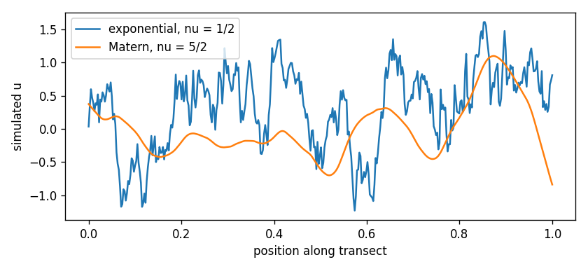

Figure 2.2 compares an exponential transect ($\phi = 0.1$, practical range about 0.30) with a Matérn transect with $\nu = 5/2$ ($\phi = 0.05$, practical range about 0.30). The two wander over similar distances, but the exponential path is jagged at every scale while the Matérn path is smooth, as the expansion in Section 2.5.3 predicts.

---

<a id="ch2-exercises"></a>

## Exercises

**Analytical**

1. In Section 2.1.4, the derivation of $\boldsymbol{\Sigma}$ assumed that $\mathbf{u}$ and $\boldsymbol{\varepsilon}$ are independent. Suppose instead that their cross-covariance matrix $\operatorname{Cov}(\mathbf{u}, \boldsymbol{\varepsilon})$ is not zero. Find $\operatorname{Var}(\mathbf{Y})$, and describe a rent setting where such a correlation might arise.

2. For the random walk of Section 2.2.3, show that $\operatorname{Cov}(Y_s, Y_t) = \min(s, t)$. Explain why this covariance cannot be written as a function of $t - s$ alone.

3. Show that for a second-order stationary process, $0 \le \gamma(\mathbf{h}) \le 2C(\mathbf{0})$. When can $\gamma(\mathbf{h})$ exceed $C(\mathbf{0})$, and what does that say about $C(\mathbf{h})$?

4. Generalize Section 2.4.2: three locations on a line at 0, $d$, and $2d$, with a rule giving correlation $c$ to pairs closer than some cutoff between $d$ and $2d$ and 0 to pairs beyond it. Show that the eigenvalues are $1 - c\sqrt{2}$, $1$, and $1 + c\sqrt{2}$, and conclude that the rule is invalid whenever $c > 1/\sqrt{2}$.

5. In the product argument of Section 2.4.3, where exactly was independence of $u_1$ and $u_2$ used? Show by example that the product of a process with itself, $u(\mathbf{s})^2$, does not have covariance $C(\mathbf{h})^2$.

6. Verify that the spherical correlation function is continuous at $h = \phi$ and that its first derivative is also zero there. Compute its practical range exactly, by solving a cubic, and compare it with the true range $\phi$ and with the value $0.811\,\phi$ in the table of Section 2.5.

7. Using the expansion in Section 2.5.3, find the leading term of $1 - r(h)$ for the Matérn model with $\nu = 5/2$. Compare the small-$h$ behavior of the exponential, Matérn $3/2$, Matérn $5/2$, and Gaussian models, and order them from roughest to smoothest.

8. Compute the Cholesky factor of the $3 \times 3$ matrix $\boldsymbol{\Sigma}$ in Section 2.1.4 by hand, using the column-by-column formulas of Section 2.7.1. Check your answer with `np.linalg.cholesky`.

9. A river runs at 30 degrees north of east, and correlation along the river reaches three times as far as correlation across it. Write down $\mathbf{G}$ as $\mathbf{U}\boldsymbol{\Lambda}\mathbf{U}'$ with $\mathbf{U}$ a rotation matrix, and compute the anisotropic distance between $(0, 0)$ and $(1, 0)$. (Hint: Remember the inverse relationship between correlation reach and distance metrics. If correlation along the river reaches three times as far, effective distances along the river must be scaled down by a factor of 3 relative to the cross-river direction, so the eigenvalue for the along-river eigenvector is $(1/3)^2 = 1/9$ relative to the cross-river eigenvalue.)

10. Section 2.2.3 defined intrinsic stationarity through the variance of pairwise differences $2\gamma(\mathbf{h})$. Consider an arbitrary linear contrast $\sum_{i=1}^n a_i Y(\mathbf{s}_i)$ where the coefficients sum to zero: $\sum_{i=1}^n a_i = 0$. (a) Show that $\sum_{i=1}^n a_i Y(\mathbf{s}_i) = -\frac{1}{2}\sum_{i=1}^n \sum_{j=1}^n a_i a_j [Y(\mathbf{s}_i) - Y(\mathbf{s}_j)]$. (b) Using the definition $\operatorname{Var}(Y(\mathbf{s}_i) - Y(\mathbf{s}_j)) = 2\gamma(\mathbf{s}_i - \mathbf{s}_j)$, show that $\operatorname{Var}\!\left(\sum_{i=1}^n a_i Y(\mathbf{s}_i)\right) = -\sum_{i=1}^n \sum_{j=1}^n a_i a_j \gamma(\mathbf{s}_i - \mathbf{s}_j)$. (c) Explain why this implies that the semivariogram matrix $\boldsymbol{\Gamma}$ with entries $\Gamma_{ij} = \gamma(\mathbf{s}_i - \mathbf{s}_j)$ is conditionally negative definite: $\mathbf{a}'\boldsymbol{\Gamma}\mathbf{a} \le 0$ for all $\mathbf{a}$ satisfying $\mathbf{a}'\mathbf{1}_n = 0$.

11. Section 2.4.4 noted that valid covariance functions correspond to positive spectral densities via Fourier transforms (Bochner's theorem). On the real line $\mathbb{R}$, the spectral density is $f(\omega) = \frac{1}{2\pi}\int_{-\infty}^\infty C(h)e^{-i\omega h}\,dh$. (a) For the exponential covariance $C(h) = \sigma^2 e^{-\lvert h \rvert/\phi}$, use symmetry to show that $f(\omega) = \frac{\sigma^2}{\pi}\int_0^\infty e^{-h/\phi}\cos(\omega h)\,dh = \frac{\sigma^2\phi}{\pi(1 + \phi^2\omega^2)}$. (b) Explain why $f(\omega) > 0$ for all $\omega \in \mathbb{R}$ confirms that the exponential model is valid on the line. (c) For the step function of Section 2.4.2 ($C(h) = 1$ for $\lvert h \rvert < 1$ and $0$ beyond), show that its Fourier transform is proportional to $\sin(\omega)/\omega$, which takes negative values, and explain how this connects to the negative eigenvalues found in Section 2.4.2.

12. Section 2.6 defined the anisotropic distance metric $h_{ij}^2(\mathbf{G}) = (\mathbf{s}_i - \mathbf{s}_j)'\mathbf{G}(\mathbf{s}_i - \mathbf{s}_j)$. Suppose we rotate the coordinate system by an orthogonal matrix $\mathbf{Q}$ ($\mathbf{Q}'\mathbf{Q} = \mathbf{I}_2$), so that locations become $\tilde{\mathbf{s}}_i = \mathbf{Q}\mathbf{s}_i$, and the metric tensor transforms as $\widetilde{\mathbf{G}} = \mathbf{Q}\mathbf{G}\mathbf{Q}'$. (a) Show that the pairwise distance between any two locations is identical in both coordinate systems: $h_{ij}(\widetilde{\mathbf{G}}) = h_{ij}(\mathbf{G})$. (b) Explain why this ensures that the spatial covariance between any two physical locations is invariant to the choice of map coordinate orientation.

13. Section 2.4.3 proved that if $C_1(h)$ and $C_2(h)$ are valid covariance functions, their product $C_1(h)C_2(h)$ is also valid. In matrix algebra, this is the Schur product theorem: if $\boldsymbol{\Sigma}_1$ and $\boldsymbol{\Sigma}_2$ are positive semi-definite $n \times n$ matrices, their elementwise product $\boldsymbol{\Sigma}_1 \circ \boldsymbol{\Sigma}_2$ with entries $[\boldsymbol{\Sigma}_1 \circ \boldsymbol{\Sigma}_2]_{ij} = \Sigma_{1,ij}\Sigma_{2,ij}$ is also positive semi-definite. (a) Write the spectral decompositions $\boldsymbol{\Sigma}_1 = \sum_{k=1}^n \lambda_k \mathbf{v}_k\mathbf{v}_k'$ and $\boldsymbol{\Sigma}_2 = \sum_{l=1}^n \mu_l \mathbf{w}_l\mathbf{w}_l'$. (b) Show that $\boldsymbol{\Sigma}_1 \circ \boldsymbol{\Sigma}_2 = \sum_{k=1}^n \sum_{l=1}^n \lambda_k \mu_l (\mathbf{v}_k \circ \mathbf{w}_l)(\mathbf{v}_k \circ \mathbf{w}_l)'$. (c) For any vector $\mathbf{a}$, show that $\mathbf{a}'(\boldsymbol{\Sigma}_1 \circ \boldsymbol{\Sigma}_2)\mathbf{a} \ge 0$, giving an algebraic proof that elementwise products of covariance matrices are valid.

14. Section 2.1.3 explained that the nugget $\tau^2$ absorbs both measurement error $\tau_{\text{meas}}^2$ and micro-scale spatial variation $\sigma_{\text{micro}}^2$ with range $\phi_{\text{micro}} \ll \min_{i \ne j} h_{ij}$. Suppose the true covariance is $C(h) = \sigma^2 e^{-h/\phi} + \sigma_{\text{micro}}^2 e^{-h/\phi_{\text{micro}}} + \tau_{\text{meas}}^2 \mathbb{1}(h = 0)$. (a) If the minimum sampling distance between distinct observations is $h_{\min} > 0$, and $\phi_{\text{micro}} \le h_{\min}/10$, show that $e^{-h_{ij}/\phi_{\text{micro}}} < 5 \times 10^{-5}$ for all pairs $i \ne j$. (b) Explain why the covariance matrix $\boldsymbol{\Sigma}$ of the sample is numerically indistinguishable from a model with a single nugget $\tau^2 = \sigma_{\text{micro}}^2 + \tau_{\text{meas}}^2$. (c) What sampling design would allow an analyst to separate $\sigma_{\text{micro}}^2$ from $\tau_{\text{meas}}^2$?

**Computational and simulation**

15. Simulate 500 rent districts as in Section 2.8.2, recording the average of $\mathbf{u}$ over each. Compare the standard deviation of these averages with the theoretical value $\sqrt{\mathbf{1}'\sigma^2\mathbf{R}\mathbf{1}}/n$ from Chapter 1, and compute the effective sample size of the district.

16. Time `np.linalg.cholesky` and `np.linalg.eigh` on exponential covariance matrices for grids of 500, 1,000, and 2,000 locations. How does the ratio of their times change with $n$?

17. Find the smallest square grid (number of points per side and spacing) on which the tent function of Section 2.4.4 produces a negative eigenvalue. Try spacings between 0.2 and 1.0.

18. For the $20 \times 20$ grid of Section 2.5.1, compute the condition number of $\sigma^2\mathbf{R} + \tau^2\mathbf{I}$ for the Gaussian model with $\sigma^2 = 1$ and $\tau^2 = 10^{-6}$, $10^{-3}$, and $10^{-1}$. Then repeat with the Matérn model with $\nu = 5/2$ and the same practical range. Which model needs less nugget to be numerically safe?

---

<a id="ch2-what-comes-next"></a>

## What Comes Next

This chapter assumed we know $\sigma^2$, $\tau^2$, $\phi$, and the correlation family. Chapter 3 begins estimating them from data. It turns the semivariogram of Section 2.2 into an estimator by averaging squared differences over pairs of locations, fits the families of Section 2.5 to the result, and shows what happens when a trend in the mean is mistaken for spatial correlation.


---

<!-- manuscript:part:begin {"label": "Part II", "title": "Geostatistical Models and Generalized Least Squares", "description": "Continuous surfaces: estimate the covariance, predict at new locations, and fit the whole model by likelihood.", "chapters": [3, 4, 5]} -->
<a id="part-2"></a>

# Part II: Geostatistical Models and Generalized Least Squares

*Continuous surfaces: estimate the covariance, predict at new locations, and fit the whole model by likelihood.*

<!-- manuscript:part:end -->

---

<a id="ch3"></a>

# Chapter 3: Empirical Variography and Weighted Least Squares Fitting

Chapter 2 described a spatial process through its semivariogram $\gamma(\mathbf{h})$: half the variance of the difference between two values separated by the lag $\mathbf{h}$. It treated the variogram as known. In practice it is not. We have one map of data, and we must estimate how dependence decays with distance from that map alone.

This chapter builds the standard tools for doing so. The idea is the one promised in Section 2.2: if the process follows the same rules everywhere, then every pair of locations at a given separation is a replicate, and averaging squared differences over many such pairs estimates $\gamma$. We turn that idea into an estimator, compute it efficiently, study how reliable it is, make it resistant to bad data, and fit the parametric families of Section 2.5 to it.

The chapter ends with a warning that runs through the rest of the book. A variogram is a statement about the random part of the data. If the mean is not constant and we ignore that, the variogram absorbs the trend and tells a misleading story. Removing the trend first helps, but the most common way of removing it introduces a smaller bias of its own, which Chapter 5 finally fixes.

> **Chapter at a Glance**
>
> - **The Empirical Semivariogram (§3.1):** Matheron's estimator, why it is unbiased, how to compute it for thousands of pairs at once, how to choose distance bins, and how to look for direction-dependent correlation.
> - **Robust Estimation (§3.2):** Why a few bad data points inflate the estimator, and the Cressie-Hawkins alternative, with its constants derived from the normal distribution.
> - **Fitting a Model (§3.3):** Why ordinary least squares is a poor way to fit a variogram curve, the approximate variance of each bin, and Cressie's weighted least squares.
> - **The Trend Pitfall (§3.4):** How an ignored trend makes the variogram grow without limit, and why removing the trend by OLS biases the variogram downward.
> - **Walkthrough and Lab (§3.5):** The rent district from raw listings to a fitted variogram, directional variograms, and outliers, with figures.

---

<a id="s3-1"></a>

## 3.1 Estimating the Empirical Semivariogram

### 3.1.1 Matheron's Estimator

Recall from Section 2.2.3 that a process is intrinsically stationary when its increments have mean zero and a variance that depends only on the lag:

$$
\operatorname{E}\!\left[Y(\mathbf{s}_i) - Y(\mathbf{s}_j)\right] = 0, \qquad \operatorname{Var}\!\left(Y(\mathbf{s}_i) - Y(\mathbf{s}_j)\right) = 2\gamma(\mathbf{s}_i - \mathbf{s}_j)
$$

For a single pair of observations, the squared difference has expectation

$$
\operatorname{E}\!\left[(Y_i - Y_j)^2\right] = \operatorname{Var}(Y_i - Y_j) + \left(\operatorname{E}[Y_i - Y_j]\right)^2 = 2\gamma(\mathbf{s}_i - \mathbf{s}_j) + 0
$$

using the one-variable version of the result in Section 1.1.1: the mean of a square is the variance plus the squared mean. So half the squared difference of any pair is an unbiased estimate of the semivariogram at that pair's lag. One pair gives a very noisy estimate. Averaging over many pairs at the same lag keeps the estimate unbiased and reduces its variance.

Exactly repeated lags are rare in irregular data, so we group pairs by distance. Divide distances into **bins**, and let $N(h_k)$ be the set of pairs $(i, j)$, with $i < j$, whose distance falls in bin $k$. Write $\lvert N(h_k) \rvert$ for the number of such pairs and $h_k$ for their average distance, which serves as the bin's lag. **Matheron's estimator** is

$$
\hat{\gamma}(h_k) = \frac{1}{2\lvert N(h_k) \rvert}\sum_{(i,j) \in N(h_k)} (Y_i - Y_j)^2
$$

It is called a method-of-moments estimator because it replaces an expectation with an average over the data, as the sample variance does.

Two assumptions are hiding in this formula. First, it uses only distance, so it assumes isotropy: pairs separated east-west and north-south are pooled. Section 3.1.4 relaxes this. Second, within a bin, pairs have slightly different distances, so $\hat{\gamma}(h_k)$ estimates the average of $\gamma$ over those distances, not $\gamma(h_k)$ exactly. When $\gamma$ is close to linear across a bin, the two agree. Narrow bins make this bias small but leave few pairs per bin; wide bins do the opposite. Section 3.1.3 discusses the trade-off.

**A hand-sized example: five noise monitors.** Five noise monitors sit along a highway at 0, 1, 2, 3, and 4 km, recording average daytime noise levels of 62, 65, 63, 69, and 66 decibels. With monitors exactly 1 km apart, each lag is its own bin. At lag 1 there are four pairs, with squared differences $(65 - 62)^2 = 9$, $(63 - 65)^2 = 4$, $(69 - 63)^2 = 36$, and $(66 - 69)^2 = 9$, so

$$
\hat{\gamma}(1) = \frac{9 + 4 + 36 + 9}{2 \times 4} = \frac{58}{8} = 7.25
$$

The code repeats this for every lag.

```python
import numpy as np
from scipy import optimize, special

t = np.array([0.0, 1.0, 2.0, 3.0, 4.0])
y5 = np.array([62.0, 65.0, 63.0, 69.0, 66.0])
for lag in (1, 2, 3, 4):
    i = np.arange(5 - lag)
    sq = (y5[i] - y5[i + lag])**2
    print(f"lag {lag}: pairs={len(i)}  squared diffs={sq}  "
          f"gamma_hat={sq.sum() / (2 * len(i)):.3f}")
```

| Lag (km) | Pairs | Squared differences | $\hat{\gamma}$ |
| :--- | :--- | :--- | :--- |
| 1 | 4 | 9, 4, 36, 9 | 7.250 |
| 2 | 3 | 1, 16, 9 | 4.333 |
| 3 | 2 | 49, 1 | 12.500 |
| 4 | 1 | 16 | 8.000 |

The estimates jump around: the semivariance at lag 2 is lower than at lag 1, and lag 3 is the highest of all. With so few pairs, a single large difference (the jump from 63 to 69 between the third and fourth monitors) dominates. Real data sets have thousands of pairs per bin, and the rest of this section shows how to compute and organize them.

### 3.1.2 Vectorized Computation

For $n$ locations there are $n(n-1)/2$ pairs. Looping over them in Python is slow, but the same broadcasting idea as the distance matrix of Section 1.6.1 computes every squared difference at once. The matrix of differences is

$$
\mathbf{y}\mathbf{1}' - \mathbf{1}\mathbf{y}'
$$

whose $(i, j)$ entry is $y_i - y_j$. Squaring it entrywise gives every squared difference, and the distance matrix $\mathbf{H}$ says which bin each pair belongs to. Because both matrices are symmetric, only the entries above the diagonal are needed: each pair once, and no pair of a location with itself.

The function `empirical_variogram` below does this. It also defines the shared data set used in Chapters 3, 4, and 5: **simulated rent listings** in a district, rescaled to the unit square. Rents are in hundreds of dollars, the trend rises to the east as $\mu(\mathbf{s}) = 18 + 6\,s_{\text{east}}$, the neighborhood effect $u$ has $\sigma^2 = 4$ with exponential correlation and $\phi = 0.15$, and the nugget has $\tau^2 = 1$. These are the same values as the rent district of Section 2.8.2, but the 250 listings are now at random locations, as real listings are.

```python
def dist(S):
    """Matrix of Euclidean distances between the rows of S."""
    q = np.sum(S**2, axis=1)
    H2 = q[:, None] - 2 * S @ S.T + q[None, :]
    H = np.sqrt(np.maximum(H2, 0.0))
    np.fill_diagonal(H, 0.0)
    return H


def rent_district(n=250, seed=2030):
    """Simulated rent listings: locations, trend, effect, noise, rent."""
    rng = np.random.default_rng(seed)
    S = rng.uniform(size=(n, 2))
    mu = 18.0 + 6.0 * S[:, 0]
    R = np.exp(-dist(S) / 0.15)
    L = np.linalg.cholesky(4.0 * R + 1e-10 * np.eye(n))
    u = L @ rng.standard_normal(n)
    eps = rng.standard_normal(n)
    return S, mu, u, eps, mu + u + eps


def empirical_variogram(S, y, edges):
    """Matheron estimator on distance bins given by edges."""
    H = dist(S)
    D2 = (y[:, None] - y[None, :])**2
    iu = np.triu_indices(len(y), k=1)
    h, d2 = H[iu], D2[iu]
    centers, gam, counts = [], [], []
    for lo, hi in zip(edges[:-1], edges[1:]):
        m = (h > lo) & (h <= hi)
        centers.append(h[m].mean())
        gam.append(d2[m].sum() / (2 * m.sum()))
        counts.append(m.sum())
    return np.array(centers), np.array(gam), np.array(counts)


def gamma_exp(h, sigma2, tau2, phi):
    """Semivariogram of the exponential model with a nugget (as in Ch. 2)."""
    h = np.asarray(h, dtype=float)
    return np.where(h > 0, tau2 + sigma2 * (1 - np.exp(-h / phi)), 0.0)


S, mu, u, eps, y = rent_district()
n = len(y)
H = dist(S)
print("pairs:", n * (n - 1) // 2, " largest distance:", round(H.max(), 3))
edges = np.linspace(0.0, 0.6, 13)
hc, g_oracle, cnt = empirical_variogram(S, u + eps, edges)
for k in range(len(hc)):
    print(f"bin {edges[k]:.2f}-{edges[k+1]:.2f}: h={hc[k]:.3f} "
          f"pairs={cnt[k]:4d} gamma_hat={g_oracle[k]:.3f} "
          f"true={gamma_exp(hc[k], 4.0, 1.0, 0.15):.3f}")
far = np.linspace(0.6, 1.4, 9)
hf, gf, cf = empirical_variogram(S, u + eps, far)
for k in range(len(hf)):
    print(f"far bin {far[k]:.1f}-{far[k+1]:.1f}: pairs={cf[k]:4d} "
          f"gamma_hat={gf[k]:.3f}")
```

In this section we estimate the variogram of $u + \varepsilon$, the part of the rent left after subtracting the true trend. A real analyst does not know the trend; we do, because the data are simulated, and using it lets us study the estimator by itself. Section 3.4 removes this advantage. The 250 listings give 31,125 pairs, and the largest distance between two listings is 1.358.

### 3.1.3 Distance Bins, Lag Tolerances, and the Half-Diameter Rule

The code uses 12 bins of width 0.05, from 0 to 0.6. Half the width of a bin, here 0.025, is called the **lag tolerance**: pairs within that distance of the bin's center are pooled.

| Bin | $h_k$ | Pairs $\lvert N(h_k)\rvert$ | $\hat{\gamma}(h_k)$ | True $\gamma(h_k)$ |
| :--- | :--- | :--- | :--- | :--- |
| 0.00 to 0.05 | 0.034 | 223 | 1.844 | 1.803 |
| 0.05 to 0.10 | 0.078 | 692 | 2.553 | 2.617 |
| 0.10 to 0.15 | 0.127 | 1104 | 3.488 | 3.285 |
| 0.15 to 0.20 | 0.176 | 1473 | 3.931 | 3.765 |
| 0.20 to 0.25 | 0.226 | 1769 | 4.239 | 4.113 |
| 0.25 to 0.30 | 0.275 | 1920 | 4.258 | 4.359 |
| 0.30 to 0.35 | 0.325 | 2080 | 4.154 | 4.543 |
| 0.35 to 0.40 | 0.375 | 2238 | 4.579 | 4.672 |
| 0.40 to 0.45 | 0.425 | 2341 | 4.736 | 4.765 |
| 0.45 to 0.50 | 0.475 | 2186 | 4.847 | 4.832 |
| 0.50 to 0.55 | 0.525 | 2173 | 5.215 | 4.879 |
| 0.55 to 0.60 | 0.575 | 2180 | 5.382 | 4.913 |

The estimates follow the true curve: they start near the nugget-plus-a-little at short distances and rise toward the sill of 5. The first bin has the fewest pairs (223), because few listings happen to be very close together, and the bins in the middle have the most.

**Choosing bins.** Three practical considerations guide the choice.

- **Enough pairs.** A common rule of thumb asks for at least 30 pairs per bin. With 250 listings this is easy except at the shortest distances, which are also the most important for estimating the nugget and the shape near the origin.
- **Narrow enough to keep the shape.** Wide bins average $\gamma$ over a range of distances and blur the curve near the origin, where it changes fastest.
- **Not too far.** Use distances only up to about half the largest distance in the data.

**Why stop at half the largest distance?** The second half of the code's output computes the estimator in bins beyond 0.6:

| Bin | 0.6 to 0.7 | 0.7 to 0.8 | 0.8 to 0.9 | 0.9 to 1.0 | 1.0 to 1.1 | 1.1 to 1.2 | 1.2 to 1.3 | 1.3 to 1.4 |
| :--- | :--- | :--- | :--- | :--- | :--- | :--- | :--- | :--- |
| Pairs | 4016 | 3025 | 1964 | 1118 | 438 | 137 | 36 | 12 |
| $\hat{\gamma}$ | 5.341 | 6.172 | 7.169 | 7.874 | 7.874 | 7.407 | 6.602 | 9.695 |

The true semivariogram is flat at 5 out here, yet the estimates climb to nearly 8 and then wander. Two things go wrong at long distances. Pairs become scarce, as the counts show. More importantly, the long pairs all join opposite edges or corners of the district, so they compare a few large regions with each other instead of sampling the whole district. Within one realization, $u$ has large-scale ups and downs, and the long pairs measure the difference between whichever large regions happen to be high and low. In this realization $u$ happens to drift upward to the east (Section 3.4 measures the drift), so east-west pairs far apart differ more than the model says. The half-diameter rule keeps us in the range where many pairs from all over the district contribute to each bin.

### 3.1.4 Directional Variograms

Matheron's estimator as written pools pairs in all directions. If correlation reaches farther in one direction than another, as in the riverfront example of Section 2.6, pooling hides it. A **directional variogram** uses only pairs whose lag vector points within some angle of a chosen direction.

For a pair $(i, j)$, the direction of the lag vector is the angle $\vartheta_{ij}$ it makes with the east axis. Because the pair $(j, i)$ points the opposite way, directions are taken modulo 180 degrees, so 10 degrees and 190 degrees count as the same direction. The **angular tolerance** is the half-width of the wedge of directions pooled; 22.5 degrees is common, which splits the half-circle into four wedges centered on east-west, north-south, and the two diagonals.

To see the method work, we simulate a field we know to be anisotropic: 300 listings along a riverfront that runs east-west, with the anisotropy matrix $\mathbf{G} = \operatorname{diag}(1, 9)$ of Section 2.6, so that correlation reaches three times farther east-west than north-south. The other parameters match the rent district.

```python
def directional_variogram(S, y, edges, angle, tol):
    """Matheron estimator using pairs whose direction is within tol
    degrees of angle (measured from east, counterclockwise)."""
    H = dist(S)
    iu = np.triu_indices(len(y), k=1)
    dx = S[iu[1], 0] - S[iu[0], 0]
    dy = S[iu[1], 1] - S[iu[0], 1]
    theta = np.degrees(np.arctan2(dy, dx)) % 180.0
    off = np.abs(theta - angle)
    keep = np.minimum(off, 180.0 - off) <= tol
    h = H[iu][keep]
    d2 = ((y[iu[0]] - y[iu[1]])**2)[keep]
    gam, counts = [], []
    for lo, hi in zip(edges[:-1], edges[1:]):
        m = (h > lo) & (h <= hi)
        gam.append(d2[m].sum() / (2 * m.sum()))
        counts.append(m.sum())
    return np.array(gam), np.array(counts)


rng = np.random.default_rng(404)
S_r = rng.uniform(size=(300, 2))
D = S_r[:, None, :] - S_r[None, :, :]
G = np.diag([1.0, 9.0])
H_aniso = np.sqrt(np.einsum("ijk,kl,ijl->ij", D, G, D))
L_r = np.linalg.cholesky(4.0 * np.exp(-H_aniso / 0.15)
                         + 1.0 * np.eye(300))
y_r = L_r @ rng.standard_normal(300)
dir_edges = np.linspace(0.0, 0.4, 9)
for angle, name in ((0.0, "east-west"), (90.0, "north-south")):
    g_dir, c_dir = directional_variogram(S_r, y_r, dir_edges, angle, 22.5)
    print(f"{name:12s}", np.round(g_dir, 2), " pairs:", c_dir.min(),
          "to", c_dir.max())
```

| Distance bin | 0 to 0.05 | 0.05 to 0.10 | 0.10 to 0.15 | 0.15 to 0.20 | 0.20 to 0.25 | 0.25 to 0.30 | 0.30 to 0.35 | 0.35 to 0.40 |
| :--- | :--- | :--- | :--- | :--- | :--- | :--- | :--- | :--- |
| East-west | 1.52 | 3.07 | 3.55 | 3.80 | 4.01 | 4.54 | 4.74 | 4.47 |
| North-south | 2.76 | 3.83 | 4.05 | 4.00 | 4.42 | 4.41 | 4.45 | 5.27 |

At short distances the north-south variogram is higher: 2.76 against 1.52 in the first bin and 3.83 against 3.07 in the second. North-south pairs lose their correlation faster, as designed. By about 0.25 both curves are near the same level, and beyond that they cross back and forth, because each directional bin has only a quarter of the pairs (between 80 and 737 here) and is correspondingly noisier. Figure 3.2 in Section 3.5 plots both curves.

Two refinements are worth knowing.

- **The rose diagram.** Computing directional variograms in many directions and recording, for each direction, the distance at which the variogram reaches a fixed level gives a set of points that, under geometric anisotropy, lie on an ellipse. Plotting them (often as a "rose" around the origin) shows the directions of longest and shortest reach, which are the eigenvectors of $\mathbf{G}$ in Section 2.6. Exercise 15 builds one.
- **Zonal anisotropy.** Geometric anisotropy changes how fast the variogram rises in each direction but not the sill it reaches. Sometimes the sills themselves differ. If rents vary by neighborhood across the river but are similar for long stretches along it, the north-south variogram may keep climbing to a higher level than the east-west one. That is **zonal anisotropy**, and it cannot be produced by stretching coordinates. It is usually modeled by adding a second process that varies in one direction only (Exercise 7).

---

<a id="s3-2"></a>

## 3.2 Robust Estimation: The Cressie-Hawkins Estimator

### 3.2.1 Why Outliers Inflate Matheron's Estimator

Matheron's estimator squares differences, so large differences dominate it. One bad data point is worse than it looks, because it takes part in $n - 1$ pairs and contaminates every bin.

Rental listings contain bad data points. A landlord may include parking and utilities in the rent, or a typo may add a digit. To see the effect, take the rent district's $u + \varepsilon$ and add 12 (that is, \$1,200) to five randomly chosen listings, two percent of the data.

### 3.2.2 The Cressie-Hawkins Idea

Cressie and Hawkins proposed averaging a quantity that is less sensitive to large differences: the square root of the absolute difference, $\lvert Y_i - Y_j \rvert^{1/2}$. A difference of 12 contributes $12^2 = 144$ to Matheron's sum but only $\sqrt{12} \approx 3.5$ to theirs. The question is how to turn an average of square roots back into an estimate of $\gamma$.

The answer uses normality. If the data are Gaussian, the difference $Y_i - Y_j$ is normal with mean 0 and variance $2\gamma$, so we can write it as $\sqrt{2\gamma}\,Z$ with $Z \sim N(0, 1)$. Then

$$
\lvert Y_i - Y_j \rvert^{1/2} = (2\gamma)^{1/4}\lvert Z \rvert^{1/2}, \qquad \operatorname{E}\!\left[\lvert Y_i - Y_j \rvert^{1/2}\right] = (2\gamma)^{1/4}\,m, \qquad m = \operatorname{E}\!\left[\lvert Z \rvert^{1/2}\right]
$$

Raising the expectation to the fourth power gives $2\gamma\,m^4$. So if $\bar{a}_k$ is the average of $\lvert Y_i - Y_j \rvert^{1/2}$ over the pairs in bin $k$, then $\bar{a}_k^4/(2m^4)$ estimates $\gamma(h_k)$. Section 3.2.3 shows that $m^4 \approx 0.457$.

Raising an average to the fourth power introduces a small upward bias, for the same reason that the square of a sample mean overestimates the square of the true mean. Cressie and Hawkins corrected for it, and their estimator is

$$
\bar{\gamma}(h_k) = \frac{\bar{a}_k^4}{2\left(0.457 + 0.494/\lvert N(h_k) \rvert\right)}, \qquad \bar{a}_k = \frac{1}{\lvert N(h_k) \rvert}\sum_{(i,j) \in N(h_k)} \lvert Y_i - Y_j \rvert^{1/2}
$$

For bins with hundreds of pairs, the correction term is negligible.

```python
c_half = (2**0.25 * special.gamma(0.75) / np.sqrt(np.pi))**4
print("E|Z|^(1/2) raised to the fourth power:", round(c_half, 4))
m_half = 2**0.25 * special.gamma(0.75) / np.sqrt(np.pi)
var_root = np.sqrt(2 / np.pi) - m_half**2
print("Var(|Z|^(1/2)):", round(var_root, 4),
      " correction constant:", round(c_half * 6 * var_root / m_half**2, 4))


def cressie_hawkins(S, y, edges):
    """Cressie-Hawkins robust estimator on distance bins."""
    H = dist(S)
    iu = np.triu_indices(len(y), k=1)
    h = H[iu]
    r = np.sqrt(np.abs(y[iu[0]] - y[iu[1]]))
    gam = []
    for lo, hi in zip(edges[:-1], edges[1:]):
        m = (h > lo) & (h <= hi)
        nk = m.sum()
        gam.append(r[m].mean()**4 / (2 * (0.457 + 0.494 / nk)))
    return np.array(gam)


z_clean = u + eps
rng = np.random.default_rng(99)
bad = rng.choice(n, size=5, replace=False)
z_bad = z_clean.copy()
z_bad[bad] += 12.0
_, g_m_clean, _ = empirical_variogram(S, z_clean, edges)
_, g_m_bad, _ = empirical_variogram(S, z_bad, edges)
g_ch_clean = cressie_hawkins(S, z_clean, edges)
g_ch_bad = cressie_hawkins(S, z_bad, edges)
for k in (0, 3, 7, 11):
    print(f"h={hc[k]:.3f}  Matheron clean={g_m_clean[k]:.3f} "
          f"bad={g_m_bad[k]:.3f}  CH clean={g_ch_clean[k]:.3f} "
          f"bad={g_ch_bad[k]:.3f}  true={gamma_exp(hc[k], 4, 1, .15):.3f}")
print("average increase, Matheron:",
      round(np.mean(g_m_bad - g_m_clean), 3),
      " Cressie-Hawkins:", round(np.mean(g_ch_bad - g_ch_clean), 3))
```

| $h_k$ | Matheron, clean | Matheron, 5 bad listings | Cressie-Hawkins, clean | Cressie-Hawkins, 5 bad listings | True $\gamma$ |
| :--- | :--- | :--- | :--- | :--- | :--- |
| 0.034 | 1.844 | 5.173 | 1.887 | 2.728 | 1.803 |
| 0.176 | 3.931 | 7.579 | 3.853 | 5.196 | 3.765 |
| 0.375 | 4.579 | 9.078 | 4.397 | 6.130 | 4.672 |
| 0.575 | 5.382 | 8.378 | 5.385 | 6.638 | 4.913 |

On clean data the two estimators agree closely. With five bad listings, Matheron's estimator rises by 3.819 on average across the 12 bins and nearly triples in the first bin, which would suggest a nugget several times its true size. The Cressie-Hawkins estimator rises by 1.435 on average. It is far more resistant, but not immune: five gross errors still push it well above the truth. A robust estimator is a safety check, not a substitute for looking at the data. When the two estimators disagree sharply, find out why before fitting anything.

### 3.2.3 Where the Constants Come From (Optional)

*This subsection derives the constants 0.457 and 0.494 from the standard normal distribution. It can be skipped on a first reading.*

**The constant $m^4 \approx 0.457$.** For $Z \sim N(0, 1)$ and $p > -1$,

$$
\operatorname{E}\!\left[\lvert Z \rvert^p\right] = 2\int_0^\infty z^p\,\frac{1}{\sqrt{2\pi}}e^{-z^2/2}\,dz
$$

Substitute $w = z^2/2$, so that $z = (2w)^{1/2}$ and $dz = (2w)^{-1/2}dw$:

$$
\operatorname{E}\!\left[\lvert Z \rvert^p\right] = \frac{2}{\sqrt{2\pi}}\int_0^\infty (2w)^{p/2}(2w)^{-1/2}e^{-w}\,dw = \frac{2^{p/2}}{\sqrt{\pi}}\int_0^\infty w^{(p-1)/2}e^{-w}\,dw = \frac{2^{p/2}\,\Gamma\!\left(\frac{p+1}{2}\right)}{\sqrt{\pi}}
$$

using the definition of the gamma function, $\Gamma(a) = \int_0^\infty w^{a-1}e^{-w}\,dw$. With $p = 1/2$,

$$
m = \operatorname{E}\!\left[\lvert Z \rvert^{1/2}\right] = \frac{2^{1/4}\,\Gamma(3/4)}{\sqrt{\pi}} \approx 0.8222, \qquad m^4 \approx 0.4569
$$

The code above evaluates this as 0.4569, which Cressie and Hawkins rounded to 0.457.

**The correction 0.494.** The same formula with $p = 1$ gives $\operatorname{E}\lvert Z \rvert = \sqrt{2/\pi}$, so $\operatorname{Var}(\lvert Z \rvert^{1/2}) = \sqrt{2/\pi} - m^2 \approx 0.1219$. Suppose, as an approximation, that the $\lvert N \rvert$ terms in $\bar{a}_k$ are independent. Then, after scaling out $(2\gamma)^{1/4}$, $\bar{a}_k$ has mean $m$ and variance $0.1219/\lvert N \rvert$. Write $\bar{a}_k = m + d$, where $d$ has mean 0 and variance $0.1219/\lvert N \rvert$. Expanding the fourth power,

$$
\operatorname{E}\!\left[(m + d)^4\right] = m^4 + 4m^3\operatorname{E}[d] + 6m^2\operatorname{E}[d^2] + 4m\operatorname{E}[d^3] + \operatorname{E}[d^4] \approx m^4 + 6m^2\,\frac{0.1219}{\lvert N \rvert}
$$

keeping terms up to order $1/\lvert N \rvert$. Factoring out $m^4$,

$$
\operatorname{E}\!\left[\bar{a}_k^4\right] \approx m^4\left(1 + \frac{6 \times 0.1219}{m^2\lvert N \rvert}\right) = 0.4569 + \frac{0.4944}{\lvert N \rvert}
$$

which the code also confirms. Dividing by this expectation, rather than by $m^4$ alone, removes the upward bias to first order. The independence assumption is not exactly true, which is one more reason the correction is only approximate.

---

<a id="s3-3"></a>

## 3.3 Fitting Parametric Curves to Empirical Variograms

The empirical variogram is a set of points. To use it for prediction (Chapter 4) we need a whole curve from one of the valid families of Section 2.5, since only those guarantee a positive semi-definite covariance matrix. We therefore choose a family and find the parameter values whose curve best matches the points.

It is convenient to collect the parameters into one vector, $\boldsymbol{\theta} = (\sigma^2, \tau^2, \phi)'$, and write the model semivariogram as $\gamma(h;\boldsymbol{\theta})$. For the exponential family, $\gamma(h;\boldsymbol{\theta}) = \tau^2 + \sigma^2(1 - e^{-h/\phi})$ for $h > 0$.

### 3.3.1 Why Ordinary Least Squares Is a Poor Choice

The obvious approach is nonlinear least squares: choose $\boldsymbol{\theta}$ to minimize

$$
\sum_k \left(\hat{\gamma}(h_k) - \gamma(h_k;\boldsymbol{\theta})\right)^2
$$

This treats every bin as equally reliable and as independent of the others. Neither is true.

- **Bins differ in precision.** A bin with 2,000 pairs is far more reliable than one with 200, and, as Section 3.3.2 shows, bins with larger semivariance are noisier. So the bins are heteroscedastic, and least squares should weight them.
- **Bins are correlated.** Every listing takes part in pairs in many bins, so the bins share data. A listing with an unusual value pushes up several bins at once. Ordinary least squares does not account for this, and neither, in fact, does the weighted method below. Chapter 5 avoids the issue entirely by fitting the model to the data rather than to the variogram.

### 3.3.2 The Approximate Variance of a Bin

How variable is $\hat{\gamma}(h_k)$? Start with one pair. Under normality, $Y_i - Y_j = \sqrt{2\gamma}\,Z$ with $Z \sim N(0, 1)$, so half the squared difference is

$$
\frac{(Y_i - Y_j)^2}{2} = \gamma\,Z^2
$$

Its mean is $\gamma\operatorname{E}[Z^2] = \gamma$, as Section 3.1.1 showed. Its variance needs the fourth moment of a standard normal. One way to find it uses the identity $\operatorname{E}[Z\,g(Z)] = \operatorname{E}[g'(Z)]$, which follows from integrating by parts against the normal density (Exercise 2). With $g(z) = z^3$,

$$
\operatorname{E}[Z^4] = \operatorname{E}[Z \cdot Z^3] = \operatorname{E}[3Z^2] = 3
$$

so $\operatorname{Var}(Z^2) = \operatorname{E}[Z^4] - (\operatorname{E}[Z^2])^2 = 3 - 1 = 2$, and

$$
\operatorname{Var}\!\left(\frac{(Y_i - Y_j)^2}{2}\right) = \gamma^2\operatorname{Var}(Z^2) = 2\gamma^2
$$

If the $\lvert N(h_k) \rvert$ pairs in a bin were independent, the variance of their average would be

$$
\operatorname{Var}\!\left(\hat{\gamma}(h_k)\right) \approx \frac{2\left[\gamma(h_k)\right]^2}{\lvert N(h_k) \rvert}
$$

This formula says what Section 3.3.1 claimed: bins with more pairs are more precise, and bins with larger semivariance are less precise, in proportion to $\gamma^2$.

The pairs are not independent, though. Two pairs that share a listing are correlated, and in a bin with thousands of pairs, each listing appears many times. How much does that matter? The code simulates 400 new rent fields at the same 250 locations and computes the estimator in the bin from 0.10 to 0.15 each time.

```python
Sigma_true = 4.0 * np.exp(-H / 0.15) + np.eye(n)
L_true = np.linalg.cholesky(Sigma_true)
rng = np.random.default_rng(5)
k = 2
iu = np.triu_indices(n, k=1)
mask = (H[iu] > edges[k]) & (H[iu] <= edges[k + 1])
draws = []
for _ in range(400):
    z = L_true @ rng.standard_normal(n)
    d2 = (z[iu[0]] - z[iu[1]])**2
    draws.append(d2[mask].sum() / (2 * mask.sum()))
g_true_k = gamma_exp(H[iu][mask], 4.0, 1.0, 0.15).mean()
approx = 2 * g_true_k**2 / mask.sum()
print(f"bin {edges[k]:.2f}-{edges[k+1]:.2f}: mean of estimates="
      f"{np.mean(draws):.3f}  true={g_true_k:.3f}")
print(f"variance: simulated={np.var(draws):.4f}  "
      f"approximation={approx:.4f}  ratio={np.var(draws) / approx:.1f}")
```

The average of the 400 estimates is 3.275 against a true average semivariance of 3.277 for the pairs in the bin, confirming that the estimator is unbiased. But the simulated variance is 0.1850, while the formula gives 0.0195: the true variance is 9.5 times larger. The 1,104 pairs in this bin carry far less information than 1,104 independent pairs would, for the same reason Chapter 1's correlated observations did. Exercise 3 traces this to the covariance between squared differences that share a listing.

So the formula is badly wrong in absolute terms. It is still useful in relative terms: it gets the direction right (more pairs help, larger $\gamma$ hurts), and that is all a set of weights needs.

### 3.3.3 Cressie's Weighted Least Squares

Weighted least squares weights each squared residual by the reciprocal of its variance. Using the approximation of Section 3.3.2, the weight for bin $k$ is $\lvert N(h_k) \rvert/(2\gamma(h_k)^2)$. Cressie proposed evaluating $\gamma$ in the weight at the model value $\gamma(h_k;\boldsymbol{\theta})$ rather than at the noisy estimate. Dropping the constant factor of 2, the objective is

$$
\sum_k \frac{\lvert N(h_k) \rvert}{\gamma(h_k;\boldsymbol{\theta})^2}\left(\hat{\gamma}(h_k) - \gamma(h_k;\boldsymbol{\theta})\right)^2 = \sum_k \lvert N(h_k) \rvert\left(\frac{\hat{\gamma}(h_k)}{\gamma(h_k;\boldsymbol{\theta})} - 1\right)^2
$$

The right-hand form shows what is being minimized: the relative error of the fit in each bin, weighted by the number of pairs.

Because the weights depend on $\boldsymbol{\theta}$, there is no closed-form solution. One approach is iterative: fix the weights at the current estimate, solve the resulting weighted least squares problem, update the weights, and repeat until the estimate stops changing. The other is to hand the whole objective to a numerical optimizer, which is what the code does. It optimizes over the logarithms of the parameters, which keeps all three positive without constraints.

```python
def fit_variogram(h, g, counts, model, start, weighted=True):
    """Fit (sigma2, tau2, phi) by OLS or Cressie's WLS on log parameters."""
    def loss(logp):
        s2, t2, ph = np.exp(logp)
        m = model(h, s2, t2, ph)
        if weighted:
            return np.sum(counts * (g / m - 1.0)**2)
        return np.sum((g - m)**2)
    res = optimize.minimize(loss, np.log(start), method="Nelder-Mead",
                            options={"xatol": 1e-8, "fatol": 1e-10,
                                     "maxiter": 5000})
    return np.exp(res.x)


def gamma_matern32(h, sigma2, tau2, phi):
    """Matern (nu = 3/2) semivariogram with a nugget, for h > 0."""
    x = h / phi
    return tau2 + sigma2 * (1 - (1 + x) * np.exp(-x))


start = (3.0, 0.5, 0.1)
for name, wt in (("OLS", False), ("WLS", True)):
    s2, t2, ph = fit_variogram(hc, g_oracle, cnt, gamma_exp, start, wt)
    print(f"{name}: sigma2={s2:.3f}  tau2={t2:.3f}  phi={ph:.3f}")
```

| Method | $\hat{\sigma}^2$ | $\hat{\tau}^2$ | $\hat{\phi}$ |
| :--- | :--- | :--- | :--- |
| Ordinary least squares | 3.987 | 1.291 | 0.188 |
| Cressie's weighted least squares | 3.919 | 1.342 | 0.186 |
| Truth | 4 | 1 | 0.15 |

Both fits are reasonable, and they are close to each other. Both put the range a little long and the nugget a little high. That is the honest result of one realization: the empirical variogram in Section 3.1.3 sits above the true curve between 0.10 and 0.25 and below it around 0.30, and any curve that follows the points inherits those wiggles. With a single map, the variogram is estimated with real uncertainty, and the parameters inherit it. Exercise 14 measures how much by repeating the fit over many simulated districts. Chapter 5 asks whether fitting the model directly to the data, by maximum likelihood, does better.

---

<a id="s3-4"></a>

## 3.4 The Trend-Contamination Pitfall

So far we have estimated the variogram of $u + \varepsilon$, using our knowledge of the true trend. An analyst who has only the rents faces a choice: compute the variogram of the raw rents, or remove a trend first.

### 3.4.1 What an Ignored Trend Does

Write the data as $Y(\mathbf{s}) = \mu(\mathbf{s}) + e_{\text{true}}(\mathbf{s})$, where the true error process $e_{\text{true}} = u + \varepsilon$ is intrinsically stationary with semivariogram $\gamma_e$. (Section 3.4.2 will also need the vector of OLS residuals, which is written $\mathbf{e}$; the true errors always carry the subscript.) The difference of two observations is

$$
Y_i - Y_j = (\mu_i - \mu_j) + (e_{\text{true},i} - e_{\text{true},j})
$$

and its squared expectation, by the same one-variable identity as in Section 3.1.1, is

$$
\frac{1}{2}\operatorname{E}\!\left[(Y_i - Y_j)^2\right] = \gamma_e(h_{ij}) + \frac{1}{2}(\mu_i - \mu_j)^2
$$

So Matheron's estimator applied to raw data estimates the true semivariogram plus half the average squared difference in the mean.

For the rent district the trend is $\mu(\mathbf{s}) = 18 + 6\,s_{\text{east}}$, so $\mu_i - \mu_j = 6\,\Delta_{ij}$, where $\Delta_{ij}$ is the east-west separation of the pair. A pair at distance $h$ in direction $\vartheta$ has $\Delta_{ij} = h\cos\vartheta$. If the directions of pairs are spread evenly, the average of $\cos^2\vartheta$ is $1/2$ (Exercise 5), and the expected extra term is

$$
\frac{1}{2} \times 6^2 \times \frac{h^2}{2} = \frac{6^2 h^2}{4} = 9h^2
$$

It grows like $h^2$ and never levels off. A trend in the mean turns a variogram with a sill into one that rises without limit, which looks like very long-range spatial correlation.

```python
_, g_raw, _ = empirical_variogram(S, y, edges)
dx2 = (S[:, 0][:, None] - S[:, 0][None, :])**2
for k in (0, 3, 7, 11):
    m = np.triu((H > edges[k]) & (H <= edges[k + 1]), 1)
    extra = 0.5 * 6.0**2 * dx2[m].mean()
    print(f"h={hc[k]:.3f}  raw={g_raw[k]:.3f}  oracle={g_oracle[k]:.3f}  "
          f"difference={g_raw[k] - g_oracle[k]:.3f}  "
          f"trend term={extra:.3f}  6^2 h^2/4={6.0**2 * hc[k]**2 / 4:.3f}")
print("slope of u on east in this realization:",
      round(np.polyfit(S[:, 0], u, 1)[0], 3))
```

| $h_k$ | Raw rents | True $u + \varepsilon$ | Difference | Trend term for these pairs | $6^2h^2/4$ |
| :--- | :--- | :--- | :--- | :--- | :--- |
| 0.034 | 1.866 | 1.844 | 0.021 | 0.011 | 0.010 |
| 0.176 | 4.318 | 3.931 | 0.387 | 0.281 | 0.280 |
| 0.375 | 6.660 | 4.579 | 2.082 | 1.307 | 1.266 |
| 0.575 | 9.962 | 5.382 | 4.580 | 3.042 | 2.971 |

The "trend term" column computes $\frac{1}{2}\,6^2\,\Delta_{ij}^2$ exactly for the pairs in each bin; it agrees closely with the $9h^2$ approximation. At short distances the trend barely matters. By the last bin it has nearly doubled the semivariance.

The observed difference is larger still, because the cross term $(\mu_i - \mu_j)(e_{\text{true},i} - e_{\text{true},j})$, which has expectation zero, is not zero in one realization. In this realization the neighborhood effect $u$ itself happens to drift upward to the east, with a fitted slope of 1.834 per unit distance, so it reinforces the trend. This is the same chance drift that inflated the long-distance bins in Section 3.1.3.

Fitting the exponential model to the raw-rent variogram shows the consequence. Cressie's weighted least squares, in the lab below, returns $\hat{\sigma}^2 \approx 2.7 \times 10^8$ and $\hat{\phi} \approx 2.1 \times 10^7$. For distances much smaller than $\phi$, $\sigma^2(1 - e^{-h/\phi}) \approx (\sigma^2/\phi)h$, a straight line, and the fit has found the line that best matches the rising points: a slope of $\hat{\sigma}^2/\hat{\phi} \approx 13.13$. The model is trying to describe an unbounded variogram and has run off to infinity in both parameters. When a variogram fit returns absurd values like these, suspect a trend.

### 3.4.2 Detrending With OLS Residuals

The standard fix is to estimate the trend by ordinary least squares and compute the variogram of the residuals. Not knowing the true trend, an analyst might fit a plane in the coordinates: $\mathbf{X}$ has columns for the intercept, the east coordinate, and the north coordinate. The residuals are

$$
\mathbf{e} = (\mathbf{I}_n - \mathbf{P}_{\mathbf{X}})\mathbf{Y}
$$

Figure 3.1 in Section 3.5 shows that the residual variogram is far closer to the truth than the raw one. But it is not unbiased, and the reason is instructive.

### 3.4.3 Why Residuals Have a Biased Variogram

The residuals are not the true errors $\mathbf{e}_{\text{true}} = \mathbf{u} + \boldsymbol{\varepsilon}$. Since $(\mathbf{I}_n - \mathbf{P}_{\mathbf{X}})\mathbf{X}\boldsymbol{\beta} = \mathbf{0}$,

$$
\mathbf{e} = (\mathbf{I}_n - \mathbf{P}_{\mathbf{X}})(\mathbf{u} + \boldsymbol{\varepsilon})
$$

and by Tool 1 their covariance matrix is

$$
\boldsymbol{\Sigma}_e = \operatorname{Var}(\mathbf{e}) = (\mathbf{I}_n - \mathbf{P}_{\mathbf{X}})\,\boldsymbol{\Sigma}\,(\mathbf{I}_n - \mathbf{P}_{\mathbf{X}})
$$

which is not $\boldsymbol{\Sigma}$. The residuals have mean zero, so the expected half squared difference of a pair of residuals is

$$
\frac{1}{2}\operatorname{E}\!\left[(e_i - e_j)^2\right] = \frac{1}{2}\left[(\boldsymbol{\Sigma}_e)_{ii} + (\boldsymbol{\Sigma}_e)_{jj} - 2(\boldsymbol{\Sigma}_e)_{ij}\right]
$$

Averaging this over the pairs in a bin gives the exact expected value of the residual variogram, which we can compare with the true $\gamma$.

Why should it be smaller? OLS chooses $\hat{\boldsymbol{\beta}}$ to make the residuals as small as possible. Any part of $\mathbf{u}$ that looks like a plane, such as the eastward drift found above, is indistinguishable from trend and is absorbed into $\hat{\boldsymbol{\beta}}$. The residuals lose that large-scale part of the spatial variation, and large-scale variation is exactly what the variogram measures at long distances. So the residual variogram is biased downward, and the bias grows with distance.

```python
X = np.column_stack([np.ones(n), S[:, 0], S[:, 1]])
P_X = X @ np.linalg.solve(X.T @ X, X.T)
e = y - P_X @ y
_, g_res, _ = empirical_variogram(S, e, edges)

Sigma_e = (np.eye(n) - P_X) @ Sigma_true @ (np.eye(n) - P_X)
d_e = np.diag(Sigma_e)
E_res = 0.5 * (d_e[:, None] + d_e[None, :] - 2 * Sigma_e)
gam_true_pairs = np.where(H > 0, gamma_exp(H, 4.0, 1.0, 0.15), 0.0)
for k in (0, 3, 7, 11):
    m = (H > edges[k]) & (H <= edges[k + 1])
    m = np.triu(m, 1)
    print(f"h={hc[k]:.3f}  expected residual gamma={E_res[m].mean():.3f}  "
          f"true gamma={gam_true_pairs[m].mean():.3f}  "
          f"observed residual gamma={g_res[k]:.3f}")
```

| $h_k$ | Expected residual $\gamma$ | True $\gamma$ | Observed residual $\hat{\gamma}$ |
| :--- | :--- | :--- | :--- |
| 0.034 | 1.793 | 1.794 | 1.843 |
| 0.176 | 3.715 | 3.759 | 3.907 |
| 0.375 | 4.404 | 4.670 | 4.390 |
| 0.575 | 4.244 | 4.913 | 5.179 |

The expected residual variogram (computed exactly from $\boldsymbol{\Sigma}_e$, without simulation) matches the true variogram at short distances and falls 14% below it by the last bin, as the argument predicts. (In the code, `Sigma_e` is $\boldsymbol{\Sigma}_e$ and `Sigma_true` is $\boldsymbol{\Sigma}$.) In this particular realization the observed residual variogram happens to land above the truth in the last bin. Bias is a statement about the average over many realizations, and one realization can fall on either side.

The bias matters in practice. The fitted partial sill in the lab is 3.736 from the residuals against 3.919 from the true errors. The fix is to estimate the trend and the covariance together, so that the covariance estimate accounts for the part of the variation the trend absorbs. That is what restricted maximum likelihood (REML) does in Chapter 5.

---

<a id="s3-5"></a>

## 3.5 Walkthrough and Lab 3

### 3.5.1 From Raw Listings to a Fitted Variogram

The first part of the lab fits the exponential model by Cressie's weighted least squares to three versions of the rent variogram: the raw rents, the OLS residuals, and the true $u + \varepsilon$. It also fits the Matérn model with $\nu = 3/2$ to the residuals, and prints each fit's practical range (Section 2.5).

```python
print("fits (sigma2, tau2, phi):")
for name, g in (("raw rents", g_raw), ("OLS residuals", g_res),
                ("oracle u + eps", g_oracle)):
    s2, t2, ph = fit_variogram(hc, g, cnt, gamma_exp, start)
    print(f"  {name:15s} exponential WLS: {s2:7.3f} {t2:6.3f} {ph:7.3f}"
          f"  practical range={2.996 * ph:.3f}")
s2, t2, ph = fit_variogram(hc, g_raw, cnt, gamma_exp, start)
print(f"  raw-rent fit: sigma2 / phi = {s2 / ph:.2f}")
s2, t2, ph = fit_variogram(hc, g_res, cnt, gamma_matern32, start)
print(f"  {'OLS residuals':15s} Matern 3/2 WLS:  "
      f"{s2:7.3f} {t2:6.3f} {ph:7.3f}  practical range={4.744 * ph:.3f}")
```

| Data | Model | $\hat{\sigma}^2$ | $\hat{\tau}^2$ | $\hat{\phi}$ | Practical range |
| :--- | :--- | :--- | :--- | :--- | :--- |
| Raw rents | Exponential | $2.7 \times 10^8$ | 1.812 | $2.1 \times 10^7$ | not meaningful |
| OLS residuals | Exponential | 3.736 | 1.342 | 0.178 | 0.534 |
| True $u + \varepsilon$ | Exponential | 3.919 | 1.342 | 0.186 | 0.559 |
| OLS residuals | Matérn, $\nu = 3/2$ | 2.907 | 1.965 | 0.087 | 0.415 |
| Truth | Exponential | 4 | 1 | 0.15 | 0.449 |

The raw-rent fit has run away, as Section 3.4.1 explained. The residual fit is close to the fit on the true errors, with a smaller partial sill, as Section 3.4.3 predicted. The Matérn fit to the same residuals splits the variance differently: a larger nugget and smaller partial sill, with a shorter practical range. Both curves pass close to the points (Exercise 17 compares their objective values), so the variogram alone does not settle which family is right. Chapter 5 compares families with likelihood-based criteria.

The next block draws the three empirical variograms with the true curve and the residual fit (Figure 3.1), the directional variograms of Section 3.1.4 (Figure 3.2), and the contaminated estimators of Section 3.2 (Figure 3.3). As in Chapter 2, run it from the top folder of the repository.

```python
import os
import matplotlib
matplotlib.use("Agg")
import matplotlib.pyplot as plt

os.makedirs("figures/ch03", exist_ok=True)
hh = np.linspace(0.001, 0.6, 200)
s2, t2, ph = fit_variogram(hc, g_res, cnt, gamma_exp, start)
fig, ax = plt.subplots(figsize=(7, 4))
ax.plot(hc, g_raw, "s", label="raw rents (trend ignored)")
ax.plot(hc, g_res, "o", label="OLS residuals")
ax.plot(hc, g_oracle, "^", label="true u + eps (known in simulation)")
ax.plot(hh, gamma_exp(hh, 4.0, 1.0, 0.15), "k-", label="true variogram")
ax.plot(hh, gamma_exp(hh, s2, t2, ph), "k--",
        label="WLS fit to residuals")
ax.set_xlabel("distance h")
ax.set_ylabel("semivariance (hundreds of dollars squared)")
ax.legend()
fig.tight_layout()
fig.savefig("figures/ch03/fig_3_1_rent_variograms.png", dpi=120)

mid = 0.5 * (dir_edges[:-1] + dir_edges[1:])
fig, ax = plt.subplots(figsize=(7, 4))
for angle, name in ((0.0, "east-west"), (90.0, "north-south")):
    g_dir, _ = directional_variogram(S_r, y_r, dir_edges, angle, 22.5)
    ax.plot(mid, g_dir, "o-", label=name)
ax.set_xlabel("distance h")
ax.set_ylabel("semivariance")
ax.legend()
fig.tight_layout()
fig.savefig("figures/ch03/fig_3_2_directional.png", dpi=120)

fig, ax = plt.subplots(figsize=(7, 4))
ax.plot(hc, g_m_bad, "s", label="Matheron, 5 bad listings")
ax.plot(hc, g_ch_bad, "o", label="Cressie-Hawkins, 5 bad listings")
ax.plot(hh, gamma_exp(hh, 4.0, 1.0, 0.15), "k-", label="true variogram")
ax.set_xlabel("distance h")
ax.set_ylabel("semivariance")
ax.legend()
fig.tight_layout()
fig.savefig("figures/ch03/fig_3_3_outliers.png", dpi=120)
print("figures saved")
```

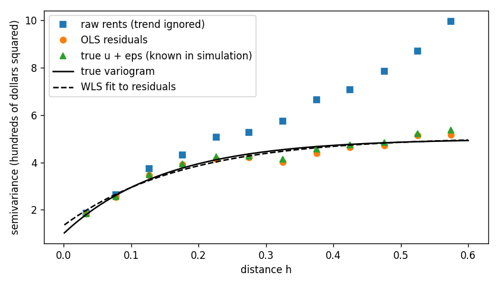

In Figure 3.1 the raw-rent points (squares) follow the others for the first two bins and then pull away, reaching nearly 10 by the last bin with no sign of leveling off. The residual points (circles) and the true-error points (triangles) are almost indistinguishable and track the true curve, wiggling around it in the way Section 3.3.3 described. The dashed weighted least squares fit to the residuals lies close to the true curve, slightly above it near the origin because its nugget is larger.

### 3.5.2 Directional Variograms

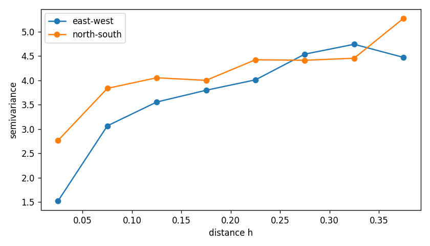

Figure 3.2 plots the table of Section 3.1.4. The north-south curve starts well above the east-west curve and stays above it to about 0.25, where the two meet. Beyond that the curves cross, because the directional bins have fewer pairs and more noise. Detecting anisotropy from directional variograms is therefore most reliable at short and moderate distances.

### 3.5.3 Outliers

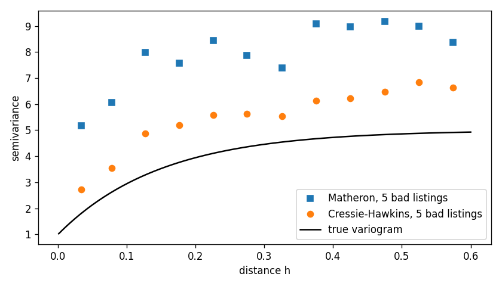

In Figure 3.3 the Matheron estimates (squares) jump to between 5 and 9 across all bins, roughly doubling the semivariance and turning the gentle rise of the true curve into a high, flat band. That pattern would suggest a nugget several times its true size. The Cressie-Hawkins estimates (circles) are still too high, but they keep the rising shape and are much closer to the truth.

---

<a id="ch3-exercises"></a>

## Exercises

**Analytical**

1. Show that if $\operatorname{E}[Y_i - Y_j] = \Delta\mu_{ij} \ne 0$, then $\operatorname{E}[\hat{\gamma}(h_k)]$ equals the average of $\gamma$ over the bin plus $\frac{1}{2\lvert N(h_k) \rvert}\sum_{(i,j) \in N(h_k)} (\Delta\mu_{ij})^2$. Use this to recover the trend term of Section 3.4.1.

2. Let $Z \sim N(0, 1)$ with density $f(z)$. Show that $f'(z) = -zf(z)$, and use integration by parts to prove that $\operatorname{E}[Z\,g(Z)] = \operatorname{E}[g'(Z)]$ for any differentiable $g$ that does not grow too fast. Use it to find $\operatorname{E}[Z^4]$ and $\operatorname{E}[Z^6]$.

3. For jointly normal mean-zero variables $A$ and $B$, a standard result is $\operatorname{Cov}(A^2, B^2) = 2\operatorname{Cov}(A, B)^2$. Use it to show that two squared differences that share a location, $(Y_1 - Y_2)^2$ and $(Y_1 - Y_3)^2$, have positive covariance even when $Y_2$ and $Y_3$ are independent of each other. Explain how this accounts for the factor of 9.5 in Section 3.3.2.

4. Using the formula $\operatorname{E}\lvert Z \rvert^p = 2^{p/2}\Gamma((p+1)/2)/\sqrt{\pi}$ from Section 3.2.3, check the cases $p = 0$ and $p = 2$, and compute $\operatorname{E}\lvert Z \rvert$. Then redo the correction-constant calculation keeping the term $4m\operatorname{E}[d^3]$, using the skewness of $\lvert Z \rvert^{1/2}$, and judge whether it matters for bins with 100 pairs.

5. Show that if a direction $\vartheta$ is uniformly distributed on $[0, \pi)$, then $\operatorname{E}[\cos^2\vartheta] = 1/2$. For a trend $\mu(\mathbf{s}) = \mathbf{b}'\mathbf{s}$ in an arbitrary direction, show that the expected extra semivariance at distance $h$ is $\lVert\mathbf{b}\rVert^2h^2/4$.

6. For the intercept-only model $\mathbf{X} = \mathbf{1}$, show that $e_i - e_j = Y_i - Y_j$ for every pair, so the residual variogram equals the raw variogram exactly. Explain why the downward bias of Section 3.4.3 appears only when $\mathbf{X}$ has columns that vary across space.

7. Let $u_1(\mathbf{s})$ be an isotropic process with sill $\sigma_1^2$, and let $u_2(\mathbf{s}) = v(s_{\text{north}})$ be a process that varies only in the north-south direction, with semivariogram $\gamma_v$ and sill $\sigma_2^2$, independent of $u_1$. Find the semivariogram of $u_1 + u_2$ for lags pointing due east and due north, and show that the two have different sills. This is zonal anisotropy.

8. Section 3.1.1 defined Matheron's estimator for bin $k$ as $\hat{\gamma}(h_k) = \frac{1}{2\lvert N(h_k) \rvert}\sum_{(i,j) \in N(h_k)} (Y_i - Y_j)^2$. (a) Define the $n \times n$ symmetric adjacency matrix $\mathbf{A}_k$ for bin $k$, where $(\mathbf{A}_k)_{ij} = 1$ if $(i, j) \in N(h_k)$ or $(j, i) \in N(h_k)$, and $0$ otherwise. Let $\mathbf{D}_k = \operatorname{diag}(\mathbf{A}_k\mathbf{1}_n)$ be its diagonal degree matrix. Show that $\sum_{(i,j) \in N(h_k)} (Y_i - Y_j)^2 = \mathbf{Y}'(\mathbf{D}_k - \mathbf{A}_k)\mathbf{Y} = \mathbf{Y}'\mathbf{L}_k\mathbf{Y}$, where $\mathbf{L}_k$ is the graph Laplacian of bin $k$. (b) Using Tool 2 (Section 1.1.1), show that $\operatorname{E}[\hat{\gamma}(h_k)] = \frac{\operatorname{tr}(\mathbf{L}_k\boldsymbol{\Sigma}) + \boldsymbol{\mu}'\mathbf{L}_k\boldsymbol{\mu}}{2\lvert N(h_k) \rvert}$, and show that the mean term vanishes whenever the mean is constant ($\boldsymbol{\mu} = \mu\mathbf{1}_n$) because $\mathbf{L}_k\mathbf{1}_n = \mathbf{0}$. (c) Evaluate the trace $\operatorname{tr}(\mathbf{L}_k\boldsymbol{\Sigma})$ explicitly to recover the bin average of $\gamma$.

9. Section 3.3.2 discussed why pairs sharing a listing are correlated. Suppose observations are Gaussian with covariance matrix $\boldsymbol{\Sigma}$. (a) For two distinct pairs $(1, 2)$ and $(1, 3)$ sharing location $1$, show that $\operatorname{Cov}(Y_1 - Y_2, Y_1 - Y_3) = \gamma(\mathbf{s}_1 - \mathbf{s}_3) + \gamma(\mathbf{s}_1 - \mathbf{s}_2) - \gamma(\mathbf{s}_2 - \mathbf{s}_3)$. (b) Using $\operatorname{Cov}(A^2, B^2) = 2\operatorname{Cov}(A, B)^2$ from Exercise 3, show that the covariance between the two squared differences is $2\left[\gamma(\mathbf{s}_1 - \mathbf{s}_3) + \gamma(\mathbf{s}_1 - \mathbf{s}_2) - \gamma(\mathbf{s}_2 - \mathbf{s}_3)\right]^2$. (c) For three locations forming an equilateral triangle of side $h$, evaluate this covariance in terms of $\gamma(h)$.

10. Let $\mathbf{s}_1, \dots, \mathbf{s}_n$ be $n$ locations with semivariogram matrix $\boldsymbol{\Gamma}$ ($\Gamma_{ij} = \gamma(\mathbf{s}_i - \mathbf{s}_j)$, with zeros on the diagonal). (a) Using Section 2.2.4 ($\gamma(\mathbf{h}) = C(\mathbf{0}) - C(\mathbf{h})$), show that $\boldsymbol{\Gamma} = C(\mathbf{0})\mathbf{1}_n\mathbf{1}_n' - \boldsymbol{\Sigma}$. (b) For any vector $\mathbf{a}$ orthogonal to $\mathbf{1}_n$ ($\mathbf{a}'\mathbf{1}_n = 0$), show that $\mathbf{a}'\boldsymbol{\Gamma}\mathbf{a} = -\mathbf{a}'\boldsymbol{\Sigma}\mathbf{a} \le 0$. (c) Explain why this conditional negative definiteness guarantees that the matrix $\mathbf{B} = -\frac{1}{2}\mathbf{P}_c\boldsymbol{\Gamma}\mathbf{P}_c$ is positive semi-definite (where $\mathbf{P}_c = \mathbf{I}_n - \frac{1}{n}\mathbf{1}_n\mathbf{1}_n'$ is the centering matrix), and connect this to classical multidimensional scaling.

11. Suppose $Y(\mathbf{s})$ is an intrinsically stationary point process with semivariogram $\gamma(h)$. In many remote sensing applications, an instrument records the spatial average of $Y$ over a square pixel $B(\mathbf{s})$ centered at $\mathbf{s}$: $Y_B(\mathbf{s}) = \frac{1}{\lvert B \rvert}\int_{B(\mathbf{s})} Y(\mathbf{u})\,d\mathbf{u}$. (a) Show that the semivariogram of the block-averaged process is $\gamma_B(\mathbf{h}) = \bar{\gamma}(B(\mathbf{s}), B(\mathbf{s}+\mathbf{h})) - \bar{\gamma}(B, B)$, where $\bar{\gamma}(B_1, B_2) = \frac{1}{\lvert B_1 \rvert \lvert B_2 \rvert}\int_{B_1}\int_{B_2}\gamma(\mathbf{u} - \mathbf{v})\,d\mathbf{u}\,d\mathbf{v}$. (b) Show that $\gamma_B(\mathbf{0}) = 0$, but the sill of $\gamma_B$ is strictly less than the sill of the original point process $\gamma$. Explain why area-averaging smooths out variation and reduces both the partial sill and the nugget (the change of support effect).

12. Section 3.1.4 and Section 2.6 describe geometric anisotropy through the elliptical lag distance $h(\mathbf{G}) = \sqrt{\mathbf{h}'\mathbf{G}\mathbf{h}}$. (a) Let $\mathbf{G} = \mathbf{U}\boldsymbol{\Lambda}\mathbf{U}'$ with rotation matrix $\mathbf{U} = \begin{bmatrix} \cos\theta & -\sin\theta \\ \sin\theta & \cos\theta \end{bmatrix}$ and $\boldsymbol{\Lambda} = \operatorname{diag}(\lambda_1, \lambda_2)$ with $0 < \lambda_1 < \lambda_2$. Show that the contour of constant semivariance $\gamma(h(\mathbf{G})) = c$ forms an ellipse $\mathbf{h}'\mathbf{G}\mathbf{h} = h_0^2$ in lag space $\mathbf{h} = (h_x, h_y)'$. (b) Find the lengths of the semi-major and semi-minor axes of this ellipse in terms of $h_0, \lambda_1, \lambda_2$. (c) Verify that the direction of longest reach (the semi-major axis of the ellipse) points in direction $\theta$ with length $h_0/\sqrt{\lambda_1}$, confirming that the smallest eigenvalue of $\mathbf{G}$ corresponds to the longest spatial range.

**Computational and simulation**

13. Recompute the rent district's empirical variogram with bin widths 0.025, 0.05, and 0.1, and refit the exponential model by Cressie's weighted least squares each time. How sensitive are $\hat{\sigma}^2$, $\hat{\tau}^2$, and $\hat{\phi}$ to the bin width?

14. Keep the 250 listing locations fixed, simulate 200 new values of $u + \varepsilon$, and fit the exponential model to each by both ordinary and weighted least squares. Report the mean and standard deviation of $\hat{\phi}$ for each method. Does weighting reduce the variability?

15. For the anisotropic field of Section 3.1.4, compute directional variograms at 0, 45, 90, and 135 degrees. For each direction, find (by linear interpolation between bins) the distance at which the variogram first reaches 3.5. Plot these distances as points at the corresponding angles and their opposites, and compare the shape with the ellipse implied by $\mathbf{G}$.

16. Repeat the outlier experiment of Section 3.2 with 1, 2, 5, 10, and 20 bad listings. Plot the average increase of each estimator against the number of bad listings.

17. Compute the weighted least squares objective at the fitted values for the exponential and Matérn $\nu = 3/2$ fits to the OLS residuals in Section 3.5.1. Then fit the Matérn model with $\nu = 5/2$. Can the objective values be used to choose among the families? Why or why not?

---

<a id="ch3-what-comes-next"></a>

## What Comes Next

The variogram is now an estimated curve with a fitted family and parameters. Chapter 4 uses such a curve for its main purpose: predicting the value of the process at locations where we have no data, such as the rent of an apartment that is not listed. Kriging, as that prediction is called, turns out to be best linear unbiased prediction in the sense of the linear models you know. Chapter 5 then returns to estimation and replaces variogram fitting with maximum likelihood and REML, which use the data directly and fix the residual bias of Section 3.4.3.


---

<a id="ch4"></a>

# Chapter 4: Spatial Prediction: Kriging as Linear Model BLUP

A landlord is pricing an apartment in a building that has never been listed. A city agency wants the typical rent across a neighborhood to set a housing benchmark. Both questions ask for a value at a place where we have no observation, using observations from nearby places. Answering them is **spatial prediction**, and the standard method has a mining name: **kriging**, after the South African mining engineer Danie Krige, whose work on estimating ore grades was later formalized by Georges Matheron.

This chapter shows that kriging is something you already know under another name. It is **best linear unbiased prediction** (BLUP): the same combination of least squares and unbiasedness that makes OLS the best linear unbiased estimator in a classical regression, and that made GLS best in Section 1.3.5. Every kriging formula in this chapter comes from one recipe. Write the predictor as a linear combination of the data, write its mean squared error as a quadratic form, impose unbiasedness, and minimize. The different flavors of kriging differ only in what is known about the mean.

Throughout the chapter, the covariance parameters $\sigma^2$, $\tau^2$, and $\phi$ are treated as **known**. In the simulations they are set to the true values used to generate the data. Chapters 3 and 5 show how to estimate them, and Section 5.4.5 discusses what plugging in estimates costs. Separating the two problems keeps this chapter about prediction alone.

> **Chapter at a Glance**
>
> - **Kriging Is BLUP (§4.1):** The prediction target, linear predictors, and the mean squared prediction error as variance plus squared bias.
> - **Simple Kriging (§4.2):** With a known mean, the best weights solve $\boldsymbol{\Sigma}\boldsymbol{\lambda} = \mathbf{c}_0$. Worked by hand at the center of the four-apartment block, with a geometric picture.
> - **Ordinary Kriging (§4.3):** With an unknown constant mean, a Lagrange multiplier enforces unbiasedness, and block inversion shows the extra variance is the cost of estimating the mean.
> - **Universal Kriging (§4.4):** With covariates, kriging is GLS for the trend plus simple kriging of the residuals.
> - **Two Targets (§4.5):** Predicting the noise-free value smooths the data; predicting a new observation adds $\tau^2$. Kriging is Gaussian process regression and kernel ridge regression, and skewed data need care when back-transforming.
> - **Block Kriging (§4.6):** Predicting an average over an area, with a smaller variance than any single point.
> - **Cross-Validation (§4.7):** All $n$ leave-one-out residuals from one matrix, the spatial analogue of the regression hat-matrix shortcut.
> - **Walkthrough and Lab (§4.8):** A symbolic derivation, a rent map with standard errors, a check of interval coverage against the truth, and how the kriging standard error depends on the number of listings.

---

<a id="s4-1"></a>

## 4.1 Demystifying "Kriging": It Is Best Linear Unbiased Prediction

### 4.1.1 The Prediction Target

Return to the model of Chapter 2,

$$
Y(\mathbf{s}) = \mu(\mathbf{s}) + u(\mathbf{s}) + \varepsilon(\mathbf{s}), \qquad \mu(\mathbf{s}) = \mathbf{x}(\mathbf{s})'\boldsymbol{\beta}
$$

with data $\mathbf{Y}$ at locations $\mathbf{s}_1, \dots, \mathbf{s}_n$ and $\operatorname{Var}(\mathbf{Y}) = \boldsymbol{\Sigma} = \sigma^2\mathbf{R}(\phi) + \tau^2\mathbf{I}_n$. We want to predict at a new location $\mathbf{s}_0$, such as the unlisted building.

Before deriving anything, we must say what we are predicting. There are two natural targets.

- The **noise-free value** $\tilde{Y}(\mathbf{s}_0) = \mu(\mathbf{s}_0) + u(\mathbf{s}_0)$: the rent level the location commands, its trend plus its neighborhood effect, without the apartment-specific noise $\varepsilon$.
- A **new observation** $Y(\mathbf{s}_0) = \tilde{Y}(\mathbf{s}_0) + \varepsilon(\mathbf{s}_0)$: the rent of one particular apartment there, noise included.

This chapter predicts $\tilde{Y}(\mathbf{s}_0)$ by default, because it is what a map of rents, or of pollution, is meant to show. Section 4.5 explains how the answer changes for the other target. To keep formulas short, write $\mu_0 = \mu(\mathbf{s}_0)$ and $\mathbf{x}_0 = \mathbf{x}(\mathbf{s}_0)$.

Prediction works through the covariance between the data and the target:

$$
\mathbf{c}_0 = \operatorname{Cov}\!\left(\mathbf{Y}, \tilde{Y}(\mathbf{s}_0)\right), \qquad (\mathbf{c}_0)_i = \operatorname{Cov}\!\left(u(\mathbf{s}_i) + \varepsilon(\mathbf{s}_i),\, u(\mathbf{s}_0)\right) = \sigma^2 r(h_{i0};\phi)
$$

where $h_{i0}$ is the distance from $\mathbf{s}_i$ to $\mathbf{s}_0$. The noise $\varepsilon(\mathbf{s}_i)$ drops out because it is independent of $u(\mathbf{s}_0)$. We also need the variance of the target, $\operatorname{Var}(\tilde{Y}(\mathbf{s}_0)) = \operatorname{Var}(u(\mathbf{s}_0)) = \sigma^2$.

### 4.1.2 Linear Predictors and Their Error

A **linear predictor** is any predictor of the form

$$
\hat{Y}(\mathbf{s}_0) = \lambda_0 + \boldsymbol{\lambda}'\mathbf{Y} = \lambda_0 + \sum_{i=1}^n \lambda_i Y(\mathbf{s}_i)
$$

a constant plus a weighted sum of the data. The weights $\boldsymbol{\lambda}$ say how much each listing contributes. We judge a predictor by its **mean squared prediction error** (MSPE), the average squared distance between prediction and target:

$$
\operatorname{MSPE} = \operatorname{E}\!\left[\left(\hat{Y}(\mathbf{s}_0) - \tilde{Y}(\mathbf{s}_0)\right)^2\right]
$$

Like any mean squared error, it splits into variance plus squared bias. For a random variable $D$, $\operatorname{E}[D^2] = \operatorname{Var}(D) + (\operatorname{E}[D])^2$. Taking $D = \hat{Y}(\mathbf{s}_0) - \tilde{Y}(\mathbf{s}_0)$,

$$
\operatorname{MSPE} = \operatorname{Var}\!\left(\hat{Y}(\mathbf{s}_0) - \tilde{Y}(\mathbf{s}_0)\right) + \left(\operatorname{E}\!\left[\hat{Y}(\mathbf{s}_0) - \tilde{Y}(\mathbf{s}_0)\right]\right)^2
$$

The bias term is $\lambda_0 + \boldsymbol{\lambda}'\operatorname{E}[\mathbf{Y}] - \mu_0$. It depends on the constant and on the mean, but not on the covariance.

### 4.1.3 The Variance Part Is a Quadratic Form

The variance part depends only on the weights. The constant $\lambda_0$ does not affect a variance, so $D$ has the same variance as $\boldsymbol{\lambda}'\mathbf{Y} - \tilde{Y}(\mathbf{s}_0)$. Expanding the variance of a difference, and using Tool 1 for each piece,

$$
\begin{aligned}
\operatorname{Var}\!\left(\boldsymbol{\lambda}'\mathbf{Y} - \tilde{Y}(\mathbf{s}_0)\right) &= \operatorname{Var}(\boldsymbol{\lambda}'\mathbf{Y}) - 2\operatorname{Cov}\!\left(\boldsymbol{\lambda}'\mathbf{Y}, \tilde{Y}(\mathbf{s}_0)\right) + \operatorname{Var}(\tilde{Y}(\mathbf{s}_0)) \\
&= \boldsymbol{\lambda}'\boldsymbol{\Sigma}\boldsymbol{\lambda} - 2\boldsymbol{\lambda}'\mathbf{c}_0 + \sigma^2
\end{aligned}
$$

So for any predictor whose bias is zero, that is, whose mean equals the mean of the target,

$$
\operatorname{MSPE}(\boldsymbol{\lambda}) = \boldsymbol{\lambda}'\boldsymbol{\Sigma}\boldsymbol{\lambda} - 2\boldsymbol{\lambda}'\mathbf{c}_0 + \sigma^2
$$

This quadratic form is the whole problem. The three terms have plain meanings. The first is the variance of the weighted sum: weights on listings that repeat each other add up. The second rewards weights on listings that are correlated with the target. The third is the uncertainty we start with, before seeing any data.

The rest of the chapter minimizes this quadratic form under different assumptions about the mean. Each assumption leads to a different unbiasedness requirement, and so to a different version of kriging.

---

<a id="s4-2"></a>

## 4.2 Simple Kriging (Known Mean)

### 4.2.1 A Tool We Need: Derivatives With Respect to a Vector

To minimize a function of the vector $\boldsymbol{\lambda}$, we set its derivative with respect to each component to zero and collect the results into a vector, the **gradient**. Two rules cover everything in this chapter.

**Linear functions.** For a fixed vector $\mathbf{c}$, the function $\boldsymbol{\lambda}'\mathbf{c} = \sum_i \lambda_i c_i$ has partial derivative $c_k$ with respect to $\lambda_k$. Collecting them,

$$
\frac{\partial}{\partial\boldsymbol{\lambda}}\,\boldsymbol{\lambda}'\mathbf{c} = \mathbf{c}
$$

**Quadratic forms.** For a fixed symmetric matrix $\boldsymbol{\Sigma}$, write $\boldsymbol{\lambda}'\boldsymbol{\Sigma}\boldsymbol{\lambda} = \sum_i\sum_j \lambda_i\Sigma_{ij}\lambda_j$. The component $\lambda_k$ appears in the terms with $i = k$ and in the terms with $j = k$, so

$$
\frac{\partial}{\partial\lambda_k}\sum_i\sum_j \lambda_i\Sigma_{ij}\lambda_j = \sum_j \Sigma_{kj}\lambda_j + \sum_i \lambda_i\Sigma_{ik} = 2(\boldsymbol{\Sigma}\boldsymbol{\lambda})_k
$$

using symmetry, $\Sigma_{ik} = \Sigma_{ki}$, in the last step. Collecting,

$$
\frac{\partial}{\partial\boldsymbol{\lambda}}\,\boldsymbol{\lambda}'\boldsymbol{\Sigma}\boldsymbol{\lambda} = 2\boldsymbol{\Sigma}\boldsymbol{\lambda}
$$

These are the vector versions of $\frac{d}{dx}cx = c$ and $\frac{d}{dx}ax^2 = 2ax$. Appendix A.2 collects them with others.

### 4.2.2 The Simple Kriging Equations

**Simple kriging** assumes the mean $\mu(\mathbf{s})$ is known everywhere: at the data, $\operatorname{E}[\mathbf{Y}] = \boldsymbol{\mu}$, and at the target, $\mu_0$. With a constant mean $\mu$, $\boldsymbol{\mu} = \mu\mathbf{1}_n$ and $\mu_0 = \mu$.

The bias of $\lambda_0 + \boldsymbol{\lambda}'\mathbf{Y}$ is $\lambda_0 + \boldsymbol{\lambda}'\boldsymbol{\mu} - \mu_0$, so the choice

$$
\lambda_0 = \mu_0 - \boldsymbol{\lambda}'\boldsymbol{\mu}
$$

makes the predictor unbiased whatever the weights are. With a constant mean this is $\lambda_0 = \mu(1 - \boldsymbol{\lambda}'\mathbf{1}_n)$. The constant does the bookkeeping for the mean, and the weights are free to minimize the variance.

By Section 4.2.1, the gradient of $\operatorname{MSPE}(\boldsymbol{\lambda}) = \boldsymbol{\lambda}'\boldsymbol{\Sigma}\boldsymbol{\lambda} - 2\boldsymbol{\lambda}'\mathbf{c}_0 + \sigma^2$ is $2\boldsymbol{\Sigma}\boldsymbol{\lambda} - 2\mathbf{c}_0$. Setting it to zero gives the **simple kriging equations**:

$$
\boldsymbol{\Sigma}\boldsymbol{\lambda} = \mathbf{c}_0, \qquad \boldsymbol{\lambda} = \boldsymbol{\Sigma}^{-1}\mathbf{c}_0
$$

This is a minimum, not a maximum or a saddle, because the matrix of second derivatives is $2\boldsymbol{\Sigma}$, which is positive definite. The predictor is

$$
\hat{Y}_{\text{SK}}(\mathbf{s}_0) = \mu_0 + \mathbf{c}_0'\boldsymbol{\Sigma}^{-1}(\mathbf{Y} - \boldsymbol{\mu})
$$

It starts from the known mean at $\mathbf{s}_0$ and adjusts it by a weighted combination of how far each listing sits above or below its own mean.

Substituting $\boldsymbol{\lambda} = \boldsymbol{\Sigma}^{-1}\mathbf{c}_0$ into the MSPE gives the **simple kriging variance**:

$$
\sigma^2_{\text{SK}}(\mathbf{s}_0) = \mathbf{c}_0'\boldsymbol{\Sigma}^{-1}\boldsymbol{\Sigma}\boldsymbol{\Sigma}^{-1}\mathbf{c}_0 - 2\mathbf{c}_0'\boldsymbol{\Sigma}^{-1}\mathbf{c}_0 + \sigma^2 = \sigma^2 - \mathbf{c}_0'\boldsymbol{\Sigma}^{-1}\mathbf{c}_0
$$

We start with uncertainty $\sigma^2$, and the data remove $\mathbf{c}_0'\boldsymbol{\Sigma}^{-1}\mathbf{c}_0$ of it. Far from all data, $\mathbf{c}_0 \approx \mathbf{0}$: the predictor falls back to the mean $\mu_0$ and the variance returns to $\sigma^2$.

One feature of this formula has a practical consequence. **The kriging variance does not depend on the observed values $\mathbf{y}$**, only on the locations and the covariance. So we can compute how precise predictions will be before collecting any data, and choose where to sample so that the variance is small where it matters. That is the idea behind spatial sampling design (Appendix D).

### 4.2.3 By Hand: The Center of the Block

Use the four apartments at the corners of a block from Chapters 1 and 2: $\mathbf{s}_1 = (0, 0)$, $\mathbf{s}_2 = (1, 0)$, $\mathbf{s}_3 = (0, 1)$, $\mathbf{s}_4 = (1, 1)$, with $\sigma^2 = 1$, $\tau^2 = 0$, and exponential correlation with $\phi = 1$. Recall from Section 1.3.2 that

$$
\boldsymbol{\Sigma} = \begin{bmatrix} 1 & a & a & b \\ a & 1 & b & a \\ a & b & 1 & a \\ b & a & a & 1 \end{bmatrix}, \qquad a = e^{-1} \approx 0.3679, \qquad b = e^{-\sqrt{2}} \approx 0.2431
$$

and that every row sums to $1 + 2a + b = 1.9789$.

Predict at the center of the block, $\mathbf{s}_0 = (0.5, 0.5)$. Each corner is $\sqrt{0.5} \approx 0.7071$ from the center, so every entry of $\mathbf{c}_0$ is $e^{-0.7071} \approx 0.4931$, that is, $\mathbf{c}_0 = 0.4931\cdot\mathbf{1}$. Because $\mathbf{1}$ is an eigenvector of $\boldsymbol{\Sigma}$ with eigenvalue $1.9789$ (Section 1.3.3), $\boldsymbol{\Sigma}^{-1}\mathbf{1} = \mathbf{1}/1.9789$, and

$$
\boldsymbol{\lambda} = \boldsymbol{\Sigma}^{-1}\mathbf{c}_0 = \frac{0.4931}{1.9789}\,\mathbf{1} \approx 0.2492\cdot\mathbf{1}
$$

Each corner gets weight 0.2492. The weights sum to 0.9967, slightly less than 1; the remaining $0.0033$ of weight goes to the known mean through $\lambda_0 = \mu(1 - 0.9967)$. The kriging variance is

$$
\sigma^2_{\text{SK}} = 1 - \mathbf{c}_0'\boldsymbol{\lambda} = 1 - 4 \times 0.4931 \times 0.2492 \approx 0.5086
$$

so four corners, each 0.71 block lengths away, remove about half of the initial uncertainty.

**A second location: off the block.** Now predict at $\mathbf{s}_0 = (2, 0.5)$, one block length east of the block. The west corners $\mathbf{s}_1$ and $\mathbf{s}_3$ are $\sqrt{4.25} \approx 2.062$ away, with correlation $0.1273$; the east corners $\mathbf{s}_2$ and $\mathbf{s}_4$ are $\sqrt{1.25} \approx 1.118$ away, with correlation $0.3269$. So $\mathbf{c}_0 = (0.1273, 0.3269, 0.1273, 0.3269)'$.

The eigenvectors of Section 1.3.3 again make the solve possible by hand. Split $\mathbf{c}_0$ into its average and its east-west contrast:

$$
\mathbf{c}_0 = 0.2271\cdot(1, 1, 1, 1)' + 0.0998\cdot(-1, 1, -1, 1)'
$$

where $0.2271$ is the average of the two values and $0.0998$ is half their difference. Both vectors are eigenvectors of $\boldsymbol{\Sigma}$, with eigenvalues $1.9789$ and $1 - b = 0.7569$, so $\boldsymbol{\Sigma}^{-1}$ divides each part by its eigenvalue:

$$
\boldsymbol{\lambda} = \frac{0.2271}{1.9789}(1, 1, 1, 1)' + \frac{0.0998}{0.7569}(-1, 1, -1, 1)' = 0.1148\cdot\mathbf{1} + 0.1319\cdot(-1, 1, -1, 1)'
$$

The east corners get $0.1148 + 0.1319 = 0.2467$, and the west corners get $0.1148 - 0.1319 = -0.0171$. **A negative weight.** The west corners are farther away and lie behind the east corners as seen from $\mathbf{s}_0$. Once the east corners are used, the west corners add little new information about $\mathbf{s}_0$, and the small negative weight corrects for the part of the east corners' values that the west corners share. This is called the **screening effect**: near data screen off far data. The weights sum to only $0.459$, so more than half of the prediction comes from the known mean, and the kriging variance is $0.8431$, close to the starting value of 1.

```python
import numpy as np


def dist(S, T=None):
    """Euclidean distances between rows of S and rows of T (default S).

    This is the distance helper of Chapter 1, extended to two point sets."""
    same = T is None
    T = S if same else T
    q_s = np.sum(S**2, axis=1)
    q_t = np.sum(T**2, axis=1)
    H2 = q_s[:, None] - 2 * S @ T.T + q_t[None, :]
    H = np.sqrt(np.maximum(H2, 0.0))
    if same:
        np.fill_diagonal(H, 0.0)
    return H


S4 = np.array([[0.0, 0.0], [1.0, 0.0], [0.0, 1.0], [1.0, 1.0]])
Sigma4 = np.exp(-dist(S4))
s_center = np.array([[0.5, 0.5]])
c0 = np.exp(-dist(S4, s_center))[:, 0]
lam = np.linalg.solve(Sigma4, c0)
print("c0:", np.round(c0, 4))
print("simple kriging weights:", np.round(lam, 4))
print("sum of weights:", round(lam.sum(), 4))
print("SK variance:", round(1 - c0 @ lam, 4))

s_far = np.array([[2.0, 0.5]])
c_far = np.exp(-dist(S4, s_far))[:, 0]
lam_far = np.linalg.solve(Sigma4, c_far)
print("c0 (far):", np.round(c_far, 4))
print("SK weights (far):", np.round(lam_far, 4),
      " sum:", round(lam_far.sum(), 4))
print("SK variance (far):", round(1 - c_far @ lam_far, 4))
```

### 4.2.4 Two Geometric Pictures

The kriging equations have a geometric meaning that ties them to least squares.

**Kriging as a projection.** Think of mean-zero random variables as vectors, with the **covariance inner product** $\langle A, B\rangle = \operatorname{Cov}(A, B)$. Length is standard deviation, and "perpendicular" means uncorrelated. In this picture, the centered data $Y(\mathbf{s}_i) - \mu_i$ span a subspace, and the simple kriging predictor is the point in that subspace closest to the centered target $\tilde{Y}(\mathbf{s}_0) - \mu_0$. The closest point is the orthogonal projection: the error must be perpendicular to every data value,

$$
\operatorname{Cov}\!\left(\tilde{Y}(\mathbf{s}_0) - \boldsymbol{\lambda}'\mathbf{Y},\, Y(\mathbf{s}_i)\right) = 0 \quad \text{for each } i \quad \iff \quad \mathbf{c}_0 - \boldsymbol{\Sigma}\boldsymbol{\lambda} = \mathbf{0}
$$

which is exactly the simple kriging equations. Pythagoras then splits the target's variance into the variance of its projection and the variance of the error, $\sigma^2 = \mathbf{c}_0'\boldsymbol{\Sigma}^{-1}\mathbf{c}_0 + \sigma^2_{\text{SK}}$, which is the kriging variance formula read the other way.

**GLS fitted values as a projection.** Section 1.3.5 found $\hat{\boldsymbol{\beta}}_{\text{GLS}}$. Its normal equations, $\mathbf{X}'\boldsymbol{\Sigma}^{-1}(\mathbf{Y} - \mathbf{X}\hat{\boldsymbol{\beta}}_{\text{GLS}}) = \mathbf{0}$, say that the residual vector is perpendicular to every column of $\mathbf{X}$ in the inner product $\langle\mathbf{a}, \mathbf{b}\rangle = \mathbf{a}'\boldsymbol{\Sigma}^{-1}\mathbf{b}$ between fixed vectors. So the GLS fitted values $\mathbf{X}\hat{\boldsymbol{\beta}}_{\text{GLS}}$ are the orthogonal projection of $\mathbf{Y}$ onto the columns of $\mathbf{X}$ in that inner product, just as OLS fitted values are in the ordinary one.

The two pictures live in different spaces, one of random variables and one of data vectors, but both say the same thing: the best linear answer leaves an error perpendicular to everything it could have used. That is why the normal equations of regression and the kriging equations look alike.

---

<a id="s4-3"></a>

## 4.3 Ordinary Kriging (Unknown Constant Mean)

### 4.3.1 Unbiasedness as a Constraint

Simple kriging needs the mean. In practice it is unknown. **Ordinary kriging** assumes the mean is an unknown constant $\mu$ and uses no constant term, $\lambda_0 = 0$. Then

$$
\operatorname{E}[\boldsymbol{\lambda}'\mathbf{Y}] - \operatorname{E}[\tilde{Y}(\mathbf{s}_0)] = \mu\,\boldsymbol{\lambda}'\mathbf{1}_n - \mu = \mu(\boldsymbol{\lambda}'\mathbf{1}_n - 1)
$$

For this to be zero whatever the value of $\mu$, the weights must sum to one:

$$
\boldsymbol{\lambda}'\mathbf{1}_n = 1
$$

We now minimize $\operatorname{MSPE}(\boldsymbol{\lambda})$ subject to this constraint. The standard tool is a **Lagrange multiplier**. Introduce a new unknown $m$ and form the Lagrangian

$$
\mathcal{L}(\boldsymbol{\lambda}, m) = \boldsymbol{\lambda}'\boldsymbol{\Sigma}\boldsymbol{\lambda} - 2\boldsymbol{\lambda}'\mathbf{c}_0 + \sigma^2 + 2m\left(\boldsymbol{\lambda}'\mathbf{1}_n - 1\right)
$$

(The factor 2 on $m$ only makes the equations tidier.) At the constrained minimum, the derivatives with respect to both $\boldsymbol{\lambda}$ and $m$ are zero. By Section 4.2.1,

$$
\frac{\partial\mathcal{L}}{\partial\boldsymbol{\lambda}} = 2\boldsymbol{\Sigma}\boldsymbol{\lambda} - 2\mathbf{c}_0 + 2m\mathbf{1}_n = \mathbf{0}, \qquad \frac{\partial\mathcal{L}}{\partial m} = 2(\boldsymbol{\lambda}'\mathbf{1}_n - 1) = 0
$$

The second equation is the constraint itself. The first says $\boldsymbol{\Sigma}\boldsymbol{\lambda} + m\mathbf{1}_n = \mathbf{c}_0$.

### 4.3.2 The Block-Matrix System

The two equations stack into one linear system of size $n + 1$:

$$
\begin{bmatrix} \boldsymbol{\Sigma} & \mathbf{1}_n \\ \mathbf{1}_n' & 0 \end{bmatrix} \begin{bmatrix} \boldsymbol{\lambda} \\ m \end{bmatrix} = \begin{bmatrix} \mathbf{c}_0 \\ 1 \end{bmatrix}
$$

We call the matrix on the left the **kriging matrix** and write it $\mathbf{K}$. Numerically, ordinary kriging is a single call to a linear solver with $\mathbf{K}$. To see what the solution means, we solve it by hand.

**Solving by elimination.** From the first block row, $\boldsymbol{\lambda} = \boldsymbol{\Sigma}^{-1}(\mathbf{c}_0 - m\mathbf{1}_n)$. Substituting into the constraint,

$$
\mathbf{1}_n'\boldsymbol{\Sigma}^{-1}\mathbf{c}_0 - m\,\mathbf{1}_n'\boldsymbol{\Sigma}^{-1}\mathbf{1}_n = 1 \quad\Longrightarrow\quad m = \frac{\mathbf{1}_n'\boldsymbol{\Sigma}^{-1}\mathbf{c}_0 - 1}{\mathbf{1}_n'\boldsymbol{\Sigma}^{-1}\mathbf{1}_n}
$$

and therefore

$$
\boldsymbol{\lambda}_{\text{OK}} = \boldsymbol{\Sigma}^{-1}\mathbf{c}_0 + \boldsymbol{\Sigma}^{-1}\mathbf{1}_n\,\frac{1 - \mathbf{1}_n'\boldsymbol{\Sigma}^{-1}\mathbf{c}_0}{\mathbf{1}_n'\boldsymbol{\Sigma}^{-1}\mathbf{1}_n}
$$

The first term is the simple kriging weight vector. The second term tops up the weights so that they sum to one. The amount of top-up depends on $1 - \mathbf{1}_n'\boldsymbol{\Sigma}^{-1}\mathbf{c}_0$, which is one minus the sum of the simple kriging weights: the share of the prediction that simple kriging would have taken from the known mean.

**The predictor is GLS plus simple kriging.** Write $\hat{\mu}_{\text{GLS}} = \mathbf{1}_n'\boldsymbol{\Sigma}^{-1}\mathbf{Y}/\mathbf{1}_n'\boldsymbol{\Sigma}^{-1}\mathbf{1}_n$ for the GLS estimate of the constant mean (Section 1.4.4, which writes it with $\mathbf{R}^{-1}$; the scale $\sigma^2$ cancels). Then

$$
\boldsymbol{\lambda}_{\text{OK}}'\mathbf{Y} = \mathbf{c}_0'\boldsymbol{\Sigma}^{-1}\mathbf{Y} + \left(1 - \mathbf{1}_n'\boldsymbol{\Sigma}^{-1}\mathbf{c}_0\right)\hat{\mu}_{\text{GLS}} = \hat{\mu}_{\text{GLS}} + \mathbf{c}_0'\boldsymbol{\Sigma}^{-1}\left(\mathbf{Y} - \hat{\mu}_{\text{GLS}}\mathbf{1}_n\right)
$$

Ordinary kriging is simple kriging with the unknown mean replaced by its best linear unbiased estimate. Section 4.4 shows this holds for any regression mean.

### 4.3.3 What the Lagrange Multiplier Costs

The ordinary kriging variance follows from the system without much algebra. Multiply the first block row, $\boldsymbol{\Sigma}\boldsymbol{\lambda} = \mathbf{c}_0 - m\mathbf{1}_n$, on the left by $\boldsymbol{\lambda}'$ and use the constraint $\boldsymbol{\lambda}'\mathbf{1}_n = 1$:

$$
\boldsymbol{\lambda}'\boldsymbol{\Sigma}\boldsymbol{\lambda} = \boldsymbol{\lambda}'\mathbf{c}_0 - m
$$

Substituting into the MSPE,

$$
\sigma^2_{\text{OK}} = (\boldsymbol{\lambda}'\mathbf{c}_0 - m) - 2\boldsymbol{\lambda}'\mathbf{c}_0 + \sigma^2 = \sigma^2 - \boldsymbol{\lambda}'\mathbf{c}_0 - m
$$

To compare with simple kriging, insert the solution. Write $a_0 = \mathbf{1}_n'\boldsymbol{\Sigma}^{-1}\mathbf{c}_0$ (the sum of the simple kriging weights) and $q_0 = \mathbf{1}_n'\boldsymbol{\Sigma}^{-1}\mathbf{1}_n$. From the formulas above,

$$
\boldsymbol{\lambda}'\mathbf{c}_0 = \mathbf{c}_0'\boldsymbol{\Sigma}^{-1}\mathbf{c}_0 + \frac{(1 - a_0)\,a_0}{q_0}, \qquad -m = \frac{1 - a_0}{q_0}
$$

so

$$
\sigma^2_{\text{OK}} = \sigma^2 - \mathbf{c}_0'\boldsymbol{\Sigma}^{-1}\mathbf{c}_0 - \frac{(1 - a_0)a_0}{q_0} + \frac{1 - a_0}{q_0} = \sigma^2_{\text{SK}} + \frac{(1 - a_0)^2}{q_0}
$$

The extra term has a clean interpretation. By Tool 1, the GLS mean has variance $\operatorname{Var}(\hat{\mu}_{\text{GLS}}) = 1/\mathbf{1}_n'\boldsymbol{\Sigma}^{-1}\mathbf{1}_n = 1/q_0$. So

$$
\sigma^2_{\text{OK}} = \sigma^2_{\text{SK}} + (1 - a_0)^2\operatorname{Var}(\hat{\mu}_{\text{GLS}})
$$

**The extra variance is the cost of estimating the mean**, weighted by how much the prediction relies on the mean. Near the data, the simple kriging weights sum almost to one, $1 - a_0 \approx 0$, and not knowing the mean costs almost nothing. Far from the data, the prediction leans on the mean, and its uncertainty passes straight through.

**By hand, off the block.** At $\mathbf{s}_0 = (2, 0.5)$, Section 4.2.3 found simple kriging weights summing to $a_0 = 0.459$. Since $\boldsymbol{\Sigma}^{-1}\mathbf{1} = \mathbf{1}/1.9789$, $q_0 = 4/1.9789 = 2.0213$. Each weight is topped up by $(1/1.9789)(1 - 0.459)/2.0213 \approx 0.1352$, giving ordinary kriging weights of $0.1181$ for the west corners and $0.3819$ for the east corners, summing to one. The Lagrange multiplier is $m = (0.459 - 1)/2.0213 \approx -0.2676$, and the extra variance is $(1 - 0.459)^2/2.0213 \approx 0.1448$, raising the variance from $0.8431$ to $0.9879$. The negative weights have disappeared: with an unknown mean, every corner is needed to estimate it.

```python
one = np.ones(4)
K_ok = np.block([[Sigma4, one[:, None]], [one[None, :], np.zeros((1, 1))]])
sol = np.linalg.solve(K_ok, np.append(c_far, 1.0))
lam_ok, m = sol[:4], sol[4]
a = one @ np.linalg.solve(Sigma4, c_far)
q = one @ np.linalg.solve(Sigma4, one)
print("OK weights (far):", np.round(lam_ok, 4),
      " sum:", round(lam_ok.sum(), 4))
print("Lagrange multiplier m:", round(m, 4))
var_sk = 1 - c_far @ lam_far
var_ok = 1 - lam_ok @ c_far - m
print("OK variance:", round(var_ok, 4),
      " = SK", round(var_sk, 4), "+ extra", round((1 - a)**2 / q, 4))
```

### 4.3.4 A Tool We Need: Inverting a Block Matrix

The elimination above can be packaged as a general formula that we will use twice more in this chapter, for universal kriging and for cross-validation. For a square matrix split into blocks, with $\mathbf{M}_{11}$ invertible,

$$
\begin{bmatrix} \mathbf{M}_{11} & \mathbf{M}_{12} \\ \mathbf{M}_{21} & \mathbf{M}_{22} \end{bmatrix}
$$

the matrix $\mathbf{F} = \mathbf{M}_{22} - \mathbf{M}_{21}\mathbf{M}_{11}^{-1}\mathbf{M}_{12}$ is called the **Schur complement** of $\mathbf{M}_{11}$. It is what remains of the lower-right block after eliminating the first block of unknowns, exactly as we eliminated $\boldsymbol{\lambda}$ above. If $\mathbf{F}$ is invertible,

$$
\begin{bmatrix} \mathbf{M}_{11} & \mathbf{M}_{12} \\ \mathbf{M}_{21} & \mathbf{M}_{22} \end{bmatrix}^{-1} = \begin{bmatrix} \mathbf{M}_{11}^{-1} + \mathbf{M}_{11}^{-1}\mathbf{M}_{12}\mathbf{F}^{-1}\mathbf{M}_{21}\mathbf{M}_{11}^{-1} & -\mathbf{M}_{11}^{-1}\mathbf{M}_{12}\mathbf{F}^{-1} \\ -\mathbf{F}^{-1}\mathbf{M}_{21}\mathbf{M}_{11}^{-1} & \mathbf{F}^{-1} \end{bmatrix}
$$

Exchanging the roles of the two blocks gives the same formula with $\mathbf{M}_{11}$ and $\mathbf{M}_{22}$ interchanged, so when $\mathbf{M}_{22}$ is invertible the upper-left block of the inverse is also $(\mathbf{M}_{11} - \mathbf{M}_{12}\mathbf{M}_{22}^{-1}\mathbf{M}_{21})^{-1}$. You can verify the formula above by multiplying the two matrices together and checking that each block of the product is an identity or a zero; Appendix A.1 does this in full. (Here $\mathbf{M}_{11}, \dots, \mathbf{M}_{22}$ are generic blocks.)

For the ordinary kriging matrix, $\mathbf{M}_{11} = \boldsymbol{\Sigma}$, $\mathbf{M}_{12} = \mathbf{1}_n$, $\mathbf{M}_{21} = \mathbf{1}_n'$, $\mathbf{M}_{22} = 0$, so the Schur complement is the scalar $F = -\mathbf{1}_n'\boldsymbol{\Sigma}^{-1}\mathbf{1}_n = -q_0$. The bottom-right entry of $\mathbf{K}^{-1}$ is $-1/q_0 = -\operatorname{Var}(\hat{\mu}_{\text{GLS}})$: the variance of the estimated mean sits inside the kriging matrix. Multiplying $\mathbf{K}^{-1}$ by $(\mathbf{c}_0', 1)'$ reproduces the formulas for $\boldsymbol{\lambda}_{\text{OK}}$ and $m$ found by elimination (Exercise 3).

---

<a id="s4-4"></a>

## 4.4 Universal Kriging (Spatial Regression With Covariates)

### 4.4.1 Unbiasedness for Every $\boldsymbol{\beta}$

Rents rise toward the east, so a constant mean is wrong for the rent district. **Universal kriging** allows the regression mean $\mu(\mathbf{s}) = \mathbf{x}(\mathbf{s})'\boldsymbol{\beta}$ with $\boldsymbol{\beta}$ unknown. With $\lambda_0 = 0$, the predictor $\boldsymbol{\lambda}'\mathbf{Y}$ has mean $\boldsymbol{\lambda}'\mathbf{X}\boldsymbol{\beta}$, and the target has mean $\mathbf{x}_0'\boldsymbol{\beta}$. For these to agree for every $\boldsymbol{\beta}$,

$$
\mathbf{X}'\boldsymbol{\lambda} = \mathbf{x}_0
$$

These are $p$ constraints, one per covariate. For the rent district, $\mathbf{x}(\mathbf{s}) = (1, s_{\text{east}})'$, and the constraints say the weights sum to one and the weighted average east coordinate of the listings equals the east coordinate of $\mathbf{s}_0$. The weights must reproduce the trend exactly at the target.

### 4.4.2 The Universal Kriging System

With one Lagrange multiplier per constraint, collected into $\mathbf{m}$,

$$
\mathcal{L}(\boldsymbol{\lambda}, \mathbf{m}) = \boldsymbol{\lambda}'\boldsymbol{\Sigma}\boldsymbol{\lambda} - 2\boldsymbol{\lambda}'\mathbf{c}_0 + \sigma^2 + 2\mathbf{m}'(\mathbf{X}'\boldsymbol{\lambda} - \mathbf{x}_0)
$$

The term $\mathbf{m}'\mathbf{X}'\boldsymbol{\lambda} = \boldsymbol{\lambda}'(\mathbf{X}\mathbf{m})$ is linear in $\boldsymbol{\lambda}$, so its gradient is $\mathbf{X}\mathbf{m}$. Setting both gradients to zero gives $\boldsymbol{\Sigma}\boldsymbol{\lambda} + \mathbf{X}\mathbf{m} = \mathbf{c}_0$ and $\mathbf{X}'\boldsymbol{\lambda} = \mathbf{x}_0$, or

$$
\mathbf{K}\begin{bmatrix} \boldsymbol{\lambda} \\ \mathbf{m} \end{bmatrix} = \begin{bmatrix} \mathbf{c}_0 \\ \mathbf{x}_0 \end{bmatrix}, \qquad \mathbf{K} = \begin{bmatrix} \boldsymbol{\Sigma} & \mathbf{X} \\ \mathbf{X}' & \mathbf{0} \end{bmatrix}
$$

Ordinary kriging is the special case $\mathbf{X} = \mathbf{1}_n$.

### 4.4.3 The Two-Stage Decomposition

Eliminate as before. From the first block row, $\boldsymbol{\lambda} = \boldsymbol{\Sigma}^{-1}(\mathbf{c}_0 - \mathbf{X}\mathbf{m})$. Substituting into the constraints,

$$
\mathbf{X}'\boldsymbol{\Sigma}^{-1}\mathbf{c}_0 - \mathbf{X}'\boldsymbol{\Sigma}^{-1}\mathbf{X}\mathbf{m} = \mathbf{x}_0 \quad\Longrightarrow\quad \mathbf{m} = (\mathbf{X}'\boldsymbol{\Sigma}^{-1}\mathbf{X})^{-1}(\mathbf{X}'\boldsymbol{\Sigma}^{-1}\mathbf{c}_0 - \mathbf{x}_0)
$$

The predictor is

$$
\begin{aligned}
\boldsymbol{\lambda}'\mathbf{Y} &= \mathbf{c}_0'\boldsymbol{\Sigma}^{-1}\mathbf{Y} - \mathbf{m}'\mathbf{X}'\boldsymbol{\Sigma}^{-1}\mathbf{Y} \\
&= \mathbf{c}_0'\boldsymbol{\Sigma}^{-1}\mathbf{Y} - (\mathbf{c}_0'\boldsymbol{\Sigma}^{-1}\mathbf{X} - \mathbf{x}_0')(\mathbf{X}'\boldsymbol{\Sigma}^{-1}\mathbf{X})^{-1}\mathbf{X}'\boldsymbol{\Sigma}^{-1}\mathbf{Y} \\
&= \mathbf{c}_0'\boldsymbol{\Sigma}^{-1}\mathbf{Y} - \mathbf{c}_0'\boldsymbol{\Sigma}^{-1}\mathbf{X}\hat{\boldsymbol{\beta}}_{\text{GLS}} + \mathbf{x}_0'\hat{\boldsymbol{\beta}}_{\text{GLS}}
\end{aligned}
$$

using $\hat{\boldsymbol{\beta}}_{\text{GLS}} = (\mathbf{X}'\boldsymbol{\Sigma}^{-1}\mathbf{X})^{-1}\mathbf{X}'\boldsymbol{\Sigma}^{-1}\mathbf{Y}$ from Section 1.3.5. Rearranging,

$$
\hat{Y}_{\text{UK}}(\mathbf{s}_0) = \mathbf{x}_0'\hat{\boldsymbol{\beta}}_{\text{GLS}} + \mathbf{c}_0'\boldsymbol{\Sigma}^{-1}(\mathbf{Y} - \mathbf{X}\hat{\boldsymbol{\beta}}_{\text{GLS}})
$$

This is the central result of the chapter. **Universal kriging is a two-stage procedure:** estimate the trend by GLS, then predict the residual at $\mathbf{s}_0$ by simple kriging, treating the GLS residuals as if their mean were known to be zero. Spatial prediction is linear regression with correlated errors, followed by a correction that borrows the residuals of nearby listings.

### 4.4.4 The Universal Kriging Variance

The same trick as in Section 4.3.3 gives the variance. Multiplying the first block row by $\boldsymbol{\lambda}'$ and using $\boldsymbol{\lambda}'\mathbf{X} = \mathbf{x}_0'$, $\boldsymbol{\lambda}'\boldsymbol{\Sigma}\boldsymbol{\lambda} = \boldsymbol{\lambda}'\mathbf{c}_0 - \mathbf{x}_0'\mathbf{m}$, so

$$
\sigma^2_{\text{UK}} = \sigma^2 - \boldsymbol{\lambda}'\mathbf{c}_0 - \mathbf{x}_0'\mathbf{m}
$$

Inserting $\boldsymbol{\lambda}$ and $\mathbf{m}$, with $\mathbf{d}_0 = \mathbf{x}_0 - \mathbf{X}'\boldsymbol{\Sigma}^{-1}\mathbf{c}_0$, the same steps as for ordinary kriging give (Exercise 4)

$$
\sigma^2_{\text{UK}} = \underbrace{\sigma^2 - \mathbf{c}_0'\boldsymbol{\Sigma}^{-1}\mathbf{c}_0}_{\sigma^2_{\text{SK}}} + \mathbf{d}_0'(\mathbf{X}'\boldsymbol{\Sigma}^{-1}\mathbf{X})^{-1}\mathbf{d}_0
$$

The first part is the simple kriging variance: the uncertainty about the neighborhood effect that remains after seeing the data. The second part is the **cost of estimating the trend**. Since $(\mathbf{X}'\boldsymbol{\Sigma}^{-1}\mathbf{X})^{-1} = \operatorname{Var}(\hat{\boldsymbol{\beta}}_{\text{GLS}})$, it equals $\operatorname{Var}(\mathbf{d}_0'\hat{\boldsymbol{\beta}}_{\text{GLS}})$ by Tool 1. The vector $\mathbf{d}_0$ measures how far the simple kriging weights are from reproducing the trend at $\mathbf{s}_0$ on their own: where nearby listings already pin down the trend, $\mathbf{d}_0 \approx \mathbf{0}$, and the cost is negligible.

**The unlisted building.** The code below applies universal kriging to the rent district of Chapters 3 to 5: 250 simulated listings, rents in hundreds of dollars, with the true values $\sigma^2 = 4$, $\tau^2 = 1$, $\phi = 0.15$ (exponential), and a trend rising to the east. It predicts the noise-free rent at the unlisted building at $(0.5, 0.5)$, two ways: by solving the kriging system, and by the two-stage formula.

```python
def rent_district(n=250, seed=2030):
    """Simulated rent listings: locations, trend, effect, noise, rent."""
    rng = np.random.default_rng(seed)
    S = rng.uniform(size=(n, 2))
    mu = 18.0 + 6.0 * S[:, 0]
    R = np.exp(-dist(S) / 0.15)
    L = np.linalg.cholesky(4.0 * R + 1e-10 * np.eye(n))
    u = L @ rng.standard_normal(n)
    eps = rng.standard_normal(n)
    return S, mu, u, eps, mu + u + eps


S, mu, u, eps, y = rent_district()
n = len(y)
sigma2, tau2, phi = 4.0, 1.0, 0.15
Sigma = sigma2 * np.exp(-dist(S) / phi) + tau2 * np.eye(n)
X = np.column_stack([np.ones(n), S[:, 0]])
p = X.shape[1]


def uk_predict(s0, x0):
    """Universal kriging of the noise-free value at s0 (known Sigma)."""
    c0 = sigma2 * np.exp(-dist(S, s0[None, :]) / phi)[:, 0]
    K = np.block([[Sigma, X], [X.T, np.zeros((p, p))]])
    sol = np.linalg.solve(K, np.concatenate([c0, x0]))
    lam, m = sol[:n], sol[n:]
    return lam @ y, sigma2 - lam @ c0 - m @ x0, lam, c0


s0 = np.array([0.5, 0.5])
x0 = np.array([1.0, 0.5])
pred, var, lam, c0 = uk_predict(s0, x0)
print(f"UK prediction at (0.5, 0.5): {pred:.3f}, SE {np.sqrt(var):.3f}")
print("weights sum to", round(lam.sum(), 6),
      " weighted east coordinate:", round(lam @ S[:, 0], 6))

Si_X = np.linalg.solve(Sigma, X)
beta_gls = np.linalg.solve(X.T @ Si_X, Si_X.T @ y)
resid = y - X @ beta_gls
two_stage = x0 @ beta_gls + c0 @ np.linalg.solve(Sigma, resid)
print("GLS coefficients:", np.round(beta_gls, 3))
print(f"two-stage prediction: {two_stage:.3f}")

print(" location      prediction  UK var   SK var   trend cost")
for s_new in ([0.5, 0.5], [0.95, 0.95], [1.3, 0.5]):
    s_new = np.array(s_new)
    x_new = np.array([1.0, s_new[0]])
    pr, va, la, c = uk_predict(s_new, x_new)
    v_sk = sigma2 - c @ np.linalg.solve(Sigma, c)
    d = x_new - Si_X.T @ c
    v_beta = d @ np.linalg.solve(X.T @ Si_X, d)
    print(f" {str(s_new):12s} {pr:8.3f}  {va:7.4f}  {v_sk:7.4f}  {v_beta:.5f}")
nearest = np.argsort(dist(S, s0[None, :])[:, 0])[:5]
print("five nearest listings to (0.5, 0.5): distance and weight")
for i in nearest:
    print(f"  {dist(S[i:i+1], s0[None, :])[0, 0]:.3f}  {lam[i]:.3f}")
print("number of negative weights:", int((lam < 0).sum()),
      " their total:", round(lam[lam < 0].sum(), 3))
```

The two routes agree: the predicted noise-free rent at $(0.5, 0.5)$ is 20.438, about \$2,044 a month, with standard error 0.946 (about \$95). The weights sum to one and their weighted east coordinate is 0.5, as the constraints require. The GLS trend is $16.853 + 7.201\,s_{\text{east}}$, close to the true $18 + 6\,s_{\text{east}}$.

The table of three locations shows how the trend cost behaves.

| Location | Prediction | UK variance | SK variance | Trend cost |
| :--- | :--- | :--- | :--- | :--- |
| (0.5, 0.5), center of the district | 20.438 | 0.8952 | 0.8952 | 0.00003 |
| (0.95, 0.95), near a corner | 23.460 | 1.7234 | 1.7136 | 0.00975 |
| (1.3, 0.5), outside the district | 25.994 | 5.1711 | 3.9215 | 1.24959 |

In the middle of the district, estimating the trend costs essentially nothing. Outside the district, where the prediction is an extrapolation of the trend, the trend's uncertainty is a quarter of the total variance.

The weights also show the screening effect at scale. The nearest listing, 0.015 away, gets weight 0.375. The fourth nearest, at distance 0.050, gets more weight (0.160) than the third nearest at 0.045 (0.092), because the third nearest sits in the same direction as closer listings and is partly screened by them. Of the 250 weights, 103 are negative, but they are small: together they total $-0.033$.

---

<a id="s4-5"></a>

## 4.5 Two Targets, and Interpolation Versus Smoothing

### 4.5.1 Predicting the Noise-Free Value at a Data Location

What does kriging predict at a location where we already have a listing? Take $\mathbf{s}_0 = \mathbf{s}_i$. The covariance vector is then the $i$th column of $\sigma^2\mathbf{R}$, which is the $i$th column of $\boldsymbol{\Sigma}$ minus the nugget: $\mathbf{c}_0 = \boldsymbol{\Sigma}\mathbf{e}_i - \tau^2\mathbf{e}_i$, where $\mathbf{e}_i$ is the vector with 1 in position $i$ and zeros elsewhere. (This $\mathbf{e}_i$ is a standard basis vector, used only here; it is not the residual vector of Chapter 1.) The simple kriging weights are

$$
\boldsymbol{\lambda} = \boldsymbol{\Sigma}^{-1}\mathbf{c}_0 = \mathbf{e}_i - \tau^2\boldsymbol{\Sigma}^{-1}\mathbf{e}_i
$$

and the predictor is

$$
\hat{Y}(\mathbf{s}_i) = \mu_i + (Y_i - \mu_i) - \tau^2\left[\boldsymbol{\Sigma}^{-1}(\mathbf{Y} - \boldsymbol{\mu})\right]_i = Y_i - \tau^2\left[\boldsymbol{\Sigma}^{-1}(\mathbf{Y} - \boldsymbol{\mu})\right]_i
$$

Two cases follow.

- **No nugget, $\tau^2 = 0$:** $\hat{Y}(\mathbf{s}_i) = Y_i$ exactly, and the kriging variance is zero there. Kriging **interpolates**: the predicted surface passes through every data value.
- **A nugget, $\tau^2 > 0$:** the prediction pulls $Y_i$ toward what its neighbors suggest. Kriging **smooths**, because part of each observed value is noise that the neighbors do not share, and the noise-free target should not include it.

The same formula holds for universal kriging, with $\mathbf{X}\hat{\boldsymbol{\beta}}_{\text{GLS}}$ in place of $\boldsymbol{\mu}$. For the rent district we know the true noise-free rents, so we can check that smoothing helps.

```python
Si_c_all = np.linalg.solve(Sigma, sigma2 * np.exp(-dist(S) / phi))
y_tilde_hat = X @ beta_gls + Si_c_all.T @ resid
truth = mu + u
print(f"RMSE of raw rents vs truth:     "
      f"{np.sqrt(np.mean((y - truth)**2)):.3f}")
print(f"RMSE of kriged values vs truth: "
      f"{np.sqrt(np.mean((y_tilde_hat - truth)**2)):.3f}")
alt = np.linalg.solve(Sigma, y - X @ beta_gls)
print("shortcut y - tau2 * Sigma^{-1} resid matches:",
      np.allclose(y_tilde_hat, y - tau2 * alt))
```

The raw listed rents miss the true noise-free rents by a root mean squared error of 1.087, which is the nugget's standard deviation of 1, plus sampling variation. The kriged values miss by only 0.807. By borrowing from neighbors, kriging removes part of the noise in each listing.

Figure 4.1 shows the difference on a small one-dimensional example: eight noisy observations of a smooth curve, kriged with simple kriging (known mean zero, $\sigma^2 = 1$, exponential correlation with $\phi = 0.2$), once with no nugget and once with a nugget of 0.25.

```python
import os
import matplotlib
matplotlib.use("Agg")
import matplotlib.pyplot as plt

os.makedirs("figures/ch04", exist_ok=True)
t_obs = np.array([0.05, 0.18, 0.3, 0.42, 0.55, 0.7, 0.82, 0.95])
rng = np.random.default_rng(4)
y_obs = np.sin(2 * np.pi * t_obs) + 0.5 * rng.standard_normal(len(t_obs))
t_new = np.linspace(0, 1, 300)
fig, axes = plt.subplots(1, 2, figsize=(10, 3.4), sharey=True)
for ax, nug in zip(axes, (0.0, 0.25)):
    Sig_1d = np.exp(-np.abs(t_obs[:, None] - t_obs[None, :]) / 0.2)
    Sig_1d = Sig_1d + nug * np.eye(len(t_obs))
    C_new = np.exp(-np.abs(t_obs[:, None] - t_new[None, :]) / 0.2)
    W = np.linalg.solve(Sig_1d, C_new)
    pred_1d = W.T @ y_obs
    se_1d = np.sqrt(np.maximum(1 - np.sum(C_new * W, axis=0), 0))
    ax.fill_between(t_new, pred_1d - 2 * se_1d, pred_1d + 2 * se_1d,
                    color="0.85", label="plus or minus 2 SE")
    ax.plot(t_new, pred_1d, label="kriged noise-free value")
    ax.plot(t_obs, y_obs, "o", color="black", label="data")
    ax.set_title(f"nugget = {nug}")
    ax.set_xlabel("position")
axes[0].set_ylabel("value")
axes[0].legend(loc="lower left", fontsize=8)
fig.tight_layout()
fig.savefig("figures/ch04/fig_4_1_interp_smooth.png", dpi=120)
```


In the left panel, the kriged curve passes through every observation and the shaded band of two standard errors pinches to zero width at each one. In the right panel, the curve passes between the points, pulled away from isolated high and low values such as the peak near 0.3 and the low points near 0.55 and 0.82, and the band never closes, because the noise-free value is uncertain even where it has been measured.

### 4.5.2 Predicting a New Observation

For the other target, a new observation $Y(\mathbf{s}_0) = \tilde{Y}(\mathbf{s}_0) + \varepsilon(\mathbf{s}_0)$ at a location that is not one of the data locations, nothing changes in the weights: the extra $\varepsilon(\mathbf{s}_0)$ is independent of the data, so $\operatorname{Cov}(\mathbf{Y}, Y(\mathbf{s}_0)) = \mathbf{c}_0$ still. Its variance adds to the target's: $\operatorname{Var}(Y(\mathbf{s}_0)) = \sigma^2 + \tau^2$. Repeating Section 4.1.3 with this variance,

$$
\operatorname{MSPE}_{\text{new}} = \sigma^2_{\text{UK}} + \tau^2
$$

The prediction is the same; the interval is wider, by the nugget. A landlord who asks "what will this particular apartment rent for?" needs the wider interval. An agency mapping the rent level of a neighborhood needs the narrower one. Software output often does not say which it reports, which is one reason to understand the derivation.

### 4.5.3 Kriging Is Gaussian Process Regression and Kernel Ridge Regression (Optional)

*This subsection connects kriging to Gaussian process regression and kernel ridge regression in machine learning. It can be skipped on a first reading.*

Kriging appears under other names in machine learning. Two connections are worth making precise.

**Kriging as a conditional mean.** If $\mathbf{Y}$ and $\tilde{Y}(\mathbf{s}_0)$ are jointly normal, the conditional distribution of the target given the data is normal, with (Appendix A.4)

$$
\operatorname{E}\!\left[\tilde{Y}(\mathbf{s}_0) \mid \mathbf{Y}\right] = \mu_0 + \mathbf{c}_0'\boldsymbol{\Sigma}^{-1}(\mathbf{Y} - \boldsymbol{\mu}), \qquad \operatorname{Var}\!\left(\tilde{Y}(\mathbf{s}_0) \mid \mathbf{Y}\right) = \sigma^2 - \mathbf{c}_0'\boldsymbol{\Sigma}^{-1}\mathbf{c}_0
$$

These are the simple kriging predictor and variance. Under normality, then, simple kriging is not only the best *linear* predictor: it is the conditional mean, which is the best predictor of any form. In machine learning this is **Gaussian process regression**. A Gaussian process prior on the unknown function, with covariance function $\sigma^2 r(h;\phi)$ and observation noise $\tau^2$, gives exactly this posterior mean and variance.

**Kriging as kernel ridge regression.** Take a known mean of zero and write $\mathbf{C}_u = \sigma^2\mathbf{R}$, so $\boldsymbol{\Sigma} = \mathbf{C}_u + \tau^2\mathbf{I}_n$. Kernel ridge regression looks for a function of the form $f(\mathbf{s}) = \sum_j \alpha_j\,\sigma^2 r(\lVert\mathbf{s} - \mathbf{s}_j\rVert;\phi)$, one bump per data location, and chooses the coefficients $\boldsymbol{\alpha}$ to minimize a penalized sum of squares,

$$
\lVert\mathbf{y} - \mathbf{C}_u\boldsymbol{\alpha}\rVert^2 + \tau^2\,\boldsymbol{\alpha}'\mathbf{C}_u\boldsymbol{\alpha}
$$

The first term rewards fitting the data; the second penalizes rough functions, with $\tau^2$ as the penalty weight. Setting the gradient to zero (Section 4.2.1),

$$
-2\mathbf{C}_u(\mathbf{y} - \mathbf{C}_u\boldsymbol{\alpha}) + 2\tau^2\mathbf{C}_u\boldsymbol{\alpha} = \mathbf{0} \quad\Longrightarrow\quad \mathbf{C}_u\left[(\mathbf{C}_u + \tau^2\mathbf{I}_n)\boldsymbol{\alpha} - \mathbf{y}\right] = \mathbf{0}
$$

so $\boldsymbol{\alpha} = (\mathbf{C}_u + \tau^2\mathbf{I}_n)^{-1}\mathbf{y} = \boldsymbol{\Sigma}^{-1}\mathbf{y}$, and the fitted function at $\mathbf{s}_0$ is $f(\mathbf{s}_0) = \mathbf{c}_0'\boldsymbol{\alpha} = \mathbf{c}_0'\boldsymbol{\Sigma}^{-1}\mathbf{y}$: the simple kriging predictor. The nugget plays the role of the ridge penalty. With no nugget there is no penalty, and the fit interpolates, as in Section 4.5.1. (Here $\mathbf{C}_u$ and $\boldsymbol{\alpha}$ are local to this subsection. That the best function has this one-bump-per-point form is a known result, the representer theorem, which we take from the literature.)

Three communities, geostatistics, Bayesian statistics, and machine learning, arrived at the same formula from three directions: best linear unbiased prediction, a conditional mean, and a penalized fit.

### 4.5.4 Skewed Responses: Kriging on the Log Scale

Rents, incomes, and pollutant concentrations are often right-skewed, and their logarithms are closer to normal. A common approach is to krige $\log Y$ and transform back. The back-transformation needs care.

Suppose $\log Y(\mathbf{s})$ follows the spatial model, with noise-free value $\tilde{Y}(\mathbf{s}_0)$ on the log scale, and we want the noise-free rent $\exp(\tilde{Y}(\mathbf{s}_0))$. With known mean, Section 4.5.3 says that, given the data, $\tilde{Y}(\mathbf{s}_0)$ is normal with mean $\hat{Y}_{\text{SK}}(\mathbf{s}_0)$ and variance $\sigma^2_{\text{SK}}(\mathbf{s}_0)$. For a normal variable $V$ with mean $a$ and variance $v$, $\operatorname{E}[e^V] = e^{a + v/2}$ (the moment generating function of the normal, evaluated at 1). So

$$
\operatorname{E}\!\left[\exp(\tilde{Y}(\mathbf{s}_0)) \mid \mathbf{Y}\right] = \exp\!\left(\hat{Y}_{\text{SK}}(\mathbf{s}_0) + \tfrac{1}{2}\sigma^2_{\text{SK}}(\mathbf{s}_0)\right)
$$

The naive back-transformation $\exp(\hat{Y}_{\text{SK}})$ estimates the conditional median, not the mean, and is biased low. The correction factor $e^{\sigma^2_{\text{SK}}/2}$ is largest where the prediction is least certain. (With an estimated mean, as in ordinary or universal kriging, the exact correction has an extra term; using the kriging variance in its place is a common approximation.)

The code checks this on a simulated log-rent field, with log-scale mean 3 (a typical rent of $e^3 \approx 20$, about \$2,000), $\sigma^2 = 0.09$, $\tau^2 = 0.01$, and $\phi = 0.15$. It predicts the noise-free rent on a $20 \times 20$ grid of unlisted locations. Checking against the truth requires knowing what the true surface was at those unlisted grid locations. Simulating the listings first with `rent_district()` and then simulating the grid in a separate call would produce two independent realizations, destroying the spatial correlation between the data and the targets. To preserve the covariance $\mathbf{c}_0$, the random effect $\mathbf{u}$ must be drawn jointly from the combined $(n + m)$-dimensional distribution. The function `joint_field` does that through a single Cholesky factorization of the combined covariance matrix, as in Section 2.7. The rent district generator used elsewhere in this chapter simulates only at the listings, which is why a second generator is needed here.

```python
def joint_field(S_obs, S_new, sigma2, phi, seed):
    """Spatial effect simulated jointly at observed and new locations."""
    rng = np.random.default_rng(seed)
    S_all = np.vstack([S_obs, S_new])
    R_all = np.exp(-dist(S_all) / phi)
    L_all = np.linalg.cholesky(sigma2 * R_all + 1e-10 * np.eye(len(S_all)))
    u_all = L_all @ rng.standard_normal(len(S_all))
    return u_all[:len(S_obs)], u_all[len(S_obs):]


g = (np.arange(20) + 0.5) / 20
G1, G2 = np.meshgrid(g, g)
S_grid = np.column_stack([G1.ravel(), G2.ravel()])
s2_log, t2_log, phi_log, mu_log = 0.09, 0.01, 0.15, 3.0
Sig_log = s2_log * np.exp(-dist(S) / phi_log) + t2_log * np.eye(n)
C_log = s2_log * np.exp(-dist(S, S_grid) / phi_log)
W_log = np.linalg.solve(Sig_log, C_log)
var_log = s2_log - np.sum(C_log * W_log, axis=0)
err_naive, err_fix = [], []
for rep in range(100):
    u_o, u_g = joint_field(S, S_grid, s2_log, phi_log, seed=500 + rep)
    rng = np.random.default_rng(900 + rep)
    z = mu_log + u_o + np.sqrt(t2_log) * rng.standard_normal(n)
    z_hat = mu_log + W_log.T @ (z - mu_log)
    target = np.exp(mu_log + u_g)
    err_naive.append(np.mean(np.exp(z_hat) - target))
    err_fix.append(np.mean(np.exp(z_hat + var_log / 2) - target))
print(f"average error, naive back-transform:     {np.mean(err_naive):.4f}")
print(f"average error, corrected back-transform: {np.mean(err_fix):.4f}")
print(f"median kriging variance on log scale:    {np.median(var_log):.4f}")
```

Over 100 simulated fields, the naive back-transformation underpredicts the noise-free rent by 0.2669 on average, about \$27 a month. The corrected version is off by only 0.0122, which is within simulation error of zero. The typical kriging variance on the log scale is 0.0240, so the correction factor is about $e^{0.012} \approx 1.012$: small for one apartment, but a systematic \$27 error across a whole map.

---

<a id="s4-6"></a>

## 4.6 Change of Support: Block Kriging

### 4.6.1 Predicting an Average Over an Area

A housing agency setting a benchmark rent for a neighborhood does not want the rent at one point. It wants the average over the neighborhood. In general, for a region $B$ we want

$$
\tilde{Y}(B) = \frac{1}{\operatorname{area}(B)}\int_B \tilde{Y}(\mathbf{s})\,d\mathbf{s}
$$

The same need arises for the average noise level over a park, or the average pollution over a census tract. Predicting a quantity at a different spatial scale, or **support**, from the data is called a **change of support**.

The block average is a linear function of the same process, so everything in this chapter applies with three substitutions. Approximate the integral by an average over $n_B$ points $\mathbf{s}^B_1, \dots, \mathbf{s}^B_{n_B}$ on a fine grid inside $B$. Then:

- **The covariance vector** becomes the average of the point covariance vectors:

  $$
  \mathbf{c}_B = \operatorname{Cov}\!\left(\mathbf{Y}, \tilde{Y}(B)\right) \approx \frac{1}{n_B}\sum_{k=1}^{n_B}\mathbf{c}_0(\mathbf{s}^B_k)
  $$

  where $\mathbf{c}_0(\mathbf{s}^B_k)$ is the covariance vector for the point $\mathbf{s}^B_k$.
- **The target's variance** becomes the average covariance over pairs of points in the block, $\sigma^2_B = \frac{1}{n_B^2}\sum_k\sum_l \sigma^2 r(\lVert\mathbf{s}^B_k - \mathbf{s}^B_l\rVert;\phi)$, which is smaller than $\sigma^2$.
- **The covariates** become their block averages, $\mathbf{x}_B = \frac{1}{n_B}\sum_k \mathbf{x}(\mathbf{s}^B_k)$.

### 4.6.2 The Only Change Is $\mathbf{c}_B$

The universal kriging system is unchanged except for its right-hand side, $(\mathbf{c}_B', \mathbf{x}_B')'$, and the variance is $\sigma^2_B - \boldsymbol{\lambda}'\mathbf{c}_B - \mathbf{x}_B'\mathbf{m}$. Because the solution is linear in the right-hand side, and $\mathbf{c}_B$ and $\mathbf{x}_B$ are averages, the block prediction is exactly the average of the point predictions over the grid. The variance is not the average of the point variances, as the next subsection explains.

```python
def uk_block(lo, hi, m_pts=10):
    """Universal kriging of the average noise-free rent over a square."""
    gb = lo + (np.arange(m_pts) + 0.5) / m_pts * (hi - lo)
    B1, B2 = np.meshgrid(gb, gb)
    S_B = np.column_stack([B1.ravel(), B2.ravel()])
    c_B = sigma2 * np.exp(-dist(S, S_B) / phi).mean(axis=1)
    var_B = sigma2 * np.exp(-dist(S_B) / phi).mean()
    x_B = np.array([1.0, S_B[:, 0].mean()])
    K = np.block([[Sigma, X], [X.T, np.zeros((p, p))]])
    sol = np.linalg.solve(K, np.concatenate([c_B, x_B]))
    lam_B, m_B = sol[:n], sol[n:]
    point_preds = [uk_predict(s, np.array([1.0, s[0]]))[0] for s in S_B]
    return (lam_B @ y, var_B - lam_B @ c_B - m_B @ x_B, var_B,
            np.mean(point_preds))


for lo, hi in ((0.4, 0.6), (0.2, 0.8)):
    pr_B, v_B, s2_B, avg_pt = uk_block(lo, hi)
    print(f"block [{lo}, {hi}]^2: prediction {pr_B:.3f}, "
          f"average of point predictions {avg_pt:.3f}")
    print(f"   variance of the true block average {s2_B:.4f}, "
          f"kriging variance {v_B:.4f}")
```

For the neighborhood $[0.4, 0.6]^2$ in the middle of the district, the predicted average noise-free rent is 20.321, and it equals the average of the 100 point predictions, as linearity requires. The kriging variance of the block average is 0.1396 (standard error 0.374), against 0.8952 (standard error 0.946) for the single point at the block's center in Section 4.4. For the larger neighborhood $[0.2, 0.8]^2$ the kriging variance drops to 0.0199. The variance of the true block average itself also shrinks with size, from $\sigma^2 = 4$ for a point to 2.1120 and 0.7813 for the two blocks, because averaging over an area smooths out the neighborhood effect.

### 4.6.3 Why Block Predictions Are More Precise

The block prediction error is the average of the point prediction errors $D_k = \hat{Y}(\mathbf{s}^B_k) - \tilde{Y}(\mathbf{s}^B_k)$ over the grid, since both the prediction and the target are averages. Write $v_k = \operatorname{Var}(D_k)$ for the point kriging variances. By Tool 1 and the Cauchy-Schwarz inequality $\operatorname{Cov}(D_k, D_l) \le \sqrt{v_k v_l}$,

$$
\operatorname{Var}\!\left(\frac{1}{n_B}\sum_k D_k\right) = \frac{1}{n_B^2}\sum_k\sum_l \operatorname{Cov}(D_k, D_l) \le \left(\frac{1}{n_B}\sum_k\sqrt{v_k}\right)^2 \le \frac{1}{n_B}\sum_k v_k
$$

where the last step says the square of an average is at most the average of the squares. **The block kriging variance is never larger than the average point kriging variance**, and it is much smaller when the point errors are not strongly correlated: errors at different points in the block partly cancel. This matters in practice. A map of point predictions with wide intervals can still support precise statements about averages over areas.

---

<a id="s4-7"></a>

## 4.7 Evaluating Predictions: Leave-One-Out Cross-Validation

### 4.7.1 The Idea, and the Cost of Doing It Directly

How good are the predictions? With real data there is no truth to compare with, but each listing can be predicted from the others. **Leave-one-out cross-validation** (LOOCV) removes listing $i$, predicts its observed rent $Y_i$ from the remaining $n - 1$ listings, and records the error $Y_i - \hat{Y}_{-i}$. Here the target is the observation $Y_i$ itself, including its noise, so the prediction uses the full covariance $\boldsymbol{\Sigma}$ between $Y_i$ and the other listings, and the trend is re-estimated from the $n - 1$ remaining listings each time.

Done directly, this means solving $n$ kriging systems of size $n - 1 + p$. For a few thousand listings that is slow. In ordinary regression there is a famous shortcut: the leave-one-out residual is $e_i/(1 - h_{ii})$, computable from a single fit, where $h_{ii} = [\mathbf{P}_{\mathbf{X}}]_{ii}$ is the leverage. Kriging has the same kind of shortcut.

### 4.7.2 The Shortcut

Define the **residual precision matrix**

$$
\boldsymbol{\Pi} = \boldsymbol{\Sigma}^{-1} - \boldsymbol{\Sigma}^{-1}\mathbf{X}(\mathbf{X}'\boldsymbol{\Sigma}^{-1}\mathbf{X})^{-1}\mathbf{X}'\boldsymbol{\Sigma}^{-1}
$$

Since $\boldsymbol{\Sigma}^{-1}\mathbf{X}(\mathbf{X}'\boldsymbol{\Sigma}^{-1}\mathbf{X})^{-1}\mathbf{X}'\boldsymbol{\Sigma}^{-1}\mathbf{Y} = \boldsymbol{\Sigma}^{-1}\mathbf{X}\hat{\boldsymbol{\beta}}_{\text{GLS}}$, applying $\boldsymbol{\Pi}$ to the data gives the GLS residuals weighted by $\boldsymbol{\Sigma}^{-1}$:

$$
\boldsymbol{\Pi}\mathbf{Y} = \boldsymbol{\Sigma}^{-1}(\mathbf{Y} - \mathbf{X}\hat{\boldsymbol{\beta}}_{\text{GLS}})
$$

Then, for every $i$ at once,

$$
Y_i - \hat{Y}_{-i} = \frac{(\boldsymbol{\Pi}\mathbf{Y})_i}{\Pi_{ii}}, \qquad \operatorname{Var}\!\left(Y_i - \hat{Y}_{-i}\right) = \frac{1}{\Pi_{ii}}
$$

All $n$ leave-one-out residuals, and their variances, come from one matrix computed from the full data. The proof is in Section 4.7.4.

**The connection to regression.** With independent errors, $\boldsymbol{\Sigma} = \tau^2\mathbf{I}_n$, the matrix becomes $\boldsymbol{\Pi} = (\mathbf{I}_n - \mathbf{P}_{\mathbf{X}})/\tau^2$, so $\boldsymbol{\Pi}\mathbf{Y} = \mathbf{e}/\tau^2$ with $\mathbf{e}$ the OLS residuals, and $\Pi_{ii} = (1 - h_{ii})/\tau^2$. The shortcut becomes $e_i/(1 - h_{ii})$: the regression formula is the special case of the kriging formula with no spatial correlation.

With a known mean and no covariates, $\boldsymbol{\Pi}$ reduces to $\boldsymbol{\Sigma}^{-1}$, and the formula says the leave-one-out residual of $Y_i$ is $[\boldsymbol{\Sigma}^{-1}(\mathbf{Y} - \boldsymbol{\mu})]_i/(\boldsymbol{\Sigma}^{-1})_{ii}$. Chapter 8 meets this formula again, as the conditional mean of one value given all the others.

### 4.7.3 Using the Residuals

The standardized residuals $\text{LOO}_i\sqrt{\Pi_{ii}}$, where $\text{LOO}_i = (\boldsymbol{\Pi}\mathbf{Y})_i/\Pi_{ii}$, should look like standard normal draws if the model and its covariance parameters are right. Their mean square should be near 1, and about 5% should exceed 1.96 in absolute value. Large departures suggest the covariance model is wrong, and Section 5.6.1 uses this as a diagnostic.

```python
Si = np.linalg.inv(Sigma)
Pi = Si - Si_X @ np.linalg.solve(X.T @ Si_X, Si_X.T)
loo_shortcut = (Pi @ y) / np.diag(Pi)

loo_brute = np.empty(n)
for i in range(n):
    keep = np.arange(n) != i
    Sig_k, X_k = Sigma[np.ix_(keep, keep)], X[keep]
    K = np.block([[Sig_k, X_k], [X_k.T, np.zeros((p, p))]])
    sol = np.linalg.solve(K, np.concatenate([Sigma[keep, i], X[i]]))
    loo_brute[i] = y[i] - sol[:n - 1] @ y[keep]
print("largest difference, shortcut vs refitting:",
      f"{np.max(np.abs(loo_shortcut - loo_brute)):.1e}")
z_loo = (Pi @ y) / np.sqrt(np.diag(Pi))
print(f"mean squared standardized residual: {np.mean(z_loo**2):.3f}")
print(f"share with |z| > 1.96: {np.mean(np.abs(z_loo) > 1.96):.3f}")
print(f"LOOCV root mean squared error: "
      f"{np.sqrt(np.mean(loo_shortcut**2)):.3f}")
H_ols = X @ np.linalg.solve(X.T @ X, X.T)
e_ols = y - H_ols @ y
Pi_iid = np.eye(n) - H_ols
print("with Sigma = I the shortcut is e/(1 - h):",
      np.allclose((Pi_iid @ y) / np.diag(Pi_iid),
                  e_ols / (1 - np.diag(H_ols))))
print(f"OLS LOOCV root mean squared error: "
      f"{np.sqrt(np.mean((e_ols / (1 - np.diag(H_ols)))**2)):.3f}")
```

For the rent district, the shortcut agrees with brute-force refitting of all 250 kriging systems to within $5.2 \times 10^{-14}$, rounding error. The mean squared standardized residual is 1.109 and 7.2% of the standardized residuals exceed 1.96 in absolute value, both reasonably close to the values of 1 and 5% expected when the model is right. The leave-one-out root mean squared error of kriging is 1.587, against 2.228 for leave-one-out OLS with the same trend and no spatial correlation. Accounting for the neighborhood effect cuts prediction error for a held-out listing by about 29%.

### 4.7.4 Proof of the Shortcut (Optional)

*This subsection proves the leave-one-out formula with the block inversion of Section 4.3.4. It can be skipped on a first reading.*

**Step 1: $\boldsymbol{\Pi}$ is a block of $\mathbf{K}^{-1}$.** Apply the block inversion formula to the universal kriging matrix $\mathbf{K}$, with $\mathbf{M}_{11} = \boldsymbol{\Sigma}$, $\mathbf{M}_{12} = \mathbf{X}$, $\mathbf{M}_{21} = \mathbf{X}'$, $\mathbf{M}_{22} = \mathbf{0}$. The Schur complement is $\mathbf{F} = -\mathbf{X}'\boldsymbol{\Sigma}^{-1}\mathbf{X}$, and the top-left $n \times n$ block of $\mathbf{K}^{-1}$ is

$$
\boldsymbol{\Sigma}^{-1} + \boldsymbol{\Sigma}^{-1}\mathbf{X}\left(-\mathbf{X}'\boldsymbol{\Sigma}^{-1}\mathbf{X}\right)^{-1}\mathbf{X}'\boldsymbol{\Sigma}^{-1} = \boldsymbol{\Pi}
$$

**Step 2: reorder so that listing $i$ comes first.** Reordering the rows and columns of $\mathbf{K}$ the same way does not change the argument, so assume $i = 1$ and partition

$$
\mathbf{K} = \begin{bmatrix} \Sigma_{11} & \mathbf{b}' \\ \mathbf{b} & \mathbf{K}_{-1} \end{bmatrix}, \qquad \mathbf{b} = \begin{bmatrix} \boldsymbol{\Sigma}_{-1,1} \\ \mathbf{x}_1 \end{bmatrix}
$$

where $\mathbf{K}_{-1}$ is the universal kriging matrix built from the other $n - 1$ listings, $\boldsymbol{\Sigma}_{-1,1}$ holds the covariances between $Y_1$ and the other listings, and $\mathbf{x}_1$ is the covariate vector of listing 1.

**Step 3: read off the leave-one-out prediction.** Predicting $Y_1$ from the other listings by universal kriging means solving a system with matrix $\mathbf{K}_{-1}$ and right-hand side $\mathbf{b}$: the covariance vector and the covariates at the target, exactly as in Section 4.4.2. The first $n - 1$ entries of the solution $\mathbf{K}_{-1}^{-1}\mathbf{b}$ are the weights, so with $\mathbf{y}^{\circ} = (\mathbf{Y}_{-1}', \mathbf{0}_p')'$, the other listings' values padded with $p$ zeros,

$$
\hat{Y}_{-1} = \mathbf{b}'\mathbf{K}_{-1}^{-1}\mathbf{y}^{\circ}
$$

**Step 4: apply block inversion again.** Now treat $\Sigma_{11}$ as the lower-right block. Its Schur complement is the scalar $f = \Sigma_{11} - \mathbf{b}'\mathbf{K}_{-1}^{-1}\mathbf{b}$, and the first row of $\mathbf{K}^{-1}$ is $\left(1/f,\; -\mathbf{b}'\mathbf{K}_{-1}^{-1}/f\right)$. Multiply that row by the full vector $(Y_1, \mathbf{y}^{\circ\prime})'$:

$$
\left[\mathbf{K}^{-1}\begin{pmatrix} Y_1 \\ \mathbf{y}^{\circ} \end{pmatrix}\right]_1 = \frac{Y_1 - \mathbf{b}'\mathbf{K}_{-1}^{-1}\mathbf{y}^{\circ}}{f} = \frac{Y_1 - \hat{Y}_{-1}}{f}
$$

**Step 5: combine.** The vector $(Y_1, \mathbf{y}^{\circ\prime})'$ is $(\mathbf{Y}', \mathbf{0}_p')'$, so by Step 1 the left side is $(\boldsymbol{\Pi}\mathbf{Y})_1$, and the $(1, 1)$ entry of $\mathbf{K}^{-1}$, which is $1/f$, is $\Pi_{11}$. Therefore $Y_1 - \hat{Y}_{-1} = (\boldsymbol{\Pi}\mathbf{Y})_1/\Pi_{11}$.

For the variance, $f = \Sigma_{11} - \mathbf{b}'\mathbf{K}_{-1}^{-1}\mathbf{b} = \Sigma_{11} - \boldsymbol{\lambda}'\boldsymbol{\Sigma}_{-1,1} - \mathbf{x}_1'\mathbf{m}$, which is the universal kriging variance of Section 4.4.4 for predicting the observation $Y_1$ (target variance $\Sigma_{11}$). So $\operatorname{Var}(Y_1 - \hat{Y}_{-1}) = f = 1/\Pi_{11}$. $\square$

---

<a id="s4-8"></a>

## 4.8 Walkthrough and Lab 4

### 4.8.1 The Ordinary Kriging Equations in SymPy

For two listings with correlation $r$, unit variances, and covariances $c_1$, $c_2$ with the target, SymPy can set up the Lagrangian of Section 4.3.1, differentiate, and solve.

```python
import sympy as sp

l1, l2, m_s, r_s, c1, c2 = sp.symbols("lambda1 lambda2 m r c1 c2")
lam_s = sp.Matrix([l1, l2])
Sig_s = sp.Matrix([[1, r_s], [r_s, 1]])
c_s = sp.Matrix([c1, c2])
lagr = ((lam_s.T * Sig_s * lam_s)[0] - 2 * (lam_s.T * c_s)[0] + 1
        + 2 * m_s * (l1 + l2 - 1))
eqs = [sp.diff(lagr, v) for v in (l1, l2, m_s)]
sol_s = sp.solve(eqs, (l1, l2, m_s), dict=True)[0]
print("lambda1 =", sp.simplify(sol_s[l1]))
print("m =", sp.simplify(sol_s[m_s]))
```

The output is $\lambda_1 = (-c_1 + c_2 + r - 1)/(2(r - 1))$, which rearranges to $\lambda_1 = \tfrac{1}{2} + (c_1 - c_2)/(2(1 - r))$, and $m = (c_1 + c_2 - r - 1)/2$. The weights start at one half each and shift toward the listing more correlated with the target, by an amount that grows as the two listings become more alike ($r$ near 1). Exercise 2 asks you to check that this matches the general formula of Section 4.3.2.

### 4.8.2 The Four-Apartment Block

The code blocks in Sections 4.2.3 and 4.3.3 reproduce every hand calculation: the weights 0.2492 at the center, $-0.0171$ and $0.2467$ off the block, and the ordinary kriging weights 0.1181 and 0.3819 with $m = -0.2676$ and the extra variance 0.1448.

### 4.8.3 Do the Intervals Cover the Truth?

The kriging variance is only useful if it is honest. The code below simulates 200 new versions of the rent district at the same listing locations, each time with a fresh neighborhood effect and fresh noise, together with the true noise-free rent on the $20 \times 20$ grid of Section 4.5.4. For each version it computes universal kriging predictions at the grid, with the known covariance parameters, and records how often the 95% interval $\hat{Y} \pm 1.96\,\sigma_{\text{UK}}$ covers the truth. It also compares kriging with the fitted trend alone, which is what an OLS analysis would map.

```python
X_grid = np.column_stack([np.ones(len(S_grid)), S_grid[:, 0]])
C_grid = sigma2 * np.exp(-dist(S, S_grid) / phi)
K_full = np.block([[Sigma, X], [X.T, np.zeros((p, p))]])
sol_g = np.linalg.solve(K_full, np.vstack([C_grid, X_grid.T]))
Lam_g, M_g = sol_g[:n], sol_g[n:]
var_g = sigma2 - np.sum(Lam_g * C_grid, axis=0) - np.sum(M_g * X_grid.T,
                                                         axis=0)
cover, sq_uk, sq_trend = 0.0, 0.0, 0.0
L_noise = np.sqrt(tau2)
for rep in range(200):
    u_o, u_g = joint_field(S, S_grid, sigma2, phi, seed=1000 + rep)
    rng = np.random.default_rng(3000 + rep)
    y_rep = X @ np.array([18.0, 6.0]) + u_o + L_noise * rng.standard_normal(n)
    truth_g = X_grid @ np.array([18.0, 6.0]) + u_g
    pred_g = Lam_g.T @ y_rep
    b_ols = np.linalg.lstsq(X, y_rep, rcond=None)[0]
    cover += np.mean(np.abs(pred_g - truth_g) <= 1.96 * np.sqrt(var_g))
    sq_uk += np.mean((pred_g - truth_g)**2)
    sq_trend += np.mean((X_grid @ b_ols - truth_g)**2)
print(f"coverage of 95% intervals: {cover / 200:.3f}")
print(f"RMSE, universal kriging:   {np.sqrt(sq_uk / 200):.3f}")
print(f"RMSE, fitted trend only:   {np.sqrt(sq_trend / 200):.3f}")
print(f"average kriging SE:        {np.mean(np.sqrt(var_g)):.3f}")
```

The intervals cover the true noise-free rent 95.0% of the time, as they should. Kriging has a root mean squared error of 1.115 against 1.847 for the fitted trend alone, a 40% reduction, and the average kriging standard error of 1.098 matches the realized error of 1.115 closely.

### 4.8.4 A Rent Map

Finally, the map. The code computes universal kriging predictions and standard errors on a $40 \times 40$ grid over the rent district.

```python
g40 = (np.arange(40) + 0.5) / 40
A1, A2 = np.meshgrid(g40, g40)
S_map = np.column_stack([A1.ravel(), A2.ravel()])
X_map = np.column_stack([np.ones(len(S_map)), S_map[:, 0]])
C_map = sigma2 * np.exp(-dist(S, S_map) / phi)
sol_m = np.linalg.solve(K_full, np.vstack([C_map, X_map.T]))
pred_map = sol_m[:n].T @ y
se_map = np.sqrt(sigma2 - np.sum(sol_m[:n] * C_map, axis=0)
                 - np.sum(sol_m[n:] * X_map.T, axis=0))
fig, axes = plt.subplots(1, 2, figsize=(10, 4))
im0 = axes[0].imshow(pred_map.reshape(40, 40), origin="lower",
                     extent=(0, 1, 0, 1), cmap="viridis")
axes[0].set_title("Kriged rent (hundreds of dollars)")
fig.colorbar(im0, ax=axes[0])
im1 = axes[1].imshow(se_map.reshape(40, 40), origin="lower",
                     extent=(0, 1, 0, 1), cmap="magma")
axes[1].plot(S[:, 0], S[:, 1], ".", color="white", markersize=3)
axes[1].set_title("Kriging standard error, with listings")
fig.colorbar(im1, ax=axes[1])
for ax in axes:
    ax.set_xlabel("east")
    ax.set_ylabel("north")
fig.tight_layout()
fig.savefig("figures/ch04/fig_4_2_rent_map.png", dpi=120)
print(f"standard error range on the map: {se_map.min():.3f} "
      f"to {se_map.max():.3f}")
print("figures saved")
```

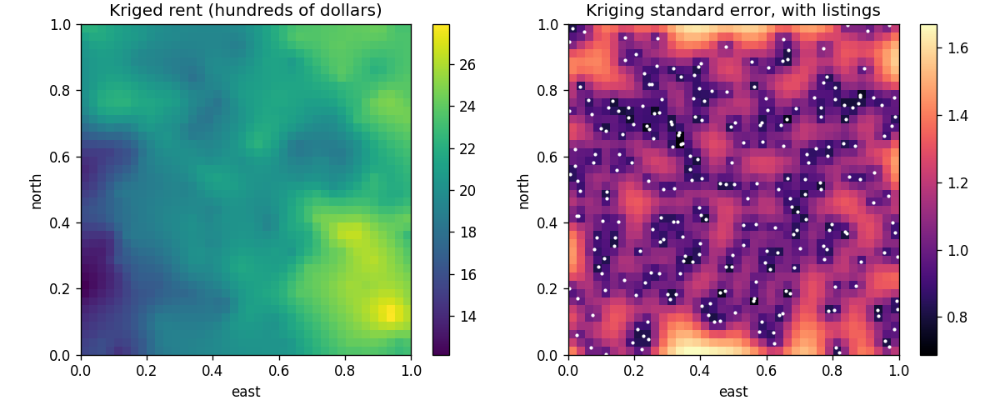

The left panel of Figure 4.2 shows the trend rising to the east, broken up by the neighborhood effect: a pocket of low rents in the southwest and high rents toward the southeast corner. The right panel shows where those predictions can be trusted. The standard error ranges from 0.688 to 1.669. It is smallest at and between dense clusters of listings and largest in gaps, along the edges, and especially in the corners and along the top and bottom borders, where the nearest listings are farthest away and on one side only. Because the kriging variance does not depend on the observed rents (Section 4.2.2), this right panel could have been drawn before any rents were collected.

### 4.8.5 How the Kriging Standard Error Depends on the Number of Listings

Chapter 0 and Section 1.4.4 said that packing more listings into the same district barely improves a region-wide quantity such as the average rent, but helps a great deal for prediction at a particular location. This experiment shows both. The kriging variance depends only on where the listings are (Section 4.2.2), so no rents need to be simulated. For each number of listings $n$ the code draws 20 sets of $n$ locations uniformly in the district, computes the universal kriging standard error of the noise-free rent at the district's center, $(0.5, 0.5)$, with the formula of Section 4.4.4 (the simple kriging variance plus the cost of estimating the trend), and computes, for the same locations, the effective sample size of the sample mean from Section 1.4.1, $n_{\text{eff}} = C(0)/\operatorname{Var}(\bar{Y})$ with $C(0) = \sigma^2 + \tau^2$.

```python
rng = np.random.default_rng(2031)
s0 = np.array([[0.5, 0.5]])
x0 = np.array([1.0, 0.5])
print("    n   mean SE   (min, max)        mean n_eff of the sample mean")
for n_i in (25, 100, 250, 1000):
    se_list, neff_list = [], []
    for _ in range(20):
        S_i = rng.uniform(size=(n_i, 2))
        Sig = sigma2 * np.exp(-dist(S_i) / phi) + tau2 * np.eye(n_i)
        X_i = np.column_stack([np.ones(n_i), S_i[:, 0]])
        c0 = sigma2 * np.exp(-dist(S_i, s0)[:, 0] / phi)
        Sig_c = np.linalg.solve(Sig, c0)
        Sig_X = np.linalg.solve(Sig, X_i)
        d0 = x0 - X_i.T @ Sig_c
        var_uk = (sigma2 - c0 @ Sig_c
                  + d0 @ np.linalg.solve(X_i.T @ Sig_X, d0))
        se_list.append(np.sqrt(var_uk))
        one = np.ones(n_i)
        neff_list.append((sigma2 + tau2) / (one @ Sig @ one / n_i**2))
    print(f"{n_i:5d}   {np.mean(se_list):.3f}   "
          f"({min(se_list):.3f}, {max(se_list):.3f})   "
          f"{np.mean(neff_list):.2f}")
```

| $n$ | Mean standard error at $(0.5, 0.5)$ | Range over the 20 location sets | Mean $n_{\text{eff}}$ of the sample mean |
| :--- | :--- | :--- | :--- |
| 25 | 1.568 | 0.927 to 1.841 | 9.08 |
| 100 | 1.309 | 1.083 to 1.546 | 11.95 |
| 250 | 1.092 | 0.936 to 1.351 | 12.74 |
| 1,000 | 0.821 | 0.655 to 0.961 | 13.17 |

The two columns tell different stories. The standard error of the prediction falls from 1.57 to 0.82 as the number of listings grows 40-fold, and it would keep falling with more listings, because the noise-free rent at a point can be learned more and more precisely from the listings around it. The effective sample size of the sample mean goes from 9 to only 13: the average rent of the district is limited by how many independent fluctuations the district contains (Section 1.4.3), not by how many listings there are. The range column also shows how much the arrangement matters at small $n$: a lucky arrangement of 25 listings, with one close to the center, beats an unlucky arrangement of 100 (0.927 against 1.546). That is the point of spatial sampling design, which Appendix D mentions: where the listings are can matter as much as how many.

---

<a id="ch4-exercises"></a>

## Exercises

**Analytical**

1. Show that for any linear predictor $\lambda_0 + \boldsymbol{\lambda}'\mathbf{Y}$, the MSPE for the target $\tilde{Y}(\mathbf{s}_0)$ equals $\boldsymbol{\lambda}'\boldsymbol{\Sigma}\boldsymbol{\lambda} - 2\boldsymbol{\lambda}'\mathbf{c}_0 + \sigma^2 + (\lambda_0 + \boldsymbol{\lambda}'\boldsymbol{\mu} - \mu_0)^2$. Use it to explain why simple kriging can always remove the bias term, while ordinary kriging cannot without a constraint.

2. Using the formula for $\boldsymbol{\lambda}_{\text{OK}}$ in Section 4.3.2 with $n = 2$, $\boldsymbol{\Sigma} = \begin{bmatrix} 1 & r \\ r & 1 \end{bmatrix}$, and $\mathbf{c}_0 = (c_1, c_2)'$, derive $\lambda_1$ and $m$ by hand and confirm the SymPy output of Section 4.8.1.

3. Use the block inversion formula of Section 4.3.4 to write $\mathbf{K}^{-1}$ for the ordinary kriging matrix in terms of $\boldsymbol{\Sigma}^{-1}$ and $q_0 = \mathbf{1}_n'\boldsymbol{\Sigma}^{-1}\mathbf{1}_n$. Multiply it by $(\mathbf{c}_0', 1)'$ and show that you recover the formulas for $\boldsymbol{\lambda}_{\text{OK}}$ and $m$.

4. Complete the derivation of the universal kriging variance in Section 4.4.4: starting from $\sigma^2_{\text{UK}} = \sigma^2 - \boldsymbol{\lambda}'\mathbf{c}_0 - \mathbf{x}_0'\mathbf{m}$, substitute the solutions for $\boldsymbol{\lambda}$ and $\mathbf{m}$ and show that it equals $\sigma^2_{\text{SK}} + \mathbf{d}_0'(\mathbf{X}'\boldsymbol{\Sigma}^{-1}\mathbf{X})^{-1}\mathbf{d}_0$. Check that with $\mathbf{X} = \mathbf{1}_n$ it reduces to the ordinary kriging result.

5. For the four-apartment block with $\tau^2 = 0$, predict at the midpoint of the south side, $\mathbf{s}_0 = (0.5, 0)$, by simple kriging. Use the eigenvectors of Section 1.3.3: split $\mathbf{c}_0$ into parts along $(1, 1, 1, 1)'$ and $(-1, -1, 1, 1)'$ (south against north), and divide each part by its eigenvalue. Are any weights negative? Explain.

6. Show that when $\tau^2 = 0$ and $\mathbf{s}_0 = \mathbf{s}_i$, the universal kriging variance is zero. Then show that with $\tau^2 > 0$ it is strictly positive at every data location.

7. In Section 4.5.3, verify that minimizing $\lVert\mathbf{y} - \mathbf{C}_u\boldsymbol{\alpha}\rVert^2 + \tau^2\boldsymbol{\alpha}'\mathbf{C}_u\boldsymbol{\alpha}$ gives $\boldsymbol{\alpha} = (\mathbf{C}_u + \tau^2\mathbf{I}_n)^{-1}\mathbf{y}$ when $\mathbf{C}_u$ is invertible. What changes if $\mathbf{C}_u$ is singular?

8. Show that if $V \sim N(a, v)$, then $\operatorname{E}[e^V] = e^{a + v/2}$, by completing the square in the integral. Use the result to explain why $\exp(\hat{Y}_{\text{SK}})$ is the conditional median of $\exp(\tilde{Y}(\mathbf{s}_0))$.

9. Show that $\boldsymbol{\Pi}\mathbf{X} = \mathbf{0}$ and $\boldsymbol{\Pi}\boldsymbol{\Sigma}\boldsymbol{\Pi} = \boldsymbol{\Pi}$. Use the first to explain why the leave-one-out residuals do not depend on the true value of $\boldsymbol{\beta}$.

10. In the block-kriging argument of Section 4.6.3, when is the inequality an equality? Describe a covariance model and a block for which block kriging gives almost no improvement over point kriging.

11. Formulate ordinary kriging directly through the semivariogram $\gamma(\mathbf{h})$ rather than the covariance $C(\mathbf{h})$. Assume intrinsic stationarity, with $\gamma(\mathbf{s}_i - \mathbf{s}_j) = C(\mathbf{0}) - C(\mathbf{s}_i - \mathbf{s}_j)$. Define the $n \times n$ semivariogram matrix $\boldsymbol{\Gamma}$ with entries $\Gamma_{ij} = \gamma(\mathbf{s}_i - \mathbf{s}_j)$ and the target semivariogram vector $\boldsymbol{\gamma}_0$ with entries $(\boldsymbol{\gamma}_0)_i = \gamma(\mathbf{s}_i - \mathbf{s}_0)$.
    (a) For any weight vector satisfying $\boldsymbol{\lambda}'\mathbf{1}_n = 1$, show that $\boldsymbol{\lambda}'\boldsymbol{\Sigma}\boldsymbol{\lambda} = C(\mathbf{0}) - \boldsymbol{\lambda}'\boldsymbol{\Gamma}\boldsymbol{\lambda}$ and $\boldsymbol{\lambda}'\mathbf{c}_0 = C(\mathbf{0}) - \boldsymbol{\lambda}'\boldsymbol{\gamma}_0$.
    (b) Show that minimizing the prediction error variance subject to $\boldsymbol{\lambda}'\mathbf{1}_n = 1$ leads to the linear system
    $$
    \begin{bmatrix} \boldsymbol{\Gamma} & \mathbf{1}_n \\ \mathbf{1}_n' & 0 \end{bmatrix} \begin{bmatrix} \boldsymbol{\lambda} \\ m_\gamma \end{bmatrix} = \begin{bmatrix} \boldsymbol{\gamma}_0 \\ 1 \end{bmatrix}
    $$
    with $m_\gamma = -m$, giving the identical weights $\boldsymbol{\lambda}_{\text{OK}}$ as the covariance system.
    (c) Show that the ordinary kriging variance equals $\sigma^2_{\text{OK}} = \boldsymbol{\lambda}'\boldsymbol{\gamma}_0 + m_\gamma$. Use this to explain why ordinary kriging requires only intrinsic stationarity, whereas simple kriging requires second-order stationarity.

12. In a one-dimensional spatial process on the line with exponential covariance $C(h) = \sigma^2 \exp(-\lvert h\rvert / \phi)$ and no nugget ($\tau^2 = 0$), the process is a stationary Markov process (the Ornstein-Uhlenbeck process). Suppose observations are located at $s_1 < s_2 < \dots < s_n$. We want to predict $\tilde{Y}(s_0)$ at an interior point $s_0 \in (s_k, s_{k+1})$ by simple kriging with mean zero.
    (a) Using the tridiagonal structure of $\boldsymbol{\Sigma}^{-1}$ from Section 1.3.2, show that the simple kriging weights $\lambda_j$ are zero for all $j \notin \{k, k+1\}$: the screening effect is exact.
    (b) Solve the reduced $2 \times 2$ system for the weights $\lambda_k$ and $\lambda_{k+1}$ on the two enclosing neighbors in terms of $d_1 = s_0 - s_k$, $d_2 = s_{k+1} - s_0$, and $\Delta = s_{k+1} - s_k = d_1 + d_2$.
    (c) Show that both weights are positive. Show that as the correlation range $\phi \to \infty$, the weights converge to linear interpolation: $\lambda_k \to d_2 / \Delta$ and $\lambda_{k+1} \to d_1 / \Delta$.

13. Derive the simple kriging predictor as a conditional expectation under joint normality. Suppose $\mathbf{Y}$ and $\tilde{Y}_0 = \tilde{Y}(\mathbf{s}_0)$ are jointly Gaussian:
    $$
    \begin{bmatrix} \mathbf{Y} \\ \tilde{Y}_0 \end{bmatrix} \sim N\!\left(\begin{bmatrix} \boldsymbol{\mu} \\ \mu_0 \end{bmatrix},\; \begin{bmatrix} \boldsymbol{\Sigma} & \mathbf{c}_0 \\ \mathbf{c}_0' & \sigma^2 \end{bmatrix}\right)
    $$
    Define the random variable $Z = \tilde{Y}_0 - \mathbf{c}_0'\boldsymbol{\Sigma}^{-1}\mathbf{Y}$.
    (a) Compute $\operatorname{Cov}(Z, \mathbf{Y})$ and show that it equals $\mathbf{0}'$.
    (b) Because linear combinations of Gaussian vectors are Gaussian, zero covariance implies that $Z$ and $\mathbf{Y}$ are independent. Use this independence to evaluate $\operatorname{E}[\tilde{Y}_0 \mid \mathbf{Y}]$ and $\operatorname{Var}(\tilde{Y}_0 \mid \mathbf{Y})$ by writing $\tilde{Y}_0 = Z + \mathbf{c}_0'\boldsymbol{\Sigma}^{-1}\mathbf{Y}$.
    (c) Confirm that the conditional mean and conditional variance match the simple kriging formulas $\hat{Y}_{\text{SK}}(\mathbf{s}_0)$ and $\sigma^2_{\text{SK}}(\mathbf{s}_0)$. Explain why this implies that under normality, no nonlinear predictor can achieve a lower mean squared prediction error than simple kriging.

14. Suppose simple kriging weights $\boldsymbol{\lambda}_n = \boldsymbol{\Sigma}_n^{-1}\mathbf{c}_0$ have been computed for $n$ listings. A new listing arrives at location $\mathbf{s}_{n+1}$, expanding the covariance matrix to $\boldsymbol{\Sigma}_{n+1} = \begin{bmatrix} \boldsymbol{\Sigma}_n & \mathbf{k} \\ \mathbf{k}' & \Sigma_{n+1, n+1} \end{bmatrix}$ and the target covariance to $\mathbf{c}_{0, n+1} = (\mathbf{c}_0', c_{0, n+1})'$.
    (a) Use the block inversion formula of Section 4.3.4 to express $\boldsymbol{\Sigma}_{n+1}^{-1}$ in terms of $\boldsymbol{\Sigma}_n^{-1}$, $\mathbf{k}$, and the scalar Schur complement $s = \Sigma_{n+1, n+1} - \mathbf{k}'\boldsymbol{\Sigma}_n^{-1}\mathbf{k}$.
    (b) Show that the new weight on listing $n+1$ is $\lambda_{n+1} = (c_{0, n+1} - \mathbf{k}'\boldsymbol{\lambda}_n) / s$, and express the updated weights $\boldsymbol{\lambda}_{1:n}$ on the original $n$ listings in terms of $\boldsymbol{\lambda}_n$ and $\lambda_{n+1}$.
    (c) Show that the updated simple kriging variance satisfies $\sigma^2_{\text{SK}, n+1} = \sigma^2_{\text{SK}, n} - s\,\lambda_{n+1}^2$. Conclude that adding an observation can never increase the simple kriging variance.

15. In ordinary kriging, consider relaxing the unbiasedness constraint to $\boldsymbol{\lambda}'\mathbf{1}_n = c$ for an arbitrary scalar $c$.
    (a) Minimize $\operatorname{MSPE}(\boldsymbol{\lambda}) = \boldsymbol{\lambda}'\boldsymbol{\Sigma}\boldsymbol{\lambda} - 2\boldsymbol{\lambda}'\mathbf{c}_0 + \sigma^2$ subject to $\boldsymbol{\lambda}'\mathbf{1}_n = c$ using the Lagrangian $\mathcal{L}_c(\boldsymbol{\lambda}, m) = \operatorname{MSPE}(\boldsymbol{\lambda}) + 2m(\boldsymbol{\lambda}'\mathbf{1}_n - c)$. Show that the constrained minimum variance as a function of $c$, $V(c)$, satisfies $V(c) = \sigma^2_{\text{SK}} + (c - a_0)^2 / q_0$, where $a_0 = \mathbf{1}_n'\boldsymbol{\Sigma}^{-1}\mathbf{c}_0$ and $q_0 = \mathbf{1}_n'\boldsymbol{\Sigma}^{-1}\mathbf{1}_n$.
    (b) Differentiate $V(c)$ with respect to $c$ and evaluate at $c = 1$. Show that $V'(1) = 2m$, confirming the economic interpretation of the Lagrange multiplier as the marginal change in prediction variance per unit shift in the constraint.
    (c) Using $m = (a_0 - 1) / q_0$, explain under what conditions on the location $\mathbf{s}_0$ the Lagrange multiplier satisfies $m < 0$, $m = 0$, or $m > 0$.

**Computational and simulation**

16. For the rent district, compute the universal kriging standard error along the line from $(0.5, 0.5)$ to $(2, 0.5)$, east out of the district. Plot the simple kriging variance and the trend cost separately. Where does the trend cost overtake the simple kriging variance?

17. Repeat the coverage experiment of Section 4.8.3 for the other target: a new observation at each grid location, with intervals $\hat{Y} \pm 1.96\sqrt{\sigma^2_{\text{UK}} + \tau^2}$. Confirm about 95% coverage, and show that the intervals for $\tilde{Y}$ cover new observations far less often.

18. Run the coverage experiment with a misspecified covariance: krige with $\phi = 0.05$ or $\phi = 0.4$ while simulating with $\phi = 0.15$. Report coverage and RMSE. Which mistake is worse, and why?

19. Use the LOOCV shortcut to choose $\phi$ for the rent district: compute the leave-one-out root mean squared error for $\phi$ from 0.05 to 0.40, keeping $\sigma^2$ and $\tau^2$ fixed. Does the minimum fall near the true value 0.15?

20. Compute block kriging variances for squares $[0.5 - w/2, 0.5 + w/2]^2$ with $w$ from 0.02 to 0.8, and plot them against $w$. Explain the shape of the curve, including its value as $w \to 0$.

---

<a id="ch4-what-comes-next"></a>

## What Comes Next

This chapter assumed the covariance parameters were known. Chapter 5 estimates them by maximum likelihood and restricted maximum likelihood, using the same matrices that appeared here: $\boldsymbol{\Sigma}^{-1}$, the GLS estimate, and the residual precision $\boldsymbol{\Pi}$, which turns out to be the heart of the restricted likelihood. Section 5.4.5 compares the kriging variances computed at the maximum likelihood, REML, and true parameters and discusses what plugging in estimates costs, and Section 5.6.1 uses the leave-one-out residuals of Section 4.7 as a diagnostic.


---

<a id="ch5"></a>

# Chapter 5: Likelihood Inference, Model Selection, and Diagnostics

Chapter 3 estimated the covariance parameters by fitting a curve to an empirical variogram, and Chapter 4 used them to predict rents at unlisted buildings, treating them as known. This chapter estimates everything at once from the likelihood: the regression coefficients $\boldsymbol{\beta}$ and the covariance parameters, which, as in Section 3.3, we collect in a vector $\boldsymbol{\theta} = (\sigma^2, \tau^2, \phi)'$.

Likelihood is the method you already know from mathematical statistics: write the density of the data as a function of the parameters and find the parameters that make the observed data most probable. For spatial data the density is multivariate normal with a covariance matrix that depends on $\boldsymbol{\theta}$, so every tool from Chapters 0 through 2 comes back: quadratic forms, determinants, the Cholesky factorization, and generalized least squares. The new ingredients are two derivatives of matrices, which give us standard errors, and one correction, restricted maximum likelihood, which fixes the tendency of maximum likelihood to underestimate variances.

The chapter also asks the questions an analyst faces after fitting. Which covariance family fits best? Is there spatial structure at all, or a nugget at all? Do the residuals look like the model says they should? And what goes wrong when several apartments in one building share the same coordinates?

The running example throughout is a simulated data set of 250 rent listings scattered over a district, with true parameters $\sigma^2 = 4$, $\tau^2 = 1$, $\phi = 0.15$, and a trend that rises toward the east. Because the data are simulated, we can always compare the estimates with the truth.

> **Chapter at a Glance**
>
> - **The Log-Likelihood (§5.1):** From the multivariate normal density to $\ell(\boldsymbol{\beta}, \boldsymbol{\theta})$, evaluated by hand on four apartments.
> - **Profile Likelihood (§5.2):** $\boldsymbol{\beta}$ and $\sigma^2$ have closed-form estimates for fixed $(\phi, \delta)$, which reduces the search to two dimensions.
> - **REML (§5.3):** Why maximum likelihood underestimates variances, and how likelihood for error contrasts fixes it without depending on the contrasts chosen.
> - **Optimization and Standard Errors (§5.4):** Cholesky evaluation, the score and the information matrix, Fisher scoring, and why $\sigma^2$ and $\phi$ are hard to separate.
> - **Model Selection and Tests (§5.5):** AIC and BIC across Matérn smoothness values, and likelihood ratio tests when the null value lies on the boundary.
> - **Diagnostics (§5.6):** Decorrelated residuals, spatial confounding, and duplicate locations.
> - **Walkthrough and Lab (§5.7):** A symbolic check of the information formula, a small-sample comparison of ML and REML, and figures of the likelihood surface.

---

<a id="s5-1"></a>

## 5.1 The Multivariate Normal Log-Likelihood

Under the model of Chapter 2, the vector of $n$ responses is multivariate normal:

$$
\mathbf{Y} \sim N\!\left(\mathbf{X}\boldsymbol{\beta},\ \boldsymbol{\Sigma}(\boldsymbol{\theta})\right), \qquad \boldsymbol{\Sigma}(\boldsymbol{\theta}) = \sigma^2\mathbf{R}(\phi) + \tau^2\mathbf{I}_n
$$

Its density, evaluated at the observed data $\mathbf{y}$, is

$$
f(\mathbf{y}) = (2\pi)^{-n/2}\lvert\boldsymbol{\Sigma}(\boldsymbol{\theta})\rvert^{-1/2}\exp\!\left\{-\tfrac{1}{2}(\mathbf{y} - \mathbf{X}\boldsymbol{\beta})'\boldsymbol{\Sigma}(\boldsymbol{\theta})^{-1}(\mathbf{y} - \mathbf{X}\boldsymbol{\beta})\right\}
$$

Read as a function of the parameters with the data fixed, this is the likelihood. Its logarithm is the **log-likelihood**, written $\ell$:

$$
\ell(\boldsymbol{\beta}, \boldsymbol{\theta}) = -\frac{n}{2}\log(2\pi) - \frac{1}{2}\log\lvert\boldsymbol{\Sigma}(\boldsymbol{\theta})\rvert - \frac{1}{2}(\mathbf{y} - \mathbf{X}\boldsymbol{\beta})'\boldsymbol{\Sigma}(\boldsymbol{\theta})^{-1}(\mathbf{y} - \mathbf{X}\boldsymbol{\beta})
$$

This is Tool 3 of Section 0.4.3, now with parameters inside $\boldsymbol{\Sigma}$. The two parts still compete. The determinant term penalizes covariance matrices that allow a lot of spread. The quadratic form, a Mahalanobis distance, rewards covariance matrices under which the residuals look typical. Maximum likelihood estimation (ML) chooses the $\boldsymbol{\beta}$ and $\boldsymbol{\theta}$ that maximize $\ell$.

**A hand-sized example.** Return to the four apartments at the corners of a block (Sections 1.3.2 and 1.3.3), with $\boldsymbol{\Sigma}$ having entries $e^{-h_{ij}}$ ($\sigma^2 = 1$, $\tau^2 = 0$, $\phi = 1$). Suppose the residuals from a known mean are

$$
\mathbf{y} - \mathbf{X}\boldsymbol{\beta} = (0.5,\ 1.5,\ -0.5,\ 0.5)'
$$

for apartments at $(0,0)$, $(1,0)$, $(0,1)$, and $(1,1)$. We can evaluate $\ell$ by hand using the eigenvectors of Section 1.3.3, because they make both terms easy.

*The determinant.* The determinant of a matrix is the product of its eigenvalues, so its logarithm is the sum of their logarithms:

$$
\log\lvert\boldsymbol{\Sigma}\rvert = \log 1.9789 + 2\log 0.7569 + \log 0.5074 = 0.6825 - 0.5570 - 0.6785 = -0.5530
$$

*The quadratic form.* With $\boldsymbol{\Sigma} = \mathbf{U}\boldsymbol{\Lambda}\mathbf{U}'$, the inverse is $\boldsymbol{\Sigma}^{-1} = \mathbf{U}\boldsymbol{\Lambda}^{-1}\mathbf{U}'$, so for any vector $\mathbf{e}$,

$$
\mathbf{e}'\boldsymbol{\Sigma}^{-1}\mathbf{e} = \sum_{k} \frac{(\mathbf{v}_k'\mathbf{e})^2}{\lambda_k}
$$

The four patterns of Section 1.3.3, scaled to length 1, are $(1,1,1,1)'/2$, $(-1,1,-1,1)'/2$, $(-1,-1,1,1)'/2$, and $(1,-1,-1,1)'/2$. Their inner products with $\mathbf{e} = (0.5, 1.5, -0.5, 0.5)'$ are $1$, $1$, $-1$, and $0$. So

$$
\mathbf{e}'\boldsymbol{\Sigma}^{-1}\mathbf{e} = \frac{1}{1.9789} + \frac{1}{0.7569} + \frac{1}{0.7569} + \frac{0}{0.5074} = 0.5053 + 1.3212 + 1.3212 = 3.1477
$$

*The log-likelihood.* Putting the pieces together, with $-2\log(2\pi) = -3.6758$,

$$
\ell = -3.6758 - \tfrac{1}{2}(-0.5530) - \tfrac{1}{2}(3.1477) = -3.6758 + 0.2765 - 1.5739 = -4.9732
$$

For comparison, if the four residuals were independent with variance 1, then $\boldsymbol{\Sigma} = \mathbf{I}_4$, the determinant term is 0, the quadratic form is $0.25 + 2.25 + 0.25 + 0.25 = 3$, and $\ell = -3.6758 - 1.5 = -5.1758$. The spatial model has the higher likelihood.

It is worth seeing why. The spatial model's quadratic form (3.1477) is slightly worse than the independent model's (3.0), because the data put weight on the east-west and north-south patterns, which the spatial model expects to be smaller than 1. But the spatial model's determinant is smaller than 1, since correlated values occupy less "volume," and that earns it $+0.2765$. The determinant reward outweighs the slightly worse fit.

The code below repeats the calculation with a Cholesky factorization, the method used for real data (Section 5.4.1). The small differences in the fourth decimal place come from rounding the hand calculation.

```python
import numpy as np
from scipy import linalg, optimize, stats

S4 = np.array([[0.0, 0.0], [1.0, 0.0], [0.0, 1.0], [1.0, 1.0]])
H4 = np.sqrt(((S4[:, None, :] - S4[None, :, :])**2).sum(axis=2))
Sigma4 = np.exp(-H4)
y4 = np.array([0.5, 1.5, -0.5, 0.5])


def gauss_loglik(y, mean, Sigma):
    """Multivariate normal log-likelihood, evaluated with Cholesky."""
    n = len(y)
    c = linalg.cho_factor(Sigma, lower=True)
    r = y - mean
    quad = r @ linalg.cho_solve(c, r)
    logdet = 2 * np.sum(np.log(np.diag(c[0])))
    return -0.5 * n * np.log(2 * np.pi) - 0.5 * logdet - 0.5 * quad


print("eigenvalues:", np.round(np.linalg.eigvalsh(Sigma4), 4))
print("log|Sigma| =", round(np.linalg.slogdet(Sigma4)[1], 4))
print("quadratic form =", round(y4 @ np.linalg.solve(Sigma4, y4), 4))
print("loglik, spatial:", round(gauss_loglik(y4, 0.0, Sigma4), 4))
print("loglik, independent:", round(gauss_loglik(y4, 0.0, np.eye(4)), 4))
```

The code gives $\log\lvert\boldsymbol{\Sigma}\rvert = -0.5531$, a quadratic form of 3.1478, and log-likelihoods of $-4.9731$ (spatial) and $-5.1758$ (independent).

---

<a id="s5-2"></a>

## 5.2 Profile Maximum Likelihood

The log-likelihood has five unknowns in the rent example: two regression coefficients and three covariance parameters. Maximizing over all five numerically is possible but slow and fragile. Two of them can be solved for exactly, which leaves a search over two.

### 5.2.1 Factoring Out the Scale

Section 2.1.4 introduced the noise-to-signal ratio $\delta = \tau^2/\sigma^2$ and wrote

$$
\boldsymbol{\Sigma} = \sigma^2\boldsymbol{\Psi}(\phi, \delta), \qquad \boldsymbol{\Psi}(\phi, \delta) = \mathbf{R}(\phi) + \delta\mathbf{I}_n
$$

We now reparameterize from $(\sigma^2, \tau^2, \phi)$ to $(\sigma^2, \phi, \delta)$. Two facts about scalar multiples simplify the log-likelihood. The determinant of $\sigma^2\boldsymbol{\Psi}$ is $(\sigma^2)^n\lvert\boldsymbol{\Psi}\rvert$, because multiplying an $n \times n$ matrix by a scalar multiplies each of its $n$ eigenvalues by that scalar. And the inverse is $\boldsymbol{\Sigma}^{-1} = \boldsymbol{\Psi}^{-1}/\sigma^2$. Substituting,

$$
\ell = -\frac{n}{2}\log(2\pi) - \frac{n}{2}\log\sigma^2 - \frac{1}{2}\log\lvert\boldsymbol{\Psi}\rvert - \frac{1}{2\sigma^2}(\mathbf{y} - \mathbf{X}\boldsymbol{\beta})'\boldsymbol{\Psi}^{-1}(\mathbf{y} - \mathbf{X}\boldsymbol{\beta})
$$

where $\boldsymbol{\Psi}$ depends on $(\phi, \delta)$ only.

### 5.2.2 Closed-Form Estimates of $\boldsymbol{\beta}$ and $\sigma^2$

Hold $\phi$ and $\delta$ fixed for the moment.

**The coefficients.** Only the last term involves $\boldsymbol{\beta}$, and maximizing $\ell$ means minimizing $(\mathbf{y} - \mathbf{X}\boldsymbol{\beta})'\boldsymbol{\Psi}^{-1}(\mathbf{y} - \mathbf{X}\boldsymbol{\beta})$. That is the generalized least squares problem of Section 1.3.5, with $\boldsymbol{\Psi}$ in place of $\boldsymbol{\Sigma}$. Setting its gradient $-2\mathbf{X}'\boldsymbol{\Psi}^{-1}(\mathbf{y} - \mathbf{X}\boldsymbol{\beta})$ to zero,

$$
\hat{\boldsymbol{\beta}}(\phi, \delta) = (\mathbf{X}'\boldsymbol{\Psi}^{-1}\mathbf{X})^{-1}\mathbf{X}'\boldsymbol{\Psi}^{-1}\mathbf{y}
$$

The scale $\sigma^2$ cancels, so this is exactly the GLS estimator with $\boldsymbol{\Sigma}$.

**The scale.** Write $\mathrm{RSS}_\Psi(\phi, \delta) = (\mathbf{y} - \mathbf{X}\hat{\boldsymbol{\beta}})'\boldsymbol{\Psi}^{-1}(\mathbf{y} - \mathbf{X}\hat{\boldsymbol{\beta}})$ for the generalized residual sum of squares. Differentiating $\ell$ with respect to $\sigma^2$, with $\boldsymbol{\beta} = \hat{\boldsymbol{\beta}}$,

$$
\frac{\partial\ell}{\partial\sigma^2} = -\frac{n}{2\sigma^2} + \frac{\mathrm{RSS}_\Psi}{2\sigma^4} = 0 \quad\Longrightarrow\quad \hat{\sigma}^2(\phi, \delta) = \frac{\mathrm{RSS}_\Psi(\phi, \delta)}{n}
$$

This is the calculation of Section 0.4.4, with a mean added.

**The profile log-likelihood.** Substituting both estimates back, the quadratic term becomes $\mathrm{RSS}_\Psi/(2\hat{\sigma}^2) = n/2$, and

$$
\ell_p(\phi, \delta) = -\frac{n}{2}\left[\log\!\left(2\pi\hat{\sigma}^2(\phi, \delta)\right) + 1\right] - \frac{1}{2}\log\lvert\boldsymbol{\Psi}(\phi, \delta)\rvert
$$

This is the **profile log-likelihood**: for each $(\phi, \delta)$, the best value of $\ell$ over $\boldsymbol{\beta}$ and $\sigma^2$. Maximizing it over two parameters gives the same answer as maximizing $\ell$ over all five. We search over $\log\phi$ and $\log\delta$ rather than $\phi$ and $\delta$, so that the search can never step to a negative value, and we use SciPy's bounded L-BFGS-B method.

The code below defines the running data set, the profile log-likelihood (with a switch for REML, which Section 5.3 explains), and the optimizer, and then fits the rent data. The design matrix has an intercept and the east coordinate, so $p = 2$.

```python
def dist(S):
    """Matrix of Euclidean distances between the rows of S."""
    q = np.sum(S**2, axis=1)
    H2 = q[:, None] - 2 * S @ S.T + q[None, :]
    H = np.sqrt(np.maximum(H2, 0.0))
    np.fill_diagonal(H, 0.0)
    return H


def rent_district(n=250, seed=2030):
    """Simulated rent listings: locations, trend, effect, noise, rent."""
    rng = np.random.default_rng(seed)
    S = rng.uniform(size=(n, 2))
    mu = 18.0 + 6.0 * S[:, 0]
    R = np.exp(-dist(S) / 0.15)
    L = np.linalg.cholesky(4.0 * R + 1e-10 * np.eye(n))
    u = L @ rng.standard_normal(n)
    eps = rng.standard_normal(n)
    return S, mu, u, eps, mu + u + eps


def matern(H, phi, nu):
    """Matern correlation for nu = 1/2, 3/2, 5/2 (closed forms)."""
    x = H / phi
    if nu == 0.5:
        return np.exp(-x)
    if nu == 1.5:
        return (1 + x) * np.exp(-x)
    return (1 + x + x**2 / 3) * np.exp(-x)


def profile_fit(phi, delta, y, X, H, nu=0.5, reml=False):
    """Profile out beta and sigma2 for fixed (phi, delta)."""
    n, p = X.shape
    Psi = matern(H, phi, nu) + delta * np.eye(n)
    c = linalg.cho_factor(Psi, lower=True)
    PsiX = linalg.cho_solve(c, X)
    XtPX = X.T @ PsiX
    beta = np.linalg.solve(XtPX, PsiX.T @ y)
    r = y - X @ beta
    quad = r @ linalg.cho_solve(c, r)
    logdet = 2 * np.sum(np.log(np.diag(c[0])))
    m = n - p if reml else n
    sigma2 = quad / m
    ll = -0.5 * m * (np.log(2 * np.pi * sigma2) + 1) - 0.5 * logdet
    if reml:
        ll -= 0.5 * np.linalg.slogdet(XtPX)[1]
    return dict(ll=ll, beta=beta, sigma2=sigma2, tau2=delta * sigma2,
                phi=phi, delta=delta)


def fit(y, X, H, nu=0.5, reml=False, start=(0.2, 0.5)):
    """Maximize the profile log-likelihood over log(phi), log(delta)."""
    def neg(lp):
        try:
            return -profile_fit(np.exp(lp[0]), np.exp(lp[1]), y, X, H,
                                nu, reml)["ll"]
        except linalg.LinAlgError:
            return 1e10
    bounds = [(np.log(1e-3), np.log(5.0)), (np.log(1e-6), np.log(1e3))]
    res = optimize.minimize(neg, np.log(start), method="L-BFGS-B",
                            bounds=bounds)
    return profile_fit(np.exp(res.x[0]), np.exp(res.x[1]), y, X, H, nu,
                       reml)


S, mu, u, eps, y = rent_district()
n = len(y)
H = dist(S)
X = np.column_stack([np.ones(n), S[:, 0]])
fit_ml = fit(y, X, H, reml=False)
fit_reml = fit(y, X, H, reml=True)
for name, f in (("ML", fit_ml), ("REML", fit_reml)):
    print(f"{name:5s} sigma2={f['sigma2']:.3f}  tau2={f['tau2']:.3f}  "
          f"phi={f['phi']:.4f}  beta=({f['beta'][0]:.3f}, "
          f"{f['beta'][1]:.3f})  loglik={f['ll']:.3f}")
```

| Method | $\hat{\sigma}^2$ | $\hat{\tau}^2$ | $\hat{\phi}$ | $\hat{\beta}_0$ | $\hat{\beta}_1$ (east) | Maximized log-likelihood |
| :--- | :--- | :--- | :--- | :--- | :--- | :--- |
| Truth | 4 | 1 | 0.15 | 18 | 6 | |
| ML | 4.672 | 1.202 | 0.1880 | 16.873 | 7.101 | $-490.949$ |
| REML | 7.193 | 1.267 | 0.3266 | 16.918 | 6.770 | $-488.560$ |
| Chapter 3: WLS on OLS residuals (plane trend) | 3.736 | 1.342 | 0.178 | | | |

The last row repeats the estimates of Chapter 3 (Section 3.5.1), where Cressie's weighted least squares was applied to the variogram of the OLS residuals from a plane trend in both coordinates. The trend model differs from the east-only trend used here, so the comparison is rough. Those residuals have covariance $\boldsymbol{\Sigma}_e = (\mathbf{I}_n - \mathbf{P}_{\mathbf{X}})\boldsymbol{\Sigma}(\mathbf{I}_n - \mathbf{P}_{\mathbf{X}})$ (Section 3.4.3): the estimated mean absorbs smooth variation, which biases the residual variogram downward at long distances. The likelihood methods avoid the binning and the separate detrending step, and REML in particular is built to account for the part of the variation that the estimated mean absorbs (Section 5.3). On this one data set the weighted least squares estimates of $\sigma^2$ and $\phi$ happen to be closer to the truth than either likelihood estimate; that is a property of this realization, and of the ridge described in Section 5.4.4, not a ranking of the methods. The ML estimates of $\sigma^2$, $\tau^2$, and $\phi$ are all in the right neighborhood. The REML estimates, explained in the next section, put $\sigma^2$ and $\phi$ much higher. That is not a mistake in either method; Section 5.4.4 shows that this data set barely distinguishes between the two answers. (The two log-likelihoods are on different scales and cannot be compared with each other; Section 5.5.1 explains why.)

---

<a id="s5-3"></a>

## 5.3 Restricted Maximum Likelihood (REML)

### 5.3.1 Why ML Underestimates Variance Parameters

Start with the simplest case: independent observations with an unknown mean, $\mathbf{X} = \mathbf{1}$ and $\boldsymbol{\Psi} = \mathbf{I}_n$. Then $\hat{\boldsymbol{\beta}} = \bar{y}$ and the ML estimate of the variance is

$$
\hat{\sigma}^2_{\text{ML}} = \frac{1}{n}\sum_{i=1}^n (y_i - \bar{y})^2
$$

which, as you know from mathematical statistics, has expectation $\sigma^2(n - 1)/n$. The familiar fix is to divide by $n - 1$. The reason is that the residuals $y_i - \bar{y}$ are measured from an estimated mean, which is placed to make them as small as possible. One of the $n$ dimensions of the data has been spent estimating the mean, and only $n - 1$ remain to estimate the variance.

The same thing happens in general. With $\boldsymbol{\Psi}$ known, write the generalized residual sum of squares as a quadratic form. Since $\mathbf{y} - \mathbf{X}\hat{\boldsymbol{\beta}} = \left(\mathbf{I}_n - \mathbf{X}(\mathbf{X}'\boldsymbol{\Psi}^{-1}\mathbf{X})^{-1}\mathbf{X}'\boldsymbol{\Psi}^{-1}\right)\mathbf{y}$, a short calculation gives

$$
\mathrm{RSS}_\Psi = \mathbf{y}'\boldsymbol{\Pi}_\Psi\mathbf{y}, \qquad \boldsymbol{\Pi}_\Psi = \boldsymbol{\Psi}^{-1} - \boldsymbol{\Psi}^{-1}\mathbf{X}(\mathbf{X}'\boldsymbol{\Psi}^{-1}\mathbf{X})^{-1}\mathbf{X}'\boldsymbol{\Psi}^{-1}
$$

This $\boldsymbol{\Pi}_\Psi$ is the residual precision matrix of Section 4.7, built from $\boldsymbol{\Psi}$ instead of $\boldsymbol{\Sigma}$. It satisfies $\boldsymbol{\Pi}_\Psi\mathbf{X} = \mathbf{0}$, so the mean term of the quadratic-form expectation (Section 1.1.1) vanishes, and with $\operatorname{Var}(\mathbf{Y}) = \sigma^2\boldsymbol{\Psi}$,

$$
\operatorname{E}[\mathrm{RSS}_\Psi] = \operatorname{tr}(\boldsymbol{\Pi}_\Psi\,\sigma^2\boldsymbol{\Psi}) = \sigma^2\left[n - \operatorname{tr}\!\left((\mathbf{X}'\boldsymbol{\Psi}^{-1}\mathbf{X})^{-1}\mathbf{X}'\boldsymbol{\Psi}^{-1}\mathbf{X}\right)\right] = \sigma^2(n - p)
$$

using a cycle of the trace in the last step. So $\operatorname{E}[\hat{\sigma}^2_{\text{ML}}] = \sigma^2(n - p)/n$: ML divides by $n$ when only $n - p$ dimensions of the data carry information about the variance.

When $\phi$ and $\delta$ are also estimated, the problem grows. The estimated mean absorbs some of the smooth spatial variation, the residuals look less variable and less correlated than the process really is, and the estimates of $\sigma^2$, $\tau^2$, and $\phi$ are all pulled down. Section 5.7.2 measures this: with 60 locations, the median ML estimates are $\hat{\sigma}^2 = 3.620$, $\hat{\tau}^2 = 0.546$, and $\hat{\phi} = 0.1011$, against true values of 4, 1, and 0.15.

### 5.3.2 Filtering Out the Mean With Error Contrasts

Restricted (or residual) maximum likelihood, REML, removes the mean from the problem before estimating the variance. The idea is to base the likelihood on linear combinations of the data whose distribution does not involve $\boldsymbol{\beta}$ at all.

Let $\mathbf{T}$ be an $n \times (n - p)$ matrix of full column rank with

$$
\mathbf{T}'\mathbf{X} = \mathbf{0}
$$

Its columns are called **error contrasts**. Each column $\mathbf{t}$ satisfies $\operatorname{E}[\mathbf{t}'\mathbf{Y}] = \mathbf{t}'\mathbf{X}\boldsymbol{\beta} = 0$ for every $\boldsymbol{\beta}$, so the vector $\mathbf{T}'\mathbf{Y}$ has mean zero no matter what $\boldsymbol{\beta}$ is. By Tool 1 its covariance is $\mathbf{T}'\boldsymbol{\Sigma}\mathbf{T}$, so

$$
\mathbf{T}'\mathbf{Y} \sim N\!\left(\mathbf{0},\ \mathbf{T}'\boldsymbol{\Sigma}(\boldsymbol{\theta})\mathbf{T}\right)
$$

The mean has disappeared and only $\boldsymbol{\theta}$ remains. Why $n - p$ columns? The condition $\mathbf{T}'\mathbf{X} = \mathbf{0}$ says each column of $\mathbf{T}$ is perpendicular to the $p$ columns of $\mathbf{X}$. The vectors perpendicular to $p$ independent vectors in $n$ dimensions form a space of dimension $n - p$, so that is the largest number of independent contrasts available. These are the $n - p$ dimensions left over after estimating $\boldsymbol{\beta}$.

A convenient choice is an orthonormal $\mathbf{T}$, with $\mathbf{T}'\mathbf{T} = \mathbf{I}_{n-p}$. Then $\mathbf{T}\mathbf{T}' = \mathbf{I}_n - \mathbf{P}_{\mathbf{X}}$, the projection onto the space perpendicular to the columns of $\mathbf{X}$. One way to construct it is the QR decomposition of $[\mathbf{X}\ \ \mathbf{I}_n]$: the first $p$ columns of the orthonormal factor span the columns of $\mathbf{X}$, and the remaining $n - p$ columns are perpendicular to them.

Two identities connect contrasts back to quantities we already know. Recall the residual precision matrix of Section 4.7,

$$
\boldsymbol{\Pi} = \boldsymbol{\Sigma}^{-1} - \boldsymbol{\Sigma}^{-1}\mathbf{X}(\mathbf{X}'\boldsymbol{\Sigma}^{-1}\mathbf{X})^{-1}\mathbf{X}'\boldsymbol{\Sigma}^{-1}
$$

Then, for any $\mathbf{T}$ with $\mathbf{T}'\mathbf{X} = \mathbf{0}$ and $n - p$ independent columns,

$$
\boldsymbol{\Pi} = \mathbf{T}(\mathbf{T}'\boldsymbol{\Sigma}\mathbf{T})^{-1}\mathbf{T}'
$$

and, if $\mathbf{T}$ is orthonormal,

$$
\lvert\mathbf{T}'\boldsymbol{\Sigma}\mathbf{T}\rvert = \frac{\lvert\boldsymbol{\Sigma}\rvert\,\lvert\mathbf{X}'\boldsymbol{\Sigma}^{-1}\mathbf{X}\rvert}{\lvert\mathbf{X}'\mathbf{X}\rvert}
$$

Section 5.3.4 proves both. The first says that the quadratic form of the contrasts, $(\mathbf{T}'\mathbf{y})'(\mathbf{T}'\boldsymbol{\Sigma}\mathbf{T})^{-1}(\mathbf{T}'\mathbf{y})$, equals $\mathbf{y}'\boldsymbol{\Pi}\mathbf{y}$. There is a second useful form of this quantity. Multiplying out $\boldsymbol{\Pi}\mathbf{y}$ gives $\boldsymbol{\Sigma}^{-1}(\mathbf{y} - \mathbf{X}\hat{\boldsymbol{\beta}}_{\text{GLS}})$, as Section 4.7 noted, so

$$
\mathbf{y}'\boldsymbol{\Pi}\mathbf{y} = (\mathbf{y} - \mathbf{X}\hat{\boldsymbol{\beta}}_{\text{GLS}})'\boldsymbol{\Sigma}^{-1}(\mathbf{y} - \mathbf{X}\hat{\boldsymbol{\beta}}_{\text{GLS}})
$$

using the fact that $\mathbf{X}'\boldsymbol{\Sigma}^{-1}(\mathbf{y} - \mathbf{X}\hat{\boldsymbol{\beta}}_{\text{GLS}}) = \mathbf{0}$ by the GLS normal equations. The contrasts never need to be formed in practice.

### 5.3.3 The REML Log-Likelihood

The REML log-likelihood is the log-likelihood of the contrasts $\mathbf{T}'\mathbf{y}$, which is multivariate normal of dimension $n - p$:

$$
\ell_{\text{REML}}(\boldsymbol{\theta}) = -\frac{n-p}{2}\log(2\pi) - \frac{1}{2}\log\lvert\mathbf{T}'\boldsymbol{\Sigma}\mathbf{T}\rvert - \frac{1}{2}\mathbf{y}'\mathbf{T}(\mathbf{T}'\boldsymbol{\Sigma}\mathbf{T})^{-1}\mathbf{T}'\mathbf{y}
$$

**The choice of contrasts does not matter.** Any two valid contrast matrices $\mathbf{T}$ and $\mathbf{T}_2$ have columns spanning the same space, the space perpendicular to the columns of $\mathbf{X}$. So $\mathbf{T}_2 = \mathbf{T}\mathbf{F}$ for some invertible $(n - p) \times (n - p)$ matrix $\mathbf{F}$. Substituting,

$$
\lvert\mathbf{T}_2'\boldsymbol{\Sigma}\mathbf{T}_2\rvert = \lvert\mathbf{F}'\rvert\,\lvert\mathbf{T}'\boldsymbol{\Sigma}\mathbf{T}\rvert\,\lvert\mathbf{F}\rvert = \lvert\mathbf{F}\rvert^2\,\lvert\mathbf{T}'\boldsymbol{\Sigma}\mathbf{T}\rvert
$$

and

$$
\mathbf{T}_2(\mathbf{T}_2'\boldsymbol{\Sigma}\mathbf{T}_2)^{-1}\mathbf{T}_2' = \mathbf{T}\mathbf{F}\,\mathbf{F}^{-1}(\mathbf{T}'\boldsymbol{\Sigma}\mathbf{T})^{-1}(\mathbf{F}')^{-1}\,\mathbf{F}'\mathbf{T}' = \mathbf{T}(\mathbf{T}'\boldsymbol{\Sigma}\mathbf{T})^{-1}\mathbf{T}'
$$

The quadratic form is unchanged, and the determinant term changes by $-\log\lvert\mathbf{F}\rvert$, a constant that does not depend on $\boldsymbol{\theta}$. Different contrasts give log-likelihoods that differ by a constant, so they have the same maximizer and the same curvature. REML is a well-defined method, not a family of methods indexed by $\mathbf{T}$.

**The form used in practice.** With an orthonormal $\mathbf{T}$, the two identities of Section 5.3.2 rewrite everything in terms of $\boldsymbol{\Sigma}$:

$$
\ell_{\text{REML}}(\boldsymbol{\theta}) = -\frac{n-p}{2}\log(2\pi) - \frac{1}{2}\log\lvert\boldsymbol{\Sigma}\rvert - \frac{1}{2}\log\lvert\mathbf{X}'\boldsymbol{\Sigma}^{-1}\mathbf{X}\rvert - \frac{1}{2}\mathbf{y}'\boldsymbol{\Pi}\mathbf{y} + \frac{1}{2}\log\lvert\mathbf{X}'\mathbf{X}\rvert
$$

The last term does not depend on $\boldsymbol{\theta}$ and is usually dropped, which is why the REML log-likelihood is described as unique up to an additive constant. Compared with the ML log-likelihood, REML has $n - p$ in place of $n$, the GLS residuals in the quadratic form, and one extra term, $-\frac{1}{2}\log\lvert\mathbf{X}'\boldsymbol{\Sigma}^{-1}\mathbf{X}\rvert$. That term is the log-determinant of the inverse variance of $\hat{\boldsymbol{\beta}}_{\text{GLS}}$. It corrects for the degrees of freedom used up by estimating $\boldsymbol{\beta}$: it favors covariance parameters under which the estimated mean is less precise, which offsets ML's downward bias in the variance parameters.

**Profiling REML.** The scale factors out exactly as in Section 5.2. With $\boldsymbol{\Sigma} = \sigma^2\boldsymbol{\Psi}$, the terms become $\log\lvert\boldsymbol{\Sigma}\rvert = n\log\sigma^2 + \log\lvert\boldsymbol{\Psi}\rvert$, $\log\lvert\mathbf{X}'\boldsymbol{\Sigma}^{-1}\mathbf{X}\rvert = -p\log\sigma^2 + \log\lvert\mathbf{X}'\boldsymbol{\Psi}^{-1}\mathbf{X}\rvert$, and $\mathbf{y}'\boldsymbol{\Pi}\mathbf{y} = \mathrm{RSS}_\Psi/\sigma^2$. The terms involving $\sigma^2$ are $-\frac{n-p}{2}\log\sigma^2 - \mathrm{RSS}_\Psi/(2\sigma^2)$, maximized at

$$
\hat{\sigma}^2_{\text{REML}}(\phi, \delta) = \frac{\mathrm{RSS}_\Psi(\phi, \delta)}{n - p}
$$

the divisor that makes the known-$\boldsymbol{\Psi}$ estimate unbiased (Section 5.3.1). The profile REML log-likelihood, up to the constant, is

$$
\ell_{\text{REML},p}(\phi, \delta) = -\frac{n-p}{2}\left[\log\!\left(2\pi\hat{\sigma}^2_{\text{REML}}\right) + 1\right] - \frac{1}{2}\log\lvert\boldsymbol{\Psi}\rvert - \frac{1}{2}\log\lvert\mathbf{X}'\boldsymbol{\Psi}^{-1}\mathbf{X}\rvert
$$

which is what `profile_fit` computes when `reml=True`. The estimates of $\boldsymbol{\beta}$ reported with REML are the GLS estimates at the REML values of $(\phi, \delta)$.

The code below builds an orthonormal $\mathbf{T}$ for the rent data from a QR decomposition and checks both identities numerically at the REML estimates.

```python
Q_full, _ = np.linalg.qr(np.column_stack([X, np.eye(n)]))
T = Q_full[:, 2:n]
print("T'X is zero:", np.allclose(T.T @ X, 0.0))
print("T T' = I - P_X:",
      np.allclose(T @ T.T, np.eye(n) - X @ np.linalg.solve(X.T @ X, X.T)))
Sig = fit_reml["sigma2"] * (np.exp(-H / fit_reml["phi"])
                            + fit_reml["delta"] * np.eye(n))
Si = np.linalg.inv(Sig)
Pi = Si - Si @ X @ np.linalg.solve(X.T @ Si @ X, X.T @ Si)
Pi_T = T @ np.linalg.solve(T.T @ Sig @ T, T.T)
print("Pi equals T (T' Sigma T)^{-1} T':", np.allclose(Pi, Pi_T))
lhs = np.linalg.slogdet(T.T @ Sig @ T)[1]
rhs = (np.linalg.slogdet(Sig)[1] + np.linalg.slogdet(X.T @ Si @ X)[1]
       - np.linalg.slogdet(X.T @ X)[1])
print("log|T' Sigma T| =", round(lhs, 4), " identity gives", round(rhs, 4))
```

All three checks print `True`, and both sides of the determinant identity equal 264.778. (This check forms $\boldsymbol{\Sigma}^{-1}$ explicitly for clarity; Section 5.4.1 explains why the fitting code never does.)

### 5.3.4 Proofs of the Two Identities (Optional)

*This subsection proves the identities used in Sections 5.3.2 and 5.3.3. It can be skipped on a first reading.*

**The residual precision identity.** Form the $n \times n$ matrix $\mathbf{J}_1 = [\mathbf{T}\ \ \boldsymbol{\Sigma}^{-1}\mathbf{X}]$, placing the $n - p$ columns of $\mathbf{T}$ next to the $p$ columns of $\boldsymbol{\Sigma}^{-1}\mathbf{X}$. It is invertible: a combination $\mathbf{T}\mathbf{a} + \boldsymbol{\Sigma}^{-1}\mathbf{X}\mathbf{b} = \mathbf{0}$ multiplied on the left by $\mathbf{X}'$ gives $\mathbf{X}'\boldsymbol{\Sigma}^{-1}\mathbf{X}\mathbf{b} = \mathbf{0}$, so $\mathbf{b} = \mathbf{0}$, and then $\mathbf{T}\mathbf{a} = \mathbf{0}$ forces $\mathbf{a} = \mathbf{0}$. (Here $\mathbf{J}_1$ is a local name for this proof only.)

For any invertible $\mathbf{J}_1$,

$$
\mathbf{J}_1(\mathbf{J}_1'\boldsymbol{\Sigma}\mathbf{J}_1)^{-1}\mathbf{J}_1' = \mathbf{J}_1\mathbf{J}_1^{-1}\boldsymbol{\Sigma}^{-1}(\mathbf{J}_1')^{-1}\mathbf{J}_1' = \boldsymbol{\Sigma}^{-1}
$$

Now compute $\mathbf{J}_1'\boldsymbol{\Sigma}\mathbf{J}_1$ in blocks. The off-diagonal block is $\mathbf{T}'\boldsymbol{\Sigma}\boldsymbol{\Sigma}^{-1}\mathbf{X} = \mathbf{T}'\mathbf{X} = \mathbf{0}$, so the matrix is block diagonal:

$$
\mathbf{J}_1'\boldsymbol{\Sigma}\mathbf{J}_1 = \begin{bmatrix} \mathbf{T}'\boldsymbol{\Sigma}\mathbf{T} & \mathbf{0} \\ \mathbf{0} & \mathbf{X}'\boldsymbol{\Sigma}^{-1}\mathbf{X} \end{bmatrix}
$$

Its inverse is block diagonal with the inverse blocks, and multiplying out,

$$
\boldsymbol{\Sigma}^{-1} = \mathbf{T}(\mathbf{T}'\boldsymbol{\Sigma}\mathbf{T})^{-1}\mathbf{T}' + \boldsymbol{\Sigma}^{-1}\mathbf{X}(\mathbf{X}'\boldsymbol{\Sigma}^{-1}\mathbf{X})^{-1}\mathbf{X}'\boldsymbol{\Sigma}^{-1}
$$

Moving the second term to the left side gives $\boldsymbol{\Pi} = \mathbf{T}(\mathbf{T}'\boldsymbol{\Sigma}\mathbf{T})^{-1}\mathbf{T}'$. $\square$

**The determinant identity.** Now let $\mathbf{T}$ be orthonormal and form $\mathbf{J}_2 = [\mathbf{T}\ \ \mathbf{X}]$, which does not depend on $\boldsymbol{\Sigma}$. Because $\mathbf{T}'\mathbf{X} = \mathbf{0}$ and $\mathbf{T}'\mathbf{T} = \mathbf{I}$, $\mathbf{J}_2'\mathbf{J}_2$ is block diagonal with blocks $\mathbf{I}_{n-p}$ and $\mathbf{X}'\mathbf{X}$, so $\lvert\mathbf{J}_2\rvert^2 = \lvert\mathbf{X}'\mathbf{X}\rvert$, and its inverse is $\mathbf{J}_2^{-1} = (\mathbf{J}_2'\mathbf{J}_2)^{-1}\mathbf{J}_2'$, whose rows are $\mathbf{T}'$ and $(\mathbf{X}'\mathbf{X})^{-1}\mathbf{X}'$.

Let $\mathbf{M}_2 = \mathbf{J}_2'\boldsymbol{\Sigma}\mathbf{J}_2$. On one hand, $\lvert\mathbf{M}_2\rvert = \lvert\mathbf{J}_2\rvert^2\lvert\boldsymbol{\Sigma}\rvert = \lvert\mathbf{X}'\mathbf{X}\rvert\,\lvert\boldsymbol{\Sigma}\rvert$. On the other, the block-determinant formula of Appendix A.1 says that for a partitioned matrix, $\lvert\mathbf{M}_2\rvert$ equals the determinant of its upper-left block times the reciprocal of the determinant of the lower-right block of $\mathbf{M}_2^{-1}$. The upper-left block of $\mathbf{M}_2$ is $\mathbf{T}'\boldsymbol{\Sigma}\mathbf{T}$. The lower-right block of $\mathbf{M}_2^{-1} = \mathbf{J}_2^{-1}\boldsymbol{\Sigma}^{-1}(\mathbf{J}_2^{-1})'$ is $(\mathbf{X}'\mathbf{X})^{-1}\mathbf{X}'\boldsymbol{\Sigma}^{-1}\mathbf{X}(\mathbf{X}'\mathbf{X})^{-1}$, with determinant $\lvert\mathbf{X}'\boldsymbol{\Sigma}^{-1}\mathbf{X}\rvert/\lvert\mathbf{X}'\mathbf{X}\rvert^2$. So

$$
\lvert\mathbf{X}'\mathbf{X}\rvert\,\lvert\boldsymbol{\Sigma}\rvert = \lvert\mathbf{T}'\boldsymbol{\Sigma}\mathbf{T}\rvert\,\frac{\lvert\mathbf{X}'\mathbf{X}\rvert^2}{\lvert\mathbf{X}'\boldsymbol{\Sigma}^{-1}\mathbf{X}\rvert}
$$

and rearranging gives the identity. $\square$

---

<a id="s5-4"></a>

## 5.4 Numerical Optimization and Asymptotic Standard Errors

### 5.4.1 Evaluating the Likelihood Safely With Cholesky

Every evaluation of the log-likelihood needs $\log\lvert\boldsymbol{\Sigma}\rvert$ and the quadratic form $\mathbf{e}'\boldsymbol{\Sigma}^{-1}\mathbf{e}$, where $\mathbf{e} = \mathbf{y} - \mathbf{X}\boldsymbol{\beta}$. The Cholesky factor $\mathbf{L}$ of Section 2.7.1 provides both.

**The determinant.** Since $\boldsymbol{\Sigma} = \mathbf{L}\mathbf{L}'$, $\lvert\boldsymbol{\Sigma}\rvert = \lvert\mathbf{L}\rvert^2$. The determinant of a triangular matrix is the product of its diagonal entries, so

$$
\log\lvert\boldsymbol{\Sigma}\rvert = 2\sum_{i=1}^n \log L_{ii}
$$

This is a sum of $n$ moderate numbers. Computing $\lvert\boldsymbol{\Sigma}\rvert$ itself and then taking its logarithm is risky: for the rent data, $\lvert\boldsymbol{\Sigma}\rvert$ at the REML estimates is about $4.5 \times 10^{119}$. That still fits in double precision, whose largest number is about $1.8 \times 10^{308}$, but a data set a few times larger would overflow, and a covariance matrix with small eigenvalues would underflow to zero.

**The quadratic form.** Solve $\mathbf{L}\mathbf{z} = \mathbf{e}$ by forward substitution, which is fast because $\mathbf{L}$ is triangular. Then $\mathbf{z} = \mathbf{L}^{-1}\mathbf{e}$ and

$$
\mathbf{e}'\boldsymbol{\Sigma}^{-1}\mathbf{e} = \mathbf{e}'(\mathbf{L}')^{-1}\mathbf{L}^{-1}\mathbf{e} = \mathbf{z}'\mathbf{z}
$$

No inverse is ever formed. Forming $\boldsymbol{\Sigma}^{-1}$ explicitly costs more and loses accuracy when $\boldsymbol{\Sigma}$ is poorly conditioned. SciPy's `cho_factor` and `cho_solve`, used in `profile_fit`, do exactly this. One factorization of $\boldsymbol{\Psi}$ serves the determinant, the GLS estimate, and the quadratic form.

```python
print("det(Sigma) computed directly:", np.linalg.det(Sig))
c = linalg.cho_factor(Sig, lower=True)
print("log|Sigma| from Cholesky:", round(2 * np.sum(np.log(np.diag(c[0]))), 3))
```

The direct determinant is $4.45 \times 10^{119}$; the Cholesky log-determinant is 275.5.

### 5.4.2 The Score and the Information Matrix

To get standard errors, and to optimize with derivatives, we need the derivatives of $\ell$ with respect to $\boldsymbol{\theta}$. Write $\dot{\boldsymbol{\Sigma}}_j = \partial\boldsymbol{\Sigma}/\partial\theta_j$ for the matrix of derivatives of the entries of $\boldsymbol{\Sigma}$ with respect to the $j$th parameter. Two identities from matrix calculus do all the work (Appendix A.2 collects them).

**Derivative of an inverse.** Differentiate both sides of $\boldsymbol{\Sigma}\boldsymbol{\Sigma}^{-1} = \mathbf{I}$ with the product rule: $\dot{\boldsymbol{\Sigma}}_j\boldsymbol{\Sigma}^{-1} + \boldsymbol{\Sigma}\,\partial(\boldsymbol{\Sigma}^{-1})/\partial\theta_j = \mathbf{0}$. Solving,

$$
\frac{\partial\boldsymbol{\Sigma}^{-1}}{\partial\theta_j} = -\boldsymbol{\Sigma}^{-1}\dot{\boldsymbol{\Sigma}}_j\boldsymbol{\Sigma}^{-1}
$$

the matrix version of $d(1/x) = -dx/x^2$.

**Derivative of a log-determinant.** For a small change $t$ in $\theta_j$, $\boldsymbol{\Sigma}$ changes to approximately $\boldsymbol{\Sigma} + t\dot{\boldsymbol{\Sigma}}_j = \boldsymbol{\Sigma}(\mathbf{I} + t\boldsymbol{\Sigma}^{-1}\dot{\boldsymbol{\Sigma}}_j)$. The determinant of a product is the product of determinants, and $\lvert\mathbf{I} + t\mathbf{B}\rvert \approx 1 + t\operatorname{tr}(\mathbf{B})$ for small $t$, because the eigenvalues of $\mathbf{I} + t\mathbf{B}$ are $1 + t\lambda_k(\mathbf{B})$ and their product is $1 + t\sum_k\lambda_k(\mathbf{B}) + O(t^2)$. Taking logarithms, with $\log(1 + x) \approx x$,

$$
\frac{\partial\log\lvert\boldsymbol{\Sigma}\rvert}{\partial\theta_j} = \operatorname{tr}\!\left(\boldsymbol{\Sigma}^{-1}\dot{\boldsymbol{\Sigma}}_j\right)
$$

the matrix version of $d\log x = dx/x$.

**The score.** Applying both identities to $\ell$, with $\boldsymbol{\beta}$ held fixed and $\mathbf{e} = \mathbf{y} - \mathbf{X}\boldsymbol{\beta}$,

$$
\frac{\partial\ell}{\partial\theta_j} = -\frac{1}{2}\operatorname{tr}\!\left(\boldsymbol{\Sigma}^{-1}\dot{\boldsymbol{\Sigma}}_j\right) + \frac{1}{2}\mathbf{e}'\boldsymbol{\Sigma}^{-1}\dot{\boldsymbol{\Sigma}}_j\boldsymbol{\Sigma}^{-1}\mathbf{e}
$$

This is the **score** for $\theta_j$. Its expectation is zero at the true parameters, as a score should be: by the quadratic-form expectation of Section 1.1.1 with $\operatorname{E}[\mathbf{e}] = \mathbf{0}$ and $\operatorname{Var}(\mathbf{e}) = \boldsymbol{\Sigma}$, $\operatorname{E}[\mathbf{e}'\boldsymbol{\Sigma}^{-1}\dot{\boldsymbol{\Sigma}}_j\boldsymbol{\Sigma}^{-1}\mathbf{e}] = \operatorname{tr}(\boldsymbol{\Sigma}^{-1}\dot{\boldsymbol{\Sigma}}_j\boldsymbol{\Sigma}^{-1}\boldsymbol{\Sigma}) = \operatorname{tr}(\boldsymbol{\Sigma}^{-1}\dot{\boldsymbol{\Sigma}}_j)$, which cancels the first term.

**The expected information.** The Fisher information is the expected value of minus the second derivative of $\ell$. For the covariance parameters it is

$$
\mathcal{I}_{\text{ML}}(\boldsymbol{\theta})_{jk} = \frac{1}{2}\operatorname{tr}\!\left(\boldsymbol{\Sigma}^{-1}\dot{\boldsymbol{\Sigma}}_j\boldsymbol{\Sigma}^{-1}\dot{\boldsymbol{\Sigma}}_k\right)
$$

Section 5.4.6 derives this formula, and Section 5.7.1 checks it symbolically. Two further facts complete the picture. The information between $\boldsymbol{\beta}$ and $\boldsymbol{\theta}$ is zero (the cross derivatives are linear in $\mathbf{e}$, which has mean zero), so the two sets of parameters can be treated separately. And the information for $\boldsymbol{\beta}$ is $\mathbf{X}'\boldsymbol{\Sigma}^{-1}\mathbf{X}$, so the estimated variance of $\hat{\boldsymbol{\beta}}_{\text{GLS}}$ is $(\mathbf{X}'\boldsymbol{\Sigma}^{-1}\mathbf{X})^{-1}$ evaluated at $\hat{\boldsymbol{\theta}}$, as in Section 1.3.5.

**REML.** The REML log-likelihood is the ordinary log-likelihood of the contrasts $\mathbf{T}'\mathbf{y}$, which have covariance $\mathbf{T}'\boldsymbol{\Sigma}\mathbf{T}$ and derivatives $\mathbf{T}'\dot{\boldsymbol{\Sigma}}_j\mathbf{T}$. Applying the formulas above to the contrasts and using $\mathbf{T}(\mathbf{T}'\boldsymbol{\Sigma}\mathbf{T})^{-1}\mathbf{T}' = \boldsymbol{\Pi}$ (Section 5.3.2) with the cyclic property of the trace,

$$
\frac{\partial\ell_{\text{REML}}}{\partial\theta_j} = -\frac{1}{2}\operatorname{tr}\!\left(\boldsymbol{\Pi}\dot{\boldsymbol{\Sigma}}_j\right) + \frac{1}{2}\mathbf{y}'\boldsymbol{\Pi}\dot{\boldsymbol{\Sigma}}_j\boldsymbol{\Pi}\mathbf{y}, \qquad \mathcal{I}_{\text{REML}}(\boldsymbol{\theta})_{jk} = \frac{1}{2}\operatorname{tr}\!\left(\boldsymbol{\Pi}\dot{\boldsymbol{\Sigma}}_j\boldsymbol{\Pi}\dot{\boldsymbol{\Sigma}}_k\right)
$$

The REML formulas are the ML formulas with $\boldsymbol{\Pi}$ in place of $\boldsymbol{\Sigma}^{-1}$.

**The derivatives for the exponential model.** With $\boldsymbol{\theta} = (\sigma^2, \tau^2, \phi)'$ and $\boldsymbol{\Sigma} = \sigma^2\mathbf{R}(\phi) + \tau^2\mathbf{I}_n$, $R_{ij} = e^{-h_{ij}/\phi}$:

$$
\dot{\boldsymbol{\Sigma}}_{\sigma^2} = \mathbf{R}(\phi), \qquad \dot{\boldsymbol{\Sigma}}_{\tau^2} = \mathbf{I}_n, \qquad \left(\dot{\boldsymbol{\Sigma}}_{\phi}\right)_{ij} = \sigma^2\,\frac{h_{ij}}{\phi^2}\,e^{-h_{ij}/\phi}
$$

The last follows from $\frac{d}{d\phi}e^{-h/\phi} = \frac{h}{\phi^2}e^{-h/\phi}$.

### 5.4.3 Fisher Scoring and Standard Errors

**Standard errors.** Under standard conditions, the maximum likelihood estimator is approximately normal with covariance matrix equal to the inverse of the information. So the estimated standard errors are the square roots of the diagonal of $[\mathcal{I}(\hat{\boldsymbol{\theta}})]^{-1}$. (Spatial data stretch the usual conditions, because the observations are not independent. Section 5.4.4 explains when the approximation is poor, and Section 5.5.3 uses the bootstrap as a check.)

**Fisher scoring.** The information also gives an optimization method. Newton-Raphson updates a parameter by $\boldsymbol{\theta}_{\text{new}} = \boldsymbol{\theta} - [\nabla^2\ell]^{-1}\nabla\ell$, using the matrix of second derivatives, the **observed information** with a sign change. Fisher scoring replaces the observed information by its expectation:

$$
\boldsymbol{\theta}_{\text{new}} = \boldsymbol{\theta} + [\mathcal{I}(\boldsymbol{\theta})]^{-1}\,\text{score}(\boldsymbol{\theta})
$$

The expected information is always positive semi-definite and has the simple trace formula above, so scoring is easier to program and more stable far from the maximum. If a step would make a variance negative, we halve it until it does not. Near the maximum both methods converge quickly.

The code below computes the derivative matrices, the ML and REML information, and the standard errors; runs Fisher scoring for REML from a poor starting point; and computes the observed information numerically, by finite differences of the REML log-likelihood, for comparison.

```python
def dSigma(theta, H):
    """Derivatives of Sigma for theta = (sigma2, tau2, phi), exponential."""
    sigma2, tau2, phi = theta
    R = np.exp(-H / phi)
    return [R, np.eye(len(H)), sigma2 * R * H / phi**2]


def sigma_of(theta, H):
    sigma2, tau2, phi = theta
    return sigma2 * np.exp(-H / phi) + tau2 * np.eye(len(H))


def reml_parts(theta, y, X, H):
    """REML score vector and expected information at theta."""
    Si = np.linalg.inv(sigma_of(theta, H))
    Pi = Si - Si @ X @ np.linalg.solve(X.T @ Si @ X, X.T @ Si)
    D = dSigma(theta, H)
    PD = [Pi @ Dj for Dj in D]
    Py = Pi @ y
    score = np.array([-0.5 * np.trace(PDj) + 0.5 * Py @ Dj @ Py
                      for PDj, Dj in zip(PD, D)])
    info = np.array([[0.5 * np.sum(PDj * PDk.T) for PDk in PD]
                     for PDj in PD])
    return score, info


def ml_info(theta, H):
    Si = np.linalg.inv(sigma_of(theta, H))
    SD = [Si @ Dj for Dj in dSigma(theta, H)]
    return np.array([[0.5 * np.sum(a * b.T) for b in SD] for a in SD])


theta_ml = np.array([fit_ml["sigma2"], fit_ml["tau2"], fit_ml["phi"]])
theta_re = np.array([fit_reml["sigma2"], fit_reml["tau2"], fit_reml["phi"]])
for name, th, I in (("ML", theta_ml, ml_info(theta_ml, H)),
                    ("REML", theta_re, reml_parts(theta_re, y, X, H)[1])):
    V = np.linalg.inv(I)
    se = np.sqrt(np.diag(V))
    corr_sp = V[0, 2] / (se[0] * se[2])
    print(f"{name:5s} SE(sigma2)={se[0]:.3f}  SE(tau2)={se[1]:.3f}  "
          f"SE(phi)={se[2]:.4f}  corr(sigma2, phi)={corr_sp:.3f}")

theta = np.array([1.0, 1.0, 0.3])
for it in range(12):
    score, info = reml_parts(theta, y, X, H)
    step = np.linalg.solve(info, score)
    t = 1.0
    while np.any(theta + t * step <= 0):
        t /= 2
    theta = theta + t * step
    if it in (0, 1, 2, 5, 11):
        print(f"iteration {it + 1:2d}: sigma2={theta[0]:.4f}  "
              f"tau2={theta[1]:.4f}  phi={theta[2]:.4f}")


def reml_loglik(theta, y, X, H):
    Sg = sigma_of(theta, H)
    Si = np.linalg.inv(Sg)
    XtSX = X.T @ Si @ X
    Pi = Si - Si @ X @ np.linalg.solve(XtSX, X.T @ Si)
    return -0.5 * (np.linalg.slogdet(Sg)[1] + np.linalg.slogdet(XtSX)[1]
                   + y @ Pi @ y)


eps_fd = 1e-4 * theta_re
Hobs = np.zeros((3, 3))
for j in range(3):
    for k in range(3):
        ej = np.eye(3)[j] * eps_fd[j]
        ek = np.eye(3)[k] * eps_fd[k]
        Hobs[j, k] = (reml_loglik(theta_re + ej + ek, y, X, H)
                      - reml_loglik(theta_re + ej - ek, y, X, H)
                      - reml_loglik(theta_re - ej + ek, y, X, H)
                      + reml_loglik(theta_re - ej - ek, y, X, H)
                      ) / (4 * eps_fd[j] * eps_fd[k])
se_obs = np.sqrt(np.diag(np.linalg.inv(-Hobs)))
print("observed-information SEs:", np.round(se_obs, 4))
```

In the information code, `np.sum(A * B.T)` computes $\operatorname{tr}(\mathbf{A}\mathbf{B})$ without forming the product, since $\operatorname{tr}(\mathbf{A}\mathbf{B}) = \sum_{i,j}A_{ij}B_{ji}$. The code forms $\boldsymbol{\Sigma}^{-1}$ explicitly because the trace formulas need it entry by entry; for 250 locations that is fast and accurate enough.

**Fisher scoring.** Starting from $(\sigma^2, \tau^2, \phi) = (1, 1, 0.3)$:

| Iteration | $\sigma^2$ | $\tau^2$ | $\phi$ |
| :--- | :--- | :--- | :--- |
| 1 | 3.3904 | 1.1169 | 0.1132 |
| 2 | 4.9206 | 1.3829 | 0.2143 |
| 3 | 6.1880 | 1.2607 | 0.2751 |
| 6 | 7.1454 | 1.2661 | 0.3240 |
| 12 | 7.1929 | 1.2666 | 0.3266 |

After 12 iterations scoring reaches the REML estimates of Section 5.2, found there by a different optimizer over a different parameterization. Agreement between two independent routes is a good check on both.

**Standard errors.**

| Method | SE($\hat{\sigma}^2$) | SE($\hat{\tau}^2$) | SE($\hat{\phi}$) | Correlation of $\hat{\sigma}^2$ and $\hat{\phi}$ |
| :--- | :--- | :--- | :--- | :--- |
| ML, expected information | 1.365 | 0.282 | 0.0729 | 0.686 |
| REML, expected information | 4.666 | 0.271 | 0.2535 | 0.940 |
| REML, observed information | 5.7222 | 0.2687 | 0.3089 | |

The nugget is estimated well: $\hat{\tau}^2$ is about 1.2 to 1.3 with a standard error near 0.27 under every method. The partial sill and range are not. Their standard errors are large relative to the estimates, especially under REML, and the two estimates are strongly correlated. The observed and expected information give noticeably different standard errors for $\sigma^2$ and $\phi$, another sign that the likelihood is far from the ideal quadratic shape in those directions. The next section explains why.

### 5.4.4 Practical Identifiability: Why $\sigma^2$ and $\phi$ Travel Together

The ML and REML estimates of Section 5.2 look very different: $\hat{\sigma}^2 = 4.672$ and $\hat{\phi} = 0.188$ against $\hat{\sigma}^2 = 7.193$ and $\hat{\phi} = 0.327$. But their ratios are close:

$$
\frac{\hat{\sigma}^2}{\hat{\phi}} = 24.85 \ (\text{ML}), \qquad 22.03 \ (\text{REML}), \qquad \text{truth } 26.67
$$

The individual estimates differ by more than 50%; the ratios differ by about 13%.

To see what is going on, fix $\phi$ at a sequence of values, maximize the profile REML log-likelihood over $\delta$ at each one, and record the resulting $\hat{\sigma}^2$.

```python
ratio_ml = fit_ml["sigma2"] / fit_ml["phi"]
ratio_re = fit_reml["sigma2"] / fit_reml["phi"]
print(f"sigma2/phi: ML {ratio_ml:.2f}  REML {ratio_re:.2f}  truth "
      f"{4.0 / 0.15:.2f}")
phis = np.array([0.1, 0.15, 0.2, 0.3, 0.4, 0.6])
for phi in phis:
    best = optimize.minimize_scalar(
        lambda ld: -profile_fit(phi, np.exp(ld), y, X, H,
                                reml=True)["ll"],
        bounds=(np.log(1e-4), np.log(10.0)), method="bounded")
    f = profile_fit(phi, np.exp(best.x), y, X, H, reml=True)
    print(f"phi={phi:4.2f}  sigma2={f['sigma2']:6.3f}  "
          f"sigma2/phi={f['sigma2'] / phi:6.2f}  loglik={f['ll']:.3f}")
```

| $\phi$ | 0.10 | 0.15 | 0.20 | 0.30 | 0.40 | 0.60 |
| :--- | :--- | :--- | :--- | :--- | :--- | :--- |
| $\hat{\sigma}^2$ | 3.770 | 4.317 | 5.047 | 6.723 | 8.519 | 12.247 |
| $\hat{\sigma}^2/\phi$ | 37.70 | 28.78 | 25.24 | 22.41 | 21.30 | 20.41 |
| Profile REML log-likelihood | $-491.498$ | $-489.394$ | $-488.800$ | $-488.565$ | $-488.578$ | $-488.662$ |

Between $\phi = 0.2$ and $\phi = 0.6$ the log-likelihood changes by less than 0.25, while $\hat{\sigma}^2$ more than doubles. A change of 0.25 in log-likelihood is far too small to matter (the 95% likelihood ratio threshold for one parameter is 1.92). So the data say almost nothing about where along this stretch the truth lies. They do constrain the ratio, which changes much less over the same stretch. Figure 5.1 in Section 5.7.3 shows the ridge.

The reason is a feature of sampling in a fixed region. Over short distances, the exponential correlation behaves like $e^{-h/\phi} \approx 1 - h/\phi$, so the covariance $\sigma^2 e^{-h/\phi} \approx \sigma^2 - (\sigma^2/\phi)h$ and the semivariogram near the origin is approximately $\tau^2 + (\sigma^2/\phi)h$. Within a fixed district, most of the information comes from pairs of nearby listings, and those pairs see only the slope $\sigma^2/\phi$ of the semivariogram near zero. A larger partial sill with a longer range produces almost the same short-distance behavior as a smaller sill with a shorter range. Separating $\sigma^2$ from $\phi$ requires seeing where the semivariogram levels off, which needs pairs much farther apart than the range, and a fixed region supplies few of them.

For the exponential model this is more than a numerical inconvenience. A known theoretical result is that under infill sampling of a fixed region, which is the setting of Section 1.4.3, no estimator can estimate $\sigma^2$ and $\phi$ separately with increasing precision, while the ratio $\sigma^2/\phi$ can be estimated consistently [@zhang2004]. We take this result from the literature.

The practical lessons are three. Do not interpret $\hat{\sigma}^2$ and $\hat{\phi}$ separately without looking at their joint uncertainty. Report the ratio, or the semivariogram slope near zero, when that is the quantity of interest. And take comfort that spatial prediction depends mainly on the well-determined combination, as the next subsection shows.

### 5.4.5 Plug-In Prediction

Chapter 4 derived kriging predictions and their variances assuming $\boldsymbol{\theta}$ known. In practice we substitute $\hat{\boldsymbol{\theta}}$, which is called **plug-in** prediction. The code below computes the simple kriging variance of Section 4.2.2 for the noise-free target at the center of the district, $(0.5, 0.5)$, using the true parameters, the ML estimates, and the REML estimates.

```python
s0 = np.array([[0.5, 0.5]])
h0 = np.sqrt(((S - s0)**2).sum(axis=1))
for name, th in (("truth", np.array([4.0, 1.0, 0.15])),
                 ("ML", theta_ml), ("REML", theta_re)):
    c0 = th[0] * np.exp(-h0 / th[2])
    v = th[0] - c0 @ np.linalg.solve(sigma_of(th, H), c0)
    print(f"{name:5s} simple kriging variance at (0.5, 0.5): {v:.3f}")
```

The three variances are 0.895 (truth), 0.896 (ML), and 0.841 (REML). Although the ML and REML values of $\sigma^2$ and $\phi$ are far apart, the prediction variances are close, because prediction at a location surrounded by data depends mostly on the short-distance behavior that the data determine well.

Plug-in prediction has a limitation, though: the kriging variance treats $\hat{\boldsymbol{\theta}}$ as if it were the truth, and so it ignores the uncertainty in the estimates. The reported prediction intervals are therefore somewhat too narrow. With 250 listings the effect at this location is small, but it grows with fewer data or with predictions far from any data. Two remedies are a parametric bootstrap, which refits the model on data simulated from $\hat{\boldsymbol{\theta}}$ and adds the variation in the predictions, and Bayesian methods, which average over the uncertainty in $\boldsymbol{\theta}$ (Appendix D).

### 5.4.6 Deriving the Information Formula (Optional)

*This subsection derives the trace formula for the expected information in Section 5.4.2. It can be skipped on a first reading.*

Differentiate the score of Section 5.4.2 with respect to $\theta_k$. Write $\ddot{\boldsymbol{\Sigma}}_{jk}$ for the matrix of second derivatives $\partial^2\boldsymbol{\Sigma}/\partial\theta_j\partial\theta_k$. Using the product rule and the two identities of Section 5.4.2,

$$
\begin{aligned}
\frac{\partial^2\ell}{\partial\theta_j\partial\theta_k} = &-\frac{1}{2}\operatorname{tr}\!\left(-\boldsymbol{\Sigma}^{-1}\dot{\boldsymbol{\Sigma}}_k\boldsymbol{\Sigma}^{-1}\dot{\boldsymbol{\Sigma}}_j + \boldsymbol{\Sigma}^{-1}\ddot{\boldsymbol{\Sigma}}_{jk}\right) \\
&+ \frac{1}{2}\mathbf{e}'\left(-\boldsymbol{\Sigma}^{-1}\dot{\boldsymbol{\Sigma}}_k\boldsymbol{\Sigma}^{-1}\dot{\boldsymbol{\Sigma}}_j\boldsymbol{\Sigma}^{-1} + \boldsymbol{\Sigma}^{-1}\ddot{\boldsymbol{\Sigma}}_{jk}\boldsymbol{\Sigma}^{-1} - \boldsymbol{\Sigma}^{-1}\dot{\boldsymbol{\Sigma}}_j\boldsymbol{\Sigma}^{-1}\dot{\boldsymbol{\Sigma}}_k\boldsymbol{\Sigma}^{-1}\right)\mathbf{e}
\end{aligned}
$$

Now take expectations. Each quadratic form $\mathbf{e}'\mathbf{M}\mathbf{e}$ has expectation $\operatorname{tr}(\mathbf{M}\boldsymbol{\Sigma})$ (Section 1.1.1, with mean zero). The three quadratic forms give

$$
-\operatorname{tr}\!\left(\boldsymbol{\Sigma}^{-1}\dot{\boldsymbol{\Sigma}}_k\boldsymbol{\Sigma}^{-1}\dot{\boldsymbol{\Sigma}}_j\right) + \operatorname{tr}\!\left(\boldsymbol{\Sigma}^{-1}\ddot{\boldsymbol{\Sigma}}_{jk}\right) - \operatorname{tr}\!\left(\boldsymbol{\Sigma}^{-1}\dot{\boldsymbol{\Sigma}}_j\boldsymbol{\Sigma}^{-1}\dot{\boldsymbol{\Sigma}}_k\right)
$$

after cancelling $\boldsymbol{\Sigma}^{-1}\boldsymbol{\Sigma}$ and cycling the trace. The first and third traces are equal (cycle the trace), so the expected quadratic part is $\frac{1}{2}\left[\operatorname{tr}(\boldsymbol{\Sigma}^{-1}\ddot{\boldsymbol{\Sigma}}_{jk}) - 2\operatorname{tr}(\boldsymbol{\Sigma}^{-1}\dot{\boldsymbol{\Sigma}}_j\boldsymbol{\Sigma}^{-1}\dot{\boldsymbol{\Sigma}}_k)\right]$. Adding the first line,

$$
\operatorname{E}\!\left[\frac{\partial^2\ell}{\partial\theta_j\partial\theta_k}\right] = \frac{1}{2}\operatorname{tr}\!\left(\boldsymbol{\Sigma}^{-1}\dot{\boldsymbol{\Sigma}}_j\boldsymbol{\Sigma}^{-1}\dot{\boldsymbol{\Sigma}}_k\right) - \frac{1}{2}\operatorname{tr}\!\left(\boldsymbol{\Sigma}^{-1}\ddot{\boldsymbol{\Sigma}}_{jk}\right) + \frac{1}{2}\operatorname{tr}\!\left(\boldsymbol{\Sigma}^{-1}\ddot{\boldsymbol{\Sigma}}_{jk}\right) - \operatorname{tr}\!\left(\boldsymbol{\Sigma}^{-1}\dot{\boldsymbol{\Sigma}}_j\boldsymbol{\Sigma}^{-1}\dot{\boldsymbol{\Sigma}}_k\right)
$$

The second-derivative terms cancel, and

$$
\mathcal{I}_{\text{ML}}(\boldsymbol{\theta})_{jk} = -\operatorname{E}\!\left[\frac{\partial^2\ell}{\partial\theta_j\partial\theta_k}\right] = \frac{1}{2}\operatorname{tr}\!\left(\boldsymbol{\Sigma}^{-1}\dot{\boldsymbol{\Sigma}}_j\boldsymbol{\Sigma}^{-1}\dot{\boldsymbol{\Sigma}}_k\right)
$$

Notice that the second derivatives of $\boldsymbol{\Sigma}$ dropped out. The expected information needs only first derivatives, which is one reason Fisher scoring is easier to implement than Newton-Raphson. $\square$

---

<a id="s5-5"></a>

## 5.5 Model Selection and Tests for Spatial Structure

### 5.5.1 Comparing Covariance Families With AIC and BIC

Which correlation family should we use for the rents? Chapter 2 offered the exponential, Gaussian, spherical, and Matérn families. The likelihood gives a way to compare them, as long as we pay for extra parameters.

The **Akaike information criterion** and the **Bayesian information criterion** are

$$
\text{AIC} = -2\hat{\ell} + 2k, \qquad \text{BIC} = -2\hat{\ell} + k\log n
$$

where $\hat{\ell}$ is the maximized log-likelihood and $k$ is the number of estimated parameters. Smaller is better. The penalty $2k$ or $k\log n$ offsets the fact that a model with more parameters can always fit at least as well. A common rule of thumb treats AIC differences below about 2 as weak evidence.

The code below fits the Matérn family with $\nu = 1/2$ (the exponential), $3/2$, and $5/2$ by ML. Each model has $k = 5$ parameters: two regression coefficients plus $\sigma^2$, $\tau^2$, and $\phi$. Fixing $\nu$ at each value and comparing the fits is a coarse profile over smoothness, which is more stable than estimating $\nu$ directly.

```python
for nu in (0.5, 1.5, 2.5):
    f = fit(y, X, H, nu=nu, reml=False, start=(0.1, 0.5))
    k = X.shape[1] + 3
    aic = -2 * f["ll"] + 2 * k
    bic = -2 * f["ll"] + k * np.log(n)
    print(f"nu={nu}  loglik={f['ll']:.3f}  AIC={aic:.2f}  BIC={bic:.2f}  "
          f"phi={f['phi']:.4f}  sigma2={f['sigma2']:.3f}  "
          f"tau2={f['tau2']:.3f}")
```

| Smoothness $\nu$ | Log-likelihood | AIC | BIC | $\hat{\phi}$ | $\hat{\sigma}^2$ | $\hat{\tau}^2$ |
| :--- | :--- | :--- | :--- | :--- | :--- | :--- |
| 1/2 (exponential) | $-490.949$ | 991.90 | 1009.51 | 0.1880 | 4.672 | 1.202 |
| 3/2 | $-490.583$ | 991.17 | 1008.77 | 0.0737 | 3.820 | 1.668 |
| 5/2 | $-490.854$ | 991.71 | 1009.32 | 0.0516 | 3.619 | 1.751 |

The data were generated from the exponential model, yet the Matérn model with $\nu = 3/2$ has the lowest AIC and BIC. The differences are under 1, well below the threshold of 2, so the honest conclusion is that this data set cannot tell the three smoothness values apart. That is typical. Smoothness is a property of the process at very short distances, and with listings spread over a district, few pairs are close enough to reveal it. Notice also how the other estimates adjust: the smoother models attribute more variation to the nugget and use a shorter range parameter (recall from Section 2.5 that $\phi$ means something different for each $\nu$).

**A caveat for REML.** REML log-likelihoods can be used the same way to compare covariance models, but only when the design matrix $\mathbf{X}$ is the same. The REML likelihood is the density of the contrasts $\mathbf{T}'\mathbf{y}$, and the contrasts depend on $\mathbf{X}$. Two models with different covariates are likelihoods for different data, and their REML values are not comparable. To compare mean structures, for example whether to include distance to transit, use ML. This is also why the ML and REML log-likelihoods in Section 5.2 cannot be compared with each other.

### 5.5.2 Testing on the Boundary

Is there a nugget at all? Is there any spatial structure? Both questions are hypotheses about a variance being zero: $\tau^2 = 0$, or $\sigma^2 = 0$. The natural tool is the likelihood ratio test,

$$
\text{LRT} = 2\left[\hat{\ell}_{\text{full}} - \hat{\ell}_{\text{null}}\right]
$$

which for one restricted parameter is usually compared with a $\chi^2_1$ distribution. That reference distribution is wrong here, and the reason is worth understanding.

A variance cannot be negative, so the null value 0 sits on the **boundary** of the parameter space. Suppose the null is true, so the true $\tau^2$ is 0. If we could estimate $\tau^2$ without the constraint, the estimate would be roughly normal and centered at 0, falling below 0 about half the time. In those data sets the constrained estimate is exactly 0, the full model reduces to the null model, and the likelihood ratio statistic is exactly 0. In the other half, the estimate is positive and the usual argument applies, so the statistic behaves like a $\chi^2_1$ variable. The null distribution is therefore a 50:50 mixture:

$$
\text{LRT} \sim \tfrac{1}{2}\chi^2_0 + \tfrac{1}{2}\chi^2_1
$$

where $\chi^2_0$ is a point mass at zero. In practice this halves the p-value: $p = \frac{1}{2}P(\chi^2_1 > \text{LRT})$. Equivalently, the 5% critical value is 2.706, the 90th percentile of $\chi^2_1$, instead of 3.841. Using $\chi^2_1$ makes the test too conservative: it rejects too rarely.

```python
def fit_no_nugget(y, X, H):
    """ML fit with tau2 = 0: optimize over phi only."""
    res = optimize.minimize_scalar(
        lambda lp: -profile_fit(np.exp(lp), 0.0, y, X, H)["ll"],
        bounds=(np.log(1e-3), np.log(5.0)), method="bounded")
    return profile_fit(np.exp(res.x), 0.0, y, X, H)


fit0 = fit_no_nugget(y, X, H)
lrt = 2 * (fit_ml["ll"] - fit0["ll"])
print(f"tau2 = 0 fit: loglik={fit0['ll']:.3f}  phi={fit0['phi']:.4f}  "
      f"sigma2={fit0['sigma2']:.3f}")
print(f"LRT = {lrt:.2f}  naive p = {stats.chi2.sf(lrt, 1):.1e}  "
      f"mixture p = {0.5 * stats.chi2.sf(lrt, 1):.1e}")
b_ols = np.linalg.lstsq(X, y, rcond=None)[0]
rss = np.sum((y - X @ b_ols)**2)
ll_iid = -0.5 * n * (np.log(2 * np.pi * rss / n) + 1)
print(f"sigma2 = 0 (independent errors): LRT = "
      f"{2 * (fit_ml['ll'] - ll_iid):.2f}")
print("mixture critical value:", round(stats.chi2.isf(0.10, 1), 3),
      " chi2_1 critical value:", round(stats.chi2.isf(0.05, 1), 3))
```

**Is there a nugget?** Without a nugget, the best fit has log-likelihood $-503.418$, with $\hat{\phi} = 0.0653$ and $\hat{\sigma}^2 = 5.315$. Notice how the model compensates: with no independent noise term, it shortens the range so that nearby listings can still differ. The likelihood ratio statistic is 24.94, with a mixture p-value of $3.0 \times 10^{-7}$ (the naive $\chi^2_1$ value is twice that, $5.9 \times 10^{-7}$). The data leave no doubt that a nugget is needed.

**Is there spatial structure?** Setting $\sigma^2 = 0$ gives the ordinary regression model with independent errors. Its likelihood ratio statistic against the spatial model is 123.17, overwhelming evidence of spatial structure. This test has an extra complication: when $\sigma^2 = 0$ the range $\phi$ disappears from the model, so it is not defined under the null, and the mixture result does not apply exactly. With a statistic this large the conclusion is not in doubt, but in borderline cases the bootstrap of the next subsection is the safe choice.

### 5.5.3 Checking Boundary Results by Parametric Bootstrap

The mixture distribution is an approximation for large samples. A **parametric bootstrap** checks it directly for our data: simulate many data sets from the fitted null model, fit both models to each, and use the simulated likelihood ratio statistics as the reference distribution. We use 200 simulated data sets; the computation takes well under a minute.

```python
rng = np.random.default_rng(55)
Sig0 = fit0["sigma2"] * np.exp(-H / fit0["phi"])
L0 = np.linalg.cholesky(Sig0 + 1e-10 * np.eye(n))
lrt_boot = []
for b in range(200):
    yb = X @ fit0["beta"] + L0 @ rng.standard_normal(n)
    f1 = fit(yb, X, H, start=(fit0["phi"], 0.05))
    f0 = fit_no_nugget(yb, X, H)
    lrt_boot.append(max(2 * (f1["ll"] - f0["ll"]), 0.0))
lrt_boot = np.array(lrt_boot)
print(f"bootstrap: share of LRT below 0.01 = "
      f"{np.mean(lrt_boot < 0.01):.3f}, 95th percentile = "
      f"{np.quantile(lrt_boot, 0.95):.3f}, p-value = "
      f"{np.mean(lrt_boot >= lrt):.3f}")
```

The bootstrap broadly confirms the mixture picture, with a twist. A share of 0.675 of the simulated statistics are essentially zero, more than the half the mixture predicts, and the bootstrap 95th percentile is 1.739, below the mixture's 2.706. The reason stems from finite-sample spatial dependence. With a finite number of locations, nearby listings are positively correlated, so subtle sample fluctuations in the data can easily be absorbed into the smooth spatial field by shortening the range slightly, rather than requiring an explicit nugget. This pulls the unconstrained estimate of $\tau^2$ toward zero even more frequently than the 50% predicted by large-sample theory, piling extra mass at the boundary. Either way, the observed statistic of 24.94 is larger than all 200 bootstrap values, so the bootstrap p-value is below $1/200$, and the conclusion stands.

The general lesson: the mixture is a much better guide than $\chi^2_1$, and the bootstrap is the check when a conclusion depends on the details.

---

<a id="s5-6"></a>

## 5.6 Spatial Regression Diagnostics and Confounding

### 5.6.1 Decorrelated Residuals

In ordinary regression we check a model by looking at its residuals: are they centered, normally distributed, free of pattern? Spatial residuals $\mathbf{e} = \mathbf{y} - \mathbf{X}\hat{\boldsymbol{\beta}}_{\text{GLS}}$ are correlated by design, so the usual plots are hard to read. The fix is to decorrelate them with the Cholesky factor of the fitted covariance matrix, $\hat{\boldsymbol{\Sigma}} = \mathbf{L}\mathbf{L}'$:

$$
\mathbf{r}^* = \mathbf{L}^{-1}(\mathbf{y} - \mathbf{X}\hat{\boldsymbol{\beta}}_{\text{GLS}})
$$

If the model is right, then (ignoring the estimation of $\boldsymbol{\beta}$ and $\boldsymbol{\theta}$) $\operatorname{Var}(\mathbf{r}^*) = \mathbf{L}^{-1}\boldsymbol{\Sigma}(\mathbf{L}^{-1})' = \mathbf{I}_n$ by Tool 1, the same calculation as GLS in Section 1.3.5. So the decorrelated residuals should look like independent standard normal values, and all the familiar checks apply.

Because $\mathbf{L}$ is lower triangular, the decorrelated residuals have a concrete meaning. The first is the first residual, standardized. The $i$th is the standardized error in predicting residual $i$ from residuals $1$ through $i - 1$. The ordering of the locations is arbitrary, so $\mathbf{r}^*$ is a tool for checking the model as a whole, not for locating a problem on the map.

```python
Sig_hat = sigma_of(theta_re, H)
L_hat = np.linalg.cholesky(Sig_hat)
b_gls = fit_reml["beta"]
e_gls = y - X @ b_gls
r_star = linalg.solve_triangular(L_hat, e_gls, lower=True)
print(f"decorrelated residuals: mean={r_star.mean():.3f}  "
      f"sd={r_star.std(ddof=2):.3f}  "
      f"Shapiro-Wilk p={stats.shapiro(r_star).pvalue:.3f}")
close = (H > 0) & (H < 0.05)
i, j = np.where(np.triu(close))
for name, e in (("OLS residuals", y - X @ b_ols),
                ("decorrelated", r_star)):
    z = (e - e.mean()) / e.std()
    print(f"{name:14s} correlation of pairs closer than 0.05: "
          f"{np.mean(z[i] * z[j]):.3f}  ({len(i)} pairs)")
```

For the REML fit, the decorrelated residuals have mean 0.064 and standard deviation 0.998, and a Shapiro-Wilk test of normality gives $p = 0.735$. Figure 5.2 in Section 5.7.3 shows their normal quantile plot, which follows the line closely. To see the decorrelation at work, compare the 223 pairs of listings closer than 0.05 apart. The OLS residuals of those pairs have correlation 0.536: neighbors still share their neighborhood effect. The decorrelated residuals of the same pairs have correlation $-0.029$, essentially none.

Chapter 4 offered a second residual check that needs no Cholesky factor. Section 4.7.2 showed that the leave-one-out residual of listing $i$, the difference between its rent and its prediction from all the other listings, is $(\boldsymbol{\Pi}\mathbf{y})_i/\Pi_{ii}$ with variance $1/\Pi_{ii}$, so the standardized leave-one-out residual is $(\boldsymbol{\Pi}\mathbf{y})_i/\sqrt{\Pi_{ii}}$. Here $\boldsymbol{\Pi} = \boldsymbol{\Sigma}^{-1} - \boldsymbol{\Sigma}^{-1}\mathbf{X}(\mathbf{X}'\boldsymbol{\Sigma}^{-1}\mathbf{X})^{-1}\mathbf{X}'\boldsymbol{\Sigma}^{-1}$ is computed at the REML estimates. The code builds it and compares the two kinds of standardized residual by their mean square (near 1 if the model is right) and the share beyond 1.96 in absolute value (near 5%).

```python
Sig_inv = linalg.cho_solve(linalg.cho_factor(Sig_hat, lower=True),
                           np.eye(n))
Sig_inv_X = Sig_inv @ X
Pi = Sig_inv - Sig_inv_X @ np.linalg.solve(X.T @ Sig_inv_X, Sig_inv_X.T)
loo_std = (Pi @ y) / np.sqrt(np.diag(Pi))
for name, e in (("leave-one-out", loo_std), ("decorrelated", r_star)):
    print(f"{name:14s} mean square={np.mean(e**2):.3f}  "
          f"share beyond 1.96={np.mean(np.abs(e) > 1.96):.3f}")
print("correlation of the two kinds:",
      round(np.corrcoef(loo_std, r_star)[0, 1], 3))
```

For the REML fit the leave-one-out residuals have mean square 1.014 and 6.0% of them lie beyond 1.96, and the decorrelated residuals have mean square 0.992 and 5.2%: both checks say the fitted model is consistent with the data, as it should be for data simulated from this model family. The two kinds of residual are related (their correlation is 0.898) but they answer different questions. The decorrelated residuals depend on the order of the locations and check the joint model as a whole. The leave-one-out residuals do not depend on any ordering, and each belongs to one listing, so they can be plotted on the map to locate a listing that the model predicts badly. This is the diagnostic Section 4.7.3 promised.

### 5.6.2 Spatial Confounding

The east coordinate is a smooth covariate, exactly the kind Section 1.3.4 warned about. Compare the OLS and GLS estimates of its coefficient, whose true value is 6.

```python
XtX_inv = np.linalg.inv(X.T @ X)
V_ols = XtX_inv @ X.T @ Sig_hat @ X @ XtX_inv
V_gls = np.linalg.inv(X.T @ np.linalg.solve(Sig_hat, X))
se_naive = np.sqrt(rss / (n - 2) * XtX_inv[1, 1])
print(f"OLS slope {b_ols[1]:.3f}  naive SE {se_naive:.3f}  "
      f"sandwich SE {np.sqrt(V_ols[1, 1]):.3f}")
print(f"GLS slope {b_gls[1]:.3f}  SE {np.sqrt(V_gls[1, 1]):.3f}")
eig_sigma, U = np.linalg.eigh(Sig_hat)
xc = S[:, 0] - S[:, 0].mean()
share = (U.T @ xc)**2 / (xc @ xc)
print(f"share of the east coordinate on the 5 largest eigenvectors: "
      f"{share[-5:].sum():.3f}")
```

| Estimator | Slope for east | Standard error |
| :--- | :--- | :--- |
| OLS, naive SE | 7.631 | 0.487 |
| OLS, sandwich SE | 7.631 | 2.998 |
| GLS | 6.770 | 2.443 |

Three things stand out. First, the naive OLS standard error, 0.487, is about six times too small, as Chapter 1 predicted for a smooth covariate. Second, the honest standard errors are large: an east-west rise of 6 (hundreds of dollars across the district) is estimated with a standard error of about 2.4 to 3.0. Third, OLS and GLS give noticeably different estimates, though the difference of 0.86 is well within their standard errors.

The eigenvectors explain all three. Of the east coordinate's squared length, 0.901 lies along the five eigenvectors of $\hat{\boldsymbol{\Sigma}}$ with the largest eigenvalues, the smoothest patterns in the district. Those are exactly the patterns in which the neighborhood effect $\mathbf{u}$ has the most variance. The data cannot easily tell whether an east-west rise in rents comes from the covariate or from a large, smooth neighborhood effect that happens to slope east-west. This is **spatial confounding**: a smooth covariate competes with the smooth spatial random effect for the same patterns. GLS gives less weight to those high-variance patterns, which is why its estimate and its standard error differ from OLS.

In this simulation the neighborhood effect was generated independently of the east coordinate, so both OLS and GLS are unbiased and the difference between them is chance. In real data the spatial random effect often stands in for unmeasured variables, such as the age of the housing stock, that may themselves vary smoothly with the covariates. Then the random effect and the covariate are genuinely related, the model's assumption that $\mathbf{u}$ is independent of $\mathbf{X}$ fails, and both estimators can be biased. How best to handle this is an active research question, and Appendix D points to it. The practical advice is to be cautious when interpreting coefficients of smooth covariates in spatial models, and to report how much the estimate changes between OLS and GLS.

### 5.6.3 Duplicate Locations

Rental listings often include several units in one building, all with the same coordinates. Suppose a building has five listed units. What happens to $\boldsymbol{\Sigma}$?

Two listings at the same location are at distance zero, so their correlation is $r(0;\phi) = 1$. Their rows of $\mathbf{R}$ are identical. A matrix with two identical rows is singular, so without a nugget, $\sigma^2\mathbf{R}$ has a zero eigenvalue and no Cholesky factor. The meaning is the transitivity argument of Section 2.4.2 in its extreme form: the model insists that the two units have exactly the same rent, and the data will contradict that.

The nugget repairs this. With $\tau^2 > 0$, the covariance matrix $\sigma^2\mathbf{R} + \tau^2\mathbf{I}$ has every eigenvalue at least $\tau^2$, so it is positive definite. In the language of Section 2.1.3, units in one building differ by the independent noise term, which is exactly what the nugget represents. Duplicate locations are in fact the best possible data for estimating the nugget: for two units at the same location, $\operatorname{Var}(Y_i - Y_j) = 2\tau^2$, with no contribution from $u$.

The code takes the first 20 listings and adds four more units at the location of the first, making a building of five.

```python
S_dup = np.vstack([S[:20], np.repeat(S[[0]], 4, axis=0)])
D_dup = S_dup[:, None, :] - S_dup[None, :, :]
H_dup = np.sqrt((D_dup**2).sum(axis=2))
R_dup = np.exp(-H_dup / 0.15)
print("smallest eigenvalue, tau2 = 0:",
      f"{np.linalg.eigvalsh(R_dup).min():.1e}")
try:
    np.linalg.cholesky(4.0 * R_dup)
    print("Cholesky with tau2 = 0 succeeded")
except np.linalg.LinAlgError:
    print("Cholesky with tau2 = 0 failed")
Sig_dup = 4.0 * R_dup + 1.0 * np.eye(len(H_dup))
print("condition number with tau2 = 1:",
      f"{np.linalg.cond(Sig_dup):.1f}")
```

Without a nugget, the smallest eigenvalue is $1.6 \times 10^{-46}$, zero to machine precision, and the Cholesky factorization fails. With $\tau^2 = 1$ the condition number is 25.2, perfectly safe.

One numerical detail: this code computes distances from explicit coordinate differences rather than with the `dist` function of Section 1.6.1. The quadratic-expansion trick in `dist` leaves rounding errors of about $10^{-8}$ in the distance between two identical locations that are not on the diagonal, which would make the duplicate rows almost, but not exactly, identical and hide the problem. With duplicates in the data, compute distances directly or round them.

---

<a id="s5-7"></a>

## 5.7 Walkthrough and Lab 5

### 5.7.1 Checking the Information Formula Symbolically

Section 5.4.6 derived the expected information by hand. SymPy can check it on a small case. Take two locations with $\boldsymbol{\Sigma} = \begin{bmatrix} \sigma^2 + \tau^2 & \sigma^2 r \\ \sigma^2 r & \sigma^2 + \tau^2 \end{bmatrix}$, a fixed correlation $r$, and data $\mathbf{y} = (y_1, y_2)'$ with mean zero. For each pair of parameters in $(\sigma^2, \tau^2)$, the code computes minus the second derivative of the log-likelihood, takes its expectation by replacing each product $y_iy_j$ with $\Sigma_{ij}$, and subtracts the trace formula.

```python
import sympy as sp

s2, t2, r_, y1, y2 = sp.symbols("sigma2 tau2 r y1 y2", real=True)
Sig_s = sp.Matrix([[s2 + t2, s2 * r_], [s2 * r_, s2 + t2]])
yv = sp.Matrix([y1, y2])
ll_s = (-sp.log(Sig_s.det()) / 2
        - (yv.T * Sig_s.inv() * yv)[0, 0] / 2)
params = (s2, t2)


def expect(expr):
    """Replace y_i y_j by Sigma_ij: the expectation when E[y] = 0."""
    expr = sp.expand(expr)
    poly = sp.Poly(expr, y1, y2)
    out = 0
    for (a, b), coef in poly.terms():
        if (a, b) == (2, 0):
            out += coef * Sig_s[0, 0]
        elif (a, b) == (0, 2):
            out += coef * Sig_s[1, 1]
        elif (a, b) == (1, 1):
            out += coef * Sig_s[0, 1]
        else:
            out += coef
    return out


Si_s = Sig_s.inv()
D_s = [Sig_s.diff(t) for t in params]
for j in range(2):
    for k in range(2):
        info_hess = expect(-sp.diff(ll_s, params[j], params[k]))
        info_trace = (Si_s * D_s[j] * Si_s * D_s[k]).trace() / 2
        print(f"entry ({j + 1},{k + 1}) difference:",
              sp.simplify(info_hess - info_trace))
```

All four differences simplify to 0: the trace formula agrees with the expected second derivative, symbolically, for every value of $\sigma^2$, $\tau^2$, and $r$.

### 5.7.2 ML Versus REML in Small Samples

Section 5.3.1 claimed that ML pulls variance estimates down and REML reduces the problem. To check, simulate 200 small data sets of 60 listings each, with the same true parameters as the running example ($\sigma^2 = 4$, $\tau^2 = 1$, $\phi = 0.15$, $\boldsymbol{\beta} = (18, 6)'$), and fit both methods to each.

```python
rng = np.random.default_rng(77)
S_small = rng.uniform(size=(60, 2))
H_small = dist(S_small)
X_small = np.column_stack([np.ones(60), S_small[:, 0]])
L_small = np.linalg.cholesky(4.0 * np.exp(-H_small / 0.15) + np.eye(60))
est = {"ML": [], "REML": []}
for b in range(200):
    yb = X_small @ np.array([18.0, 6.0]) + L_small @ rng.standard_normal(60)
    for name, flag in (("ML", False), ("REML", True)):
        f = fit(yb, X_small, H_small, reml=flag, start=(0.15, 0.25))
        est[name].append((f["sigma2"], f["tau2"], f["phi"]))
for name in est:
    a = np.array(est[name])
    print(f"{name:5s} median sigma2={np.median(a[:, 0]):.3f}  "
          f"median tau2={np.median(a[:, 1]):.3f}  "
          f"median phi={np.median(a[:, 2]):.4f}  "
          f"median sigma2+tau2={np.median(a[:, 0] + a[:, 1]):.3f}")
```

| Method | Median $\hat{\sigma}^2$ | Median $\hat{\tau}^2$ | Median $\hat{\phi}$ | Median $\hat{\sigma}^2 + \hat{\tau}^2$ |
| :--- | :--- | :--- | :--- | :--- |
| Truth | 4 | 1 | 0.15 | 5 |
| ML | 3.620 | 0.546 | 0.1011 | 4.235 |
| REML | 4.447 | 0.723 | 0.1469 | 5.028 |

We report medians because the estimates of $\sigma^2$ and $\phi$ have long right tails, a consequence of the ridge in Section 5.4.4. ML is pulled down in every component: the median total variance is 4.235 against a true 5. REML's median total variance is 5.028 and its median range is 0.1469, both close to the truth. Neither method estimates the nugget well with only 60 listings, though REML is closer.

### 5.7.3 Figures: The Likelihood Surface and the Residuals

The last block draws the profile REML log-likelihood over $(\phi, \delta)$ for the rent data, the path of $\hat{\sigma}^2$ along the ridge, and a normal quantile plot of the decorrelated residuals. It saves the figures to `figures/ch05/`; run it from the top folder of the repository.

```python
import os
import matplotlib
matplotlib.use("Agg")
import matplotlib.pyplot as plt

os.makedirs("figures/ch05", exist_ok=True)
phi_grid = np.exp(np.linspace(np.log(0.05), np.log(1.0), 40))
delta_grid = np.exp(np.linspace(np.log(0.02), np.log(1.0), 40))
LL = np.array([[profile_fit(p, d, y, X, H, reml=True)["ll"]
                for p in phi_grid] for d in delta_grid])
fig, axes = plt.subplots(1, 2, figsize=(10, 3.8))
cs = axes[0].contour(phi_grid, delta_grid, LL - LL.max(),
                     levels=[-6, -4, -2, -1, -0.5], cmap="viridis")
axes[0].clabel(cs, fontsize=8)
axes[0].plot(fit_reml["phi"], fit_reml["delta"], "k+", ms=10,
             label="REML estimate")
axes[0].plot(0.15, 0.25, "ro", label="truth")
axes[0].set_xscale("log")
axes[0].set_yscale("log")
axes[0].set_xlabel("range phi")
axes[0].set_ylabel("noise-to-signal ratio delta")
axes[0].legend(fontsize=8)
best = LL.argmax(axis=0)
sig_path = [profile_fit(p, delta_grid[k], y, X, H, reml=True)["sigma2"]
            for p, k in zip(phi_grid, best)]
axes[1].plot(phi_grid, sig_path, label="sigma2 along the ridge")
axes[1].plot(phi_grid, np.array(sig_path) / phi_grid / 4,
             label="(sigma2 / phi) / 4")
axes[1].set_xscale("log")
axes[1].set_xlabel("range phi")
axes[1].legend(fontsize=8)
fig.tight_layout()
fig.savefig("figures/ch05/fig_5_1_reml_surface.png", dpi=120)

fig, ax = plt.subplots(figsize=(4.5, 4))
stats.probplot(r_star, dist="norm", plot=ax)
ax.set_title("Decorrelated residuals")
fig.tight_layout()
fig.savefig("figures/ch05/fig_5_2_residual_qq.png", dpi=120)
print("figures saved")
```

![Figure 5.1. Left: contours of the profile REML log-likelihood for the simulated rent data, relative to its maximum, over the range phi and the noise-to-signal ratio delta (both on log scales). The true values (dot) and the REML estimate (cross) both lie inside the highest contour, along a ridge that stretches toward long ranges. Right: along that ridge, the estimated sigma2 rises steadily with phi, while the ratio sigma2/phi (scaled by 1/4 to share the axis) changes much less once phi exceeds about 0.2.](current/figures/ch05/fig_5_1_reml_surface.png)

In the left panel of Figure 5.1, the contours stretch into a long ridge that runs from the truth toward larger ranges and smaller noise-to-signal ratios. The truth and the REML estimate both sit inside the contour half a unit below the maximum, so the data cannot distinguish them. The right panel follows the ridge: as $\phi$ goes from 0.05 to 1, the estimated $\sigma^2$ rises from under 4 to about 20, while the scaled ratio $\sigma^2/\phi$ falls steeply at first and then levels off between about 5 and 6.3 (a ratio of about 20 to 25) for ranges above 0.2. This is the picture behind Section 5.4.4.


Figure 5.2 shows the decorrelated residuals of Section 5.6.1 against normal quantiles. The points lie close to the line throughout, with only slight departures in the extreme tails, consistent with the Shapiro-Wilk p-value of 0.735.

---

<a id="ch5-exercises"></a>

## Exercises

**Analytical**

1. Starting from the multivariate normal density, derive the log-likelihood of Section 5.1. Then show that when $\boldsymbol{\Sigma} = \tau^2\mathbf{I}_n$, maximizing it over $\boldsymbol{\beta}$ and $\tau^2$ gives the OLS estimate and $\hat{\tau}^2 = \mathbf{e}'\mathbf{e}/n$.

2. In the hand example of Section 5.1, change the residuals to $(1, 1, 1, 1)'$ and then to $(1, -1, -1, 1)'$. For each, compute the spatial and independent log-likelihoods by hand using the eigenvector method. Explain which model each residual pattern favors and why.

3. Show that $\mathrm{RSS}_\Psi = \mathbf{y}'\boldsymbol{\Pi}_\Psi\mathbf{y}$, as claimed in Section 5.3.1. (Write $\mathbf{y} - \mathbf{X}\hat{\boldsymbol{\beta}}$ as a matrix times $\mathbf{y}$ and multiply out.)

4. For the intercept-only model with $\boldsymbol{\Psi} = \mathbf{I}_n$, show that the profile REML log-likelihood is maximized at $\hat{\sigma}^2 = \frac{1}{n-1}\sum_i(y_i - \bar{y})^2$. Then write down an explicit contrast matrix $\mathbf{T}$ for $n = 3$ that is not orthonormal, and verify by hand that it gives the same estimate.

5. Using the identity $\boldsymbol{\Pi} = \mathbf{T}(\mathbf{T}'\boldsymbol{\Sigma}\mathbf{T})^{-1}\mathbf{T}'$, show that $\boldsymbol{\Pi}\boldsymbol{\Sigma}\boldsymbol{\Pi} = \boldsymbol{\Pi}$ and $\operatorname{tr}(\boldsymbol{\Pi}\boldsymbol{\Sigma}) = n - p$.

6. Derive the REML score of Section 5.4.2 directly from the profile-free REML log-likelihood, using the two matrix-calculus identities and the derivative $\partial\boldsymbol{\Pi}/\partial\theta_j = -\boldsymbol{\Pi}\dot{\boldsymbol{\Sigma}}_j\boldsymbol{\Pi}$. (Prove this derivative first.)

7. For the exponential model, compute the expected information entry $\mathcal{I}_{\text{ML}}(\boldsymbol{\theta})_{\tau^2\tau^2}$ when $\sigma^2 = 0$, and interpret the result.

8. Explain, using the expansion $e^{-h/\phi} \approx 1 - h/\phi$, why the semivariogram of the exponential model near the origin depends on $\sigma^2$ and $\phi$ only through $\sigma^2/\phi$. What combination plays the same role for the Matérn model with $\nu = 3/2$? (Use the expansion in Section 2.5.3.)

9. Suppose a likelihood ratio test of $\tau^2 = 0$ gives LRT $= 3.2$. Compute the p-value using $\chi^2_1$ and using the mixture. At the 5% level, do the two approaches agree?

10. For two units at the same location, show that $\operatorname{Var}(Y_i - Y_j) = 2\tau^2$ under the model of Section 2.1. Explain why a data set with many buildings containing several units can estimate $\tau^2$ well even when $\phi$ is poorly determined.

11. Under infill asymptotics in a bounded interval $[0, 1]$, suppose a mean-zero Gaussian process $Y(s)$ with exponential covariance $C(h) = \sigma^2 \exp(-\lvert h\rvert / \phi)$ and no nugget ($\tau^2 = 0$) is observed at regularly spaced points $s_i = i/n$ for $i = 0, 1, \dots, n$.
    (a) Using the Taylor expansion $e^{-h/\phi} = 1 - h/\phi + O(h^2)$, show that for adjacent observations at distance $h = 1/n$, $\operatorname{E}[(Y(s_i) - Y(s_{i-1}))^2] = 2\sigma^2(1 - e^{-1/(n\phi)}) = \frac{2\sigma^2}{n\phi} + O(n^{-2})$.
    (b) Show that the sample quadratic variation $Q_n = \sum_{i=1}^n (Y(s_i) - Y(s_{i-1}))^2$ has expectation $\operatorname{E}[Q_n] \to 2\sigma^2/\phi$ as $n \to \infty$.
    (c) Using the property that independent increments in a 1D Markov process have variance proportional to $1/n^2$, show that $\operatorname{Var}(Q_n) \to 0$ as $n \to \infty$. Conclude why dense sampling within a fixed region determines the ratio $\sigma^2/\phi$ consistently, while estimating $\sigma^2$ separately requires expanding the domain to observe pairs at large lag distances.

12. Derive the REML log-likelihood as the marginal likelihood obtained by integrating out the regression coefficients $\boldsymbol{\beta}$ under an improper flat prior $p(\boldsymbol{\beta}) \propto 1$.
    (a) Write the joint Gaussian likelihood $L(\boldsymbol{\beta}, \boldsymbol{\theta})$ and show that the exponent can be expanded as
    $$
    -\tfrac{1}{2}(\mathbf{y} - \mathbf{X}\boldsymbol{\beta})'\boldsymbol{\Sigma}^{-1}(\mathbf{y} - \mathbf{X}\boldsymbol{\beta}) = -\tfrac{1}{2}\mathbf{y}'\boldsymbol{\Pi}\mathbf{y} - \tfrac{1}{2}(\boldsymbol{\beta} - \hat{\boldsymbol{\beta}}_{\text{GLS}})'(\mathbf{X}'\boldsymbol{\Sigma}^{-1}\mathbf{X})(\boldsymbol{\beta} - \hat{\boldsymbol{\beta}}_{\text{GLS}})
    $$
    where $\boldsymbol{\Pi} = \boldsymbol{\Sigma}^{-1} - \boldsymbol{\Sigma}^{-1}\mathbf{X}(\mathbf{X}'\boldsymbol{\Sigma}^{-1}\mathbf{X})^{-1}\mathbf{X}'\boldsymbol{\Sigma}^{-1}$.
    (b) Evaluate the Gaussian integral $\int_{\mathbb{R}^p} \exp\!\left\{-\tfrac{1}{2}(\boldsymbol{\beta} - \hat{\boldsymbol{\beta}}_{\text{GLS}})'(\mathbf{X}'\boldsymbol{\Sigma}^{-1}\mathbf{X})(\boldsymbol{\beta} - \hat{\boldsymbol{\beta}}_{\text{GLS}})\right\} d\boldsymbol{\beta}$.
    (c) Combine the terms to recover the REML marginal log-likelihood of Section 5.3.3, including the factor $-\frac{1}{2}\log\lvert\mathbf{X}'\boldsymbol{\Sigma}^{-1}\mathbf{X}\rvert$. Explain why integrating out $\boldsymbol{\beta}$ automatically penalizes covariance parameters for the degrees of freedom consumed by estimating the mean.

13. Show that the Fisher information matrix for the spatial linear model is block diagonal between the mean parameters $\boldsymbol{\beta}$ and the covariance parameters $\boldsymbol{\theta}$.
    (a) Starting from the score for the regression coefficients $\partial\ell/\partial\boldsymbol{\beta} = \mathbf{X}'\boldsymbol{\Sigma}^{-1}(\mathbf{y} - \mathbf{X}\boldsymbol{\beta})$, differentiate with respect to a covariance parameter $\theta_j$.
    (b) Take expectations with $\operatorname{E}[\mathbf{Y}] = \mathbf{X}\boldsymbol{\beta}$ and show that $\operatorname{E}[\partial^2\ell/\partial\boldsymbol{\beta}\partial\theta_j] = \mathbf{0}$.
    (c) Deduce that the asymptotic covariance of $\hat{\boldsymbol{\beta}}$ is $(\mathbf{X}'\boldsymbol{\Sigma}^{-1}\mathbf{X})^{-1}$, identical to the variance when $\boldsymbol{\theta}$ is known. Explain why this means estimating $\boldsymbol{\theta}$ from the data does not cost precision in estimating $\boldsymbol{\beta}$ asymptotically, even though in finite samples it widens prediction intervals.

14. In Section 5.6.2, spatial confounding arises when a covariate $\mathbf{x}$ is correlated with the smooth eigenvectors of $\boldsymbol{\Sigma}$. One proposed remedy is Restricted Spatial Regression (RSR), which decomposes the spatial random effect into parts parallel and orthogonal to the design matrix: $\mathbf{u} = \mathbf{u}_X + \mathbf{u}_\perp$, with $\mathbf{u}_X = \mathbf{P}_{\mathbf{X}}\mathbf{u}$ and $\mathbf{u}_\perp = (\mathbf{I}_n - \mathbf{P}_{\mathbf{X}})\mathbf{u}$, and restricts the model to $\mathbf{Y} = \mathbf{X}\boldsymbol{\beta} + \mathbf{u}_\perp + \boldsymbol{\varepsilon}$.
    (a) Show that $\mathbf{X}'\mathbf{u}_\perp = \mathbf{0}$.
    (b) Show that the generalized least squares estimator of $\boldsymbol{\beta}$ under the restricted model coincides exactly with the ordinary least squares estimator $\hat{\boldsymbol{\beta}}_{\text{OLS}} = (\mathbf{X}'\mathbf{X})^{-1}\mathbf{X}'\mathbf{Y}$.
    (c) Discuss the trade-off: does RSR solve the problem of an unobserved spatially varying confounder, or does it merely force the spatial model to reproduce the OLS estimate at the expense of ignoring potential confounding bias?

15. Section 5.3.3 noted that the profile REML log-likelihood contains an extra term, $-\frac{1}{2}\log\lvert\mathbf{X}'\boldsymbol{\Sigma}^{-1}\mathbf{X}\rvert$, compared to the profile maximum likelihood objective.
    (a) Using the matrix derivative of a log-determinant (Section 5.4.2), prove that
    $$
    \frac{\partial}{\partial\theta_j}\left[-\frac{1}{2}\log\lvert\mathbf{X}'\boldsymbol{\Sigma}^{-1}\mathbf{X}\rvert\right] = \frac{1}{2}\operatorname{tr}\!\left((\mathbf{X}'\boldsymbol{\Sigma}^{-1}\mathbf{X})^{-1}\mathbf{X}'\boldsymbol{\Sigma}^{-1}\dot{\boldsymbol{\Sigma}}_j\boldsymbol{\Sigma}^{-1}\mathbf{X}\right)
    $$
    (b) Show that this derivative can be written as $\frac{1}{2}\operatorname{tr}\!\left(\mathbf{P}_{\mathbf{X}, \boldsymbol{\Sigma}}\dot{\boldsymbol{\Sigma}}_j\boldsymbol{\Sigma}^{-1}\right)$, where $\mathbf{P}_{\mathbf{X}, \boldsymbol{\Sigma}} = \mathbf{X}(\mathbf{X}'\boldsymbol{\Sigma}^{-1}\mathbf{X})^{-1}\mathbf{X}'\boldsymbol{\Sigma}^{-1}$ is the oblique projection matrix onto the column space of $\mathbf{X}$.
    (c) For the scale parameter $\sigma^2$ with $\dot{\boldsymbol{\Sigma}}_{\sigma^2} = \mathbf{R}$, show that this term is strictly positive. Use this to explain mathematically why the REML score has an extra positive contribution that pushes $\hat{\sigma}^2_{\text{REML}}$ to be systematically larger than $\hat{\sigma}^2_{\text{ML}}$.

**Computational and simulation**

16. Implement Newton-Raphson for the REML log-likelihood using the finite-difference Hessian of Section 5.4.3, starting from $(1, 1, 0.3)$. Compare the number of iterations and the stability with Fisher scoring. What happens if you start from $(1, 1, 3)$?

17. Repeat the small-sample comparison of Section 5.7.2 with 30, 60, and 120 listings. Plot the median ML and REML estimates of $\sigma^2 + \tau^2$ against the number of listings.

18. Extend the parametric bootstrap of Section 5.5.3 to the test of $\sigma^2 = 0$. Simulate from the fitted independent-errors model, fit both models to each data set, and describe the null distribution of the likelihood ratio statistic. How much of it is at zero?

19. Fit the rent data with an anisotropic exponential model (Section 2.6), adding two parameters for the direction and ratio of anisotropy. Use a likelihood ratio test (with ML) to decide whether anisotropy is needed. Is this test on the boundary?

20. Add 30 duplicate units to the rent data (several units in each of 10 buildings, simulated from the model with $\tau^2 = 1$). Refit by REML and compare the standard error of $\hat{\tau}^2$ with and without the duplicates.

21. Compute the condition number of $\mathbf{R}$ for the rent data with $\tau^2 = 0$ as $\phi$ grows from 0.05 to 2. At what range does the Cholesky factorization fail? Repeat with $\tau^2 = 0.01$.

---

<a id="ch5-what-comes-next"></a>

## What Comes Next

This chapter completes Part II. We can now model continuous spatial data from start to finish: explore with the variogram (Chapter 3), estimate the covariance parameters by likelihood or REML (this chapter), predict with uncertainty by kriging (Chapter 4), and check the fit with decorrelated residuals and model comparisons. Part III turns to data on regions, such as counties and census tracts, where the natural description of space is not distance but adjacency. Chapter 6 begins with how such data are defined, why the choice of regions matters, and how to test for spatial pattern with Moran's $I$.


---

<!-- manuscript:part:begin {"label": "Part III", "title": "Discrete Spatial Models (Lattice and Areal Data)", "description": "Data on regions such as counties or tracts: neighborhoods as matrices, spatial regression, and models for counts.", "chapters": [6, 7, 8, 9]} -->
<a id="part-3"></a>

# Part III: Discrete Spatial Models (Lattice and Areal Data)

*Data on regions such as counties or tracts: neighborhoods as matrices, spatial regression, and models for counts.*

<!-- manuscript:part:end -->

---

<a id="ch6"></a>

# Chapter 6: Areal Units, Spatial Weights, and Quadratic Form Tests

Chapters 7 to 9 build models for data attached to regions: counties, census tracts, ZIP codes, spots on a tissue slide. Every one of those models starts from a decision that is easy to make without noticing. Which regions count as neighbors, and how much does each neighbor count? This chapter makes that decision visible, and builds the first tools for areal data: the spatial weights matrix $\mathbf{W}$, and Moran's I, a single number that measures how much neighboring regions resemble each other.

The chapter begins with a warning. The regions themselves are a choice, made by whoever drew the boundaries, and the same underlying people can give different statistics under different boundaries. After that we build weights matrices, represent a map as a graph, and show that Moran's I is a ratio of two quadratic forms in the data. That puts the tools of Chapters 0 and 1 to work: Tool 1 for variances of linear combinations, Tool 2 for quadratic forms, and the eigendecomposition of Chapter 1. We derive the exact mean and variance of Moran's I when there is no spatial structure, extend it to the residuals of a regression, and meet two relatives, Geary's $C$ and the local indicators. The last part explains permutation tests, which need no distributional assumption, and says honestly what they cannot do.

> **Chapter at a Glance**
>
> - **Areal Units Are a Choice (§6.1):** The scale effect, the zoning effect, and the ecological fallacy. The same data, aggregated differently, can give slopes of opposite sign.
> - **Building a Weights Matrix (§6.2):** Rook and queen contiguity, distance bands, inverse distance, and nearest neighbors. Nearest-neighbor weights are not symmetric, and the choice of weights can change a conclusion.
> - **Regions as Graphs (§6.3):** The adjacency matrix $\mathbf{A}$, the degree matrix $\mathbf{D}$, row-standardized weights, and why their eigenvalues are real.
> - **Moran's I (§6.4):** The slope of a regression of the neighbors' average on the value, and a ratio of quadratic forms.
> - **Exact Null Moments (§6.5):** $\operatorname{E}[I] = -1/(n-1)$, the variance, and why the numerator and denominator can be handled separately.
> - **Residuals (§6.6):** The same derivation after a regression, with $\mathbf{I}_n - \mathbf{P}_{\mathbf{X}}$ in place of $\mathbf{P}_c$.
> - **Geary's C and Local Indicators (§6.7):** A Laplacian quadratic form, and region-by-region contributions that add up to Moran's I.
> - **Permutation Inference (§6.8):** An exact test on four regions, a Monte Carlo test on 144, and two situations where permuting the data gives the wrong answer.
> - **Walkthrough and Lab (§6.9):** Hand calculations collected in code, a comparison of weights, and a simulated study of the modifiable areal unit problem.

---

<a id="s6-1"></a>

## 6.1 Areal Units Are a Choice: The Modifiable Areal Unit Problem

Areal data arrive already aggregated. A health department reports overdose deaths by county. A census reports income by tract. A mail service reports delivery times by ZIP code. Behind each number are individual people or events, and the regions are the bins into which they were sorted.

Nobody chose those bins to answer the analyst's question. Census tracts are drawn to hold roughly 4,000 people. ZIP codes follow mail routes. Counties follow history and politics. If the bins had been drawn differently, the same people would produce different numbers, and so different statistics. This is the **modifiable areal unit problem**, usually shortened to MAUP. It has two parts.

### 6.1.1 The Scale Effect and the Zoning Effect

The **scale effect** is what happens when the same data are aggregated into fewer, larger units. The **zoning effect** is what happens when the number of units stays the same but the boundaries move. The two are best seen on a small example you can check by hand.

**A hand-sized example: four tracts, two ways to form ZIP codes.** Four census tracts sit in a two-by-two block. Each has a value of a covariate $x$ (a deprivation index) and an outcome $y$ (an overdose rate):

| Tract | NW | NE | SW | SE |
| :--- | :--- | :--- | :--- | :--- |
| $x$ | 1 | 5 | 3 | 7 |
| $y$ | 3 | 6 | 2 | 3 |

Regressing $y$ on $x$ across the four tracts gives a slope of $0.2$: $\bar{x} = 4$, $\bar{y} = 3.5$, the cross-product sum is $4$, the sum of squares of $x$ is $20$, and $4/20 = 0.2$.

Now combine the tracts into two ZIP codes, by averaging. In zoning A the ZIP codes are a west unit (NW and SW) and an east unit (NE and SE). The west unit has $\bar{x} = 2$ and $\bar{y} = 2.5$, and the east unit has $\bar{x} = 6$ and $\bar{y} = 4.5$. The slope across the two units is $(4.5 - 2.5)/(6 - 2) = +0.5$. In zoning B the ZIP codes are a north unit (NW and NE) and a south unit (SW and SE). The north unit has $\bar{x} = 3$ and $\bar{y} = 4.5$, and the south unit has $\bar{x} = 5$ and $\bar{y} = 2.5$. The slope is $(2.5 - 4.5)/(5 - 3) = -1.0$.

The same four tracts give a slope of $+0.2$, $+0.5$, or $-1.0$, depending only on how they are grouped. The code below repeats the calculation, using an **aggregation matrix** (called `G` in the code): each row corresponds to one unit and holds the averaging weights of its tracts, so that `G @ x` is the vector of unit averages.

```python
import numpy as np
from scipy import stats


def slope(x, y):
    """OLS slope of y on x, with an intercept."""
    xc = x - x.mean()
    return xc @ (y - y.mean()) / (xc @ xc)


# Four tracts, in the order NW, NE, SW, SE
x_t = np.array([1.0, 5.0, 3.0, 7.0])
y_t = np.array([3.0, 6.0, 2.0, 3.0])
zoning_A = np.array([[1, 0, 1, 0], [0, 1, 0, 1]]) / 2  # west unit, east unit
zoning_B = np.array([[1, 1, 0, 0], [0, 0, 1, 1]]) / 2  # north unit, south unit
print("tracts:", round(slope(x_t, y_t), 3))
for name, G in (("A, west/east:", zoning_A), ("B, north/south:", zoning_B)):
    print(name, "units", G @ x_t, G @ y_t,
          "slope", round(slope(G @ x_t, G @ y_t), 3))
```

Two units give a slope that is determined by two points, so this example is only a demonstration that grouping matters. For a realistic picture we need a simulation, and for that we need a model for how the slope depends on the scale of aggregation.

**Why aggregation changes the slope.** Suppose the covariate at each location is the sum of two independent parts, a local part $a$ that varies from block to block and a regional part $b$ that varies smoothly over long distances, so that $x = a + b$. Suppose the outcome responds to the two parts differently: $y = 1.0\,a - 0.5\,b + \varepsilon$, with independent noise $\varepsilon$. At the finest scale, a unit increase in the local part of $x$ goes with a unit increase in $y$, and the regional part pulls the other way. Everything in this example is simulated.

Now average over larger and larger units. Averaging shrinks the variance of the local part quickly, since many independent-ish values are averaged. It shrinks the variance of the regional part much more slowly, because neighboring values are nearly equal and averaging them changes little. So at coarse scales the covariate is dominated by $b$, and the slope turns toward the regional effect.

Writing $v_a$ and $v_b$ for the variances across units of the aggregated local and regional parts, the cross-product of $\bar{x}$ and $\bar{y}$ is $1.0\,v_a - 0.5\,v_b$ (the parts are independent, and the noise is unrelated to $x$), and the variance of $\bar{x}$ is $v_a + v_b$. So the regression slope across units is approximately

$$
\text{slope} \approx \frac{1.0\,v_a - 0.5\,v_b}{v_a + v_b} = \frac{v_a}{v_a + v_b}\,(+1.0) + \frac{v_b}{v_a + v_b}\,(-0.5)
$$

a weighted average of the local effect $+1.0$ and the regional effect $-0.5$, with weights equal to each part's share of the variance of the covariate. The weights depend on the aggregation, and that is the whole mechanism. (This is the same kind of weighted average as the variance ratio of Section 1.3.4.) It is approximate because the average of a ratio is not the ratio of averages.

**The simulation.** Section 6.9.3 simulates 200 worlds on a fine grid of $48 \times 48$ cells. The local part $a$ has exponential correlation with range 0.02, about one cell. The regional part $b$ has exponential correlation with range 0.6 east-west and 0.2 north-south, so the region is stretched along the east-west direction. Each world is aggregated six ways: into $12 \times 12$, $6 \times 6$, and $3 \times 3$ squares (the scale effect), and into $48 \times 3$ and $3 \times 48$ strips (the zoning effect: like the $12 \times 12$ squares, both strip layouts have 144 units, but the units have a different shape).

Here are the results, averaged over the 200 worlds. The last column evaluates the weighted-average formula from the exact variances.

| Aggregation | Units | Average slope | Share of worlds with slope $< 0$ | Average correlation | Predicted slope |
| :--- | :--- | :--- | :--- | :--- | :--- |
| Fine cells | 2,304 | 0.383 | 0.00 | 0.333 | 0.356 |
| Squares | 144 | $-0.088$ | 0.76 | $-0.133$ | $-0.128$ |
| Squares | 36 | $-0.287$ | 0.99 | $-0.470$ | $-0.321$ |
| Squares | 9 | $-0.397$ | 0.99 | $-0.706$ | $-0.422$ |
| Strips, east-west | 144 | $-0.207$ | 0.95 | $-0.307$ | $-0.243$ |
| Strips, north-south | 144 | $-0.045$ | 0.65 | $-0.082$ | $-0.127$ |

Read down the squares first. At the finest scale the slope is positive, $+0.383$ on average, and it is positive in every world. By $12 \times 12$ units it is $-0.088$, negative in 76% of worlds, and by $3 \times 3$ units it is $-0.397$, negative in 99%. The correlation goes from $+0.33$ to $-0.71$. The sign of the relationship reverses as the units get bigger, as the weighted-average formula predicted, with predicted slopes within about $0.04$ of the simulated averages for the squares.

The two strip layouts have the same number of units as the $12 \times 12$ squares, yet they give different slopes, $-0.207$ and $-0.045$. That is the zoning effect: the number of units is fixed and only the shape of the boundaries changes. East-west strips average along the direction in which the regional part is smooth, so they retain more of it and the slope is more negative. The last predicted value, $-0.127$ for north-south strips, is farther from the simulated $-0.045$, and those worlds are noisy: the standard deviation of the slope across worlds is $0.191$, the largest of any aggregation.

Figure 6.1 shows one world at four aggregations. Figure 6.2 shows the distribution of the slope over all 200 worlds.

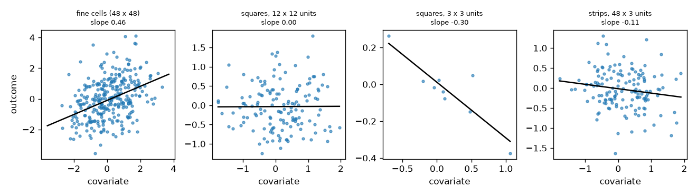

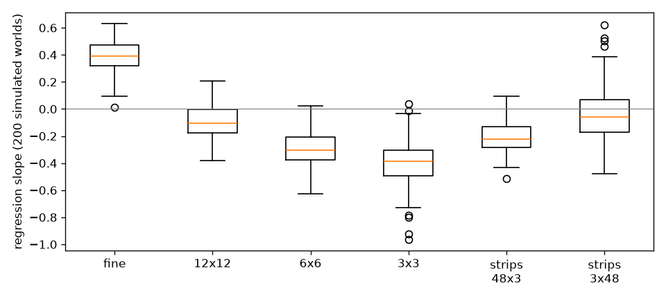

The simulated worlds are invented, and nothing here is a finding about real overdose rates. The point is that all six sets of units describe the same underlying cells, and an analyst who published only one of them would report a positive, a negative, or a near-zero relationship, each correct for its own units.

Moran's I, defined in Section 6.4, behaves differently from the slope. Averaged over the 200 worlds, the Moran's I of the outcome is $0.234$ for the fine cells, $0.343$ for the $12 \times 12$ squares, $0.328$ for $6 \times 6$, and $0.100$ for $3 \times 3$. It rises when aggregation removes the local noise and falls when only nine units are left, partly because the benchmark value $-1/(n-1)$ it is compared with moves from $-0.0004$ to $-0.125$. The scale at which spatial dependence is measured matters too.

### 6.1.2 The Ecological Fallacy

A related warning concerns what a regional relationship says about individuals. The **ecological fallacy** is the inference that a relationship between regional averages holds for the individuals inside the regions.

**A hand-sized example: three counties, nine people.** Suppose each county has three people. Within every county, a person with a higher exposure $x$ has a higher risk $y$, with a slope of exactly $+1$. But counties with a higher average exposure have a lower average risk, because (in this invented story) counties with high exposure also have better access to treatment. The county averages are

| County | 1 | 2 | 3 |
| :--- | :--- | :--- | :--- |
| Average $x$ | 1 | 3 | 5 |
| Average $y$ | 8 | 5 | 2 |

and the three people in each county sit at $-1$, $0$, and $+1$ around its averages, in both $x$ and $y$. Within each county the slope is $+1$. Across the three county averages the slope is $(2 - 8)/(5 - 1) = -1.5$. Pooling all nine people ignores the counties and gives something in between. The pooled cross-product sum is the within-county part, $3 \times 2 = 6$, plus the between-county part, $3 \times [(-2)(3) + 0 + (2)(-3)] = -36$, for $-30$. The pooled sum of squares of $x$ is $3 \times 2 + 3 \times 8 = 30$. The pooled slope is $-30/30 = -1.0$.

```python
x_reg = np.array([1.0, 3.0, 5.0])
y_reg = np.array([8.0, 5.0, 2.0])
offsets = np.array([-1.0, 0.0, 1.0])
x_ind = np.concatenate([xr + offsets for xr in x_reg])
y_ind = np.concatenate([yr + offsets for yr in y_reg])
region = np.repeat([0, 1, 2], 3)
within = [slope(x_ind[region == k], y_ind[region == k]) for k in range(3)]
print("within-region slopes:", within)
print("slope of the region means:", round(slope(x_reg, y_reg), 3))
print("pooled slope, all nine people:", round(slope(x_ind, y_ind), 3))
```

The county-level regression says the relationship is negative, with a slope of $-1.5$. For every individual in every county, the relationship is positive. An analysis that used only the three county averages, and then claimed that an individual's risk falls as the individual's exposure rises, would be wrong about every person in the data. Chapter 9 returns to this when it models county counts: a county-level coefficient describes counties.

### 6.1.3 What This Means for Every Model in Part III

The models of Chapters 7 to 9 describe the regions that were given, and they inherit three limits from this section.

- **A coefficient belongs to its units.** A slope estimated from tracts describes tracts. It need not describe ZIP codes, counties, or people.
- **The boundaries are part of the assumptions.** If the conclusion changes when the boundaries move to another reasonable set, it was a statement about the boundaries as much as about the world. When another reasonable set of units exists, fit both.
- **Spatial dependence has a scale.** Regions that are small relative to the process look strongly dependent, and regions that are large look nearly independent.

None of these limits is cured by a better model. They are properties of the data.

---

<a id="s6-2"></a>

## 6.2 Building a Spatial Weights Matrix

Moran's I and every model in Chapters 7 to 9 use a matrix $\mathbf{W}$ whose entry $w_{ij}$ says how much region $j$ counts as a neighbor of region $i$. By convention $w_{ii} = 0$, so that no region is its own neighbor. The matrix is not estimated from the data. The analyst writes it down, and it encodes a belief about which regions influence which. This section describes the common ways to build it.

The running example is the $12 \times 12$ map of 144 square counties from the shared data set of Part III, in which $\mathbf{S}$ holds the county centroids, `pop` the populations, and `x` a smooth standardized deprivation index.

### 6.2.1 Contiguity: Rook and Queen

The most common definition says two regions are neighbors if they share a border. For squares, there are two versions. **Rook** contiguity counts regions that share an edge, as rooks move on a chessboard. **Queen** contiguity counts regions that share an edge or a corner. The result is a binary matrix $\mathbf{A}$ with $A_{ij} = 1$ for neighbors, the adjacency matrix of Section 1.5.2.

```python
def dist(S):
    """Matrix of Euclidean distances between the rows of S."""
    q = np.sum(S**2, axis=1)
    H2 = q[:, None] - 2 * S @ S.T + q[None, :]
    H = np.sqrt(np.maximum(H2, 0.0))
    np.fill_diagonal(H, 0.0)
    return H


def county_map(m=12):
    """A grid of square 'counties': centroids, rook adjacency, populations,
    and a smooth standardized covariate (a deprivation index)."""
    g = (np.arange(m) + 0.5) / m
    xx, yy = np.meshgrid(g, g)
    S = np.column_stack([xx.ravel(), yy.ravel()])
    n = m * m
    A = np.zeros((n, n))
    for i in range(m):
        for j in range(m):
            k = i * m + j
            if i + 1 < m:
                A[k, k + m] = A[k + m, k] = 1
            if j + 1 < m:
                A[k, k + 1] = A[k + 1, k] = 1
    rng = np.random.default_rng(2031)
    pop = np.round(np.exp(rng.normal(np.log(5000), 1.0, n))).astype(int)
    d = np.sqrt(((S[:, None, :] - S[None, :, :]) ** 2).sum(axis=2))
    L = np.linalg.cholesky(np.exp(-d / 0.25) + 1e-8 * np.eye(n))
    x = L @ np.random.default_rng(2032).standard_normal(n)
    return S, A, pop, (x - x.mean()) / x.std()


def rook(nr, nc):
    """Rook adjacency for an nr-by-nc grid of squares (row = k // nc)."""
    B = np.zeros((nr * nc, nr * nc))
    for i in range(nr):
        for j in range(nc):
            k = i * nc + j
            if i + 1 < nr:
                B[k, k + nc] = B[k + nc, k] = 1
            if j + 1 < nc:
                B[k, k + 1] = B[k + 1, k] = 1
    return B


def queen(nr, nc):
    """Queen adjacency: squares sharing an edge or a corner."""
    B = np.zeros((nr * nc, nr * nc))
    for i in range(nr):
        for j in range(nc):
            for di in (-1, 0, 1):
                for dj in (-1, 0, 1):
                    if (di, dj) != (0, 0) and 0 <= i + di < nr \
                            and 0 <= j + dj < nc:
                        B[i * nc + j, (i + di) * nc + j + dj] = 1
    return B


S, A, pop, x = county_map()
n = len(S)
A_queen = queen(12, 12)
print("county_map adjacency is rook:", np.array_equal(A, rook(12, 12)))
for name, B in (("rook", A), ("queen", A_queen)):
    print(f"{name}: {int(B.sum())} nonzero entries, neighbors per county",
          sorted(set(B.sum(axis=1).astype(int))))
```

On the $12 \times 12$ map, interior counties have 4 rook neighbors and 8 queen neighbors. Counties on an edge have 3 rook neighbors or 5 queen neighbors, and corner counties have 2 and 3. The rook matrix has 528 nonzero entries and the queen matrix 1,012.

Spatial transcriptomics, which measures gene expression at thousands of spots on a tissue slide, uses the same idea with a different geometry. The spots usually lie on a hexagonal lattice, with every other row shifted by half a spacing, so each interior spot touches six others instead of four or eight. The code below builds the neighbor matrix for a small patch of spots by looking for pairs at one spacing apart, an idea that Section 6.2.2 generalizes.

```python
# Hexagonal spots: every other row is shifted by half a spacing
spots = np.array([[c + 0.5 * (r % 2), r * np.sqrt(3) / 2]
                  for r in range(6) for c in range(6)])
Hs = dist(spots)
A_hex = ((Hs > 0) & (Hs < 1.01)).astype(float)
print("neighbors per spot:", sorted(set(A_hex.sum(axis=1).astype(int))))
```

Spots on the edge of the patch have 2 to 5 neighbors and interior spots have 6. Everything later in this chapter applies to such a matrix without change.

Contiguity needs a map of the boundaries, and a region with no neighbors (an island) has a row of zeros, which cannot be row-standardized (Section 6.3). Real data sets often have such regions and need a decision about them.

### 6.2.2 Distance Bands, Inverse Distance, and Nearest Neighbors

When only centroids are known, or when influence is thought to depend on distance rather than on touching, there are three common choices. All use the distance matrix $\mathbf{H}$ of Chapter 1.

- **Distance band.** Regions within a chosen radius are neighbors: $A_{ij} = 1$ if $0 < h_{ij} \le r$. A band just wider than one cell gives the rook matrix, and a band of 1.5 cells, which reaches the diagonal neighbors at $\sqrt{2} \approx 1.41$ cells, gives the queen matrix.
- **Inverse distance.** Nearer regions count more: $w_{ij} \propto h_{ij}^{-1}$ (or another power), usually with a cutoff beyond which the weight is zero.
- **$k$ nearest neighbors.** Region $j$ is a neighbor of region $i$ if $j$ is among the $k$ regions closest to $i$. Every region has exactly $k$ neighbors, which avoids islands. On a regular grid many regions are exactly the same distance away, so "the $k$ nearest" is not unique: for $k = 4$, 44 of the 144 counties have more than four counties at or inside the fourth-smallest distance, and for $k = 8$, 8 of them do (the code prints these counts). The code below breaks such ties by region number, which means the neighbors it picks lean toward the south and west; a different rule would give slightly different numbers for the nearest-neighbor rows.

```python
H = dist(S)
cell = 1 / 12


def band(H, radius):
    """Binary weights: 1 if the distance is positive and at most radius."""
    return ((H > 0) & (H <= radius)).astype(float)


def inverse_distance(H, cutoff, power=1.0):
    """Weights 1 / h^power for pairs within the cutoff, 0 otherwise."""
    B = np.zeros_like(H)
    near = (H > 0) & (H <= cutoff)
    B[near] = H[near] ** (-power)
    return B


def knn(H, k):
    """Binary weights: j is a neighbor of i if j is among i's k nearest.

    Ties are broken by region number (lower first), after rounding the
    distances to 9 decimals so that equal distances compare equal."""
    n = len(H)
    B = np.zeros_like(H)
    index = np.arange(n)
    for i in range(n):
        d = np.round(H[i], 9)
        d[i] = np.inf
        B[i, np.lexsort((index, d))[:k]] = 1.0
    return B


weights = {"rook": A,
           "queen": A_queen,
           "band, 2.5 cells": band(H, 2.5 * cell + 1e-9),
           "4 nearest": knn(H, 4),
           "8 nearest": knn(H, 8),
           "inverse distance": inverse_distance(H, 3.5 * cell)}
print("a band of 1 cell is the rook:",
      np.array_equal(band(H, cell + 1e-9), A))
print("a band of 1.5 cells is the queen:",
      np.array_equal(band(H, 1.5 * cell + 1e-9), A_queen))
print(f"{'weights':18s}{'min':>5s}{'mean':>7s}{'max':>5s}  symmetric")
for name, B in weights.items():
    nb = (B > 0).sum(axis=1)
    print(f"{name:18s}{nb.min():5d}{nb.mean():7.2f}{nb.max():5d}  "
          f"{np.allclose(B, B.T)}")


def count_ties(H, k):
    """Counties with more than k counties at or inside the k-th distance."""
    d = np.round(H, 9)
    np.fill_diagonal(d, np.inf)
    kth = np.sort(d, axis=1)[:, k - 1]
    return int(((d <= kth[:, None]).sum(axis=1) > k).sum())


print("counties with a tie at the cutoff, k = 4:", count_ties(H, 4))
print("counties with a tie at the cutoff, k = 8:", count_ties(H, 8))
```

| Weights | Fewest neighbors | Mean | Most neighbors | Symmetric? |
| :--- | :--- | :--- | :--- | :--- |
| Rook | 2 | 3.67 | 4 | Yes |
| Queen | 3 | 7.03 | 8 | Yes |
| Band, 2.5 cells | 7 | 16.47 | 20 | Yes |
| 4 nearest | 4 | 4.00 | 4 | No |
| 8 nearest | 8 | 8.00 | 8 | No |
| Inverse distance, 3.5 cells | 12 | 27.75 | 36 | Yes |

The last column foreshadows the next subsection: the two nearest-neighbor matrices are not symmetric.

### 6.2.3 Why Nearest-Neighbor Weights Are Not Symmetric

Picture three rural clinics along a highway at mile posts 0, 1, and 3. If each clinic names its single nearest clinic as its neighbor, clinic 1 (at mile 0) names clinic 2 (at mile 1), and clinic 2 names clinic 1. Clinic 3 (at mile 3) is 2 miles from clinic 2 and 3 miles from clinic 1, so it names clinic 2. But clinic 2 does not name clinic 3. The relation "is the nearest neighbor of" is not mutual.

```python
pts = np.array([0.0, 1.0, 3.0])
Hp = np.abs(pts[:, None] - pts[None, :])
B3 = knn(Hp, 1)
print("nearest-neighbor matrix:\n", B3)
print("symmetric:", np.allclose(B3, B3.T))
print("either lists the other:\n", np.maximum(B3, B3.T))
print("average of the two:\n", (B3 + B3.T) / 2)
```

The matrix has $B_{32} = 1$ but $B_{23} = 0$, so it is not symmetric. Two common repairs make it symmetric: count a pair as neighbors if either lists the other (take the larger of $B_{ij}$ and $B_{ji}$), or average the two entries.

Symmetry is not a detail. Several results in this book assume it, and nearest-neighbor weights break them in two ways.

- **Real eigenvalues (Section 6.3.3).** The argument that row-standardized weights have real eigenvalues needs the underlying binary matrix to be symmetric. Without it, eigenvalues can be complex numbers. On the county map the row-standardized 4-nearest and 8-nearest matrices have eigenvalues with imaginary parts as large as $0.098$ and $0.040$ (Section 6.3.3). Chapter 7's bound on the spatial autoregressive parameter, which is set by the smallest and largest eigenvalues of the weights matrix, assumes real eigenvalues.
- **The conditional autoregressive model (Chapter 8).** A conditional specification, in which each region is modeled given its neighbors, can define a valid joint distribution only if its regression coefficients and conditional variances satisfy a symmetry condition, and with a nonsymmetric neighbor structure that condition fails except in special cases (Section 8.1.3).

The moments of Moran's I in Section 6.5 only use the symmetrized matrix $(\mathbf{W} + \mathbf{W}')/2$, so Moran's I itself is not affected. The models are.

### 6.2.4 Sensitivity of Conclusions to the Choice of W

There is no correct weights matrix. Different choices answer different questions: do counties resemble the counties they touch, or the counties within 30 miles, or the eight closest? Two checks keep an analysis honest. Use a definition that matches how influence is thought to travel, and report how much the conclusion depends on it.

To see the dependence, the code below simulates two responses on the county map, both described as overdose deaths per 10,000 residents (simulated, not real). The strong response has a deprivation trend plus a long-range spatial effect (range 0.2). The weak response has no trend and a short-range spatial effect (range 0.05, about half a county) mixed with more noise. It then computes Moran's I, defined formally in Section 6.4 but needed here only as a number, for six row-standardized weight matrices.

```python
def row_standardize(B):
    """Divide each row by its sum (every row needs at least one neighbor)."""
    return B / B.sum(axis=1, keepdims=True)


def simulate_rate(seed, mean, sigma2, tau2, phi):
    """Normal 'rate' with an exponential spatial effect and a nugget."""
    rng = np.random.default_rng(seed)
    L = np.linalg.cholesky(sigma2 * np.exp(-H / phi) + 1e-8 * np.eye(n))
    u = L @ rng.standard_normal(n)
    return mean + u + np.sqrt(tau2) * rng.standard_normal(n)


# Overdose deaths per 10,000 residents (simulated), with deprivation as a
# covariate: a strong, long-range pattern, and a weak, short-range one
y_strong = simulate_rate(2040, 10 + 1.5 * x, 1.0, 0.5, 0.2)
y_weak = simulate_rate(2041, 0.0, 0.5, 1.0, 0.05)


def moran_I(y, W):
    """Moran's I for data y and a weights matrix W with zero diagonal."""
    z = y - y.mean()
    return len(y) / W.sum() * (z @ W @ z) / (z @ z)


print(f"{'weights':18s}{'I, strong':>11s}{'I, weak':>10s}")
for name, B in weights.items():
    W = row_standardize(B)
    print(f"{name:18s}{moran_I(y_strong, W):11.3f}{moran_I(y_weak, W):10.3f}")
```

| Weights | $I$, strong response | $I$, weak response |
| :--- | :--- | :--- |
| Rook | 0.615 | 0.067 |
| Queen | 0.596 | 0.063 |
| Band, 2.5 cells | 0.454 | 0.077 |
| 4 nearest | 0.609 | 0.071 |
| 8 nearest | 0.553 | 0.072 |
| Inverse distance | 0.413 | 0.055 |

The values differ by weights, but their size is not the right thing to compare, since wider neighborhoods average more distant counties and dilute $I$ even when the pattern is real. What matters is whether $I$ is large compared with what chance would give for that matrix. Section 6.5 gives the benchmark, and Section 6.9.2 returns to this table with a significance test for each row. The result for the weak response is that some weights detect the pattern and others do not, so for borderline patterns the conclusion depends on the weights.

---

<a id="s6-3"></a>

## 6.3 Representing Regions as Graphs

A map of regions with a neighbor relation is a graph: regions are the **nodes**, and two nodes are joined by an **edge** when they are neighbors. Graph language gives us the matrix tools of earlier chapters.

For hand calculations we use a small map of four regions, the **hub map**. Region 1 touches only region 2. Region 2 touches regions 1, 3, and 4. Regions 3 and 4 touch each other and region 2. Region 2 is the hub, with three neighbors, and regions 2, 3, and 4 form a triangle.

### 6.3.1 The Adjacency Matrix and the Degree Matrix

The **adjacency matrix** $\mathbf{A}$ has $A_{ij} = 1$ if regions $i$ and $j$ are neighbors and $0$ otherwise, with zeros on the diagonal. For an undirected map it is symmetric. The number of neighbors of region $i$ is its **degree**, $d_i = \sum_j A_{ij}$, and the **degree matrix** is the diagonal matrix $\mathbf{D} = \operatorname{diag}(\mathbf{A}\mathbf{1}_n)$ with the degrees on its diagonal. For the hub map,

$$
\mathbf{A} = \begin{bmatrix} 0 & 1 & 0 & 0 \\ 1 & 0 & 1 & 1 \\ 0 & 1 & 0 & 1 \\ 0 & 1 & 1 & 0 \end{bmatrix}, \qquad \mathbf{D} = \operatorname{diag}(1, 3, 2, 2)
$$

### 6.3.2 Row-Standardized Weights

In most of this book the weights matrix is the **row-standardized** version of $\mathbf{A}$, in which each row is divided by its sum:

$$
\mathbf{W} = \mathbf{D}^{-1}\mathbf{A}, \qquad w_{ij} = \frac{A_{ij}}{d_i}
$$

Each region's neighbors share a total weight of 1, so $(\mathbf{W}\mathbf{y})_i = \sum_j w_{ij}y_j$ is the average of $y$ over region $i$'s neighbors. In matrix form the row sums are $\mathbf{W}\mathbf{1}_n = \mathbf{D}^{-1}\mathbf{A}\mathbf{1}_n = \mathbf{D}^{-1}\mathbf{D}\mathbf{1}_n = \mathbf{1}_n$. The sum of all the weights, $S_0 = \sum_i\sum_j w_{ij} = \mathbf{1}'\mathbf{W}\mathbf{1}$, therefore equals $n$.

For the hub map,

$$
\mathbf{W} = \begin{bmatrix} 0 & 1 & 0 & 0 \\ \tfrac{1}{3} & 0 & \tfrac{1}{3} & \tfrac{1}{3} \\ 0 & \tfrac{1}{2} & 0 & \tfrac{1}{2} \\ 0 & \tfrac{1}{2} & \tfrac{1}{2} & 0 \end{bmatrix}
$$

Row-standardized weights have an important property that is easy to miss: $\mathbf{W}$ is generally **not symmetric**, even though $\mathbf{A}$ is. Here $w_{12} = 1$ but $w_{21} = 1/3$: region 1's only neighbor counts for all of its weight, while region 1 is one of three neighbors of region 2. Row-standardizing makes each row an average, and it gives up symmetry to do so.

### 6.3.3 A Similarity Transformation: The Eigenvalues of W Are Real

The eigenvalues of $\mathbf{W}$ will matter in Chapters 7 and 8, because they limit the spatial autoregressive parameter of those chapters. Since $\mathbf{W}$ is not symmetric, nothing guarantees they are real. They are, for a reason that rests on a new tool.

**A tool we need: similar matrices.** Two square matrices $\mathbf{B}$ and $\mathbf{C}$ are **similar** if $\mathbf{B} = \mathbf{N}^{-1}\mathbf{C}\mathbf{N}$ for some invertible matrix $\mathbf{N}$. Similar matrices have the same eigenvalues. The proof takes one line. If $\mathbf{C}\mathbf{v} = \lambda\mathbf{v}$, then $\mathbf{B}(\mathbf{N}^{-1}\mathbf{v}) = \mathbf{N}^{-1}\mathbf{C}\mathbf{N}\mathbf{N}^{-1}\mathbf{v} = \mathbf{N}^{-1}\mathbf{C}\mathbf{v} = \lambda\,\mathbf{N}^{-1}\mathbf{v}$, so $\lambda$ is an eigenvalue of $\mathbf{B}$ with eigenvector $\mathbf{N}^{-1}\mathbf{v}$. (Here $\mathbf{N}$ is only a generic invertible matrix.)

Define the symmetric matrix $\tilde{\mathbf{A}} = \mathbf{D}^{-1/2}\mathbf{A}\mathbf{D}^{-1/2}$, where $\mathbf{D}^{-1/2}$ is the diagonal matrix with entries $d_i^{-1/2}$. It is symmetric because $\mathbf{A}$ is. Then

$$
\mathbf{D}^{-1/2}\,\tilde{\mathbf{A}}\,\mathbf{D}^{1/2} = \mathbf{D}^{-1/2}\mathbf{D}^{-1/2}\mathbf{A}\mathbf{D}^{-1/2}\mathbf{D}^{1/2} = \mathbf{D}^{-1}\mathbf{A} = \mathbf{W}
$$

so $\mathbf{W}$ is similar to $\tilde{\mathbf{A}}$. A symmetric real matrix has real eigenvalues and an orthonormal set of eigenvectors, so $\mathbf{W}$ has the same real eigenvalues. Chapter 8 writes $\tilde{\lambda}_k$ for the eigenvalues of $\tilde{\mathbf{A}}$; they are the same numbers as the eigenvalues $\lambda_i$ of $\mathbf{W}$. This is the step that fails for nearest-neighbor weights: there $\mathbf{A}$ is not symmetric, so $\tilde{\mathbf{A}}$ is not either.

**Where the eigenvalues lie.** They are between $-1$ and $1$, and $1$ is always an eigenvalue. To see this, let $\mathbf{W}\mathbf{x} = \lambda\mathbf{x}$ and pick the entry $x_i$ with the largest absolute value. Then $\lvert\lambda\rvert\lvert x_i\rvert = \lvert\sum_j w_{ij}x_j\rvert \le \sum_j w_{ij}\lvert x_j\rvert \le \lvert x_i\rvert$, because the weights in a row are nonnegative and add to 1, so $\lvert\lambda\rvert \le 1$. And $\mathbf{W}\mathbf{1}_n = \mathbf{1}_n$ shows $\lambda = 1$ with eigenvector $\mathbf{1}_n$.

The value $-1$ is an eigenvalue when the map can be colored with two colors so that every edge joins different colors (a **bipartite** map). If $x_i = +1$ on one color and $-1$ on the other, then $(\mathbf{W}\mathbf{x})_i$ is the average of neighbors that all have the opposite sign, so $\mathbf{W}\mathbf{x} = -\mathbf{x}$. A rook grid of squares is bipartite (color it like a checkerboard), and the hub map is not, since regions 2, 3, and 4 form a triangle.

**By hand on the hub map.** The eigenvalues of $\mathbf{W}$ are $1$, $-\tfrac{1}{2}$, and the two roots of $x^2 + \tfrac{1}{2}x - \tfrac{1}{6} = 0$, which are $(-3 \pm \sqrt{33})/12$: approximately $0.2287$ and $-0.7287$. They sum to zero, the trace of $\mathbf{W}$, as they must. The code below confirms that $\mathbf{W}$ and $\tilde{\mathbf{A}}$ have the same eigenvalues, and then checks the rook grid and the nearest-neighbor matrices of Section 6.2.3.

```python
A_hub = np.array([[0, 1, 0, 0],
                  [1, 0, 1, 1],
                  [0, 1, 0, 1],
                  [0, 1, 1, 0]], dtype=float)
d_hub = A_hub.sum(axis=1)
D_hub = np.diag(d_hub)
W_hub = A_hub / d_hub[:, None]
print("degrees:", d_hub)
print("W:\n", np.round(W_hub, 4))
print("row sums:", W_hub.sum(axis=1), " S0:", W_hub.sum(),
      " symmetric:", np.allclose(W_hub, W_hub.T))

D_half_inv = np.diag(d_hub ** -0.5)
D_half = np.diag(d_hub ** 0.5)
S_sym = D_half_inv @ A_hub @ D_half_inv
print("W = D^(-1/2) S D^(1/2):",
      np.allclose(W_hub, D_half_inv @ S_sym @ D_half))
print("eigenvalues of S (symmetric):", np.round(np.linalg.eigvalsh(S_sym), 4))
print("eigenvalues of W:",
      np.round(np.sort(np.linalg.eigvals(W_hub).real), 4))
```

```python
d_rook = A.sum(axis=1)
S_rook = np.diag(d_rook ** -0.5) @ A @ np.diag(d_rook ** -0.5)
lam = np.linalg.eigvalsh(S_rook)
print(f"rook grid: smallest eigenvalue {lam[0]:.4f}, largest {lam[-1]:.4f}")
for name in ("4 nearest", "8 nearest"):
    ev = np.linalg.eigvals(row_standardize(weights[name]))
    print(f"{name}: largest imaginary part {np.abs(ev.imag).max():.4f}")
```

The 12-by-12 rook grid has smallest eigenvalue $-1$ and largest $1$, as the bipartite argument predicts. The nearest-neighbor matrices have complex eigenvalues, with imaginary parts as large as $0.098$ and $0.040$: small, but not zero, and enough to break any argument that needs a real spectrum.

**What the eigenvalues of W mean conceptually.** In Chapter 1, eigenvalues measured the variance of spatial patterns in a covariance matrix $\boldsymbol{\Sigma}$. Here $\mathbf{W}$ is an averaging operator, so its eigenvalues have a different, dynamic meaning. Multiplying a vector $\mathbf{x}$ by $\mathbf{W}$ replaces each region's value with the average of its neighbors. An eigenvector is a spatial pattern whose geometric shape is preserved under neighbor averaging, and its eigenvalue $\lambda$ is the factor by which that pattern expands or shrinks:

- **$\lambda = 1$ (constant surface):** If every region has the same value, averaging neighbors changes nothing ($\mathbf{W}\mathbf{1}_n = 1\cdot\mathbf{1}_n$).
- **$\lambda > 0$ near 1 (smooth regional waves):** When neighbors are already alike, averaging barely dampens the pattern, so $\lambda$ remains positive and close to 1.
- **$\lambda \approx 0$ (unstructured noise):** When values vary erratically, positive and negative neighbors cancel each other out in the row average, crushing the pattern toward zero.
- **$\lambda = -1$ (bipartite checkerboards):** On a bipartite map, every region is surrounded exclusively by neighbors of the opposite sign. Averaging neighbors flips the sign of every entry while preserving its magnitude ($\mathbf{W}\mathbf{x} = -1\cdot\mathbf{x}$).

**Why the eigenvalues matter: spatial echoes and the multiplier.** In an interconnected regional system, a shock to one county never stays local. In regional economics and public finance, local policies and economic shocks trigger strategic feedback: when a county adjusts its tax rate or experiences an industrial plant closure, neighboring counties respond, and their adjustments reverberate across the map [@besley1995; @brueckner2003]. 

In spatial autoregressive models (developed in Chapter 7), this feedback is expressed as $\mathbf{y} = \rho\mathbf{W}\mathbf{y} + \boldsymbol{\varepsilon}$, where $\rho$ is the spatial autoregressive parameter. Solving for the reduced form yields the **spatial multiplier** [@lesage2009]:

$$
\mathbf{y} = (\mathbf{I}_n - \rho\mathbf{W})^{-1}\boldsymbol{\varepsilon} = \left(\mathbf{I}_n + \rho\mathbf{W} + \rho^2\mathbf{W}^2 + \rho^3\mathbf{W}^3 + \dots\right)\boldsymbol{\varepsilon}
$$

The expansion decomposes total impact into distinct physical rounds of transmission:
1. **$\mathbf{I}_n$:** The direct, local shock to each region.
2. **$\rho\mathbf{W}$:** The first-order spillover to adjacent neighbors.
3. **$\rho^2\mathbf{W}^2$:** The second-order spillover to neighbors-of-neighbors. In particular, the diagonal entries $[\mathbf{W}^2]_{ii} = \sum_j w_{ij}w_{ji}$ represent closed loops of length two ($i \to j \to i$): an initial shock spills over to a neighbor, which reacts, echoing back to the originator.
4. **$\rho^k\mathbf{W}^k$:** Higher-order reverberations along paths of length $k$.

The eigenvalues of $\mathbf{W}$ govern whether these echoes dampen over time or explode into an unstable cascade. By the spectral radius theorem, the matrix geometric series converges if and only if $\lvert\rho\lambda_k\rvert < 1$ for every eigenvalue $\lambda_k$, placing the autoregressive parameter inside the stability interval $1/\lambda_{\min} < \rho < 1/\lambda_{\max}$ [@ord1975]. 

Furthermore, network structure determines how shocks dissipate. On a homogeneous grid, spillovers diffuse evenly. On an asymmetric network where out-degrees have heavy tails (such as the hub map of Section 6.3.1, or nationwide production and supply-chain networks), the principal eigenvectors concentrate on central hubs. Shocks hitting central hubs echo through multiple downstream channels simultaneously, generating systemic volatility that does not average out [@acemoglu2012; @carvalho2021].

---

<a id="s6-4"></a>

## 6.4 Moran's I as a Ratio of Quadratic Forms

We want one number that says whether neighboring regions have more similar values than chance would produce. Start from the centered data, $\mathbf{y}_c$ with entries $y_{c,i} = y_i - \bar{y}$, so that high values are positive and low values negative. If neighbors tend to be alike, then $y_{c,i}$ and the neighbors' average $\sum_j w_{ij}y_{c,j}$ tend to have the same sign, and their product is positive. If neighbors tend to differ, the product is negative. Adding the products over all regions gives $\sum_i y_{c,i}\sum_j w_{ij}y_{c,j} = \mathbf{y}_c'\mathbf{W}\mathbf{y}_c$. Dividing by $\mathbf{y}_c'\mathbf{y}_c$, the total squared deviation, removes the scale of the data.

For row-standardized weights this ratio has a familiar meaning. The vector $\mathbf{W}\mathbf{y}_c$ holds each region's neighbor average, and

$$
\frac{\mathbf{y}_c'\mathbf{W}\mathbf{y}_c}{\mathbf{y}_c'\mathbf{y}_c}
$$

is the least squares slope of the regression of the neighbor average $\mathbf{W}\mathbf{y}_c$ on the value $\mathbf{y}_c$, with no intercept (the slope formula of Tool 5 for a single predictor through the origin). **Moran's I is the slope of a regression of "what my neighbors look like" on "what I look like."** A slope of $0.6$ means that, on average, a county 10 units above the mean has neighbors about 6 units above the mean. A plot of $\mathbf{W}\mathbf{y}_c$ against $\mathbf{y}_c$ is called a **Moran scatterplot**, and Figure 6.3 shows one.

### 6.4.1 The Centering Matrix and the Centered Data

Chapter 0 introduced the centering matrix $\mathbf{P}_c = \mathbf{I}_n - \tfrac{1}{n}\mathbf{1}\mathbf{1}'$. It is symmetric and idempotent, and it subtracts the average: $\mathbf{P}_c\mathbf{y} = \mathbf{y} - \bar{y}\mathbf{1}$. We write the centered data as $\mathbf{y}_c = \mathbf{P}_c\mathbf{y}$ (observed values) or $\mathbf{P}_c\mathbf{Y}$ (random). Two facts follow from $\mathbf{P}_c\mathbf{1} = \mathbf{0}$ and $\mathbf{P}_c\mathbf{P}_c = \mathbf{P}_c$:

$$
\mathbf{y}_c'\mathbf{y}_c = \mathbf{y}'\mathbf{P}_c\mathbf{P}_c\mathbf{y} = \mathbf{y}'\mathbf{P}_c\mathbf{y}, \qquad \mathbf{y}_c'\mathbf{W}\mathbf{y}_c = \mathbf{y}'\mathbf{P}_c\mathbf{W}\mathbf{P}_c\mathbf{y}
$$

so both the denominator and the numerator of Moran's I are quadratic forms in the original data $\mathbf{y}$.

### 6.4.2 The Symmetrized Central Matrix

Tool 2 and Section 1.1.1 work with quadratic forms $\mathbf{Y}'\mathbf{M}\mathbf{Y}$ in a **symmetric** matrix $\mathbf{M}$, and $\mathbf{P}_c\mathbf{W}\mathbf{P}_c$ is not symmetric. The fix uses the fact that a quadratic form is a number, and a number equals its own transpose:

$$
\mathbf{x}'\mathbf{W}\mathbf{x} = (\mathbf{x}'\mathbf{W}\mathbf{x})' = \mathbf{x}'\mathbf{W}'\mathbf{x} \quad\Longrightarrow\quad \mathbf{x}'\mathbf{W}\mathbf{x} = \mathbf{x}'\mathbf{W}_s\mathbf{x}, \qquad \mathbf{W}_s = \tfrac{1}{2}(\mathbf{W} + \mathbf{W}')
$$

The quadratic form of a matrix depends only on its symmetric part, which we call the **symmetrized weights** $\mathbf{W}_s$. Define

$$
\mathbf{M} = \mathbf{P}_c\mathbf{W}_s\mathbf{P}_c
$$

This matrix is symmetric, and $\mathbf{M}\mathbf{1}_n = \mathbf{0}$ because $\mathbf{P}_c\mathbf{1} = \mathbf{0}$. By the identity just shown, $\mathbf{y}_c'\mathbf{W}\mathbf{y}_c = \mathbf{y}'\mathbf{M}\mathbf{y}$.

### 6.4.3 The Ratio Form

Putting the pieces together, with $S_0 = \sum_i\sum_j w_{ij}$ in general (it equals $n$ for row-standardized weights, which removes the factor):

$$
I = \frac{n}{S_0}\,\frac{\mathbf{y}_c'\mathbf{W}\mathbf{y}_c}{\mathbf{y}_c'\mathbf{y}_c} = \frac{n}{S_0}\,\frac{\mathbf{y}'\mathbf{M}\mathbf{y}}{\mathbf{y}'\mathbf{P}_c\mathbf{y}}
$$

The factor $n/S_0$ makes $I$ comparable across weights matrices whose entries have different sizes.

**By hand on the hub map.** Let the four regions have values $\mathbf{y} = (1, 1, 5, 5)'$: regions 1 and 2 are low, regions 3 and 4 are high. The mean is 3, so $\mathbf{y}_c = (-2, -2, 2, 2)'$ and $\mathbf{y}_c'\mathbf{y}_c = 16$. The neighbor averages are $(\mathbf{W}\mathbf{y}_c)_1 = y_{c,2} = -2$, $(\mathbf{W}\mathbf{y}_c)_2 = (y_{c,1} + y_{c,3} + y_{c,4})/3 = 2/3$, $(\mathbf{W}\mathbf{y}_c)_3 = (y_{c,2} + y_{c,4})/2 = 0$, and $(\mathbf{W}\mathbf{y}_c)_4 = (y_{c,2} + y_{c,3})/2 = 0$. So

$$
\mathbf{y}_c'\mathbf{W}\mathbf{y}_c = (-2)(-2) + (-2)\left(\tfrac{2}{3}\right) + 2(0) + 2(0) = 4 - \tfrac{4}{3} = \tfrac{8}{3}, \qquad I = \frac{4}{4}\cdot\frac{8/3}{16} = \frac{1}{6}
$$

```python
y_hub = np.array([1.0, 1.0, 5.0, 5.0])
z_hub = y_hub - y_hub.mean()
print("z:", z_hub, " Wz:", np.round(W_hub @ z_hub, 4))
print("z'Wz =", round(z_hub @ W_hub @ z_hub, 4), " z'z =", z_hub @ z_hub)
print("Moran's I, hub map:", round(moran_I(y_hub, W_hub), 4))
print("binary weights instead:", round(moran_I(y_hub, A_hub), 4))
```

The same value comes out of the matrix $\mathbf{M}$. Its entries, rounded, are printed below, and $\mathbf{y}'\mathbf{M}\mathbf{y} = 8/3$, $\mathbf{y}'\mathbf{P}_c\mathbf{y} = 16$:

```python
n_hub = 4
P_c = np.eye(n_hub) - np.ones((n_hub, n_hub)) / n_hub
W_sym = (W_hub + W_hub.T) / 2
M_hub = P_c @ W_sym @ P_c
print("M:\n", np.round(M_hub, 4))
print("M 1 =", np.round(M_hub @ np.ones(n_hub), 12))
num = y_hub @ M_hub @ y_hub
den = y_hub @ P_c @ y_hub
print("Y'MY =", round(num, 4), " Y'P_cY =", den,
      " I =", round(n_hub / W_hub.sum() * num / den, 4))
print("eigenvalues of the symmetrized W:",
      np.round(np.linalg.eigvalsh(W_sym), 4))
```

The output includes $\mathbf{M}\mathbf{1} = \mathbf{0}$, so adding a constant to the data cannot change $I$.

Binary weights give a different answer for the same data: $I = 0$, not $1/6$. With the binary matrix $\mathbf{A}$, the products over the four edges are $4$ for the edge between regions 1 and 2, $-4$ for each of the edges 2-3 and 2-4, and $4$ for the edge 3-4, and they cancel. The weights are part of the definition of $I$, as Section 6.2.4 said.

### 6.4.4 Reading the Value of I

Under no spatial structure, $I$ is near $-1/(n-1)$ (derived in Section 6.5), which is slightly below zero and close to zero for large $n$. Positive values mean that neighbors resemble each other, and negative values mean that neighbors tend to differ.

The value of $I$ is not bounded by $\pm 1$ in general. It is a ratio of the form $\mathbf{y}_c'\mathbf{W}_s\mathbf{y}_c/\mathbf{y}_c'\mathbf{y}_c$, and the eigenvector argument of Section 1.3.4 applies. Write $\mathbf{W}_s = \sum_k\lambda_k\mathbf{v}_k\mathbf{v}_k'$ and expand $\mathbf{y}_c = \sum_k c_k\mathbf{v}_k$. Then the ratio is $\sum_k\lambda_kc_k^2/\sum_kc_k^2$, a weighted average of the eigenvalues of $\mathbf{W}_s$. So $I$ always lies between the smallest and largest eigenvalue of $\mathbf{W}_s$ (times $n/S_0$ when the weights are not row-standardized). For the hub map the eigenvalues of $\mathbf{W}_s$ run from $-0.812$ to $1.052$, as the output of the block in Section 6.4.3 shows, and for the rook county map from $-1.0023$ to $1.0023$, as the next block prints. The range is slightly wider than $\pm 1$, even for row-standardized weights, because symmetrizing a row-standardized matrix gives up the guarantee that the eigenvalues stay within $\pm 1$. The value $I = 0.615$ for the simulated rates is well inside the range of $I$ for that map, but the range alone does not say whether $0.615$ is large. For that we need a comparison with its null distribution, which Section 6.5 provides.

```python
# Moran's I as a regression slope (row-standardized weights)
z = y_strong - y_strong.mean()
W_rook = row_standardize(A)
Wz = W_rook @ z
print("slope of Wz on z through the origin:", round(z @ Wz / (z @ z), 4))
print("Moran's I, county map:", round(moran_I(y_strong, W_rook), 4))
Ws_rook = (W_rook + W_rook.T) / 2
lam_s = np.linalg.eigvalsh(Ws_rook)
print(f"eigenvalues of the symmetrized rook W: {lam_s[0]:.4f} to "
      f"{lam_s[-1]:.4f}")
```

---

<a id="s6-5"></a>

## 6.5 Exact Null Moments of I Under Normality

To decide whether an observed $I$ is large, we compare it with the values $I$ takes when there is no spatial structure. The simplest version of "no spatial structure" is that the observations are independent draws from the same normal distribution:

$$
\mathbf{Y} \sim N(\mu\mathbf{1}_n, \tau^2\mathbf{I}_n)
$$

Here $\tau^2$ is the variance of independent noise, as in Chapter 1: with no spatial structure there is no spatial random effect, so $\sigma^2$ plays no role. We will derive the exact mean and variance of $I$ under this null model. The derivation has three steps: a tool for quadratic forms in normal vectors, the observation that the numerator and the denominator of $I$ can be handled separately, and the calculation itself.

### 6.5.1 A Tool We Need: Quadratic Forms in Normal Vectors

Let $\mathbf{Z} \sim N(\mathbf{0}, \mathbf{I}_n)$ and let $\mathbf{M}$ be symmetric. By the eigendecomposition of Chapter 1, $\mathbf{M} = \sum_k\lambda_k\mathbf{v}_k\mathbf{v}_k'$ with orthonormal eigenvectors. Then

$$
\mathbf{Z}'\mathbf{M}\mathbf{Z} = \sum_{k=1}^n\lambda_k(\mathbf{v}_k'\mathbf{Z})^2 = \sum_{k=1}^n\lambda_k\,z_k^2
$$

where $z_k = \mathbf{v}_k'\mathbf{Z}$. By Tool 1, the vector of the $z_k$ has covariance $\mathbf{U}'\mathbf{I}_n\mathbf{U} = \mathbf{I}_n$, where $\mathbf{U}$ holds the eigenvectors, so the $z_k$ are independent standard normals (here $z_k$ is a standard normal variable, not the test statistic $z$ used later in this chapter). A quadratic form in a normal vector is a weighted sum of independent squared standard normals, with the eigenvalues as weights. Because $\operatorname{E}[z_k^2] = 1$ and $\operatorname{Var}(z_k^2) = 2$,

$$
\operatorname{E}[\mathbf{Z}'\mathbf{M}\mathbf{Z}] = \sum_k\lambda_k = \operatorname{tr}(\mathbf{M}), \qquad \operatorname{Var}(\mathbf{Z}'\mathbf{M}\mathbf{Z}) = 2\sum_k\lambda_k^2 = 2\operatorname{tr}(\mathbf{M}^2)
$$

where $\operatorname{tr}(\mathbf{M}^2) = \sum_k\lambda_k^2$ because the eigenvalues of $\mathbf{M}^2$ are the squares. (The fact that $\operatorname{Var}(z^2) = 2$ for a standard normal is the same fourth-moment fact, $\operatorname{E}[z^4] = 3$, used in Chapter 3.) For $\mathbf{Y} \sim N(\mathbf{0}, \tau^2\mathbf{I}_n)$, write $\mathbf{Y} = \tau\mathbf{Z}$, so the mean is $\tau^2\operatorname{tr}(\mathbf{M})$ and the variance is $2\tau^4\operatorname{tr}(\mathbf{M}^2)$. The second moment is the variance plus the squared mean:

$$
\operatorname{E}[(\mathbf{Y}'\mathbf{M}\mathbf{Y})^2] = 2\tau^4\operatorname{tr}(\mathbf{M}^2) + \tau^4\operatorname{tr}(\mathbf{M})^2
$$

**A check with two variables.** Take $\mathbf{M} = \begin{bmatrix} 0 & 1/2 \\ 1/2 & 0 \end{bmatrix}$, so that $\mathbf{Z}'\mathbf{M}\mathbf{Z} = Z_1Z_2$. The eigenvalues of $\mathbf{M}$ are $\pm 1/2$, with eigenvectors $(1, 1)'/\sqrt{2}$ and $(1, -1)'/\sqrt{2}$, so $Z_1Z_2 = \tfrac{1}{2}(z_1^2 - z_2^2)$ with $z_1 = (Z_1 + Z_2)/\sqrt{2}$ and $z_2 = (Z_1 - Z_2)/\sqrt{2}$. The formula gives $\operatorname{E}[Z_1Z_2] = \operatorname{tr}(\mathbf{M}) = 0$ and $\operatorname{Var}(Z_1Z_2) = 2\operatorname{tr}(\mathbf{M}^2) = 2(\tfrac{1}{4} + \tfrac{1}{4}) = 1$, which is right, since $Z_1$ and $Z_2$ are independent standard normals and $\operatorname{Var}(Z_1Z_2) = \operatorname{E}[Z_1^2]\operatorname{E}[Z_2^2] = 1$.

```python
rng = np.random.default_rng(6)
Zs = rng.standard_normal((200_000, 2))
prod = Zs[:, 0] * Zs[:, 1]
print("Z1*Z2: mean", round(prod.mean(), 3), " variance", round(prod.var(), 3))
M2 = np.array([[0.0, 0.5], [0.5, 0.0]])
print("tr(M) =", np.trace(M2), " 2 tr(M^2) =", 2 * np.trace(M2 @ M2))
```

### 6.5.2 Independence of I and Its Denominator

Write the numerator and denominator of Moran's I as $q_1 = \mathbf{Y}'\mathbf{M}\mathbf{Y}$ and $q_2 = \mathbf{Y}'\mathbf{P}_c\mathbf{Y}$, so that $I = (n/S_0)\,q_1/q_2$. We want $\operatorname{E}[I]$ and $\operatorname{E}[I^2]$, but the expectation of a ratio is not the ratio of expectations. If, however, $I$ and $q_2$ are independent, then $q_1 = (S_0/n)\,I\,q_2$ gives

$$
\operatorname{E}[q_1^k] = \left(\frac{S_0}{n}\right)^k\operatorname{E}[I^k]\operatorname{E}[q_2^k] \quad\Longrightarrow\quad \operatorname{E}[I^k] = \left(\frac{n}{S_0}\right)^k\frac{\operatorname{E}[q_1^k]}{\operatorname{E}[q_2^k]}
$$

and we can compute the numerator and denominator moments separately. This independence is a property of the normal distribution, sometimes credited to Pitman and Koopmans.

**Why it holds.** First remove the mean. Because $\mathbf{P}_c\mathbf{1} = \mathbf{0}$, both $q_1$ and $q_2$ depend on $\mathbf{Y}$ only through $\mathbf{P}_c\mathbf{Y} = \mathbf{P}_c(\mathbf{Y} - \mu\mathbf{1})$, so the unknown $\mu$ drops out, and we may take $\mu = 0$.

Next, let $\mathbf{U}_{\perp}$ be an $n \times (n-1)$ matrix whose columns are an orthonormal basis of the vectors perpendicular to $\mathbf{1}_n$. Then $\mathbf{P}_c = \mathbf{U}_{\perp}\mathbf{U}_{\perp}'$. The vector $\mathbf{w} = \mathbf{U}_{\perp}'\mathbf{Y}$ has covariance $\tau^2\mathbf{U}_{\perp}'\mathbf{U}_{\perp} = \tau^2\mathbf{I}_{n-1}$ by Tool 1, so $\mathbf{w} \sim N(\mathbf{0}, \tau^2\mathbf{I}_{n-1})$. In terms of $\mathbf{w}$,

$$
q_2 = \mathbf{Y}'\mathbf{U}_{\perp}\mathbf{U}_{\perp}'\mathbf{Y} = \mathbf{w}'\mathbf{w}, \qquad q_1 = \mathbf{w}'\left(\mathbf{U}_{\perp}'\mathbf{W}_s\mathbf{U}_{\perp}\right)\mathbf{w}, \qquad I = \frac{n}{S_0}\,\frac{\mathbf{w}'(\mathbf{U}_{\perp}'\mathbf{W}_s\mathbf{U}_{\perp})\mathbf{w}}{\mathbf{w}'\mathbf{w}}
$$

So $I$ depends on $\mathbf{w}$ only through its direction $\mathbf{w}/\lVert\mathbf{w}\rVert$, while $q_2 = \lVert\mathbf{w}\rVert^2$ is its squared length.

The distribution of $\mathbf{w}$ is unchanged by any rotation, since for a rotation matrix $\mathbf{O}$ the vector $\mathbf{O}\mathbf{w}$ also has covariance $\tau^2\mathbf{I}$. Fix the length $r = \lVert\mathbf{w}\rVert$. Given that length, the direction has a distribution that is itself rotation-invariant, which can only be the uniform distribution on the sphere, whatever $r$ is. A conditional distribution that does not depend on the conditioning value means the direction and the length are independent. So $I$ and $q_2$ are independent.

Section 6.5.5 checks this by simulation on both maps: the correlation between $I$ and the denominator in 20,000 simulated null data sets is $0.009$ on the hub map and $0.008$ on the county map, zero within simulation error.

### 6.5.3 The Mean: E[I] = -1/(n-1)

For the numerator, Section 6.5.1 gives $\operatorname{E}[q_1] = \tau^2\operatorname{tr}(\mathbf{M})$. Cycle the trace, use $\mathbf{P}_c\mathbf{P}_c = \mathbf{P}_c$, and use the fact that $\operatorname{tr}(\mathbf{W}_s) = \operatorname{tr}(\mathbf{W}) = 0$ because the diagonal of $\mathbf{W}$ is zero:

$$
\operatorname{tr}(\mathbf{M}) = \operatorname{tr}(\mathbf{P}_c\mathbf{W}_s\mathbf{P}_c) = \operatorname{tr}(\mathbf{W}_s\mathbf{P}_c) = \operatorname{tr}(\mathbf{W}_s) - \frac{1}{n}\mathbf{1}'\mathbf{W}_s\mathbf{1} = 0 - \frac{S_0}{n}
$$

For the denominator, $\operatorname{E}[q_2] = \tau^2\operatorname{tr}(\mathbf{P}_c) = \tau^2(n-1)$. Therefore

$$
\operatorname{E}[I] = \frac{n}{S_0}\cdot\frac{-\tau^2S_0/n}{\tau^2(n-1)} = -\frac{1}{n-1}
$$

The null mean of Moran's I is not zero. It is slightly negative, and it does not depend on $\mathbf{W}$, on $\mu$, or on $\tau^2$. The reason is that centering forces the deviations to sum to zero, so deviations must be slightly negatively correlated with each other on average. For the hub map the value is $-1/3$, and for the 144-county map $-1/143 \approx -0.007$.

### 6.5.4 The Variance

By Section 6.5.2 and the second moment of Section 6.5.1, with $\operatorname{E}[q_2^2] = \tau^4\left[2(n-1) + (n-1)^2\right] = \tau^4(n-1)(n+1)$, because $q_2/\tau^2$ is a sum of $n-1$ squared standard normals:

$$
\operatorname{E}[I^2] = \left(\frac{n}{S_0}\right)^2\frac{2\operatorname{tr}(\mathbf{M}^2) + \operatorname{tr}(\mathbf{M})^2}{(n-1)(n+1)}, \qquad \operatorname{Var}(I) = \operatorname{E}[I^2] - \frac{1}{(n-1)^2}
$$

**By hand on the hub map.** With $n = 4$ and $S_0 = 4$ the factor $n/S_0$ is 1. From Section 6.4.3, the matrix $\mathbf{M}$ has $\operatorname{tr}(\mathbf{M}) = -1$ (matching $-S_0/n$) and $\operatorname{tr}(\mathbf{M}^2) = \sum_{ij}M_{ij}^2 = 43/48$. Then

$$
\operatorname{E}[I^2] = \frac{2(43/48) + 1}{3 \times 5} = \frac{67}{360}, \qquad \operatorname{Var}(I) = \frac{67}{360} - \frac{1}{9} = \frac{27}{360} = \frac{3}{40} = 0.075
$$

The standard deviation is $\sqrt{0.075} = 0.2739$. The observed $I = 1/6$ for $\mathbf{y} = (1, 1, 5, 5)'$ is $(1/6 + 1/3)/0.2739 = 1.826$ standard deviations above the null mean. The code below confirms these numbers and also gives the mean and standard deviation for the county map, $-0.0070$ and $0.0614$.

```python
def moran_moments(W):
    """Exact mean and sd of Moran's I under Y ~ N(mu 1, tau^2 I)."""
    n = len(W)
    S0 = W.sum()
    P_c = np.eye(n) - np.ones((n, n)) / n
    M = P_c @ ((W + W.T) / 2) @ P_c
    trM, trM2 = np.trace(M), np.trace(M @ M)
    mean = n / S0 * trM / (n - 1)
    second = (n / S0) ** 2 * (2 * trM2 + trM**2) / ((n - 1) * (n + 1))
    return mean, np.sqrt(second - mean**2)


m_hub, s_hub = moran_moments(W_hub)
print(f"hub map: E[I] = {m_hub:.4f}, sd = {s_hub:.4f}, "
      f"z = {(moran_I(y_hub, W_hub) - m_hub) / s_hub:.3f}")
W_rook = row_standardize(A)
m_c, s_c = moran_moments(W_rook)
print(f"county map, rook: E[I] = {m_c:.4f}, sd = {s_c:.4f}")
```

### 6.5.5 Checking the Formulas by Simulation

Moments derived by hand deserve an independent check. The code below simulates 20,000 data sets from $N(3, 2^2)$ on each map (the mean and variance are arbitrary, since neither matters) and computes $I$ for each. It reports the sample mean and standard deviation of $I$, the exact values, and the correlation between $I$ and the denominator.

```python
def moran_I_rows(Y, W):
    """Moran's I for each row of Y."""
    Z = Y - Y.mean(axis=1, keepdims=True)
    return Y.shape[1] / W.sum() * ((Z @ W) * Z).sum(axis=1) / (Z * Z).sum(1)


rng = np.random.default_rng(11)
for name, W in (("hub map", W_hub), ("county map", W_rook)):
    Y = 3.0 + 2.0 * rng.standard_normal((20_000, len(W)))
    I_sim = moran_I_rows(Y, W)
    Zc = Y - Y.mean(axis=1, keepdims=True)
    D_sim = (Zc * Zc).sum(axis=1)
    mean_, sd_ = moran_moments(W)
    print(f"{name}: simulated mean {I_sim.mean():.4f}, sd {I_sim.std():.4f}"
          f" | exact {mean_:.4f}, {sd_:.4f}"
          f" | corr(I, sum of squares) {np.corrcoef(I_sim, D_sim)[0, 1]:.3f}")
```

On the hub map the simulated mean is $-0.3342$ and standard deviation $0.2738$, against exact values $-0.3333$ and $0.2739$. On the county map they are $-0.0076$ and $0.0613$ against $-0.0070$ and $0.0614$. The correlations between $I$ and the denominator are $0.009$ and $0.008$.

The null standard deviation depends strongly on the weights and the map, as the earlier table showed: on the county map it is $0.061$ for rook weights, $0.044$ for queen, and $0.023$ for inverse distance. A wider neighborhood averages more values, so $I$ varies less under the null.

### 6.5.6 The Textbook Formula for the Variance (Optional)

*This subsection shows that the variance above equals the formula found in most textbooks and software, which is written with three sums of the weights. It can be skipped on a first reading.*

Define $S_1 = \tfrac{1}{2}\sum_i\sum_j(w_{ij} + w_{ji})^2$ and $S_2 = \sum_i(w_{i\cdot} + w_{\cdot i})^2$, where $w_{i\cdot}$ and $w_{\cdot i}$ are the row sum and column sum for region $i$. The textbook result under normality is

$$
\operatorname{Var}(I) = \frac{n^2S_1 - nS_2 + 3S_0^2}{S_0^2(n^2 - 1)} - \frac{1}{(n-1)^2}
$$

To derive it from Section 6.5.4, expand $\operatorname{tr}(\mathbf{M}^2) = \operatorname{tr}(\mathbf{P}_c\mathbf{W}_s\mathbf{P}_c\mathbf{W}_s)$ using $\mathbf{P}_c = \mathbf{I}_n - \tfrac{1}{n}\mathbf{1}\mathbf{1}'$:

$$
\operatorname{tr}(\mathbf{M}^2) = \operatorname{tr}(\mathbf{W}_s^2) - \frac{2}{n}\mathbf{1}'\mathbf{W}_s^2\mathbf{1} + \frac{1}{n^2}\left(\mathbf{1}'\mathbf{W}_s\mathbf{1}\right)^2
$$

The three terms are, in order: $\operatorname{tr}(\mathbf{W}_s^2) = \sum_{ij}(w^s_{ij})^2 = S_1/2$ (since $w^s_{ij} = (w_{ij} + w_{ji})/2$); $\mathbf{1}'\mathbf{W}_s^2\mathbf{1} = \sum_i(\text{row sum of }\mathbf{W}_s)^2 = \sum_i\left(\tfrac{w_{i\cdot} + w_{\cdot i}}{2}\right)^2 = S_2/4$; and $\mathbf{1}'\mathbf{W}_s\mathbf{1} = S_0$. So $\operatorname{tr}(\mathbf{M}^2) = S_1/2 - S_2/(2n) + S_0^2/n^2$. With $\operatorname{tr}(\mathbf{M}) = -S_0/n$,

$$
2\operatorname{tr}(\mathbf{M}^2) + \operatorname{tr}(\mathbf{M})^2 = S_1 - \frac{S_2}{n} + \frac{3S_0^2}{n^2}
$$

and multiplying by $(n/S_0)^2/(n^2 - 1)$ gives $\operatorname{E}[I^2] = (n^2S_1 - nS_2 + 3S_0^2)/(S_0^2(n^2-1))$, which is the textbook formula once $-1/(n-1)^2$ is subtracted.

```python
def moran_var_classic(W):
    """The textbook variance of I under normality, from S0, S1, and S2."""
    n = len(W)
    S0 = W.sum()
    S1 = 0.5 * ((W + W.T) ** 2).sum()
    S2 = ((W.sum(axis=0) + W.sum(axis=1)) ** 2).sum()
    return (n**2 * S1 - n * S2 + 3 * S0**2) / (S0**2 * (n**2 - 1)) \
        - 1 / (n - 1) ** 2


for name, W in (("hub map", W_hub), ("county map", W_rook)):
    print(name, round(moran_var_classic(W), 6),
          round(moran_moments(W)[1] ** 2, 6))
```

The two expressions agree to six decimals on both maps: $0.075$ for the hub map and $0.003769$ for the county map. With the sums $S_1$ and $S_2$ in hand, software can compute the null variance without any matrix products, which matters for very large maps.

---

<a id="s6-6"></a>

## 6.6 Moran's I on Regression Residuals

In practice Moran's I is more often applied to the residuals of a regression than to a raw response. The question changes. For the raw rates, "Do counties resemble their neighbors?" is partly answered by the covariates: counties with similar deprivation tend to be neighbors, so their rates are similar for reasons the regression already explains. For the residuals, the question is "After accounting for deprivation, do counties still resemble their neighbors?" A positive answer means the regression is missing spatial structure, and that is the diagnostic used before and after the models of Chapters 7 and 8.

### 6.6.1 The Same Derivation With a Different Projection

Let $\mathbf{Y} = \mathbf{X}\boldsymbol{\beta} + \boldsymbol{\varepsilon}$ with independent normal errors of variance $\tau^2$, and let $\mathbf{e} = (\mathbf{I}_n - \mathbf{P}_{\mathbf{X}})\mathbf{Y}$ be the OLS residuals. Moran's I of the residuals is

$$
I_e = \frac{n}{S_0}\,\frac{\mathbf{e}'\mathbf{W}\mathbf{e}}{\mathbf{e}'\mathbf{e}}
$$

Residuals from a model with an intercept have mean zero, so no separate centering is needed. Every step of Section 6.5 goes through with $\mathbf{P}_c$ replaced by $\mathbf{I}_n - \mathbf{P}_{\mathbf{X}}$. Define

$$
\mathbf{M}_{\mathbf{X}} = (\mathbf{I}_n - \mathbf{P}_{\mathbf{X}})\,\mathbf{W}_s\,(\mathbf{I}_n - \mathbf{P}_{\mathbf{X}})
$$

Because $(\mathbf{I}_n - \mathbf{P}_{\mathbf{X}})\mathbf{X} = \mathbf{0}$, both $\mathbf{e}'\mathbf{W}\mathbf{e} = \mathbf{Y}'\mathbf{M}_{\mathbf{X}}\mathbf{Y}$ and $\mathbf{e}'\mathbf{e} = \mathbf{Y}'(\mathbf{I}_n - \mathbf{P}_{\mathbf{X}})\mathbf{Y}$ are free of $\boldsymbol{\beta}$, and they depend on $\boldsymbol{\varepsilon}$ only. The matrix $\mathbf{I}_n - \mathbf{P}_{\mathbf{X}}$ is symmetric, idempotent, and has trace $n - p$, so the independence argument of Section 6.5.2 works in the $(n-p)$-dimensional space of vectors perpendicular to the columns of $\mathbf{X}$. The denominator is $\tau^2$ times a sum of $n - p$ squared standard normals, with $\operatorname{E}[q_2] = \tau^2(n-p)$ and $\operatorname{E}[q_2^2] = \tau^4(n-p)(n-p+2)$. The numerator moments are those of Section 6.5.1, now with $\mathbf{M}_{\mathbf{X}}$. Therefore

$$
\operatorname{E}[I_e] = \frac{n}{S_0}\,\frac{\operatorname{tr}(\mathbf{M}_{\mathbf{X}})}{n - p}, \qquad \operatorname{E}[I_e^2] = \left(\frac{n}{S_0}\right)^2\frac{2\operatorname{tr}(\mathbf{M}_{\mathbf{X}}^2) + \operatorname{tr}(\mathbf{M}_{\mathbf{X}})^2}{(n-p)(n-p+2)}
$$

and since the diagonal of $\mathbf{W}$ is zero, $\operatorname{tr}(\mathbf{M}_{\mathbf{X}}) = \operatorname{tr}((\mathbf{I}_n - \mathbf{P}_{\mathbf{X}})\mathbf{W}) = -\operatorname{tr}(\mathbf{P}_{\mathbf{X}}\mathbf{W})$. The mean is

$$
\operatorname{E}[I_e] = \frac{n}{S_0}\,\frac{\operatorname{tr}\!\left((\mathbf{I}_n - \mathbf{P}_{\mathbf{X}})\mathbf{W}\right)}{n - p} = -\frac{n}{S_0}\,\frac{\operatorname{tr}(\mathbf{P}_{\mathbf{X}}\mathbf{W})}{n - p}
$$

With $p = 1$ and $\mathbf{X} = \mathbf{1}$ these formulas reduce to Section 6.5, since then $\mathbf{P}_{\mathbf{X}} = \tfrac{1}{n}\mathbf{1}\mathbf{1}'$. The mean of $I_e$ is further below zero when the columns of $\mathbf{X}$ are spatially smooth, because a smooth covariate has a large $\operatorname{tr}(\mathbf{P}_{\mathbf{X}}\mathbf{W})$: the regression absorbs spatially smooth structure and leaves residuals that are slightly less alike across neighbors than independent errors would be.

**By hand on the hub map.** Take $\mathbf{X} = [\mathbf{1}\ \ \mathbf{x}]$ with $\mathbf{x} = (0, 1, 2, 3)'$, so $p = 2$. The centered covariate is $\mathbf{x}_c = (-1.5, -0.5, 0.5, 1.5)'$ with $\mathbf{x}_c'\mathbf{x}_c = 5$, and $\mathbf{P}_{\mathbf{X}} = \tfrac{1}{4}\mathbf{1}\mathbf{1}' + \mathbf{x}_c\mathbf{x}_c'/5$. Then $\operatorname{tr}(\mathbf{P}_{\mathbf{X}}\mathbf{W}) = S_0/4 + \mathbf{x}_c'\mathbf{W}\mathbf{x}_c/5$. The neighbor averages of $\mathbf{x}_c$ are $(-0.5,\ 0.5/3,\ 0.5,\ 0)'$, so $\mathbf{x}_c'\mathbf{W}\mathbf{x}_c = 0.75 - 0.0833 + 0.25 + 0 = 0.9167$, and

$$
\operatorname{tr}(\mathbf{P}_{\mathbf{X}}\mathbf{W}) = 1 + 0.1833 = 1.1833, \qquad \operatorname{E}[I_e] = -\frac{1.1833}{2} = -0.5917
$$

```python
def moran_moments_resid(W, X):
    """Exact null mean and sd of Moran's I for the OLS residuals of X."""
    n, p = X.shape
    S0 = W.sum()
    Q = np.eye(n) - X @ np.linalg.solve(X.T @ X, X.T)
    M = Q @ ((W + W.T) / 2) @ Q
    trM, trM2 = np.trace(M), np.trace(M @ M)
    m = n - p
    mean = n / S0 * trM / m
    second = (n / S0) ** 2 * (2 * trM2 + trM**2) / (m * (m + 2))
    return mean, np.sqrt(second - mean**2)


print("p = 1 reproduces Section 6.5:",
      np.allclose(moran_moments_resid(W_hub, np.ones((4, 1))),
                  moran_moments(W_hub)))
X_hub = np.column_stack([np.ones(4), [0.0, 1.0, 2.0, 3.0]])
P_hub = X_hub @ np.linalg.solve(X_hub.T @ X_hub, X_hub.T)
print("tr(P_X W) =", round(np.trace(P_hub @ W_hub), 4))
m2, s2 = moran_moments_resid(W_hub, X_hub)
print(f"hub map, p = 2: E[I] = {m2:.4f}, sd = {s2:.4f}")
```

The code gives the same $1.1833$ and $-0.5917$, with a standard deviation of $0.1187$.

### 6.6.2 An Application to the Overdose Rates

For the simulated rates of Section 6.2.4, regress the rate on the deprivation index and compare Moran's I before and after.

```python
X = np.column_stack([np.ones(n), x])
beta_hat = np.linalg.solve(X.T @ X, X.T @ y_strong)
resid = y_strong - X @ beta_hat
I_y = moran_I(y_strong, W_rook)
I_e = moran_I(resid, W_rook)
m_y, s_y = moran_moments(W_rook)
m_e, s_e = moran_moments_resid(W_rook, X)
print("OLS coefficients:", np.round(beta_hat, 3))
print(f"I of the rates:     {I_y:.3f}  E = {m_y:.3f}  sd = {s_y:.3f}  "
      f"z = {(I_y - m_y) / s_y:.2f}")
print(f"I of the residuals: {I_e:.3f}  E = {m_e:.3f}  sd = {s_e:.3f}  "
      f"z = {(I_e - m_e) / s_e:.2f}")
```

The OLS coefficients are $10.28$ and $1.652$, close to the true $10$ and $1.5$. Moran's I of the raw rates is $0.615$, with $z = 10.13$ against the null mean $-0.007$ and standard deviation $0.061$. For the residuals it is $0.348$, with null mean $-0.011$, standard deviation $0.061$, and $z = 5.86$. Deprivation explains some of the spatial pattern, since $I$ drops from $0.615$ to $0.348$, but a large and highly significant amount remains. By construction, that is the spatial random effect $u$ in the model of Section 2.1, which the regression does not include. Chapters 7 and 8 model it.

---

<a id="s6-7"></a>

## 6.7 Geary's C and Local Indicators

Moran's I is built from cross-products of neighbors, $y_{c,i}y_{c,j}$. Two relatives use the same ingredients differently.

### 6.7.1 Geary's C as a Laplacian Quadratic Form

**Geary's $C$** uses squared differences of neighbors instead of products:

$$
C = \frac{n-1}{2S_0}\,\frac{\sum_i\sum_jw_{ij}(y_i - y_j)^2}{\sum_i(y_i - \bar{y})^2}
$$

Where Moran's I looks at how neighbors co-vary, Geary's $C$ looks at how much they differ. $C$ is near 1 when there is no spatial structure, below 1 when neighbors are alike, and above 1 when neighbors tend to differ. Because it is built from raw differences, it responds more strongly to sharp local differences, such as a jump in rates across a state border where a policy changes, than to a gradual regional pattern.

The numerator is a quadratic form in the **graph Laplacian** of the symmetrized weights. Expand the square and write $r_i = w_{i\cdot}$ and $w_{\cdot i}$ for the row and column sums of $\mathbf{W}$:

$$
\sum_i\sum_jw_{ij}(y_i - y_j)^2 = \sum_iy_i^2r_i + \sum_jy_j^2w_{\cdot j} - 2\mathbf{y}'\mathbf{W}\mathbf{y} = 2\,\mathbf{y}'\left[\operatorname{diag}\!\left(\tfrac{r_i + w_{\cdot i}}{2}\right) - \mathbf{W}_s\right]\mathbf{y}
$$

and $\operatorname{diag}((r_i + w_{\cdot i})/2) = \operatorname{diag}(\mathbf{W}_s\mathbf{1}_n) = \mathbf{D}_s$, the degree matrix of the symmetrized weights. So with the Laplacian $\mathbf{D}_s - \mathbf{W}_s$,

$$
C = \frac{n-1}{S_0}\,\frac{\mathbf{y}'(\mathbf{D}_s - \mathbf{W}_s)\mathbf{y}}{\mathbf{y}'\mathbf{P}_c\mathbf{y}}
$$

For a binary symmetric map, $\mathbf{D}_s - \mathbf{W}_s = \mathbf{D} - \mathbf{A}$, and the numerator is the quadratic form $\mathbf{y}'(\mathbf{D} - \mathbf{A})\mathbf{y} = \tfrac{1}{2}\sum_{ij}A_{ij}(y_i - y_j)^2$ that Chapter 8 uses as the smoothness penalty of the intrinsic autoregressive model.

**Its mean is 1.** The Laplacian satisfies $(\mathbf{D}_s - \mathbf{W}_s)\mathbf{1} = \mathbf{0}$, so the independence argument of Section 6.5.2 applies, and $\operatorname{E}[\mathbf{Y}'(\mathbf{D}_s - \mathbf{W}_s)\mathbf{Y}] = \tau^2\operatorname{tr}(\mathbf{D}_s - \mathbf{W}_s) = \tau^2S_0$ (the trace of $\mathbf{D}_s$ is the sum of all weights, and the trace of $\mathbf{W}_s$ is zero). Dividing by $\operatorname{E}[q_2] = \tau^2(n-1)$ gives $\operatorname{E}[C] = 1$.

**By hand on the hub map.** With $\mathbf{y} = (1, 1, 5, 5)'$, the weighted sum of squared differences is $\sum_{ij}w_{ij}(y_i - y_j)^2 = 0 + \tfrac{1}{3}(0 + 16 + 16) + \tfrac{1}{2}(16 + 0) + \tfrac{1}{2}(16 + 0) = 80/3 = 26.67$, and $\sum_i(y_i - \bar{y})^2 = 16$. So $C = \tfrac{3}{8}\cdot 26.67/16 = 0.625$.

```python
def geary_C(y, W):
    """Geary's C for data y and a weights matrix W with zero diagonal."""
    z = y - y.mean()
    diff2 = (y[:, None] - y[None, :]) ** 2
    return (len(y) - 1) / (2 * W.sum()) * (W * diff2).sum() / (z @ z)


def local_moran(y, W):
    """Local indicators I_i = z_i (Wz)_i / m2, with m2 = sum(z^2) / n."""
    z = y - y.mean()
    return z * (W @ z) / (z @ z / len(y))


W_s = (W_hub + W_hub.T) / 2
L_s = np.diag(W_s.sum(axis=1)) - W_s
print("Geary's C, hub map:", round(geary_C(y_hub, W_hub), 4))
print("via the Laplacian:  ",
      round((4 - 1) / W_hub.sum() * (y_hub @ L_s @ y_hub)
            / (y_hub @ P_c @ y_hub), 4))
Li = local_moran(y_hub, W_hub)
print("local indicators:", np.round(Li, 4), " sum / S0 =",
      round(Li.sum() / W_hub.sum(), 4))
```

**Relation to Moran's I.** For row-standardized weights $r_i = 1$, and if the column sums are all close to 1 as well, then $\mathbf{D}_s \approx \mathbf{I}_n$ and $C \approx \frac{n-1}{n}(1 - I)$. On the county map, where most column sums are close to 1, the rates give $C = 0.3882$ against the approximation $0.3823$. The two statistics carry nearly the same information when the weights are regular and differ when they are not.

```python
C_county = geary_C(y_strong, W_rook)
approx = (n - 1) / n * (1 - I_y)
print(f"county map: C = {C_county:.4f}, (n-1)/n (1 - I) = {approx:.4f}")
```

### 6.7.2 Local Indicators of Spatial Association

Moran's I is one number for the whole map. It cannot say where the dependence is. **Local indicators of spatial association** (LISA) split it into one number per region. With $m_2 = \sum_iy_{c,i}^2/n$, the local Moran indicator of region $i$ is

$$
I_i = \frac{y_{c,i}\sum_jw_{ij}y_{c,j}}{m_2}
$$

Each $I_i$ is positive when region $i$ and its neighbors are on the same side of the mean (both high or both low) and negative when they are on opposite sides. The indicators add up to the global statistic: $\sum_iI_i = n\,\mathbf{y}_c'\mathbf{W}\mathbf{y}_c/\mathbf{y}_c'\mathbf{y}_c$, so $I = \sum_iI_i/S_0$. Each region's indicator is its contribution to $I$.

On the hub map with $\mathbf{y} = (1, 1, 5, 5)'$ we have $m_2 = 16/4 = 4$, so $I_1 = (-2)(-2)/4 = 1$, $I_2 = (-2)(2/3)/4 = -1/3$, and $I_3 = I_4 = 0$. They sum to $2/3$, and $(2/3)/S_0 = 1/6 = I$. Region 1 contributes the most: it is low, and its only neighbor is low.

The sign of $y_{c,i}$ and of the neighbor average sorts each region into a quadrant: high with high neighbors (HH), low with low neighbors (LL), high with low neighbors (HL), and low with high neighbors (LH). HH and LL regions are the **clusters**, and HL and LH are **outliers**.

**Local significance and its trap.** Each $I_i$ can be tested by a conditional permutation: hold $y_{c,i}$ fixed, shuffle the other values among the other regions, and compare $I_i$ with its shuffled values. The code below does this for the 144 counties with 99 permutations each, using a two-sided p-value, and then repeats the exercise on 100 maps of independent noise, to see what the tests do when there is nothing to find.

```python
neighbors = [np.flatnonzero(A[i]) for i in range(n)]


def local_pvalues(y, W, rng, B=99):
    """Two-sided conditional permutation p-values for local indicators."""
    z = y - y.mean()
    m2 = z @ z / len(y)
    Li = z * (W @ z) / m2
    p = np.empty(len(y))
    for i in range(len(y)):
        others = np.delete(z, i)
        draws = rng.permuted(np.tile(others, (B, 1)), axis=1)
        sim = z[i] * draws[:, :len(neighbors[i])].mean(axis=1) / m2
        upper = (1 + np.sum(sim >= Li[i])) / (B + 1)
        lower = (1 + np.sum(sim <= Li[i])) / (B + 1)
        p[i] = min(1.0, 2 * min(upper, lower))
    return p, Li


rng = np.random.default_rng(21)
p_loc, Li_county = local_pvalues(y_strong, W_rook, rng)
print("counties flagged at 5%:", int(np.sum(p_loc <= 0.05)),
      " (expected by chance alone: about", round(0.04 * n, 1), ")")

p_sorted = np.sort(p_loc)
threshold = (np.arange(1, n + 1) / n) * 0.05
surviving = np.sum(p_loc <= p_sorted[p_sorted <= threshold].max()) \
    if np.any(p_sorted <= threshold) else 0
print("counties surviving 5% FDR control:", surviving)

flagged = []
for _ in range(100):
    y0 = rng.standard_normal(n)          # no spatial structure at all
    flagged.append(np.sum(local_pvalues(y0, W_rook, rng)[0] <= 0.05))
flagged = np.array(flagged)
print(f"100 maps with no structure: mean flagged {flagged.mean():.2f}, "
      f"max {flagged.max()}, maps with at least one: "
      f"{np.mean(flagged >= 1):.2f}")
```

For the simulated rates, 26 of the 144 counties are flagged at the uncorrected 5% level: 11 high-high and 15 low-low. In each of 100 maps of pure noise with no spatial structure whatever, the number flagged averaged $5.63$, with a maximum of $15$, and 98% of those maps had at least one flagged county. (With 99 shuffles the two-sided p-value is at most 0.05 only when the observed value is among the two most extreme on one side of the 100 values, which has probability $2 \times 2/100 = 0.04$, so the expected count is $0.04 \times 144 = 5.8$ rather than $0.05 \times 144 = 7.2$.) A single flagged county is therefore weak evidence. The 26 flagged in the simulated rates are far more than noise would give, but which individual counties are real is much less certain.

With 144 tests per map, a correction for multiple testing is necessary before declaring a cluster. Under the Benjamini-Hochberg procedure [@benjamini1995] at target false discovery rate $q = 0.05$, the $k$-th ordered p-value must satisfy $p_{(k)} \le (k/n) q$. Here, because $B = 99$, the smallest two-sided Monte Carlo p-value is $2/(B+1) = 0.02$. Even at rank $k = 26$, the Benjamini-Hochberg threshold is $(26/144) \times 0.05 \approx 0.009$, which is strictly smaller than the discrete resolution of 99 shuffles. Consequently, zero counties survive 5% FDR control with $B = 99$. Multiple testing under permutation inference requires either substantially more permutations ($B \gg n/q$) to resolve small tail probabilities, or analytical normal-theory approximations [@anselin1995]. Figure 6.4 in the lab shows where the uncorrected flagged counties lie.

---

<a id="s6-8"></a>

## 6.8 Distribution-Free Inference: Permutation Tests

The null moments of Section 6.5 assume normal data. A **permutation test** assumes less. It asks whether the observed arrangement of the values over the regions is unusual among all the ways the same values could have been arranged.

### 6.8.1 The Idea, and Why the p-Value Is Valid

If the values carry no spatial information, then which value sits in which region is arbitrary: every one of the $n!$ rearrangements is equally likely. This is the null hypothesis of **exchangeability**. Moran's I computed on each rearrangement gives a reference distribution, and the p-value is the share of rearrangements with an $I$ at least as large as the observed one.

Computing all $n!$ values is impossible for $n = 144$, so we compute $I$ for $B$ random rearrangements instead. The Monte Carlo p-value is

$$
p = \frac{1 + \#\{b : I^{(b)} \ge I_{\text{obs}}\}}{B + 1}
$$

The $+1$ in both places counts the observed arrangement as one of the $B + 1$. This makes the test valid: under exchangeability, the observed $I$ and the $B$ shuffled values are $B + 1$ exchangeable draws, so the rank of the observed value is uniform on $1, \dots, B+1$, and $P(p \le k/(B+1)) \le k/(B+1)$. A p-value of exactly zero is impossible; with $B = 999$ the smallest value is $0.001$.

### 6.8.2 The Mean of the Permutation Distribution

The mean of the permutation distribution can be computed exactly, and it equals the normal-theory mean. Fix the centered values $y_{c,1}, \dots, y_{c,n}$. Under a random rearrangement, the pair of values $(y_{c,i}, y_{c,j})$ at two different regions is a uniformly random ordered pair of different values, so $\operatorname{E}[y_{c,i}y_{c,j}] = \frac{1}{n(n-1)}\sum_{k \ne l}y_{c,k}y_{c,l}$. Since the $y_{c,k}$ sum to zero, $\sum_{k \ne l}y_{c,k}y_{c,l} = (\sum_ky_{c,k})^2 - \sum_ky_{c,k}^2 = -\sum_ky_{c,k}^2$, so $\operatorname{E}[y_{c,i}y_{c,j}] = -\sum_ky_{c,k}^2/(n(n-1))$. Because $w_{ii} = 0$, the numerator of $I$ has mean $S_0\cdot\operatorname{E}[y_{c,i}y_{c,j}]$, and

$$
\operatorname{E}_{\text{perm}}[I] = \frac{n}{S_0}\cdot\frac{S_0\cdot\left(-\sum_ky_{c,k}^2/(n(n-1))\right)}{\sum_ky_{c,k}^2} = -\frac{1}{n-1}
$$

for every weights matrix and every data set.

### 6.8.3 Exact Enumeration on Four Regions

For the hub map with $\mathbf{y} = (1, 1, 5, 5)'$ we can list all $4! = 24$ rearrangements. Because two values are 1 and two are 5, there are only $\binom{4}{2} = 6$ distinct arrangements, each arising from 4 permutations.

```python
import itertools

arrangements = {}
for perm in itertools.permutations(range(4)):
    arrangements.setdefault(tuple(y_hub[list(perm)]), []).append(perm)
print("distinct arrangements:", len(arrangements))
exact = []
for arrangement, perms in arrangements.items():
    value = moran_I(np.array(arrangement), W_hub)
    exact.extend([value] * len(perms))
    print(arrangement, " I =", round(value, 4), " permutations:", len(perms))
exact = np.array(exact)
print("mean over the 24 permutations:", round(exact.mean(), 4),
      " variance:", round(exact.var(), 4))
print("exact p-value, P(I >= 1/6):", np.mean(exact >= 1 / 6 - 1e-12))
```

| Arrangement of $(y_1, y_2, y_3, y_4)$ | $I$ | Permutations |
| :--- | :--- | :--- |
| (1, 1, 5, 5) | $+0.1667$ | 4 |
| (5, 5, 1, 1) | $+0.1667$ | 4 |
| (1, 5, 1, 5) | $-0.5833$ | 4 |
| (1, 5, 5, 1) | $-0.5833$ | 4 |
| (5, 1, 1, 5) | $-0.5833$ | 4 |
| (5, 1, 5, 1) | $-0.5833$ | 4 |

Two arrangements give $I = 1/6$, the observed value, so $P(I \ge 1/6) = 8/24 = 1/3$. The mean over the 24 permutations is $-1/3$, as Section 6.8.2 proved. The variance over permutations is $1/8 = 0.125$, which is not the normal-theory variance $3/40 = 0.075$. The two reference distributions answer different questions: the permutation distribution conditions on these particular values, and the normal-theory distribution averages over normal data.

The permutation answer is also a reminder about small maps. The observed arrangement is among the two most clustered of the six, but even so its exact p-value is $1/3$. With four regions, no arrangement can give a p-value below $1/3$ here. A map this small cannot provide evidence of spatial structure, and the hub map is useful only for checking mechanics. The z-score of $1.83$ from Section 6.5.4 would suggest a one-sided p-value near $0.034$; with $n = 4$ the normal approximation to the null distribution is poor.

### 6.8.4 Monte Carlo Inference on the County Map

For the 144 counties the test uses 999 random rearrangements of the rates. The code below also returns the permutation values for use in Figure 6.3.

```python
def permutation_test(y, W, rng, B=999):
    """Upper-tail permutation p-value for Moran's I, with the +1 rule."""
    z = y - y.mean()
    Z = rng.permuted(np.tile(z, (B, 1)), axis=1)
    I_perm = len(y) / W.sum() * ((Z @ ((W + W.T) / 2)) * Z).sum(axis=1) \
        / (Z * Z).sum(axis=1)
    I_obs = moran_I(y, W)
    return I_obs, I_perm, (1 + np.sum(I_perm >= I_obs)) / (B + 1)


rng = np.random.default_rng(31)
I_obs, I_perm, p_perm = permutation_test(y_strong, W_rook, rng)
print(f"observed I {I_obs:.4f}; permutation mean {I_perm.mean():.4f}, "
      f"sd {I_perm.std():.4f}; p = {p_perm:.4f}")
print(f"normal theory: mean {m_c:.4f}, sd {s_c:.4f}; "
      f"z-test p = {stats.norm.sf((I_obs - m_c) / s_c):.2e}")
```

The observed $I$ is $0.6150$. The 999 permuted values have mean $-0.0095$ and standard deviation $0.0617$, close to the normal-theory $-0.0070$ and $0.0614$. The p-value is $0.0010$, the smallest possible with 999 permutations, since no shuffled value came close. The normal-theory z-test gives a p-value of $2 \times 10^{-24}$, which is not a number to take literally: it comes from extrapolating a normal tail $10$ standard deviations out. The conclusion is the same, and the permutation p-value is the honest statement of what 999 shuffles can show.

### 6.8.5 When Permuting the Data Gives the Wrong Answer

A permutation test is valid only when the values are exchangeable under the null hypothesis. Two common situations break that assumption.

**Skewed data are not a problem, but unequal variances are.** The code below measures the actual rejection rate of the 5% tests on 1,000 data sets with no spatial structure, for four ways of generating the data. The first three have independent, identically distributed values: normal, lognormal with a very long right tail, and Student's $t$ with 2 degrees of freedom, which has infinite variance. The fourth has independent values whose standard deviation varies across the map, $\exp(1.0\times\text{deprivation})$, as if rates were noisier in more deprived counties (for instance because those counties are smaller).

```python
def size_experiment(draw, W, rng, reps=1000, B=199):
    """Rejection rates at 5% for the z-test and the permutation test."""
    mean_, sd_ = moran_moments(W)
    z_reject = p_reject = 0
    for _ in range(reps):
        y0 = draw()
        _, _, p = permutation_test(y0, W, rng, B)
        z_reject += (moran_I(y0, W) - mean_) / sd_ > stats.norm.isf(0.05)
        p_reject += p <= 0.05
    return z_reject / reps, p_reject / reps


rng = np.random.default_rng(41)
# rates are noisier where deprivation is high
sd_field = np.exp(1.0 * x)
scenarios = {
    "normal": lambda: rng.standard_normal(n),
    "lognormal, sdlog 1.5": lambda: np.exp(1.5 * rng.standard_normal(n)),
    "t, 2 degrees of freedom": lambda: rng.standard_t(2, n),
    "unequal variances": lambda: sd_field * rng.standard_normal(n),
}
print(f"{'no spatial structure, 1000 data sets':38s}{'z-test':>8s}"
      f"{'permutation':>13s}")
for name, draw in scenarios.items():
    zr, pr = size_experiment(draw, W_rook, rng)
    print(f"{name:38s}{zr:8.3f}{pr:13.3f}")
```

| No spatial structure, 1,000 data sets | z-test | Permutation test |
| :--- | :--- | :--- |
| Normal | 0.043 | 0.046 |
| Lognormal, sdlog 1.5 | 0.051 | 0.049 |
| $t$, 2 degrees of freedom | 0.042 | 0.058 |
| Unequal variances | 0.262 | 0.288 |

For identically distributed values, both tests hold their size, even for data far from normal; Moran's I on 144 regions is robust to the shape of the distribution. For unequal variances, both tests are badly wrong, rejecting 26% and 29% of the time when 5% is intended. The values are independent, so there is no spatial dependence to find, yet the tests find it. The reason is that the variances are spatially smooth: the counties with large variances are near each other, and their large deviations multiply into large products $y_{c,i}y_{c,j}$ for neighboring pairs. Shuffling the values moves the large deviations to random places and destroys exactly the clustering of variance that created the large $I$.

The lesson, which Chapter 9 acts on, is that rates computed from counts in regions of very different sizes are not exchangeable. Dividing each region's value by its standard deviation before computing $I$, or modeling the counts directly, restores the assumption.

**Residuals are not exchangeable.** Permuting the residuals of a regression to test their Moran's I looks like the natural extension. It needs care. Even when the errors are independent with equal variances, the OLS residuals are not: $\operatorname{Var}(\mathbf{e}) = \tau^2(\mathbf{I}_n - \mathbf{P}_{\mathbf{X}})$ has unequal diagonal entries and nonzero off-diagonal entries, and the residuals satisfy $\mathbf{X}'\mathbf{e} = \mathbf{0}$. A random rearrangement of the residuals destroys that orthogonality, and the rearranged vector is no longer a possible residual vector. In particular, the mean of Moran's I over rearrangements is $-1/(n-1)$ by Section 6.8.2, whereas the true null mean of $I_e$ from Section 6.6.1 is $-\frac{n}{S_0}\operatorname{tr}(\mathbf{P}_{\mathbf{X}}\mathbf{W})/(n-p)$, which can be much more negative.

A repair, due to Freedman and Lane, projects each rearranged residual vector back: compute $(\mathbf{I}_n - \mathbf{P}_{\mathbf{X}})\mathbf{e}_\pi$ for the rearranged residuals $\mathbf{e}_\pi$, and then compute $I$. The projected vector satisfies the orthogonality, and its reference distribution has the right mean. The code below compares the two references with the exact formula on 1,000 null data sets, for a regression on the deprivation index ($p = 2$) and for a regression on a quartic trend surface in the coordinates ($p = 15$).

```python
def residual_experiment(X, W, rng, reps=1000, B=199):
    """Null behavior of Moran's I on OLS residuals, three reference sets."""
    n, p = X.shape
    S0, Ws = W.sum(), (W + W.T) / 2
    Q = np.eye(n) - X @ np.linalg.solve(X.T @ X, X.T)
    mean_, sd_ = moran_moments_resid(W, X)

    def I_rows(V):
        return n / S0 * ((V @ Ws) * V).sum(axis=1) / (V * V).sum(axis=1)

    I_true, naive_mean, fl_mean = [], [], []
    rej = np.zeros(3)
    for _ in range(reps):
        e = Q @ rng.standard_normal(n)           # residuals of a null data set
        I_e = I_rows(e[None, :])[0]
        perm = rng.permuted(np.tile(e, (B, 1)), axis=1)
        I_naive = I_rows(perm)                   # permute the residuals
        I_fl = I_rows(perm @ Q)                  # project them back (see text)
        I_true.append(I_e)
        naive_mean.append(I_naive.mean())
        fl_mean.append(I_fl.mean())
        rej += [(I_e - mean_) / sd_ > stats.norm.isf(0.05),
                (1 + np.sum(I_naive >= I_e)) / (B + 1) <= 0.05,
                (1 + np.sum(I_fl >= I_e)) / (B + 1) <= 0.05]
    return (mean_, sd_, np.mean(I_true), np.std(I_true), np.mean(naive_mean),
            np.mean(fl_mean), rej / reps)


cx, cy = S[:, 0] - 0.5, S[:, 1] - 0.5
X_quartic = np.column_stack([cx**i * cy**j for i in range(5)
                             for j in range(5 - i)])
rng = np.random.default_rng(51)
for name, X in (("p = 2, deprivation", np.column_stack([np.ones(n), x])),
                ("p = 15, quartic trend", X_quartic)):
    out = residual_experiment(X, W_rook, rng)
    print(f"{name}: exact E {out[0]:.4f}, sd {out[1]:.4f}; simulated "
          f"E {out[2]:.4f}, sd {out[3]:.4f}")
    print(f"   mean of the permutation reference: naive {out[4]:.4f}, "
          f"projected {out[5]:.4f}")
    print(f"   rejection rates at 5%: z-test {out[6][0]:.3f}, "
          f"naive {out[6][1]:.3f}, projected {out[6][2]:.3f}")
```

| Regression | Exact null mean of $I_e$ | Mean of the naive reference | Mean of the projected reference | Rejection rates at 5%: z-test, naive, projected |
| :--- | :--- | :--- | :--- | :--- |
| $p = 2$ | $-0.0110$ | $-0.0071$ | $-0.0111$ | 0.067, 0.058, 0.066 |
| $p = 15$ | $-0.0950$ | $-0.0071$ | $-0.0951$ | 0.060, 0.000, 0.058 |

With the single covariate, the mean of the naive reference, $-0.0071$, is close enough to the exact $-0.0110$ that the naive test behaves acceptably. With fifteen columns the true null mean is $-0.0950$, but the naive reference is still centered at $-0.0071$. The observed $I_e$ is compared with a reference that is too high, and the naive test rejects in 0.0% of the null data sets: its p-values are far too large, and it would miss spatial structure that the projected test finds. The projected reference has mean $-0.0951$ and rejects 5.8% of the time. The z-test from the exact moments is also close to its nominal size.

---

<a id="s6-9"></a>

## 6.9 Walkthrough and Lab 6

### 6.9.1 The Hub Map Collected

The hand calculations of this chapter all use the hub map and the data $\mathbf{y} = (1, 1, 5, 5)'$. The following table collects them next to the code that checked each one.

| Quantity | By hand | Code |
| :--- | :--- | :--- |
| $\mathbf{W}$, $S_0$ | Section 6.3.2 | `W_hub`, 4.0 |
| Eigenvalues of $\mathbf{W}$ | $1$, $-\tfrac{1}{2}$, $(-3 \pm \sqrt{33})/12$ | $-0.7287$, $-0.5$, $0.2287$, $1$ |
| $I$ (row-standardized) | $1/6$ | $0.1667$ |
| $I$ (binary) | $0$ | $0.0$ |
| $\operatorname{tr}(\mathbf{M})$, $\operatorname{tr}(\mathbf{M}^2)$ | $-1$, $43/48$ | $-1.0$, $0.8958$ |
| $\operatorname{E}[I]$, $\operatorname{Var}(I)$ | $-1/3$, $3/40$ | $-0.3333$, $0.075$ |
| $C$ | $0.625$ | $0.625$ |
| Local indicators | $1$, $-1/3$, $0$, $0$ | same |
| Exact permutation $p$ | $1/3$ | $0.3333$ |
| $\operatorname{E}[I_e]$ with $\mathbf{x} = (0, 1, 2, 3)'$ | $-71/120 = -0.5917$ | $-0.5917$ |

### 6.9.2 Weights and Conclusions on the County Map

Section 6.2.4 left a question: for the two simulated responses, do the weights change the conclusion? The code below computes, for each weights matrix, Moran's I, its exact null mean and standard deviation, the z-score, and a permutation p-value with 999 shuffles.

```python
print(f"{'weights':18s}{'I':>7s}{'E[I]':>8s}{'sd':>7s}{'z':>7s}{'perm p':>9s}")
rng = np.random.default_rng(61)
for label, y0 in (("strong response", y_strong), ("weak response", y_weak)):
    print(label)
    for name, B in weights.items():
        W = row_standardize(B)
        I0, _, p0 = permutation_test(y0, W, rng)
        m0, s0 = moran_moments(W)
        print(f"  {name:16s}{I0:7.3f}{m0:8.3f}{s0:7.3f}"
              f"{(I0 - m0) / s0:7.2f}{p0:9.3f}")
```

| Weights | $I$ | $\operatorname{E}[I]$ | sd | $z$ | Permutation $p$ |
| :--- | :--- | :--- | :--- | :--- | :--- |
| *Strong response* | | | | | |
| Rook | 0.615 | $-0.007$ | 0.061 | 10.13 | 0.001 |
| Queen | 0.596 | $-0.007$ | 0.044 | 13.61 | 0.001 |
| Band, 2.5 cells | 0.454 | $-0.007$ | 0.028 | 16.41 | 0.001 |
| 4 nearest | 0.609 | $-0.007$ | 0.057 | 10.84 | 0.001 |
| 8 nearest | 0.553 | $-0.007$ | 0.040 | 14.03 | 0.001 |
| Inverse distance | 0.413 | $-0.007$ | 0.023 | 18.08 | 0.001 |
| *Weak response* | | | | | |
| Rook | 0.067 | $-0.007$ | 0.061 | 1.21 | 0.121 |
| Queen | 0.063 | $-0.007$ | 0.044 | 1.57 | 0.059 |
| Band, 2.5 cells | 0.077 | $-0.007$ | 0.028 | 2.98 | 0.007 |
| 4 nearest | 0.071 | $-0.007$ | 0.057 | 1.37 | 0.095 |
| 8 nearest | 0.072 | $-0.007$ | 0.040 | 1.97 | 0.045 |
| Inverse distance | 0.055 | $-0.007$ | 0.023 | 2.67 | 0.014 |

For the strong response, every weights matrix leads to the same conclusion, with z-scores from 10 to 18. The $I$ values differ, from $0.413$ to $0.615$, but the sizes of the differences are matched by the null standard deviations, which is why the z-scores are the right thing to compare.

For the weak response, the conclusion depends on the weights. At the 5% level, the 2.5-cell band, the 8 nearest neighbors, and inverse distance find the pattern ($p = 0.007$, $0.045$, $0.014$), while rook, queen, and 4 nearest neighbors do not ($p = 0.121$, $0.059$, $0.095$). The true spatial effect has a range of 0.05, about half a county, so correlation with adjacent counties is weak and correlation with counties two cells away is weaker still. Averaging over a wider neighborhood adds counties with almost no correlation, and also reduces the null standard deviation of $I$ from $0.061$ to $0.028$. In this realization, the second effect wins for the wider bands. In another realization the order could differ. An analyst who tried all six and reported only the one with $p < 0.05$ would be reporting a result that the data do not support, and the honest report is the whole table.

Figure 6.3 shows the Moran scatterplot for the strong response with rook weights, whose fitted slope is Moran's I, and the permutation reference distribution against the observed value.

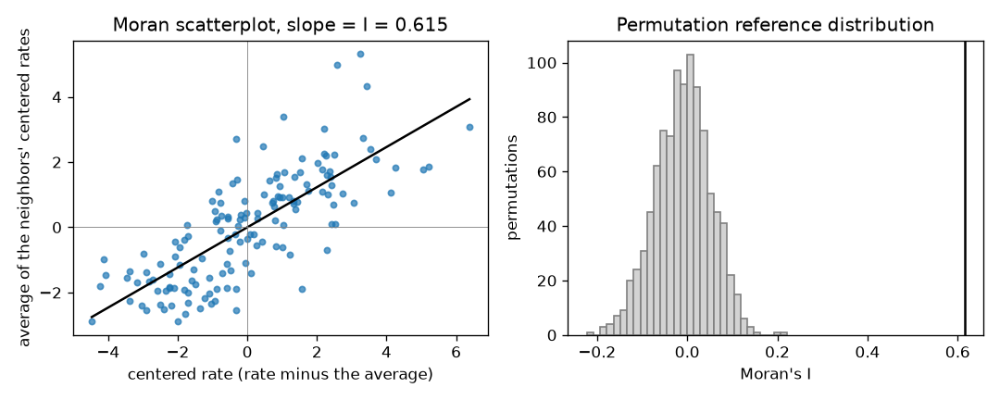

```python
import os
import matplotlib
matplotlib.use("Agg")
import matplotlib.pyplot as plt

os.makedirs("figures/ch06", exist_ok=True)
z = y_strong - y_strong.mean()
fig, axes = plt.subplots(1, 2, figsize=(9, 3.6))
axes[0].scatter(z, W_rook @ z, s=14, alpha=0.7)
grid_z = np.array([z.min(), z.max()])
axes[0].plot(grid_z, I_obs * grid_z, color="black")
axes[0].axhline(0, color="gray", lw=0.5)
axes[0].axvline(0, color="gray", lw=0.5)
axes[0].set_xlabel("centered rate (rate minus the average)")
axes[0].set_ylabel("average of the neighbors' centered rates")
axes[0].set_title(f"Moran scatterplot, slope = I = {I_obs:.3f}")
axes[1].hist(I_perm, bins=30, color="lightgray", edgecolor="gray")
axes[1].axvline(I_obs, color="black")
axes[1].set_xlabel("Moran's I")
axes[1].set_ylabel("permutations")
axes[1].set_title("Permutation reference distribution")
fig.tight_layout()
fig.savefig("figures/ch06/fig_6_3_moran.png", dpi=120)
```

Figure 6.4 shows the simulated rates and the counties flagged by the local test, colored by quadrant.

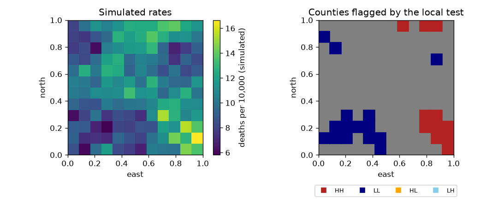

```python
z = y_strong - y_strong.mean()
Wz = W_rook @ z
quadrant = np.where(z > 0, np.where(Wz > 0, "HH", "HL"),
                    np.where(Wz > 0, "LH", "LL"))
colors = {"HH": "firebrick", "LL": "navy", "HL": "orange", "LH": "skyblue"}
fig, axes = plt.subplots(1, 2, figsize=(9, 3.8))
im = axes[0].imshow(y_strong.reshape(12, 12), origin="lower",
                    extent=(0, 1, 0, 1), cmap="viridis")
fig.colorbar(im, ax=axes[0], label="deaths per 10,000 (simulated)")
axes[0].set_title("Simulated rates")
axes[1].imshow(np.ones((12, 12)), origin="lower", extent=(0, 1, 0, 1),
               cmap="gray", vmin=0, vmax=2)
for i in np.flatnonzero(p_loc <= 0.05):
    axes[1].add_patch(plt.Rectangle((S[i, 0] - 1 / 24, S[i, 1] - 1 / 24),
                                    1 / 12, 1 / 12,
                                    color=colors[quadrant[i]]))
axes[1].set_title("Counties flagged by the local test")
for q, c in colors.items():
    axes[1].plot([], [], "s", color=c, label=q)
axes[1].legend(loc="upper center", bbox_to_anchor=(0.5, -0.2), ncol=4,
               fontsize=8)
for ax in axes:
    ax.set_xlabel("east")
    ax.set_ylabel("north")
fig.tight_layout()
fig.savefig("figures/ch06/fig_6_4_local.png", dpi=120)
print(dict(zip(*np.unique(quadrant[p_loc <= 0.05], return_counts=True))))
```

The flagged high-high counties lie in the east, and the flagged low-low counties lie in the south-west and the north-west, with one in the east. The pattern follows the smooth regional structure of the data, and the flags are best read as a map of where the pattern is strongest, not as 26 separate findings.

### 6.9.3 A Simulated Study of the Modifiable Areal Unit Problem

The last part of the lab builds the simulation behind Section 6.1.1. The code first defines the fine grid and the matrix that averages cells into units, then simulates the two components, the covariate, and the outcome for 200 worlds.

```python
def fine_grid(m):
    """Centers of an m-by-m grid of cells in the unit square."""
    g = (np.arange(m) + 0.5) / m
    xx, yy = np.meshgrid(g, g)
    return np.column_stack([xx.ravel(), yy.ravel()])


def aggregation_matrix(m, gr, gc):
    """Average over gr-by-gc blocks of an m-by-m grid (cell = row*m + col).
    Units are numbered like the grid of units: unit = row * (m // gc) + col."""
    cells = np.arange(m * m).reshape(m, m)
    G = np.zeros(((m // gr) * (m // gc), m * m))
    for i in range(m // gr):
        for j in range(m // gc):
            block = cells[i * gr:(i + 1) * gr, j * gc:(j + 1) * gc]
            G[i * (m // gc) + j, block.ravel()] = 1 / (gr * gc)
    return G


m_f = 48
S_f = fine_grid(m_f)
n_f = len(S_f)
dx = S_f[:, 0][:, None] - S_f[:, 0][None, :]
dy = S_f[:, 1][:, None] - S_f[:, 1][None, :]
R_local = np.exp(-np.sqrt(dx**2 + dy**2) / 0.02)
R_region = np.exp(-np.sqrt((dx / 0.6) ** 2 + (dy / 0.2) ** 2))
L_local = np.linalg.cholesky(R_local + 1e-8 * np.eye(n_f))
L_region = np.linalg.cholesky(R_region + 1e-8 * np.eye(n_f))

reps = 200
rng = np.random.default_rng(2050)
a = L_local @ rng.standard_normal((n_f, reps))     # local component
b = L_region @ rng.standard_normal((n_f, reps))    # regional component
e = rng.standard_normal((n_f, reps))               # independent noise
x_cells = a + b                                    # covariate, per cell
y_cells = 1.0 * a - 0.5 * b + e                    # outcome, per cell
```

The second block aggregates each world six ways, computes the slope, the correlation, Moran's I of the outcome (using rook weights on the grid of units), and the predicted slope from the exact variances, and prints the table quoted in Section 6.1.1.

```python
def slope_corr(X, Y):
    """Slope and correlation for each column of X and Y."""
    Xc, Yc = X - X.mean(axis=0), Y - Y.mean(axis=0)
    sxy, sxx, syy = (Xc * Yc).sum(0), (Xc**2).sum(0), (Yc**2).sum(0)
    return sxy / sxx, sxy / np.sqrt(sxx * syy)


def moran_I_cols(Y, W):
    """Moran's I for each column of Y."""
    Z = Y - Y.mean(axis=0)
    return len(Y) / W.sum() * (Z * (W @ Z)).sum(0) / (Z * Z).sum(0)


def expected_variance(C):
    """Expected sample variance across the units, for covariance matrix C."""
    U = len(C)
    return np.trace((np.eye(U) - np.ones((U, U)) / U) @ C) / (U - 1)


zonings = {"fine cells (48 x 48)": (1, 1),
           "squares, 12 x 12 units": (4, 4),
           "squares, 6 x 6 units": (8, 8),
           "squares, 3 x 3 units": (16, 16),
           "strips, 48 x 3 units": (1, 16),
           "strips, 3 x 48 units": (16, 1)}
maup = {}
print(f"{'zoning':26s}{'slope':>7s}{'sd':>6s}{'share <0':>9s}"
      f"{'corr':>7s}{'I of y':>8s}{'predicted':>10s}")
for name, (gr, gc) in zonings.items():
    G = aggregation_matrix(m_f, gr, gc)
    X, Y = G @ x_cells, G @ y_cells
    slopes, corrs = slope_corr(X, Y)
    W_u = row_standardize(rook(m_f // gr, m_f // gc))
    I_y = moran_I_cols(Y, W_u)
    if gr == gc == 1:
        Ca, Cb = R_local, R_region
    else:
        Ca, Cb = G @ R_local @ G.T, G @ R_region @ G.T
    va, vb = expected_variance(Ca), expected_variance(Cb)
    predicted = (1.0 * va - 0.5 * vb) / (va + vb)
    maup[name] = (X, Y, slopes, corrs, I_y)
    print(f"{name:26s}{slopes.mean():7.3f}{slopes.std():6.3f}"
          f"{np.mean(slopes < 0):9.2f}{corrs.mean():7.3f}"
          f"{I_y.mean():8.3f}{predicted:10.3f}")
```

The output gives the numbers in the table of Section 6.1.1. The slope falls from $0.383$ at the finest scale to $-0.397$ at nine units, and the strips give $-0.207$ and $-0.045$. The third block draws Figures 6.1 and 6.2.

```python
fig, axes = plt.subplots(1, 4, figsize=(11, 3.1))
rng_plot = np.random.default_rng(3)
for ax, name in zip(axes, ["fine cells (48 x 48)", "squares, 12 x 12 units",
                           "squares, 3 x 3 units", "strips, 48 x 3 units"]):
    X, Y, slopes, corrs, _ = maup[name]
    xs, ys = X[:, 0], Y[:, 0]
    keep = rng_plot.choice(len(xs), min(len(xs), 300), replace=False)
    ax.scatter(xs[keep], ys[keep], s=8, alpha=0.6)
    line = np.array([xs.min(), xs.max()])
    ax.plot(line, ys.mean() + slopes[0] * (line - xs.mean()), color="black")
    ax.set_title(f"{name}\nslope {slopes[0]:.2f}", fontsize=8)
    print(f"first world, {name}: slope {slopes[0]:.2f}")
    ax.set_xlabel("covariate")
axes[0].set_ylabel("outcome")
fig.tight_layout()
fig.savefig("figures/ch06/fig_6_1_maup_one.png", dpi=120)

fig, ax = plt.subplots(figsize=(8, 3.6))
ax.boxplot([maup[k][2] for k in zonings])
ax.set_xticklabels(["fine", "12x12", "6x6", "3x3",
                    "strips\n48x3", "strips\n3x48"])
ax.axhline(0, color="gray", lw=0.7)
ax.set_ylabel("regression slope (200 simulated worlds)")
fig.tight_layout()
fig.savefig("figures/ch06/fig_6_2_maup_slopes.png", dpi=120)
```

In the first of the 200 worlds, the fitted slope is $0.46$ for the fine cells, $0.00$ for the 144 squares, $-0.30$ for the nine squares, and $-0.11$ for the 144 east-west strips, as Figure 6.1 shows. One world can differ from the average, which is why Figure 6.2 shows all 200.

---

<a id="ch6-exercises"></a>

## Exercises

**Analytical**

1. For the four tracts of Section 6.1.1, find a third grouping into two ZIP codes (NW with SE, and NE with SW) and compute the slope across the two units. Then find values of $y$ for the four tracts, keeping $x = (1, 5, 3, 7)$, for which the slopes of zoning A and zoning B have the same sign.

2. In the ecological example of Section 6.1.2, give each county a different within-county slope, $+1$, $+2$, and $+3$, keeping the county averages the same. Compute the pooled slope. Show that the pooled slope is a weighted average of the within-county slopes and a between-county term, and find the weights.

3. Show that for the aggregated variables of Section 6.1.1 the slope across units is approximately $(v_a - 0.5v_b)/(v_a + v_b)$. State exactly where independence of $a$, $b$, and $\varepsilon$ is used, and why "approximately" is needed.

4. Show that the eigenvalues of the row-standardized rook matrix for a path of three regions in a line are $1$, $0$, and $-1$. Find the eigenvectors and verify that the path is bipartite.

5. A $2 \times 2$ rook grid is a cycle of four regions. Compute $\mathbf{W}$, show that $\mathbf{W}$ is symmetric here, and find its eigenvalues. Why is $\mathbf{W}$ symmetric when all degrees are equal?

6. For the three clinics of Section 6.2.3, compute $\tilde{\mathbf{A}} = \mathbf{D}^{-1/2}\mathbf{A}\mathbf{D}^{-1/2}$ for the nearest-neighbor matrix $\mathbf{B}$ and show that it is not symmetric. Compute the eigenvalues of the row-standardized $\mathbf{B}$ and check whether they are real. Repeat for the symmetrized matrix $\max(\mathbf{B}, \mathbf{B}')$.

7. Show that for row-standardized weights, $I = \mathbf{y}_c'\mathbf{W}\mathbf{y}_c/\mathbf{y}_c'\mathbf{y}_c$ equals the slope of the regression of $\mathbf{W}\mathbf{y}_c$ on $\mathbf{y}_c$ through the origin. Then find the slope of the reverse regression, of $\mathbf{y}_c$ on $\mathbf{W}\mathbf{y}_c$, and explain why it is not $1/I$.

8. Compute the $4 \times 4$ matrix $\mathbf{M}$ for the hub map by hand from $\mathbf{P}_c\mathbf{W}_s\mathbf{P}_c$, and verify $\operatorname{tr}(\mathbf{M}) = -1$, $\operatorname{tr}(\mathbf{M}^2) = 43/48$, and $\mathbf{M}\mathbf{1} = \mathbf{0}$.

9. Prove the claim of Section 6.5.2 that the rotation-invariance of $\mathbf{w}$ implies independence of its direction and length. (Hint: write the density of $\mathbf{w}$ in polar coordinates.) Then show that the same argument fails if $\operatorname{Var}(\mathbf{w}) = \tau^2\boldsymbol{\Sigma}_w$ with $\boldsymbol{\Sigma}_w$ not a multiple of the identity.

10. For the hub map, compute $\operatorname{E}[C]$ and, using the Laplacian form of Section 6.7.1, $\operatorname{Var}(C)$ under normality. (Use the same method as Section 6.5.4, with $\operatorname{tr}(\mathcal{L}^2)$ in place of $\operatorname{tr}(\mathbf{M}^2)$, where $\mathcal{L} = \mathbf{D}_s - \mathbf{W}_s$.)

11. Show that for the local indicators of Section 6.7.2, $\sum_iI_i = S_0\,I$. Then, for $n$ independent standard normal values and weights of one neighbor per region, explain why the local indicators are not independent of each other even when the data are.

12. In Section 6.8.2, show that the mean of the permutation distribution of Geary's $C$ is also 1 for any weights.

13. Explain why the residuals of an OLS fit are not exchangeable even when the errors are independent and identically distributed: find $\operatorname{Var}(e_i)$ and $\operatorname{Cov}(e_i, e_j)$ in terms of $\mathbf{P}_{\mathbf{X}}$, and compute them for the hub map with $\mathbf{X} = [\mathbf{1}\ \ \mathbf{x}]$, $\mathbf{x} = (0, 1, 2, 3)'$.

14. Show that Moran's $I$ can be expressed as a Rayleigh quotient on the subspace orthogonal to $\mathbf{1}_n$:
$$
I = \frac{n}{S_0} \frac{\mathbf{y}_c'\mathbf{W}_s\mathbf{y}_c}{\mathbf{y}_c'\mathbf{y}_c} = \frac{n}{S_0} \frac{\mathbf{y}'\mathbf{M}\mathbf{y}}{\mathbf{y}'\mathbf{P}_c\mathbf{y}}
$$
where $\mathbf{M} = \mathbf{P}_c\mathbf{W}_s\mathbf{P}_c$. Because $\mathbf{M}\mathbf{1}_n = \mathbf{0}$, one eigenvalue of $\mathbf{M}$ is zero with eigenvector $\mathbf{1}_n$. Let the eigenvalues of $\mathbf{M}$ on the $(n-1)$-dimensional subspace $\mathbf{1}_n^{\perp}$ be ordered as $\lambda_2 \le \lambda_3 \le \dots \le \lambda_n$.
(a) Prove that for any non-constant data vector $\mathbf{y}$, the values of Moran's $I$ are strictly bounded:
$$
\frac{n}{S_0}\lambda_2 \le I \le \frac{n}{S_0}\lambda_n
$$
(b) Explain why these sharp algebraic bounds can fall outside the interval $[-1, 1]$.
(c) Using the eigenvalues of $\mathbf{M}$ calculated for the hub map in Section 6.4.2, compute these bounds explicitly and check that the observed $I = 1/6$ satisfies them.

15. The graph Laplacian associated with the symmetrized weights $\mathbf{W}_s$ is $\mathcal{L} = \mathbf{D}_s - \mathbf{W}_s$, where $\mathbf{D}_s = \operatorname{diag}(\mathbf{W}_s\mathbf{1}_n)$.
(a) Show that the quadratic form $\mathbf{y}'\mathcal{L}\mathbf{y}$ equals the Dirichlet energy:
$$
\mathbf{y}'\mathcal{L}\mathbf{y} = \frac{1}{2}\sum_{i=1}^n\sum_{j=1}^n [\mathbf{W}_s]_{ij}(y_i - y_j)^2
$$
(b) Verify that $\mathcal{L}$ is positive semi-definite with $\mathcal{L}\mathbf{1}_n = \mathbf{0}$.
(c) Geary's $C$ satisfies $C = \frac{n-1}{S_0}\frac{\mathbf{y}'\mathcal{L}\mathbf{y}}{\mathbf{y}'\mathbf{P}_c\mathbf{y}}$. Use the Courant-Fischer min-max theorem to show that the non-constant map pattern $\mathbf{y}$ that minimizes Geary's $C$ is the eigenvector of $\mathcal{L}$ corresponding to its smallest positive eigenvalue $\lambda_2(\mathcal{L})$ (the Fiedler vector). What kind of spatial pattern does this vector represent?

16. Consider a connected bipartite graph with adjacency matrix $\mathbf{A} = \begin{bmatrix} \mathbf{0} & \mathbf{B} \\ \mathbf{B}' & \mathbf{0} \end{bmatrix}$, partitioned into vertex sets $V_1$ of size $n_1$ and $V_2$ of size $n_2$.
(a) Show that if $\lambda$ is an eigenvalue of the normalized matrix $\tilde{\mathbf{A}} = \mathbf{D}^{-1/2}\mathbf{A}\mathbf{D}^{-1/2}$ with eigenvector $(\mathbf{u}_1', \mathbf{u}_2')'$, then $-\lambda$ is also an eigenvalue with eigenvector $(\mathbf{u}_1', -\mathbf{u}_2')'$.
(b) Deduce that the spectrum of $\mathbf{W} = \mathbf{D}^{-1}\mathbf{A}$ is symmetric about zero, with $\lambda_{\min} = -1$ and $\lambda_{\max} = 1$.
(c) On a regular $m \times m$ grid with rook neighbors, construct the eigenvector corresponding to $\lambda = -1$ (the checkerboard pattern). Show that when an autoregressive process $\mathbf{y} = (\mathbf{I}_n - \rho\mathbf{W})^{-1}\boldsymbol{\varepsilon}$ is driven by negative autocorrelation $\rho < 0$, the spatial multiplier amplifies this checkerboard pattern by the factor $(1 + \lvert\rho\rvert)^{-1}$ when $\rho > -1$, and discuss what happens as $\rho \to -1$.

17. The asymptotic normality of Moran's $I$ under the randomization null hypothesis requires that no individual region dominates the network, formalized by the condition $\sum_{i=1}^n d_i^2 = o(S_0^2)$ as $n \to \infty$. Consider a star graph with one central hub connected to $n - 1$ outer leaves ($A_{1j} = A_{j1} = 1$ for $j \ge 2$, and all other $A_{ij} = 0$).
(a) Compute the degree sum $\sum_{i=1}^n d_i^2$ for the star graph with binary adjacency weights, and show that $\sum_{i=1}^n d_i^2 = O(n^2)$ while $S_0^2 = 4(n-1)^2$, so that the condition $\sum_{i=1}^n d_i^2 = o(S_0^2)$ fails.
(b) For binary weights on the star graph, show that the centered quadratic form $\mathbf{y}_c'\mathbf{A}\mathbf{y}_c$ reduces to $-2 y_{c,1}^2$.
(c) Explain why the null distribution of $I$ on a star graph cannot be asymptotically normal, and describe the physical consequence for testing spatial autocorrelation on centralized transportation or flow networks.

18. In local spatial cluster analysis, $n$ dependent hypothesis tests are evaluated simultaneously.
(a) The Benjamini-Hochberg procedure controls the false discovery rate at level $q$ under independence or positive regression dependence. State the step-up rejection rule in terms of the ordered p-values $p_{(1)} \le p_{(2)} \le \dots \le p_{(n)}$.
(b) Benjamini and Yekutieli (2001) showed that under arbitrary dependence, false discovery rate control at level $q$ is guaranteed by replacing $q$ with $q / c(n)$, where $c(n) = \sum_{i=1}^n 1/i$. For the 144 counties of Section 6.7.2, compute $c(144) = \sum_{i=1}^{144} 1/i$ and find the effective penalized discovery threshold.
(c) Because spatial weights matrices perform local averaging, local indicators $I_i$ of adjacent counties share common terms and exhibit positive spatial dependence. Evaluate whether the conservative Benjamini-Yekutieli penalty is appropriate for exploratory map analysis, and contrast it with permutation-based cluster-extent tests.

**Computational and simulation**

19. Rebuild the table of Section 6.2.4 for the queen weights with the rows standardized and not standardized. Does Moran's I change? Does its null mean change? (Remember the factor $n/S_0$.)

20. Simulate 5,000 data sets on the county map with independent standard normal values and compute $I$ with rook weights. Compare the histogram of $I$ with a normal density with the exact mean and standard deviation. Repeat with $n = 9$ regions ($3 \times 3$ rook grid) and describe how the approximation changes.

21. Using the data of Section 6.8.5, find the simplest rescaling of the values (dividing by $\exp(\text{deprivation})$) that restores the 5% size for both tests. Then find what happens if the variance field is not known and has to be estimated from the data.

22. Repeat the residual experiment of Section 6.8.5 for polynomial trend surfaces of degrees 1, 2, 3, and 4 ($p = 3, 6, 10, 15$) and plot the exact null mean of $I_e$ against $p$. At what $p$ does the naive permutation test first lose half its power against a spatial effect with $\phi = 0.2$?

23. Extend the MAUP simulation of Section 6.9.3 with a second regional range, 0.3 east-west and 0.1 north-south. Does the slope still change sign as the units grow? Predict the answer from the weighted-average formula first, and then check it.

24. Build a $48 \times 48$ fine grid and a zoning by 144 irregular units: draw 144 random points, assign each cell to its nearest point (a Voronoi partition), and aggregate. Compare the slope with that of the squares and strips, and compute Moran's I with queen weights between the Voronoi units (adjacent when any of their cells touch).

25. A permutation test for Geary's $C$ is analogous to the one for $I$. Implement it and apply it to the strong response with the rook weights. Compare the p-value with that of Moran's I.

---

<a id="ch6-what-comes-next"></a>

## What Comes Next

The weights matrix and the null distribution of Moran's I give us a way to detect spatial structure in areal data. Chapters 7 and 8 turn the weights into models. Chapter 7 builds the simultaneous autoregressive models, in which each region's value is regressed on its neighbors' values, and shows how to interpret the effect of a covariate once the feedback between neighbors is accounted for. Chapter 8 builds the conditional autoregressive models, in which each region is described given its neighbors, and shows that both families produce a covariance structure that can be handled with the sparse precision matrices of Chapter 8. Chapter 9 puts these on the count scale, with expected counts and the small-population problem that Chapter 0 introduced.


---

<a id="ch7"></a>

# Chapter 7: Simultaneous Autoregressive Models: Spatial Regression with Feedback

Chapter 6 gave us a way to say which regions are neighbors and a way to test whether a variable is spatially correlated. This chapter builds the first regression models for data on regions that put that neighbor structure to work. The idea is the one that makes spatial econometrics a field of its own: a region's value depends on its neighbors' values, and their values depend on it, all at once.

There are two ways to write that down, and they answer different questions. In the **spatial lag model** the feedback is in the response: a city's tax rate depends on the tax rates of its neighbors. In the **spatial error model** the feedback is in the unexplained part: counties share unobserved shocks, and the shocks echo across borders. Both models have a covariance matrix of the same shape, so both are linear models with a structured $\boldsymbol{\Sigma}$ and everything from Chapters 1 and 5 applies. They differ in the mean, and that difference matters a great deal for what the coefficients mean, for what goes wrong with ordinary least squares, and for how to report results.

We derive each model, see why OLS fails in each (a different way), fit them by maximum likelihood with one trick that makes the likelihood cheap (Ord's eigenvalue identity), test which model the data prefer, and learn to interpret the lag model through its direct, indirect, and total impacts. Four small tools are introduced along the way, each with an example before it is used: the Neumann series for a matrix inverse, the determinant as a product of eigenvalues, the change of variables formula for a density, and the score test.

The running data set is a simulated map of 144 square counties. Responses are simulated with known parameters, so every estimator can be checked against the truth.

> **Chapter at a Glance**
>
> - **The Simultaneous Idea (§7.1):** Each region regressed on its neighbors, all at once, and the two places to put the feedback.
> - **The Spatial Error Model (§7.2):** Correlated shocks, the induced covariance $\sigma^2[(\mathbf{I}-\rho\mathbf{W})'(\mathbf{I}-\rho\mathbf{W})]^{-1}$, the precision matrix $\mathbf{Q}$, and GLS as OLS on spatially filtered data.
> - **The Spatial Lag Model (§7.3):** The feedback multiplier as a series in $\mathbf{W}$, and why OLS is biased in two different ways.
> - **The Parameter Space (§7.4):** When $\mathbf{I}-\rho\mathbf{W}$ can be inverted, and why $\rho$ lives in an interval around zero.
> - **Maximum Likelihood (§7.5):** The Jacobian term, Ord's eigenvalue identity, and a one-dimensional profile search over $\rho$.
> - **Choosing a Model (§7.6):** Lagrange multiplier tests, robust versions, likelihood ratio tests, and AIC.
> - **Impacts (§7.7):** Why a lag-model coefficient is not a marginal effect, and direct, indirect, and total impacts.
> - **Walkthrough and Lab (§7.8):** A four-region example in code, a simulated county map, and checks of every claim above.

---

<a id="s7-1"></a>

## 7.1 The Simultaneous Idea

Think of neighboring cities setting their property tax rates. A city that raises its rate risks losing residents and businesses to a neighbor with a lower one, and voters compare their own city's rate with what is charged next door. So each city's rate depends on its neighbors' rates. But the neighbors are reacting to this city and to their own neighbors in the same way. No city moves first, and no city's decision can be treated as given while the others are solved. The rates are determined together, as the solution of a system of equations.

Write this for region $i$, using the row-standardized weights $w_{ij}$ of Chapter 6:

$$
Y_i = \rho\sum_{j=1}^n w_{ij}Y_j + \mathbf{x}_i'\boldsymbol{\beta} + \varepsilon_i
$$

The sum $\sum_j w_{ij}Y_j$ is the average of $Y$ over region $i$'s neighbors, so $\rho$ says how strongly a region follows its neighbors' average. The vector $\mathbf{x}_i$ holds the region's own covariates, and $\varepsilon_i$ is a fresh independent disturbance. For all regions at once, $\mathbf{Y} = \rho\mathbf{W}\mathbf{Y} + \mathbf{X}\boldsymbol{\beta} + \boldsymbol{\varepsilon}$. The word *simultaneous* refers to the fact that $\mathbf{Y}$ appears on both sides: every equation involves values that are themselves unknown and are the subject of other equations.

**A two-region example.** To see what simultaneity does, take two regions that are each other's only neighbor, so $w_{12} = w_{21} = 1$, and drop the covariates: $Y_1 = \rho Y_2 + \varepsilon_1$ and $Y_2 = \rho Y_1 + \varepsilon_2$. Substitute the second equation into the first:

$$
Y_1 = \rho(\rho Y_1 + \varepsilon_2) + \varepsilon_1 \quad\Longrightarrow\quad Y_1 = \frac{\varepsilon_1 + \rho\varepsilon_2}{1 - \rho^2}, \qquad Y_2 = \frac{\varepsilon_2 + \rho\varepsilon_1}{1 - \rho^2}
$$

With $\rho = 0.5$ and a shock of 1 in region 1 and none in region 2, $Y_1 = 1/0.75 = 1.333$ and $Y_2 = 0.5/0.75 = 0.667$. The shock was 1, but region 1 rises by more than 1, because the rise in region 2 feeds back. That echo is the signature of a simultaneous model, and the matrix algebra below is the general version of this calculation. The code confirms the numbers by solving the two equations as a linear system.

```python
import numpy as np
from scipy import optimize, stats

W2 = np.array([[0.0, 1.0], [1.0, 0.0]])
rho = 0.5
shock = np.array([1.0, 0.0])
print("response to a shock in region 1:",
      np.round(np.linalg.solve(np.eye(2) - rho * W2, shock), 4))
```

**What we assume about $\mathbf{W}$.** Chapter 6 built $\mathbf{W}$ from the adjacency matrix $\mathbf{A}$ and the degree matrix $\mathbf{D}$ as $\mathbf{W} = \mathbf{D}^{-1}\mathbf{A}$. This chapter uses four facts from that construction: $\mathbf{W}$ has zeros on its diagonal (no region is its own neighbor), its rows sum to 1 so that $\mathbf{W}\mathbf{1}_n = \mathbf{1}_n$, it is not symmetric in general, and its eigenvalues are real because $\mathbf{W}$ is similar to the symmetric matrix $\tilde{\mathbf{A}} = \mathbf{D}^{-1/2}\mathbf{A}\mathbf{D}^{-1/2}$ (Section 6.3.3).

**Two places for the feedback.** The equation above puts the neighbors' values into the model for $Y_i$. That is the lag model. The alternative is to leave the mean alone and let the unexplained part of each region echo its neighbors' unexplained parts. Both are called simultaneous autoregressive (SAR) models, and the table summarizes how they differ.

| | Spatial lag model | Spatial error model |
| :--- | :--- | :--- |
| Equation | $\mathbf{Y} = \rho\mathbf{W}\mathbf{Y} + \mathbf{X}\boldsymbol{\beta} + \boldsymbol{\varepsilon}$ | $\mathbf{Y} = \mathbf{X}\boldsymbol{\beta} + \mathbf{u}$, $\ \mathbf{u} = \rho\mathbf{W}\mathbf{u} + \boldsymbol{\varepsilon}$ |
| Feedback in | The response | The unexplained part |
| Typical story | Strategic interaction: tax rates, prices | Shared shocks: weather, local economy |
| Mean of $\mathbf{Y}$ | $(\mathbf{I}-\rho\mathbf{W})^{-1}\mathbf{X}\boldsymbol{\beta}$ | $\mathbf{X}\boldsymbol{\beta}$ |
| What OLS does | Biased and inconsistent | Unbiased, wrong standard errors |
| Coefficient means | Not the marginal effect | The marginal effect |

Two things stand out. The covariance of $\mathbf{Y}$ turns out to be the same in the two models, as Section 7.3.1 shows, and the means differ. And Chapter 8 will approach the same dependence from the opposite direction, by specifying each region's distribution given its neighbors; Section 8.5 compares the two.

In the language of the one model equation of Section 0.2, the spatial error model writes $Y = \mu + u$ with the spatial random effect $u$ built from independent innovations $\varepsilon$. The spatial lag model has the same covariance, but its mean also passes through the feedback matrix, as Section 7.3.1 shows. There is no separate nugget in these models: the independent part is the innovation that drives $u$, and its variance is $\sigma^2$.

---

<a id="s7-2"></a>

## 7.2 The Spatial Error Model

### 7.2.1 The Model

Counties on either side of a state line have different minimum wages, but workers commute across the line and firms relocate across it. A researcher regressing county employment growth on the county's own minimum wage and other covariates will leave out many things: a plant closing, a regional slowdown, a bad winter. Such shocks do not respect county borders. A shock in one county spreads partly to its neighbors, so the unexplained part of the regression is correlated across neighbors.

The spatial error model writes this directly:

$$
\mathbf{Y} = \mathbf{X}\boldsymbol{\beta} + \mathbf{u}, \qquad \mathbf{u} = \rho\mathbf{W}\mathbf{u} + \boldsymbol{\varepsilon}, \qquad \boldsymbol{\varepsilon} \sim N(\mathbf{0}, \sigma^2\mathbf{I}_n)
$$

Each county's unexplained part $u_i$ is $\rho$ times the average of its neighbors' unexplained parts, plus a fresh independent innovation $\varepsilon_i$. The regression coefficients $\boldsymbol{\beta}$ keep their usual meaning: $\beta_k$ is the change in the expected response when covariate $k$ increases by one unit, with nothing else moving. All of the spatial structure is in the errors.

By Chapter 1, this means OLS remains unbiased for $\boldsymbol{\beta}$ and its standard errors are wrong, understated most when the covariates are spatially smooth. The remaining questions are what covariance matrix the model implies and how to do better than OLS.

### 7.2.2 The Reduced Form

The equation for $\mathbf{u}$ has $\mathbf{u}$ on both sides. Collect the terms:

$$
\mathbf{u} - \rho\mathbf{W}\mathbf{u} = \boldsymbol{\varepsilon} \quad\Longrightarrow\quad (\mathbf{I}_n - \rho\mathbf{W})\mathbf{u} = \boldsymbol{\varepsilon}
$$

If the matrix $\mathbf{I}_n - \rho\mathbf{W}$ is invertible, we can solve for $\mathbf{u}$:

$$
\mathbf{u} = (\mathbf{I}_n - \rho\mathbf{W})^{-1}\boldsymbol{\varepsilon}
$$

This is the **reduced form**: the unexplained part written in terms of the independent innovations alone. We give the inverse a name, since it will appear throughout the chapter:

$$
\boldsymbol{\Phi}(\rho) = (\mathbf{I}_n - \rho\mathbf{W})^{-1}
$$

and call it the **feedback matrix**. The entry $\Phi_{ij}$ says how much of innovation $\varepsilon_j$ ends up in $u_i$ after all the echoes. When $\mathbf{I}_n - \rho\mathbf{W}$ can be inverted is the subject of Section 7.4. For now, assume it can.

### 7.2.3 The Covariance and the Precision Matrix

Since $\mathbf{u} = \boldsymbol{\Phi}\boldsymbol{\varepsilon}$ and $\operatorname{Var}(\boldsymbol{\varepsilon}) = \sigma^2\mathbf{I}_n$, Tool 1 of Section 0.4.1 gives

$$
\operatorname{Var}(\mathbf{u}) = \boldsymbol{\Phi}(\sigma^2\mathbf{I}_n)\boldsymbol{\Phi}' = \sigma^2\boldsymbol{\Phi}\boldsymbol{\Phi}'
$$

To write this without an inverse of a product, use the fact that the inverse of a product is the product of the inverses in reverse order, $(\boldsymbol{\Phi}\boldsymbol{\Phi}')^{-1} = (\boldsymbol{\Phi}')^{-1}\boldsymbol{\Phi}^{-1} = (\mathbf{I}_n - \rho\mathbf{W})'(\mathbf{I}_n - \rho\mathbf{W})$. Therefore

$$
\operatorname{Var}(\mathbf{u}) = \sigma^2\left[(\mathbf{I}_n - \rho\mathbf{W})'(\mathbf{I}_n - \rho\mathbf{W})\right]^{-1}
$$

The inverse of a covariance matrix is called the **precision matrix**. For this model it is available in closed form, and we write it $\mathbf{Q}$:

$$
\mathbf{Q}_{\text{SAR}} = \operatorname{Var}(\mathbf{u})^{-1} = \sigma^{-2}(\mathbf{I}_n - \rho\mathbf{W})'(\mathbf{I}_n - \rho\mathbf{W})
$$

The precision matrix matters because it describes dependence in a different way than the covariance does. Chapter 8 shows that a zero in $\mathbf{Q}$ means that two regions are independent once all the other regions are known. Here, expand the product:

$$
(\mathbf{I}_n - \rho\mathbf{W})'(\mathbf{I}_n - \rho\mathbf{W}) = \mathbf{I}_n - \rho(\mathbf{W} + \mathbf{W}') + \rho^2\mathbf{W}'\mathbf{W}
$$

The entry for regions $i$ and $j$ is nonzero if they are neighbors, through $\mathbf{W} + \mathbf{W}'$, or if they share a neighbor, through $\mathbf{W}'\mathbf{W}$. So $\mathbf{Q}_{\text{SAR}}$ is sparse but reaches two steps across the map, not one. Keep this in mind; it is the main structural difference from the CAR model.

**A hand-sized example.** Take four regions in a $2 \times 2$ block, numbered

$$
\begin{matrix} 1 & 2 \\ 3 & 4 \end{matrix}
$$

with rook neighbors: regions 1 and 2, 1 and 3, 2 and 4, 3 and 4. Each region has two neighbors, so

$$
\mathbf{W} = \frac{1}{2}\begin{bmatrix} 0 & 1 & 1 & 0 \\ 1 & 0 & 0 & 1 \\ 1 & 0 & 0 & 1 \\ 0 & 1 & 1 & 0 \end{bmatrix}
$$

This $\mathbf{W}$ happens to be symmetric because every region has the same number of neighbors. Its eigenvalues are $1, 0, 0, -1$, found from the eigenvectors $(1,1,1,1)'$, $(1,0,0,-1)'$, $(0,1,-1,0)'$, and $(1,-1,-1,1)'$; the last is the checkerboard pattern that flips sign between neighbors. Take $\rho = 0.5$. We need $\boldsymbol{\Phi} = (\mathbf{I} - 0.5\mathbf{W})^{-1}$. The matrix $\mathbf{W}$ has the same eigenvectors as $\boldsymbol{\Phi}$, with eigenvalues $1/(1 - 0.5\lambda)$ equal to $2, 1, 1, 2/3$. Section 7.3.2 shows how to get the entries directly; the result is

$$
\boldsymbol{\Phi}(0.5) = \frac{1}{6}\begin{bmatrix} 7 & 2 & 2 & 1 \\ 2 & 7 & 1 & 2 \\ 2 & 1 & 7 & 2 \\ 1 & 2 & 2 & 7 \end{bmatrix}
$$

You can check the first row against the first column of $\mathbf{I} - 0.5\mathbf{W}$, which is $(1, -0.25, -0.25, 0)'$: $\tfrac{7}{6} - \tfrac{2}{6}\cdot 0.25 - \tfrac{2}{6}\cdot 0.25 + 0 = 1$. Now the covariance of $\mathbf{u}$ is $\sigma^2\boldsymbol{\Phi}\boldsymbol{\Phi}'$. Its first row has entries, using $\boldsymbol{\Phi}$ symmetric:

$$
\begin{aligned}
\operatorname{Var}(u_1)/\sigma^2 &= \tfrac{1}{36}(49 + 4 + 4 + 1) = \tfrac{58}{36} = 1.6111 \\
\operatorname{Cov}(u_1, u_2)/\sigma^2 &= \tfrac{1}{36}(7\cdot 2 + 2\cdot 7 + 2\cdot 1 + 1\cdot 2) = \tfrac{32}{36} = 0.8889 \\
\operatorname{Cov}(u_1, u_4)/\sigma^2 &= \tfrac{1}{36}(7\cdot 1 + 2\cdot 2 + 2\cdot 2 + 1\cdot 7) = \tfrac{22}{36} = 0.6111
\end{aligned}
$$

Neighboring regions have correlation $0.8889/1.6111 = 0.552$; regions 1 and 4, which are not neighbors, have correlation $0.379$. Notice that $\rho = 0.5$ is not a correlation: it is a coefficient in the equations, and the correlations it produces are computed from the whole system.

For the precision, $(\mathbf{I} - \rho\mathbf{W})'(\mathbf{I} - \rho\mathbf{W}) = \mathbf{I} - \mathbf{W} + 0.25\,\mathbf{W}^2$ because $\mathbf{W}$ is symmetric and $\rho = 0.5$. With $\mathbf{W}^2 = \tfrac{1}{2}\begin{bmatrix} 1 & 0 & 0 & 1 \\ 0 & 1 & 1 & 0 \\ 0 & 1 & 1 & 0 \\ 1 & 0 & 0 & 1 \end{bmatrix}$, the first row of $\sigma^2\mathbf{Q}_{\text{SAR}}$ is

$$
(1 + 0.125,\ -0.5,\ -0.5,\ 0.125) = (1.125,\ -0.5,\ -0.5,\ 0.125)
$$

The last entry is nonzero even though regions 1 and 4 are not neighbors. They share two neighbors, regions 2 and 3, and that is enough. The lab (Section 7.8.1) verifies all of these numbers.

### 7.2.4 Generalized Least Squares for $\boldsymbol{\beta}$ Given $\rho$

Suppose for a moment that $\rho$ and $\sigma^2$ are known. The error model is then a linear model with covariance $\boldsymbol{\Sigma} = \sigma^2\boldsymbol{\Phi}\boldsymbol{\Phi}'$, and Section 1.3.5 says the best linear unbiased estimator is GLS:

$$
\hat{\boldsymbol{\beta}}_{\text{GLS}} = (\mathbf{X}'\boldsymbol{\Sigma}^{-1}\mathbf{X})^{-1}\mathbf{X}'\boldsymbol{\Sigma}^{-1}\mathbf{Y}
$$

Here $\boldsymbol{\Sigma}^{-1} = \mathbf{Q}_{\text{SAR}} = \sigma^{-2}(\mathbf{I}_n - \rho\mathbf{W})'(\mathbf{I}_n - \rho\mathbf{W})$ with no matrix to invert, and the factor $\sigma^{-2}$ cancels between the two parts of the formula. Define the **spatially filtered** data

$$
\mathbf{Y}^* = (\mathbf{I}_n - \rho\mathbf{W})\mathbf{Y}, \qquad \mathbf{X}^* = (\mathbf{I}_n - \rho\mathbf{W})\mathbf{X}
$$

Then $\mathbf{X}'(\mathbf{I}-\rho\mathbf{W})'(\mathbf{I}-\rho\mathbf{W})\mathbf{X} = \mathbf{X}^{*\prime}\mathbf{X}^*$ and the estimator is exactly the OLS estimator of $\mathbf{Y}^*$ on $\mathbf{X}^*$:

$$
\hat{\boldsymbol{\beta}}_{\text{GLS}}(\rho) = (\mathbf{X}^{*\prime}\mathbf{X}^*)^{-1}\mathbf{X}^{*\prime}\mathbf{Y}^*, \qquad \operatorname{Var}(\hat{\boldsymbol{\beta}}_{\text{GLS}}) = \sigma^2(\mathbf{X}^{*\prime}\mathbf{X}^*)^{-1}
$$

This is the decorrelation idea of Section 1.3.5 in its simplest form. There we multiplied the data by $\mathbf{L}^{-1}$ where $\mathbf{L}\mathbf{L}' = \boldsymbol{\Sigma}$. Here $\mathbf{L} = \sigma\boldsymbol{\Phi}$ satisfies $\mathbf{L}\mathbf{L}' = \boldsymbol{\Sigma}$ (it is a square root of the covariance, though not the triangular Cholesky factor), so $\mathbf{L}^{-1} = \sigma^{-1}(\mathbf{I}_n - \rho\mathbf{W})$: the feedback matrix plays the role of $\mathbf{L}$, and its inverse is the filter. The filter has a plain meaning. The entry for region $i$ of $(\mathbf{I} - \rho\mathbf{W})\mathbf{Y}$ is $Y_i - \rho\sum_j w_{ij}Y_j$: the region's value minus $\rho$ times its neighbors' average. Subtracting the echo leaves the independent innovation. Econometricians call this spatial differencing, by analogy with differencing a time series.

**By hand.** With the four-region map and $\rho = 0.5$, take $\mathbf{y} = (2, 1, 3, 2)'$. The neighbor averages are $\mathbf{W}\mathbf{y} = \tfrac{1}{2}(1 + 3,\ 2 + 2,\ 2 + 2,\ 1 + 3)' = (2, 2, 2, 2)'$, so the filtered data are

$$
\mathbf{y}^* = \mathbf{y} - 0.5\,\mathbf{W}\mathbf{y} = (2 - 1,\ 1 - 1,\ 3 - 1,\ 2 - 1)' = (1, 0, 2, 1)'
$$

In practice $\rho$ is unknown, so GLS is not yet a method; Section 7.5 estimates $\rho$ by maximum likelihood and then applies this filter. Section 7.8.8 shows what is gained: with spatially correlated shocks, the naive OLS interval for a slope covers the truth 83.2% of the time, and the interval from the filtered fit covers it 93.4% of the time.

---

<a id="s7-3"></a>

## 7.3 The Spatial Lag Model

### 7.3.1 The Model and Its Reduced Form

The lag model is the one from the tax-rate story in Section 7.1:

$$
\mathbf{Y} = \rho\mathbf{W}\mathbf{Y} + \mathbf{X}\boldsymbol{\beta} + \boldsymbol{\varepsilon}, \qquad \boldsymbol{\varepsilon} \sim N(\mathbf{0}, \sigma^2\mathbf{I}_n)
$$

A city's tax rate responds to its neighbors' rates (this is $\rho$) and to its own characteristics, such as population and income (these are in $\mathbf{X}\boldsymbol{\beta}$). The coefficient $\rho$ is the slope of a *reaction function*: how much a city moves when its neighbors move. A positive $\rho$ describes mimicking, as when cities follow each other's rates. This is an idea from the economics literature on strategic interaction, and it is a good example of a model where the dependence is itself the object of interest, not a nuisance.

Collect the $\mathbf{Y}$ terms and solve:

$$
(\mathbf{I}_n - \rho\mathbf{W})\mathbf{Y} = \mathbf{X}\boldsymbol{\beta} + \boldsymbol{\varepsilon} \quad\Longrightarrow\quad \mathbf{Y} = \boldsymbol{\Phi}(\rho)\left(\mathbf{X}\boldsymbol{\beta} + \boldsymbol{\varepsilon}\right)
$$

By Tool 1 this has mean and covariance

$$
\operatorname{E}[\mathbf{Y}] = \boldsymbol{\Phi}\mathbf{X}\boldsymbol{\beta}, \qquad \operatorname{Var}(\mathbf{Y}) = \sigma^2\boldsymbol{\Phi}\boldsymbol{\Phi}'
$$

The covariance is exactly the same matrix as in the error model. What differs is the mean. In the error model the mean is $\mathbf{X}\boldsymbol{\beta}$. In the lag model the mean is $\boldsymbol{\Phi}\mathbf{X}\boldsymbol{\beta}$: a region's expected value depends on its neighbors' covariates and on their neighbors' covariates, because those affect its neighbors' values, which affect it. This is why the two models call for different interpretations, and why the data can in principle tell them apart (Section 7.6).

### 7.3.2 The Feedback Multiplier as a Series

A tool we need: the matrix version of a geometric series.

For a number $r$ with $\lvert r\rvert < 1$, $1/(1 - r) = 1 + r + r^2 + \cdots$. The same thing holds for matrices. To see why, multiply the partial sum by $\mathbf{I} - \rho\mathbf{W}$; the terms telescope:

$$
(\mathbf{I} - \rho\mathbf{W})\left(\mathbf{I} + \rho\mathbf{W} + \rho^2\mathbf{W}^2 + \cdots + \rho^K\mathbf{W}^K\right) = \mathbf{I} - \rho^{K+1}\mathbf{W}^{K+1}
$$

Each term $\rho^k\mathbf{W}^k$ in the sum is cancelled by the next one except the first and the last. If $\rho^{K+1}\mathbf{W}^{K+1} \to \mathbf{0}$ as $K$ grows, the right side tends to $\mathbf{I}$, which says the sum converges to the inverse:

$$
\boldsymbol{\Phi}(\rho) = (\mathbf{I}_n - \rho\mathbf{W})^{-1} = \mathbf{I}_n + \rho\mathbf{W} + \rho^2\mathbf{W}^2 + \cdots
$$

This series is called the **Neumann series**. When does the condition hold? The eigenvalues of $\mathbf{W}$ lie between $-1$ and 1 (Section 6.3.3 proved this), so the eigenvalues of $\rho^k\mathbf{W}^k$ are at most $\lvert\rho\rvert^k$ in absolute value and they shrink to zero whenever $\lvert\rho\rvert < 1$.

The series has a clear meaning. Read $\boldsymbol{\Phi}\boldsymbol{\varepsilon} = \boldsymbol{\varepsilon} + \rho\mathbf{W}\boldsymbol{\varepsilon} + \rho^2\mathbf{W}^2\boldsymbol{\varepsilon} + \cdots$ as a story about one shock. The first term is the shock where it happens. The second, $\rho\mathbf{W}\boldsymbol{\varepsilon}$, is the part passed to each region's neighbors: region $i$ receives $\rho$ times the average of its neighbors' shocks. The third, $\rho^2\mathbf{W}^2\boldsymbol{\varepsilon}$, is the part passed to neighbors of neighbors, and some of it returns to the region where the shock started, since neighbors are mutual. The entries of $\mathbf{W}^k$ have a concrete interpretation: $(\mathbf{W}^k)_{ij}$ is the probability that a walker who moves, at each step, to a uniformly chosen neighbor, starting at region $i$, is at region $j$ after exactly $k$ steps. The feedback matrix adds up these walks with weights $\rho^k$.

**By hand on the four regions.** For the $2 \times 2$ block, the walker's two-step matrix is

$$
\mathbf{W}^2 = \frac{1}{2}\begin{bmatrix} 1 & 0 & 0 & 1 \\ 0 & 1 & 1 & 0 \\ 0 & 1 & 1 & 0 \\ 1 & 0 & 0 & 1 \end{bmatrix}
$$

From region 1, the walker moves to region 2 or 3 and then, with probability one half each, back to region 1 or onward to region 4. Two steps later the walker is at region 1 with probability $1/2$ and at region 4 with probability $1/2$, and never at regions 2 or 3. Applying $\mathbf{W}$ to $\mathbf{W}^2$ gives back $\mathbf{W}$, so $\mathbf{W}^3 = \mathbf{W}$, then $\mathbf{W}^4 = \mathbf{W}^2$, and so on: odd powers equal $\mathbf{W}$ and even powers (from 2 up) equal $\mathbf{W}^2$. Grouping the series by parity,

$$
\boldsymbol{\Phi}(\rho) = \mathbf{I} + (\rho + \rho^3 + \cdots)\mathbf{W} + (\rho^2 + \rho^4 + \cdots)\mathbf{W}^2 = \mathbf{I} + \frac{\rho}{1 - \rho^2}\mathbf{W} + \frac{\rho^2}{1 - \rho^2}\mathbf{W}^2
$$

For $\rho = 0.5$ the two fractions are $0.5/0.75 = 2/3$ and $0.25/0.75 = 1/3$, so $\boldsymbol{\Phi} = \mathbf{I} + \tfrac{2}{3}\mathbf{W} + \tfrac{1}{3}\mathbf{W}^2$. The diagonal entry is $1 + \tfrac{1}{3}\cdot\tfrac{1}{2} = \tfrac{7}{6}$, the entry for a neighbor is $\tfrac{2}{3}\cdot\tfrac{1}{2} = \tfrac{1}{3}$, and the entry for the region two steps away is $\tfrac{1}{3}\cdot\tfrac{1}{2} = \tfrac{1}{6}$. That is the matrix $\tfrac{1}{6}(7, 2, 2, 1)$ used in Section 7.2.3.

The diagonal entry builds up as the series is summed: $1$ from the identity, nothing added at the first power (a region is not its own neighbor), $1 + 0.25 \times 0.5 = 1.125$ with the second, still $1.125$ with the third, $1.15625$ with the fourth, and so on toward $7/6 = 1.1667$. Each row of $\boldsymbol{\Phi}$ sums to $7/6 + 2/6 + 2/6 + 1/6 = 2 = 1/(1 - \rho)$. This is no accident: because $\mathbf{W}\mathbf{1} = \mathbf{1}$, we have $\boldsymbol{\Phi}\mathbf{1} = (1 + \rho + \rho^2 + \cdots)\mathbf{1} = \mathbf{1}/(1 - \rho)$ for every connected map. Section 7.8.1 prints the partial sums.

### 7.3.3 Why OLS Fails in the Lag Model

OLS fails in two ways, depending on how it is used. Both are easy to see from the reduced form.

**Leaving out the lag.** Suppose the analyst ignores the spatial structure and regresses $\mathbf{Y}$ on $\mathbf{X}$ alone. Since $\operatorname{E}[\mathbf{Y}] = \boldsymbol{\Phi}\mathbf{X}\boldsymbol{\beta}$,

$$
\operatorname{E}[\hat{\boldsymbol{\beta}}_{\text{OLS}}] = (\mathbf{X}'\mathbf{X})^{-1}\mathbf{X}'\boldsymbol{\Phi}\mathbf{X}\boldsymbol{\beta} \ne \boldsymbol{\beta}
$$

unless $\rho = 0$. This is omitted-variable bias: the true model contains the neighbors' average $\mathbf{W}\mathbf{Y}$, which is correlated with $\mathbf{X}$ because covariates are themselves spatially smooth, and leaving it out loads its effect onto $\mathbf{X}$. For a smooth covariate the slope absorbs part of the spillover. The lab shows the exact mean slope of $1.74$ against a true $\beta_1$ of $1$.

**Including the lag.** The natural fix is to include $\mathbf{W}\mathbf{Y}$ as a regressor, giving OLS of $\mathbf{Y}$ on $\mathbf{X}_L = [\mathbf{W}\mathbf{Y},\ \mathbf{X}]$. This is also inconsistent, for a different reason: the new regressor is correlated with the disturbance. Since $\mathbf{W}\mathbf{Y} = \mathbf{W}\boldsymbol{\Phi}(\mathbf{X}\boldsymbol{\beta} + \boldsymbol{\varepsilon})$ and $\mathbf{X}\boldsymbol{\beta}$ is fixed,

$$
\operatorname{Cov}(\mathbf{W}\mathbf{Y}, \boldsymbol{\varepsilon}) = \mathbf{W}\boldsymbol{\Phi}\operatorname{Var}(\boldsymbol{\varepsilon}) = \sigma^2\mathbf{W}\boldsymbol{\Phi}
$$

Its diagonal entries are what matter: they are the covariance between $\varepsilon_i$ and the regressor $(\mathbf{W}\mathbf{Y})_i$ in the same equation. Use the series:

$$
\mathbf{W}\boldsymbol{\Phi} = \mathbf{W} + \rho\mathbf{W}^2 + \rho^2\mathbf{W}^3 + \cdots, \qquad (\mathbf{W}\boldsymbol{\Phi})_{ii} = \sum_{k \ge 1}\rho^{k-1}(\mathbf{W}^k)_{ii}
$$

The first term is zero, since $W_{ii} = 0$. The second is $\rho(\mathbf{W}^2)_{ii} = \rho\sum_j w_{ij}w_{ji}$, which is positive when neighbors are mutual, as they are on a map. So for $\rho > 0$ the covariance is positive. Intuitively, a shock $\varepsilon_i$ raises $Y_i$, which raises its neighbors' values, which raises $(\mathbf{W}\mathbf{Y})_i$ itself, so the regressor contains a piece of the disturbance. Least squares attributes that piece to the coefficient of $\mathbf{W}\mathbf{Y}$ and overstates $\rho$.

How large is the effect? For a regression of $\mathbf{Y}$ on $\mathbf{X}_L$, the error in the estimate is $(\mathbf{X}_L'\mathbf{X}_L)^{-1}\mathbf{X}_L'\boldsymbol{\varepsilon}$. Replacing each factor by its expectation gives an approximation to the bias that becomes exact as $n$ grows:

$$
\text{bias} \approx \left(\operatorname{E}[\mathbf{X}_L'\mathbf{X}_L]\right)^{-1}\operatorname{E}[\mathbf{X}_L'\boldsymbol{\varepsilon}], \qquad \operatorname{E}[\mathbf{X}_L'\boldsymbol{\varepsilon}] = \begin{bmatrix} \sigma^2\operatorname{tr}(\mathbf{W}\boldsymbol{\Phi}) \\ \mathbf{0} \end{bmatrix}
$$

The lower block is zero because $\mathbf{X}$ is not random and $\operatorname{E}[\boldsymbol{\varepsilon}] = \mathbf{0}$. In the four-region example, $\mathbf{W}\boldsymbol{\Phi} = \tfrac{4}{3}\mathbf{W} + \tfrac{2}{3}\mathbf{W}^2$ (using $\mathbf{W}^3 = \mathbf{W}$), whose diagonal is $\tfrac{2}{3}\cdot\tfrac{1}{2} = \tfrac{1}{3}$. Each region's regressor carries covariance $\sigma^2/3$ with its own disturbance, an amount comparable to the size of the disturbance itself.

The bias also spreads to the other coefficients, through the inverse of $\operatorname{E}[\mathbf{X}_L'\mathbf{X}_L]$: when $\rho$ is overstated, the coefficients on $\mathbf{X}$ are understated, because the lag regressor has taken credit for part of what $\mathbf{X}$ explains. In the lab with $\rho = 0.6$, the formula predicts a bias of $+0.147$ in $\hat{\rho}$ and $-0.181$ in the slope; the simulated biases are $+0.130$ and $-0.167$.

Neither version of OLS works. The remedy is maximum likelihood, which accounts for the dependence between $\mathbf{W}\mathbf{Y}$ and $\boldsymbol{\varepsilon}$ through a term that OLS leaves out (Section 7.5.1).

---

<a id="s7-4"></a>

## 7.4 The Parameter Space

The reduced forms need $\mathbf{I}_n - \rho\mathbf{W}$ to be invertible. This section works out for which values of $\rho$ it is, using the eigenvalues of $\mathbf{W}$.

**A tool we need: the determinant and the eigenvalues.** If $\mathbf{W}\mathbf{v} = \lambda\mathbf{v}$, then $(\mathbf{I} - \rho\mathbf{W})\mathbf{v} = \mathbf{v} - \rho\lambda\mathbf{v} = (1 - \rho\lambda)\mathbf{v}$. So the eigenvectors of $\mathbf{I} - \rho\mathbf{W}$ are those of $\mathbf{W}$, and its eigenvalues are $1 - \rho\lambda_i$. The determinant of a matrix is the product of its eigenvalues, so

$$
\lvert\mathbf{I}_n - \rho\mathbf{W}\rvert = \prod_{i=1}^n(1 - \rho\lambda_i)
$$

A matrix is invertible exactly when its determinant is not zero. So $\mathbf{I}_n - \rho\mathbf{W}$ is singular only at the values $\rho = 1/\lambda_i$ for eigenvalues $\lambda_i \ne 0$, and invertible everywhere else. For the four-region example the eigenvalues are $1, 0, 0, -1$, so the determinant is $(1 - \rho)(1)(1)(1 + \rho) = 1 - \rho^2$, singular only at $\rho = \pm 1$. At $\rho = 0.5$ it is $0.75$.

**What we know about the eigenvalues of $\mathbf{W}$.** For a row-standardized $\mathbf{W}$ on a connected map:

- $\lambda_{\max} = 1$. The vector $\mathbf{1}$ satisfies $\mathbf{W}\mathbf{1} = \mathbf{1}$, so 1 is an eigenvalue.
- All eigenvalues satisfy $\lvert\lambda\rvert \le 1$, by the largest-entry argument of Section 6.3.3 (the weights are nonnegative and sum to 1 in each row).
- $\lambda_{\min}$ lies between $-1$ and $0$, and equals $-1$ exactly when the regions can be split into two groups so that every neighbor pair has one region in each group (a bipartite map). A grid of square regions is bipartite: color it like a checkerboard, and the checkerboard pattern is an eigenvector with eigenvalue $-1$.

For the county map used in this chapter, the lab confirms that the smallest eigenvalue is $-1$ and the largest is $1$.

**The parameter space.** The interval

$$
\rho \in \left(\frac{1}{\lambda_{\min}},\ \frac{1}{\lambda_{\max}}\right)
$$

is the conventional parameter space: the largest interval around zero on which $\mathbf{I}_n - \rho\mathbf{W}$ stays invertible. For a row-standardized $\mathbf{W}$ the upper end is $1$, and for the county map and the four-region block the lower end is $-1$, so $\rho \in (-1, 1)$. Three reasons make this the right interval:

- Inside it every factor $1 - \rho\lambda_i$ is positive: for $\lambda_i > 0$ this needs $\rho < 1/\lambda_i$, and for $\lambda_i < 0$ it needs $\rho > 1/\lambda_i$. So the determinant is positive and the log-likelihood of Section 7.5 is defined.
- It contains $\rho = 0$, where both models reduce to the classical linear model.
- Inside it the Neumann series converges, so the feedback matrix has the interpretation of Section 7.3.2 as a sum of walks.

Beyond a singular point the matrix is invertible again, but the model would have no connection to the classical model and no interpretation as echoes. In applied work with positive dependence, $\rho$ lies in $(0, 1)$, and values near 1 describe strong dependence, with the covariance growing without bound as $\rho \to 1$.

With a binary (not row-standardized) adjacency matrix, the largest eigenvalue can be much greater than 1 (up to the largest degree), so the interval for $\rho$ is much narrower, which is one reason row-standardizing is common.

---

<a id="s7-5"></a>

## 7.5 Maximum Likelihood

### 7.5.1 The Likelihood and the Jacobian Term

A tool we need: changing variables in a density.

If $Y = a\varepsilon$ with $\varepsilon \sim N(0, 1)$, whose density we call $f$, and $a > 0$, the density of $Y$ is not $f(y/a)$. It is $f(y/a)/a$, because stretching the axis by a factor $a$ spreads the same probability over a longer interval and so lowers the density by the factor $a$. For a vector, $\boldsymbol{\varepsilon}$ is a function of $\mathbf{Y}$, and the density of $\mathbf{Y}$ equals the density of $\boldsymbol{\varepsilon}$ at that function, times the absolute value of the determinant of the matrix of derivatives $\partial\boldsymbol{\varepsilon}/\partial\mathbf{Y}$. This determinant is the **Jacobian**: the factor by which the transformation stretches volume.

For the lag model, solve the equation for the innovations: $\boldsymbol{\varepsilon} = (\mathbf{I}_n - \rho\mathbf{W})\mathbf{Y} - \mathbf{X}\boldsymbol{\beta}$. The matrix of derivatives of $\boldsymbol{\varepsilon}$ with respect to $\mathbf{Y}$ is $\mathbf{I}_n - \rho\mathbf{W}$. Since $\boldsymbol{\varepsilon} \sim N(\mathbf{0}, \sigma^2\mathbf{I}_n)$, the log-likelihood is

$$
\ell(\boldsymbol{\beta}, \rho, \sigma^2) = -\frac{n}{2}\log(2\pi\sigma^2) + \log\lvert\mathbf{I}_n - \rho\mathbf{W}\rvert - \frac{1}{2\sigma^2}\boldsymbol{\varepsilon}'\boldsymbol{\varepsilon}, \qquad \boldsymbol{\varepsilon} = (\mathbf{I}_n - \rho\mathbf{W})\mathbf{y} - \mathbf{X}\boldsymbol{\beta}
$$

For the error model, $\boldsymbol{\varepsilon} = (\mathbf{I}_n - \rho\mathbf{W})(\mathbf{y} - \mathbf{X}\boldsymbol{\beta})$, the derivative matrix is again $\mathbf{I}_n - \rho\mathbf{W}$, and the same formula holds with this $\boldsymbol{\varepsilon}$.

**Agreement with the general formula.** The error model is a multivariate normal with covariance $\boldsymbol{\Sigma} = \sigma^2\boldsymbol{\Phi}\boldsymbol{\Phi}'$, so Chapter 5's log-likelihood applies. Check that the two agree. The determinant is $\lvert\boldsymbol{\Sigma}\rvert = \sigma^{2n}\lvert\boldsymbol{\Phi}\rvert^2 = \sigma^{2n}\lvert\mathbf{I}_n - \rho\mathbf{W}\rvert^{-2}$, so $-\tfrac{1}{2}\log\lvert\boldsymbol{\Sigma}\rvert = -\tfrac{n}{2}\log\sigma^2 + \log\lvert\mathbf{I}_n - \rho\mathbf{W}\rvert$, and the quadratic form $(\mathbf{y} - \mathbf{X}\boldsymbol{\beta})'\boldsymbol{\Sigma}^{-1}(\mathbf{y} - \mathbf{X}\boldsymbol{\beta})$ equals $\boldsymbol{\varepsilon}'\boldsymbol{\varepsilon}/\sigma^2$. The Jacobian term is exactly the log-determinant term of Chapter 5, written in a convenient form.

**Why the Jacobian matters.** Drop it, and what remains is $-\boldsymbol{\varepsilon}'\boldsymbol{\varepsilon}$: maximizing the likelihood without the Jacobian is least squares. For the lag model, $\boldsymbol{\varepsilon}'\boldsymbol{\varepsilon}$ with $\boldsymbol{\varepsilon} = \mathbf{y} - \rho\mathbf{W}\mathbf{y} - \mathbf{X}\boldsymbol{\beta}$ is the sum of squares of OLS of $\mathbf{y}$ on $[\mathbf{W}\mathbf{y}, \mathbf{X}]$, the biased estimator of Section 7.3.3. So maximum likelihood equals that regression plus the term $\log\lvert\mathbf{I}_n - \rho\mathbf{W}\rvert$, and that term corrects the bias. It is $\sum_i\log(1 - \rho\lambda_i)$, which is zero at $\rho = 0$, negative elsewhere, and falls steeply as $\rho$ approaches 1 ($-23.5$ at $\rho = 0.9$ on the county map), so it pulls the estimate down from the value least squares would choose.

**A hand-sized example.** On the four-region map take $\mathbf{y} = (2, 1, 3, 2)'$, $\mathbf{X} = \mathbf{1}$, and the parameter values $\beta = 1$, $\rho = 0.5$, $\sigma^2 = 1$, and evaluate the lag log-likelihood. From Section 7.2.4, $(\mathbf{I} - 0.5\mathbf{W})\mathbf{y} = (1, 0, 2, 1)'$, so $\boldsymbol{\varepsilon} = (1, 0, 2, 1)' - (1, 1, 1, 1)' = (0, -1, 1, 0)'$ and $\boldsymbol{\varepsilon}'\boldsymbol{\varepsilon} = 2$. The Jacobian term is $\log 0.75 = -0.2877$. So

$$
\ell = -\frac{4}{2}\log(2\pi) - 0.2877 - \frac{2}{2} = -3.6758 - 0.2877 - 1 = -4.9634
$$

The lab evaluates the same quantity from the multivariate normal density with mean $\boldsymbol{\Phi}\mathbf{1}$ and covariance $\boldsymbol{\Phi}\boldsymbol{\Phi}'$, and gets $-4.9634$.

### 7.5.2 Ord's Eigenvalue Identity

The log-likelihood needs $\log\lvert\mathbf{I}_n - \rho\mathbf{W}\rvert$ at every value of $\rho$ the optimizer tries. Computing a determinant of an $n \times n$ matrix costs on the order of $n^3$ operations, and the optimizer may try dozens of values. Section 7.4 gives the way out. The determinant is the product of the eigenvalues $1 - \rho\lambda_i$, so

$$
\log\lvert\mathbf{I}_n - \rho\mathbf{W}\rvert = \sum_{i=1}^n\log(1 - \rho\lambda_i)
$$

This is **Ord's identity**. Once the eigenvalues $\lambda_i$ of $\mathbf{W}$ are computed, each new value of $\rho$ costs only $n$ logarithms. The eigenvalues themselves are found once, at a cost of order $n^3$, and that is made faster and more stable by computing them from the symmetric matrix $\tilde{\mathbf{A}} = \mathbf{D}^{-1/2}\mathbf{A}\mathbf{D}^{-1/2}$, which has the same eigenvalues as $\mathbf{W}$ (Section 6.3.3) and for which symmetric eigenvalue routines apply. For the four-region example the identity gives $\log 0.5 + 2\log 1 + \log 1.5 = \log 0.75$. The lab checks it on the county map, where $\log\lvert\mathbf{I} - 0.9\mathbf{W}\rvert = -23.5143$ both ways.

For maps with tens of thousands of regions even one eigendecomposition is too expensive. Chapter 8 and Chapter 13 use sparse matrix factorizations instead.

### 7.5.3 Profiling Out $\boldsymbol{\beta}$ and $\sigma^2$

As in Chapter 5, $\boldsymbol{\beta}$ and $\sigma^2$ can be removed from the likelihood, leaving a one-dimensional problem in $\rho$.

**The lag model.** For fixed $\rho$, the log-likelihood in $\boldsymbol{\beta}$ is minus a multiple of $\lVert(\mathbf{y} - \rho\mathbf{W}\mathbf{y}) - \mathbf{X}\boldsymbol{\beta}\rVert^2$, so the maximizer is the OLS regression of $\mathbf{y} - \rho\mathbf{W}\mathbf{y}$ on $\mathbf{X}$:

$$
\hat{\boldsymbol{\beta}}(\rho) = (\mathbf{X}'\mathbf{X})^{-1}\mathbf{X}'(\mathbf{y} - \rho\mathbf{W}\mathbf{y}) = \hat{\boldsymbol{\beta}}_y - \rho\,\hat{\boldsymbol{\beta}}_{Wy}
$$

where $\hat{\boldsymbol{\beta}}_y$ and $\hat{\boldsymbol{\beta}}_{Wy}$ are the OLS coefficients from regressing $\mathbf{y}$ and $\mathbf{W}\mathbf{y}$ on $\mathbf{X}$. The residuals are linear in $\rho$ in the same way:

$$
\mathbf{e}(\rho) = \mathbf{e}_y - \rho\,\mathbf{e}_{Wy}
$$

where $\mathbf{e}_y$ and $\mathbf{e}_{Wy}$ are the OLS residual vectors of those two regressions. Both are computed once. Then $\hat{\sigma}^2(\rho) = \mathbf{e}(\rho)'\mathbf{e}(\rho)/n$, and substituting into the log-likelihood (exactly as in Section 5.2.2, the exponent term becomes $-n/2$) gives the **profile log-likelihood**

$$
\ell_p(\rho) = -\frac{n}{2}\left(\log(2\pi) + 1\right) - \frac{n}{2}\log\hat{\sigma}^2(\rho) + \sum_{i=1}^n\log(1 - \rho\lambda_i)
$$

Each evaluation costs order $n$: a vector update, one dot product, and $n$ logarithms.

**The error model.** For fixed $\rho$, the filtered regression of Section 7.2.4 gives $\hat{\boldsymbol{\beta}}(\rho) = (\mathbf{X}^{*\prime}\mathbf{X}^*)^{-1}\mathbf{X}^{*\prime}\mathbf{Y}^*$, with residual $\mathbf{e}(\rho) = \mathbf{y}^* - \mathbf{X}^*\hat{\boldsymbol{\beta}}(\rho)$ and the same formula for $\ell_p$. The filtered data are cheap to form, since $\mathbf{y}^* = \mathbf{y} - \rho\mathbf{W}\mathbf{y}$ and $\mathbf{X}^* = \mathbf{X} - \rho\mathbf{W}\mathbf{X}$ use products $\mathbf{W}\mathbf{y}$ and $\mathbf{W}\mathbf{X}$ computed once.

**The algorithm.** Maximize $\ell_p$ over $\rho$ in the interval of Section 7.4 with a bounded one-dimensional search, then recover $\hat{\boldsymbol{\beta}}(\hat{\rho})$ and $\hat{\sigma}^2(\hat{\rho})$. Standard errors come from the observed information of the full log-likelihood in $(\boldsymbol{\beta}, \rho, \sigma^2)$, computed here by finite differences. Section 7.8.4 implements all of this.

**Testing $\rho = 0$.** Both models reduce to the classical linear model at $\rho = 0$, and $\rho = 0$ is an interior point of the parameter space $(-1, 1)$, so the ordinary likelihood ratio test applies: $2(\hat{\ell} - \ell_{\text{OLS}})$ is approximately $\chi^2_1$ under the null. This differs from the boundary tests of Section 5.5.2, where the null value lay on the edge of the parameter space.

---

<a id="s7-6"></a>

## 7.6 Choosing Between the Error and Lag Models

Suppose a researcher finds that the tax rates of neighboring cities are correlated after accounting for the cities' own characteristics. Two explanations are on the table. Cities may react to each other (a lag model), or they may share unobserved influences such as regional economic conditions (an error model). Both produce the same covariance matrix for $\mathbf{Y}$. They differ in the mean, and in the coefficients' interpretation. Which model describes the data matters for what the researcher reports.

The standard workflow starts from OLS, which is quick to fit and needs only residuals, and uses tests that ask whether adding a spatial term to OLS would improve the fit.

### 7.6.1 The Idea of a Score Test

**A tool we need: the score test.** A test of a null hypothesis can look at the fitted alternative, as the likelihood ratio test does, or at the slope of the log-likelihood at the null value. If the null value is the maximum of the log-likelihood, the slope there is zero. If the data fit the null poorly, the log-likelihood is still climbing at the null value, and the slope there is large. The slope is called the **score**, and a test based on it needs only the null fit, which here is OLS. A one-parameter example: for $Y_i \sim N(\mu, 1)$ and the null $\mu = 0$, the score at the null is $\sum_i y_i$, its variance under the null is $n$, and the score test statistic $(\sum_i y_i)^2/n$ is the square of the usual $z$ statistic. In general, the statistic is the score squared divided by the information (the variance of the score), and under the null it is approximately $\chi^2_1$. In the spatial setting these tests are called **Lagrange multiplier** (LM) tests, the name used in econometrics for the same construction.

### 7.6.2 The Four Statistics

All the ingredients come from the OLS fit. Let $\mathbf{e}$ be the OLS residuals, $s^2 = \mathbf{e}'\mathbf{e}/n$, and define

$$
g_{\text{err}} = \frac{\mathbf{e}'\mathbf{W}\mathbf{e}}{s^2}, \qquad g_{\text{lag}} = \frac{\mathbf{e}'\mathbf{W}\mathbf{y}}{s^2}
$$

The first measures whether residuals correlate with their neighbors' residuals: for a row-standardized $\mathbf{W}$ it equals $n$ times Moran's $I$ computed on the residuals (Section 6.6). The second measures whether the residuals correlate with the neighbors' responses. Two constants scale them:

$$
T_W = \operatorname{tr}(\mathbf{W}^2 + \mathbf{W}'\mathbf{W}), \qquad J = \frac{(\mathbf{W}\mathbf{X}\hat{\boldsymbol{\beta}})'(\mathbf{I}_n - \mathbf{P}_{\mathbf{X}})(\mathbf{W}\mathbf{X}\hat{\boldsymbol{\beta}})}{s^2} + T_W
$$

where $\mathbf{P}_{\mathbf{X}}$ is the projection of Section 1.1.2. The constant $T_W$ depends only on the map. The term in $J$ involving $\mathbf{W}\mathbf{X}\hat{\boldsymbol{\beta}}$ is the part of the neighbors' fitted values that the covariates cannot explain; it will be zero if $\mathbf{W}\mathbf{X}\hat{\boldsymbol{\beta}}$ lies in the span of $\mathbf{X}$. The four statistics are

$$
\begin{aligned}
\text{LM}_{\text{err}} &= \frac{g_{\text{err}}^2}{T_W}, & \text{LM}_{\text{lag}} &= \frac{g_{\text{lag}}^2}{J} \\
\text{RLM}_{\text{err}} &= \frac{\left(g_{\text{err}} - (T_W/J)\,g_{\text{lag}}\right)^2}{T_W - T_W^2/J}, & \text{RLM}_{\text{lag}} &= \frac{(g_{\text{lag}} - g_{\text{err}})^2}{J - T_W}
\end{aligned}
$$

Each is approximately $\chi^2_1$ under its null. Section 7.6.4 derives them as score tests (it can be skipped).

**Why four?** $\text{LM}_{\text{err}}$ tests for spatially correlated errors, and $\text{LM}_{\text{lag}}$ for a spatial lag, each assuming the other is absent. But each has power against the other alternative too. If the truth is a lag model, the residuals of OLS are spatially correlated, so $\text{LM}_{\text{err}}$ also rejects, and vice versa. The **robust** versions, $\text{RLM}_{\text{err}}$ and $\text{RLM}_{\text{lag}}$, adjust each score for the presence of the other kind of dependence, so that $\text{RLM}_{\text{lag}}$ tests for a lag while allowing for error dependence and $\text{RLM}_{\text{err}}$ tests for error dependence while allowing for a lag.

**The decision rule.** A common workflow follows these steps:

1. If neither $\text{LM}_{\text{err}}$ nor $\text{LM}_{\text{lag}}$ is significant, keep OLS.
2. If only one is significant, fit that model.
3. If both are significant, compare the robust statistics. Fit the model whose robust statistic is significant, and if both are, the one with the larger robust statistic.

The lab shows the rule at work: on data simulated from a lag model, $\text{LM}_{\text{err}}$ is 15.96 and $\text{LM}_{\text{lag}}$ is 52.35, both far beyond the $\chi^2_1$ cutoff of 3.84. The robust statistics separate them: $\text{RLM}_{\text{err}}$ is 2.85 (p-value 0.091, not significant at 5%) and $\text{RLM}_{\text{lag}}$ is 39.25 (p-value below $10^{-9}$).

### 7.6.3 Likelihood Ratio Tests and AIC

Once both models are fit by ML, they can be compared directly. Each reduces to OLS at $\rho = 0$, so each can be tested against OLS with the likelihood ratio test of Section 7.5.3. The two models are not nested in each other: neither is a special case of the other, so a likelihood ratio test between them is not available. Both have the same number of parameters ($p + 2$: the $p$ coefficients, $\rho$, and $\sigma^2$), so AIC, which equals $-2\hat{\ell}$ plus twice the number of parameters (Section 5.5.1), reduces to comparing the maximized log-likelihoods. The model with the larger maximized log-likelihood is preferred. In the lab, on lag-model data, the lag model has log-likelihood $-200.06$ and the error model $-215.34$, a difference of about 15 log-likelihood units.

A model that contains both as special cases adds the neighbors' covariates $\mathbf{W}\mathbf{X}$ to the lag model; it is known as the spatial Durbin model, which we do not develop here. Such a model can be tested against each of the two simpler ones with likelihood ratio tests.

### 7.6.4 Deriving the LM Statistics (Optional)

*This subsection derives the four statistics of Section 7.6.2 as score tests. It uses only the log-likelihood of Section 7.5.1 and the moments of quadratic forms, and it can be skipped on a first reading.*

Start with the lag model's log-likelihood. Its derivative with respect to $\rho$ has two parts. The log-determinant has derivative $-\operatorname{tr}\!\left(\boldsymbol{\Phi}(\rho)\mathbf{W}\right)$, and the quadratic term has derivative $\boldsymbol{\varepsilon}'\mathbf{W}\mathbf{y}/\sigma^2$, since $\partial\boldsymbol{\varepsilon}/\partial\rho = -\mathbf{W}\mathbf{y}$. So

$$
\frac{\partial\ell}{\partial\rho} = -\operatorname{tr}\!\left(\boldsymbol{\Phi}(\rho)\mathbf{W}\right) + \frac{1}{\sigma^2}\boldsymbol{\varepsilon}'\mathbf{W}\mathbf{y}
$$

At the null $\rho = 0$, $\boldsymbol{\Phi} = \mathbf{I}$ and $\operatorname{tr}(\mathbf{W}) = 0$ because $\mathbf{W}$ has a zero diagonal. The first part vanishes, and with $\boldsymbol{\varepsilon}$ replaced by the OLS residuals $\mathbf{e}$ the **score** is $\mathbf{e}'\mathbf{W}\mathbf{y}/s^2 = g_{\text{lag}}$. For the error model, $\boldsymbol{\varepsilon} = (\mathbf{I} - \rho\mathbf{W})(\mathbf{y} - \mathbf{X}\boldsymbol{\beta})$ and the same steps give a score $\mathbf{e}'\mathbf{W}\mathbf{e}/s^2 = g_{\text{err}}$ at $\rho = 0$. (Here $\partial\boldsymbol{\varepsilon}/\partial\rho = -\mathbf{W}(\mathbf{y} - \mathbf{X}\boldsymbol{\beta})$, and the quadratic term gives $\boldsymbol{\varepsilon}'\mathbf{W}(\mathbf{y} - \mathbf{X}\boldsymbol{\beta})/\sigma^2$.)

*The information.* The variance of a score is the information. At the null, $\boldsymbol{\varepsilon}$ equals the true innovations $\boldsymbol{\varepsilon}_0 \sim N(\mathbf{0}, \sigma^2\mathbf{I})$, and the variance of a quadratic form in independent normals is $\operatorname{Var}(\boldsymbol{\varepsilon}_0'\mathbf{A}\boldsymbol{\varepsilon}_0) = \sigma^4\operatorname{tr}(\mathbf{A}^2 + \mathbf{A}\mathbf{A}')$. For $\mathbf{A} = \mathbf{W}$,

$$
\operatorname{Var}\!\left(\frac{\boldsymbol{\varepsilon}_0'\mathbf{W}\boldsymbol{\varepsilon}_0}{\sigma^2}\right) = \operatorname{tr}(\mathbf{W}^2 + \mathbf{W}\mathbf{W}') = T_W
$$

where $\operatorname{tr}(\mathbf{W}\mathbf{W}') = \operatorname{tr}(\mathbf{W}'\mathbf{W})$ by the cyclic property of the trace. So the information for the error parameter is $T_W$. The score and the regression coefficients are uncorrelated at the null (the score involves third moments of the normal innovations, which vanish), so there is no adjustment for estimating $\boldsymbol{\beta}$, and $\text{LM}_{\text{err}} = g_{\text{err}}^2/T_W$.

For the lag model the score has an extra piece, because at the null $\mathbf{W}\mathbf{y} = \mathbf{W}\mathbf{X}\boldsymbol{\beta} + \mathbf{W}\boldsymbol{\varepsilon}_0$. The score is $\boldsymbol{\varepsilon}_0'\mathbf{W}\mathbf{X}\boldsymbol{\beta}/\sigma^2 + \boldsymbol{\varepsilon}_0'\mathbf{W}\boldsymbol{\varepsilon}_0/\sigma^2$. The two pieces are uncorrelated, so the variance adds up to $(\mathbf{W}\mathbf{X}\boldsymbol{\beta})'(\mathbf{W}\mathbf{X}\boldsymbol{\beta})/\sigma^2 + T_W$. Now the score is correlated with the score for $\boldsymbol{\beta}$, which is $\mathbf{X}'\boldsymbol{\varepsilon}_0/\sigma^2$, with covariance $(\mathbf{W}\mathbf{X}\boldsymbol{\beta})'\mathbf{X}/\sigma^2$. When a nuisance parameter is estimated, the correct information for $\rho$ subtracts the part explained by its score: information minus covariance times the inverse of the information of $\boldsymbol{\beta}$ (which is $\mathbf{X}'\mathbf{X}/\sigma^2$) times covariance. This gives

$$
\frac{(\mathbf{W}\mathbf{X}\boldsymbol{\beta})'\left(\mathbf{I} - \mathbf{X}(\mathbf{X}'\mathbf{X})^{-1}\mathbf{X}'\right)(\mathbf{W}\mathbf{X}\boldsymbol{\beta})}{\sigma^2} + T_W = J
$$

after replacing the unknown parameters by their OLS estimates. So $\text{LM}_{\text{lag}} = g_{\text{lag}}^2/J$. (The scores for $\sigma^2$ and $\rho$ are uncorrelated at the null because $\operatorname{tr}(\mathbf{W}) = 0$, so $\sigma^2$ needs no adjustment.)

*The robust versions.* Consider both parameters at once, $\rho_{\text{lag}}$ and $\rho_{\text{err}}$. Their scores at the null are $g_{\text{lag}}$ and $g_{\text{err}}$. Both contain the same quadratic form $\boldsymbol{\varepsilon}_0'\mathbf{W}\boldsymbol{\varepsilon}_0/\sigma^2$, so their covariance is its variance, $T_W$, and the information matrix for the pair is

$$
\begin{bmatrix} J & T_W \\ T_W & T_W \end{bmatrix}
$$

To test the lag parameter while allowing for the error parameter, subtract from $g_{\text{lag}}$ the part of it predictable from $g_{\text{err}}$, which is $(T_W/T_W)\,g_{\text{err}} = g_{\text{err}}$, leaving $g_{\text{lag}} - g_{\text{err}}$ with variance $J - T_W^2/T_W = J - T_W$. That is $\text{RLM}_{\text{lag}}$. Reversing the roles, subtracting $(T_W/J)\,g_{\text{lag}}$ from $g_{\text{err}}$ leaves variance $T_W - T_W^2/J$, which is $\text{RLM}_{\text{err}}$. The lab confirms that the four statistics have the claimed behavior when the truth is no spatial dependence, a lag, or an error.

---

<a id="s7-7"></a>

## 7.7 Interpreting the Lag Model: Direct, Indirect, and Total Impacts

### 7.7.1 Why $\beta_k$ Is Not the Marginal Effect

Return to the story of regional research and development. Suppose the response is patents granted in region $i$, and one covariate is the region's R&D spending. In a lag model, a region with more R&D produces more patents. Its neighbors, drawing on its findings, also produce more. And the neighbors' extra patents spill back. A researcher who reports $\beta_k$ as "the effect of one more dollar of R&D" has reported only the first of these.

Make this precise. In the lag model $\operatorname{E}[\mathbf{Y}] = \boldsymbol{\Phi}\mathbf{X}\boldsymbol{\beta}$, so the expected response in region $i$ is $\sum_j\Phi_{ij}\,(\mathbf{X}\boldsymbol{\beta})_j$. Raise covariate $k$ in region $j$ by one unit. The expected response in region $i$ changes by

$$
\frac{\partial\operatorname{E}[Y_i]}{\partial x_{jk}} = \Phi_{ij}\,\beta_k
$$

for every region $i$. These are the entries of the **effect matrix** $\boldsymbol{\Phi}\beta_k$. Its diagonal entries are the effect of raising the covariate in a region on that same region, and its off-diagonal entries are the spillovers. In the error model there is no feedback, $\operatorname{E}[\mathbf{Y}] = \mathbf{X}\boldsymbol{\beta}$, and the effect matrix is just $\beta_k\mathbf{I}$: here $\beta_k$ is the marginal effect.

The effect matrix has $n^2$ entries, and different regions have different effects, since $\Phi_{ij}$ depends on where $i$ and $j$ are on the map. Reporting needs a summary.

### 7.7.2 Direct, Indirect, and Total Impacts

The standard summaries average the effect matrix in three ways.

- The **direct impact** is the average of the diagonal: the average effect of a change in a region on the same region, $M_{\text{dir}} = \beta_k\operatorname{tr}(\boldsymbol{\Phi})/n$.
- The **total impact** is the average row sum: the average total effect on a region of raising the covariate by one unit in *all* regions at once, $M_{\text{tot}} = \beta_k\mathbf{1}'\boldsymbol{\Phi}\mathbf{1}/n$. The average of the column sums is the same number: it is the average total effect on the whole map of raising the covariate in one region.
- The **indirect impact** is the difference, $M_{\text{ind}} = M_{\text{tot}} - M_{\text{dir}}$: the average spillover.

For a row-standardized $\mathbf{W}$ the total impact has a simple form. We showed $\boldsymbol{\Phi}\mathbf{1} = \mathbf{1}/(1 - \rho)$ in Section 7.3.2, so every row sum is $1/(1 - \rho)$ and

$$
M_{\text{tot}} = \frac{\beta_k}{1 - \rho}
$$

For the direct impact, the trace of $\boldsymbol{\Phi}$ is the sum of its eigenvalues, which are $1/(1 - \rho\lambda_i)$:

$$
M_{\text{dir}} = \frac{\beta_k}{n}\sum_{i=1}^n\frac{1}{1 - \rho\lambda_i}
$$

Both are cheap to compute from the eigenvalues found for Ord's identity.

**Reading the Neumann series.** Using $\boldsymbol{\Phi} = \mathbf{I} + \rho\mathbf{W} + \rho^2\mathbf{W}^2 + \cdots$, the average diagonal is $1 + \rho^2\cdot\overline{(\mathbf{W}^2)_{ii}} + \rho^4\cdot\overline{(\mathbf{W}^4)_{ii}} + \cdots$ (the odd powers have zero diagonal on a bipartite map, such as a grid): the direct impact is the own effect, 1, plus the part that returns after going out and coming back. The first spillover term is $\rho\mathbf{W}\beta_k$, whose average row sum is $\rho\beta_k$ because the rows of $\mathbf{W}$ sum to 1. On a bipartite map with $\rho > 0$ every later term is nonnegative, so the indirect impact is at least $\rho\beta_k$, and it grows as $\rho$ grows. When $\rho = 0$, the direct impact equals $\beta_k$ and the indirect impact is zero.

**By hand on the four-region map.** With $\rho = 0.5$, the trace of $\boldsymbol{\Phi}$ is $4 \times 7/6$, so the direct impact is $\tfrac{7}{6}\beta_k = 1.1667\beta_k$. The total impact is $\beta_k/(1 - 0.5) = 2\beta_k$. The indirect impact is $2 - \tfrac{7}{6} = \tfrac{5}{6}\beta_k = 0.8333\beta_k$. Using the eigenvalues $1, 0, 0, -1$ for the trace: $1/(1 - 0.5) + 1 + 1 + 1/(1 + 0.5) = 2 + 2 + 0.6667 = 4.6667$, and $4.6667/4 = 1.1667$, as before. A coefficient of $\beta_k = 2$ would mean a direct effect of $2.33$, a spillover of $1.67$, and a total of $4$.

**The OLS slope in between.** If the analyst ignores the lag, the slope of OLS estimates neither impact. Its mean is $\beta_k\,\mathbf{x}_c'\boldsymbol{\Phi}\mathbf{x}_c/\mathbf{x}_c'\mathbf{x}_c$ for a covariate centered at its mean, a weighted average of the feedback matrix's values over the patterns present in the covariate, in the same way the variance ratio of Section 1.3.4 was a weighted average of eigenvalues. The lab shows an example where this slope lies between the direct and total impacts.

### 7.7.3 Uncertainty in the Impacts

The impacts depend on $\hat{\rho}$ and $\hat{\beta}_k$, both uncertain, and they are nonlinear functions of them. A simple way to put intervals on them is by simulation. Draw many parameter vectors from a normal distribution with mean at the ML estimates and covariance equal to the inverse of the observed information of Section 7.5.3, keep draws with $\rho$ inside the parameter space, and compute the three impacts for each draw. Percentiles of the results give intervals. This is the approach used in the applied literature on spatial impacts, and Section 7.8.7 applies it.

### 7.7.4 Checking by Simulation

A direct check on the effect matrix: simulate a data set, then simulate it again with the same innovations after raising a covariate by one unit in one county, and compare. Because the model is linear in $\boldsymbol{\varepsilon}$ and $\mathbf{X}$, the difference between the two simulated responses is exactly $\boldsymbol{\Phi}\beta_k\mathbf{e}_j$ (with $\mathbf{e}_j$ the unit vector for county $j$). The lab does this for a county in the middle of the map and then for every county, and the averages of the own effects and the total effects reproduce the formulas for $M_{\text{dir}}$ and $M_{\text{tot}}$. Figure 7.3 shows how the effect of the change spreads across the map for three values of $\rho$.

---

<a id="s7-8"></a>

## 7.8 Walkthrough and Lab 7

### 7.8.1 The Four Regions in Code

The first block checks the numbers of Sections 7.2 to 7.7 for the $2 \times 2$ block with $\rho = 0.5$: the eigenvalues of $\mathbf{W}$, the feedback matrix, the partial sums of the Neumann series, the covariance and precision, the covariance between $\mathbf{W}\mathbf{Y}$ and $\boldsymbol{\varepsilon}$, the impacts, the log-determinant, and the log-likelihood of Section 7.5.1, which is also computed from the multivariate normal density with mean $\boldsymbol{\Phi}\mathbf{1}$ and covariance $\boldsymbol{\Phi}\boldsymbol{\Phi}'$.

```python
A4 = np.array([[0, 1, 1, 0], [1, 0, 0, 1], [1, 0, 0, 1], [0, 1, 1, 0]],
              dtype=float)
W4 = A4 / A4.sum(axis=1, keepdims=True)
I4 = np.eye(4)
Phi4 = np.linalg.inv(I4 - rho * W4)
print("eigenvalues of W:", np.round(np.linalg.eigvalsh(W4), 4))
print("6 * Phi:\n", np.round(6 * Phi4, 4))

partial = np.zeros((4, 4))
term = I4.copy()
for k in range(8):
    partial += term
    print(f"terms 0..{k}: Phi[1,1] = {partial[0, 0]:.5f}  "
          f"largest error = {np.abs(partial - Phi4).max():.5f}")
    term = rho * term @ W4

Var_u = Phi4 @ Phi4.T
Q4 = (I4 - rho * W4).T @ (I4 - rho * W4)
print("Var(u) / sigma^2, row 1:", np.round(Var_u[0], 4))
print("Q * sigma^2, row 1:", np.round(Q4[0], 4))
print("Cov(WY_i, eps_i) / sigma^2:", np.round(np.diag(W4 @ Phi4), 4))
print("direct, total, indirect:", round(np.trace(Phi4) / 4, 4),
      round(Phi4.sum() / 4, 4),
      round(Phi4.sum() / 4 - np.trace(Phi4) / 4, 4))
sign, logdet = np.linalg.slogdet(I4 - rho * W4)
lam4 = np.linalg.eigvalsh(W4)
print("log|I - rho W|:", round(logdet, 4),
      round(np.log(1 - rho * lam4).sum(), 4))

y = np.array([2.0, 1.0, 3.0, 2.0])
eps = (I4 - rho * W4) @ y - 1.0
ll_direct = (-2 * np.log(2 * np.pi) + logdet - 0.5 * eps @ eps)
mvn = stats.multivariate_normal(mean=Phi4 @ np.ones(4),
                                cov=Phi4 @ Phi4.T)
print("log-likelihood:", round(ll_direct, 4), round(mvn.logpdf(y), 4))
```

The eigenvalues are $-1, 0, 0, 1$, and $6\boldsymbol{\Phi}$ has rows $(7, 2, 2, 1)$, $(2, 7, 1, 2)$, $(2, 1, 7, 2)$, $(1, 2, 2, 7)$. The partial sums of the diagonal entry are $1, 1, 1.125, 1.125, 1.15625, 1.15625, 1.16406, 1.16406$ for terms $0, \dots, 7$, and the largest error in any entry of the partial sum falls by half with every term: $0.3333, 0.1667, 0.0833, 0.0417, \dots, 0.0026$. The first row of $\operatorname{Var}(\mathbf{u})/\sigma^2$ is $(1.6111, 0.8889, 0.8889, 0.6111)$ and the first row of $\sigma^2\mathbf{Q}_{\text{SAR}}$ is $(1.125, -0.5, -0.5, 0.125)$, matching Section 7.2.3. The covariance between each $(\mathbf{W}\mathbf{Y})_i$ and its own $\varepsilon_i$ is $\sigma^2 \times 0.3333$. The direct, total, and indirect impacts per unit of $\beta_k$ are $1.1667$, $2.0$, and $0.8333$. The log-determinant is $-0.2877$ whether computed directly or from the eigenvalues, and the log-likelihood is $-4.9634$ from the Jacobian formula and from the multivariate normal density.

### 7.8.2 The County Map and Its Eigenvalues

Now the simulated map. The function below builds 144 square counties on a $12 \times 12$ grid, their rook adjacency matrix, populations (used in Chapter 9), and a smooth standardized covariate, which we call a deprivation index. We row-standardize the adjacency matrix and compute the eigenvalues of $\mathbf{W}$ through the symmetric matrix $\mathbf{D}^{-1/2}\mathbf{A}\mathbf{D}^{-1/2}$, checking the result against the eigenvalues of $\mathbf{W}$ itself and Ord's identity at $\rho = 0.9$.

```python
def county_map(m=12):
    """A grid of square 'counties': centroids, rook adjacency, populations,
    and a smooth standardized covariate (a deprivation index)."""
    g = (np.arange(m) + 0.5) / m
    xx, yy = np.meshgrid(g, g)
    S = np.column_stack([xx.ravel(), yy.ravel()])
    n = m * m
    A = np.zeros((n, n))
    for i in range(m):
        for j in range(m):
            k = i * m + j
            if i + 1 < m:
                A[k, k + m] = A[k + m, k] = 1
            if j + 1 < m:
                A[k, k + 1] = A[k + 1, k] = 1
    rng = np.random.default_rng(2031)
    pop = np.round(np.exp(rng.normal(np.log(5000), 1.0, n))).astype(int)
    d = np.sqrt(((S[:, None, :] - S[None, :, :]) ** 2).sum(axis=2))
    L = np.linalg.cholesky(np.exp(-d / 0.25) + 1e-8 * np.eye(n))
    x = L @ np.random.default_rng(2032).standard_normal(n)
    return S, A, pop, (x - x.mean()) / x.std()


S, A, pop, x = county_map()
n = len(x)
deg = A.sum(axis=1)
W = A / deg[:, None]
D_half = 1 / np.sqrt(deg)
lam = np.linalg.eigvalsh(D_half[:, None] * A * D_half[None, :])
print("n =", n, " smallest and largest eigenvalue of W:",
      round(lam.min(), 4), round(lam.max(), 4))
print("parameter space: (", round(1 / lam.min(), 4), ",",
      round(1 / lam.max(), 4), ")")
lam_check = np.sort(np.linalg.eigvals(W).real)
print("same eigenvalues from W itself:", np.allclose(lam_check, lam))
rho_test = 0.9
sign, logdet = np.linalg.slogdet(np.eye(n) - rho_test * W)
print("log|I - 0.9 W|:", round(logdet, 4),
      round(np.log(1 - rho_test * lam).sum(), 4))
```

The smallest and largest eigenvalues are $-1$ and $1$, so the parameter space is $(-1, 1)$, as expected for a bipartite grid. The eigenvalues from the symmetric matrix agree with those of $\mathbf{W}$, and $\log\lvert\mathbf{I} - 0.9\mathbf{W}\rvert = -23.5143$ both by the determinant and by the sum of logarithms.

### 7.8.3 A Simulated Lag Model: How Badly Does OLS Do?

We simulate from a lag model with $\rho = 0.6$, $\boldsymbol{\beta} = (0.5, 1)'$, and $\sigma^2 = 1$, with the deprivation index as the covariate. The seed is 2050. The block first shows the two OLS estimators on one data set, then repeats the simulation 500 times, and then evaluates the bias formula of Section 7.3.3.

```python
X = np.column_stack([np.ones(n), x])
rho_true, beta_true, sigma2_true = 0.6, np.array([0.5, 1.0]), 1.0
Phi = np.linalg.inv(np.eye(n) - rho_true * W)
rng = np.random.default_rng(2050)


def simulate(kind):
    eps = np.sqrt(sigma2_true) * rng.standard_normal(n)
    if kind == "lag":
        return Phi @ (X @ beta_true + eps)
    if kind == "error":
        return X @ beta_true + Phi @ eps
    return X @ beta_true + eps


def ols_with_wy(y):
    Z = np.column_stack([W @ y, X])
    return np.linalg.lstsq(Z, y, rcond=None)[0]


def ols_plain(y):
    return np.linalg.lstsq(X, y, rcond=None)[0]


y_lag = simulate("lag")
print("one data set, OLS on [Wy, 1, x]:", np.round(ols_with_wy(y_lag), 4))
print("one data set, OLS on [1, x]:", np.round(ols_plain(y_lag), 4))

reps = 500
est_wy = np.array([ols_with_wy(simulate("lag")) for _ in range(reps)])
est_plain = np.array([ols_plain(simulate("lag")) for _ in range(reps)])
print("OLS with Wy, mean (rho, b0, b1):", np.round(est_wy.mean(axis=0), 4))
print("OLS without Wy, mean (b0, b1):", np.round(est_plain.mean(axis=0), 4))

G = W @ Phi
mu_y = Phi @ (X @ beta_true)
m_vec = G @ (X @ beta_true)
Z_mean = np.column_stack([m_vec, X])
EZZ = Z_mean.T @ Z_mean
EZZ[0, 0] += sigma2_true * np.trace(G.T @ G)
EZe = np.array([sigma2_true * np.trace(G), 0.0, 0.0])
print("average Cov(Wy_i, eps_i) / sigma^2:", round(np.trace(G) / n, 4))
print("approximate bias from the formula:",
      np.round(np.linalg.solve(EZZ, EZe), 4))
print("simulated bias:", np.round(est_wy.mean(axis=0)
                                  - np.array([rho_true, *beta_true]), 4))
xs_exact = np.linalg.solve(X.T @ X, X.T @ Phi @ X @ beta_true)
print("exact mean of OLS without Wy:", np.round(xs_exact, 4))
```

On one data set, OLS with the lag regressor gives $\hat{\rho} = 0.687$ (true $0.6$) and a slope of $0.932$ (true $1$); OLS without the lag gives a slope of $1.849$. Over 500 data sets, OLS with the lag has mean $\hat{\rho} = 0.7298$ and mean slope $0.8333$, a bias of $+0.130$ and $-0.167$. The approximate formula gives $+0.147$ and $-0.181$, close but not exact because it replaces ratios of random quantities by ratios of expectations. The average of $\operatorname{Cov}(\mathbf{W}\mathbf{Y}_i, \varepsilon_i)/\sigma^2$ is $0.2155$. OLS without the lag has mean slope $1.7389$, against the exact value $1.7398$ from the formula of Section 7.3.3: it estimates something between the direct and total impact, as Section 7.8.7 shows, and not the coefficient $\beta_1 = 1$.

### 7.8.4 Maximum Likelihood

The next block implements Section 7.5. The function `make_profile` returns the profile log-likelihood of $\rho$ for a given data set and model, with $\mathbf{W}\mathbf{y}$ and $\mathbf{W}\mathbf{X}$ computed once; `fit_sar` maximizes it over the parameter space; `full_loglik` and `ml_covariance` give the covariance matrix of the estimates from a numerical Hessian. We fit the lag model to the simulated data set, compare it with OLS by a likelihood ratio test, and fit the error model to the same data for comparison.

```python
I_n = np.eye(n)
LOG2PI = np.log(2 * np.pi)


def ols_resid(v, X):
    """Residuals from regressing v on the columns of X."""
    return v - X @ np.linalg.solve(X.T @ X, X.T @ v)


def make_profile(y, X, W, lam, kind):
    """Return the profile log-likelihood of rho for one data set.

    W @ y and W @ X are computed once, so each evaluation costs O(n)."""
    n = len(y)
    Wy, WX = W @ y, W @ X
    if kind == "lag":
        e0, eL = ols_resid(y, X), ols_resid(Wy, X)

    def profile(rho):
        if kind == "lag":
            e = e0 - rho * eL
        else:
            e = filtered_resid(y - rho * Wy, X - rho * WX)
        return (-n / 2 * (LOG2PI + 1) - n / 2 * np.log(e @ e / n)
                + np.log(1 - rho * lam).sum())
    return profile


def filtered_resid(ys, Xs):
    """Residuals from regressing ys on Xs (the filtered data)."""
    return ys - Xs @ np.linalg.solve(Xs.T @ Xs, Xs.T @ ys)


def fit_sar(y, X, W, lam, kind):
    """ML fit by a one-dimensional search over rho."""
    lo, hi = 1 / lam.min() + 1e-6, 1 / lam.max() - 1e-6
    profile = make_profile(y, X, W, lam, kind)
    res = optimize.minimize_scalar(lambda r: -profile(r), bounds=(lo, hi),
                                   method="bounded",
                                   options={"xatol": 1e-8})
    rho = res.x
    F = np.eye(len(y)) - rho * W
    if kind == "lag":
        beta = np.linalg.solve(X.T @ X, X.T @ (F @ y))
        e = F @ y - X @ beta
    else:
        Xs = F @ X
        beta = np.linalg.solve(Xs.T @ Xs, Xs.T @ (F @ y))
        e = F @ (y - X @ beta)
    return rho, beta, e @ e / len(y), -res.fun


def full_loglik(theta, y, X, W, lam, kind):
    """Log-likelihood in (beta, rho, sigma^2), for the Hessian."""
    beta, rho, s2 = theta[:-2], theta[-2], theta[-1]
    F = np.eye(len(y)) - rho * W
    e = F @ y - X @ beta if kind == "lag" else F @ (y - X @ beta)
    return (-len(y) / 2 * (LOG2PI + np.log(s2)) + np.log(1 - rho * lam).sum()
            - e @ e / (2 * s2))


def ml_covariance(theta, *args, h=1e-4):
    """Covariance matrix from a central-difference Hessian."""
    k = len(theta)
    H = np.zeros((k, k))
    step = h * np.maximum(1.0, np.abs(theta))
    f = lambda t: full_loglik(t, *args)
    for i in range(k):
        for j in range(k):
            ei, ej = np.eye(k)[i] * step[i], np.eye(k)[j] * step[j]
            H[i, j] = (f(theta + ei + ej) - f(theta + ei - ej)
                       - f(theta - ei + ej) + f(theta - ei - ej)
                       ) / (4 * step[i] * step[j])
    return np.linalg.inv(-H)


rho_hat, beta_hat, s2_hat, ll_lag = fit_sar(y_lag, X, W, lam, "lag")
theta_hat = np.array([*beta_hat, rho_hat, s2_hat])
cov_hat = ml_covariance(theta_hat, y_lag, X, W, lam, "lag")
se = np.sqrt(np.diag(cov_hat))
print("lag ML:", np.round(theta_hat, 4), " log-lik", round(ll_lag, 3))
print("lag ML standard errors:", np.round(se, 4))
beta_ols = np.linalg.lstsq(X, y_lag, rcond=None)[0]
e_ols = y_lag - X @ beta_ols
ll_ols = -n / 2 * (LOG2PI + 1 + np.log(e_ols @ e_ols / n))
lrt = 2 * (ll_lag - ll_ols)
print("OLS log-lik", round(ll_ols, 3), " LR statistic", round(lrt, 2),
      " p-value", stats.chi2.sf(lrt, 1))
rho_e, beta_e, s2_e, ll_err = fit_sar(y_lag, X, W, lam, "error")
print("error ML on the same data:", np.round([*beta_e, rho_e, s2_e], 4),
      " log-lik", round(ll_err, 3))
print("AIC lag:", round(-2 * ll_lag + 2 * 4, 2),
      " AIC error:", round(-2 * ll_err + 2 * 4, 2))
```

The lag model fit gives $(\hat{\beta}_0, \hat{\beta}_1, \hat{\rho}, \hat{\sigma}^2) = (0.419, 1.098, 0.563, 0.855)$ against the truth $(0.5, 1, 0.6, 1)$, with standard errors $(0.095, 0.110, 0.059, 0.103)$. Each estimate is within about 1.4 standard errors of the truth, and $\sigma^2$ is the furthest. The likelihood ratio statistic against OLS is $63.91$ ($p < 10^{-14}$). The error model fitted to the same data has log-likelihood $-215.34$, against $-200.06$ for the lag model, so AIC prefers the lag model, $408.13$ against $438.68$. Figure 7.1 shows the two profile log-likelihoods.

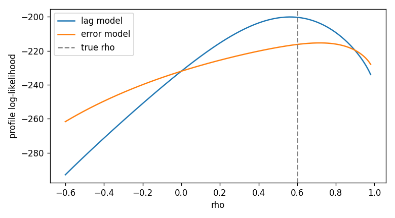

In Figure 7.1 the lag curve peaks at $\hat{\rho} = 0.563$, a little below the true $0.6$, and is about $15$ units higher than the error curve at its own peak, $\hat{\rho} = 0.717$. The error model tries to account for the neighbor dependence through the errors alone, and does so less well because the data have a mean that depends on the neighbors' covariates. Both curves fall steeply as $\rho \to 1$, where the Jacobian term $\sum\log(1 - \rho\lambda_i)$ goes to minus infinity.

### 7.8.5 The Sampling Distribution of the Estimators

Repeat the ML fit on 500 simulated data sets and compare with OLS with the lag regressor.

```python
fits = [fit_sar(simulate("lag"), X, W, lam, "lag") for _ in range(reps)]
rho_ml = np.array([f[0] for f in fits])
b1_ml = np.array([f[1][1] for f in fits])
print("ML over", reps, "data sets: mean rho", round(rho_ml.mean(), 4),
      " sd", round(rho_ml.std(), 4), " mean beta1", round(b1_ml.mean(), 4),
      " sd", round(b1_ml.std(), 4))
print("OLS with Wy: mean rho", round(est_wy[:, 0].mean(), 4),
      " sd", round(est_wy[:, 0].std(), 4))
print("share of estimates below the truth: ML",
      round(np.mean(rho_ml < rho_true), 3), " OLS with Wy",
      round(np.mean(est_wy[:, 0] < rho_true), 3))
```

Across the 500 data sets, ML has mean $\hat{\rho} = 0.586$ (standard deviation $0.061$) and mean slope $1.012$ (standard deviation $0.108$). OLS with the lag has mean $\hat{\rho} = 0.730$ (standard deviation $0.071$). ML is slightly low for $\rho$, a small-sample effect, but far closer to the truth than OLS, whose estimate is on average $0.13$ too high. Only 4.0% of the OLS estimates fall below the true $0.6$, while 58.4% of the ML estimates do.

### 7.8.6 Lagrange Multiplier Tests

The function `lm_tests` computes the four statistics of Section 7.6.2 from the OLS fit. We apply it to the simulated lag data, and then evaluate how often each test rejects at the 5% level in 2,000 data sets simulated with no spatial dependence, with a lag, and with error dependence (the error model with the same $\rho = 0.6$).

```python
def lm_tests(y, X, W):
    """LM-error, LM-lag, and robust versions, from OLS residuals."""
    n = len(y)
    b = np.linalg.solve(X.T @ X, X.T @ y)
    e = y - X @ b
    s2 = e @ e / n
    Wy = W @ y
    WXb = W @ (X @ b)
    T = np.trace(W @ W + W.T @ W)
    J = ols_resid(WXb, X) @ WXb / s2 + T
    g_err, g_lag = e @ (W @ e) / s2, e @ Wy / s2
    stat = {"LM-error": g_err**2 / T,
            "LM-lag": g_lag**2 / J,
            "robust LM-error": (g_err - T / J * g_lag) ** 2 / (T - T**2 / J),
            "robust LM-lag": (g_lag - g_err) ** 2 / (J - T)}
    return stat


print("T_W =", round(np.trace(W @ W + W.T @ W), 3))
stat = lm_tests(y_lag, X, W)
for name, value in stat.items():
    print(f"{name:16s} statistic {value:8.2f}  p-value "
          f"{stats.chi2.sf(value, 1):.2e}")

reps_lm = 2000
rng = np.random.default_rng(2051)
rows = {}
for truth in ("none", "lag", "error"):
    hits = {k: 0 for k in stat}
    for _ in range(reps_lm):
        for name, value in lm_tests(simulate(truth), X, W).items():
            hits[name] += stats.chi2.sf(value, 1) < 0.05
    rows[truth] = {k: v / reps_lm for k, v in hits.items()}
    print(f"truth = {truth:5s}",
          "  ".join(f"{k}: {v:.3f}" for k, v in rows[truth].items()))
```

For the single data set, $T_W = 80.167$ for this map, and the statistics are $\text{LM}_{\text{err}} = 15.96$, $\text{LM}_{\text{lag}} = 52.35$, $\text{RLM}_{\text{err}} = 2.85$, and $\text{RLM}_{\text{lag}} = 39.25$, as quoted in Section 7.6.2. The rejection rates are:

| Truth | LM-error | LM-lag | Robust LM-error | Robust LM-lag |
| :--- | :--- | :--- | :--- | :--- |
| No spatial dependence | 0.046 | 0.035 | 0.056 | 0.044 |
| Lag | 0.999 | 1.000 | 0.036 | 0.997 |
| Error | 0.999 | 0.993 | 0.779 | 0.103 |

With no dependence all four tests reject close to the nominal 5%. When the truth is a lag, both ordinary tests reject nearly always, as Section 7.6.2 warned, while the robust error test rejects only 3.6% of the time and the robust lag test rejects 99.7%. When the truth is an error model, both ordinary tests again reject nearly always, the robust error test rejects 77.9%, and the robust lag test rejects only 10.3%. The robust tests give the right answer in both cases, though the error model is harder to identify: its power is 78%, against 100% for the lag.

### 7.8.7 Impacts

The next block computes the true and estimated impacts from the eigenvalues, draws from the normal approximation to the estimates to get intervals, and runs the check of Section 7.7.4: raise the deprivation index by one unit in one county in the middle of the map, county 78, with the innovations held fixed, and compare the change in the response with the entries of $\boldsymbol{\Phi}\beta_1$.

```python
def impacts(rho, beta1, lam):
    """Average direct, indirect, and total impacts of one covariate."""
    direct = beta1 * np.mean(1 / (1 - rho * lam))
    total = beta1 / (1 - rho)
    return direct, total - direct, total


true_imp = impacts(rho_true, beta_true[1], lam)
est_imp = impacts(rho_hat, beta_hat[1], lam)
print("true impacts (direct, indirect, total):", np.round(true_imp, 4))
print("estimated impacts:", np.round(est_imp, 4))
print("naive: coefficient", round(beta_hat[1], 4),
      " OLS slope", round(beta_ols[1], 4))

rng = np.random.default_rng(2052)
draws = rng.multivariate_normal(theta_hat, cov_hat, size=4000)
draws = draws[np.abs(draws[:, 2]) < 0.999]
sim = np.array([impacts(d[2], d[1], lam) for d in draws])
lo, hi = np.percentile(sim, [2.5, 97.5], axis=0)
for name, a, b, c in zip(("direct", "indirect", "total"), true_imp, lo, hi):
    print(f"{name:8s} true {a:.3f}   95% interval ({b:.3f}, {c:.3f})")

eps0 = rng.standard_normal(n)
y0 = Phi @ (X @ beta_true + eps0)
j = 6 * 12 + 6
X1 = X.copy()
X1[j, 1] += 1.0
y1 = Phi @ (X1 @ beta_true + eps0)
diff = y1 - y0
print("raise x by one unit in county", j, ": change in county", j, "=",
      round(diff[j], 4), " sum of all changes =", round(diff.sum(), 4))
print("analytic:", round(Phi[j, j] * beta_true[1], 4),
      round(Phi[:, j].sum() * beta_true[1], 4))
print("a neighbor's change:", round(diff[j + 1], 4),
      " a county two steps away:", round(diff[j + 2], 4),
      " a county at the edge:", round(diff[j % 12], 4))
own = np.array([beta_true[1] * Phi[k, k] for k in range(n)])
allc = np.array([beta_true[1] * Phi[:, k].sum() for k in range(n)])
print("average own effect:", round(own.mean(), 4),
      " average total effect:", round(allc.mean(), 4))
```

The true impacts per unit of $\beta_1 = 1$ at $\rho = 0.6$ are $1.129$ (direct), $1.371$ (indirect), and $2.5$ (total). At the estimates they are $1.218$, $1.295$, and $2.513$. The 95% intervals are:

| Impact | True | 95% interval |
| :--- | :--- | :--- |
| Direct | 1.129 | (1.022, 1.415) |
| Indirect | 1.371 | (0.908, 1.888) |
| Total | 2.500 | (2.106, 3.109) |

All three contain the truth. The spillover is large: more than half of the total effect of the covariate reaches other counties. Compare these with two naive numbers. The lag model's coefficient is $\hat{\beta}_1 = 1.098$, close to the direct impact and less than half of the total, and the OLS slope is $1.849$, which lies between the direct and total impacts and measures neither.

The simulation check agrees with the formulas exactly. Raising the covariate by one unit in county 78 changes the response there by $1.1146$, which is $\Phi_{78,78}\beta_1$, and the changes in all counties sum to $2.5009$, which is $\sum_i\Phi_{i,78}\beta_1$. An east neighbor changes by $0.1909$, a county two steps east by $0.0343$, and a county on the far edge of the map by $0.0001$. Averaged over all 144 counties, the own effect is $1.1293$ and the total effect is $2.5$, which equal the direct and total impacts.

### 7.8.8 The Error Model: Naive Versus ML Intervals

Finally, return to the error model and the claim of Section 7.2.4. We simulate 500 data sets from the error model with $\rho = 0.6$, fit OLS with the naive 95% interval for the slope, and fit the error model by ML, using the standard error from the filtered regression at $\hat{\rho}$.

```python
rng = np.random.default_rng(2053)
cover_ols = cover_ml = 0
se_ols_sum = se_ml_sum = 0.0
t_crit = stats.t.ppf(0.975, n - 2)
XtX_inv = np.linalg.inv(X.T @ X)
for _ in range(reps):
    y_e = simulate("error")
    b = XtX_inv @ X.T @ y_e
    r = y_e - X @ b
    se_n = np.sqrt(r @ r / (n - 2) * XtX_inv[1, 1])
    rho_k, beta_k, s2_k, _ = fit_sar(y_e, X, W, lam, "error")
    Xs = (np.eye(n) - rho_k * W) @ X
    se_g = np.sqrt(s2_k * np.linalg.inv(Xs.T @ Xs)[1, 1])
    cover_ols += abs(b[1] - beta_true[1]) < t_crit * se_n
    cover_ml += abs(beta_k[1] - beta_true[1]) < 1.96 * se_g
    se_ols_sum += se_n
    se_ml_sum += se_g
print("error model, OLS: coverage", cover_ols / reps,
      " mean SE", round(se_ols_sum / reps, 4))
print("error model, ML:  coverage", cover_ml / reps,
      " mean SE", round(se_ml_sum / reps, 4))
```

The naive OLS interval covers the true slope $\beta_1 = 1$ in 83.2% of the data sets and its average standard error is $0.0987$. The ML interval covers in 93.4% and its average standard error is $0.1125$. The ML interval is wider on average, and that is correct: the OLS standard error is too small because it ignores the correlation, as Chapter 1 explained for a smooth covariate. The wider interval is the honest price of admitting that the data carry less independent information than OLS assumed. How large the shortfall of OLS is depends on how smooth the covariate is and how large $\rho$ is (Exercise 15).

### 7.8.9 Figures

The last block draws Figures 7.1 to 7.3. It saves them to `figures/ch07/`, so run the chapter's code from the top folder of the repository.

```python
import os
import matplotlib
matplotlib.use("Agg")
import matplotlib.pyplot as plt

os.makedirs("figures/ch07", exist_ok=True)
grid_r = np.linspace(-0.6, 0.98, 200)
prof_lag = make_profile(y_lag, X, W, lam, "lag")
prof_err = make_profile(y_lag, X, W, lam, "error")
fig, ax = plt.subplots(figsize=(6.5, 3.6))
ax.plot(grid_r, [prof_lag(r) for r in grid_r], label="lag model")
ax.plot(grid_r, [prof_err(r) for r in grid_r], label="error model")
ax.axvline(rho_true, color="gray", linestyle="--", label="true rho")
ax.set_xlabel("rho")
ax.set_ylabel("profile log-likelihood")
ax.legend()
fig.tight_layout()
fig.savefig("figures/ch07/fig_7_1_profile.png", dpi=120)

fig, ax = plt.subplots(figsize=(6.5, 3.4))
bins = np.linspace(0.35, 0.95, 40)
ax.hist(est_wy[:, 0], bins=bins, alpha=0.6, label="OLS with Wy")
ax.hist(rho_ml, bins=bins, alpha=0.6, label="maximum likelihood")
ax.axvline(rho_true, color="black", linestyle="--", label="true rho")
ax.set_xlabel("estimate of rho")
ax.set_ylabel("number of data sets")
ax.legend()
fig.tight_layout()
fig.savefig("figures/ch07/fig_7_2_rho_estimates.png", dpi=120)

fig, axes = plt.subplots(1, 3, figsize=(10, 3.4))
for ax, r in zip(axes, (0.3, 0.6, 0.9)):
    Phi_r = np.linalg.inv(np.eye(n) - r * W)
    effect = (beta_true[1] * Phi_r[:, j]).reshape(12, 12)
    im = ax.imshow(effect, origin="lower", extent=(0, 1, 0, 1),
                   cmap="viridis", norm=matplotlib.colors.PowerNorm(0.4))
    ax.set_title(f"rho = {r}: total {effect.sum():.2f}")
    ax.set_xlabel("east")
    fig.colorbar(im, ax=ax, fraction=0.046)
fig.tight_layout()
fig.savefig("figures/ch07/fig_7_3_spillover.png", dpi=120)
print("figures saved")
```

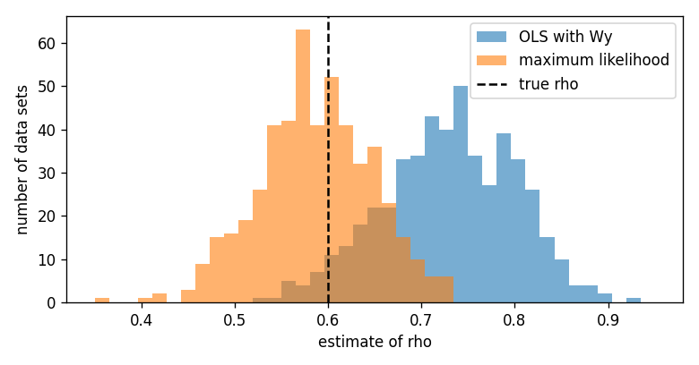

In Figure 7.2 the OLS histogram sits to the right of the dashed line for the true value, centered near $0.73$, and the ML histogram is centered near $0.59$. Only 4.0% of the OLS estimates fall below $0.6$.


In Figure 7.3 the effect is largest in the county itself and fades with distance across the map. At $\rho = 0.3$ it is confined to the nearest few counties and the total effect is $1.43$. At $\rho = 0.6$ it reaches farther and the total is $2.50$. At $\rho = 0.9$ the spillover covers most of the map and the total is $10.16$ (the column sum for this county; the average total impact is exactly $1/(1 - \rho) = 10$), more than ten times the coefficient. Large values of $\rho$ make the total impact extremely sensitive to the estimate, since $1/(1 - \rho)$ grows quickly near 1.

---

<a id="ch7-exercises"></a>

## Exercises

**Analytical**

1. Show that $\mathbf{Y} = \boldsymbol{\Phi}(\mathbf{X}\boldsymbol{\beta} + \boldsymbol{\varepsilon})$ in the lag model has the same covariance as the error model. Then explain in words why the two models can still be told apart, using the mean. For the four-region map with $\rho = 0.5$ and $\mathbf{x} = (1, 0, 0, 0)'$, compute the lag-model mean $\boldsymbol{\Phi}\mathbf{x}\beta$ and compare it with the error-model mean $\mathbf{x}\beta$.

2. For the two-region system of Section 7.1, find $\operatorname{Var}(Y_1)$, $\operatorname{Var}(Y_2)$, and the correlation between them as functions of $\rho$. What happens as $\rho \to 1$? Check against the matrix formula $\sigma^2\boldsymbol{\Phi}\boldsymbol{\Phi}'$ with $\mathbf{W} = \begin{bmatrix} 0 & 1 \\ 1 & 0 \end{bmatrix}$.

3. For the four-region map, show that $\mathbf{W}^3 = \mathbf{W}$, and verify the formula $\boldsymbol{\Phi}(\rho) = \mathbf{I} + \frac{\rho}{1-\rho^2}\mathbf{W} + \frac{\rho^2}{1-\rho^2}\mathbf{W}^2$ by multiplying it by $\mathbf{I} - \rho\mathbf{W}$. Compute $\boldsymbol{\Phi}(0.8)$, its direct impact, and its total impact.

4. Prove that for $\mathbf{Q} = \sigma^{-2}(\mathbf{I} - \rho\mathbf{W})'(\mathbf{I} - \rho\mathbf{W})$, the entry $Q_{ij}$ is zero whenever regions $i$ and $j$ are more than two steps apart on the map. Give an example of a $3 \times 3$ map (a line of three regions) and compute $\mathbf{Q}$ explicitly, showing that regions 1 and 3 have a nonzero entry.

5. Show that when $\mathbf{W}$ is symmetric, $\mathbf{I}_n - \rho\mathbf{W}$ has eigenvalues $1 - \rho\lambda_i$ and the covariance of the error model has eigenvalues $\sigma^2/(1 - \rho\lambda_i)^2$. Which eigenvectors of $\mathbf{W}$ have the largest variance when $\rho > 0$? Relate this to the discussion of smooth eigenvectors in Section 1.3.3.

6. In Section 7.3.3 we derived $\operatorname{Cov}(\mathbf{W}\mathbf{Y}, \boldsymbol{\varepsilon}) = \sigma^2\mathbf{W}\boldsymbol{\Phi}$. Show that the diagonal entry $(\mathbf{W}\boldsymbol{\Phi})_{ii}$ is positive for $\rho > 0$ and zero for $\rho = 0$. What is its sign when $\rho < 0$ on a bipartite map? (Hint: only even powers of $\mathbf{W}$ have a nonzero diagonal there, and the series for $\mathbf{W}\boldsymbol{\Phi}$ has terms $\rho^{k-1}(\mathbf{W}^k)_{ii}$.)

7. Prove that the eigenvalues of a row-standardized $\mathbf{W}$ lie in $[-1, 1]$ using the argument of Section 7.4, and show that $-1$ is an eigenvalue if the map is bipartite. For a map with an odd cycle, such as a triangle of three mutually adjacent regions, find $\mathbf{W}$, its eigenvalues, and the parameter space for $\rho$.

8. For the lag model on the four-region map, derive the log-likelihood of $\mathbf{y} = (2, 1, 3, 2)'$ as a function of $\rho$ with $\mathbf{X} = \mathbf{1}$, after profiling out $\beta$ and $\sigma^2$, and find the value of $\rho$ at which the profile log-likelihood is largest, using a numerical search.

9. Derive the score for $\rho$ in the error model at $\rho = 0$, as in Section 7.6.4, and show that its variance is $T_W$. Then verify that $T_W = 2\operatorname{tr}(\mathbf{W}^2)$ when $\mathbf{W}$ is symmetric, and compute $T_W$ for the four-region map.

10. Show that for the error model $\beta_k$ is the marginal effect of covariate $k$, and that for the lag model the direct impact is never smaller than $\beta_k$ (for $\beta_k > 0$). (Hint: the direct impact is $\beta_k$ times the average of $1/(1 - \rho\lambda_i)$. Use Jensen's inequality for the convex function $1/(1 - \rho\lambda)$ and the fact that $\sum_i\lambda_i = \operatorname{tr}(\mathbf{W}) = 0$.)

**Computational and simulation**

11. Repeat the 500-replicate comparison of Section 7.8.5 for $\rho = 0.2$, $0.4$, $0.8$. Plot the bias of OLS-with-lag and of ML as functions of $\rho$. Compare the bias of OLS-with-lag with the formula of Section 7.3.3.

12. Extend Section 7.7.3: compute the 95% intervals for the three impacts in 200 simulated data sets, and report how often each interval covers the true impact. Do the intervals cover about 95% of the time?

13. Repeat the LM test comparison of Section 7.8.6 with $\rho = 0.2$ and with $\rho = 0.4$. How does the power of the four tests change? Which truth, lag or error, is harder to identify at small $\rho$?

14. Replace the row-standardized $\mathbf{W}$ by the binary adjacency matrix $\mathbf{A}$ and compute the eigenvalues, the parameter space, and the profile log-likelihood for the simulated lag data. Why is the parameter space so much narrower, and what does the fitted $\hat{\rho}$ mean on this scale?

15. Simulate the error model with $\rho = 0.6$ and fit it by OLS and by ML. Compare the estimated slope and its standard error from the two fits. Then use a coordinate covariate instead of the smooth deprivation index (for example, the east coordinate of the county centroid). Is the shortfall of the OLS interval larger or smaller, and why? (Use the variance ratio of Section 1.3.4.)

---

<a id="ch7-what-comes-next"></a>

## What Comes Next

This chapter specified dependence through a system of equations in which every region depends on its neighbors at once, and the covariance followed from solving the system. Chapter 8 starts from the other end. It specifies each region's distribution given its neighbors, builds the joint distribution from those conditionals, and works with the precision matrix directly, which makes large models fast. It also returns to the comparison of the two ways of building spatial dependence that Section 7.1 promised. Chapter 9 puts the same ideas inside a generalized linear model for counts.


---

<a id="ch8"></a>

# Chapter 8: Conditional Autoregressive Models and Sparse Precision Matrices

Chapter 7 built the covariance of a spatial random effect from a simultaneous system: every region's value is a function of its neighbors' values and a fresh error, all at once. This chapter starts from a different question. Suppose we knew the values in every region except one. What should that region's value look like?

A natural answer is a regression on the neighbors. A county's unexplained health outcome should resemble the average of the counties around it, with some leftover variation that shrinks when the county has many neighbors to learn from. The same idea fits a spot on a tissue slide, whose gene expression resembles the average of the six spots touching it. Writing one such regression for every region, and asking what joint distribution they imply, gives the **conditional autoregressive** (CAR) model. The word *autoregressive* refers to the regression of a region on its neighbors, and *conditional* says that each regression is stated given all the other regions.

The chapter has a plan. We first show how the conditional regressions determine the joint distribution, and how that distribution is described by a **precision matrix**, the inverse of the covariance matrix, which turns out to be the natural object. Then we meet the two models used throughout applied work: the **proper CAR**, whose parameter $\rho$ controls the strength of spatial dependence, and the **intrinsic CAR** (ICAR), the limiting case that smooths without limit and has a different kind of density. We then see how to compute with precision matrices, which is where the models earn their popularity: precision matrices of CAR models are sparse, and sparse matrices make maps with thousands of regions routine. We end by comparing CAR with the SAR model of Chapter 7. Chapter 9 uses both CAR and ICAR as random effects in models for counts.

> **Chapter at a Glance**
>
> - **The Conditional Idea (§8.1):** Each region is regressed on its neighbors. A tool relates conditional distributions to the precision matrix; a Brook's-lemma calculation shows when the conditionals fit together; zeros in the precision matrix mean conditional independence.
> - **The Proper CAR Model (§8.2):** Equal weights on neighbors give the precision $\sigma^{-2}(\mathbf{D} - \rho\mathbf{A})$. A four-region map by hand, the allowed range of $\rho$, and why $\sigma^2$ is not the marginal variance.
> - **The Intrinsic CAR Model (§8.3):** At $\rho = 1$ the quadratic form becomes a sum of squared neighbor differences. The precision matrix is singular, so the density is improper, and constraints and a generalized determinant repair it.
> - **Computing With Precision Matrices (§8.4):** The log-likelihood from eigenvalues, simulation from a factor of $\mathbf{Q}$, and sparse storage and solves for thousands of regions.
> - **SAR Versus CAR (§8.5):** Two precision matrices with different sparsity patterns, and two parameters named $\rho$ that cannot be compared.
> - **Walkthrough and Lab (§8.6):** Simulating a CAR field on a 144-county map, recovering its parameters, and four figures.

---

<a id="s8-1"></a>

## 8.1 The Conditional Idea

### 8.1.1 Full Conditionals

Let $\mathbf{u} = (u_1, \dots, u_n)'$ be the spatial random effect on $n$ regions, with mean zero. (With covariates, $\mathbf{u}$ is what is left after removing $\mathbf{X}\boldsymbol{\beta}$, as in Chapter 7.) Write $\mathbf{u}_{-i}$ for the vector $\mathbf{u}$ with its $i$th entry removed. A **full conditional** is the distribution of one region's value given all the others. The CAR approach specifies each one as a normal distribution:

$$
u_i \mid \mathbf{u}_{-i} \sim N\!\left(\sum_{j \ne i} c_{ij}u_j,\ \sigma_i^2\right), \qquad i = 1, \dots, n
$$

The numbers $c_{ij}$ are regression coefficients, with $c_{ii} = 0$ and $c_{ij} = 0$ unless regions $i$ and $j$ are neighbors. The numbers $\sigma_i^2$ are the **conditional variances**. This is a linear model for each region: the conditional mean of $u_i$ is a linear combination of its neighbors' values, and $\sigma_i^2$ is the error variance. Nothing is fitted to data here. These are assumptions about the joint distribution of $\mathbf{u}$, in the same way that a variogram model is an assumption.

The contrast with Chapter 7 is worth stating. The SAR model specifies a recipe for generating $\mathbf{u}$ from independent errors, and the conditional distributions are a by-product that nobody asked for. The CAR model specifies the conditional distributions, and the joint distribution is the by-product. Two questions follow. Do $n$ conditional distributions always fit together into a joint distribution? And what does the joint distribution look like? Sections 8.1.2 and 8.1.3 answer them.

We will use the four-region hub map of Section 6.3.1 throughout the chapter, small enough to do every calculation by hand. Region 1 touches only region 2. Region 2 touches regions 1, 3, and 4. Regions 3 and 4 touch each other and region 2. So region 2 is a hub, regions 3 and 4 form a triangle with it, and region 1 is a pendant region hanging off the hub. The number of neighbors of each region, its degree $d_i$ (Section 6.3.1), is 1, 3, 2, and 2.

```python
import numpy as np
from scipy import linalg, optimize, stats
from scipy import sparse
from scipy.sparse import linalg as spla

# The hub map of Section 6.3.1, regions 1 to 4 in rows 0 to 3: region 2
# touches 1, 3, and 4; regions 3 and 4 touch each other.
A4 = np.array([[0, 1, 0, 0],
               [1, 0, 1, 1],
               [0, 1, 0, 1],
               [0, 1, 1, 0]], dtype=float)
d4 = A4.sum(axis=1)
D4 = np.diag(d4)
print("number of neighbors:", d4)
```

### 8.1.2 A Tool We Need: Conditional Distributions From the Precision Matrix

Suppose $\mathbf{u} \sim N(\mathbf{0}, \mathbf{Q}^{-1})$, where $\mathbf{Q}$ is a symmetric positive definite matrix. Chapter 7 met $\mathbf{Q}$ as the precision matrix of the SAR model: the inverse of the covariance matrix. The density of $\mathbf{u}$ is proportional to $\exp(-\tfrac{1}{2}\mathbf{u}'\mathbf{Q}\mathbf{u})$. We want the distribution of $u_i$ given the other entries, and the precision matrix gives it with almost no work.

The conditional density of $u_i$ given $\mathbf{u}_{-i}$ equals the joint density divided by the marginal density of $\mathbf{u}_{-i}$. The marginal does not involve $u_i$, so as a function of $u_i$ the conditional density is proportional to the joint density. We only need to find the part of $\mathbf{u}'\mathbf{Q}\mathbf{u}$ that depends on $u_i$. Splitting the double sum into terms with $i$ in neither, one, or both positions, and using $Q_{ij} = Q_{ji}$,

$$
\mathbf{u}'\mathbf{Q}\mathbf{u} = Q_{ii}u_i^2 + 2u_i\sum_{j \ne i}Q_{ij}u_j + \sum_{j \ne i}\sum_{k \ne i}Q_{jk}u_ju_k
$$

The last term does not involve $u_i$, so it is a constant for our purposes. Write $s = \sum_{j \ne i}Q_{ij}u_j$. Completing the square in $u_i$,

$$
Q_{ii}u_i^2 + 2u_is = Q_{ii}\left(u_i + \frac{s}{Q_{ii}}\right)^2 - \frac{s^2}{Q_{ii}}
$$

and the last piece is again a constant. So, as a function of $u_i$,

$$
p(u_i \mid \mathbf{u}_{-i}) \propto \exp\!\left(-\frac{Q_{ii}}{2}\left(u_i + \frac{s}{Q_{ii}}\right)^2\right)
$$

which is the density of a normal distribution with

$$
\operatorname{E}[u_i \mid \mathbf{u}_{-i}] = -\sum_{j \ne i}\frac{Q_{ij}}{Q_{ii}}u_j, \qquad \operatorname{Var}(u_i \mid \mathbf{u}_{-i}) = \frac{1}{Q_{ii}}
$$

Comparing with Section 8.1.1 reads off the CAR parameters from $\mathbf{Q}$:

$$
c_{ij} = -\frac{Q_{ij}}{Q_{ii}}, \qquad \sigma_i^2 = \frac{1}{Q_{ii}}
$$

or, turned around, $Q_{ii} = 1/\sigma_i^2$ and $Q_{ij} = -c_{ij}/\sigma_i^2$. The precision matrix holds all $n$ conditional regressions at once, one per row: row $i$ divided by $Q_{ii}$ gives region $i$'s coefficients, and $1/Q_{ii}$ gives its error variance.

**The same answer from the covariance matrix.** Chapter 4 derived the general formula for a conditional distribution through the Schur complement. Put $u_i$ in the last block of the vector, so that $\boldsymbol{\Sigma} = \mathbf{Q}^{-1}$ is partitioned with $\boldsymbol{\Sigma}_{-i,-i}$ in the upper left and $\Sigma_{ii}$ in the lower right. The Schur complement of the upper-left block is $F = \Sigma_{ii} - \boldsymbol{\Sigma}_{i,-i}\boldsymbol{\Sigma}_{-i,-i}^{-1}\boldsymbol{\Sigma}_{-i,i}$, and the block inversion formula of Section 4.3.4 says that the lower-right entry of the inverse is $1/F$. That entry is $Q_{ii}$. So $1/Q_{ii} = F$, the conditional variance, as above. The conditional mean is $\boldsymbol{\Sigma}_{i,-i}\boldsymbol{\Sigma}_{-i,-i}^{-1}\mathbf{u}_{-i}$.

This is a kriging calculation. The weights $\boldsymbol{\Sigma}_{i,-i}\boldsymbol{\Sigma}_{-i,-i}^{-1}$ are the simple kriging weights of Section 4.2.2 for predicting $u_i$ from all the other regions, and $F$ is the simple kriging variance. The precision matrix delivers all $n$ such kriging problems, each with $n - 1$ data values, from the entries of one matrix, with no matrix inversion of size $n - 1$ at all.

The code checks the identities on the four-region map, with the precision matrix $\mathbf{Q} = \mathbf{D} - 0.5\mathbf{A}$ (Section 8.2 explains where this matrix comes from; any positive definite $\mathbf{Q}$ would do). We compute region 3's weights both ways.

```python
Q4 = D4 - 0.5 * A4
Sigma4 = np.linalg.inv(Q4)
i, rest = 2, [0, 1, 3]
S_ir = Sigma4[i, rest]
S_rr = Sigma4[np.ix_(rest, rest)]
weights = np.linalg.solve(S_rr, S_ir)
cond_var = Sigma4[i, i] - S_ir @ weights
print("weights from the covariance matrix:", np.round(weights, 4) + 0.0)
print("-Q_ij / Q_ii:                      ", -Q4[i, rest] / Q4[i, i] + 0.0)
print("conditional variance:", round(cond_var, 4),
      " 1/Q_ii:", 1 / Q4[i, i])

y = np.array([1.5, 0.3, -1.0, 0.8])
for i in range(4):
    others = [j for j in range(4) if j != i]
    cond_mean = -Q4[i, others] @ y[others] / Q4[i, i]
    print(f"region {i + 1}: y_i - E[y_i | rest] = {y[i] - cond_mean:7.4f}   "
          f"(Q y)_i / Q_ii = {(Q4 @ y)[i] / Q4[i, i]:7.4f}")
```

Region 3's neighbors are regions 2 and 4. Its conditional mean is $0.25u_2 + 0.25u_4$, with weight 0 on region 1, and its conditional variance is 0.5. Both routes agree. The zero weight on region 1 is the **screening effect** of Section 4.2.3 in its purest form: given its neighbors, region 3 has no use for region 1.

**The connection to leave-one-out residuals.** Chapter 4 proved that the leave-one-out residual of a spatial prediction is $(\boldsymbol{\Pi}\mathbf{Y})_i/\Pi_{ii}$, and noted that with a known mean and no covariates, $\boldsymbol{\Pi}$ reduces to $\boldsymbol{\Sigma}^{-1}$, which is the precision matrix. The formula above shows why that result is natural. For data $\mathbf{y}$ with known mean $\boldsymbol{\mu}$ and precision matrix $\mathbf{Q}$, the leave-one-out residual of $y_i$ is $y_i - \operatorname{E}[y_i \mid \mathbf{y}_{-i}]$, the difference between $y_i$ and its prediction from all the other values. Substituting the conditional mean,

$$
y_i - \operatorname{E}[y_i \mid \mathbf{y}_{-i}] = (y_i - \mu_i) + \sum_{j \ne i}\frac{Q_{ij}}{Q_{ii}}(y_j - \mu_j) = \frac{1}{Q_{ii}}\sum_{j}Q_{ij}(y_j - \mu_j) = \frac{[\mathbf{Q}(\mathbf{y} - \boldsymbol{\mu})]_i}{Q_{ii}}
$$

which is Chapter 4's formula with $\boldsymbol{\Pi} = \mathbf{Q}$. The last lines of the code confirm it numerically for an arbitrary data vector. So Chapter 4's cross-validation shortcut and the CAR conditional mean are the same fact seen from two directions: a conditional mean is a kriging prediction, and a kriging prediction computed from a precision matrix is a row operation.

### 8.1.3 Reconstructing the Joint Distribution: Brook's Lemma by Hand

Now the other direction. Start from the conditionals of Section 8.1.1 and ask for the joint density. The tool is **Brook's lemma**: a joint density can be rebuilt from its full conditionals, up to a constant, by changing one coordinate at a time. We show it for three regions, with a reference point at which all values are zero.

Write the conditional means as $m_i = \sum_j c_{ij}u_j$. Comparing the conditional density at a value $u_i$ with the density at 0, with the other regions held fixed, the normalizing constants cancel and

$$
\frac{p(u_i \mid \mathbf{u}_{-i})}{p(0 \mid \mathbf{u}_{-i})} = \exp\!\left(-\frac{(u_i - m_i)^2 - m_i^2}{2\sigma_i^2}\right) = \exp\!\left(-\frac{u_i^2 - 2u_im_i}{2\sigma_i^2}\right)
$$

Now move from the point $(0, 0, 0)$ to the point $(u_1, u_2, u_3)$ in three steps, changing one coordinate each time:

$$
\frac{p(u_1, u_2, u_3)}{p(0, 0, 0)} = \frac{p(u_1, u_2, u_3)}{p(0, u_2, u_3)}\cdot\frac{p(0, u_2, u_3)}{p(0, 0, u_3)}\cdot\frac{p(0, 0, u_3)}{p(0, 0, 0)}
$$

In each ratio only one coordinate changes, so the common marginal density of the other two cancels, and each ratio is a ratio of conditional densities:

$$
\frac{p(u_1 \mid u_2, u_3)}{p(0 \mid u_2, u_3)}\cdot\frac{p(u_2 \mid 0, u_3)}{p(0 \mid 0, u_3)}\cdot\frac{p(u_3 \mid 0, 0)}{p(0 \mid 0, 0)}
$$

In the first factor the conditional mean is $m_1 = c_{12}u_2 + c_{13}u_3$. In the second, $u_1$ has already been set to zero, so $m_2 = c_{23}u_3$. In the third, both others are zero, so $m_3 = 0$. Multiplying the three exponentials,

$$
\log\frac{p(\mathbf{u})}{p(\mathbf{0})} = -\frac{1}{2}\left[\frac{u_1^2 - 2u_1(c_{12}u_2 + c_{13}u_3)}{\sigma_1^2} + \frac{u_2^2 - 2u_2c_{23}u_3}{\sigma_2^2} + \frac{u_3^2}{\sigma_3^2}\right]
$$

This is a complete formula for the joint density, up to a constant. But the order in which we moved the coordinates was arbitrary. Moving them in the opposite order, $u_3$ first, then $u_2$, then $u_1$, gives

$$
\log\frac{p(\mathbf{u})}{p(\mathbf{0})} = -\frac{1}{2}\left[\frac{u_3^2 - 2u_3(c_{31}u_1 + c_{32}u_2)}{\sigma_3^2} + \frac{u_2^2 - 2u_2c_{21}u_1}{\sigma_2^2} + \frac{u_1^2}{\sigma_1^2}\right]
$$

If a joint density exists, both formulas describe it, so they must agree. Compare the coefficient of the cross term $u_1u_2$. The first formula has $c_{12}/\sigma_1^2$, and the second has $c_{21}/\sigma_2^2$. The same comparison for $u_1u_3$ and $u_2u_3$ gives three conditions, which are all instances of one:

$$
\frac{c_{ij}}{\sigma_i^2} = \frac{c_{ji}}{\sigma_j^2} \quad\Longleftrightarrow\quad c_{ij}\sigma_j^2 = c_{ji}\sigma_i^2
$$

This is the **symmetry requirement**. It says that the regression coefficients and error variances cannot be chosen independently for each region: if region $i$ uses region $j$ strongly, region $j$ must use region $i$ in a matching proportion. When it holds, the exponent equals $-\tfrac{1}{2}\mathbf{u}'\mathbf{Q}\mathbf{u}$ with

$$
Q_{ii} = \frac{1}{\sigma_i^2}, \qquad Q_{ij} = -\frac{c_{ij}}{\sigma_i^2} = -\frac{c_{ji}}{\sigma_j^2} = Q_{ji}
$$

In matrix form, with $\mathbf{C}$ the matrix of the $c_{ij}$ and $\boldsymbol{\Sigma}_c = \operatorname{diag}(\sigma_1^2, \dots, \sigma_n^2)$,

$$
\mathbf{Q} = \boldsymbol{\Sigma}_c^{-1}(\mathbf{I}_n - \mathbf{C})
$$

The same calculation works for any $n$. The joint density exists and is a proper normal density when two conditions hold: the symmetry requirement, so that $\mathbf{Q}$ is symmetric, and positive definiteness of $\mathbf{Q}$, so that $\exp(-\tfrac{1}{2}\mathbf{u}'\mathbf{Q}\mathbf{u})$ can be normalized. Symmetry is a condition on the choices of $c_{ij}$ and $\sigma_i^2$. Positive definiteness is a separate condition, usually a restriction on parameters such as $\rho$ (Section 8.2.3).

**A three-region example.** Let regions 1, 2, 3 lie in a row, with $c_{12} = 0.4$, $c_{21} = 0.2$, $c_{23} = 0.3$, $c_{32} = 0.6$, $c_{13} = c_{31} = 0$, and conditional variances $\sigma_1^2 = 1$, $\sigma_2^2 = 0.5$, $\sigma_3^2 = 1$. Check the symmetry requirement: $c_{12}\sigma_2^2 = 0.4 \times 0.5 = 0.2$ and $c_{21}\sigma_1^2 = 0.2 \times 1 = 0.2$; $c_{23}\sigma_3^2 = 0.3 \times 1 = 0.3$ and $c_{32}\sigma_2^2 = 0.6 \times 0.5 = 0.3$. Both hold. Then $Q_{11} = 1$, $Q_{22} = 2$, $Q_{33} = 1$, $Q_{12} = -0.4/1 = -0.4$ (and $-0.2/0.5 = -0.4$ from the other side), $Q_{23} = -0.3/0.5 = -0.6$, and

$$
\mathbf{Q} = \begin{bmatrix} 1 & -0.4 & 0 \\ -0.4 & 2 & -0.6 \\ 0 & -0.6 & 1 \end{bmatrix}
$$

If instead we changed $c_{21}$ to 0.3, then $c_{21}\sigma_1^2 = 0.3 \ne 0.2 = c_{12}\sigma_2^2$, and no joint distribution has those conditionals.

```python
c = np.array([[0.0, 0.4, 0.0],
              [0.2, 0.0, 0.3],
              [0.0, 0.6, 0.0]])
cond_var3 = np.array([1.0, 0.5, 1.0])
Q3 = (np.eye(3) - c) / cond_var3[:, None]
print("Q from the conditionals:\n", Q3)
print("symmetric:", np.allclose(Q3, Q3.T),
      " eigenvalues:", np.round(np.linalg.eigvalsh(Q3), 4))
c_bad = c.copy()
c_bad[1, 0] = 0.3
Q_bad = (np.eye(3) - c_bad) / cond_var3[:, None]
print("with c_21 changed to 0.3, symmetric:", np.allclose(Q_bad, Q_bad.T))
```

The matrix is symmetric and positive definite (eigenvalues 0.62, 1, and 2.38), so these three conditionals define a proper joint normal distribution. With $c_{21}$ changed, the matrix $\boldsymbol{\Sigma}_c^{-1}(\mathbf{I}_n - \mathbf{C})$ is not symmetric, which no covariance or precision matrix can be.

### 8.1.4 Gaussian Markov Random Fields

Section 8.1.2 shows that the conditional distribution of $u_i$ depends on $u_j$ only through the weight $Q_{ij}$. If $Q_{ij} = 0$, region $j$ drops out of the conditional distribution of region $i$. A stronger statement is true: $u_i$ and $u_j$ are **conditionally independent** given all the other regions exactly when $Q_{ij} = 0$. To see it, fix the other regions and collect the terms of $\mathbf{u}'\mathbf{Q}\mathbf{u}$ that involve $u_i$ or $u_j$:

$$
Q_{ii}u_i^2 + Q_{jj}u_j^2 + 2Q_{ij}u_iu_j + 2u_is_i + 2u_js_j
$$

where $s_i$ and $s_j$ collect the terms with the fixed regions. If $Q_{ij} = 0$ the conditional density, proportional to $\exp$ of minus half this, is a product of a function of $u_i$ and a function of $u_j$, which is the definition of independence. If $Q_{ij} \ne 0$ the cross term couples them.

A normal vector whose precision matrix has $Q_{ij} \ne 0$ only for neighboring regions, so that each region depends on the rest only through its neighbors, is a **Gaussian Markov random field** (GMRF). The CAR models are GMRFs by construction, since $c_{ij} = 0$ for non-neighbors.

Conditional independence is not independence. In the four-region model of Section 8.2.2, regions 1 and 3 are not neighbors, so $Q_{13} = 0$, yet their covariance $\Sigma_{13}$ is not zero: regions 1 and 3 are both tied to region 2, and through it they are related. This gap between zeros in $\mathbf{Q}$ and zeros in $\boldsymbol{\Sigma}$ drives the rest of the chapter. The precision matrix is sparse and cheap to store and work with. The covariance matrix is dense.

---

<a id="s8-2"></a>

## 8.2 The Proper CAR Model

### 8.2.1 Equal Weights for Neighbors

The general framework leaves the $c_{ij}$ and $\sigma_i^2$ free. The standard **proper CAR** model makes two simple choices.

- **Equal weights.** A region's conditional mean is $\rho$ times the average of its neighbors:

  $$
  c_{ij} = \rho\,\frac{A_{ij}}{d_i} = \rho\,w_{ij}
  $$

  where $w_{ij} = A_{ij}/d_i$ are the row-standardized weights of Section 6.3.2. Each of the $d_i$ neighbors gets the same weight $\rho/d_i$.
- **Variance shrinking with the number of neighbors.**

  $$
  \sigma_i^2 = \frac{\sigma^2}{d_i}
  $$

  A region with many neighbors has many readings to learn from, so less is left unexplained. The parameter $\sigma^2$ is the conditional variance a region would have if it had a single neighbor.

Check the symmetry requirement:

$$
c_{ij}\sigma_j^2 = \rho\,\frac{A_{ij}}{d_i}\cdot\frac{\sigma^2}{d_j} = \frac{\rho\sigma^2A_{ij}}{d_id_j}
$$

which is symmetric in $i$ and $j$ because $A_{ij} = A_{ji}$. So the choices fit together, and Section 8.1.3 gives the precision matrix. Its diagonal entries are $Q_{ii} = 1/\sigma_i^2 = d_i/\sigma^2$, and its off-diagonal entries are

$$
Q_{ij} = -\frac{c_{ij}}{\sigma_i^2} = -\rho\,\frac{A_{ij}}{d_i}\cdot\frac{d_i}{\sigma^2} = -\frac{\rho A_{ij}}{\sigma^2}
$$

Together,

$$
\mathbf{Q}_{\text{CAR}} = \sigma^{-2}(\mathbf{D} - \rho\mathbf{A})
$$

The proper CAR model is $\mathbf{u} \sim N\!\left(\mathbf{0}, \sigma^2(\mathbf{D} - \rho\mathbf{A})^{-1}\right)$, whenever $\mathbf{D} - \rho\mathbf{A}$ is positive definite (Section 8.2.3). From here on, in this chapter, write $\boldsymbol{\Sigma} = \mathbf{Q}^{-1}$ for the covariance matrix of $\mathbf{u}$.

### 8.2.2 A Four-Region Map by Hand

Take $\sigma^2 = 1$ and $\rho = 0.5$ on the four-region map. The conditional variances are $\sigma^2/d_i = 1, 1/3, 1/2, 1/2$. The conditional mean of region 2 is $0.5 \times \tfrac{1}{3}(u_1 + u_3 + u_4)$, half the average of its three neighbors. The conditional mean of region 1, whose only neighbor is region 2, is $0.5u_2$. The precision matrix is $\mathbf{D} - 0.5\mathbf{A}$:

$$
\mathbf{Q} = \begin{bmatrix} 1 & -0.5 & 0 & 0 \\ -0.5 & 3 & -0.5 & -0.5 \\ 0 & -0.5 & 2 & -0.5 \\ 0 & -0.5 & -0.5 & 2 \end{bmatrix}
$$

The covariance matrix is its inverse. We can find the columns of $\boldsymbol{\Sigma}$ by hand, because the map's symmetry (regions 3 and 4 are interchangeable) reduces each system to two unknowns. Take the column for region 1, the vector $\mathbf{g}$ with $\mathbf{Q}\mathbf{g} = \mathbf{e}_1$, where $\mathbf{e}_1$ has a 1 in position 1 and zeros elsewhere. The row for region 1 says $g_1 - 0.5g_2 = 1$. The rows for regions 3 and 4 are equal, since $g_3 = g_4$, and each reads $2g_3 - 0.5g_2 - 0.5g_3 = 0$, so $g_3 = g_2/3$. The row for region 2 says $3g_2 - 0.5(g_1 + g_3 + g_4) = 0$. Substituting $g_3 = g_4 = g_2/3$ and $g_1 = 1 + 0.5g_2$,

$$
3g_2 - \frac{g_2}{3} - \frac{1}{2} - \frac{g_2}{4} = 0 \quad\Longrightarrow\quad \frac{29}{12}g_2 = \frac{1}{2} \quad\Longrightarrow\quad g_2 = \frac{6}{29}
$$

so $\Sigma_{21} = 6/29 \approx 0.2069$, $\Sigma_{31} = \Sigma_{41} = g_2/3 = 2/29 \approx 0.0690$, and $\Sigma_{11} = 1 + 3/29 = 32/29 \approx 1.1034$. The same steps for the column of region 2, with the right-hand side $\mathbf{e}_2$, give $\Sigma_{22} = 12/29 \approx 0.4138$. The code finishes the job and checks these numbers.

```python
rho, sigma2 = 0.5, 1.0
Q4 = (D4 - rho * A4) / sigma2
Sigma4 = np.linalg.inv(Q4)
print("Q:\n", Q4)
print("Sigma = Q^{-1}:\n", np.round(Sigma4, 4))
print("conditional variances:", 1 / np.diag(Q4))
print("marginal variances:   ", np.round(np.diag(Sigma4), 4))
corr4 = Sigma4 / np.sqrt(np.outer(np.diag(Sigma4), np.diag(Sigma4)))
print("correlations:\n", np.round(corr4, 4))
print("Q_13 =", Q4[0, 2], " but Sigma_13 =", round(Sigma4[0, 2], 4))
```

Four lessons come from these matrices.

- **Marginal variances differ from conditional variances, and from each other.** The conditional variances are $1, 1/3, 1/2, 1/2$. The marginal variances are $1.1034, 0.4138, 0.5793, 0.5793$. Marginal variances are always larger, because knowing the neighbors can only reduce uncertainty. The pendant region 1 has the largest marginal variance: it has only one neighbor to anchor it, so it wanders more. The hub region 2, tied to three regions, is held in place.
- **The parameter $\sigma^2 = 1$ is not the variance of anything we can see.** No region has marginal variance 1; region 1 comes closest at 1.10. Section 8.2.4 returns to this.
- **Neighbors are correlated, and the correlations differ by pair.** Region 2 and its neighbors have correlations of 0.28 (with regions 3 and 4) and 0.31 (with region 1); regions 3 and 4 have 0.31.
- **Non-neighbors can still be correlated.** Regions 1 and 3 are not neighbors, $Q_{13} = 0$, yet $\Sigma_{13} = 2/29 \approx 0.069$ and their correlation is 0.086. That is the gap between conditional independence and independence from Section 8.1.4.

### 8.2.3 When Is the Model Valid?

The matrix $\mathbf{D} - \rho\mathbf{A}$ has to be positive definite, or $\mathbf{Q}$ is not a precision matrix. Which values of $\rho$ allow that? Define the **normalized adjacency matrix**

$$
\tilde{\mathbf{A}} = \mathbf{D}^{-1/2}\mathbf{A}\mathbf{D}^{-1/2}
$$

It is symmetric, with entries $A_{ij}/\sqrt{d_id_j}$. Let $\tilde{\lambda}_1 \ge \dots \ge \tilde{\lambda}_n$ be its eigenvalues. Factor $\mathbf{D} - \rho\mathbf{A} = \mathbf{D}^{1/2}(\mathbf{I}_n - \rho\tilde{\mathbf{A}})\mathbf{D}^{1/2}$ and, for any vector $\mathbf{a} \ne \mathbf{0}$, write $\mathbf{b} = \mathbf{D}^{1/2}\mathbf{a}$, which is also nonzero:

$$
\mathbf{a}'(\mathbf{D} - \rho\mathbf{A})\mathbf{a} = \mathbf{b}'(\mathbf{I}_n - \rho\tilde{\mathbf{A}})\mathbf{b}
$$

The right side is positive for every $\mathbf{b} \ne \mathbf{0}$ exactly when all eigenvalues of $\mathbf{I}_n - \rho\tilde{\mathbf{A}}$ are positive. Those eigenvalues are $1 - \rho\tilde{\lambda}_k$. So the model is valid when $1 - \rho\tilde{\lambda}_k > 0$ for every $k$, that is,

$$
\frac{1}{\tilde{\lambda}_{\min}} < \rho < \frac{1}{\tilde{\lambda}_{\max}}
$$

(the lower bound applies if $\tilde{\lambda}_{\min} < 0$, which is always the case for a map with any neighbors).

The upper end is always 1. The vector $\mathbf{D}^{1/2}\mathbf{1}$ is an eigenvector of $\tilde{\mathbf{A}}$ with eigenvalue 1, because

$$
\tilde{\mathbf{A}}\mathbf{D}^{1/2}\mathbf{1} = \mathbf{D}^{-1/2}\mathbf{A}\mathbf{1} = \mathbf{D}^{-1/2}\mathbf{D}\mathbf{1} = \mathbf{D}^{1/2}\mathbf{1}
$$

using $\mathbf{A}\mathbf{1} = \mathbf{D}\mathbf{1}$, which is the definition of the degrees. Section 8.2.5 (Optional) shows that no eigenvalue exceeds 1 or falls below $-1$. So the largest eigenvalue is exactly 1, and the valid range is

$$
\frac{1}{\tilde{\lambda}_{\min}} < \rho < 1
$$

with a lower end at or below $-1$. At $\rho = 1$ the matrix $\mathbf{D} - \mathbf{A}$ has the zero eigenvalue just found, so the model degenerates into the intrinsic CAR of Section 8.3.

The eigenvalues also depend on the map. For the four-region map, the code finds $\tilde{\lambda} = -0.7287, -0.5, 0.2287, 1$, so the valid range is $-1.3723 < \rho < 1$. Checking the smallest eigenvalue of $\mathbf{D} - \rho\mathbf{A}$ directly at several values of $\rho$ confirms the boundaries: it is positive at 0.9 and 0.99, zero to rounding error at 1, negative at 1.05; on the negative side it is positive at $-1.30$ and negative at $-1.50$.

```python
B4 = A4 / np.sqrt(np.outer(d4, d4))
lam4 = np.linalg.eigvalsh(B4)
print("eigenvalues of D^-1/2 A D^-1/2:", np.round(lam4, 4))
print("valid rho: between", round(1 / lam4.min(), 4), "and", 1 / lam4.max())
for rho_try in (0.9, 0.99, 1.0, 1.05, -1.3, -1.5):
    smallest = np.linalg.eigvalsh(D4 - rho_try * A4).min()
    print(f"rho={rho_try:5.2f}: smallest eigenvalue of D - rho A = "
          f"{smallest:8.4f}")
```

Negative values of $\rho$, which make neighbors tend to differ, are rarely used. On the 144-county map of the next subsection the range is $-1 < \rho < 1$, because a rectangular grid is bipartite (Exercise 5). In practice, positive $\rho$ near 1 is what applied models need, and Section 8.5.3 shows that $\rho$ must be very close to 1 for strong spatial correlation.

### 8.2.4 Why $\sigma^2$ Is Not the Marginal Variance

The covariance matrix of the proper CAR is $\boldsymbol{\Sigma} = \sigma^2(\mathbf{D} - \rho\mathbf{A})^{-1}$, so the marginal variance of region $i$ is $\sigma^2[(\mathbf{D} - \rho\mathbf{A})^{-1}]_{ii}$, which depends on $i$ and on $\rho$. Even at $\rho = 0$ the model is $\mathbf{Q} = \sigma^{-2}\mathbf{D}$, independent regions with variances $\sigma^2/d_i$: the parameter $\sigma^2$ is not the variance of any region, even with no spatial dependence at all. It is a scale for the conditional variance, per neighbor.

This is worth seeing on the shared 144-county map, a $12 \times 12$ grid of squares, where regions on the edge have 3 neighbors and corner regions have 2. (This map is used in Chapters 6 to 9. The function below builds it, along with populations and a smooth covariate that later chapters use.) The code computes, for several $\rho$ and with $\sigma^2 = 1$, the average marginal variance among regions with 2, 3, and 4 neighbors.

```python
def county_map(m=12):
    """A grid of square 'counties': centroids, rook adjacency, populations,
    and a smooth standardized covariate (a deprivation index)."""
    g = (np.arange(m) + 0.5) / m
    xx, yy = np.meshgrid(g, g)
    S = np.column_stack([xx.ravel(), yy.ravel()])
    n = m * m
    A = np.zeros((n, n))
    for i in range(m):
        for j in range(m):
            k = i * m + j
            if i + 1 < m:
                A[k, k + m] = A[k + m, k] = 1
            if j + 1 < m:
                A[k, k + 1] = A[k + 1, k] = 1
    rng = np.random.default_rng(2031)
    pop = np.round(np.exp(rng.normal(np.log(5000), 1.0, n))).astype(int)
    d = np.sqrt(((S[:, None, :] - S[None, :, :]) ** 2).sum(axis=2))
    L = np.linalg.cholesky(np.exp(-d / 0.25) + 1e-8 * np.eye(n))
    x = L @ np.random.default_rng(2032).standard_normal(n)
    return S, A, pop, (x - x.mean()) / x.std()


S, A, pop, x = county_map()
n = len(A)
d = A.sum(axis=1)
D = np.diag(d)
print("regions:", n, " neighbors per region (2, 3, 4):",
      [int((d == k).sum()) for k in (2, 3, 4)])
lam = np.linalg.eigvalsh(A / np.sqrt(np.outer(d, d)))
print("eigenvalues of D^-1/2 A D^-1/2 range from",
      round(lam.min(), 4), "to", round(lam.max(), 4))

for rho in (0.0, 0.5, 0.9, 0.99):
    Sigma = np.linalg.inv(D - rho * A)
    mv = np.diag(Sigma)
    line = "  ".join(f"deg {k}: {mv[d == k].mean():.3f}" for k in (2, 3, 4))
    print(f"rho={rho:4.2f}  mean marginal variance (sigma2=1)  {line}")
```

At $\rho = 0$ the marginal variances are $1/2$, $1/3$, and $1/4$ for regions with 2, 3, and 4 neighbors. As $\rho$ rises they all grow, and they spread: at $\rho = 0.9$, corner regions have an average marginal variance of 0.826 and interior regions of 0.379, and at $\rho = 0.99$, 1.418 and 0.706. Regions near the boundary of the map, with fewer neighbors, are less constrained and so more variable. As $\rho \to 1$ all the variances grow without bound, which is what happens when the model becomes intrinsic. The marginal variance also changes with the resolution of the map; Section 13.5.1 explains why.

Two consequences matter in applied work. First, the heteroscedasticity (variance depending on the number of neighbors) is a property of the model and the map, not of the data. Second, an estimate $\hat{\sigma}^2$ cannot be read as "the variance of the spatial effect." Its meaning depends on the map and on $\rho$. Chapter 9 introduces a rescaled version of the intrinsic model (BYM2) designed so that the variance parameter does have a marginal interpretation. Figure 8.2 in Section 8.6.3 maps both conditional and marginal variances.

### 8.2.5 No Eigenvalue of $\tilde{\mathbf{A}}$ Exceeds 1 in Absolute Value (Optional)

*This subsection proves the bound used in Section 8.2.3. It can be skipped on a first reading.*

Let $\mathbf{a}$ be any vector. Then

$$
\lvert\mathbf{a}'\tilde{\mathbf{A}}\mathbf{a}\rvert = \left\lvert\sum_{i}\sum_{j}\frac{A_{ij}a_ia_j}{\sqrt{d_id_j}}\right\rvert \le \sum_{i}\sum_{j}A_{ij}\frac{\lvert a_i\rvert}{\sqrt{d_i}}\frac{\lvert a_j\rvert}{\sqrt{d_j}}
$$

For any two numbers $p$ and $q$, $pq \le (p^2 + q^2)/2$, because $(p - q)^2 \ge 0$. Apply it with $p = \lvert a_i\rvert/\sqrt{d_i}$ and $q = \lvert a_j\rvert/\sqrt{d_j}$:

$$
\le \frac{1}{2}\sum_{i}\sum_{j}A_{ij}\left(\frac{a_i^2}{d_i} + \frac{a_j^2}{d_j}\right) = \frac{1}{2}\left(\sum_i\frac{a_i^2}{d_i}\sum_jA_{ij} + \sum_j\frac{a_j^2}{d_j}\sum_iA_{ij}\right) = \frac{1}{2}\left(\sum_ia_i^2 + \sum_ja_j^2\right) = \mathbf{a}'\mathbf{a}
$$

using $\sum_jA_{ij} = d_i$ and, by symmetry, $\sum_iA_{ij} = d_j$. So $\lvert\mathbf{a}'\tilde{\mathbf{A}}\mathbf{a}\rvert \le \mathbf{a}'\mathbf{a}$ for every $\mathbf{a}$. If $\mathbf{a}$ is an eigenvector with eigenvalue $\tilde{\lambda}$, then $\mathbf{a}'\tilde{\mathbf{A}}\mathbf{a} = \tilde{\lambda}\mathbf{a}'\mathbf{a}$, and so $\lvert\tilde{\lambda}\rvert \le 1$. $\square$

---

<a id="s8-3"></a>

## 8.3 The Intrinsic CAR Model

### 8.3.1 Setting $\rho = 1$

At $\rho = 1$ the precision matrix becomes $\mathbf{Q}_{\text{ICAR}} = \sigma^{-2}(\mathbf{D} - \mathbf{A})$. The conditional distributions are still perfectly well defined:

$$
u_i \mid \mathbf{u}_{-i} \sim N\!\left(\frac{1}{d_i}\sum_{j \sim i}u_j,\ \frac{\sigma^2}{d_i}\right)
$$

where $j \sim i$ means that $j$ is a neighbor of $i$. In words, **a region's value is the average of its neighbors, plus noise whose variance shrinks with the number of neighbors**. There is no pull toward zero, which the factor $\rho < 1$ supplied in the proper model. The model is called *intrinsic* because, like the intrinsically stationary processes of Section 2.2.3, it describes differences between values and says nothing about their overall level. The remainder of this section shows what that means.

### 8.3.2 The Quadratic Form Is a Sum of Squared Differences

The reason the intrinsic model describes differences is that its quadratic form is made of them. For a symmetric adjacency matrix,

$$
\mathbf{u}'(\mathbf{D} - \mathbf{A})\mathbf{u} = \tfrac{1}{2}\sum_{i=1}^n\sum_{j=1}^nA_{ij}(u_i - u_j)^2 = \sum_{i \sim j}(u_i - u_j)^2
$$

where the last sum counts each neighbor pair once. To see it, expand the middle expression:

$$
\tfrac{1}{2}\sum_i\sum_jA_{ij}(u_i^2 - 2u_iu_j + u_j^2) = \tfrac{1}{2}\sum_iu_i^2\sum_jA_{ij} + \tfrac{1}{2}\sum_ju_j^2\sum_iA_{ij} - \sum_i\sum_jA_{ij}u_iu_j
$$

The first two sums are each $\sum_id_iu_i^2 = \mathbf{u}'\mathbf{D}\mathbf{u}$, so together they give $\mathbf{u}'\mathbf{D}\mathbf{u}$, and the last is $\mathbf{u}'\mathbf{A}\mathbf{u}$. The check with numbers: on the four-region map with $\mathbf{u} = (1.5, 0.3, -1.0, 0.8)'$, both sides equal 6.62 (the code below).

There is a tidy way to say the same thing with a matrix. Let $\mathbf{O}$ be the **edge-by-region incidence matrix**: it has one row for each neighbor pair $(i, j)$, with $+1$ in column $i$, $-1$ in column $j$, and zeros elsewhere. Then $(\mathbf{O}\mathbf{u})$ is the vector of differences $u_i - u_j$ across all neighbor pairs, so $\mathbf{u}'\mathbf{O}'\mathbf{O}\mathbf{u} = \sum_{i \sim j}(u_i - u_j)^2$, and the identity above says

$$
\mathbf{D} - \mathbf{A} = \mathbf{O}'\mathbf{O}
$$

The matrix $\mathbf{D} - \mathbf{A}$ is called the **graph Laplacian** of the map. Because it has the form $\mathbf{O}'\mathbf{O}$, it is positive semi-definite: $\mathbf{u}'(\mathbf{D} - \mathbf{A})\mathbf{u} = \lVert\mathbf{O}\mathbf{u}\rVert^2 \ge 0$.

The density of the intrinsic model is therefore

$$
p(\mathbf{u}) \propto \exp\!\left(-\frac{1}{2\sigma^2}\sum_{i \sim j}(u_i - u_j)^2\right)
$$

Taking minus the logarithm, the model **penalizes roughness**: differences between neighbors are costly, and the cost is the squared difference. This is the same idea as a smoothing penalty in a regression with a spline or a ridge penalty, here applied to a map. On a path of regions $1 - 2 - \dots - n$ the penalty is $\sum_i(u_{i+1} - u_i)^2$, which is exactly the density of independent increments $u_{i+1} - u_i \sim N(0, \sigma^2)$: the **random walk** of Section 2.2.3, whose variogram grows without bound. The intrinsic CAR is the random walk generalized from a line to a map.

The proper CAR is a blend of two penalties. Since $\mathbf{D} - \rho\mathbf{A} = (1 - \rho)\mathbf{D} + \rho(\mathbf{D} - \mathbf{A})$,

$$
\mathbf{u}'(\mathbf{D} - \rho\mathbf{A})\mathbf{u} = (1 - \rho)\sum_id_iu_i^2 + \rho\sum_{i \sim j}(u_i - u_j)^2
$$

a ridge penalty on the sizes of the values (weighted by degree) plus a penalty on neighbor differences, with $\rho$ setting the mix. Chapter 9 builds the Leroux model by replacing $\mathbf{D}$ in the ridge term with the identity matrix.

### 8.3.3 Rank Deficiency

The vector of ones satisfies $(\mathbf{D} - \mathbf{A})\mathbf{1} = \mathbf{D}\mathbf{1} - \mathbf{A}\mathbf{1} = \mathbf{d} - \mathbf{d} = \mathbf{0}$, since $\mathbf{A}\mathbf{1}$ is the vector of degrees. So $\mathbf{D} - \mathbf{A}$ has a zero eigenvalue and is not invertible. More exactly, its null space (the vectors $\mathbf{u}$ with $(\mathbf{D} - \mathbf{A})\mathbf{u} = \mathbf{0}$) is the set of vectors that are **constant on each connected component** of the map. To prove it, observe that $(\mathbf{D} - \mathbf{A})\mathbf{u} = \mathbf{0}$ implies $\mathbf{u}'(\mathbf{D} - \mathbf{A})\mathbf{u} = 0$, so every squared difference $(u_i - u_j)^2$ along a neighbor pair is zero, and so $u$ is constant along every path, hence constant on each connected component. Conversely, if $\mathbf{O}\mathbf{u} = \mathbf{0}$, then $(\mathbf{D} - \mathbf{A})\mathbf{u} = \mathbf{O}'\mathbf{O}\mathbf{u} = \mathbf{0}$. The number of zero eigenvalues equals the number of connected components.

The four-region map is connected, and the code finds Laplacian eigenvalues 0, 1, 3, and 4, with the null vector proportional to $\mathbf{1}$. A map made of a triangle (regions 1, 2, 3) and a separate pair (regions 4, 5) has two components, and its Laplacian has eigenvalues 0, 0, 2, 3, 3. The county map is connected and has one zero eigenvalue; its smallest nonzero eigenvalue, 0.0681, is close to zero. Small eigenvalues of a precision matrix belong to smooth patterns (compare Section 1.3.3: the patterns where neighbors move together), and a pattern with a small precision eigenvalue has a large variance.

```python
L4 = D4 - A4
w4, v4 = np.linalg.eigh(L4)
print("Laplacian eigenvalues:", np.round(w4, 4))
print("null vector (scaled, up to sign):", np.round(2 * np.abs(v4[:, 0]), 4))
u = np.array([1.5, 0.3, -1.0, 0.8])
pairs = np.argwhere(np.triu(A4) > 0)
print("u'Lu =", round(u @ L4 @ u, 4), " sum over neighbor pairs =",
      round(sum((u[a] - u[b])**2 for a, b in pairs), 4))
Lplus = np.linalg.pinv(L4)
print("pseudo-inverse of L:\n", np.round(Lplus, 4))
print("row sums:", np.round(Lplus.sum(axis=1), 10) + 0.0)
print("product of nonzero eigenvalues:", round(np.prod(w4[1:]), 4),
      " n times spanning trees:", 4 * 3)

# two islands: a triangle (regions 1, 2, 3) and a pair (regions 4, 5)
A5 = np.zeros((5, 5))
for a, b in ((0, 1), (0, 2), (1, 2), (3, 4)):
    A5[a, b] = A5[b, a] = 1
L5 = np.diag(A5.sum(axis=1)) - A5
print("two islands, eigenvalues:", np.round(np.linalg.eigvalsh(L5), 4) + 0.0)
```

What does a singular $\mathbf{Q}$ mean for the model? The function $\exp(-\tfrac{1}{2\sigma^2}\mathbf{u}'(\mathbf{D} - \mathbf{A})\mathbf{u})$ is the same at $\mathbf{u}$ and at $\mathbf{u} + c\mathbf{1}$ for every constant $c$, so its integral over all of $\mathbb{R}^n$ is infinite: it is an **improper** density and cannot be normalized. There is no covariance matrix, because there is no inverse of $\mathbf{Q}$. The model fixes the pattern of differences and leaves the overall level completely unspecified, which is what *intrinsic* means.

### 8.3.4 Constraints and the Generalized Determinant

To use the intrinsic model we remove the free level. For a connected map, require $\sum_iu_i = 0$. That keeps the model as a distribution on the $(n-1)$-dimensional subspace of vectors orthogonal to $\mathbf{1}$, where $\mathbf{D} - \mathbf{A}$ is positive definite and the density is proper. Write $\xi_1 = 0 < \xi_2 \le \dots \le \xi_n$ for the Laplacian's eigenvalues, with eigenvectors $\mathbf{v}_1 \propto \mathbf{1}, \mathbf{v}_2, \dots, \mathbf{v}_n$. Three facts follow, with proofs in Section 8.3.5 (Optional).

- **Covariance.** On the constrained subspace the model has covariance $\sigma^2(\mathbf{D} - \mathbf{A})^{+}$, where $^{+}$ is the Moore-Penrose pseudo-inverse: invert the nonzero eigenvalues and leave the zero eigenvalue at zero, $(\mathbf{D} - \mathbf{A})^{+} = \sum_{k \ge 2}\xi_k^{-1}\mathbf{v}_k\mathbf{v}_k'$. For a connected map this equals $(\mathbf{D} - \mathbf{A} + \tfrac{1}{n}\mathbf{1}\mathbf{1}')^{-1} - \tfrac{1}{n}\mathbf{1}\mathbf{1}'$.
- **Simulation.** A draw is $\mathbf{u} = \sigma\sum_{k \ge 2}(z_k/\sqrt{\xi_k})\mathbf{v}_k$ with independent standard normal $z_k$, the spectral method of Section 2.7.2. By construction it sums to zero.
- **Normalizing constant.** The density on the subspace uses the **generalized determinant**, the product of the nonzero eigenvalues, $\lvert\mathbf{D} - \mathbf{A}\rvert_* = \prod_{k \ge 2}\xi_k$, in place of the determinant, which is zero.

For the four-region map, the pseudo-inverse has row sums of zero, and the constrained variances are $0.6875, 0.1875, 0.3542, 0.3542$ (times $\sigma^2$): again the pendant region 1 is the most variable, and the hub region 2 the least. The generalized determinant is $1 \times 3 \times 4 = 12$. This number has a combinatorial meaning that serves as a check: **Kirchhoff's matrix-tree theorem**, which we take from the literature, says that for a connected map, $\lvert\mathbf{D} - \mathbf{A}\rvert_* = n \times (\text{number of spanning trees})$. A spanning tree connects all regions with no loop; the four-region map has three of them (drop any one of the three edges of the triangle of regions 2, 3, and 4, and keep the edge to region 1), and $4 \times 3 = 12$.

For a map with $c$ connected components, require the values to sum to zero within each component. Equivalently, project onto the constrained subspace with

$$
\mathbf{P}_{\text{comp}} = \mathbf{I}_n - \sum_{k=1}^{c}\frac{1}{n_k}\mathbf{1}_k\mathbf{1}_k'
$$

where $\mathbf{1}_k$ indicates the regions in component $k$ and $n_k$ is its size. For a connected map, $\mathbf{P}_{\text{comp}}$ is the centering matrix $\mathbf{P}_c$ of Section 0.4.2.

The code below checks the pseudo-inverse formula, draws an intrinsic field on the county map by the spectral method, confirms that its sum is zero, and shows that the quadratic form does not change when a constant is added, while projection removes the constant.

```python
J4 = np.ones((4, 4)) / 4
print("L+ equals (L + 11'/n)^-1 - 11'/n:",
      np.allclose(Lplus, np.linalg.inv(L4 + J4) - J4))

w_c, v_c = np.linalg.eigh(D - A)
print("county map: zero eigenvalues of D - A:", int((w_c < 1e-10).sum()),
      " smallest nonzero:", round(w_c[1], 4))
z = np.random.default_rng(2060).standard_normal(n)
u_icar = v_c[:, 1:] @ (z[1:] / np.sqrt(w_c[1:]))
print("sum of the ICAR draw:", round(u_icar.sum(), 10) + 0.0)
u_shift = u_icar + 3.0
P_c = np.eye(n) - np.ones((n, n)) / n
print("quadratic form unchanged by adding 3:",
      np.isclose(u_icar @ (D - A) @ u_icar, u_shift @ (D - A) @ u_shift))
print("projection removes the shift:", np.allclose(P_c @ u_shift, u_icar))
Lp_c = np.linalg.pinv(D - A)
print("ICAR variances by number of neighbors:",
      {int(k): round(float(np.diag(Lp_c)[d == k].mean()), 3)
       for k in (2, 3, 4)})
```

Adding 3 to every region leaves the quadratic form untouched, so the data cannot distinguish $\mathbf{u}$ from $\mathbf{u} + 3\cdot\mathbf{1}$. That is why an intrinsic effect and an intercept cannot both be free: in a model $y_i = \beta_0 + u_i + \dots$, adding $c$ to every $u_i$ and subtracting $c$ from $\beta_0$ gives the identical model. The sum-to-zero constraint settles the matter by assigning the overall level to $\beta_0$. Chapter 9 uses it exactly so. The last line of the code also shows how the constrained ICAR variances behave on the county map: 1.401, 0.916, and 0.593 for regions with 2, 3, and 4 neighbors, the same edge effect seen for the proper CAR in Section 8.2.4.

### 8.3.5 Why the Pseudo-Inverse and the Generalized Determinant (Optional)

*This subsection proves the three facts of Section 8.3.4 for a connected map. It can be skipped on a first reading.*

Write the eigendecomposition $\mathbf{D} - \mathbf{A} = \sum_{k=2}^n\xi_k\mathbf{v}_k\mathbf{v}_k'$, where the $k = 1$ term vanishes because $\xi_1 = 0$. The vectors $\mathbf{v}_1, \dots, \mathbf{v}_n$ are an orthonormal basis of $\mathbb{R}^n$, with $\mathbf{v}_1 = \mathbf{1}/\sqrt{n}$. A vector $\mathbf{u}$ on the constraint subspace has $\mathbf{u}'\mathbf{v}_1 = 0$, so it is described by the $n - 1$ coordinates $t_k = \mathbf{v}_k'\mathbf{u}$ for $k \ge 2$, with $\mathbf{u} = \sum_{k \ge 2}t_k\mathbf{v}_k$ and $\mathbf{u}'\mathbf{u} = \sum_{k \ge 2}t_k^2$. In these coordinates

$$
\mathbf{u}'(\mathbf{D} - \mathbf{A})\mathbf{u} = \sum_{k \ge 2}\xi_kt_k^2
$$

so the density $\propto \exp(-\frac{1}{2\sigma^2}\sum_{k \ge 2}\xi_kt_k^2)$ factors into independent normal densities for the $t_k$, with $t_k \sim N(0, \sigma^2/\xi_k)$. Each of these densities is proper, with normalizing constant $(\xi_k/(2\pi\sigma^2))^{1/2}$. This establishes the three facts.

- **Simulation.** Draw $t_k = \sigma z_k/\sqrt{\xi_k}$ and set $\mathbf{u} = \sum_{k \ge 2}t_k\mathbf{v}_k$.
- **Covariance.** Since the $t_k$ are independent, $\operatorname{Var}(\mathbf{u}) = \sum_{k \ge 2}\operatorname{Var}(t_k)\mathbf{v}_k\mathbf{v}_k' = \sigma^2\sum_{k \ge 2}\xi_k^{-1}\mathbf{v}_k\mathbf{v}_k' = \sigma^2(\mathbf{D} - \mathbf{A})^{+}$.
- **Normalizing constant.** The joint density of $(t_2, \dots, t_n)$ is the product

  $$
  \prod_{k \ge 2}\left(\frac{\xi_k}{2\pi\sigma^2}\right)^{1/2}\exp\!\left(-\frac{\xi_kt_k^2}{2\sigma^2}\right) = (2\pi\sigma^2)^{-(n-1)/2}\lvert\mathbf{D} - \mathbf{A}\rvert_*^{1/2}\exp\!\left(-\frac{\mathbf{u}'(\mathbf{D} - \mathbf{A})\mathbf{u}}{2\sigma^2}\right)
  $$

  with $\lvert\mathbf{D} - \mathbf{A}\rvert_* = \prod_{k \ge 2}\xi_k$. This is the log-likelihood contribution that replaces $\tfrac{1}{2}\log\lvert\mathbf{Q}\rvert$ for the intrinsic model.

For the alternative formula for the pseudo-inverse, observe that $\mathbf{D} - \mathbf{A} + \tfrac{1}{n}\mathbf{1}\mathbf{1}' = \sum_{k \ge 2}\xi_k\mathbf{v}_k\mathbf{v}_k' + \mathbf{v}_1\mathbf{v}_1'$ has eigenvalues $1, \xi_2, \dots, \xi_n$ on the same eigenvectors, so its inverse is $\mathbf{v}_1\mathbf{v}_1' + \sum_{k \ge 2}\xi_k^{-1}\mathbf{v}_k\mathbf{v}_k'$, and subtracting $\mathbf{v}_1\mathbf{v}_1' = \tfrac{1}{n}\mathbf{1}\mathbf{1}'$ leaves the pseudo-inverse. $\square$

---

<a id="s8-4"></a>

## 8.4 Computing With Precision Matrices

### 8.4.1 The CAR Likelihood and Its Log-Determinant

Now fit the model to data. For the model $\mathbf{y} = \mathbf{X}\boldsymbol{\beta} + \mathbf{u}$ with a proper CAR effect $\mathbf{u} \sim N(\mathbf{0}, \sigma^2\mathbf{M}^{-1})$, where $\mathbf{M} = \mathbf{D} - \rho\mathbf{A}$, the log-likelihood follows from the normal density of Section 0.4.3. Since $\boldsymbol{\Sigma}^{-1} = \mathbf{M}/\sigma^2$ and $\log\lvert\sigma^2\mathbf{M}^{-1}\rvert = n\log\sigma^2 - \log\lvert\mathbf{M}\rvert$,

$$
\ell(\boldsymbol{\beta}, \sigma^2, \rho) = -\frac{n}{2}\log(2\pi) - \frac{n}{2}\log\sigma^2 + \frac{1}{2}\log\lvert\mathbf{M}\rvert - \frac{1}{2\sigma^2}(\mathbf{y} - \mathbf{X}\boldsymbol{\beta})'\mathbf{M}(\mathbf{y} - \mathbf{X}\boldsymbol{\beta})
$$

Two features set this apart from the geostatistical likelihood of Chapter 5. The quadratic form uses the sparse matrix $\mathbf{M}$ directly, with no inversion. And $\log\lvert\mathbf{M}\rvert$ has a closed form in the eigenvalues of $\tilde{\mathbf{A}}$. Using $\mathbf{M} = \mathbf{D}^{1/2}(\mathbf{I}_n - \rho\tilde{\mathbf{A}})\mathbf{D}^{1/2}$ from Section 8.2.3, and the fact that the determinant of a product is the product of determinants,

$$
\log\lvert\mathbf{D} - \rho\mathbf{A}\rvert = \log\lvert\mathbf{D}\rvert + \log\lvert\mathbf{I}_n - \rho\tilde{\mathbf{A}}\rvert = \sum_{i=1}^n\log d_i + \sum_{k=1}^n\log\!\left(1 - \rho\tilde{\lambda}_k\right)
$$

since the eigenvalues of $\mathbf{I}_n - \rho\tilde{\mathbf{A}}$ are $1 - \rho\tilde{\lambda}_k$. This is the CAR version of Ord's identity from Chapter 7. The two are closely related: $\mathbf{W} = \mathbf{D}^{-1}\mathbf{A}$ equals $\mathbf{D}^{-1/2}\tilde{\mathbf{A}}\mathbf{D}^{1/2}$, a similarity transformation, so $\mathbf{W}$ and $\tilde{\mathbf{A}}$ have the same eigenvalues and one eigendecomposition serves both models. The decomposition costs on the order of $n^3$ operations, once. Each later evaluation of the determinant, for a new $\rho$, costs $n$ operations.

For fixed $\rho$ the likelihood can be maximized over $\boldsymbol{\beta}$ and $\sigma^2$ in closed form, exactly as in Section 5.2.2:

$$
\hat{\boldsymbol{\beta}}(\rho) = (\mathbf{X}'\mathbf{M}\mathbf{X})^{-1}\mathbf{X}'\mathbf{M}\mathbf{y}, \qquad \hat{\sigma}^2(\rho) = \frac{\mathrm{RSS}(\rho)}{n}, \qquad \mathrm{RSS}(\rho) = (\mathbf{y} - \mathbf{X}\hat{\boldsymbol{\beta}})'\mathbf{M}(\mathbf{y} - \mathbf{X}\hat{\boldsymbol{\beta}})
$$

Substituting back, the term $\mathrm{RSS}/(2\hat{\sigma}^2)$ equals $n/2$, and the **profile log-likelihood** of $\rho$ is

$$
\ell_p(\rho) = -\frac{n}{2}\left[\log(2\pi) + \log\hat{\sigma}^2(\rho) + 1\right] + \frac{1}{2}\sum_{i}\log d_i + \frac{1}{2}\sum_{k}\log(1 - \rho\tilde{\lambda}_k)
$$

A search over the single parameter $\rho \in (1/\tilde{\lambda}_{\min}, 1)$ finishes the job. One more saving: because $\mathbf{M} = \mathbf{D} - \rho\mathbf{A}$ is linear in $\rho$, the three ingredients $\mathbf{X}'\mathbf{M}\mathbf{X}$, $\mathbf{X}'\mathbf{M}\mathbf{y}$, and $\mathbf{y}'\mathbf{M}\mathbf{y}$ are each a fixed term minus $\rho$ times another fixed term, for instance $\mathbf{X}'\mathbf{M}\mathbf{X} = \mathbf{X}'\mathbf{D}\mathbf{X} - \rho\mathbf{X}'\mathbf{A}\mathbf{X}$. The code computes the fixed terms once per data set (`car_stats`), after which every value of $\rho$ costs only a small $p \times p$ solve. The check at the end compares the formula with a brute-force evaluation of the multivariate normal log-density at three values of $\rho$.

This is maximum likelihood. As in Chapter 5, ML underestimates variance parameters in small samples, and REML would add the term $-\tfrac{1}{2}\log\lvert\mathbf{X}'\mathbf{M}\mathbf{X}\rvert$ and use $n - p$ in place of $n$ (Exercise 10).

```python
def car_stats(y, X, A, d):
    """Sums of squares that do not depend on rho (computed once)."""
    AX, Ay = A @ X, A @ y
    return dict(XDX=X.T @ (d[:, None] * X), XAX=X.T @ AX,
                XDy=X.T @ (d * y), XAy=X.T @ Ay,
                yDy=y @ (d * y), yAy=y @ Ay, n=len(y), logd=np.log(d).sum())


def car_profile(rho, st, lam):
    """Profile log-likelihood of rho; also returns beta-hat and sigma2-hat."""
    XMX = st["XDX"] - rho * st["XAX"]
    XMy = st["XDy"] - rho * st["XAy"]
    beta = np.linalg.solve(XMX, XMy)
    rss = st["yDy"] - rho * st["yAy"] - beta @ XMy
    n = st["n"]
    s2 = rss / n
    logdet = st["logd"] + np.log1p(-rho * lam).sum()
    ll = -0.5 * n * (np.log(2 * np.pi) + np.log(s2) + 1) + 0.5 * logdet
    return ll, beta, s2


rng_chk = np.random.default_rng(5)
y_chk = rng_chk.standard_normal(n)
X_chk = np.column_stack([np.ones(n), x])
st_chk = car_stats(y_chk, X_chk, A, d)
for rho in (0.3, 0.8, 0.95):
    ll, beta, s2 = car_profile(rho, st_chk, lam)
    cov = s2 * np.linalg.inv(D - rho * A)
    brute = stats.multivariate_normal(X_chk @ beta, cov).logpdf(y_chk)
    print(f"rho={rho}: eigenvalue formula {ll:10.4f}   brute force "
          f"{brute:10.4f}")
```

The two columns agree to four decimals at every value of $\rho$, which confirms the eigenvalue formula.

### 8.4.2 Simulating From a Precision Matrix

Chapter 2 simulated a spatial field as $\mathbf{u} = \mathbf{L}\mathbf{z}$ with $\mathbf{L}\mathbf{L}' = \boldsymbol{\Sigma}$, because the variance of $\mathbf{L}\mathbf{z}$ is $\mathbf{L}\mathbf{L}'$. When the model is given through $\mathbf{Q}$ instead, the same idea works with one change. Factor the precision matrix as $\mathbf{Q} = \mathbf{L}\mathbf{L}'$ (Cholesky, with $\mathbf{L}$ lower triangular), draw $\mathbf{z} \sim N(\mathbf{0}, \mathbf{I}_n)$, and **solve** $\mathbf{L}'\mathbf{u} = \mathbf{z}$, that is, $\mathbf{u} = (\mathbf{L}')^{-1}\mathbf{z}$. By Tool 1,

$$
\operatorname{Var}(\mathbf{u}) = (\mathbf{L}')^{-1}\mathbf{I}_n\left((\mathbf{L}')^{-1}\right)' = (\mathbf{L}')^{-1}\mathbf{L}^{-1} = (\mathbf{L}\mathbf{L}')^{-1} = \mathbf{Q}^{-1}
$$

Multiplying by $\mathbf{L}$ instead would produce a vector with variance $\mathbf{Q}$, the wrong matrix. The solve is a triangular back-substitution, which costs about $n^2$ operations for a dense $\mathbf{L}$ and far less when $\mathbf{L}$ is sparse.

Why prefer this to factoring $\boldsymbol{\Sigma}$? Because $\mathbf{Q}$ is sparse and $\boldsymbol{\Sigma}$ is not, which Section 8.4.3 exploits. The code checks the method on the four-region map by drawing 100,000 vectors and comparing their sample covariance with $\boldsymbol{\Sigma}$, then shows the wrong way for contrast.

```python
rng = np.random.default_rng(2060)


def sample_from_precision(Q, size, rng):
    """Draw `size` vectors from N(0, Q^{-1}) using Q = L L'."""
    L = np.linalg.cholesky(Q)
    Z = rng.standard_normal((Q.shape[0], size))
    return linalg.solve_triangular(L.T, Z, lower=False)


draws = sample_from_precision(Q4, 100_000, rng)
print("sample covariance:\n", np.round(np.cov(draws), 3))
print("target Sigma:\n", np.round(Sigma4, 3))
wrong = np.linalg.cholesky(Q4) @ rng.standard_normal((4, 100_000))
print("multiplying by L instead gives covariance close to Q:\n",
      np.round(np.cov(wrong), 2))
```

The sample covariance matches $\boldsymbol{\Sigma}$ to within simulation error (for example, 0.412 against 0.414 for region 2, and 1.102 against 1.103 for region 1). Multiplying by $\mathbf{L}$ gives a covariance close to $\mathbf{Q}$ itself, with diagonal entries near 1, 3, 2, 2 and off-diagonal entries near $-0.5$, as predicted.

### 8.4.3 Sparse Storage and Sparse Solves

The practical payoff of precision matrices is size. Consider a slide of spatial transcriptomics, with gene expression measured at spots arranged on a hexagonal grid so that each spot touches six others. A capture area holds a few thousand spots; the code builds a grid of $78 \times 64 = 4{,}992$. A dense $4{,}992 \times 4{,}992$ matrix has almost 25 million entries, about 200 MB in double precision. But the CAR precision matrix has nonzero entries only on the diagonal and for neighboring pairs: 34,378 of them, 0.14% of the entries.

A **sparse matrix** format stores only the nonzero entries and where they are. `scipy.sparse` provides several. In compressed sparse column (CSC) form it keeps three arrays: the nonzero values, their row indices, and the position where each column starts (Appendix B.3). The precision matrix of this slide takes about 0.43 MB instead of 199 MB.

The code also shows what sparsity does to the cost of a linear solve. SciPy has no sparse Cholesky factorization; `scipy.sparse.linalg.splu` computes a sparse LU factorization with a fill-reducing column ordering, which serves the same purpose for a positive definite matrix. We time the solution of $\mathbf{Q}\mathbf{x} = \mathbf{b}$ by a dense solve and by `splu`, on square grids of 400, 1,600, and 3,600 regions.

```python
import time


def hex_spots(rows, cols):
    """Sparse adjacency of a hexagonal grid of spots (odd rows shifted)."""
    ii, jj = [], []
    for r in range(rows):
        for c in range(cols):
            nbrs = [(r, c - 1), (r, c + 1)]
            cs = (c, c + 1) if r % 2 else (c - 1, c)
            for rr in (r - 1, r + 1):
                nbrs += [(rr, cs[0]), (rr, cs[1])]
            for rr, cc in nbrs:
                if 0 <= rr < rows and 0 <= cc < cols:
                    ii.append(r * cols + c)
                    jj.append(rr * cols + cc)
    n_sp = rows * cols
    return sparse.csr_matrix((np.ones(len(ii)), (ii, jj)),
                             shape=(n_sp, n_sp))


def rook_sparse(m):
    """Sparse rook adjacency of an m-by-m grid, built from a path graph."""
    P = sparse.diags([1.0, 1.0], [-1, 1], shape=(m, m))
    I = sparse.identity(m)
    return (sparse.kron(I, P) + sparse.kron(P, I)).tocsr()


A_hex = hex_spots(78, 64)
n_hex = A_hex.shape[0]
d_hex = np.asarray(A_hex.sum(axis=1)).ravel()
print("spots:", n_hex, " symmetric:", (A_hex != A_hex.T).nnz == 0)
print("spots with 6 neighbors:", int((d_hex == 6).sum()),
      " fewest neighbors:", int(d_hex.min()))
Q_hex = (sparse.diags(d_hex) - 0.9 * A_hex).tocsc()
dense_mb = n_hex**2 * 8 / 1e6
sparse_mb = (Q_hex.data.nbytes + Q_hex.indices.nbytes
             + Q_hex.indptr.nbytes) / 1e6
print(f"nonzeros: {Q_hex.nnz} of {n_hex**2} "
      f"({100 * Q_hex.nnz / n_hex**2:.2f}%)")
print(f"memory: dense {dense_mb:.0f} MB, sparse {sparse_mb:.2f} MB")

print("  grid     n   dense solve  sparse solve")
for m in (20, 40, 60):
    A_m = rook_sparse(m)
    Q_m = (sparse.diags(np.asarray(A_m.sum(axis=1)).ravel())
           - 0.9 * A_m).tocsc()
    b = rng.standard_normal(m * m)
    t0 = time.perf_counter()
    x_dense = np.linalg.solve(Q_m.toarray(), b)
    t_dense = time.perf_counter() - t0
    t0 = time.perf_counter()
    x_sparse = spla.splu(Q_m).solve(b)
    t_sparse = time.perf_counter() - t0
    print(f"{m:3d} x {m:<3d} {m * m:5d}   {t_dense:8.3f} s   "
          f"{t_sparse:8.4f} s   (differ by "
          f"{np.abs(x_dense - x_sparse).max():.0e})")
```

In the run shown, the sparse solve is about 3 times faster at 400 regions, about 30 times faster at 1,600, and about 120 times faster at 3,600, and the two methods agree to rounding error. Going from 400 to 3,600 regions, the dense time grew several hundred-fold while the sparse time grew by a factor of about 8. The times depend on the machine and change from run to run; the pattern, with the gap widening as the map grows, does not. A dense solve costs on the order of $n^3$ operations. A sparse solve exploits the fact that, with a sensible ordering, a region's factor entries stay close to its neighbors, so the work and the storage grow much more slowly.

**A sampler that needs no Cholesky factor.** For large maps we want to draw from $N(\mathbf{0}, \mathbf{Q}^{-1})$ using only what SciPy provides. A trick based on the incidence matrix of Section 8.3.2 does it. Recall $\mathbf{D} - \mathbf{A} = \mathbf{O}'\mathbf{O}$. The proper CAR matrix is a sum of two terms of that form, $\mathbf{D} - \rho\mathbf{A} = (1 - \rho)\mathbf{D} + \rho\mathbf{O}'\mathbf{O}$, so

$$
\mathbf{D} - \rho\mathbf{A} = \mathbf{N}'\mathbf{N}, \qquad \mathbf{N} = \begin{bmatrix}\sqrt{1 - \rho}\,\mathbf{D}^{1/2} \\ \sqrt{\rho}\,\mathbf{O}\end{bmatrix}
$$

where $\mathbf{N}$ stacks the diagonal matrix on top of the incidence matrix, and so has $n + m$ rows for $m$ neighbor pairs. Draw $\mathbf{z} \sim N(\mathbf{0}, \mathbf{I}_{n+m})$ and set $\mathbf{u} = \sigma(\mathbf{D} - \rho\mathbf{A})^{-1}\mathbf{N}'\mathbf{z}$, which is a sparse solve. Its variance is

$$
\sigma^2(\mathbf{D} - \rho\mathbf{A})^{-1}\mathbf{N}'\mathbf{N}(\mathbf{D} - \rho\mathbf{A})^{-1} = \sigma^2(\mathbf{D} - \rho\mathbf{A})^{-1}
$$

as required. The functions below build $\mathbf{O}$ and use this sampler. We verify the factorization $\mathbf{N}'\mathbf{N} = \mathbf{D} - 0.9\mathbf{A}$ and the covariance of the draws on the county map, then draw a field on the spot grid.

```python
def incidence(A):
    """Edge-by-region matrix O with O'O = D - A, for a symmetric A."""
    ei, ej = sparse.triu(A, k=1).nonzero()
    m = len(ei)
    rows = np.repeat(np.arange(m), 2)
    cols = np.column_stack([ei, ej]).ravel()
    vals = np.tile([1.0, -1.0], m)
    return sparse.csr_matrix((vals, (rows, cols)), shape=(m, A.shape[0]))


def sample_car_sparse(A, rho, sigma2, size, rng):
    """Draw from the proper CAR with sparse tools only (Q = N'N)."""
    d = np.asarray(A.sum(axis=1)).ravel()
    N = sparse.vstack([sparse.diags(np.sqrt((1 - rho) * d)),
                       np.sqrt(rho) * incidence(A)]).tocsr()
    Q = (N.T @ N).tocsc()
    Z = rng.standard_normal((N.shape[0], size))
    return np.sqrt(sigma2) * spla.splu(Q).solve(np.asarray(N.T @ Z))


A_sp = sparse.csr_matrix(A)
N_chk = sparse.vstack([sparse.diags(np.sqrt(0.1 * d)),
                       np.sqrt(0.9) * incidence(A_sp)])
print("N'N equals D - 0.9 A:",
      abs((N_chk.T @ N_chk) - sparse.csr_matrix(D - 0.9 * A)).max() < 1e-12)
draws = sample_car_sparse(A_sp, 0.9, 2.0, 50_000, rng)
Sigma_true = 2.0 * np.linalg.inv(D - 0.9 * A)
print("largest difference between sample and exact covariance:",
      round(np.abs(np.cov(draws) - Sigma_true).max(), 3),
      " (exact variances up to", round(Sigma_true.diagonal().max(), 3), ")")
t0 = time.perf_counter()
field = sample_car_sparse(A_hex, 0.9, 2.0, 1, rng)
print(f"one field on the {n_hex} spots: "
      f"{time.perf_counter() - t0:.2f} s, shape {field.shape}")
```

The factorization holds to machine precision. The sample covariance of 50,000 draws is within 0.022 of the exact covariance, whose largest variance is 1.652. A field on all 4,992 spots takes a fraction of a second.

---

<a id="s8-5"></a>

## 8.5 SAR Versus CAR

### 8.5.1 Simultaneous Versus Conditional

Chapter 7 defined the SAR model through the equation $\mathbf{u} = \rho\mathbf{W}\mathbf{u} + \boldsymbol{\varepsilon}$ with independent errors of variance $\sigma^2$, which gives $\mathbf{Q}_{\text{SAR}} = \sigma^{-2}(\mathbf{I}_n - \rho\mathbf{W})'(\mathbf{I}_n - \rho\mathbf{W})$. The CAR model gives $\mathbf{Q}_{\text{CAR}} = \sigma^{-2}(\mathbf{D} - \rho\mathbf{A})$. With the row-standardized weights $\mathbf{W} = \mathbf{D}^{-1}\mathbf{A}$ the two can be written side by side, since $\mathbf{D} - \rho\mathbf{A} = \mathbf{D}(\mathbf{I}_n - \rho\mathbf{W})$:

$$
\mathbf{Q}_{\text{CAR}} = \sigma^{-2}\,\mathbf{D}\,(\mathbf{I}_n - \rho\mathbf{W}), \qquad \mathbf{Q}_{\text{SAR}} = \sigma^{-2}\,(\mathbf{I}_n - \rho\mathbf{W})'\,(\mathbf{I}_n - \rho\mathbf{W})
$$

The two differ in the left factor: the CAR puts the diagonal matrix $\mathbf{D}$ there, and the SAR puts the transpose of the right factor. The CAR is symmetric because $\mathbf{D}(\mathbf{I}_n - \rho\mathbf{W}) = \mathbf{D} - \rho\mathbf{A}$ is. The SAR is symmetric by construction.

Every SAR model is a CAR model in the sense of Section 8.1: any symmetric positive definite $\mathbf{Q}$ has conditional distributions with $c_{ij} = -Q_{ij}/Q_{ii}$ and $\sigma_i^2 = 1/Q_{ii}$. The question is what those conditionals look like. The code computes them for the center region of a $3 \times 3$ map under a SAR with $\rho = 0.9$. A CAR conditional mean would involve the four neighbors only. The SAR conditional mean involves all eight other regions: weight 0.386 on each of the four neighbors, and weight $-0.132$ on each of the four diagonal regions, which are neighbors of neighbors. So the SAR is a CAR with a richer neighborhood in which second-order neighbors count, with negative weights.

### 8.5.2 Sparsity: Zeros in $\mathbf{Q}$ Versus Zeros in $\boldsymbol{\Sigma}$

The product $(\mathbf{I}_n - \rho\mathbf{W})'(\mathbf{I}_n - \rho\mathbf{W}) = \mathbf{I}_n - \rho(\mathbf{W} + \mathbf{W}') + \rho^2\mathbf{W}'\mathbf{W}$ contains the term $\mathbf{W}'\mathbf{W}$, whose $(i, j)$ entry is nonzero whenever regions $i$ and $j$ share a common neighbor. So $\mathbf{Q}_{\text{SAR}}$ is nonzero for neighbors and for neighbors of neighbors, while $\mathbf{Q}_{\text{CAR}}$ is nonzero only for neighbors. The code prints the pattern of both matrices on a $3 \times 3$ map, with regions numbered row by row, and counts nonzeros on the county map.

```python
A3 = rook_sparse(3).toarray()
d3 = A3.sum(axis=1)
W3 = A3 / d3[:, None]
rho = 0.9
IW3 = np.eye(9) - rho * W3
Qcar3 = np.diag(d3) - rho * A3
Qsar3 = IW3.T @ IW3


def show_pattern(Q):
    for row in Q:
        print("  " + " ".join("x" if abs(v) > 1e-12 else "." for v in row))


print("3 x 3 map, regions numbered row by row. Q_CAR:")
show_pattern(Qcar3)
print("Q_SAR:")
show_pattern(Qsar3)
k = 4
others = [j for j in range(9) if j != k]
cond_w = -Qsar3[k, others] / Qsar3[k, k]
print("SAR center region: conditional weights on regions", others)
print(np.round(cond_w, 3), " conditional variance", round(1 / Qsar3[k, k], 3))

W = A / d[:, None]
I_n = np.eye(n)
print("Q_CAR = D (I - rho W):",
      np.allclose(D - 0.9 * A, D @ (I_n - 0.9 * W)))
Qc = D - 0.9 * A
Qs = (I_n - 0.9 * W).T @ (I_n - 0.9 * W)
tol = 1e-12
print("nonzeros on the 12 x 12 map: Q_CAR", int((abs(Qc) > tol).sum()),
      " Q_SAR", int((abs(Qs) > tol).sum()),
      " Sigma_CAR", int((abs(np.linalg.inv(Qc)) > tol).sum()),
      " Sigma_SAR", int((abs(np.linalg.inv(Qs)) > tol).sum()),
      " of", n * n)
```

On the $3 \times 3$ map, $\mathbf{Q}_{\text{CAR}}$ is zero for regions that do not touch, while $\mathbf{Q}_{\text{SAR}}$ fills in the second-order neighbors. The center region's row has 5 nonzero entries in $\mathbf{Q}_{\text{CAR}}$ (itself and its four neighbors) and 9 in $\mathbf{Q}_{\text{SAR}}$. On the county map $\mathbf{Q}_{\text{CAR}}$ has 672 nonzero entries, which is $144 + 2 \times 264$: the diagonal plus both directions of each of the 264 neighbor pairs. $\mathbf{Q}_{\text{SAR}}$ has 1,636, almost two and a half times as many. Both are sparse, but the CAR matrix is sparser, and the gap grows with the number of neighbors per region. The covariance matrices, in contrast, are completely dense for both models: all 20,736 entries are nonzero. A connected map always makes the covariance matrix dense, for either model (Section 8.1.4). Figure 8.3 in Section 8.6.3 draws the three patterns.

### 8.5.3 Why $\rho$ Is Not Comparable

Both models have a parameter called $\rho$, and both live on $(-1, 1)$ for a rectangular grid. They do not measure the same thing. The code computes the average correlation between neighboring regions on the county map as a function of $\rho$, for each model, and finds the SAR value of $\rho$ that matches the CAR model at $\rho = 0.9$.

```python
pi, pj = np.nonzero(np.triu(A))


def mean_neighbor_corr(Sig):
    s = np.sqrt(np.diag(Sig))
    return (Sig[pi, pj] / (s[pi] * s[pj])).mean()


def car_cov(rho):
    return np.linalg.inv(D - rho * A)


def sar_cov(rho):
    M = I_n - rho * W
    return np.linalg.inv(M.T @ M)


print("   rho   CAR neighbor corr   SAR neighbor corr")
for rho in (0.5, 0.8, 0.9, 0.95, 0.99):
    print(f"  {rho:4.2f}   {mean_neighbor_corr(car_cov(rho)):12.3f}"
          f"   {mean_neighbor_corr(sar_cov(rho)):14.3f}")
target = mean_neighbor_corr(car_cov(0.9))
rho_sar = optimize.brentq(
    lambda r: mean_neighbor_corr(sar_cov(r)) - target, 0.01, 0.99)
print(f"SAR rho matching CAR rho = 0.9: {rho_sar:.3f}")
```

| $\rho$ | CAR neighbor correlation | SAR neighbor correlation |
| :--- | :--- | :--- |
| 0.50 | 0.149 | 0.302 |
| 0.80 | 0.294 | 0.593 |
| 0.90 | 0.388 | 0.753 |
| 0.95 | 0.472 | 0.865 |
| 0.99 | 0.652 | 0.980 |

At the same $\rho$ the models imply very different dependence. At $\rho = 0.9$, the CAR neighbors have correlation 0.388, and the SAR neighbors have 0.753. To get the CAR's neighbor correlation of 0.388 from a SAR, one needs $\rho \approx 0.608$. Two lessons follow. First, a fitted $\hat{\rho}$ should never be compared across the two model families or interpreted as a correlation. Second, the CAR needs a $\rho$ very close to 1 to produce strong dependence: even at $\rho = 0.99$ the neighbor correlation is only 0.652. Estimates of $\rho$ near 1 are therefore the norm in applications, not a sign of trouble.

---

<a id="s8-6"></a>

## 8.6 Walkthrough and Lab 8

### 8.6.1 Simulating a CAR Field and Recovering Its Parameters

Simulate unexplained variation in a county health outcome. On the county map, let $y_i = \beta_0 + \beta_1x_i + u_i$, with $x_i$ the standardized deprivation index of the shared data set, $\beta_0 = 1$, $\beta_1 = 0.5$, and $\mathbf{u}$ a proper CAR field with $\sigma^2 = 2$ and $\rho = 0.95$. The data are simulated, so the truth is known. We fit the model by profile maximum likelihood (Section 8.4.1), test $\rho = 0$ (independent regions with variances $\sigma^2/d_i$) by a likelihood ratio, and compare the slope from OLS with the slope from the CAR model.

```python
X = np.column_stack([np.ones(n), x])
beta_true = np.array([1.0, 0.5])
sigma2_true, rho_true = 2.0, 0.95
rng = np.random.default_rng(2060)
Q_true = (D - rho_true * A) / sigma2_true
u = sample_from_precision(Q_true, 1, rng)[:, 0]
y = X @ beta_true + u


def fit_car(y, X, A, d, lam, lo=-0.99, hi=0.999):
    """ML fit of y = X beta + u with a proper CAR u, by profiling rho."""
    st = car_stats(y, X, A, d)
    res = optimize.minimize_scalar(
        lambda r: -car_profile(r, st, lam)[0],
        bounds=(lo, hi), method="bounded", options={"xatol": 1e-6})
    ll, beta, s2 = car_profile(res.x, st, lam)
    return res.x, s2, beta, ll


rho_hat, s2_hat, beta_hat, ll_hat = fit_car(y, X, A, d, lam)
ll_zero = car_profile(0.0, car_stats(y, X, A, d), lam)[0]
print(f"rho_hat = {rho_hat:.3f} (true {rho_true}),  "
      f"sigma2_hat = {s2_hat:.3f} (true {sigma2_true})")
print("beta_hat =", np.round(beta_hat, 3), " (true", beta_true, ")")
print(f"log-likelihood {ll_hat:.2f} at rho_hat, {ll_zero:.2f} at rho = 0; "
      f"LRT = {2 * (ll_hat - ll_zero):.1f}")

b_ols = np.linalg.solve(X.T @ X, X.T @ y)
r_ols = y - X @ b_ols
se_ols = np.sqrt(r_ols @ r_ols / (n - 2) * np.linalg.inv(X.T @ X)[1, 1])
M_hat = D - rho_hat * A
cov_gls = s2_hat * np.linalg.inv(X.T @ M_hat @ X)
se_gls = np.sqrt(cov_gls[1, 1])
print(f"slope: OLS {b_ols[1]:.3f} (SE {se_ols:.3f}),  "
      f"CAR-GLS {beta_hat[1]:.3f} (SE {se_gls:.3f}),  true 0.5")
print(f"intercept: CAR-GLS {beta_hat[0]:.3f} "
      f"(SE {np.sqrt(cov_gls[0, 0]):.3f}),  true 1.0")
```

The fit recovers the dependence: $\hat{\rho} = 0.971$ (true 0.95) and $\hat{\sigma}^2 = 1.832$ (true 2). The likelihood ratio statistic against $\rho = 0$ is 75.3 on one parameter, overwhelming evidence of spatial dependence. The slope is 0.456 under the CAR model and 0.354 under OLS, against a true 0.5. The standard errors are close (0.087 and 0.090). The intercept is the poorly determined quantity: its standard error is 0.349, four times the slope's 0.087, and the estimate $\hat{\beta}_0 = 1.444$ is 1.3 standard errors above the true value of 1. This is the identifiability problem of Section 8.3.4 in a nearly intrinsic model, where $\rho$ is close to 1: when the spatial effect can absorb almost any overall level, the intercept is only weakly pinned down by the data.

### 8.6.2 How Well Are the Parameters Recovered?

One data set proves little, so repeat the experiment. The code draws 500 data sets from the same model, using the Cholesky factor of $\mathbf{Q}$ and the solve of Section 8.4.2, and fits each by the same method.

```python
reps = 500
Lq = np.linalg.cholesky(Q_true)
U = linalg.solve_triangular(Lq.T, rng.standard_normal((n, reps)),
                            lower=False)
rho_hats = np.empty(reps)
s2_hats = np.empty(reps)
slopes = np.empty(reps)
for k in range(reps):
    r_k, s2_k, b_k, _ = fit_car(X @ beta_true + U[:, k], X, A, d, lam)
    rho_hats[k], s2_hats[k], slopes[k] = r_k, s2_k, b_k[1]
q = np.percentile(rho_hats, [5, 25, 50, 75, 95])
print("rho_hat quantiles (5, 25, 50, 75, 95%):", np.round(q, 3))
print(f"sigma2_hat: mean {s2_hats.mean():.3f}, "
      f"sd {s2_hats.std():.3f} (true {sigma2_true})")
print(f"share of rho_hat above 0.99: {(rho_hats > 0.99).mean():.3f};  "
      f"below 0.5: {(rho_hats < 0.5).mean():.3f}")
print(f"slope: mean {slopes.mean():.3f}, sd {slopes.std():.3f}")
```

The slope and $\sigma^2$ are estimated without noticeable bias: the average of $\hat{\sigma}^2$ is 2.028 (true 2) and the average slope is 0.500 (true 0.5). The parameter $\rho$ is not. Its median estimate is 0.918 against a true 0.95, with a long tail to the left: the middle 50% of the estimates run from 0.862 to 0.953, and the 5th percentile is 0.743. The distribution is also capped by the boundary at 1; only 0.4% of the estimates exceed 0.99. So with 144 regions, $\rho$ is estimated with a bias toward smaller values and with a wide spread, and values of 0.9 and 0.98 would be hard to tell apart. Figure 8.4 draws both the profile for the data set of Section 8.6.1 and the distribution of the 500 estimates.

### 8.6.3 Figures

The last block draws four figures and saves them to `figures/ch08/`; run it from the top folder of the repository.

```python
import os
import matplotlib
matplotlib.use("Agg")
import matplotlib.pyplot as plt

os.makedirs("figures/ch08", exist_ok=True)
side = 12
z = np.random.default_rng(2060).standard_normal(n)
fields = []
for rho in (0.0, 0.5, 0.9, 0.99):
    Lr = np.linalg.cholesky(D - rho * A)
    fields.append(linalg.solve_triangular(Lr.T, z, lower=False))
fields.append(u_icar)
titles = ["rho = 0", "rho = 0.5", "rho = 0.9", "rho = 0.99", "ICAR"]
fig, axes = plt.subplots(1, 5, figsize=(14, 3.3))
for ax, f, title in zip(axes, fields, titles):
    lim = np.abs(f).max()
    ax.imshow(f.reshape(side, side), origin="lower", cmap="RdBu_r",
              vmin=-lim, vmax=lim)
    ax.set_title(title)
    ax.set_xticks([])
    ax.set_yticks([])
fig.tight_layout()
fig.savefig("figures/ch08/fig_8_1_car_fields.png", dpi=120)

Sigma9 = car_cov(0.9)
fig, axes = plt.subplots(1, 2, figsize=(8, 3.4))
for ax, vals, title in zip(axes, (1 / d, np.diag(Sigma9)),
                           ("conditional variance 1/d_i",
                            "marginal variance, rho = 0.9")):
    im = ax.imshow(vals.reshape(side, side), origin="lower",
                   cmap="viridis")
    ax.set_title(title)
    ax.set_xticks([])
    ax.set_yticks([])
    fig.colorbar(im, ax=ax, shrink=0.8)
fig.tight_layout()
fig.savefig("figures/ch08/fig_8_2_variances.png", dpi=120)

fig, axes = plt.subplots(1, 3, figsize=(11, 3.8))
for ax, M, title in zip(
        axes, (Qc, Qs, np.linalg.inv(Qc)),
        ("Q_CAR (672 nonzeros)", "Q_SAR (1,636 nonzeros)",
         "Sigma_CAR (all 20,736)")):
    ax.spy(abs(M) > 1e-12, markersize=1)
    ax.set_title(title, y=1.08)
fig.tight_layout()
fig.savefig("figures/ch08/fig_8_3_sparsity.png", dpi=120)

grid_rho = np.linspace(0.3, 0.995, 200)
st = car_stats(y, X, A, d)
prof = np.array([car_profile(r, st, lam)[0] for r in grid_rho])
fig, axes = plt.subplots(1, 2, figsize=(9, 3.4))
axes[0].plot(grid_rho, prof - prof.max())
axes[0].set_xlim(0.3, 1.0)
axes[0].axvline(rho_true, color="k", linestyle=":", label="true")
axes[0].axvline(rho_hat, color="C1", linestyle="--", label="maximum")
axes[0].set_ylim(-10, 0.5)
axes[0].set_xlabel("rho")
axes[0].set_ylabel("profile log-likelihood (relative to maximum)")
axes[0].legend()
axes[1].hist(rho_hats, bins=25, color="C0")
axes[1].axvline(rho_true, color="k", linestyle=":")
axes[1].set_xlabel("estimated rho in 500 simulated data sets")
axes[1].set_ylabel("count")
fig.tight_layout()
fig.savefig("figures/ch08/fig_8_4_profile.png", dpi=120)
for r0 in (0.5, 0.7, 0.9):
    j = np.argmin(np.abs(grid_rho - r0))
    print(f"profile at rho = {r0}: {prof[j] - prof.max():7.2f} "
          "relative to the maximum")
print("figures saved")
```


In Figure 8.1, the field at $\rho = 0$ is speckled: neighboring counties are unrelated, and the extreme values sit at the corners and edges, where counties have fewer neighbors and so larger variances. At $\rho = 0.5$ the picture is much the same, which fits the neighbor correlation of only 0.15 at that value (Section 8.5.3). At 0.9 and 0.99 the field organizes into broad patches of high values on the left and in the center and low values toward the upper right. The intrinsic field varies on the broadest scale of all, is centered at zero because its values sum to zero, and shows its largest values along the edges and corners, the edge effect once more.

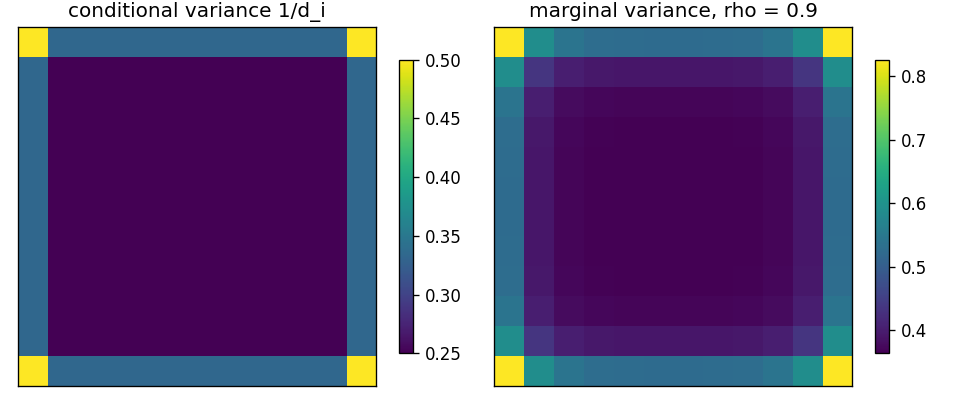

Figure 8.2 shows the edge effect of Section 8.2.4. Conditional variance takes only three values: 0.5 at the four corners, 0.33 along the edges, and 0.25 in the interior. The marginal variance at $\rho = 0.9$ follows the same pattern but smoothly, rising toward the edges and highest in the corners (0.826 on average for the corners, against 0.379 for interior regions, as the output of the code in Section 8.2.4 shows).


Figure 8.3 is the picture behind Section 8.5.2. Each region in a row-by-row numbering touches the regions one step away on the same row and 12 steps away in the next row, giving the three bands of $\mathbf{Q}_{\text{CAR}}$. The SAR precision adds the second-order neighbors, giving five bands. The covariance is a solid block.

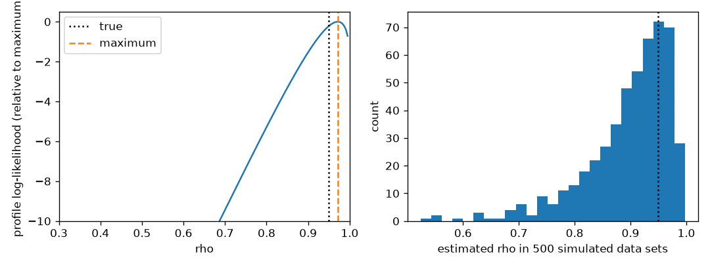

Figure 8.4 summarizes Sections 8.6.1 and 8.6.2. The profile peaks near 0.97 and falls steeply to the left: relative to its maximum it is lower by 1.5 log-likelihood units at $\rho = 0.9$, by 9.4 at $\rho = 0.7$, and by 17.8 at $\rho = 0.5$. The sharp peak against the boundary is what a map that is close to intrinsic looks like. The histogram shows the skewed distribution of $\hat{\rho}$ with its mass piled up against the boundary at 1.

---

<a id="ch8-exercises"></a>

## Exercises

**Analytical**

1. Using the two-by-two block of $\mathbf{Q}$ for regions $i$ and $j$ and the same completing-the-square argument as in Section 8.1.2, show that the conditional covariance of $u_i$ and $u_j$ given all the other regions is $-Q_{ij}/(Q_{ii}Q_{jj} - Q_{ij}^2)$. Conclude that it is zero exactly when $Q_{ij} = 0$.

2. Redo Brook's lemma of Section 8.1.3 for two regions. Find the symmetry requirement and the joint precision matrix in terms of $c_{12}$, $c_{21}$, $\sigma_1^2$, and $\sigma_2^2$. For which values of $c_{12}$ and $c_{21}$ is the matrix positive definite when $\sigma_1^2 = \sigma_2^2 = 1$ and the symmetry requirement holds?

3. For the three-region example of Section 8.1.3, compute $\boldsymbol{\Sigma} = \mathbf{Q}^{-1}$ by hand. Verify that the marginal variances exceed the conditional variances, and find the covariance of regions 1 and 3, which are not neighbors.

4. Take a path of three regions with degrees 1, 2, 1. Find the eigenvalues of $\tilde{\mathbf{A}}$ and the valid range of $\rho$. For $\rho = 0.5$ and $\sigma^2 = 1$, compute $\mathbf{Q}$ and $\boldsymbol{\Sigma}$ by hand and identify which region has the largest marginal variance.

5. Show that the $12 \times 12$ rook grid is bipartite (color the regions like a checkerboard). Let $\mathbf{s}$ be the vector with $+1$ on black squares and $-1$ on white squares. Show that $\mathbf{A}\mathbf{s} = -\mathbf{d} \circ \mathbf{s}$ (entry by entry), and that $\mathbf{D}^{1/2}\mathbf{s}$ is an eigenvector of $\tilde{\mathbf{A}}$ with eigenvalue $-1$. Conclude that the valid range for $\rho$ on this map is $(-1, 1)$.

6. Show that for the proper CAR the conditional mean of $u_i$ is $\rho$ times the average of its neighbors, starting from $\mathbf{Q} = \sigma^{-2}(\mathbf{D} - \rho\mathbf{A})$ and the formulas of Section 8.1.2. What happens to the conditional mean when $\rho = 0$?

7. On a path of $n$ regions, show that $\mathbf{u}'(\mathbf{D} - \mathbf{A})\mathbf{u} = \sum_{i=1}^{n-1}(u_{i+1} - u_i)^2$. Write the incidence matrix $\mathbf{O}$ for $n = 4$, compute $\mathbf{O}'\mathbf{O}$, and check that it equals $\mathbf{D} - \mathbf{A}$. Explain why the intrinsic CAR on a path is the random walk of Section 2.2.3.

8. Prove the sampler of Section 8.4.3: that $\mathbf{N}'\mathbf{N} = \mathbf{D} - \rho\mathbf{A}$ and that $\sigma(\mathbf{D} - \rho\mathbf{A})^{-1}\mathbf{N}'\mathbf{z}$ has covariance $\sigma^2(\mathbf{D} - \rho\mathbf{A})^{-1}$. Why does the construction fail at $\rho = 1$, and what would you change to simulate the intrinsic model?

9. Verify Kirchhoff's matrix-tree theorem for (a) a triangle, (b) a path of four regions, and (c) a cycle of four regions: compute the Laplacian eigenvalues, their nonzero product, and the number of spanning trees, and check that the product equals $n$ times the number of trees.

10. Derive the REML profile log-likelihood for the proper CAR model with covariates, by adding $-\tfrac{1}{2}\log\lvert\mathbf{X}'\mathbf{M}\mathbf{X}\rvert$ to the ML log-likelihood and replacing $n$ by $n - p$ in the variance estimate (Section 5.3.3). What is the REML estimate of $\sigma^2$ in terms of $\mathrm{RSS}(\rho)$?

11. With the county map numbered row by row, the matrix $\mathbf{Q}_{\text{CAR}}$ has bandwidth 12: every nonzero entry satisfies $\lvert i - j\rvert \le 12$. Cholesky factors of banded matrices stay inside the band. Count the largest possible number of nonzero entries in the lower-triangular factor $\mathbf{L}$ and compare with the $n(n+1)/2$ entries of a dense lower-triangular factor of $\boldsymbol{\Sigma}$.

**Computational and simulation**

12. Repeat the experiment of Section 8.6.2 with true $\rho = 0.5$ and with $\rho = 0.8$. Plot the distribution of $\hat{\rho}$ for each. How does the bias and the spread change as $\rho$ moves away from 1?

13. Implement the REML version from Exercise 10 and compare ML and REML estimates of $\sigma^2$ on a $6 \times 6$ map with 200 simulated data sets and $\rho = 0.9$, $\sigma^2 = 2$. How large is the downward bias of ML?

14. On the hexagonal spot grid of Section 8.4.3, draw 200 fields from the proper CAR with $\rho = 0.9$ using the sparse sampler. Estimate the average correlation between neighboring spots and between spots two steps apart, and compare with the same quantities on the square grid.

15. Build a map with two connected components by removing a row of regions from the $12 \times 12$ grid. Simulate the intrinsic CAR on it by the spectral method with sum-to-zero constraints within each component, and check that both component sums are zero. What happens to the sum of all regions if you impose only a single global constraint?

16. For the hexagonal grid, compare the neighbor correlations of CAR and SAR at $\rho = 0.5, 0.9, 0.99$, and find the SAR $\rho$ that matches CAR at 0.9. Is the answer close to the 0.608 found on the square grid?

17. Solve $\mathbf{Q}\mathbf{x} = \mathbf{b}$ on a $100 \times 100$ grid for $\rho = 0.9$, $0.99$, and $0.9999$ using `splu` and using the conjugate gradient method `scipy.sparse.linalg.cg`. Count the iterations of conjugate gradient and explain, using the smallest eigenvalue of $\mathbf{Q}$, why they grow as $\rho \to 1$.

---

<a id="ch8-what-comes-next"></a>

## What Comes Next

This chapter defined CAR models through conditional regressions on neighbors, showed that they are Gaussian Markov random fields with sparse precision matrices, and developed the proper and intrinsic versions with the tools to fit and simulate them. Chapter 9 puts these models to work. It replaces the normal response with a count, so that a county's death count is Poisson with a log-rate that includes the spatial random effect $\mathbf{u}$. The effect $\mathbf{u}$ may be an ICAR, a proper CAR, or the blend of ICAR and independent noise known as the BYM model, and Chapter 9 compares these choices. The sparse precision matrices, the sum-to-zero constraints, and the eigenvalue determinant of this chapter are the machinery behind each.


---

<a id="ch9"></a>

# Chapter 9: Generalized Linear Mixed Models for Spatial Count Data

Chapter 0 ended its first tour of spatial pitfalls with a map of county overdose rates that could not be trusted. Counties with few residents filled both ends of the scale, even though every county had the same true risk, because a small count is a noisy count. Chapters 7 and 8 gave us models for lattice data, but they were models for Gaussian responses. Counts of deaths, cases, and events are not Gaussian, and a Gaussian model with constant variance has no way to say that small counts are noisier counts.

This chapter builds the count version of everything in Part III. It has two ingredients, both familiar. The first is the generalized linear model (GLM): the Poisson regression you may have met in Dobson and Barnett or in a regression course, fitted by iteratively reweighted least squares (IRLS). The second is the spatial random effect $u$ of Chapter 2, now given a conditional autoregressive (CAR) distribution from Chapter 8. Put the two together and you have a generalized linear mixed model (GLMM), in which the model equation of this book,

$$
Y = \text{mean} + u + \varepsilon,
$$

lives on the log scale and the independent noise $\varepsilon$ is replaced by Poisson sampling variability.

The running story is disease mapping. A health department has five-year overdose death counts for 144 counties and wants to know which counties are truly worse off, and whether a county-level deprivation index explains the pattern. We will see why the raw ratio of observed to expected deaths misleads, how shrinkage repairs it, how spatial models borrow strength from neighbors, and how all of it is computed. As in earlier chapters, the data are simulated, so we can always compare the estimates with the truth.

> **Chapter at a Glance**
>
> - **Reviewing GLMs (§9.1):** The exponential family, link functions, score equations, and IRLS as Fisher scoring, ending with one iteration on three counties worked by hand.
> - **Spatial Poisson Regression (§9.2):** The model with expected counts as an offset, and why the raw standardized mortality ratio has a variance that depends on the county's size.
> - **Shrinkage and Spatial Random Effects (§9.3):** The gamma-Poisson model of empirical Bayes, then the BYM, BYM2, and Leroux models, with the scaling constant that makes BYM2's parameters interpretable.
> - **Penalized Quasi-Likelihood (§9.4):** Penalized IRLS and Henderson's equations, REML on the working vector, and one iteration by hand.
> - **The Laplace Approximation (§9.5):** An approximate marginal likelihood for the hyperparameters, checked against numerical integration.
> - **Walkthrough and Lab (§9.6):** Raw, shrunken, and spatial estimates of county risk compared with the truth, a likelihood ratio test, weak identification of the mixing parameter, and a coverage experiment that revisits Chapter 1.

---

<a id="s9-1"></a>

## 9.1 Reviewing GLMs in the Style of Dobson and Barnett

You have fitted GLMs before, and probably used them as black boxes: choose a family, choose a link, call a function. This section opens the box. We need its parts in matrix form, because the spatial models of this chapter are built by adding one term to the same equations.

### 9.1.1 The Exponential Family

A random variable $Y$ belongs to the (one-parameter) **exponential family** in canonical form if its density or probability function can be written

$$
f(y;\vartheta) = f_0(y)\exp\!\left\{y\vartheta - b(\vartheta)\right\}
$$

for a function $b(\cdot)$ of the **natural parameter** $\vartheta$ and a function $f_0(\cdot)$ that does not involve $\vartheta$. (Dobson and Barnett write the natural parameter as $\theta$; this book keeps $\theta$ for the relative risk below. Families with a free dispersion parameter, such as the Gaussian with unknown variance, add one more function; we do not need it.)

The mean and variance follow from $b$ alone. Write the log-density as $\ell(\vartheta) = \log f_0(y) + y\vartheta - b(\vartheta)$ and differentiate:

$$
\frac{\partial\ell}{\partial\vartheta} = y - b'(\vartheta), \qquad \frac{\partial^2\ell}{\partial\vartheta^2} = -b''(\vartheta)
$$

Two facts hold for any regular density: the expected value of the score $\partial\ell/\partial\vartheta$ is zero, and the expected squared score equals minus the expected second derivative. (Both come from differentiating $\int f\,dy = 1$ once and twice, as in a mathematical statistics course.) The first fact gives

$$
0 = \operatorname{E}[Y] - b'(\vartheta) \quad\Longrightarrow\quad \operatorname{E}[Y] = b'(\vartheta)
$$

and the second gives $\operatorname{E}[(Y - b'(\vartheta))^2] = b''(\vartheta)$, that is,

$$
\operatorname{Var}(Y) = b''(\vartheta)
$$

The variance is the derivative of the mean with respect to the natural parameter: $\operatorname{Var}(Y) = d\mu/d\vartheta$. That is the whole content of the claim that a GLM's variance is a function of its mean.

Three examples cover most of what we use.

| Family | $b(\vartheta)$ | Mean $\mu = b'(\vartheta)$ | Variance $b''(\vartheta)$ | Canonical link $\vartheta = g(\mu)$ |
| :--- | :--- | :--- | :--- | :--- |
| Gaussian, variance 1 | $\vartheta^2/2$ | $\vartheta$ | $1$ | identity |
| Poisson | $e^{\vartheta}$ | $e^{\vartheta}$ | $\mu$ | $\log\mu$ |
| Binomial, $m$ trials | $m\log(1 + e^{\vartheta})$ | $m\,\dfrac{e^{\vartheta}}{1 + e^{\vartheta}}$ | $m\,p(1 - p)$ | $\operatorname{logit}(p)$ |

For the Poisson, the probability function $\mu^y e^{-\mu}/y! = \exp\{y\log\mu - \mu - \log y!\}$ has $\vartheta = \log\mu$, $b(\vartheta) = e^{\vartheta}$, and $f_0(y) = 1/y!$, so mean and variance are both $e^{\vartheta} = \mu$. The binomial row is what we would use for vaccination rates by county, where each county has $m$ residents of whom $Y$ are vaccinated; Exercise 12 adapts this chapter's code to it.

### 9.1.2 The Linear Predictor and the Link

A GLM relates the means of $n$ observations to covariates through a **linear predictor** $\boldsymbol{\eta} = \mathbf{X}\boldsymbol{\beta}$ and a **link function** $g$:

$$
g(\mu_i) = \eta_i = \mathbf{x}_i'\boldsymbol{\beta}
$$

where $\mathbf{x}_i'$ is row $i$ of $\mathbf{X}$. The linear model of Chapter 1 is the Gaussian case with the identity link. For counts we use the log link, which keeps means positive and turns effects into ratios: adding 1 to $x$ multiplies the mean by $e^{\beta_1}$. The link is called **canonical** when it equals the function in the last column of the table, so that $\vartheta_i = \eta_i$. For the Poisson, the log link is canonical. The canonical link has a convenient property that we use below.

### 9.1.3 The Score Equations

Maximum likelihood chooses $\boldsymbol{\beta}$ to maximize $\ell(\boldsymbol{\beta}) = \sum_i\ell_i$. The derivative of $\ell_i$ with respect to $\beta_j$ passes through three links of a chain, $\beta_j \to \eta_i \to \mu_i \to \vartheta_i \to \ell_i$:

$$
\frac{\partial\ell_i}{\partial\beta_j} = \frac{\partial\ell_i}{\partial\vartheta_i}\,\frac{\partial\vartheta_i}{\partial\mu_i}\,\frac{\partial\mu_i}{\partial\eta_i}\,\frac{\partial\eta_i}{\partial\beta_j}
$$

The pieces are $\partial\ell_i/\partial\vartheta_i = y_i - \mu_i$ (from Section 9.1.1), $\partial\vartheta_i/\partial\mu_i = 1/b''(\vartheta_i) = 1/\operatorname{Var}(Y_i)$ (since $\mu = b'(\vartheta)$ gives $d\mu/d\vartheta = b''(\vartheta)$), and $\partial\eta_i/\partial\beta_j = x_{ij}$. Therefore the **score equations** are

$$
\frac{\partial\ell}{\partial\beta_j} = \sum_{i=1}^n\frac{y_i - \mu_i}{\operatorname{Var}(Y_i)}\,\frac{\partial\mu_i}{\partial\eta_i}\,x_{ij} = 0, \qquad j = 1, \dots, p
$$

For a canonical link, $\mu_i = b'(\eta_i)$, so $\partial\mu_i/\partial\eta_i = b''(\eta_i) = \operatorname{Var}(Y_i)$ and the equations collapse to

$$
\mathbf{X}'(\mathbf{y} - \boldsymbol{\mu}) = \mathbf{0}
$$

The residuals are orthogonal to every column of $\mathbf{X}$, exactly as in the normal equations of Chapter 0 (Tool 5). For Poisson regression with an intercept this says $\sum_i y_i = \sum_i\hat{\mu}_i$: the fitted counts add up to the observed counts.

### 9.1.4 Fisher Information and the Weights

The expected information about $\boldsymbol{\beta}$ is the covariance matrix of the score. The score is a sum over independent observations, so for entries $j$ and $k$,

$$
\mathcal{I}(\boldsymbol{\beta})_{jk} = \sum_{i=1}^n\frac{x_{ij}x_{ik}}{\operatorname{Var}(Y_i)}\left(\frac{\partial\mu_i}{\partial\eta_i}\right)^2, \qquad\text{that is,}\qquad \mathcal{I}(\boldsymbol{\beta}) = \mathbf{X}'\mathbf{V}\mathbf{X}
$$

with the diagonal **weight matrix** $\mathbf{V} = \operatorname{diag}(v_i)$, $v_i = (\partial\mu_i/\partial\eta_i)^2/\operatorname{Var}(Y_i)$. For the Poisson with the log link, $\partial\mu_i/\partial\eta_i = \mu_i$ and $\operatorname{Var}(Y_i) = \mu_i$, so

$$
v_i = \mu_i
$$

Dobson and Barnett call this matrix $\mathbf{W}$. This book uses $\mathbf{V}$, because $\mathbf{W}$ is the spatial weights matrix of Chapters 6 and 7. The asymptotic covariance of $\hat{\boldsymbol{\beta}}$ is $\mathcal{I}(\hat{\boldsymbol{\beta}})^{-1} = (\mathbf{X}'\mathbf{V}\mathbf{X})^{-1}$. Compare this with the OLS variance $\tau^2(\mathbf{X}'\mathbf{X})^{-1}$ of Chapter 1: the same formula, with weights.

For the canonical link there is a further simplification. The second derivative of the log-likelihood is $\partial^2\ell/\partial\boldsymbol{\beta}\,\partial\boldsymbol{\beta}' = -\mathbf{X}'\mathbf{V}\mathbf{X}$ with no $\mathbf{y}$ in it, so the observed and expected information coincide.

### 9.1.5 IRLS Is Fisher Scoring

Fisher scoring updates the estimate by adding the inverse expected information times the score:

$$
\boldsymbol{\beta}^{\text{new}} = \boldsymbol{\beta} + \mathcal{I}(\boldsymbol{\beta})^{-1}\,\frac{\partial\ell}{\partial\boldsymbol{\beta}}
$$

(For a canonical link this is the Newton-Raphson method, by the last remark of Section 9.1.4.) Multiply both sides by $\mathcal{I}(\boldsymbol{\beta}) = \mathbf{X}'\mathbf{V}\mathbf{X}$:

$$
\mathbf{X}'\mathbf{V}\mathbf{X}\,\boldsymbol{\beta}^{\text{new}} = \mathbf{X}'\mathbf{V}\mathbf{X}\boldsymbol{\beta} + \frac{\partial\ell}{\partial\boldsymbol{\beta}}
$$

Define the residuals on the scale of the linear predictor, $r_i = (y_i - \mu_i)\,\partial\eta_i/\partial\mu_i$. Since $v_i\,\partial\eta_i/\partial\mu_i = (\partial\mu_i/\partial\eta_i)/\operatorname{Var}(Y_i)$, the score equations of Section 9.1.3 read $\partial\ell/\partial\beta_j = \sum_iv_ix_{ij}r_i$, that is, $\partial\ell/\partial\boldsymbol{\beta} = \mathbf{X}'\mathbf{V}\mathbf{r}$. Substituting, and using $\mathbf{X}\boldsymbol{\beta} = \boldsymbol{\eta}$,

$$
\mathbf{X}'\mathbf{V}\mathbf{X}\,\boldsymbol{\beta}^{\text{new}} = \mathbf{X}'\mathbf{V}(\mathbf{X}\boldsymbol{\beta} + \mathbf{r}) = \mathbf{X}'\mathbf{V}\mathbf{z}, \qquad z_i = \eta_i + (y_i - \mu_i)\,\frac{\partial\eta_i}{\partial\mu_i}
$$

These are the normal equations of a **weighted least squares** problem with weights $\mathbf{V}$ and a **working response** $\mathbf{z}$. Each iteration computes $\boldsymbol{\mu}$, $\mathbf{V}$, and $\mathbf{z}$ from the current $\boldsymbol{\beta}$, solves a weighted regression, and repeats; that is **iteratively reweighted least squares**. For the Poisson with the log link,

$$
z_i = \eta_i + \frac{y_i - \mu_i}{\mu_i}, \qquad v_i = \mu_i
$$

The working response is the current linear predictor plus a first-order correction: $\log y_i \approx \log\mu_i + (y_i - \mu_i)/\mu_i$.

### 9.1.6 By Hand: Three Counties

Take three counties with covariate values $x = -1, 0, 1$ and death counts $y = 2, 3, 7$, and fit the model $\log\mu_i = \beta_0 + \beta_1x_i$. (There is no offset yet; Section 9.2 adds one.) Start at $\boldsymbol{\beta} = (\log 4, 0)'$, where $4$ is the mean count, so every $\mu_i = 4$.

At this start $\mathbf{V} = 4\,\mathbf{I}$ and the working response is $z_i = \log 4 + (y_i - 4)/4 = 1.3863 + (-0.5, -0.25, 0.75)$, that is $\mathbf{z} = (0.886, 1.136, 2.136)'$. With $\mathbf{X}$ having columns $\mathbf{1}$ and $(-1, 0, 1)'$,

$$
\mathbf{X}'\mathbf{V}\mathbf{X} = 4\begin{bmatrix} 3 & 0 \\ 0 & 2 \end{bmatrix} = \begin{bmatrix} 12 & 0 \\ 0 & 8 \end{bmatrix}, \qquad \mathbf{X}'\mathbf{V}\mathbf{z} = 4\begin{bmatrix} 0.886 + 1.136 + 2.136 \\ -0.886 + 0 + 2.136 \end{bmatrix} = \begin{bmatrix} 16.636 \\ 5 \end{bmatrix}
$$

so $\boldsymbol{\beta}^{\text{new}} = (16.636/12,\ 5/8)' = (1.3863, 0.625)'$. The code repeats this step and prints the first five iterations.

```python
import numpy as np
from scipy import optimize, special, stats, integrate
from scipy.sparse.csgraph import connected_components

x3 = np.array([-1.0, 0.0, 1.0])
y3 = np.array([2.0, 3.0, 7.0])
X3 = np.column_stack([np.ones(3), x3])
beta = np.array([np.log(y3.mean()), 0.0])
for it in range(1, 6):
    eta = X3 @ beta
    mu = np.exp(eta)
    z = eta + (y3 - mu) / mu
    XtVX = (X3.T * mu) @ X3
    XtVz = (X3.T * mu) @ z
    beta_new = np.linalg.solve(XtVX, XtVz)
    print(f"iteration {it}: mu={np.round(mu, 3)}  z={np.round(z, 3)}")
    print(f"  X'VX={np.round(XtVX, 3).tolist()}  X'Vz={np.round(XtVz, 3)}")
    print(f"  beta: {np.round(beta, 4)} -> {np.round(beta_new, 4)}")
    beta = beta_new
```

The coefficients settle at $(1.2416, 0.6709)$ by the fourth iteration, and each iteration changes the working response and weights only slightly after the second. The general function below does the same for any design matrix and an optional offset, and its standard errors come from $(\mathbf{X}'\mathbf{V}\mathbf{X})^{-1}$. As a check, we maximize the Poisson log-likelihood directly with a general-purpose optimizer.

```python
def poisson_irls(y, X, offset=None, iters=50, tol=1e-10):
    """Poisson log-link GLM by IRLS; returns beta, its covariance, mu."""
    offset = np.zeros(len(y)) if offset is None else offset
    beta = np.zeros(X.shape[1])
    beta[0] = np.log(y.sum() / np.exp(offset).sum())
    for _ in range(iters):
        mu = np.exp(offset + X @ beta)
        z = X @ beta + (y - mu) / mu
        XtV = X.T * mu
        beta_new = np.linalg.solve(XtV @ X, XtV @ z)
        done = np.max(np.abs(beta_new - beta)) < tol
        beta = beta_new
        if done:
            break
    mu = np.exp(offset + X @ beta)
    return beta, np.linalg.inv((X.T * mu) @ X), mu


beta_hat, cov_hat, _ = poisson_irls(y3, X3)
print("IRLS estimate:", np.round(beta_hat, 4),
      " standard errors:", np.round(np.sqrt(np.diag(cov_hat)), 4))


def poisson_negll(b):
    eta = X3 @ b
    return -np.sum(y3 * eta - np.exp(eta) - special.gammaln(y3 + 1))


direct = optimize.minimize(poisson_negll, np.zeros(2), method="BFGS")
print("direct maximization:", np.round(direct.x, 4))
```

The two routes agree: IRLS is maximum likelihood, computed as a sequence of weighted regressions. The slope is $0.6709$ with standard error $0.394$: with three counties, we cannot say much. Chapter 11 reuses this exact algorithm to fit point patterns.

---

<a id="s9-2"></a>

## 9.2 Spatial Poisson Regression for Regional Counts

### 9.2.1 The Model Equation Again

Let $Y_i$ be the number of overdose deaths in county $i$ over five years. A county with more people has more deaths even if its risk per person is the same, so we compare each count with an **expected count** $E_i$: the number of deaths that county would have if it had the overall rate. With the overall rate $\hat{r} = \sum_iY_i/\sum_i\text{pop}_i$,

$$
E_i = \hat{r}\cdot\text{pop}_i
$$

(This is called indirect standardization; real analyses also adjust for age and sex, which only changes how $E_i$ is computed.) The **relative risk** $\theta_i$ of county $i$ is the ratio of its mean count to $E_i$, and the **standardized mortality ratio** (SMR) is its raw estimate:

$$
\theta_i = \frac{\operatorname{E}[Y_i \mid u_i]}{E_i}, \qquad \text{SMR}_i = \frac{Y_i}{E_i}
$$

A relative risk of 1.5 means a county has 50% more deaths than expected from its size. (This chapter's relative risk compares a county's mean count with its expected count. Chapters 10 and 11 use the same words for a different ratio: the intensity of cases divided by the intensity of controls at a location. Both are ratios of observed to expected risk, but they are estimated differently.)

The spatial regression model for counts is

$$
Y_i \mid u_i \sim \text{Poisson}\!\left(E_i\exp(\mathbf{x}_i'\boldsymbol{\beta} + u_i)\right), \qquad \mathbf{u} \sim N(\mathbf{0}, \mathbf{Q}^{-1})
$$

On the log scale the mean is $\log\operatorname{E}[Y_i \mid u_i] = \log E_i + \mathbf{x}_i'\boldsymbol{\beta} + u_i$. This is the model equation of the book. The term $\log E_i$ is a known constant added to the linear predictor, called an **offset**. The trend is $\mathbf{x}_i'\boldsymbol{\beta}$ and the spatial random effect $u_i$ has the precision matrix $\mathbf{Q}$ (Sections 7.2.3 and 8.1) (for the ICAR component, $\mathbf{Q}^{-1}$ is read as the constrained generalized inverse of Section 9.3.4). The nugget $\varepsilon$ has not disappeared: its role, independent noise around the smooth surface, is played by the Poisson variation of $Y_i$ around its mean. In the Gaussian model that noise has a free variance $\tau^2$ that we estimate; here it is tied to the mean, because the Poisson variance equals its mean. When the extra variation in the data exceeds that, the random effect $u$ absorbs it, which is one reason $u$ is useful even without spatial structure.

In this model the relative risk is exactly $\theta_i = \exp(\mathbf{x}_i'\boldsymbol{\beta} + u_i)$: the covariates and the random effect act multiplicatively on the ratio of deaths to expected deaths.

Two cautions from Chapter 6 carry over to this model. First, the coefficient $\boldsymbol{\beta}$ describes how risk differs between counties, not how it differs between the people inside them. If counties with higher deprivation have higher overdose risk, that does not show that more deprived individuals are at higher risk, and a county-level coefficient can differ in size or even in sign from the individual-level one (the ecological fallacy of Section 6.1.2). Second, the offset $\log E_i$ is what lets the model handle counties of very different size: the unequal variances that made rates non-exchangeable in Section 6.8.5 enter through the Poisson variance $E_i\theta_i$, so a small county is given little weight automatically instead of being treated as an observation as precise as a large one. The next subsection shows what goes wrong without this.

### 9.2.2 Why the SMR Misleads

Given the relative risk, $Y_i$ is Poisson with mean $E_i\theta_i$ and so has variance $E_i\theta_i$. The SMR divides the count by the constant $E_i$, so

$$
\operatorname{E}[\text{SMR}_i] = \theta_i, \qquad \operatorname{Var}(\text{SMR}_i) = \frac{E_i\theta_i}{E_i^2} = \frac{\theta_i}{E_i}
$$

The SMR is unbiased, but its variance is inversely proportional to the expected count. This is the result of Section 0.3.3, now with the offset: there, with $E_i = \theta\cdot\text{pop}_i$, the variance of the rate was $\theta/\text{pop}_i$.

When every county has relative risk 1, the standard deviation of the SMR is $1/\sqrt{E_i}$. The table shows it for four sizes, together with the 2.5% and 97.5% points of the SMR, computed from the exact Poisson distribution.

```python
print("  E     sd(SMR)   2.5% and 97.5% of SMR when theta = 1")
for E_i in (1, 10, 100, 1000):
    lo = stats.poisson.ppf(0.025, E_i) / E_i
    hi = stats.poisson.ppf(0.975, E_i) / E_i
    print(f"{E_i:5d}  {1 / np.sqrt(E_i):7.3f}   {lo:6.3f}  {hi:6.3f}")
```

| Expected count $E$ | SD of SMR | 2.5% point | 97.5% point |
| :--- | :--- | :--- | :--- |
| 1 | 1.000 | 0.000 | 3.000 |
| 10 | 0.316 | 0.400 | 1.700 |
| 100 | 0.100 | 0.810 | 1.200 |
| 1,000 | 0.032 | 0.938 | 1.062 |

A county expecting one death will show an SMR of 3 or more about 2.5% of the time even though nothing is wrong, and zero deaths, an SMR of 0, far more often than that. A county expecting a thousand deaths will not stray beyond $0.94$ to $1.06$. A map of raw SMRs therefore puts small counties at both extremes. The **funnel plot** of Section 9.6.1 shows this directly: SMR against $E$, with the exact limits as a funnel.

### 9.2.3 What a Poisson GLM That Ignores $u$ Gets Wrong

The simplest alternative to the SMR is a Poisson GLM with covariates but no random effect: $\log\mu_i = \log E_i + \mathbf{x}_i'\boldsymbol{\beta}$, fitted by the IRLS of Section 9.1. It uses the covariates to smooth the estimates, and it is the right model when the counts vary around $\mathbf{x}_i'\boldsymbol{\beta}$ with Poisson noise only.

When the true risks also vary for reasons the covariates miss, which is the setting of this chapter, the counts are more variable than Poisson. This is **overdispersion**. The GLM standard errors, $(\mathbf{X}'\mathbf{V}\mathbf{X})^{-1}$, assume Poisson variation and come out too small. A common repair is the **quasi-Poisson** correction: multiply the covariance by the Pearson dispersion $s_P^2 = \frac{1}{n - p}\sum_i(y_i - \hat{\mu}_i)^2/\hat{\mu}_i$, the Poisson analogue of the residual variance estimate $s^2$ of Chapter 1. That corrects for extra variation that is independent between counties, but not for variation that is spatially correlated, and Chapter 1 has already shown what spatially correlated variation does to a covariate that is itself spatially smooth. Section 9.6.5 measures how well each approach covers.

---

<a id="s9-3"></a>

## 9.3 Shrinkage and Spatial Random Effects

The SMR uses only county $i$'s own count. When $E_i$ is small, that count carries little information, and a better estimate borrows from other counties. This section develops two ways to borrow. The first borrows from all counties equally, by shrinking toward the overall rate. The second borrows mostly from neighbors, through the spatial random effect.

### 9.3.1 Empirical Bayes Shrinkage: The Gamma-Poisson Model

**A tool we need: the gamma distribution.** A positive random variable $\theta$ has a **gamma distribution** with shape $a > 0$ and rate $b > 0$, written $\theta \sim \text{Gamma}(a, b)$, if its density is

$$
p(\theta) = \frac{b^a}{\Gamma(a)}\,\theta^{a-1}e^{-b\theta}, \qquad \theta > 0
$$

Its mean is $a/b$ and its variance is $a/b^2$. We take $a = b$, so the mean is 1 and the variance is $1/a$: the relative risks scatter around the overall rate, with a spread controlled by $a$. A large $a$ means the counties are nearly alike.

The **gamma-Poisson model** (Clayton and Kaldor, 1987 [@clayton1987]) says that each county's relative risk is a draw from this distribution, and its count is Poisson given the risk:

$$
\theta_i \sim \text{Gamma}(a, a), \qquad Y_i \mid \theta_i \sim \text{Poisson}(E_i\theta_i)
$$

**The posterior.** Multiply the prior density by the Poisson probability, keeping only the factors that involve $\theta_i$:

$$
p(\theta_i \mid y_i) \propto \theta_i^{a-1}e^{-a\theta_i}\cdot(E_i\theta_i)^{y_i}e^{-E_i\theta_i} \propto \theta_i^{a + y_i - 1}e^{-(a + E_i)\theta_i}
$$

This is the kernel of a gamma density with shape $a + y_i$ and rate $a + E_i$. So $\theta_i \mid y_i \sim \text{Gamma}(a + y_i,\ a + E_i)$, with mean and standard deviation

$$
\operatorname{E}[\theta_i \mid y_i] = \frac{a + y_i}{a + E_i}, \qquad \operatorname{SD}(\theta_i \mid y_i) = \frac{\sqrt{a + y_i}}{a + E_i}
$$

**The posterior mean is a weighted average.** Write $y_i = E_i\cdot\text{SMR}_i$ and split the fraction:

$$
\frac{a + y_i}{a + E_i} = \frac{E_i}{a + E_i}\cdot\text{SMR}_i + \frac{a}{a + E_i}\cdot 1 = w_i\,\text{SMR}_i + (1 - w_i)\cdot 1, \qquad w_i = \frac{E_i}{E_i + a}
$$

The estimate is a compromise between the county's own SMR and the overall rate, 1. The weight $w_i$ on the SMR rises toward 1 as the expected count grows and falls toward 0 as it shrinks, and the constant $a$ says how many expected deaths it takes for a county to trust its own data: at $E_i = a$ the weight is one half. This is **shrinkage**, and it is the Bayesian answer to Section 9.2.2.

**Estimating $a$.** In **empirical Bayes**, the prior parameter is estimated from the data. Integrating $\theta_i$ out of the model gives the marginal distribution of $Y_i$. With the gamma density above,

$$
P(Y_i = y) = \int_0^\infty\frac{(E_i\theta)^ye^{-E_i\theta}}{y!}\,\frac{a^a\theta^{a-1}e^{-a\theta}}{\Gamma(a)}\,d\theta = \frac{\Gamma(y + a)}{\Gamma(a)\,y!}\left(\frac{a}{a + E_i}\right)^a\left(\frac{E_i}{a + E_i}\right)^y
$$

(the integrand is again a gamma kernel, so the integral is a ratio of gamma functions). This is the **negative binomial** probability function, with mean $E_i$ and variance $E_i + E_i^2/a$, greater than the Poisson variance $E_i$: the gamma mixing produces overdispersion. The likelihood of $a$ is the product over counties of these probabilities, which we maximize numerically.

```python
def nb_negloglik(log_a, y, E):
    """Negative marginal log-likelihood of the gamma-Poisson model."""
    a = np.exp(log_a)
    return -np.sum(special.gammaln(y + a) - special.gammaln(a)
                   - special.gammaln(y + 1) + a * np.log(a / (a + E))
                   + y * np.log(E / (a + E)))


def eb_gamma_poisson(y, E):
    """Empirical Bayes shrinkage of the SMR toward 1."""
    fit = optimize.minimize_scalar(nb_negloglik, bounds=(-5, 8),
                                   args=(y, E), method="bounded")
    a = np.exp(fit.x)
    w = E / (E + a)
    return a, w, w * y / E + (1 - w), np.sqrt(a + y) / (a + E)


E3 = np.array([1.0, 10.0, 100.0])
y3c = np.array([3.0, 12.0, 105.0])
a3 = 10.0
w3 = E3 / (E3 + a3)
print("SMR:", y3c / E3)
print("weights:", np.round(w3, 4))
print("EB estimates:", np.round(w3 * y3c / E3 + (1 - w3), 4))
print("posterior sd:", np.round(np.sqrt(a3 + y3c) / (a3 + E3), 4))
```

**By hand.** Take three counties with expected counts $E = (1, 10, 100)$ and observed counts $y = (3, 12, 105)$, so the SMRs are $(3, 1.2, 1.05)$, and suppose $a = 10$. The weights are $w = E/(E + 10) = (0.0909, 0.5, 0.9091)$, and the estimates

$$
\frac{a + y_i}{a + E_i} = \frac{13}{11},\ \frac{22}{20},\ \frac{115}{110} = 1.1818,\ 1.1,\ 1.0455
$$

The county that expects one death has an SMR of 3, which shrinks to 1.18, because a count of 3 against an expectation of 1 is weak evidence. The county that expects 100 deaths barely moves. The posterior standard deviations, $\sqrt{13}/11 = 0.3278$ and so on, are $0.3278$, $0.2345$, and $0.0975$: the large county's estimate is also more certain.

Empirical Bayes shrinks every county toward the same value, 1. That is a limitation. If neighboring counties tend to resemble each other, then a better target for a small county is its neighbors' average, not the statewide rate. That is what a spatial random effect provides.

### 9.3.2 A CAR Distribution for the Random Effect

Replace the independent gamma draws with a Gaussian random effect on the log scale that has the spatial structure of Chapter 8. The **proper CAR** model has precision $\mathbf{Q} = \sigma^{-2}(\mathbf{D} - \rho\mathbf{A})$, where $\mathbf{A}$ is the adjacency matrix and $\mathbf{D}$ the diagonal matrix of neighbor counts. The **intrinsic CAR** (ICAR) model sets $\rho = 1$, giving the graph Laplacian $\mathbf{Q} = \sigma^{-2}(\mathbf{D} - \mathbf{A})$, whose quadratic form is a sum of squared differences between neighbors,

$$
\mathbf{u}'(\mathbf{D} - \mathbf{A})\mathbf{u} = \tfrac{1}{2}\sum_i\sum_jA_{ij}(u_i - u_j)^2
$$

and which is singular: $(\mathbf{D} - \mathbf{A})\mathbf{1} = \mathbf{0}$, with one zero eigenvalue for each connected component of the map. The conditional distributions of the ICAR model are the key to its behavior. By Chapter 8,

$$
\operatorname{E}[u_i \mid \mathbf{u}_{-i}] = \frac{1}{d_i}\sum_{j}A_{ij}u_j, \qquad \operatorname{Var}(u_i \mid \mathbf{u}_{-i}) = \frac{\sigma^2}{d_i}
$$

Given its neighbors, a county's effect is expected to equal their average, with a variance that shrinks as the number of neighbors $d_i$ grows. Combined with a Poisson likelihood, the fitted $u_i$ is a compromise between the county's own SMR and its neighbors' average, weighted by how much each is worth. That is borrowing strength from neighbors, and it is what the hand example of Section 9.4.3 shows in numbers.

Three variants differ in how they split the variance between a spatially structured part and an independent part. The next three subsections introduce them; Section 9.3.6 compares them.

### 9.3.3 The BYM Model

The **Besag-York-Mollié** (BYM) model [@besag1991] writes the random effect as the sum of two components:

$$
\mathbf{u} = \mathbf{u}^{\text{icar}} + \mathbf{v}, \qquad \mathbf{u}^{\text{icar}} \sim \text{ICAR with precision } \sigma_u^{-2}(\mathbf{D} - \mathbf{A}), \qquad \mathbf{v} \sim N(\mathbf{0}, \sigma_v^2\mathbf{I}_n)
$$

The structured part $\mathbf{u}^{\text{icar}}$ carries what neighboring counties share, and the unstructured part $\mathbf{v}$ carries what each county has on its own, which is the overdispersion the Poisson model cannot absorb. The two variances $\sigma_u^2$ and $\sigma_v^2$ are the hyperparameters.

The covariance of $\mathbf{u}$ is the sum of the two covariances, $\operatorname{Var}(\mathbf{u}) = \sigma_u^2\boldsymbol{\Sigma}^{\star} + \sigma_v^2\mathbf{I}_n$, where $\boldsymbol{\Sigma}^{\star}$ is the generalized inverse of $\mathbf{D} - \mathbf{A}$ with a sum-to-zero constraint on each connected component, defined in Section 9.3.4. Each county has one observation, and that observation contributes to $\mathbf{u}^{\text{icar}}_i + v_i$ only through the sum. The data can say how large $\mathbf{u}$ is and how it is spatially arranged, but splitting $\mathbf{u}$ into a structured and an unstructured part has to rely on the arrangement alone. The two components are therefore **weakly identified**, and Section 9.6.4 shows how weakly.

BYM has a second, subtler problem. The precision $\sigma_u^{-2}(\mathbf{D} - \mathbf{A})$ is a conditional precision: it describes the effect given its neighbors, not the variance of the effect itself. The marginal variance of the ICAR model depends on the map, as Section 9.3.4 shows, so $\sigma_u^2$ and $\sigma_v^2$ are on different scales, and the same numbers mean different things on different maps.

### 9.3.4 BYM2: Scaling So That the Parameters Mean Something

The **BYM2** model [@riebler2016] reparameterizes BYM with a total scale $\sigma$ and a **mixing parameter** $\rho \in [0, 1]$ that is the share of the variance that is spatially structured:

$$
\mathbf{u} = \sigma\left(\sqrt{\frac{\rho}{c}}\,\mathbf{u}^{\star} + \sqrt{1 - \rho}\,\mathbf{v}\right), \qquad \mathbf{u}^{\star} \sim \text{ICAR with precision } \mathbf{D} - \mathbf{A}, \quad \mathbf{v} \sim N(\mathbf{0}, \mathbf{I}_n)
$$

Here $\mathbf{u}^{\star}$ is the unscaled ICAR effect (precision $\mathbf{D} - \mathbf{A}$, with the sum-to-zero constraint), and the **scaling constant** $c$ is chosen so that the structured part has a marginal variance of about one. Then each county's effect has variance close to $\sigma^2[\rho + (1 - \rho)] = \sigma^2$, of which a fraction $\rho$ is spatial. Here $\rho$ is a mixing parameter, not the autoregressive parameter of Chapter 8, though both lie between 0 and 1.

**The marginal variances of the ICAR.** The ICAR precision is singular, so it has no ordinary inverse. Adding the sum-to-zero constraint, $\sum_iu^{\star}_i = 0$ within each connected component, selects a unique covariance matrix for the remaining directions. For a connected map with $n$ regions this is

$$
\boldsymbol{\Sigma}^{\star} = \left(\mathbf{D} - \mathbf{A} + \tfrac{1}{n}\mathbf{1}\mathbf{1}'\right)^{-1} - \tfrac{1}{n}\mathbf{1}\mathbf{1}'
$$

which equals the Moore-Penrose pseudo-inverse of $\mathbf{D} - \mathbf{A}$ (Section 9.3.7 proves it). For a map with several connected components, the same formula is applied to each component separately, which is the meaning of "one constraint per component". The diagonal of $\boldsymbol{\Sigma}^{\star}$ gives the marginal variance of each region.

Marginal variances differ from region to region. **A path of three regions** shows how. Regions 1, 2, and 3 lie in a row, so $\mathbf{D} - \mathbf{A} = \begin{bmatrix} 1 & -1 & 0 \\ -1 & 2 & -1 \\ 0 & -1 & 1 \end{bmatrix}$. Its inverse after the adjustment above is

$$
\boldsymbol{\Sigma}^{\star} = \frac{1}{9}\begin{bmatrix} 5 & -1 & -4 \\ -1 & 2 & -1 \\ -4 & -1 & 5 \end{bmatrix}
$$

(the rows sum to zero, as the constraint requires). The marginal variances are $5/9$, $2/9$, and $5/9$: the middle region, which has two neighbors to be tied to, is more tightly pinned than the two end regions.

**The scaling constant is the geometric mean.** Because the variances differ across regions, a single constant cannot make them all equal to one. Following Sørbye and Rue [@sorbye2014], $c$ is the **geometric mean** of the marginal variances:

$$
c = \exp\!\left\{\frac{1}{n}\sum_{i=1}^n\log\Sigma^{\star}_{ii}\right\}
$$

so that $\mathbf{u}^{\star}/\sqrt{c}$ has a geometric-mean marginal variance of exactly one. The geometric mean is used instead of the arithmetic mean because it is not dominated by a few regions with unusually large variances, and because it is the natural average on the log scale, where prior scales are usually reasoned about. For the path of three regions,

$$
c = \left(\tfrac{5}{9}\cdot\tfrac{2}{9}\cdot\tfrac{5}{9}\right)^{1/3} = \left(\tfrac{50}{729}\right)^{1/3} = 0.4093
$$

The code computes $\boldsymbol{\Sigma}^{\star}$ and $c$ for any map, one connected component at a time, and shows how $c$ grows with the size of the map.

```python
def scaling_constant(A):
    """Geometric mean of the marginal variances of the ICAR model.

    Uses the generalized inverse with a sum-to-zero constraint on each
    connected component; one-region components are ignored."""
    n_comp, label = connected_components(A, directed=False)
    marg = np.zeros(len(A))
    for k in range(n_comp):
        idx = np.where(label == k)[0]
        if len(idx) == 1:
            continue
        Ak = A[np.ix_(idx, idx)]
        Lk = np.diag(Ak.sum(axis=1)) - Ak
        Jk = np.ones((len(idx), len(idx))) / len(idx)
        marg[idx] = np.diag(np.linalg.inv(Lk + Jk) - Jk)
    pos = marg > 0
    return np.exp(np.mean(np.log(marg[pos]))), marg


A3 = np.array([[0.0, 1, 0], [1, 0, 1], [0, 1, 0]])
L3 = np.diag(A3.sum(axis=1)) - A3
J3 = np.ones((3, 3)) / 3
Sigma_star = np.linalg.inv(L3 + J3) - J3
print("9 * Sigma_star:\n", np.round(9 * Sigma_star, 4))
print("matches the pseudo-inverse:",
      np.allclose(Sigma_star, np.linalg.pinv(L3)))
c3, marg3 = scaling_constant(A3)
print("marginal variances * 9:", np.round(9 * marg3, 4))
print(f"scaling constant c = {c3:.4f}")


def rook_grid(m):
    """Binary adjacency matrix of an m-by-m grid of square regions."""
    A = np.zeros((m * m, m * m))
    for i in range(m):
        for j in range(m):
            k = i * m + j
            if i + 1 < m:
                A[k, k + m] = A[k + m, k] = 1
            if j + 1 < m:
                A[k, k + 1] = A[k + 1, k] = 1
    return A


for m in (3, 6, 12, 24, 48):
    c_m, _ = scaling_constant(rook_grid(m))
    print(f"{m:2d} x {m:2d} grid ({m * m:4d} regions): c = {c_m:.3f}")
```

The output reproduces the matrix above, the marginal variances $5/9, 2/9, 5/9$ (times 9: 5, 2, 5), and $c = 0.4093$. Square grids of 9, 36, 144, 576, and 2,304 regions have $c$ of 0.410, 0.551, 0.677, 0.796, and 0.912: the typical marginal variance of the ICAR grows as the map grows. This is why the unscaled variance $\sigma_u^2$ of BYM has no fixed meaning. A prior or an estimate for $\sigma_u^2$ that suits a 36-county state is on a different scale from one for a 576-county state, while BYM2's $\sigma$ means the same thing on both.

### 9.3.5 The Leroux Model

The **Leroux** model [@leroux2000] mixes independence and ICAR smoothing in the precision matrix itself:

$$
\mathbf{Q}(\sigma^2, \rho) = \sigma^{-2}\left[\rho(\mathbf{D} - \mathbf{A}) + (1 - \rho)\mathbf{I}_n\right], \qquad 0 \le \rho < 1
$$

At $\rho = 0$ the effects are independent with variance $\sigma^2$; as $\rho \to 1$ the precision approaches the ICAR. For $\rho < 1$ the matrix is positive definite, with no constraint needed: $\mathbf{D} - \mathbf{A}$ is positive semi-definite (its quadratic form is a sum of squares) and $(1 - \rho)\mathbf{I}_n$ is positive definite, so their positive combination is positive definite. The proper CAR model of Chapter 8 needs a bound on $\rho$ from the eigenvalues of $\mathbf{D}^{-1/2}\mathbf{A}\mathbf{D}^{-1/2}$; the Leroux model needs only $\rho < 1$.

The conditional distributions are

$$
\operatorname{E}[u_i \mid \mathbf{u}_{-i}] = \frac{\rho\sum_jA_{ij}u_j}{\rho d_i + 1 - \rho}, \qquad \operatorname{Var}(u_i \mid \mathbf{u}_{-i}) = \frac{\sigma^2}{\rho d_i + 1 - \rho}
$$

which follow from the precision matrix entries $Q_{ii} = \sigma^{-2}(\rho d_i + 1 - \rho)$ and $Q_{ij} = -\sigma^{-2}\rho A_{ij}$ and the formulas of Chapter 8. Compared with the ICAR, the pull toward neighbors is weaker: the neighbor sum is divided by $\rho d_i + 1 - \rho$ instead of $d_i$, so the conditional mean is a shrunken neighbor average, the more so as $\rho$ falls.

The Leroux model is attractive because it has a single sparse precision matrix. It shares the BYM scale problem: $\sigma^2$ is not the marginal variance, and the marginal variance changes with $\rho$.

### 9.3.6 Comparing BYM, BYM2, and Leroux

All three models are functions of the eigendecomposition of the graph Laplacian. Write $\mathbf{D} - \mathbf{A} = \mathbf{U}\operatorname{diag}(\xi_1, \dots, \xi_n)\mathbf{U}'$, with $\xi_1 = 0$ (for a connected map) belonging to the constant vector and $\xi_2, \dots, \xi_n > 0$. Then the covariance of $\mathbf{u}$ is $\mathbf{U}\operatorname{diag}(\varsigma_1, \dots, \varsigma_n)\mathbf{U}'$ with

| Model | Eigenvalue $\varsigma_k$ of $\operatorname{Var}(\mathbf{u})$, $k \ge 2$ | Eigenvalue $\varsigma_1$ (constant direction) |
| :--- | :--- | :--- |
| Leroux | $\sigma^2/(\rho\xi_k + 1 - \rho)$ | $\sigma^2/(1 - \rho)$ |
| BYM | $\sigma_u^2/\xi_k + \sigma_v^2$ | $\sigma_v^2$ |
| BYM2 | $\sigma^2\left[(\rho/c)/\xi_k + 1 - \rho\right]$ | $\sigma^2(1 - \rho)$ |

The covariance and the precision of any of them are $\mathbf{U}\operatorname{diag}(\varsigma_k)\mathbf{U}'$ and $\mathbf{U}\operatorname{diag}(1/\varsigma_k)\mathbf{U}'$, and the log-determinant is a sum of logarithms, all cheap for the 144 counties of this chapter's lab. (Large maps use the sparse forms of Chapter 8.) The function below builds all three and is used throughout the lab.

The table also shows that BYM and BYM2 are the same model written in two ways. Matching the eigenvalues,

$$
\sigma_u^2 = \frac{\sigma^2\rho}{c}, \qquad \sigma_v^2 = \sigma^2(1 - \rho)
$$

so any BYM fit is a BYM2 fit and the reverse; only the meaning of the parameters differs. The practical differences are therefore about interpretation and about priors, not about the fitted surface.

The code compares prior marginal variances on the 12 by 12 map: how much does the typical variance of $u_i$ move with $\rho$ when $\sigma^2$ is held at one?

```python
def make_prior(A, kind):
    """Return prior(par) -> (C, Q, logdet Q, hyperparameters).

    All three models are functions of the eigenvalues of D - A, so the
    covariance is C = U diag(lam) U' and the precision Q = U diag(1/lam) U'.
    kind 'leroux' and 'bym2': par = (log sigma2, logit rho).
    kind 'bym': par = (log sigma_u2, log sigma_v2)."""
    n = len(A)
    e, U = np.linalg.eigh(np.diag(A.sum(axis=1)) - A)
    c, _ = scaling_constant(A)

    def prior(par):
        lam = np.empty(n)
        if kind == "bym":
            su2, sv2 = np.exp(par)
            lam[1:] = su2 / e[1:] + sv2
            lam[0] = sv2
            hyp = (su2, sv2)
        else:
            s2 = np.exp(par[0])
            rho = 1 / (1 + np.exp(-np.clip(par[1], -7, 7)))
            if kind == "leroux":
                lam = s2 / (rho * e + 1 - rho)
            else:
                lam[1:] = s2 * ((rho / c) / e[1:] + 1 - rho)
                lam[0] = s2 * (1 - rho)
            hyp = (s2, rho)
        return (U * lam) @ U.T, (U / lam) @ U.T, -np.sum(np.log(lam)), hyp
    return prior


A12 = rook_grid(12)
print("prior marginal variances on the 12 x 12 map (mean, smallest, largest)")
print("rho    Leroux (sigma2 = 1)      BYM2 (sigma2 = 1)")
for rho in (0.1, 0.5, 0.9, 0.99):
    row = []
    for kind in ("leroux", "bym2"):
        par = np.array([0.0, np.log(rho / (1 - rho))])
        v = np.diag(make_prior(A12, kind)(par)[0])
        row.append(f"{v.mean():5.2f} {v.min():5.2f} {v.max():5.2f}")
    print(f"{rho:4.2f}   {row[0]}          {row[1]}")
v = np.diag(make_prior(A12, "bym")(np.zeros(2))[0])
print(f"BYM (both variances 1): {v.mean():5.2f} {v.min():5.2f} {v.max():5.2f}")
```

| $\rho$ | Leroux ($\sigma^2 = 1$): mean, min, max | BYM2 ($\sigma^2 = 1$): mean, min, max |
| :--- | :--- | :--- |
| 0.10 | 0.81, 0.79, 0.92 | 1.00, 0.97, 1.11 |
| 0.50 | 0.56, 0.51, 0.84 | 1.02, 0.83, 1.54 |
| 0.90 | 0.63, 0.51, 1.12 | 1.04, 0.70, 1.96 |
| 0.99 | 1.37, 1.14, 2.03 | 1.04, 0.66, 2.06 |

In the Leroux model, the mean marginal variance with $\sigma^2 = 1$ moves from 0.81 to 0.56 to 1.37 as $\rho$ rises, so $\sigma^2$ is not the variance of the effects and its meaning depends on $\rho$. In BYM2 the mean marginal variance stays at 1.00 to 1.04 for every $\rho$: $\sigma^2$ is the total variance and $\rho$ moves it between the two components without changing the total. BYM with both variances equal to one has a mean marginal variance of 1.71, and that figure would change with the map. A summary:

| | BYM | BYM2 | Leroux |
| :--- | :--- | :--- | :--- |
| Parameters | $\sigma_u^2$, $\sigma_v^2$ | $\sigma^2$, $\rho$ | $\sigma^2$, $\rho$ |
| What $\rho$ means | none | share of variance that is spatial | weight on the Laplacian in the precision |
| Is $\sigma^2$ the marginal variance? | no ($\sigma_u^2$ depends on the map) | yes, approximately | no (depends on $\rho$) |
| Sparse precision | as a pair of components | as a pair of components | directly |
| Scaling needed | yes, to compare maps | built in | not built in |

### 9.3.7 The Constrained Generalized Inverse (Optional)

*This subsection proves the formula for $\boldsymbol{\Sigma}^{\star}$ used in Section 9.3.4. It can be skipped on a first reading.*

Let $\mathcal{L} = \mathbf{D} - \mathbf{A}$ for a connected map, with eigenvalues $0 = \xi_1 < \xi_2 \le \dots \le \xi_n$ and orthonormal eigenvectors $\mathbf{v}_1 = \mathbf{1}/\sqrt{n}, \mathbf{v}_2, \dots, \mathbf{v}_n$. (The zero eigenvalue is simple because the map is connected: $\mathbf{a}'\mathcal{L}\mathbf{a} = \tfrac{1}{2}\sum_{ij}A_{ij}(a_i - a_j)^2 = 0$ forces $a_i = a_j$ across every adjacent pair, hence for the whole map.)

The ICAR density, restricted to the subspace $\sum_iu^{\star}_i = 0$, which is spanned by $\mathbf{v}_2, \dots, \mathbf{v}_n$, is a proper Gaussian density with precision $\mathcal{L}$ acting on that subspace. Its covariance acts on the same subspace and equals $\sum_{k\ge2}\xi_k^{-1}\mathbf{v}_k\mathbf{v}_k'$, which is the Moore-Penrose pseudo-inverse $\mathcal{L}^{+}$.

Now compute the matrix in the formula. Since $\tfrac{1}{n}\mathbf{1}\mathbf{1}' = \mathbf{v}_1\mathbf{v}_1'$ and the eigenvectors are orthonormal,

$$
\mathcal{L} + \tfrac{1}{n}\mathbf{1}\mathbf{1}' = \sum_{k\ge2}\xi_k\mathbf{v}_k\mathbf{v}_k' + 1\cdot\mathbf{v}_1\mathbf{v}_1'
$$

has eigenvalues $1, \xi_2, \dots, \xi_n$, all positive, so it is invertible, with inverse $\mathbf{v}_1\mathbf{v}_1' + \sum_{k\ge2}\xi_k^{-1}\mathbf{v}_k\mathbf{v}_k'$. Subtracting $\tfrac{1}{n}\mathbf{1}\mathbf{1}' = \mathbf{v}_1\mathbf{v}_1'$ leaves $\sum_{k\ge2}\xi_k^{-1}\mathbf{v}_k\mathbf{v}_k' = \mathcal{L}^{+}$. $\square$

The same eigenvector expansion explains how to simulate the ICAR: draw $\mathbf{u}^{\star} = \sum_{k\ge2}\xi_k^{-1/2}z_k\mathbf{v}_k$ with independent standard normal $z_k$. By Tool 1 its covariance is $\sum_{k\ge2}\xi_k^{-1}\mathbf{v}_k\mathbf{v}_k' = \mathcal{L}^{+}$, and it satisfies the constraint because each $\mathbf{v}_k$ with $k \ge 2$ is orthogonal to $\mathbf{1}$. The lab uses this to generate the true risk surface.

---

<a id="s9-4"></a>

## 9.4 Fitting Spatial GLMMs by Penalized Quasi-Likelihood

For known hyperparameters (the variance and mixing parameters, which fix $\mathbf{Q}$), the model has two kinds of unknowns: the regression coefficients $\boldsymbol{\beta}$ and the random effects $\mathbf{u}$. This section shows how to estimate both with a small extension of IRLS, and how to estimate the hyperparameters with the REML of Chapter 5. The method is called **penalized quasi-likelihood** (PQL; Breslow and Clayton, 1993 [@breslow1993]). We present it as a teaching device: it is simple, fast, and shows why the model behaves as it does, and Section 9.5 supplies a more careful likelihood.

### 9.4.1 The Penalized Log-Likelihood

Collect the log offset into $\mathbf{o} = \log\mathbf{E}$ and write $\boldsymbol{\eta} = \mathbf{o} + \mathbf{X}\boldsymbol{\beta} + \mathbf{u}$ and $\boldsymbol{\mu} = e^{\boldsymbol{\eta}}$ (entrywise). The joint log-density of the counts and the random effects, as a function of $(\boldsymbol{\beta}, \mathbf{u})$ with the hyperparameters fixed, is

$$
\ell_{\text{pen}}(\boldsymbol{\beta}, \mathbf{u}) = \sum_{i=1}^n\left(y_i\eta_i - e^{\eta_i} - \log y_i!\right) - \tfrac{1}{2}\mathbf{u}'\mathbf{Q}\mathbf{u} + \text{constant}
$$

The first term is the Poisson log-likelihood of Section 9.1. The second is the log of the Gaussian density of $\mathbf{u}$, and it acts as a **penalty**: it subtracts more from the log-likelihood the rougher $\mathbf{u}$ is. For the ICAR, $\tfrac{1}{2}\mathbf{u}'(\mathbf{D} - \mathbf{A})\mathbf{u} = \tfrac{1}{4}\sum_{ij}A_{ij}(u_i - u_j)^2$ penalizes differences between neighbors. The constant (the log-determinant of $\mathbf{Q}$) does not depend on $(\boldsymbol{\beta}, \mathbf{u})$ and matters only for the hyperparameters, in Section 9.5.

The first derivatives are, from Section 9.1.3 and the derivative of a quadratic form,

$$
\frac{\partial\ell_{\text{pen}}}{\partial\boldsymbol{\beta}} = \mathbf{X}'(\mathbf{y} - \boldsymbol{\mu}), \qquad \frac{\partial\ell_{\text{pen}}}{\partial\mathbf{u}} = (\mathbf{y} - \boldsymbol{\mu}) - \mathbf{Q}\mathbf{u}
$$

and the second derivatives, with $\mathbf{V} = \operatorname{diag}(\boldsymbol{\mu})$ as in Section 9.1.4, are

$$
-\frac{\partial^2\ell_{\text{pen}}}{\partial(\boldsymbol{\beta}, \mathbf{u})\,\partial(\boldsymbol{\beta}, \mathbf{u})'} = \begin{bmatrix} \mathbf{X}'\mathbf{V}\mathbf{X} & \mathbf{X}'\mathbf{V} \\ \mathbf{V}\mathbf{X} & \mathbf{V} + \mathbf{Q} \end{bmatrix}
$$

(The Poisson part contributes $\mathbf{V}$ through $\boldsymbol{\eta} = \ldots + \mathbf{X}\boldsymbol{\beta} + \mathbf{u}$, and the penalty adds $\mathbf{Q}$ to the $\mathbf{u}$ block.) When $\mathbf{Q}$ is positive definite and $\mathbf{X}$ has full column rank, this matrix is positive definite. The $\mathbf{u}$ block $\mathbf{V} + \mathbf{Q}$ is, and the Schur complement for the $\boldsymbol{\beta}$ block is $\mathbf{X}'\left[\mathbf{V} - \mathbf{V}(\mathbf{V} + \mathbf{Q})^{-1}\mathbf{V}\right]\mathbf{X} = \mathbf{X}'(\mathbf{V}^{-1} + \mathbf{Q}^{-1})^{-1}\mathbf{X}$ (by the Woodbury identity, which follows from the block inversion formula of Appendix A.1 and returns in Chapter 13), which is also positive definite. The same combination $\mathbf{V}^{-1} + \mathbf{Q}^{-1}$ returns in Section 9.4.4.

### 9.4.2 Henderson's Equations

Newton's method for maximizing $\ell_{\text{pen}}$ adds the inverse of this matrix times the gradient to the current $(\boldsymbol{\beta}, \mathbf{u})$. Write $\mathbf{N}$ for the matrix above. Multiplying the update by $\mathbf{N}$ gives

$$
\mathbf{N}\begin{bmatrix}\boldsymbol{\beta}^{\text{new}} \\ \mathbf{u}^{\text{new}}\end{bmatrix} = \mathbf{N}\begin{bmatrix}\boldsymbol{\beta} \\ \mathbf{u}\end{bmatrix} + \begin{bmatrix}\mathbf{X}'(\mathbf{y} - \boldsymbol{\mu}) \\ (\mathbf{y} - \boldsymbol{\mu}) - \mathbf{Q}\mathbf{u}\end{bmatrix}
$$

The product on the right is $\mathbf{N}(\boldsymbol{\beta}, \mathbf{u})' = \left(\mathbf{X}'\mathbf{V}(\mathbf{X}\boldsymbol{\beta} + \mathbf{u}),\ \mathbf{V}(\mathbf{X}\boldsymbol{\beta} + \mathbf{u}) + \mathbf{Q}\mathbf{u}\right)'$. Adding the gradient, the $\mathbf{Q}\mathbf{u}$ terms cancel and we can factor out $\mathbf{V}$:

$$
\mathbf{X}'\mathbf{V}(\mathbf{X}\boldsymbol{\beta} + \mathbf{u}) + \mathbf{X}'(\mathbf{y} - \boldsymbol{\mu}) = \mathbf{X}'\mathbf{V}\mathbf{z}, \qquad \mathbf{V}(\mathbf{X}\boldsymbol{\beta} + \mathbf{u}) + (\mathbf{y} - \boldsymbol{\mu}) = \mathbf{V}\mathbf{z}
$$

where $\mathbf{z} = \mathbf{X}\boldsymbol{\beta} + \mathbf{u} + \mathbf{V}^{-1}(\mathbf{y} - \boldsymbol{\mu})$ is the working response of Section 9.1.5 **with the offset removed**: it equals $\boldsymbol{\eta} - \mathbf{o} + \mathbf{V}^{-1}(\mathbf{y} - \boldsymbol{\mu})$, the linear predictor without its known part. The Newton step is therefore the solution of **Henderson's mixed-model equations**:

$$
\begin{bmatrix} \mathbf{X}'\mathbf{V}\mathbf{X} & \mathbf{X}'\mathbf{V} \\ \mathbf{V}\mathbf{X} & \mathbf{V} + \mathbf{Q} \end{bmatrix}\begin{bmatrix} \boldsymbol{\beta}^{\text{new}} \\ \mathbf{u}^{\text{new}} \end{bmatrix} = \begin{bmatrix} \mathbf{X}'\mathbf{V}\mathbf{z} \\ \mathbf{V}\mathbf{z} \end{bmatrix}
$$

The same equations arise from a weighted least squares view. They are the normal equations for minimizing

$$
(\mathbf{z} - \mathbf{X}\boldsymbol{\beta} - \mathbf{u})'\mathbf{V}(\mathbf{z} - \mathbf{X}\boldsymbol{\beta} - \mathbf{u}) + \mathbf{u}'\mathbf{Q}\mathbf{u}
$$

with $\mathbf{z}$ and $\mathbf{V}$ held fixed. Setting the derivative with respect to $\boldsymbol{\beta}$ to zero gives $\mathbf{X}'\mathbf{V}(\mathbf{z} - \mathbf{X}\boldsymbol{\beta} - \mathbf{u}) = \mathbf{0}$, the first block row, and setting the derivative with respect to $\mathbf{u}$ to zero gives $\mathbf{V}(\mathbf{z} - \mathbf{X}\boldsymbol{\beta} - \mathbf{u}) - \mathbf{Q}\mathbf{u} = \mathbf{0}$, the second. So **penalized IRLS is IRLS with a ridge-type penalty on $\mathbf{u}$**: each iteration is a weighted regression of $\mathbf{z}$ on the covariates and on an identity design for $\mathbf{u}$, in which $\mathbf{u}$ is penalized by $\mathbf{Q}$.

Two properties are worth recording.

- **Identifiability.** If $\mathbf{Q}$ is singular, as for the ICAR, and $\mathbf{X}$ contains an intercept, the system is singular, because adding a constant to $\mathbf{u}$ and subtracting it from the intercept changes nothing. The sum-to-zero constraint of Section 9.3.4 removes this. Leroux with $\rho < 1$, BYM, and BYM2 (whose $\mathbf{u}$ includes the unstructured part) have a positive definite $\mathbf{Q}$, so this chapter's code needs no constraint.
- **A link back to GLS.** Eliminating $\mathbf{u}$ from the equations shows that $\hat{\boldsymbol{\beta}}$ is the generalized least squares estimate for the working model $\mathbf{z} \sim N(\mathbf{X}\boldsymbol{\beta}, \mathbf{V}^{-1} + \mathbf{Q}^{-1})$, and that $\hat{\mathbf{u}}$ is the kriging-style predictor of Chapter 4 (Exercise 8). So the PQL standard error of $\hat{\boldsymbol{\beta}}$ is $\left(\mathbf{X}'(\mathbf{V}^{-1} + \mathbf{Q}^{-1})^{-1}\mathbf{X}\right)^{-1}$, the GLS formula of Section 1.3.5.

### 9.4.3 By Hand: One Penalized IRLS Step on Three Regions

Take three regions in a row, with expected counts $E = (1, 10, 100)$ and observed counts $y = (3, 12, 105)$ (the counties of Section 9.3.1), and the Leroux precision with $\sigma^2 = 1$ and $\rho = 0.5$. The path of three regions has $\mathbf{A} = \begin{bmatrix} 0 & 1 & 0 \\ 1 & 0 & 1 \\ 0 & 1 & 0 \end{bmatrix}$ and $\mathbf{D} = \operatorname{diag}(1, 2, 1)$, so

$$
\mathbf{Q} = 0.5(\mathbf{D} - \mathbf{A}) + 0.5\,\mathbf{I}_3 = \begin{bmatrix} 1 & -0.5 & 0 \\ -0.5 & 1.5 & -0.5 \\ 0 & -0.5 & 1 \end{bmatrix}
$$

There is only an intercept in $\mathbf{X}$, which is a column of ones. Start at $\beta = \log(\sum y/\sum E) = \log(120/111) = 0.078$ and $\mathbf{u} = \mathbf{0}$. Then $\boldsymbol{\mu} = E\,e^{0.078} = (1.081, 10.811, 108.108)$, which is also $\operatorname{diag}(\mathbf{V})$, and the working response is $z_i = 0.078 + (y_i - \mu_i)/\mu_i$:

$$
\mathbf{z} = (0.078 + 1.775,\ 0.078 + 0.110,\ 0.078 - 0.029)' = (1.853, 0.188, 0.0492)'
$$

The first county's count of 3 is almost three times its mean of 1.081, so its working response is far above the intercept. Henderson's equations have a $4 \times 4$ left-hand side. Its top-left entry is $\mathbf{1}'\mathbf{V}\mathbf{1} = 120$; the rest of the first row is $\mathbf{1}'\mathbf{V} = (1.081, 10.811, 108.108)$; and the lower-right block is $\mathbf{V} + \mathbf{Q}$, which adds the diagonal $(1.081, 10.811, 108.108)$ to $\mathbf{Q}$:

$$
\begin{bmatrix} 120 & 1.081 & 10.811 & 108.108 \\ 1.081 & 2.081 & -0.5 & 0 \\ 10.811 & -0.5 & 12.311 & -0.5 \\ 108.108 & 0 & -0.5 & 109.108 \end{bmatrix}\begin{bmatrix}\beta \\ u_1 \\ u_2 \\ u_3\end{bmatrix} = \begin{bmatrix} 9.3554 \\ 2.0032 \\ 2.0320 \\ 5.3202 \end{bmatrix}
$$

The right-hand side is $(\mathbf{1}'\mathbf{V}\mathbf{z},\ \mathbf{V}\mathbf{z})$; for example, $108.108 \times 0.04921 = 5.320$. The solution is $\beta = 0.472$, $\mathbf{u} = (0.660, -0.240, -0.420)'$, and you can check any row by multiplying it out. The fitted relative risks $e^{\beta + u_i}$ after one step are $(3.101, 1.262, 1.053)$.

The first step overshoots for the first county (3.10, against an SMR of 3), because the linearization at $\mathbf{u} = \mathbf{0}$ is poor when the count is nearly three times the mean. Further iterations fix that. The code below does the first step by hand-built matrices, confirms that the general penalized IRLS function agrees, and runs to convergence.

```python
def pirls_mixed(y, X, offset, Q, beta=None, u=None, iters=100, tol=1e-9):
    """Penalized IRLS: solve Henderson's equations until convergence.

    Returns beta, u, mu, the working response z, and iterations used."""
    n, p = X.shape
    if beta is None:
        beta = np.zeros(p)
        beta[0] = np.log(y.sum() / np.exp(offset).sum())
    u = np.zeros(n) if u is None else u
    for it in range(1, iters + 1):
        mu = np.exp(offset + X @ beta + u)
        z = X @ beta + u + (y - mu) / mu
        XtV = X.T * mu
        lhs = np.block([[XtV @ X, XtV], [XtV.T, np.diag(mu) + Q]])
        sol = np.linalg.solve(lhs, np.concatenate([XtV @ z, mu * z]))
        step = np.max(np.abs(sol - np.concatenate([beta, u])))
        beta, u = sol[:p], sol[p:]
        if step < tol:
            break
    mu = np.exp(offset + X @ beta + u)
    return beta, u, mu, X @ beta + u + (y - mu) / mu, it
```

```python
A_path = np.array([[0.0, 1, 0], [1, 0, 1], [0, 1, 0]])
D_path = np.diag(A_path.sum(axis=1))
rho_h = 0.5
Q_h = rho_h * (D_path - A_path) + (1 - rho_h) * np.eye(3)
X_h = np.ones((3, 1))
E_h, y_h = np.array([1.0, 10.0, 100.0]), np.array([3.0, 12.0, 105.0])
b0 = np.log(y_h.sum() / E_h.sum())
mu_h = E_h * np.exp(b0)
z_h = b0 + (y_h - mu_h) / mu_h
XtV = X_h.T * mu_h
lhs_h = np.block([[XtV @ X_h, XtV], [XtV.T, np.diag(mu_h) + Q_h]])
rhs_h = np.concatenate([XtV @ z_h, mu_h * z_h])
sol_h = np.linalg.solve(lhs_h, rhs_h)
print("starting beta:", round(b0, 4), " mu:", np.round(mu_h, 3))
print("working response z:", np.round(z_h, 4))
print("Q:\n", Q_h)
print("left-hand side:\n", np.round(lhs_h, 4))
print("right-hand side:", np.round(rhs_h, 4))
print("solution (beta, u1, u2, u3):", np.round(sol_h, 4))
print("fitted relative risks:", np.round(np.exp(sol_h[0] + sol_h[1:]), 4))

one_step = pirls_mixed(y_h, X_h, np.log(E_h), Q_h, iters=1)
print("one step with pirls_mixed agrees:",
      np.allclose(np.concatenate([one_step[0], one_step[1]]), sol_h))
b_c, u_c, mu_c, _, n_it = pirls_mixed(y_h, X_h, np.log(E_h), Q_h)
print(f"converged after {n_it} iterations: beta={np.round(b_c, 4)}, "
      f"u={np.round(u_c, 4)}")
print("SMR:", np.round(y_h / E_h, 4),
      " fitted relative risks:", np.round(mu_c / E_h, 4))
```

After six iterations the fitted relative risks are $(2.414, 1.234, 1.052)$, against SMRs of $(3, 1.2, 1.05)$. County 1, which expects one death and had three, is pulled down from 3.00 to 2.41, because its two-county neighborhood is not as high: its neighbor has a ratio of about 1.2. County 3 has an expected count of 100 and does not move. County 2 rises slightly from 1.2 to 1.234, pulled up by its high neighbor. The weights decide how much each county trusts its own count, which in Henderson's equations is the size of $\mathbf{V}$ against $\mathbf{Q}$.

### 9.4.4 Estimating the Hyperparameters by REML on the Working Vector

Penalized IRLS needs $\mathbf{Q}$, which depends on the hyperparameters. PQL estimates them from the **working model** that the final iteration implies. The working response is the linear predictor plus the correction $(\mathbf{y} - \boldsymbol{\mu})/\boldsymbol{\mu}$, whose entries have variance $\mu_i/\mu_i^2 = 1/\mu_i$ and are approximately independent. So

$$
\mathbf{z} = \mathbf{X}\boldsymbol{\beta} + \mathbf{u} + \mathbf{e}, \qquad \mathbf{u} \sim N(\mathbf{0}, \mathbf{Q}^{-1}), \qquad \mathbf{e} \sim N(\mathbf{0}, \mathbf{V}^{-1}), \qquad \text{so}\qquad \mathbf{z} \sim N(\mathbf{X}\boldsymbol{\beta},\ \boldsymbol{\Sigma}_z)
$$

with $\boldsymbol{\Sigma}_z = \mathbf{V}^{-1} + \mathbf{Q}^{-1}$. This is a Gaussian linear model with a known part $\mathbf{V}^{-1}$ and an unknown part $\mathbf{Q}^{-1}$ that depends on the hyperparameters, which is exactly the setting of Chapter 5. The REML log-likelihood of Section 5.3.3, with $\boldsymbol{\Sigma}_z$ in place of $\boldsymbol{\Sigma}$ and $\mathbf{z}$ in place of $\mathbf{y}$, is

$$
\ell_{\text{REML}} = -\tfrac{1}{2}\log\lvert\boldsymbol{\Sigma}_z\rvert - \tfrac{1}{2}\log\lvert\mathbf{X}'\boldsymbol{\Sigma}_z^{-1}\mathbf{X}\rvert - \tfrac{1}{2}\mathbf{z}'\boldsymbol{\Pi}_z\mathbf{z} + \text{constant}
$$

where $\boldsymbol{\Pi}_z = \boldsymbol{\Sigma}_z^{-1} - \boldsymbol{\Sigma}_z^{-1}\mathbf{X}(\mathbf{X}'\boldsymbol{\Sigma}_z^{-1}\mathbf{X})^{-1}\mathbf{X}'\boldsymbol{\Sigma}_z^{-1}$. PQL alternates two steps until the hyperparameters stop changing: run penalized IRLS with the current hyperparameters, then maximize $\ell_{\text{REML}}$ over the hyperparameters with $\mathbf{z}$ and $\mathbf{V}$ held fixed. The code below does this, using Cholesky factors as in Chapter 5 and the Nelder-Mead optimizer for the one- or two-dimensional hyperparameter search.

```python
def reml_negloglik(par, prior, z, mu, X):
    """Negative REML log-likelihood of z ~ N(X beta, V^-1 + C), up to a
    constant, as in Chapter 5 with Sigma_z = V^-1 + C."""
    C = prior(par)[0]
    Sz = C + np.diag(1 / mu)
    L = np.linalg.cholesky(Sz)
    XtSiX = X.T @ np.linalg.solve(Sz, X)
    beta = np.linalg.solve(XtSiX, X.T @ np.linalg.solve(Sz, z))
    r = z - X @ beta
    return 0.5 * (2 * np.sum(np.log(np.diag(L)))
                  + np.linalg.slogdet(XtSiX)[1]
                  + r @ np.linalg.solve(Sz, r))


def fit_pql(y, X, offset, prior, start, outer=40, tol=1e-5):
    """PQL: alternate penalized IRLS with REML on the working vector."""
    par = np.array(start, float)
    beta = u = None
    for k in range(1, outer + 1):
        Q = prior(par)[1]
        beta, u, mu, z, _ = pirls_mixed(y, X, offset, Q, beta, u)
        res = optimize.minimize(reml_negloglik, par, method="Nelder-Mead",
                                args=(prior, z, mu, X),
                                options={"xatol": 1e-4, "fatol": 1e-9})
        change = np.max(np.abs(res.x - par))
        par = res.x
        if change < tol:
            break
    C, Q, _, hyp = prior(par)
    beta, u, mu, z, _ = pirls_mixed(y, X, offset, Q, beta, u)
    cov_beta = np.linalg.inv(X.T @ np.linalg.solve(C + np.diag(1 / mu), X))
    return dict(beta=beta, u=u, mu=mu, hyper=hyp, par=par, cov=cov_beta,
                outer=k)
```

### 9.4.5 Where PQL Is Weak

The working model replaces the Poisson noise by Gaussian noise with variance $1/\mu_i$. That is accurate when counts are large and crude when they are small: for a count of 0 the working response $\eta - 1$ is not close to a normal variate. Breslow and Clayton noted that PQL tends to underestimate the variance of the random effects when counts are small. The lab counties have a median expected count of about five, so we use the Laplace likelihood of the next section as a check.

---

<a id="s9-5"></a>

## 9.5 The Laplace Approximation of the Marginal Likelihood

The hyperparameters ought to be estimated by maximizing the **marginal likelihood**, which averages the Poisson likelihood over the random effects:

$$
L(\boldsymbol{\beta}, \text{hyperparameters}) = \int p(\mathbf{y} \mid \mathbf{u}, \boldsymbol{\beta})\,p(\mathbf{u})\,d\mathbf{u}
$$

This is an $n$-dimensional integral, with no closed form. The **Laplace approximation** replaces the integrand by a Gaussian with the same mode and curvature, whose integral is known.

### 9.5.1 The Derivation

**A tool we need: the Gaussian integral.** For a positive definite $n \times n$ matrix $\mathbf{M}$,

$$
\int\exp\!\left\{-\tfrac{1}{2}(\mathbf{u} - \mathbf{m})'\mathbf{M}(\mathbf{u} - \mathbf{m})\right\}d\mathbf{u} = (2\pi)^{n/2}\lvert\mathbf{M}\rvert^{-1/2}
$$

This is the normalizing constant of the multivariate normal density with covariance $\mathbf{M}^{-1}$, which we met in Chapter 0 (Tool 3).

Write the integrand as $\exp\{h(\mathbf{u})\}$, where

$$
h(\mathbf{u}) = \sum_i\left(y_i\eta_i - e^{\eta_i} - \log y_i!\right) - \tfrac{1}{2}\mathbf{u}'\mathbf{Q}\mathbf{u} + \tfrac{1}{2}\log\lvert\mathbf{Q}\rvert - \tfrac{n}{2}\log 2\pi
$$

with $\boldsymbol{\eta} = \mathbf{o} + \mathbf{X}\boldsymbol{\beta} + \mathbf{u}$. Fix $\boldsymbol{\beta}$ and the hyperparameters. Let $\hat{\mathbf{u}}$ be the mode of $h$, the solution of $(\mathbf{y} - \boldsymbol{\mu}) - \mathbf{Q}\mathbf{u} = \mathbf{0}$, found by Newton's method on $\mathbf{u}$ alone with the step $(\mathbf{V} + \mathbf{Q})^{-1}\left[(\mathbf{y} - \boldsymbol{\mu}) - \mathbf{Q}\mathbf{u}\right]$, which is the $\mathbf{u}$ block of Section 9.4.1. At the mode the gradient vanishes, and the Hessian of $h$ is $-(\hat{\mathbf{V}} + \mathbf{Q})$ with $\hat{\mathbf{V}} = \operatorname{diag}(\hat{\boldsymbol{\mu}})$. Expanding $h$ to second order around $\hat{\mathbf{u}}$,

$$
h(\mathbf{u}) \approx h(\hat{\mathbf{u}}) - \tfrac{1}{2}(\mathbf{u} - \hat{\mathbf{u}})'(\hat{\mathbf{V}} + \mathbf{Q})(\mathbf{u} - \hat{\mathbf{u}})
$$

Exponentiating and integrating with the Gaussian integral gives $L \approx \exp\{h(\hat{\mathbf{u}})\}(2\pi)^{n/2}\lvert\hat{\mathbf{V}} + \mathbf{Q}\rvert^{-1/2}$. Take the logarithm; the constant $\tfrac{n}{2}\log 2\pi$ cancels:

$$
\log L \approx \sum_i\left(y_i\hat{\eta}_i - \hat{\mu}_i - \log y_i!\right) - \tfrac{1}{2}\hat{\mathbf{u}}'\mathbf{Q}\hat{\mathbf{u}} + \tfrac{1}{2}\log\lvert\mathbf{Q}\rvert - \tfrac{1}{2}\log\lvert\hat{\mathbf{V}} + \mathbf{Q}\rvert
$$

The last two terms combine: $\lvert\hat{\mathbf{V}} + \mathbf{Q}\rvert = \lvert\mathbf{Q}\rvert\,\lvert\mathbf{I} + \mathbf{Q}^{-1}\hat{\mathbf{V}}\rvert$, so $\tfrac{1}{2}\log\lvert\mathbf{Q}\rvert - \tfrac{1}{2}\log\lvert\hat{\mathbf{V}} + \mathbf{Q}\rvert = -\tfrac{1}{2}\log\lvert\mathbf{I} + \mathbf{Q}^{-1}\hat{\mathbf{V}}\rvert$. This term grows with the weights: it is the price the likelihood pays for the data pinning down the random effects. If the response were Gaussian, $h$ would be exactly quadratic and the approximation would be exact, which is how the marginal likelihood of Chapter 5 was computed.

The approximate log-likelihood depends on $\boldsymbol{\beta}$ and the hyperparameters, both directly and through $\hat{\mathbf{u}}$. The functions below find $\hat{\mathbf{u}}$ by Newton's method and evaluate the approximation for given parameters; the lab maximizes it over all of them with a general-purpose optimizer. This differs from PQL, which holds $\mathbf{V}$ and $\mathbf{z}$ fixed in the hyperparameter step.

```python
def inner_u(y, Xb, offset, Q, u0, iters=50, tol=1e-10):
    """Mode of the random effects for fixed beta and hyperparameters."""
    u = u0.copy()
    for _ in range(iters):
        mu = np.exp(offset + Xb + u)
        step = np.linalg.solve(np.diag(mu) + Q, (y - mu) - Q @ u)
        u = u + step
        if np.max(np.abs(step)) < tol:
            break
    return u


def laplace_negloglik(theta, y, X, offset, prior):
    """Negative Laplace approximation of the marginal log-likelihood.

    theta = (beta, hyperparameter vector for `prior`)."""
    p = X.shape[1]
    Q, logdet_Q = prior(theta[p:])[1:3]
    Xb = X @ theta[:p]
    u = inner_u(y, Xb, offset, Q, np.zeros(len(y)))
    eta = offset + Xb + u
    mu = np.exp(eta)
    loglik = np.sum(y * eta - mu - special.gammaln(y + 1))
    return -(loglik - 0.5 * u @ Q @ u + 0.5 * logdet_Q
             - 0.5 * np.linalg.slogdet(np.diag(mu) + Q)[1])
```

### 9.5.2 A One-Region Check

How good is the approximation? Take a single region with one random effect, $Y \mid u \sim \text{Poisson}(e^u)$ and $u \sim N(0, \sigma^2)$, so that the integral is one-dimensional and can be computed to high accuracy by numerical integration. The table gives the relative error of the Laplace approximation for several counts and several variances.

```python
def laplace_check(y_i, s2, E_i=1.0, b=0.0):
    """One region, one random effect: Laplace versus numerical integral."""
    def integrand(u):
        eta = np.log(E_i) + b + u
        return (np.exp(y_i * eta - np.exp(eta) - special.gammaln(y_i + 1))
                * np.exp(-u**2 / (2 * s2)) / np.sqrt(2 * np.pi * s2))
    exact = integrate.quad(integrand, -15, 15, epsabs=1e-16,
                           epsrel=1e-12, limit=200)[0]
    u = 0.0
    for _ in range(100):
        mu = E_i * np.exp(b + u)
        step = ((y_i - mu) - u / s2) / (mu + 1 / s2)
        u += step
        if abs(step) < 1e-13:
            break
    mu = E_i * np.exp(b + u)
    eta = np.log(E_i) + b + u
    log_l = (y_i * eta - mu - special.gammaln(y_i + 1) - u**2 / (2 * s2)
             - 0.5 * np.log(s2) - 0.5 * np.log(mu + 1 / s2))
    return exact, np.exp(log_l)


print("relative error of the Laplace approximation (Laplace / exact - 1)")
print("  y     s2=0.5     s2=2      s2=8")
for y_i in (0, 1, 2, 5, 20, 100):
    errs = []
    for s2 in (0.5, 2.0, 8.0):
        exact, lap = laplace_check(y_i, s2)
        errs.append(f"{100 * (lap / exact - 1):7.2f}%")
    print(f"{y_i:4d}  " + "  ".join(errs))
```

| $y$ | $\sigma^2 = 0.5$ | $\sigma^2 = 2$ | $\sigma^2 = 8$ |
| :--- | :--- | :--- | :--- |
| 0 | 0.65% | 1.26% | 0.23% |
| 1 | 0.59% | -0.46% | -4.04% |
| 2 | 0.46% | -1.12% | -3.04% |
| 5 | 0.03% | -1.11% | -1.52% |
| 20 | -0.30% | -0.40% | -0.41% |
| 100 | -0.08% | -0.08% | -0.08% |

The error is small whenever the random effect is modest: for $\sigma^2 = 0.5$ it stays under 0.7% even at a count of zero. It is largest, about 4%, when a large variance ($\sigma^2 = 8$) meets a small count, where the posterior of $u$ is skewed and a Gaussian is a poor stand-in, and it shrinks as the count grows, to under 0.1% at $y = 100$. The county data of the lab have counts around five and spatial variance around 0.15, which is in the comfortable corner of the table.

### 9.5.3 Using It

The Laplace likelihood supports the same inference as any likelihood: maximum likelihood estimates, comparison of models by their maximized values, and likelihood ratio tests. To test whether a spatial random effect is needed at all, compare it with the plain Poisson GLM, which is the case $\sigma^2 = 0$. As in Section 5.5.2, the null value lies on the boundary of the parameter space, so the reference distribution is the mixture $\tfrac{1}{2}\chi^2_0 + \tfrac{1}{2}\chi^2_1$. (In BYM2 the mixing parameter $\rho$ disappears under the null, which makes even that reference approximate. The lab's statistic is so large that the conclusion does not depend on it.)

---

<a id="s9-6"></a>

## 9.6 Walkthrough and Lab 9

### 9.6.1 The County Data and the Raw SMRs

The lab uses the 144-county map shared by Part III: a $12 \times 12$ grid of square counties with rook adjacency, lognormal populations (the same median, about 5,000, as in Section 0.3.3, but a smaller spread: the standard deviation of the log population is 1.0 here and 1.2 there), and a smooth standardized deprivation index $x$. The responses are simulated from a BYM2 model so that we know the truth:

$$
Y_i \sim \text{Poisson}\!\left(0.001\cdot\text{pop}_i\cdot\exp(0.3\,x_i + u_i)\right), \qquad \mathbf{u} \text{ BYM2 with } \sigma^2 = 0.15,\ \rho = 0.6
$$

The covariate has coefficient 0.3, so each standard deviation of deprivation raises the risk by a factor of $e^{0.3} = 1.35$. The random effect has standard deviation $\sqrt{0.15} = 0.39$ and 60% of its variance is spatial. It is simulated with the eigenvector expansion of Section 9.3.7, using the scaling constant $c$ of Section 9.3.4. This is the BYM2 model's own prior, a friendly truth for BYM2; Exercise 11 uses a different one. The baseline rate is 0.001 deaths per resident over five years, as in Chapter 0. After the counts are drawn, the analyst's expected counts are $E_i = \hat{r}\cdot\text{pop}_i$ with $\hat{r}$ the overall rate, and the **true relative risk** is $\theta_i = (\text{true mean count})/E_i$.

```python
def county_map(m=12):
    """A grid of square 'counties': centroids, rook adjacency, populations,
    and a smooth standardized covariate (a deprivation index)."""
    g = (np.arange(m) + 0.5) / m
    xx, yy = np.meshgrid(g, g)
    S = np.column_stack([xx.ravel(), yy.ravel()])
    n = m * m
    A = np.zeros((n, n))
    for i in range(m):
        for j in range(m):
            k = i * m + j
            if i + 1 < m:
                A[k, k + m] = A[k + m, k] = 1
            if j + 1 < m:
                A[k, k + 1] = A[k + 1, k] = 1
    rng = np.random.default_rng(2031)
    pop = np.round(np.exp(rng.normal(np.log(5000), 1.0, n))).astype(int)
    d = np.sqrt(((S[:, None, :] - S[None, :, :]) ** 2).sum(axis=2))
    L = np.linalg.cholesky(np.exp(-d / 0.25) + 1e-8 * np.eye(n))
    x = L @ np.random.default_rng(2032).standard_normal(n)
    return S, A, pop, (x - x.mean()) / x.std()


S, A, pop, x = county_map()
n = len(S)
X = np.column_stack([np.ones(n), x])
e_val, U_vec = np.linalg.eigh(np.diag(A.sum(axis=1)) - A)
c_scale, _ = scaling_constant(A)

sigma2_true, rho_true, beta1_true, rate0 = 0.15, 0.6, 0.3, 0.001
rng = np.random.default_rng(2070)
u_star = U_vec[:, 1:] @ (rng.standard_normal(n - 1) / np.sqrt(e_val[1:]))
v_iid = rng.standard_normal(n)
u_true = np.sqrt(sigma2_true) * (np.sqrt(rho_true / c_scale) * u_star
                                 + np.sqrt(1 - rho_true) * v_iid)
mean_count = rate0 * pop * np.exp(beta1_true * x + u_true)
y = rng.poisson(mean_count)

rate_hat = y.sum() / pop.sum()
E = rate_hat * pop
offset = np.log(E)
theta_true = mean_count / E
smr = y / E

print(f"{n} counties; populations {pop.min()} to {pop.max()}, "
      f"median {int(np.median(pop))}")
print(f"total deaths {y.sum()}, median county {int(np.median(y))}, "
      f"{(y == 0).sum()} counties with none")
print(f"overall rate {rate_hat:.5f}; expected counts E: "
      f"{E.min():.2f} to {E.max():.1f}, median {np.median(E):.2f}")
print(f"true relative risks: {theta_true.min():.2f} to {theta_true.max():.2f}")
sp_var = np.var(np.sqrt(sigma2_true * rho_true / c_scale) * u_star)
iid_var = np.var(np.sqrt(sigma2_true * (1 - rho_true)) * v_iid)
print(f"realized variances: spatial {sp_var:.3f}, i.i.d. {iid_var:.3f}, "
      f"spatial share {sp_var / (sp_var + iid_var):.2f}")

order = np.argsort(smr)
smallest = E <= np.quantile(E, 0.25)
print(f"10 highest SMRs from the smallest quarter of counties: "
      f"{smallest[order[-10:]].mean():.0%}")
print(f"10 lowest SMRs from the smallest quarter of counties: "
      f"{smallest[order[:10]].mean():.0%}")
print(f"variance of the SMR: smallest quarter "
      f"{np.var(smr[smallest]):.3f}, largest quarter "
      f"{np.var(smr[E >= np.quantile(E, 0.75)]):.3f}")
print(f"largest expected count among counties with no deaths: "
      f"{E[y == 0].max():.2f}")
print("expected counts of the 10 highest SMRs:", np.round(E[order[-10:]], 1))
print(f"correlation of the deprivation index with the true effect: "
      f"{np.corrcoef(x, u_true)[0, 1]:.2f}")


def rmse(est, mask=None):
    mask = np.ones(n, bool) if mask is None else mask
    return np.sqrt(np.mean((est[mask] - theta_true[mask])**2))


largest = E >= np.quantile(E, 0.75)
```

The output describes a hard data set. The 144 counties have populations from 369 to 225,262 and a total of 1,476 deaths, with a median of 5 per county and 14 counties with none. Expected counts run from 0.40 to 245.5, median 5.40, and the true relative risks from 0.32 to 2.38. In this realization the spatial share of the variance is 0.40, below the 0.6 it was designed to have: one draw of a spatially correlated field can differ from its design, as Chapter 1 explained.

The raw SMRs behave as Section 9.2.2 predicts. Of the ten highest SMRs, 50% belong to the smallest quarter of counties, where 25% would be expected if size did not matter, and 90% of the ten lowest do. (Chapter 0 found 55% and 80% in a different simulation: 100 counties with a larger spread in population and a constant risk, and averaged over 1,000 repetitions, not one map. The two setups agree in direction and roughly in size.) The variance of the SMR is 0.969 in the smallest quarter of counties and 0.199 in the largest. Figure 9.1 shows the funnel plot.

```python
import os
import matplotlib
matplotlib.use("Agg")
import matplotlib.pyplot as plt
from matplotlib.colors import LogNorm

os.makedirs("figures/ch09", exist_ok=True)

# Figure 9.1: the funnel plot of the SMR
fig, ax = plt.subplots(figsize=(6.5, 4))
grid_E = np.logspace(np.log10(E.min() * 0.9), np.log10(E.max() * 1.1), 200)
lo = stats.poisson.ppf(0.025, grid_E) / grid_E
hi = stats.poisson.ppf(0.975, grid_E) / grid_E
ax.fill_between(grid_E, lo, hi, color="0.9", step="mid",
                label="95% limits if every county had relative risk 1")
ax.scatter(E, smr, s=14, color="tab:blue", label="county SMR")
top = order[-10:]
ax.scatter(E[top], smr[top], s=40, facecolors="none", edgecolors="tab:red",
           label="10 highest SMRs")
ax.axhline(1.0, color="0.4", lw=0.8)
ax.set_xscale("log")
ax.set_xlabel("expected count E (log scale)")
ax.set_ylabel("standardized mortality ratio")
ax.legend(fontsize=7, loc="upper right")
fig.tight_layout()
fig.savefig("figures/ch09/fig_9_1_funnel.png", dpi=120)
```

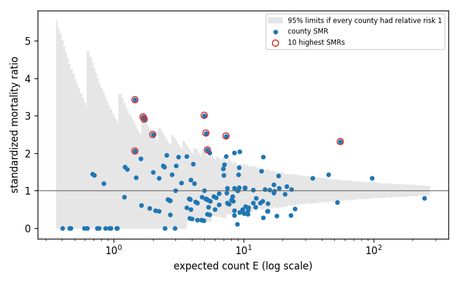

In Figure 9.1, the points scatter widely at small expected counts and narrow toward 1 as the expected count grows, with most points inside the funnel. The funnel's outline is jagged because its limits are quantiles of a discrete distribution. Nine of the ten highest SMRs (circled) have expected counts under 8; the exception, with an expected count of 55 and an SMR of 2.3, lies far above the funnel, and that excess is real. All 14 counties with no deaths sit at the bottom edge with expected counts under 3. A reader who looked only at a map of SMRs would not be able to tell the one real excess from the nine accidents of small numbers; a reader with the funnel can.

### 9.6.2 The Poisson GLM and Empirical Bayes

The next block fits the Poisson GLM with the deprivation index, using the IRLS function of Section 9.1.6, and the gamma-Poisson empirical Bayes estimates of Section 9.3.1. It also fits the three spatial models by PQL with REML for the hyperparameters, which Section 9.6.3 discusses.

```python
beta_g, cov_g, mu_g = poisson_irls(y, X, offset)
disp = np.sum((y - mu_g)**2 / mu_g) / (n - 2)
print(f"Poisson GLM: slope {beta_g[1]:.3f}, naive SE "
      f"{np.sqrt(cov_g[1, 1]):.4f}, Pearson dispersion {disp:.2f}, "
      f"quasi-Poisson SE {np.sqrt(cov_g[1, 1] * disp):.4f}")

a_hat, w_eb, eb, eb_sd = eb_gamma_poisson(y, E)
print(f"empirical Bayes: a = {a_hat:.2f} (prior sd of the relative risk "
      f"{1 / np.sqrt(a_hat):.2f}); weight on the SMR from "
      f"{w_eb.min():.2f} to {w_eb.max():.2f}")

priors = {k: make_prior(A, k) for k in ("leroux", "bym2", "bym")}
starts = {"leroux": (np.log(0.2), 0.0), "bym2": (np.log(0.2), 0.0),
          "bym": (np.log(0.05), np.log(0.1))}
pql = {k: fit_pql(y, X, offset, priors[k], starts[k]) for k in priors}
for k, f in pql.items():
    print(f"{k:7s} PQL-REML: beta1 = {f['beta'][1]:.3f} "
          f"(SE {np.sqrt(f['cov'][1, 1]):.4f}), hyperparameters "
          f"({f['hyper'][0]:.4f}, {f['hyper'][1]:.4f}), "
          f"{f['outer']} outer iterations")
s2, rho = pql["bym2"]["hyper"]
print(f"BYM2 mapped to BYM: sigma_u2 = {s2 * rho / c_scale:.4f}, "
      f"sigma_v2 = {s2 * (1 - rho):.4f}")

print("\nRMSE against the true relative risks")
print("method            all   smallest quarter   largest quarter")
methods = {"SMR": smr, "Poisson GLM": mu_g / E, "empirical Bayes": eb,
           "Leroux": pql["leroux"]["mu"] / E, "BYM2": pql["bym2"]["mu"] / E}
for name, est in methods.items():
    print(f"{name:15s}  {rmse(est):.3f}   {rmse(est, smallest):.3f}"
          f"              {rmse(est, largest):.3f}")

print("\nrank correlation with the true relative risks")
for name, est in methods.items():
    print(f"{name:15s}  {stats.spearmanr(est, theta_true)[0]:.3f}")
```

The GLM estimates a slope of 0.177 with a naive standard error of 0.0242. The truth is 0.3, which is more than five of these standard errors away. The Pearson dispersion is 2.58, so the counts vary about two and a half times more than Poisson, and the quasi-Poisson standard error is 0.0389. Two things are at work. The naive standard error is too small, as the dispersion alone shows. And the estimate itself is low: in this realization the correlation between the deprivation index and the true random effect happens to be $-0.15$, so the unexplained spatial effect partly offsets the covariate. One data set cannot separate the two, and Section 9.6.5 repeats the experiment 100 times to do so.

Empirical Bayes estimates $\hat{a} = 5.20$, a prior standard deviation of $1/\sqrt{5.20} = 0.44$ for the relative risks. The weights on the SMR run from 0.07 for the smallest county to 0.98 for the largest, so the smallest counties are almost entirely replaced by the overall rate, and the largest keep their own estimates.

### 9.6.3 The Spatial Models by PQL

The three spatial models give consistent answers. Leroux estimates the slope as 0.210 (standard error 0.0507) with hyperparameters $(\sigma^2, \rho) = (0.2193, 0.2201)$. BYM2 estimates it as 0.226 (0.0520) with $(\sigma^2, \rho) = (0.1524, 0.2125)$. BYM, which is BYM2 under another name, gives exactly the same slope and standard error, with variances $(\sigma_u^2, \sigma_v^2) = (0.0478, 0.1200)$; mapping the BYM2 estimates through $\sigma_u^2 = \sigma^2\rho/c$ and $\sigma_v^2 = \sigma^2(1 - \rho)$ gives the same $(0.0478, 0.1200)$, as Section 9.3.6 predicted.

The BYM2 estimate of the total variance, 0.152, is very close to the true 0.15. The mixing parameter is estimated as 0.21, against a design value of 0.6 and a realized spatial share of 0.40; Section 9.6.4 shows how little the data say about it.

The accuracy of the estimates of the true relative risks is summarized by the root mean squared error:

| Method | All counties | Smallest quarter | Largest quarter |
| :--- | :--- | :--- | :--- |
| SMR | 0.523 | 0.778 | 0.202 |
| Poisson GLM with deprivation | 0.358 | 0.387 | 0.310 |
| Empirical Bayes | 0.310 | 0.377 | 0.160 |
| Leroux | 0.268 | 0.330 | 0.124 |
| BYM2 | 0.267 | 0.320 | 0.126 |

The ordering is the one the chapter has been building toward. The raw SMR is worst overall (0.523), and nearly four times worse in the smallest counties than in the largest (0.778 against 0.202), which is the funnel plot in a single column. The GLM uses the deprivation index and helps a lot in the small counties (0.387), but it hurts in the large ones (0.310 against the SMR's 0.202), because a model with no random effect cannot track the county-level risk where the data are informative. Empirical Bayes keeps what the large counties know (0.160) and shrinks the small ones (0.377). The spatial models do best in every column, with an overall error about half the SMR's, and BYM2 and Leroux are nearly equal, as the earlier comparison suggested. The rank correlation between the estimates and the true relative risks tells the same story from another angle: 0.600 for the SMR, 0.604 for the Poisson GLM, 0.630 for empirical Bayes, and 0.755 and 0.756 for Leroux and BYM2. Shrinkage toward a single value changes the ranking of counties only a little; borrowing from neighbors changes it a great deal, and for the better.

```python
# Figure 9.2: maps of the true relative risk and five estimates
panels = [("True relative risk", theta_true), ("SMR", smr),
          ("Empirical Bayes", eb), ("Poisson GLM with x", mu_g / E),
          ("Leroux", pql["leroux"]["mu"] / E),
          ("BYM2", pql["bym2"]["mu"] / E)]
fig, axes = plt.subplots(2, 3, figsize=(10, 6.6))
for ax, (title, val) in zip(axes.ravel(), panels):
    im = ax.imshow(val.reshape(12, 12), origin="lower", cmap="viridis",
                   norm=LogNorm(0.4, 2.5), extent=(0, 1, 0, 1))
    ax.set_title(title, fontsize=10)
    ax.set_xticks([])
    ax.set_yticks([])
fig.colorbar(im, ax=axes, shrink=0.8, label="relative risk (log scale)")
fig.savefig("figures/ch09/fig_9_2_maps.png", dpi=120, bbox_inches="tight")
```

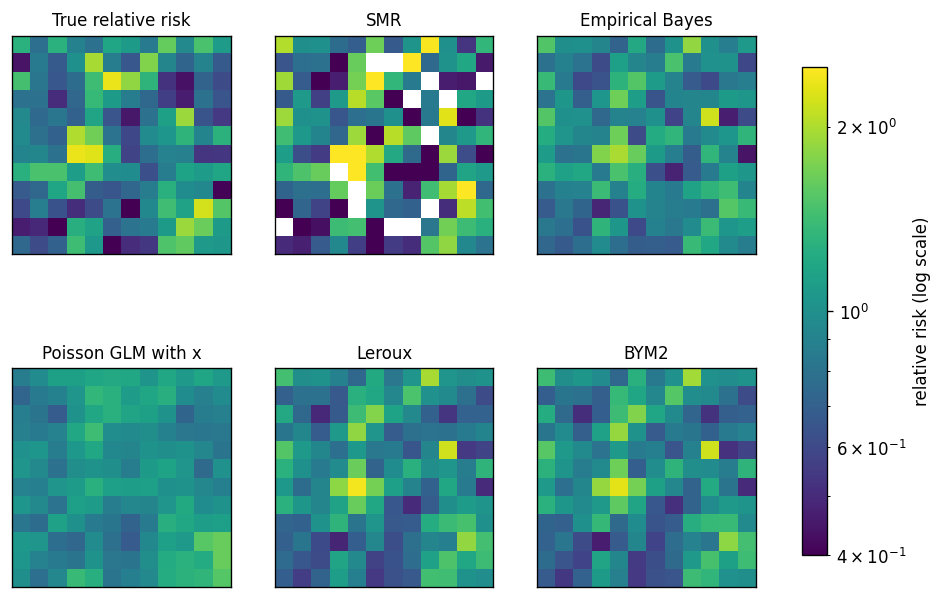

Figure 9.2 shows the maps. The SMR map is the noisiest, with isolated bright and dark counties and white squares where there were no deaths. Empirical Bayes is much smoother, since it shrinks every county toward 1, and it keeps only the stronger signals. The Poisson GLM map is nearly flat with only a slight gradient, because the deprivation index explains a small part of the variation. The Leroux and BYM2 maps are close to each other and show patches of high and low risk with softer edges than the truth, which is what shrinking toward neighbors produces; the rank correlations above say that these patches line up with the true ones better than any other column does.

### 9.6.4 Laplace Maximum Likelihood and Weak Identification

Now fit the same models by maximizing the Laplace likelihood of Section 9.5, over the coefficients and hyperparameters together, and test whether a random effect is needed at all.

```python
lap = {}
for k in priors:
    start = np.concatenate([[0.0, 0.0], starts[k]])
    lap[k] = optimize.minimize(laplace_negloglik, start, method="L-BFGS-B",
                               args=(y, X, offset, priors[k]))
    r = lap[k]
    print(f"{k:7s} Laplace ML: beta = {np.round(r.x[:2], 3)}, hyperparameters "
          f"{np.round(priors[k](r.x[2:])[3], 4)}, "
          f"negative log-likelihood {r.fun:.3f}")

nll_glm = -np.sum(y * np.log(mu_g) - mu_g - special.gammaln(y + 1))
lr = 2 * (nll_glm - lap["bym2"].fun)
print(f"\nPoisson GLM negative log-likelihood {nll_glm:.3f}; "
      f"likelihood ratio statistic for sigma2 = 0: {lr:.1f}")
print(f"mixture p-value: {0.5 * stats.chi2.sf(lr, 1):.2e}")

print("\nprofile of the Laplace likelihood in rho (BYM2)")
best = lap["bym2"]
for rho_p in (0.02, 0.1, 0.2, 0.4, 0.6, 0.8, 0.95, 0.999):
    logit = np.log(rho_p / (1 - rho_p))
    prof = optimize.minimize(
        lambda q: laplace_negloglik(np.array([q[0], q[1], q[2], logit]),
                                    y, X, offset, priors["bym2"]),
        best.x[:3], method="L-BFGS-B")
    print(f"rho = {rho_p:5.3f}: loss of log-likelihood "
          f"{prof.fun - best.fun:5.2f}, sigma2 = {np.exp(prof.x[2]):.3f}")
```

The Laplace estimates agree with PQL where it matters. For BYM2 the slope is 0.227 against PQL's 0.226, and the hyperparameters are $(0.1538, 0.2045)$ against $(0.1524, 0.2125)$. For Leroux the slope is 0.209 against 0.210, and $\sigma^2$ is 0.172 against 0.219; the estimates of $\rho$ are 0.064 and 0.220, which say little except that $\rho$ is small and uncertain. BYM again matches BYM2, with the same maximized log-likelihood (negative log-likelihood 355.386) and variances $(0.0465, 0.1224)$. The counts here are not so small that PQL fails.

The Poisson GLM's negative log-likelihood is 413.701, against 355.386 for BYM2, so the likelihood ratio statistic for $\sigma^2 = 0$ is 116.6. Against the mixture reference of Section 9.5.3, the p-value is about $1.7 \times 10^{-27}$. There is overwhelming evidence of variation in risk beyond what the Poisson and the deprivation index explain.

The question is how much of that variation is spatial. The profile in the last table of the output holds $\rho$ fixed at each value and maximizes over the coefficients and $\sigma^2$.

| $\rho$ | 0.02 | 0.1 | 0.2 | 0.4 | 0.6 | 0.8 | 0.95 | 0.999 |
| :--- | :--- | :--- | :--- | :--- | :--- | :--- | :--- | :--- |
| Loss of log-likelihood | 0.31 | 0.07 | 0.00 | 0.18 | 0.70 | 1.67 | 2.89 | 3.44 |
| $\sigma^2$ | 0.148 | 0.150 | 0.154 | 0.164 | 0.179 | 0.202 | 0.227 | 0.238 |

The loss never exceeds 1.67 for any $\rho$ from 0.02 to 0.8, so every one of these values is inside the 95% likelihood region, whose cutoff for one parameter is 1.92 (half of 3.84, the 95% point of a $\chi^2_1$ distribution). The data cannot tell a mostly independent random effect from one that is 80% spatial. The truth, 0.6, is comfortably inside. The total variance $\sigma^2$, in contrast, moves little: from 0.148 to 0.238 across the whole range of $\rho$. This is the BYM weak identification of Section 9.3.3, seen from the BYM2 side: the total is determined, the split is not.

```python
# Figure 9.3: weak identification of the BYM variance split
fixed = lap["bym"].x[:2]
grid_u = np.linspace(np.log(0.003), np.log(1.0), 25)
surface = np.array([[laplace_negloglik(np.array([*fixed, a, b]), y, X,
                                       offset, priors["bym"])
                     for a in grid_u] for b in grid_u])
surface -= lap["bym"].fun
rhos = np.array([0.02, 0.05, 0.1, 0.2, 0.4, 0.6, 0.8, 0.95, 0.999])
loss = []
for rho_p in rhos:
    logit = np.log(rho_p / (1 - rho_p))
    prof = optimize.minimize(
        lambda q: laplace_negloglik(np.array([q[0], q[1], q[2], logit]),
                                    y, X, offset, priors["bym2"]),
        lap["bym2"].x[:3], method="L-BFGS-B")
    loss.append(prof.fun - lap["bym2"].fun)
fig, axes = plt.subplots(1, 2, figsize=(10, 4))
cs = axes[0].contourf(np.exp(grid_u), np.exp(grid_u), surface,
                      levels=[0, 1, 2, 4, 8, 16, 32, 64], cmap="viridis_r")
axes[0].set_xscale("log")
axes[0].set_yscale("log")
axes[0].set_xlabel("structured variance (ICAR part)")
axes[0].set_ylabel("unstructured variance")
fig.colorbar(cs, ax=axes[0], label="loss of log-likelihood")
axes[1].plot(rhos, loss, "o-")
axes[1].axhline(1.92, color="0.4", ls="--", lw=0.8)
axes[1].axvline(rho_true, color="tab:red", lw=0.8)
axes[1].set_xlabel("mixing parameter rho")
axes[1].set_ylabel("loss of log-likelihood")
fig.tight_layout()
fig.savefig("figures/ch09/fig_9_3_identification.png", dpi=120)
print(f"cells within 2 units of the maximum: {(surface < 2).sum()} of "
      f"{surface.size}; within 4 units: {(surface < 4).sum()}")
near = surface < 2
print(f"within 2 units: structured variance "
      f"{np.exp(grid_u[near.any(axis=0)]).min():.3f} to "
      f"{np.exp(grid_u[near.any(axis=0)]).max():.3f}; unstructured "
      f"{np.exp(grid_u[near.any(axis=1)]).min():.3f} to "
      f"{np.exp(grid_u[near.any(axis=1)]).max():.3f}")
print(f"loss at the smallest structured variance on the grid "
      f"({np.exp(grid_u[0]):.3f}): {surface[:, 0].min():.2f}")
print("figures saved")
```


In the left panel of Figure 9.3 the bright region where the loss is under two units covers 81 of the 625 grid cells, and 161 cells have a loss under four. It is a band, long in the direction of the structured variance and narrow in the direction of the unstructured variance. The unstructured variance is determined to within a factor of about five: the cells with a loss under two have it between 0.034 and 0.184. The structured variance is not: it can be anywhere from the smallest value on the grid, 0.003, to roughly 0.23 with little loss, and setting it to 0.003 costs only 0.40 units of log-likelihood. On this data set, in other words, we cannot prove that there is any spatially structured variation beyond the unstructured part, although there is some. The right panel shows the BYM2 profile in $\rho$: it is flat near its minimum at 0.2 and crosses the dashed 95% line only beyond $\rho = 0.8$.

The reason is the same as in Chapter 5, where only a combination of $\sigma^2$ and $\phi$ was well determined: 144 counties with a median of five deaths each carry little information about how a risk surface is arranged, as opposed to how large it is. More counties or larger counts sharpen it; Exercise 15 tries a map with 576 counties.

### 9.6.5 Does the Standard Error Cover?

The last experiment repeats Chapter 1's. Simulate 100 new data sets from the same truth, with new random effects and new counts each time and the same covariate and populations. For each, fit the Poisson GLM, the quasi-Poisson correction, and the BYM2 model by PQL, and record whether the 95% interval for the slope contains the true 0.3.

```python
def simulate_counts(rng):
    """New spatial effects and counts from the same BYM2 truth."""
    ustar = U_vec[:, 1:] @ (rng.standard_normal(n - 1) / np.sqrt(e_val[1:]))
    u = np.sqrt(sigma2_true) * (np.sqrt(rho_true / c_scale) * ustar
                                + np.sqrt(1 - rho_true)
                                * rng.standard_normal(n))
    return rng.poisson(rate0 * pop * np.exp(beta1_true * x + u))


rng = np.random.default_rng(2071)
reps = 100
est = np.zeros((reps, 2))
se = np.zeros((reps, 3))
for r in range(reps):
    yr = simulate_counts(rng)
    off_r = np.log(yr.sum() / pop.sum() * pop)
    b_r, cov_r, mu_r = poisson_irls(yr, X, off_r)
    disp_r = max(np.sum((yr - mu_r)**2 / mu_r) / (n - 2), 1.0)
    f_r = fit_pql(yr, X, off_r, priors["bym2"], (np.log(0.15), 0.0))
    est[r] = b_r[1], f_r["beta"][1]
    se[r] = (np.sqrt(cov_r[1, 1]), np.sqrt(cov_r[1, 1] * disp_r),
             np.sqrt(f_r["cov"][1, 1]))
print("method              mean estimate   SD of estimates   mean SE   "
      "coverage")
for j, (name, col) in enumerate((("Poisson GLM", 0),
                                 ("quasi-Poisson", 0),
                                 ("BYM2 (PQL)", 1))):
    cover = np.mean(np.abs(est[:, col] - beta1_true) < 1.96 * se[:, j])
    print(f"{name:18s}  {est[:, col].mean():12.3f}  "
          f"{est[:, col].std():15.3f}  {se[:, j].mean():8.3f}  "
          f"{cover:8.0%}")
```

| Method | Mean estimate | SD of estimates | Mean SE | Coverage |
| :--- | :--- | :--- | :--- | :--- |
| Poisson GLM | 0.282 | 0.100 | 0.023 | 35% |
| quasi-Poisson | 0.282 | 0.100 | 0.038 | 46% |
| BYM2 (PQL) | 0.292 | 0.048 | 0.052 | 96% |

All three estimators are close to the truth on average (0.282 and 0.292 against 0.3). The difference is in their uncertainty. The Poisson GLM's slope varies from data set to data set with a standard deviation of 0.100, but its standard error says 0.023: more than four times too small, and a 95% interval that covers 35% of the time. The quasi-Poisson correction multiplies the standard error by the square root of the dispersion, which raises it to 0.038, still about two and a half times too small, with 46% coverage. It corrects for variation that is independent between counties, but the extra variation here is spatial, and the deprivation index is itself spatially smooth, which is the combination that Chapter 1 showed to be worst.

The BYM2 model's standard error, 0.052, matches the actual spread of 0.048, and the interval covers 96% of the time. Its estimates are also more precise: a standard deviation of 0.048 against 0.100, so the GLM's variance is about four times larger. This is the efficiency gain of generalized least squares (Section 1.3.5), now for counts.

---

<a id="ch9-exercises"></a>

## Exercises

**Analytical**

1. For the binomial with $m$ trials and success probability $p$, show that $b(\vartheta) = m\log(1 + e^{\vartheta})$ with $\vartheta = \operatorname{logit}(p)$, verify that $b'(\vartheta) = mp$ and $b''(\vartheta) = mp(1 - p)$, and find the IRLS weights $v_i$ and working response $z_i$ for the logit link.

2. For a Poisson regression with the identity link $\mu_i = \mathbf{x}_i'\boldsymbol{\beta}$, which is not canonical, find $\partial\mu_i/\partial\eta_i$, the weights $v_i$, and the working response $z_i$. Show that the observed information, which involves $\mathbf{y}$, differs from the expected information $\mathbf{X}'\mathbf{V}\mathbf{X}$.

3. Show that $\operatorname{Var}(\text{SMR}_i \mid \theta_i) = \theta_i/E_i$, and find the expected count at which the coefficient of variation of the SMR is 10% when $\theta = 1$ and when $\theta = 2$. Why does a county with a higher true risk have a more precisely estimated relative risk?

4. In the gamma-Poisson model of Section 9.3.1, show that the marginal mean and variance of $Y_i$ are $E_i$ and $E_i + E_i^2/a$. Show that the shrinkage weight $w_i = E_i/(E_i + a)$ tends to 1 as $E_i \to \infty$, and that, averaged over the gamma prior and the Poisson noise, the mean squared error of the SMR is $1/E_i$ while that of the posterior mean is $1/(E_i + a)$.

5. Suppose the prior is $\theta_i \sim \text{Gamma}(a, a/m_i)$ with mean $m_i$. Show that the posterior mean is $w_i\,\text{SMR}_i + (1 - w_i)m_i$ with the same weight $w_i$, so the estimate shrinks toward $m_i$. How would you choose $m_i$ from a fitted Poisson regression, and what is the interpretation?

6. For the Leroux model, verify the conditional mean and variance in Section 9.3.5 from the entries of $\mathbf{Q}$. Show that the model's precision is positive definite for $\rho < 1$, and find the conditional distribution of $u_i$ as $\rho \to 1$.

7. For a path of four regions, find $\boldsymbol{\Sigma}^{\star}$, the marginal variances, and the scaling constant $c$, by hand, and check them with the code of Section 9.3.4. Then add an isolated fifth region with no neighbors. Show that the formula applied to the whole map fails, and that applying it to each connected component and ignoring the isolated region gives the same $c$ as before.

8. Eliminate $\mathbf{u}$ from Henderson's equations. Use the identity $\mathbf{V} - \mathbf{V}(\mathbf{V} + \mathbf{Q})^{-1}\mathbf{V} = (\mathbf{V}^{-1} + \mathbf{Q}^{-1})^{-1}$ (a form of the Woodbury identity, derived from the block inversion formula of Appendix A.1) to show that $\hat{\boldsymbol{\beta}}$ solves the generalized least squares equations for $\mathbf{z} \sim N(\mathbf{X}\boldsymbol{\beta}, \mathbf{V}^{-1} + \mathbf{Q}^{-1})$. Then show that $\hat{\mathbf{u}} = \mathbf{Q}^{-1}(\mathbf{V}^{-1} + \mathbf{Q}^{-1})^{-1}(\mathbf{z} - \mathbf{X}\hat{\boldsymbol{\beta}})$, and interpret this as the kriging formula of Section 4.4.3.

9. For the one-region model of Section 9.5.2, write the equation for the mode $\hat{u}$ and the Laplace approximation of the integral. Evaluate them for $y = 0$ and $\sigma^2 = 0.5$ using a calculator and a few Newton steps, and compare with the first entry of the table. Show that the approximation is exact if $y \mid u$ were $N(u, 1)$.

10. Show that the BYM2 model with $(\sigma^2, \rho)$ and the BYM model with $(\sigma_u^2, \sigma_v^2) = (\sigma^2\rho/c,\ \sigma^2(1 - \rho))$ have the same covariance matrix. Express $\rho$ in terms of $\sigma_u^2$, $\sigma_v^2$, and $c$.

**Computational and simulation**

11. Replace the truth of Section 9.6.1 by a smooth Gaussian field with exponential correlation (range 0.25) of variance 0.10 plus independent noise of variance 0.05. Refit the models and compare the RMSE table and the estimate of $\rho$. Which model, if any, is hurt by the change of truth?

12. Simulate vaccination counts: county $i$ has $m_i = \text{pop}_i$ residents of whom $Y_i \sim \text{Binomial}(m_i, p_i)$ are vaccinated, with $\operatorname{logit}(p_i) = 0.8 - 0.4\,x_i + u_i$ and $\mathbf{u}$ drawn from BYM2. Modify `poisson_irls` and `pirls_mixed` for the logit link, using the weights and working response of Exercise 1, and fit the model.

13. Repeat the Laplace and PQL fits of the BYM2 model on 50 simulated data sets for baseline rates of 0.00025, 0.001, and 0.004 (expected counts one quarter, one, and four times as large). How do the two estimates of $\sigma^2$ compare with the truth as the counts change? Do you see the PQL bias that Section 9.4.5 describes?

14. Add an isolated county to the map (a row and column of zeros appended to $\mathbf{A}$). Compute the scaling constant with `scaling_constant` and with a naive pseudo-inverse of the whole Laplacian (`np.linalg.pinv`), and compare. Fit the BYM2 model to simulated data and explain what the isolated county's estimated effect is.

15. Rerun the profile of $\rho$ (Section 9.6.4) on a map of $24 \times 24$ counties, generated with `county_map(24)` and with simulated responses from the same BYM2 truth. How does the width of the 95% region for $\rho$ change relative to the 144-county map?

16. Modify `eb_gamma_poisson` so that each county shrinks toward $\exp(\mathbf{x}_i'\hat{\boldsymbol{\beta}})$ from the Poisson GLM (Exercise 5) and estimate $a$ from the negative binomial with the corresponding means. Compare its RMSE with the table of Section 9.6.3.

---

<a id="ch9-what-comes-next"></a>

## What Comes Next

This chapter completes Part III. For areal data we now have the full path from the raw ratio to a fitted spatial model: why small counties mislead, how shrinkage and neighbors repair it, how the model is estimated, and how its uncertainty compares with the naive one. Part IV changes what is random. In a point pattern the locations of the events are the data, and there are no regions to count in. But if we lay a fine grid of pixels over the study region, the number of events in each pixel is a Poisson count, with a mean that depends on location. Chapter 10 explores such patterns, Chapter 11 fits them with exactly the Poisson regression and IRLS of Section 9.1, using pixel areas as offsets, and Chapter 12 returns to this chapter's mixed model when the log intensity gets a Gaussian random effect, the log-Gaussian Cox process.


---

<!-- manuscript:part:begin {"label": "Part IV", "title": "Spatial Point Patterns", "description": "Data that are the locations themselves: where events happen, and why.", "chapters": [10, 11, 12]} -->
<a id="part-4"></a>

# Part IV: Spatial Point Patterns

*Data that are the locations themselves: where events happen, and why.*

<!-- manuscript:part:end -->

---

<a id="ch10"></a>

# Chapter 10: Exploring Point Patterns: Intensity, Randomness, and Interaction

Up to now every observation in this book was a number measured at a place. A rent at an address, a noise level at a monitor, a death count in a county: the locations were fixed by the study design or the map, and the randomness lived in the values. This chapter starts Part IV with data of a different kind. There is no value to measure. The data are the places themselves: where the immune cells sit on a tumor slide, where the traffic crashes happened, where the disease cases live. The coordinates are the random outcome.

That change removes most of the machinery of Parts I to III, which was built for responses $Y(\mathbf{s})$, but it keeps the habit of mind. We ask what a pattern with no structure looks like, describe how real patterns depart from it, and judge the departures against simulated worlds where the truth is known. The chapter's job is exploration, in the same sense that Chapter 3 explored a variogram before Chapter 5 fitted one. Section by section, we meet the null model (complete spatial randomness), the first-order question of where events are dense, the second-order question of whether events attract or repel one another, and the multitype question of whether two kinds of event are arranged differently.

Three stories run through the chapter. Immune cells on a tumor slide supply the question of clustering (do they swarm together?) and of inhibition (do cancer cells keep them out?). Traffic crashes along a highway supply an intensity that varies from place to place. Cases and controls of a disease around an industrial plant supply the multitype question. The models behind the clustered and inhibited patterns are derived in Chapter 12, and fitting models to point patterns is the subject of Chapter 11. Here we only simulate them, so that the exploratory tools have something to find.

> **Chapter at a Glance**
>
> - **What Changes (§10.1):** The coordinate matrix is now the random outcome, and the question moves from "how large is the value?" to "where are the events, and how do they relate to each other?"
> - **Complete Spatial Randomness (§10.2):** The Poisson process as a limit of Bernoulli trials on a fine grid, conditional uniformity, and quadrat counts.
> - **Simulating Patterns (§10.3):** Homogeneous patterns, Lewis-Shedler thinning, and two patterns that are not random.
> - **Kernel Intensity Estimation (§10.4):** Bias, variance, edge correction, and bandwidth selection by likelihood cross-validation.
> - **Distance Methods (§10.5):** Nearest-neighbor and empty-space distributions, and the $J$-function.
> - **Second-Order Summaries (§10.6):** Ripley's $K$ with edge weights, Besag's $L$, and the pair correlation function.
> - **Multitype Patterns (§10.7):** Cross-type summaries and the spatial relative risk, with an honest look at how much data a relative risk map needs.
> - **Boundary Effects (§10.8):** Why every estimator is biased near the edge of the window, and three ways to fix it, with the geometry of Ripley's weight.
> - **Monte Carlo Envelopes (§10.9):** Why pointwise envelopes reject too often, and a global test that does not.
> - **Walkthrough and Lab (§10.10):** All the summaries, with envelopes, for random, clustered, and inhibited patterns, and the case-control data.

---

<a id="s10-1"></a>

## 10.1 What Changes in a Point Pattern

Take the immune cells on a tumor slide. A pathologist stains the tissue, a scanner finds the cells, and the result is a list of coordinates: $n$ rows, two columns. In the notation of Chapter 1 this is the coordinate matrix $\mathbf{S}$, with rows $\mathbf{s}_i'$. In Parts II and III the matrix was fixed and a vector $\mathbf{Y}$ of measurements hung off it. Here the matrix is all there is, and both its entries and its number of rows are random.

Three kinds of question follow, and they organize the chapter.

- **Where are events dense?** This is the **first-order** question, about the expected number of events per unit area. Are crashes more frequent near the highway? Is there a hot spot of immune cells in one corner of the slide? The answer is a map of an intensity, and Section 10.4 estimates it.
- **Do events attract or repel each other?** This is the **second-order** question, about pairs of events. Given that an immune cell is here, is another one more or less likely to be nearby than a random scattering would suggest? Sections 10.5 and 10.6 answer it with distances between events.
- **Do two kinds of event differ?** This is the **multitype** question. Cases and controls, made shots and missed shots, two species of tree. Section 10.7 compares their arrangements.

First- and second-order questions are hard to separate. A pattern can look clustered because events are dense in one region (a first-order effect) or because events gather in small groups wherever they appear (a second-order effect), and the exploratory tools in this chapter mostly assume the first kind is absent. Chapter 11 returns to the problem with models that handle both.

Two words need care. The **intensity** $\lambda(\mathbf{s})$ at a location is the expected number of events per unit area near $\mathbf{s}$; it has units of events per area. It is not a probability, and it is not the probability density of an event's location. The two differ by the factor of the expected total number of events: if $n$ events fall in a window of area 1 with density $f(\mathbf{s})$, then the intensity is $nf(\mathbf{s})$. The second word is **window**. A pattern is always observed in a bounded region, here the unit square $\mathcal{D}$, and events outside it are invisible. Every estimator in this chapter has to cope with that, and Section 10.8 collects the fixes.

Throughout, the study window is the unit square. When a story needs real units, imagine the square scaled to a city map or a tissue slide; none of the methods depends on the scale.

---

<a id="s10-2"></a>

## 10.2 The Homogeneous Poisson Process: Complete Spatial Randomness

To say what a pattern with no structure looks like, we need a precise null model. The standard choice is the **homogeneous Poisson process**, whose output is called **complete spatial randomness** (CSR). It has two defining properties: events fall independently of each other, and every location is equally likely to receive one. This section derives what that means for counts and for locations.

### 10.2.1 The Poisson Count as a Limit of Bernoulli Trials

Cover the window with a fine grid of $m \times m$ square pixels, each of area $1/m^2$. Suppose each pixel independently contains an event with probability $p = \lambda/m^2$, where $\lambda$ is the expected number of events per unit area. If the pixels are small enough that none holds two events, the pattern is a record of which pixels are occupied. Nothing about one pixel influences another, and every pixel has the same chance: that is "no interaction, no trend" in the language of grids.

Now take a region $B$ of area $|B|$. It contains about $N_B = |B|m^2$ pixels, so the number of events in it is binomial, $N(B) \sim \text{Binomial}(N_B, p)$ with mean $N_B p = \lambda|B|$. As the grid is refined, $m \to \infty$, the number of pixels grows and the probability per pixel shrinks, with the mean held fixed. The binomial distribution then converges to a Poisson distribution. The probability generating function shows why. For a Binomial$(N_B, p)$ variable,

$$
\operatorname{E}\left[z^{N(B)}\right] = \left(1 + p(z - 1)\right)^{N_B} = \left(1 + \frac{\lambda|B|(z - 1)}{N_B}\right)^{N_B} \longrightarrow \exp\left\{\lambda|B|(z - 1)\right\}
$$

using $\left(1 + x/N\right)^N \to e^x$, and the limit is the generating function of the Poisson distribution with mean $\lambda|B|$. So

$$
N(B) \sim \text{Poisson}\left(\lambda\operatorname{area}(B)\right)
$$

for every region $B$. Counts in disjoint regions are independent, because they are made of disjoint sets of independent pixels. Together, these two statements define the homogeneous Poisson process.

The convergence is quick. The code takes $\lambda = 100$ and a region of area 0.3, and compares the exact binomial probabilities with the Poisson ones as the grid is refined.

```python
import numpy as np
from scipy import stats

lam, area_B = 100.0, 0.3
k = np.arange(0, 80)
for m in (16, 32, 64, 128, 256):
    n_cells = int(round(area_B * m**2))
    p = lam / m**2
    gap = np.abs(stats.binom.pmf(k, n_cells, p)
                 - stats.poisson.pmf(k, lam * area_B)).max()
    print(f"m={m:4d}  cells in B={n_cells:6d}  p={p:.5f}  "
          f"largest pmf gap={gap:.5f}")
```

With a $16 \times 16$ grid the largest gap between the two probability functions is 0.020. At $64 \times 64$ it is 0.0009, and at $256 \times 256$ it is 0.00006. Pixels need to be small relative to the spacing between events, and then the Poisson description is excellent.

### 10.2.2 Conditional Uniformity

A second consequence matters even more in practice. Suppose we know that the window holds exactly $n$ events. Where are they?

Split the window into disjoint regions $B_1, \dots, B_k$ with areas $|B_1|, \dots, |B_k|$ that sum to $|\mathcal{D}|$. The counts $N(B_j)$ are independent Poisson variables, so

$$
\Pr\left(N(B_1) = n_1, \dots, N(B_k) = n_k \,\middle|\, N(\mathcal{D}) = n\right) = \frac{\prod_{j=1}^k e^{-\lambda|B_j|}(\lambda|B_j|)^{n_j}/n_j!}{e^{-\lambda|\mathcal{D}|}(\lambda|\mathcal{D}|)^n/n!} = \frac{n!}{\prod_{j=1}^k n_j!}\prod_{j=1}^k \left(\frac{|B_j|}{|\mathcal{D}|}\right)^{n_j}
$$

where $n_1 + \dots + n_k = n$. The factors $e^{-\lambda|B_j|}$ multiply to the $e^{-\lambda|\mathcal{D}|}$ in the denominator and cancel, and so do the powers of $\lambda$. What is left is the multinomial distribution: each of the $n$ events independently lands in region $B_j$ with probability $|B_j|/|\mathcal{D}|$. That is exactly what it means for the $n$ events to be independent and uniformly distributed over the window.

> Given $N(\mathcal{D}) = n$, the events of a homogeneous Poisson process are $n$ independent uniform points on $\mathcal{D}$.

This is why the simulation of CSR in Section 10.3 is two lines: draw a Poisson count, then draw uniform coordinates. It is also why the intensity $\lambda$ is a nuisance for most tests. Conditional on the number of events, the pattern's distribution does not depend on $\lambda$, so tests and envelopes can be built from patterns with the same $n$ as the data, and no value of $\lambda$ has to be chosen.

### 10.2.3 Quadrat Counts

The oldest test for randomness divides the window into equal **quadrats** and compares the counts. With $n_q$ quadrats and counts $n_1, \dots, n_{n_q}$, let $\bar{n} = n/n_q$ be the average count. Conditional on $n$, Section 10.2.2 says the counts are multinomial with equal cell probabilities, and Pearson's goodness-of-fit statistic is

$$
X^2 = \sum_{k=1}^{n_q}\frac{(n_k - \bar{n})^2}{\bar{n}}
$$

which is approximately $\chi^2_{n_q - 1}$ when $\bar{n}$ is not small. The degrees of freedom are $n_q - 1$, not $n_q$, because the counts are constrained to sum to $n$. In fact its mean is exactly $n_q - 1$: each count has variance $n(1/n_q)(1 - 1/n_q)$, so $\sum_k \operatorname{Var}(n_k) = n(1 - 1/n_q)$, and dividing by $\bar{n} = n/n_q$ gives $n_q - 1$.

A closely related number is the **index of dispersion** $s_n^2/\bar{n}$, the variance of the quadrat counts divided by their mean. Since $s_n^2 = \sum_k(n_k - \bar{n})^2/(n_q - 1)$, the index equals $X^2/(n_q - 1)$. For a Poisson count the variance equals the mean, so under CSR the index is near 1. Clustering makes some quadrats much fuller than others and pushes the index above 1. Regular spacing makes the counts too even and pushes it below 1.

**A hand-sized example.** Four events at $(0.1, 0.1)$, $(0.4, 0.5)$, $(0.9, 0.2)$, and $(0.6, 0.9)$ fall one in each quadrant of the unit square. With $n_q = 4$ and $\bar{n} = 1$, every term of $X^2$ is zero, so $X^2 = 0$ and the index of dispersion is 0: perfectly even, as far as this coarse grid can tell. The same four points reappear in Sections 10.5, 10.6, and 10.8.

The code below computes $X^2$ for the four points and then checks the null distribution by simulation: 4,000 CSR patterns with a mean of 200 events, counted in a $5 \times 5$ grid.

```python
def quadrat_x2(P, m=5):
    """Pearson X^2 for counts in an m-by-m grid of equal quadrats."""
    cell = np.minimum((P * m).astype(int), m - 1)
    counts = np.bincount(cell[:, 0] * m + cell[:, 1], minlength=m * m)
    nbar = counts.mean()
    return ((counts - nbar)**2).sum() / nbar, counts


P4 = np.array([[0.1, 0.1], [0.4, 0.5], [0.9, 0.2], [0.6, 0.9]])
x2, counts = quadrat_x2(P4, m=2)
print("four points, 2 x 2 quadrats: counts", counts, " X^2 =", x2)

rng = np.random.default_rng(2080)
n_q, reps = 25, 4000
x2_sim = np.array([quadrat_x2(rng.uniform(size=(rng.poisson(200), 2)))[0]
                   for _ in range(reps)])
lo, hi = stats.chi2.ppf([0.025, 0.975], n_q - 1)
print(f"X^2 under CSR: mean={x2_sim.mean():.2f} (df={n_q - 1}), "
      f"sd={x2_sim.std():.2f} (sqrt(2 df)={np.sqrt(2 * (n_q - 1)):.2f})")
print(f"two-sided 5% test rejects CSR in "
      f"{np.mean((x2_sim < lo) | (x2_sim > hi)):.3f} of {reps} patterns")
```

The simulated $X^2$ has mean 23.91 and standard deviation 6.88, against 24 and $\sqrt{48} = 6.93$ for a $\chi^2_{24}$ distribution. A two-sided 5% test rejects CSR in 4.8% of the patterns, as it should.

Quadrat counts are easy to compute and easy to explain, but they have two weaknesses that Section 10.3.4 will expose. The test says nothing about distances smaller than the quadrat, and it depends on a choice of grid.

---

<a id="s10-3"></a>

## 10.3 Simulating Point Patterns From First Principles

Every tool in this chapter has to be judged against what random patterns do. We therefore start by learning to make them.

### 10.3.1 Homogeneous Patterns

By Section 10.2.2, a CSR pattern with intensity $\lambda$ on the unit square has a Poisson($\lambda$) number of events at independent uniform locations. The function below does exactly that. The check draws 5,000 patterns with $\lambda = 200$ and confirms what the theory says about the count (mean and variance both 200) and about the locations (uniform on the square, with mean 0.5 and standard deviation $1/\sqrt{12} = 0.289$).

```python
def sim_poisson(lam, rng):
    """Homogeneous Poisson process on the unit square."""
    return rng.uniform(size=(rng.poisson(lam), 2))


rng = np.random.default_rng(2080)
counts = np.array([len(sim_poisson(200, rng)) for _ in range(5000)])
print(f"number of events: mean={counts.mean():.1f}, "
      f"variance={counts.var():.1f} (Poisson: both equal 200)")
P = sim_poisson(200, rng)
print(f"one pattern: {len(P)} events; mean x={P[:, 0].mean():.3f}, "
      f"mean y={P[:, 1].mean():.3f}, sd x={P[:, 0].std():.3f} "
      f"(uniform: 0.5 and {np.sqrt(1 / 12):.3f})")
```

The counts have mean 199.9 and variance 201.4. In the single pattern drawn afterward, 201 events have mean coordinates of 0.467 and 0.505 and a standard deviation of 0.287 in $x$, all consistent with uniformity.

### 10.3.2 Lewis-Shedler Thinning

Real intensities are not constant. Crashes pile up along a highway, and more people live downtown. To simulate a process with a varying intensity $\lambda(\mathbf{s})$, start with a homogeneous process that is denser everywhere than the target, and then delete events with a probability that depends on location.

**The algorithm.** Choose $\lambda_{\max}$ with $\lambda(\mathbf{s}) \le \lambda_{\max}$ everywhere. Simulate a homogeneous pattern with intensity $\lambda_{\max}$. For each candidate $\mathbf{s}_i$ draw $U_i \sim \text{Uniform}(0, 1)$ and keep the candidate if $U_i < \lambda(\mathbf{s}_i)/\lambda_{\max}$. The retained points are an inhomogeneous Poisson process with intensity $\lambda(\mathbf{s})$.

**Why it works.** Let $p(\mathbf{s}) = \lambda(\mathbf{s})/\lambda_{\max}$ be the keep probability. Take a small pixel of area $a$ at $\mathbf{s}$. Candidates fall in it independently with probability $\lambda_{\max}a$, and each one survives independently with probability $p(\mathbf{s})$. A pixel therefore holds a retained event with probability $\lambda_{\max}a\,p(\mathbf{s}) = \lambda(\mathbf{s})a$, independently of the other pixels. That is the Bernoulli-grid description of Section 10.2.1 with a position-dependent success probability. Taking the same limit gives, for any region $B$,

$$
N(B) \sim \text{Poisson}\left(\int_B \lambda(\mathbf{s})\,d\mathbf{s}\right)
$$

with independent counts in disjoint regions. This is the **inhomogeneous Poisson process**, and its definition is Section 10.2.1's with $\lambda|B|$ replaced by an integral.

**A running example.** Crashes occur at rate $600$ per unit area on the highway $y = 0.3 + 0.4x$, falling off with the distance $\operatorname{dist}(\mathbf{s})$ to the highway as

$$
\lambda(\mathbf{s}) = 600\exp\left\{-6\operatorname{dist}(\mathbf{s})\right\}
$$

so $\lambda_{\max} = 600$. The functions below define the crash intensity and the two other intensity functions that the rest of Part IV uses: a population density with a downtown bump, and a relative risk around an industrial plant. (Chapter 11 uses a richer crash model, with road distance and population density as covariates and about 400 expected crashes, and simulates its own pattern; the crash pattern of this chapter is not reused there.)

The first part of the code is a hand-sized example. Eight candidates are drawn at rate 10, and the table shows each candidate's distance to the highway, its keep probability $p = e^{-6\operatorname{dist}}$, its uniform draw $U$, and the verdict. The second part checks the theory: 500 thinned patterns at full scale should have an average count equal to $\int\lambda(\mathbf{s})\,d\mathbf{s}$, and should have about as many events near the highway as the integral over that region predicts.

```python
def road_distance(P):
    """Distance from points P (n x 2) to the 'highway' y = 0.3 + 0.4 x."""
    return np.abs(0.4 * P[:, 0] - P[:, 1] + 0.3) / np.sqrt(0.4**2 + 1.0)


def pop_density(P):
    """Relative population density: a downtown bump on a flat base."""
    d2 = (P[:, 0] - 0.7)**2 + (P[:, 1] - 0.7)**2
    return 0.3 + 0.7 * np.exp(-d2 / (2 * 0.2**2))


def excess_risk(P):
    """Relative risk around an industrial plant at (0.3, 0.6)."""
    d2 = (P[:, 0] - 0.3)**2 + (P[:, 1] - 0.6)**2
    return np.exp(np.exp(-d2 / (2 * 0.1**2)))


def thin(lam_fun, lam_max, rng):
    """Lewis-Shedler thinning: an inhomogeneous Poisson process."""
    cand = sim_poisson(lam_max, rng)
    keep = rng.uniform(size=len(cand)) < lam_fun(cand) / lam_max
    return cand[keep]


def lam_crash(P):
    """Crash intensity: highest on the highway, decaying away from it."""
    return 600.0 * np.exp(-6.0 * road_distance(P))


# a tiny example: 8 candidates at rate 10
rng = np.random.default_rng(2081)
cand = sim_poisson(10, rng)
p_keep = np.exp(-6.0 * road_distance(cand))
u = rng.uniform(size=len(cand))
print(" cand      x      y   road dist   p_keep      U   kept")
for i in range(len(cand)):
    print(f"{i + 1:5d} {cand[i, 0]:6.3f} {cand[i, 1]:6.3f} "
          f"{road_distance(cand[i:i + 1])[0]:10.3f} {p_keep[i]:8.3f} "
          f"{u[i]:6.3f}   {'yes' if u[i] < p_keep[i] else 'no'}")

# check the counts against the integral of the intensity
g = (np.arange(200) + 0.5) / 200
GG = np.column_stack([np.repeat(g, 200), np.tile(g, 200)])
d_g = road_distance(GG)
near, far = d_g < 0.1, d_g > 0.4
expected = {"all": lam_crash(GG).mean(),
            "near": (lam_crash(GG) * near).mean(),
            "far": (lam_crash(GG) * far).mean()}
rng = np.random.default_rng(2082)
sims = [thin(lam_crash, 600.0, rng) for _ in range(500)]
obs = {"all": np.mean([len(s) for s in sims]),
       "near": np.mean([(road_distance(s) < 0.1).sum() for s in sims]),
       "far": np.mean([(road_distance(s) > 0.4).sum() for s in sims])}
for key in ("all", "near", "far"):
    print(f"{key:5s} expected {expected[key]:7.2f}   simulated "
          f"{obs[key]:7.2f}")
```

In the hand-sized table, candidates 4, 5, and 6 are kept because their uniform draws (0.093, 0.661, 0.655) fall below their keep probabilities (0.696, 0.878, 0.691). Candidate 1 is close to the highway, with $p = 0.529$, and is deleted anyway because $U = 0.844$ is large; thinning is random, and a high keep probability is not a guarantee.

The full-scale check agrees with the integral. The expected number of crashes is 199.19 and the average over 500 simulations is 200.30. Within 0.1 of the highway the expected count is 97.38 and the simulated average 97.72; farther than 0.4 it is 6.33 against 6.34.

### 10.3.3 Why Simulation Comes First

The rest of Part IV follows one pattern again and again. We compute a summary of the data, simulate many patterns from a null model, compute the same summary on each, and see where the data fall among them. Nearly every distribution in point pattern analysis is either unknown or too hard to derive, once edge effects and estimated intensities are involved, and simulation is the replacement. The logic is exactly that of the permutation tests in Chapter 6. If the data came from the null model, then the data and the simulated patterns are exchangeable, and the rank of the data among them is uniform. Section 10.9 builds tests on that fact.

### 10.3.4 Two Patterns That Are Not Random

To have something to detect, we need patterns with structure. Chapter 12 derives two standard models, and here we use short simulators that you can read in a minute. Each is explained in a paragraph, and neither is needed for the rest of the chapter beyond the patterns they produce.

- **A clustered pattern (Thomas).** Scatter parent locations at random. Around each parent, place a Poisson number of offspring whose displacements from the parent are independent Gaussian. Keep only the offspring inside the window. The result has groups of events, and the parents are never observed. This is how immune cells might gather around tumor cells. Parents are generated on a margin around the window, so that clusters centered just outside it still contribute their inside members.
- **An inhibited pattern (Matérn Type II).** Scatter many events at random, give each a random age, and delete an event if an older event lies within a minimum spacing of it. The survivors are never closer than the spacing, a model for cells that exclude one another.

The parameters are chosen so that all three patterns have close to 200 events: the CSR pattern has intensity 200; the clustered pattern has 20 parents per unit area, 10 offspring per parent, and a spread of 0.03; the inhibited pattern starts from 300 events per unit area and enforces a minimum spacing of 0.03.

```python
import os

import matplotlib
matplotlib.use("Agg")
import matplotlib.pyplot as plt


def dist(P, Q=None):
    """Matrix of Euclidean distances between rows of P and rows of Q."""
    Q = P if Q is None else Q
    d = np.sqrt(((P[:, None, :] - Q[None, :, :])**2).sum(axis=2))
    if Q is P:
        np.fill_diagonal(d, 0.0)
    return d


def sim_thomas(kappa, mu_c, sigma_c, rng):
    """Clusters: Poisson parents, Gaussian offspring (see Chapter 12)."""
    pad = 4 * sigma_c
    n_par = rng.poisson(kappa * (1 + 2 * pad)**2)
    parents = rng.uniform(-pad, 1 + pad, size=(n_par, 2))
    centers = np.repeat(parents, rng.poisson(mu_c, size=n_par), axis=0)
    pts = centers + sigma_c * rng.standard_normal(centers.shape)
    return pts[np.all((pts >= 0) & (pts <= 1), axis=1)]


def sim_matern2(lam_parent, r0, rng):
    """Inhibition: delete a point if an older point is within r0."""
    P = sim_poisson(lam_parent, rng)
    age = rng.uniform(size=len(P))
    D = dist(P)
    older = age[None, :] < age[:, None]
    return P[~((D < r0) & older).any(axis=1)]


rng = np.random.default_rng(2080)
csr = sim_poisson(200, rng)
clustered = sim_thomas(20, 10, 0.03, rng)
inhibited = sim_matern2(300, 0.03, rng)
patterns = {"random (CSR)": csr, "clustered": clustered,
            "inhibited": inhibited}
for name, P in patterns.items():
    x2, counts = quadrat_x2(P)
    p_val = 2 * min(stats.chi2.cdf(x2, 24), stats.chi2.sf(x2, 24))
    print(f"{name:13s} n={len(P):4d}  X^2={x2:7.2f}  "
          f"dispersion index={x2 / 24:5.2f}  two-sided p={p_val:.4f}")

os.makedirs("figures/ch10", exist_ok=True)
fig, axes = plt.subplots(1, 3, figsize=(10, 3.6))
for ax, (name, P) in zip(axes, patterns.items()):
    ax.plot(P[:, 0], P[:, 1], "k.", ms=4)
    ax.set_title(f"{name}, n = {len(P)}")
    ax.set_aspect("equal")
    ax.set_xlim(0, 1)
    ax.set_ylim(0, 1)
fig.tight_layout()
fig.savefig("figures/ch10/fig_10_1_three_patterns.png", dpi=120)
```

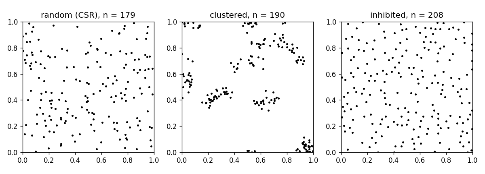

In Figure 10.1 the left panel scatters events with no visible organization, apart from the usual lumps and gaps that random points have. The middle panel shows tight groups with large empty areas between them. In the right panel the events are evenly spread, with no two touching and no large gaps.

Now the quadrat test. The random pattern has $X^2 = 38.74$, an index of dispersion of 1.61, and a two-sided p-value of 0.058: close to the 5% line, which a truly random pattern will sit near about one time in twenty. The clustered pattern has $X^2 = 215.00$ and an index of 8.96, so there is no doubt. The inhibited pattern has $X^2 = 12.91$ and an index of 0.54, with $p = 0.065$, and is not rejected.

That last result is the weakness promised in Section 10.2.3. The inhibited pattern is strikingly regular at the scale of its minimum spacing of 0.03, but the quadrats are $0.2 \times 0.2$. At that size, the regularity cancels out: whether two events are 0.03 or 0.003 apart makes no difference to which quadrat they fall in. The methods of Sections 10.5 and 10.6 look at the right scale, and find the inhibition decisively.

---

<a id="s10-4"></a>

## 10.4 First-Order Exploration: Kernel Intensity Estimation

The first question about a pattern is usually where the events are dense. The standard answer is to smooth the events into a map.

### 10.4.1 The Estimator

Place a small bump, a **kernel**, at every event, and add the bumps up. With a Gaussian kernel of **bandwidth** $\psi$ the estimate at location $\mathbf{s}$ is

$$
\hat{\lambda}(\mathbf{s}) = \sum_{i=1}^n \mathcal{K}_\psi(\mathbf{s} - \mathbf{s}_i), \qquad \mathcal{K}_\psi(\mathbf{u}) = \frac{1}{2\pi\psi^2}\exp\left\{-\frac{\lVert\mathbf{u}\rVert^2}{2\psi^2}\right\}
$$

The kernel is a bivariate normal density with standard deviation $\psi$ in each coordinate, so it integrates to 1, and each event contributes one unit of intensity, spread over a neighborhood of size about $\psi$. This is the kernel density estimator you may know from one-dimensional statistics, in two dimensions, and multiplied by $n$ because we estimate an intensity (events per area) instead of a density (probability per area).

The computation is a matrix operation. Evaluate $\hat{\lambda}$ on a grid of $n_g$ points and form the $n_g \times n$ matrix of distances between grid points and events, with a vectorized `dist` function like that of Chapter 1, which here also accepts two sets of points. The kernel is applied entrywise and the rows are summed. (Chapter 11 uses a simpler `kernel_intensity` without the edge correction and with a different argument order, because it uses the estimate only far from the border.)

**Bias and variance.** What does $\hat{\lambda}(\mathbf{s})$ estimate? For a Poisson process, the expected sum of a function $f$ over the events is $\int f(\mathbf{u})\lambda(\mathbf{u})\,d\mathbf{u}$ and its variance is $\int f(\mathbf{u})^2\lambda(\mathbf{u})\,d\mathbf{u}$. This follows from the Bernoulli-grid picture of Section 10.2.1: each pixel contributes $f$ with probability $\lambda a$, so its mean is $f\lambda a$ and, for small $a$, its variance is nearly $f^2\lambda a$. Applying these with $f(\mathbf{u}) = \mathcal{K}_\psi(\mathbf{s} - \mathbf{u})$ gives

$$
\operatorname{E}\left[\hat{\lambda}(\mathbf{s})\right] = \int\mathcal{K}_\psi(\mathbf{s} - \mathbf{u})\lambda(\mathbf{u})\,d\mathbf{u}, \qquad \operatorname{Var}\left(\hat{\lambda}(\mathbf{s})\right) = \int\mathcal{K}_\psi(\mathbf{s} - \mathbf{u})^2\lambda(\mathbf{u})\,d\mathbf{u}
$$

The mean is the true intensity smoothed with the kernel, so $\hat{\lambda}$ is biased unless $\lambda$ is constant. For small $\psi$ a Taylor expansion of $\lambda$ around $\mathbf{s}$ gives

$$
\operatorname{E}\left[\hat{\lambda}(\mathbf{s})\right] \approx \lambda(\mathbf{s}) + \frac{\psi^2}{2}\left(\frac{\partial^2\lambda}{\partial x^2} + \frac{\partial^2\lambda}{\partial y^2}\right)
$$

because the Gaussian kernel has variance $\psi^2$ in each coordinate and no cross term. Smoothing raises the intensity in valleys and lowers it on peaks. The variance, with $\lambda$ roughly constant over the kernel's reach and $\int\mathcal{K}_\psi^2 = 1/(4\pi\psi^2)$ for the bivariate Gaussian, is

$$
\operatorname{Var}\left(\hat{\lambda}(\mathbf{s})\right) \approx \frac{\lambda(\mathbf{s})}{4\pi\psi^2}
$$

Bias grows with $\psi^2$ and variance shrinks like $1/\psi^2$: the usual trade-off, now with a knob you can see. A small bandwidth gives a map that follows every event and is mostly noise. A large bandwidth gives a smooth map that washes out real features.

### 10.4.2 Edge Correction

Near the boundary, part of each kernel falls outside the window, where no events can be observed. Events near the edge therefore add less than a unit of intensity inside the window, and $\hat{\lambda}$ is biased downward there, even when $\lambda$ is constant.

The fix follows from the mean formula. If $\lambda$ is constant, then $\operatorname{E}[\hat{\lambda}(\mathbf{s})] = \lambda\int_{\mathcal{D}}\mathcal{K}_\psi(\mathbf{s} - \mathbf{u})\,d\mathbf{u} = \lambda\,\mathcal{E}_\psi(\mathbf{s})$, where

$$
\mathcal{E}_\psi(\mathbf{s}) = \int_{\mathcal{D}}\mathcal{K}_\psi(\mathbf{s} - \mathbf{u})\,d\mathbf{u}
$$

is the kernel mass inside the window. For the unit square and a Gaussian kernel the integral factors into one-dimensional normal probabilities,

$$
\mathcal{E}_\psi(\mathbf{s}) = \left[\Phi\left(\frac{1 - s_1}{\psi}\right) - \Phi\left(\frac{-s_1}{\psi}\right)\right]\left[\Phi\left(\frac{1 - s_2}{\psi}\right) - \Phi\left(\frac{-s_2}{\psi}\right)\right]
$$

with $\Phi$ the standard normal distribution function. Dividing by $\mathcal{E}_\psi(\mathbf{s})$ removes the bias for constant $\lambda$:

$$
\hat{\lambda}_{\text{edge}}(\mathbf{s}) = \frac{1}{\mathcal{E}_\psi(\mathbf{s})}\sum_{i=1}^n\mathcal{K}_\psi(\mathbf{s} - \mathbf{s}_i)
$$

For varying $\lambda$ it is still biased, as the smoothing argument above says, but the edge-specific loss is gone.

### 10.4.3 Choosing the Bandwidth

How should $\psi$ be chosen? Three approaches are in common use.

- **Rules of thumb.** A normal-reference rule for two dimensions sets $\psi = \hat{\sigma}n^{-1/6}$, with $\hat{\sigma}$ a typical standard deviation of the coordinates. It is quick, and it assumes the intensity is not much more complicated than a single Gaussian bump.
- **Minimizing a mean squared error.** Adding the squared bias and the variance above, the integrated mean squared error is large for small $\psi$ (variance) and for large $\psi$ (bias), and has a minimum between. It needs the unknown $\lambda$, so it can only be used when the truth is known, as in simulations.
- **Likelihood cross-validation.** Chapter 11 derives the log-likelihood of an inhomogeneous Poisson process with intensity $\lambda$: $\sum_i\log\lambda(\mathbf{s}_i) - \int_{\mathcal{D}}\lambda(\mathbf{s})\,d\mathbf{s}$. Evaluate it at $\hat{\lambda}_\psi$, but compute each event's term from the estimate with that event left out, so that the estimate does not reward itself for following the event:

  $$
  \operatorname{LCV}(\psi) = \sum_{i=1}^n\log\hat{\lambda}_{\psi,-i}(\mathbf{s}_i) - \int_{\mathcal{D}}\hat{\lambda}_\psi(\mathbf{s})\,d\mathbf{s}
  $$

  and choose the $\psi$ that maximizes it. In code, the leave-one-out estimate is the row sum of the event-to-event kernel matrix with its diagonal set to zero, and the integral is a mean over a grid.

The code first checks two claims by simulation, using homogeneous patterns of intensity 200 and $\psi = 0.05$: the variance formula at an interior point, and the edge correction at a point 0.02 from the boundary. It then simulates the crash pattern of Section 10.3.2, evaluates the estimate over a range of bandwidths, and reports the rule of thumb, the likelihood cross-validation choice, and the choice that minimizes the integrated squared error against the true intensity.

```python
from scipy.stats import norm


def edge_mass(pts, psi):
    """Kernel mass inside the unit square for kernels centered at pts."""
    mx = norm.cdf((1 - pts[:, 0]) / psi) - norm.cdf(-pts[:, 0] / psi)
    my = norm.cdf((1 - pts[:, 1]) / psi) - norm.cdf(-pts[:, 1] / psi)
    return mx * my


def kernel_intensity(P, psi, pts, edge=True, leave_out=False):
    """Gaussian kernel estimate of lambda(s) at pts from events P."""
    K = np.exp(-dist(pts, P)**2 / (2 * psi**2)) / (2 * np.pi * psi**2)
    if leave_out:
        np.fill_diagonal(K, 0.0)
    lam_hat = K.sum(axis=1)
    return lam_hat / edge_mass(pts, psi) if edge else lam_hat


# variance and edge correction, known-truth checks (homogeneous, rate 200)
rng = np.random.default_rng(2083)
psi = 0.05
mid, edge_pt = np.array([[0.5, 0.5]]), np.array([[0.02, 0.5]])
est = np.array([[kernel_intensity(P, psi, mid)[0],
                 kernel_intensity(P, psi, edge_pt, edge=False)[0],
                 kernel_intensity(P, psi, edge_pt)[0]]
                for P in (sim_poisson(200, rng) for _ in range(3000))])
print(f"interior: mean={est[:, 0].mean():.1f} (truth 200), "
      f"variance={est[:, 0].var():.0f} "
      f"(formula {200 / (4 * np.pi * psi**2):.0f})")
print(f"edge point, no correction: mean={est[:, 1].mean():.1f}; "
      f"kernel mass inside={edge_mass(edge_pt, psi)[0]:.3f} "
      f"-> 200 x mass = {200 * edge_mass(edge_pt, psi)[0]:.1f}")
print(f"edge point, corrected:     mean={est[:, 2].mean():.1f}")

# crashes along the highway: bandwidth, bias and variance
rng = np.random.default_rng(2084)
crashes = thin(lam_crash, 600.0, rng)
g50 = (np.arange(50) + 0.5) / 50
G50 = np.column_stack([np.repeat(g50, 50), np.tile(g50, 50)])
truth50 = lam_crash(G50)
psi_grid = np.geomspace(0.01, 0.3, 30)
ise, lcv = [], []
for ps in psi_grid:
    lam_g = kernel_intensity(crashes, ps, G50)
    ise.append(np.mean((lam_g - truth50)**2))
    loo = kernel_intensity(crashes, ps, crashes, leave_out=True)
    lcv.append(np.log(loo).sum() - lam_g.mean())
ise, lcv = np.array(ise), np.array(lcv)
scott = crashes.std(axis=0).mean() * len(crashes)**(-1 / 6)
psi_lcv, psi_ise = psi_grid[lcv.argmax()], psi_grid[ise.argmin()]
print(f"{len(crashes)} crashes; expected {lam_crash(GG).mean():.1f}")
print(f"bandwidth: Scott rule {scott:.3f}, likelihood CV {psi_lcv:.3f}, "
      f"minimum ISE {psi_ise:.3f}")
for ps in (0.02, psi_lcv, 0.2):
    k = np.abs(psi_grid - ps).argmin()
    print(f"  psi={psi_grid[k]:.3f}: integrated squared error={ise[k]:9.1f}")
```

Both claims hold. At the interior point the estimate averages 198.1 against a truth of 200, and its variance is 6,379 against the formula's 6,366. At the edge point the uncorrected estimate averages 129.5; the kernel mass inside the window is 0.655, so $200 \times 0.655 = 131.1$ is what the theory predicts. After the correction the average is 197.6.

The crash pattern has 212 events against an expected 199.2. The normal-reference rule gives $\psi = 0.102$, likelihood cross-validation 0.093, and the bandwidth that minimizes the integrated squared error against the truth is 0.083. The three agree to within about 20%. The cost of a bad choice is large: the integrated squared error is 41,097 at $\psi = 0.02$, 4,325 at the cross-validated value, and 12,252 at $\psi = 0.211$.


Figure 10.2 shows the trade-off. At $\psi = 0.02$ the map is a field of separate bumps, one per event. At $\psi = 0.2$ the highway ridge has disappeared into a gentle gradient. At the cross-validated value the ridge is visible but lumpy: with 212 events, the data limit how well any bandwidth can recover the true ridge. The bottom right panel shows that the cross-validation score peaks close to where the error against the truth is smallest, even though cross-validation never saw the truth.

---

<a id="s10-5"></a>

## 10.5 Distance Methods

The second-order question is whether events interact. The simplest evidence is distances: how far is each event from its nearest neighbor, and how far is an arbitrary location from the nearest event?

### 10.5.1 Nearest-Neighbor Distances

With the distance matrix $\mathbf{H}$ of Chapter 1, whose entry $h_{ij}$ is the distance between events $i$ and $j$, the **nearest-neighbor distance** of event $i$ is

$$
d_i^{\text{nn}} = \min_{j \ne i}h_{ij}
$$

the smallest off-diagonal entry in row $i$. Their empirical distribution function,

$$
\hat{G}(r) = \frac{1}{n}\sum_{i=1}^n\mathbb{1}\left(d_i^{\text{nn}} \le r\right)
$$

is the share of events that have a neighbor within distance $r$. Here $\mathbb{1}(\cdot)$ is the indicator of a condition: 1 if it holds, 0 if not. The target of $\hat{G}$ is the function $G(r)$, the probability that a typical event has its nearest neighbor within distance $r$.

**A hand-sized example.** The four events from Section 10.2.3 have the distance matrix printed below, with $h_{12} = 0.5$ the hypotenuse of a $0.3$-$0.4$-$0.5$ right triangle. The nearest-neighbor distances are the row minima, ignoring the diagonal zeros.

```python
H4 = dist(P4)
print("coordinates:\n", P4)
print("distance matrix H:\n", np.round(H4, 3))
H4_inf = H4 + np.diag(np.full(4, np.inf))
d_nn = H4_inf.min(axis=1)
print("nearest-neighbor distances:", np.round(d_nn, 3),
      " nearest:", H4_inf.argmin(axis=1) + 1)
for r in (0.40, 0.45, 0.50, 0.55, 0.60):
    print(f"G-hat({r:.2f}) = {(d_nn <= r + 1e-9).mean():.2f}", end="   ")
print()
lam4 = 4.0
print("CSR with lambda = 4 would give G(0.45) =",
      round(1 - np.exp(-lam4 * np.pi * 0.45**2), 3))
```

Events 2 and 4 are each other's nearest neighbors at distance 0.447; event 1's nearest neighbor is event 2 at 0.5; event 3's is event 2 at 0.583. So $\hat{G}$ is 0 below 0.447, jumps to $0.50$ at 0.447, to $0.75$ at 0.5, and to 1 at 0.583. A CSR pattern with four events in a unit square would have $G(0.45) = 1 - e^{-4\pi(0.45)^2} = 0.922$, so these four events have unusually distant neighbors. With $n = 4$ nothing is statistically meaningful, but the example is small enough to check every entry by hand.

### 10.5.2 The Nearest-Neighbor Distribution Under CSR

Under CSR the function $G$ has a closed form. Pick a typical event at $\mathbf{s}$, and ask for the probability that no other event lies within distance $r$. In the Bernoulli-grid picture of Section 10.2.1, the pixel holding the typical event has no effect on the other pixels, because pixels are independent. So the other events still form a homogeneous Poisson process, and the number of them in the disc $b(\mathbf{s}, r)$ of radius $r$ about $\mathbf{s}$ is Poisson with mean $\lambda\pi r^2$. The probability that the disc is empty, the **void probability**, is $e^{-\lambda\pi r^2}$, and the nearest neighbor is farther than $r$ exactly when the disc is empty:

$$
1 - G(r) = \Pr\left(N(b(\mathbf{s}, r)) = 0\right) = \exp\left\{-\lambda\pi r^2\right\}, \qquad G(r) = 1 - e^{-\lambda\pi r^2}
$$

As a by-product, the expected nearest-neighbor distance is $\int_0^\infty e^{-\lambda\pi r^2}\,dr = 1/(2\sqrt{\lambda})$. With 200 events per unit area that is 0.035, about the size of the minimum spacing of 0.03 used for the inhibited pattern in Section 10.3.4.

Clustered patterns have more short distances than this and inhibited patterns fewer, so $\hat{G}$ above the CSR curve signals clustering, and $\hat{G}$ below it signals inhibition.

### 10.5.3 The Empty-Space Function

The other distance question is asked from an arbitrary location in the window, not from an event: how far is the nearest event? Let $F(r)$ be the probability that a randomly chosen location has an event within distance $r$. The empirical version uses a regular grid of $n_g$ test points $\mathbf{q}_k$:

$$
\hat{F}(r) = \frac{1}{n_g}\sum_{k=1}^{n_g}\mathbb{1}\left(\min_i\lVert\mathbf{q}_k - \mathbf{s}_i\rVert \le r\right)
$$

It is computed from the grid-to-event distance matrix, the same matrix as for kernel smoothing. Under CSR, a disc around an arbitrary location is empty with probability $e^{-\lambda\pi r^2}$, so $F(r) = 1 - e^{-\lambda\pi r^2}$, the same function as $G(r)$.

The two functions differ for patterns with structure, and in opposite directions. In a clustered pattern, events have close neighbors, so $G$ rises quickly, but most of the window is empty space far from any cluster, so $F$ rises slowly. In an inhibited pattern, events are kept apart, so $G$ rises slowly, while the events are spread evenly and every location is near one, so $F$ rises quickly.

### 10.5.4 The J-Function

The two distances can be combined into one summary, the $J$-function:

$$
J(r) = \frac{1 - G(r)}{1 - F(r)}
$$

a ratio of survival functions. Under CSR, $G = F$, so $J(r) = 1$ for every $r$. Clustering makes $1 - G$ small and $1 - F$ large, so $J < 1$. Inhibition does the opposite, and $J > 1$. One curve, with one reference line.

The code computes $\hat{G}$, $\hat{F}$, and $\hat{J}$ at three distances for the three patterns of Figure 10.1, using the plain empirical functions (Section 10.8 corrects them for the window edge). The last column of the table is $1 - e^{-n\pi r^2}$, using the pattern's event count as the intensity.

```python
def g_naive(P, r):
    """Empirical nearest-neighbor distribution function (no edge fix)."""
    H = dist(P)
    np.fill_diagonal(H, np.inf)
    return (H.min(axis=1)[:, None] <= r[None, :]).mean(axis=0)


GRID = (np.arange(40) + 0.5) / 40
GRID = np.column_stack([np.repeat(GRID, 40), np.tile(GRID, 40)])


def f_naive(P, r):
    """Empirical empty-space function from a 40 x 40 grid of points."""
    d = dist(GRID, P).min(axis=1)
    return (d[:, None] <= r[None, :]).mean(axis=0)


r_vals = np.array([0.02, 0.04, 0.06])
print("pattern          r     G-hat   F-hat   J-hat   CSR value")
for name, P in patterns.items():
    lam_hat = len(P)
    G_, F_ = g_naive(P, r_vals), f_naive(P, r_vals)
    for k, r in enumerate(r_vals):
        J_ = (1 - G_[k]) / (1 - F_[k])
        print(f"{name:13s} {r:6.2f} {G_[k]:8.3f} {F_[k]:7.3f} {J_:7.3f}"
              f"   {1 - np.exp(-lam_hat * np.pi * r**2):.3f}")
```

| Pattern | $r$ | $\hat{G}$ | $\hat{F}$ | $\hat{J}$ | CSR value of $G$ and $F$ |
| :--- | :--- | :--- | :--- | :--- | :--- |
| random | 0.02 | 0.179 | 0.204 | 1.031 | 0.201 |
| random | 0.04 | 0.542 | 0.589 | 1.116 | 0.593 |
| random | 0.06 | 0.866 | 0.853 | 0.913 | 0.868 |
| clustered | 0.02 | 0.679 | 0.139 | 0.373 | 0.212 |
| clustered | 0.04 | 0.921 | 0.279 | 0.109 | 0.615 |
| clustered | 0.06 | 0.984 | 0.399 | 0.026 | 0.883 |
| inhibited | 0.02 | 0.000 | 0.255 | 1.342 | 0.230 |
| inhibited | 0.04 | 0.399 | 0.716 | 2.113 | 0.648 |
| inhibited | 0.06 | 0.841 | 0.948 | 3.022 | 0.905 |

The random pattern tracks the CSR values and has $\hat{J}$ near 1. The clustered pattern has $\hat{G}$ far above and $\hat{F}$ far below the CSR value, and $\hat{J}$ falls to 0.026 by $r = 0.06$. The inhibited pattern has $\hat{G} = 0$ at $r = 0.02$, because no two events are closer than 0.03, and $\hat{J}$ rises to 3.0. Compare this with the quadrat test, which could not see the inhibition at all.

---

<a id="s10-6"></a>

## 10.6 Second-Order Summaries

Distances to the nearest neighbor look at only one other event per event. A fuller description counts all the neighbors within a range of distances, which is what the $K$-function does.

### 10.6.1 Ripley's K-Function

Let $\lambda$ be the intensity of a pattern whose intensity is constant. The **$K$-function** is defined by

$$
\lambda K(r) = \operatorname{E}\left[\text{number of additional events within distance } r \text{ of a typical event}\right]
$$

so $K(r)$ is that expected count divided by the intensity, a quantity with the units of area. The division by $\lambda$ makes the function comparable across patterns with different numbers of events.

**Under CSR.** A typical event leaves the other events unchanged, by the argument of Section 10.5.2: they form a Poisson process of intensity $\lambda$. The number of them in a disc of radius $r$ is Poisson with mean $\lambda\pi r^2$. So $\lambda K(r) = \lambda\pi r^2$ and

$$
K(r) = \pi r^2
$$

the area of the disc. The reference curve is a parabola with no parameters. A pattern with more neighbors than that within distance $r$ has $K(r) > \pi r^2$ (clustering at that scale), and one with fewer has $K(r) < \pi r^2$ (inhibition).

### 10.6.2 The Estimator, and Edge Weights

A natural estimate counts ordered pairs of events within distance $r$, with the indicator matrix $\mathbb{1}(\mathbf{H} \le r)$, and divides by $n$ events and by an estimate of the intensity. Writing $\lambda\approx n/\operatorname{area}(\mathcal{D})$, the average number of extra neighbors per event is $\frac{1}{n}\sum_i\sum_{j \ne i}\mathbb{1}(h_{ij} \le r)$, and dividing by $\hat{\lambda}$ gives $\frac{\operatorname{area}(\mathcal{D})}{n^2}\sum_i\sum_{j \ne i}\mathbb{1}(h_{ij} \le r)$. Replacing $n^2$ by $n(n-1)$ removes a small bias, since for a Poisson number of events $\operatorname{E}[n(n-1)] = \lambda^2\operatorname{area}(\mathcal{D})^2$, so that $n(n-1)/\operatorname{area}(\mathcal{D})^2$ is an unbiased estimate of $\lambda^2$. Adding a weight $\omega_{ij} \ge 1$ for each pair to compensate for the window edge (the subject of Section 10.8) gives

$$
\hat{K}(r) = \frac{\operatorname{area}(\mathcal{D})}{n(n-1)}\sum_{i=1}^n\sum_{j \ne i}\omega_{ij}\,\mathbb{1}\left(h_{ij} \le r\right)
$$

The idea behind $\omega_{ij}$ is this. Under CSR, if $j$ is at distance $h_{ij}$ from event $i$, it is equally likely to lie anywhere on the circle of radius $h_{ij}$ around $\mathbf{s}_i$. Part of that circle may lie outside the window, in which case a neighbor there would never be seen. Let $f_{ij}$ be the fraction of the circle that lies inside the window. A pair at distance $h_{ij}$ is observed with probability $f_{ij}$, so counting it with weight $\omega_{ij} = 1/f_{ij}$ restores the expected count. Written in terms of arc lengths,

$$
\omega_{ij} = \frac{2\pi h_{ij}}{\text{length of the part of the circle } \partial b(\mathbf{s}_i, h_{ij}) \text{ inside } \mathcal{D}}
$$

Section 10.8.3 derives the arc length for a rectangle. The code below implements it exactly (the function `arc_inside`) and builds the estimator from the weights.

**A hand-sized example.** With the four events and $r = 0.55$, the ordered pairs within $0.55$ are $(1,2)$, $(2,1)$, $(2,4)$, and $(4,2)$. Event 1 sits at $(0.1, 0.1)$, near a corner, so the circle of radius $0.5$ around it has only 31.4% of its length inside the window and the weight is $1/0.3141 = 3.184$. The circle of the same radius around event 2 at $(0.4, 0.5)$ is cut only by the left edge, leaving 79.5% inside, and the weight is 1.258. The pair $(2,4)$ has radius $0.447$ around event 2, and $(4,2)$ the same radius around event 4, which sits close to the top edge. The four weights are 3.184, 1.258, 1.173, and 2.164, and they sum to 7.779. Then

$$
\hat{K}(0.55) = \frac{1}{4 \times 3}(7.779) = 0.6482
$$

without edge correction the count would be $4/12 = 0.333$, and the CSR value is $\pi(0.55)^2 = 0.950$. With four events the estimate is far too noisy to interpret, and the point of the exercise is the arithmetic.

```python
def arc_inside(P, h):
    """Fraction of the circle of radius h about each row of P that lies
    inside the unit square (exact: edge arcs minus corner overlaps)."""
    h = np.asarray(h, dtype=float)

    def half(a):
        """Half-angle of the arc cut off by an edge at distance a."""
        return np.where(a < h, np.arccos(np.clip(a / h, -1.0, 1.0)), 0.0)

    left, right = half(P[:, 0]), half(1 - P[:, 0])
    bottom, top = half(P[:, 1]), half(1 - P[:, 1])
    cut = 2 * (left + right + bottom + top)
    for a, b in ((left, bottom), (left, top), (right, bottom), (right, top)):
        cut = cut - np.maximum(0.0, a + b - np.pi / 2) * (a > 0) * (b > 0)
    return 1 - cut / (2 * np.pi)


def pair_weights(P, Q=None):
    """Distances and Ripley edge weights omega_ij (circle about P[i])."""
    same = Q is None
    Q = P if same else Q
    H = dist(P, Q)
    W = np.zeros_like(H)
    use = ~np.eye(len(P), dtype=bool) if same else np.ones_like(H, bool)
    ii, jj = np.where(use)
    W[ii, jj] = 1.0 / np.maximum(arc_inside(P[ii], H[ii, jj]), 1e-9)
    return H, W, use


def k_ripley(P, r):
    """Edge-corrected K-hat on the unit square (area 1)."""
    H, W, use = pair_weights(P)
    order = np.argsort(H[use])
    h, cw = H[use][order], np.cumsum(W[use][order])
    tot = np.concatenate([[0.0], cw])[np.searchsorted(h, r, side="right")]
    return tot / (len(P) * (len(P) - 1))


# the four points by hand: K-hat at r = 0.55
H4, W4, use4 = pair_weights(P4)
r = 0.55
print("ordered pairs with h <= 0.55: (i, j), h_ij, arc inside, omega")
total = 0.0
for i in range(4):
    for j in range(4):
        if i != j and H4[i, j] <= r:
            arc = arc_inside(P4[i:i + 1], H4[i, j])[0]
            total += W4[i, j]
            print(f"  ({i + 1},{j + 1})  h={H4[i, j]:.3f}  arc={arc:.4f}  "
                  f"omega={W4[i, j]:.3f}")
print(f"sum of weights = {total:.3f}; K-hat = {total:.3f}/12 = "
      f"{total / 12:.4f}; no edge correction: {4 / 12:.4f}; "
      f"pi r^2 = {np.pi * r**2:.4f}")
print("check with k_ripley:", np.round(k_ripley(P4, np.array([r])), 4))

# L removes the dependence of the variance on r (CSR, rate 200)
rng = np.random.default_rng(2085)
r_v = np.array([0.05, 0.10, 0.15, 0.20])
K_sim = np.array([k_ripley(sim_poisson(200, rng), r_v)
                  for _ in range(1000)])
L_sim = np.sqrt(K_sim / np.pi) - r_v
print("r            ", r_v)
print("mean K / pi r^2", np.round(K_sim.mean(axis=0) / (np.pi * r_v**2), 3))
print("sd of K-hat   ", np.round(K_sim.std(axis=0), 5))
print("2 pi r^2/n^2  ", np.round(np.sqrt(2 * np.pi * r_v**2 / 200**2), 5))
print("sd of L - r   ", np.round(L_sim.std(axis=0), 5),
      "(formula", round(np.sqrt(1 / (2 * np.pi * 200**2)), 5), ")")
```

The code reproduces $\hat{K}(0.55) = 0.6482$ from the vectorized function. The second part simulates 1,000 CSR patterns with a mean of 200 events and shows that the corrected estimator is unbiased: the mean of $\hat{K}(r)/(\pi r^2)$ is between 1.000 and 1.003 at all four distances.

### 10.6.3 Besag's L and the Variance of K

The $K$-function is a cumulative count, and its variance under CSR grows with $r$, so deviations from $\pi r^2$ at large $r$ look bigger than they are. Besag's **$L$-function**

$$
L(r) = \sqrt{\frac{K(r)}{\pi}}
$$

equals $r$ under CSR, and is customarily plotted as $L(r) - r$, so that CSR is the horizontal line at zero. It also stabilizes the variance. Under CSR, the number of ordered pairs within $r$ is roughly $2\times$ a count of unordered pairs, each of which is within $r$ with probability $\pi r^2/\operatorname{area}(\mathcal{D})$. Counting that as approximately Poisson with variance equal to its mean, and ignoring edge effects and the dependence among pairs, the variance of $\hat{K}$ is

$$
\operatorname{Var}\left(\hat{K}(r)\right) \approx \frac{2\operatorname{area}(\mathcal{D})\pi r^2}{n^2}
$$

which grows like $r^2$. Write $\hat{K} = \pi r^2(1 + \delta)$ with $\delta$ a small relative error, so that $\operatorname{Var}(\delta) \approx 2\operatorname{area}(\mathcal{D})/(n^2\pi r^2)$. The delta method gives $\hat{L} = r\sqrt{1 + \delta} \approx r(1 + \delta/2)$ and

$$
\operatorname{Var}\left(\hat{L}(r)\right) \approx \frac{r^2}{4}\operatorname{Var}(\delta) = \frac{\operatorname{area}(\mathcal{D})}{2\pi n^2}
$$

which does not depend on $r$. In the simulation of the previous block, with $n = 200$ and area 1, the standard deviation of $\hat{K}$ is 0.00066, 0.00138, 0.00209, and 0.00304 at $r = 0.05, 0.10, 0.15, 0.20$, a fivefold increase; the formula $\sqrt{2\pi r^2/n^2}$ gives 0.00063, 0.00125, 0.00188, and 0.00251, which gets the growth right and the size roughly right, and slightly understates it at larger $r$ because pairs that share an event are dependent. The standard deviation of $\hat{L}(r) - r$ is 0.0021, 0.0022, 0.0022, and 0.0024, nearly constant, against a formula value of 0.0020. A plot of $L(r) - r$ can therefore be read with a single yardstick for the width of noise at every distance.

### 10.6.4 The Pair Correlation Function

The $K$-function is cumulative: $K(r)$ counts everything up to $r$, so a cluster at small distances shows up in $K$ at all larger distances too, which makes it hard to say at which scale the interaction happens. The **pair correlation function** is the non-cumulative version.

Consider the expected number of additional events in a thin ring of radii $r$ and $r + dr$ around a typical event. Under CSR it is $\lambda\cdot2\pi r\,dr$, the intensity times the area of the ring. Write the corresponding number for a general pattern as $\lambda g(r)\cdot2\pi r\,dr$; then $g(r)$ is the ratio of the actual neighbor density at distance $r$ to what CSR would give, and $g = 1$ means no interaction at that distance. Adding up the rings gives $\lambda K(r) = \int_0^r\lambda g(s)2\pi s\,ds$, so

$$
K(r) = \int_0^r 2\pi s\,g(s)\,ds, \qquad g(r) = \frac{K'(r)}{2\pi r}
$$

and $g > 1$ means attraction at distance $r$, $g < 1$ repulsion. Because $g$ is a derivative of $\hat{K}$, which is a step function, it has to be smoothed. The estimate replaces each indicator $\mathbb{1}(h_{ij} \le r)$ in $\hat{K}$ by a kernel centered at $h_{ij}$, with a small bandwidth $b$ in the distance direction, and divides by $2\pi r$:

$$
\hat{g}(r) = \frac{\operatorname{area}(\mathcal{D})}{n(n-1)}\sum_{i=1}^n\sum_{j \ne i}\omega_{ij}\frac{\mathcal{K}_b^{(1)}(r - h_{ij})}{2\pi r}
$$

with $\mathcal{K}_b^{(1)}(u) = e^{-u^2/(2b^2)}/(b\sqrt{2\pi})$ the one-dimensional version of the Gaussian kernel of Section 10.4.1, with standard deviation $b$. The estimate is unreliable for $r$ below about $2b$, where the kernel reaches below zero distance, so the code starts at $r = 0.02$ with $b = 0.01$.

As a known-truth check, Chapter 12 derives, for any parent intensity and spread, the pair correlation of the Thomas model; for the pattern of Section 10.3.4 (20 parents per unit area, spread 0.03) it is $g(r) = 1 + \exp\{-r^2/(4 \times 0.03^2)\}/(20 \times 4\pi \times 0.03^2)$, which equals 5.4 at $r = 0$ and decays to 1. The code averages $\hat{g}$ over 200 simulated patterns of each kind.

```python
def g_pcf(P, r, bw=0.01):
    """Pair correlation: kernel-smoothed weighted pair distances."""
    H, W, use = pair_weights(P)
    h, w = H[use], W[use]
    k = np.exp(-0.5 * ((r[:, None] - h[None, :]) / bw)**2)
    k = k / (bw * np.sqrt(2 * np.pi))
    n = len(P)
    return (k * w[None, :]).sum(axis=1) / (n * (n - 1) * 2 * np.pi * r)


r_g = np.array([0.02, 0.04, 0.06, 0.10, 0.15])
rng = np.random.default_rng(2086)
g_csr = np.mean([g_pcf(sim_poisson(200, rng), r_g)
                 for _ in range(200)], axis=0)
g_thom = np.mean([g_pcf(sim_thomas(20, 10, 0.03, rng), r_g)
                  for _ in range(200)], axis=0)
g_true = 1 + np.exp(-r_g**2 / (4 * 0.03**2)) / (20 * 4 * np.pi * 0.03**2)
print("r              ", r_g)
print("CSR, mean g-hat", np.round(g_csr, 3))
print("Thomas, mean   ", np.round(g_thom, 3))
print("Thomas, formula", np.round(g_true, 3))
```

For CSR the average $\hat{g}$ is 1.00 at every distance. For the Thomas pattern it is 4.87, 3.81, 2.64, 1.24, and 0.94 at $r = 0.02, 0.04, 0.06, 0.10, 0.15$, against formula values of 4.96, 3.84, 2.63, 1.28, and 1.01. The small gap at larger $r$ comes from clusters that straddle the window edge, which the edge weights treat only approximately, and from the margin of the cluster simulator.

---

<a id="s10-7"></a>

## 10.7 Multitype Patterns

Many point patterns carry a label for each event. The labels may be a species, a disease status, or a result: a shot in basketball is made or missed, and a shot chart is a point pattern with a label for each shot. The multitype questions are whether the types occupy different places, and whether they attract or repel each other.

### 10.7.1 Marks, and Two Kinds of Question

Take two types. In the general discussion they are type 1 and type 2. In the case-control setting of Section 10.7.3, type 1 is cases, with intensity $\lambda_1(\mathbf{s})$, and type 2 is controls, with intensity $\lambda_0(\mathbf{s})$. Two questions look similar and are not.

- **Do the types interact?** If a case is here, is a control more or less likely to be nearby than for two independent patterns? This is a second-order question about pairs of different types. Section 10.7.2 answers it.
- **Do the types have different intensities?** Do cases cluster in places where controls do not? This is a first-order question about the ratio of intensities, the **relative risk**. (Here the relative risk is the intensity of cases divided by the intensity of controls. Chapter 9 used the same words for a county's mean count divided by its expected count.) Section 10.7.3 answers it.

The distinction is important in epidemiology. Cases are expected to sit where people live, which is where the controls are. Whether cases are more concentrated than the population is a question about the ratio $\lambda_1/\lambda_0$, not about their interaction.

### 10.7.2 Cross-Type Summaries

The cross-$K$ function is the multitype version of $K$: $\lambda_2K_{12}(r)$ is the expected number of type-2 events within distance $r$ of a typical type-1 event. Its estimator uses the same weights, applied to all pairs formed by one event of each type, with the circle taken around the type-1 event:

$$
\hat{K}_{12}(r) = \frac{\operatorname{area}(\mathcal{D})}{n_1n_2}\sum_{i \in \text{type 1}}\sum_{j \in \text{type 2}}\omega_{ij}\,\mathbb{1}\left(h_{ij} \le r\right)
$$

If the two patterns are independent and the type-2 pattern has constant intensity, a typical type-1 event learns nothing about type 2, so $K_{12}(r) = \pi r^2$. Values above that mean that type-2 events gather around type-1 events (attraction); values below mean that they avoid them (segregation). The matching nearest-neighbor version is $G_{12}(r)$, the probability that the nearest type-2 event to a typical type-1 event lies within $r$.

To see all three behaviors, the code generates 150 type-1 events and three different type-2 patterns: an independent random pattern; an attracted pattern, in which events are drawn from the neighborhoods of type-1 events with a spread of 0.03; and a segregated pattern, a random pattern with 250 events per unit area from which every event within 0.05 of a type-1 event is deleted. It reports $\hat{K}_{12}(0.1)/(\pi 0.1^2)$ for each.

```python
def k12_ripley(P1, P2, r):
    """Cross K-hat from type-1 points to type-2 points (area 1)."""
    H, W, use = pair_weights(P1, P2)
    return np.array([(W * (H <= rk)).sum() for rk in r]) / (len(P1) * len(P2))


rng = np.random.default_rng(2087)
type1 = sim_poisson(150, rng)
independent = sim_poisson(150, rng)
attract = type1[rng.integers(0, len(type1), 150)]
attract = attract + 0.03 * rng.standard_normal(attract.shape)
attract = attract[np.all((attract >= 0) & (attract <= 1), axis=1)]
cand = sim_poisson(250, rng)
segregate = cand[dist(cand, type1).min(axis=1) > 0.05]
r12 = np.array([0.10])
print("scenario        n2   K12(0.1) / (pi r^2)")
for name, P2 in (("independent", independent), ("attraction", attract),
                 ("segregation", segregate)):
    k12 = k12_ripley(type1, P2, r12)[0] / (np.pi * 0.1**2)
    print(f"{name:12s} {len(P2):4d} {k12:18.2f}")
```

The independent pattern gives a ratio of 1.00, the attracted pattern 1.23, and the segregated pattern 0.81, as expected.

### 10.7.3 The Spatial Relative Risk

The second question compares intensities. The **spatial relative risk** is

$$
\operatorname{RR}(\mathbf{s}) = \frac{\lambda_1(\mathbf{s})}{\lambda_0(\mathbf{s})}
$$

the ratio of the case and control intensities. Because it is a ratio, the factor that makes both intensities large where people live cancels, and what remains is the extra risk that cases carry compared with the population. A natural estimate is the ratio of two kernel estimates, $\widehat{\operatorname{RR}}(\mathbf{s}) = \hat{\lambda}_1(\mathbf{s})/\hat{\lambda}_0(\mathbf{s})$.

**The shared setting.** The code uses a case-control setting that the next two chapters also use. Controls form an inhomogeneous Poisson process with intensity $800\,\text{pop}(\mathbf{s})$, where $\text{pop}$ is the population density with a downtown bump. Cases have intensity $120\,\text{pop}(\mathbf{s})\,\text{ex}(\mathbf{s})$, where $\text{ex}$ is an excess risk that rises to $e \approx 2.72$ at an industrial plant at $(0.3, 0.6)$ and falls to 1 away from it. The true relative risk is therefore $0.15\,\text{ex}(\mathbf{s})$: population density cancels, and the baseline ratio 0.15 is 120/800.

**Why the two estimates should share a bandwidth.** The expected value of each kernel estimate is the intensity smoothed with the kernel, from Section 10.4.1. If the numerator and denominator are smoothed with the same $\psi$, the common population factor is smoothed the same way in both and mostly cancels. With different bandwidths it does not, and the shape of $\text{pop}$ leaks into the estimated risk. The block below checks this with no random noise at all, by computing the expected values of the estimators by numerical integration, and reporting the root mean squared error of $\log(\operatorname{E}[\widehat{\operatorname{RR}}]/\operatorname{RR})$ over a grid.

**The data.** The same block simulates the shared case-control data and a second data set with ten times the intensities, chooses a shared bandwidth by likelihood cross-validation on the pooled events, and compares estimates with the truth at several bandwidths. It also reports how many extra cases the plant creates.

```python
def case_control(scale, rng):
    """Cases and controls of the shared setting; scale multiplies both."""
    controls = thin(lambda P: scale * 800 * pop_density(P),
                    scale * 800.0, rng)
    cases = thin(lambda P: scale * 120 * pop_density(P) * excess_risk(P),
                 scale * 130.0, rng)
    return cases, controls


cases, controls = case_control(1, np.random.default_rng(2088))
print(f"{len(controls)} controls (expect "
      f"{800 * pop_density(GG).mean():.0f}), {len(cases)} cases (expect "
      f"{120 * (pop_density(GG) * excess_risk(GG)).mean():.0f})")
extra = 120 * (pop_density(GG) * (excess_risk(GG) - 1)).mean()
print(f"cases expected because of the plant: {extra:.1f}")

pooled = np.vstack([cases, controls])
psi_pool = np.geomspace(0.03, 0.4, 25)
lcv_pool = []
for ps in psi_pool:
    lam_g = kernel_intensity(pooled, ps, G50)
    loo = kernel_intensity(pooled, ps, pooled, leave_out=True)
    lcv_pool.append(np.log(loo).sum() - lam_g.mean())
psi_rr = psi_pool[int(np.argmax(lcv_pool))]
print(f"likelihood CV bandwidth for the pooled events: {psi_rr:.3f}")

# bias alone: expected values of the two estimators, no sampling noise
g30 = (np.arange(30) + 0.5) / 30
G30 = np.column_stack([np.repeat(g30, 30), np.tile(g30, 30)])
g80 = (np.arange(80) + 0.5) / 80
G80 = np.column_stack([np.repeat(g80, 80), np.tile(g80, 80)])


def expected_kernel(fun, psi, pts):
    """E[lambda-hat] = kernel-smoothed intensity / kernel mass inside."""
    K = np.exp(-dist(pts, G80)**2 / (2 * psi**2)) / (2 * np.pi * psi**2)
    return (K * fun(G80)[None, :]).mean(axis=1) / edge_mass(pts, psi)


lam0 = lambda P: 800 * pop_density(P)
lam1 = lambda P: 120 * pop_density(P) * excess_risk(P)
true30 = 0.15 * excess_risk(G30)
print("psi_cases  psi_controls   RMSE of log(E RR-hat / RR) (bias only)")
for p1, p0 in ((0.05, 0.05), (0.05, 0.20), (0.10, 0.10), (0.10, 0.03),
               (0.10, 0.30)):
    rr_e = expected_kernel(lam1, p1, G30) / expected_kernel(lam0, p0, G30)
    bias = np.sqrt(np.mean(np.log(rr_e / true30)**2))
    print(f"{p1:9.2f} {p0:12.2f} {bias:22.3f}")

# relative risk from data: the shared sample size and ten times as much
true_rr = 0.15 * excess_risk(G50)
at_plant = np.abs(G50 - np.array([0.3, 0.6])).sum(axis=1).argmin()
cases10, controls10 = case_control(10, np.random.default_rng(2098))
print(f"true RR at the plant {true_rr[at_plant]:.3f}; sizes: "
      f"{len(cases)}/{len(controls)} and {len(cases10)}/{len(controls10)}")
print("psi     RMSE log RR (x1)  RR at plant (x1)   "
      "RMSE log RR (x10)  RR at plant (x10)")
for ps in (0.03, 0.05, 0.083, psi_rr, 0.2):
    row = []
    for ca, co in ((cases, controls), (cases10, controls10)):
        rr = kernel_intensity(ca, ps, G50) / kernel_intensity(co, ps, G50)
        row += [np.sqrt(np.mean(np.log(rr / true_rr)**2)), rr[at_plant]]
    print(f"{ps:.3f} {row[0]:14.3f} {row[1]:17.3f} {row[2]:18.3f} "
          f"{row[3]:17.3f}")
```

With the bandwidths equal the bias is small: $\psi = 0.05$ for both gives an RMSE of 0.025 on the log scale and $\psi = 0.10$ for both gives 0.072. With unequal bandwidths it is larger: 0.143 for $(0.05, 0.20)$, 0.092 for $(0.10, 0.03)$, and 0.194 for $(0.10, 0.30)$. Equal bandwidths are the right default, even though neither is the best bandwidth for its own estimate.

The data set has 349 controls (363 expected) and 46 cases (58 expected). The more important number is how many of those cases are caused by the plant. The excess is $120\int\text{pop}(\text{ex} - 1) = 4.0$ cases. Out of 58 cases, four exist because of the plant, so the signal is faint. The relative risk table shows what that means in practice:

| $\psi$ | RMSE of $\log\widehat{\operatorname{RR}}$, shared size | $\widehat{\operatorname{RR}}$ at the plant | RMSE, ten times the data | $\widehat{\operatorname{RR}}$ at the plant |
| :--- | :--- | :--- | :--- | :--- |
| 0.030 | 5.149 | 0.022 | 0.556 | 0.399 |
| 0.050 | 1.849 | 0.112 | 0.322 | 0.319 |
| 0.083 | 0.849 | 0.146 | 0.201 | 0.263 |
| 0.136 | 0.523 | 0.143 | 0.149 | 0.212 |
| 0.200 | 0.379 | 0.137 | 0.149 | 0.183 |

The true relative risk at the plant is 0.404, and the likelihood cross-validation bandwidth for the pooled events is 0.136. With 46 cases, no bandwidth recovers the plant: the estimates at the plant are between 0.02 and 0.15, and the best overall RMSE comes from the largest bandwidths, which smooth the bump away and report the baseline ratio of 0.15 almost everywhere. With ten times as much data the picture changes. A small bandwidth of 0.03 estimates $0.399$ at the plant, close to the truth, but gives a noisy map elsewhere (an RMSE of 0.556), and the RMSE over the whole map still prefers larger $\psi$ because most of the map has a constant relative risk. This is the usual bias-variance trade-off with a twist: a single bandwidth cannot be best both for the plant and for the rest of the map, and the average error over the map is a poor yardstick for a local feature.

The lesson goes beyond the example. A kernel relative risk map is an exploratory display, and how much it can show is set by the number of cases. Chapter 11 turns the question into a model for the case-control labels and a scan statistic aimed at local excess, which use the data far more efficiently. It also pools five years of cases, because one year of data is too thin to say much about a local excess, and it uses a new simulated draw of the same setting, not the sample of this chapter.

---

<a id="s10-8"></a>

## 10.8 Boundary Truncation

Every estimator so far has a weakness near the edge of the window. Events just outside it are invisible, so events inside have fewer observed neighbors than they would in the infinite plane, and every distance-based summary is biased. This section shows how large the bias is and how to remove it.

### 10.8.1 The Size of the Problem, and the Guard Area

For the $K$-function the bias can be computed exactly. The naive estimator, with all weights equal to 1, has expectation equal to the probability that two independent uniform points in the unit square are within distance $r$. The difference of two independent uniform coordinates on $[0, 1]$ has density $1 - |\Delta|$ on $[-1, 1]$, so the two components $(\Delta_1, \Delta_2)$ of the difference of two points have joint density $(1 - |\Delta_1|)(1 - |\Delta_2|)$. Integrating over the disc of radius $r$ in polar coordinates, with $\Delta_1 = v\cos\theta$ and $\Delta_2 = v\sin\theta$, and using the symmetry of the four quadrants,

$$
\begin{aligned}
\operatorname{E}\left[\hat{K}_{\text{naive}}(r)\right] &= 4\int_0^{\pi/2}\int_0^r(1 - v\cos\theta)(1 - v\sin\theta)\,v\,dv\,d\theta \\
&= 4\left[\frac{\pi}{2}\cdot\frac{r^2}{2} - \frac{r^3}{3}\int_0^{\pi/2}(\cos\theta + \sin\theta)\,d\theta + \frac{r^4}{4}\int_0^{\pi/2}\cos\theta\sin\theta\,d\theta\right] \\
&= \pi r^2 - \frac{8}{3}r^3 + \frac{1}{2}r^4
\end{aligned}
$$

for $r \le 1$. The correction $-\frac{8}{3}r^3 + \frac{1}{2}r^4$ is negative, and it grows quickly: at $r = 0.2$ the naive estimator is expected to be $0.1051$ instead of $\pi r^2 = 0.1257$, a deficit of 16%.

The simplest fix is the **guard area** (or minus-sampling) estimator. Only events at least $r$ from the boundary are used as centers, though all events are counted as neighbors. For such a center the whole disc of radius $r$ is inside the window, so no neighbor is missed. If $b_i$ is the distance from event $i$ to the boundary and $n_r$ is the number of events with $b_i \ge r$, then

$$
\hat{K}_{\text{guard}}(r) = \frac{\operatorname{area}(\mathcal{D})}{n_r(n-1)}\sum_{i:\,b_i \ge r}\sum_{j \ne i}\mathbb{1}\left(h_{ij} \le r\right)
$$

The price is wasted data: for $r = 0.2$ in the unit square, only the central $0.6 \times 0.6$ region, 36% of the window, supplies centers. And the estimator cannot be used for $r \ge 0.5$.

### 10.8.2 Reduced-Sample Estimators for G and F

The same idea applies to the distance distributions. For event $i$ at distance $b_i$ from the boundary, the observed nearest-neighbor distance $d_i^{\text{nn}}$ equals the true one if $d_i^{\text{nn}} \le b_i$, because the disc of that radius is inside the window and a closer event could not have been missed. If $d_i^{\text{nn}} > b_i$, the disc of radius $b_i$ is inside the window and empty, so the true distance is greater than $b_i$, but it could be smaller than $d_i^{\text{nn}}$ if an unseen event lies outside. In the language of survival analysis, each distance is either observed exactly or **right-censored** at $b_i$.

Two estimators follow.

- **The Kaplan-Meier estimator** treats the pairs $(t_i, \delta_i)$, with $t_i = \min(d_i^{\text{nn}}, b_i)$ and $\delta_i = \mathbb{1}(d_i^{\text{nn}} \le b_i)$, as censored survival data. Sort the times $t_{(1)} \le \dots \le t_{(n)}$, and let $\delta_{(k)}$ be the indicator at the $k$th time. Then
  $$
  1 - \hat{G}_{\text{KM}}(r) = \prod_{k:\,t_{(k)} \le r}\left(1 - \frac{\delta_{(k)}}{n - k + 1}\right)
  $$
  where $n - k + 1$ is the number of events still "at risk" at that time.
- **The Hanisch estimator** weights each uncensored distance by the inverse of the area of the window eroded by that distance, $\mathcal{D}_{\ominus d}$, the set of points at least $d$ from the boundary, which for the unit square has area $(1 - 2d)^2$:
  $$
  \hat{G}_{\text{H}}(r) = \frac{\sum_i\mathbb{1}(d_i^{\text{nn}} \le r)\,\mathbb{1}(d_i^{\text{nn}} \le b_i)/\operatorname{area}(\mathcal{D}_{\ominus d_i^{\text{nn}}})}{\sum_i\mathbb{1}(d_i^{\text{nn}} \le b_i)/\operatorname{area}(\mathcal{D}_{\ominus d_i^{\text{nn}}})}
  $$

For $\hat{F}$, apply the same formulas with the grid test points as centers and their distances to the boundary as $b$.

**The four-point example, again.** The events at $(0.1, 0.1)$, $(0.4, 0.5)$, $(0.9, 0.2)$, and $(0.6, 0.9)$ are at distances 0.1, 0.4, 0.1, and 0.1 from the boundary, and their nearest-neighbor distances are 0.5, 0.447, 0.583, and 0.447. Every nearest-neighbor distance exceeds the corresponding boundary distance, so all four are censored and the Kaplan-Meier estimate of $G$ is 0 at every $r$ in range. The reduced-sample estimators throw away information from events near the edge, and a pattern of four events has nothing but edge events. They need patterns with many events.

### 10.8.3 Ripley's Weight on a Rectangle

The fix with the best use of the data is Ripley's weight, $\omega_{ij} = 1/f_{ij}$, where $f_{ij}$ is the fraction of the circle of radius $h_{ij}$ around $\mathbf{s}_i$ that lies inside the window. For the unit square this fraction has an exact formula.

**A single edge.** Place the event at distance $a$ from an edge, and take a circle of radius $h$. If $a \ge h$ the whole circle is on the near side. If $a < h$ the circle crosses the edge, and the part outside is the set of angles for which the point $\mathbf{s}_i + h(\cos\theta, \sin\theta)$ lies beyond it. Taking the left edge, that is $\cos\theta < -a/h$: the angles within $\alpha = \arccos(a/h)$ of straight left. The outside arc has angular width $2\alpha = 2\arccos(a/h)$, so the fraction of the circle inside, with respect to this one edge, is $1 - \arccos(a/h)/\pi$. For $a = h$ it is 1 and for $a = 0$ it is $1/2$, as it should be.

**Four edges.** Let $\alpha_L, \alpha_R, \alpha_B, \alpha_T$ be the half-angles for the left, right, bottom, and top edges, each equal to $\arccos(a/h)$ for the corresponding distance $a$ if $a < h$ and to zero otherwise. The circle's outside arcs are centered on the directions of the four edges, and each has width $2\alpha$. If they did not overlap, the angle outside would be $2(\alpha_L + \alpha_R + \alpha_B + \alpha_T)$. They do overlap near a corner: the left arc is centered at angle $\pi$ and the bottom arc at $3\pi/2$, which differ by $\pi/2$, so they overlap in an interval of length $\max(0, \alpha_L + \alpha_B - \pi/2)$, and similarly for the other three corners. Opposite edges never overlap. For the left and right edges, $\cos\alpha_L + \cos\alpha_R = (a_L + a_R)/h = 1/h > 0$, where $a_L$ and $a_R$ are the distances to the two edges and sum to 1, so $\cos\alpha_R > -\cos\alpha_L = \cos(\pi - \alpha_L)$ and therefore $\alpha_L + \alpha_R < \pi$, which is exactly the condition for the two arcs, centered at opposite directions, not to meet. The same holds for the bottom and top edges. Any three of the four edges include an opposite pair, so no angle is in three arcs. Inclusion and exclusion therefore stops at pairs:

$$
f_{ij} = 1 - \frac{1}{2\pi}\left[2(\alpha_L + \alpha_R + \alpha_B + \alpha_T) - \sum_{\text{corners}}\max\left(0, \alpha + \alpha' - \frac{\pi}{2}\right)\right]
$$

where the sum runs over the four adjacent pairs of edges. This is what `arc_inside` computes. For event 1 of the example, at $(0.1, 0.1)$ with $h = 0.5$, the left and bottom edges are at distance 0.1, so $\alpha_L = \alpha_B = \arccos(0.2) = 1.369$; the right and top edges are at 0.9, beyond $h$, and contribute nothing. The overlap is $\max(0, 2.738 - 1.571) = 1.167$, and

$$
f = 1 - \frac{1}{2\pi}\left[2(2.738) - 1.167\right] = 1 - 0.6859 = 0.3141
$$

matching the arc fraction in Section 10.6.2.

**Why the weight gives an unbiased estimator.** Under CSR, the expected number of events at distances in $(h, h + dh)$ from event $i$ is $\lambda\cdot2\pi h\,dh$, spread evenly around the circle. A fraction $f_{ij}$ of it lies inside the window and can be observed, so the expected observed count is $\lambda f_{ij}\cdot2\pi h\,dh$. Weighting each observed pair by $1/f_{ij}$ restores the full $\lambda\cdot2\pi h\,dh$, and integrating gives $\operatorname{E}[\hat{K}] = \pi r^2$.

### 10.8.4 Comparing the Fixes

The code implements the naive, guard-area, and Ripley estimators for $K$ and the naive, Hanisch, and Kaplan-Meier estimators for $G$ and $F$, and averages each over 300 CSR patterns with a mean of 100 events, against the truth. It also prints the four-point example and the exact mean of the naive $K$ estimator derived above.

```python
def boundary_dist(P):
    """Distance from each point to the boundary of the unit square."""
    return np.minimum(np.minimum(P[:, 0], 1 - P[:, 0]),
                      np.minimum(P[:, 1], 1 - P[:, 1]))


def k_naive(P, r):
    """K-hat with no edge correction."""
    H = dist(P)
    h = np.sort(H[~np.eye(len(P), dtype=bool)])
    return np.searchsorted(h, r, side="right") / (len(P) * (len(P) - 1))


def k_guard(P, r):
    """Guard-area K-hat: only events at least r from the boundary count
    as centers, and they are compared with all events."""
    H = dist(P)
    b = boundary_dist(P)
    out = []
    for rk in r:
        use = b >= rk
        extra = ((H[use] <= rk).sum(axis=1) - 1).sum()
        out.append(extra / (use.sum() * (len(P) - 1)))
    return np.array(out)


def km_cdf(d, b, r):
    """Kaplan-Meier cdf of distances d that are censored at b."""
    t = np.minimum(d, b)
    seen = d <= b
    order = np.argsort(t)
    t, seen = t[order], seen[order]
    at_risk = len(t) - np.arange(len(t))
    surv = np.cumprod(1 - seen / at_risk)
    return 1 - np.concatenate([[1.0], surv])[np.searchsorted(t, r, "right")]


def g_km(P, r):
    H = dist(P)
    np.fill_diagonal(H, np.inf)
    return km_cdf(H.min(axis=1), boundary_dist(P), r)


def g_hanisch(P, r):
    H = dist(P)
    np.fill_diagonal(H, np.inf)
    d, b = H.min(axis=1), boundary_dist(P)
    w = np.where(d <= b, 1.0 / (1 - 2 * np.minimum(d, 0.499))**2, 0.0)
    return ((d[:, None] <= r[None, :]) * w[:, None]).sum(axis=0) / w.sum()


def f_km(P, r):
    return km_cdf(dist(GRID, P).min(axis=1), boundary_dist(GRID), r)


b4 = boundary_dist(P4)
d4 = (dist(P4) + np.diag(np.full(4, np.inf))).min(axis=1)
print("four points: boundary distances", np.round(b4, 2),
      " nearest-neighbor distances", np.round(d4, 3),
      " all censored:", bool(np.all(d4 > b4)))


rng = np.random.default_rng(2089)
r_k = np.array([0.05, 0.10, 0.15, 0.20])
r_d = np.array([0.03, 0.06, 0.09, 0.12])
out = {name: [] for name in ("kn", "kg", "kr", "gn", "gh", "gk",
                              "fn", "fk")}
for _ in range(300):
    P = sim_poisson(100, rng)
    out["kn"].append(k_naive(P, r_k))
    out["kg"].append(k_guard(P, r_k))
    out["kr"].append(k_ripley(P, r_k))
    out["gn"].append(g_naive(P, r_d))
    out["gh"].append(g_hanisch(P, r_d))
    out["gk"].append(g_km(P, r_d))
    out["fn"].append(f_naive(P, r_d))
    out["fk"].append(f_km(P, r_d))
mean = {key: np.mean(v, axis=0) for key, v in out.items()}
print("K (truth pi r^2):   r =", r_k)
print("  truth        ", np.round(np.pi * r_k**2, 4))
print("  exact mean of the naive estimator",
      np.round(np.pi * r_k**2 - 8 * r_k**3 / 3 + r_k**4 / 2, 4))
for key, label in (("kn", "naive"), ("kg", "guard area"),
                   ("kr", "Ripley")):
    print(f"  {label:13s}", np.round(mean[key], 4))
print("G and F (truth 1 - exp(-100 pi r^2)):   r =", r_d)
print("  truth        ", np.round(1 - np.exp(-100 * np.pi * r_d**2), 4))
for key, label in (("gn", "G naive"), ("gh", "G Hanisch"),
                   ("gk", "G Kaplan-Meier"), ("fn", "F naive"),
                   ("fk", "F Kaplan-Meier")):
    print(f"  {label:14s}", np.round(mean[key], 4))
```

For $K$, the truth is $\pi r^2 = 0.0079, 0.0314, 0.0707, 0.1257$ at $r = 0.05, 0.10, 0.15, 0.20$. The naive estimator averages 0.0076, 0.0288, 0.0619, and 0.1052, matching the exact formula 0.0075, 0.0288, 0.0619, and 0.1051. The guard-area estimator gives 0.0079, 0.0312, 0.0701, 0.1248 and the Ripley estimator 0.0080, 0.0314, 0.0706, 0.1257: both remove the bias, and Ripley's does so with much less waste of data.

For $G$ and $F$ at $r = 0.03, 0.06, 0.09, 0.12$, the truth is $1 - e^{-100\pi r^2} = 0.246, 0.677, 0.922, 0.989$. The naive $\hat{G}$ averages 0.244, 0.647, 0.894, 0.974 and the naive $\hat{F}$ averages 0.240, 0.655, 0.898, 0.976, both too low, with errors of up to 0.03. The corrected versions are close: $\hat{G}$ by Hanisch is 0.250, 0.670, 0.919, 0.989; by Kaplan-Meier 0.249, 0.668, 0.918, 0.988; and $\hat{F}$ by Kaplan-Meier is 0.246, 0.677, 0.923, 0.990. Hanisch and Kaplan-Meier are almost interchangeable. From here on, the lab uses Kaplan-Meier for $G$ and $F$ and Ripley's weights for $K$ and $g$.

---

<a id="s10-9"></a>

## 10.9 Monte Carlo Envelopes and Tests

Sections 10.5 and 10.6 gave us curves, and the curves wiggle even for random patterns. To decide whether a wiggle is meaningful we need a reference band, and that is what a simulation envelope is.

### 10.9.1 The Pointwise Envelope

Simulate $m$ patterns from the null model, with the same number of events as the data (Section 10.2.2 explains why conditioning on $n$ is legitimate). Compute the summary, such as $L(r) - r$, for each simulated pattern and for the data. At each $r$, draw the minimum and maximum of the simulated values as an **envelope**.

If the data came from the null model, then the $m + 1$ values at a fixed $r$ (the data's and the $m$ simulated ones) are exchangeable, so the data's value is equally likely to have any rank from 1 to $m + 1$. The chance that it is the smallest, or the largest, is $1/(m + 1)$ each, so the data fall outside the envelope with probability

$$
\frac{2}{m + 1}
$$

at that one $r$. With $m = 39$ this is 5%, and with $m = 99$ it is 2%.

### 10.9.2 Why a Pointwise Envelope Is Not a Test

That statement is about one $r$. A plot shows an entire curve over dozens of $r$ values, and a curve that leaves the band anywhere looks like a rejection. The values of $\hat{L}(r)$ at nearby $r$ are strongly correlated, so the number of independent chances to leave the band is smaller than the number of $r$ values, but it is much larger than one. If the chance of leaving at each of $k$ independent distances were 5%, the chance of leaving at least once would be $1 - 0.95^k$: 54% for $k = 15$.

A test with the right size needs a single number computed from the whole curve. Use the largest absolute deviation from the CSR value,

$$
T = \max_{r \le r_{\max}}\left|\hat{L}(r) - r\right|
$$

compute it for the data and for each of the $m$ simulated patterns, and take

$$
p = \frac{1 + \#\{\text{simulated } T \ge T_{\text{data}}\}}{m + 1}
$$

By exchangeability, the rank of $T_{\text{data}}$ is uniform under the null, so this Monte Carlo p-value is valid for any $m$, with the "+1" counting the data themselves.

The code checks both claims on 100 CSR data sets of about 100 events each, with 39 simulations per data set and 15 distances between 0.02 and 0.2.

```python
r_L = np.linspace(0.02, 0.25, 24)


def max_dev_L(P):
    return np.abs(np.sqrt(k_ripley(P, r_L) / np.pi) - r_L).max()


rng = np.random.default_rng(2090)
m_sim, n_data = 39, 100
r_pt = np.linspace(0.02, 0.2, 15)
point_out = global_out = 0
for _ in range(n_data):
    P = sim_poisson(100, rng)
    L_obs = np.sqrt(k_ripley(P, r_pt) / np.pi) - r_pt
    L_sim = np.array([np.sqrt(k_ripley(rng.uniform(size=(len(P), 2)), r_pt)
                              / np.pi) - r_pt for _ in range(m_sim)])
    point_out += np.any((L_obs < L_sim.min(axis=0))
                        | (L_obs > L_sim.max(axis=0)))
    T_sim = np.abs(L_sim).max(axis=1)
    T_obs = np.abs(L_obs).max()
    global_out += (1 + (T_sim >= T_obs).sum()) / (m_sim + 1) <= 0.05
print(f"CSR data, {n_data} data sets, {m_sim} simulations each:")
print(f"  pointwise envelope leaves the band at some r in "
      f"{point_out / n_data:.2f} of data sets")
print(f"  maximum-deviation test rejects in {global_out / n_data:.2f}")
```

For random data, the pointwise envelope was left at some distance in 32% of the data sets, although a single distance is outside it 5% of the time. The maximum-deviation test rejected in 3% of the data sets, which is within sampling error of 5% (the standard error of a rate based on 100 data sets is about 2%). When a plot of $L(r) - r$ has a curve that briefly touches the envelope, that is not evidence against randomness. The global test is the correct way to ask.

### 10.9.3 Envelopes for Multitype Summaries: Random Labelling

For the multitype summaries the right null model depends on the question.

- Under **independence**, the two patterns are separate processes, and one simulates each. This null is awkward when intensities vary, because $K_{12}(r) = \pi r^2$ no longer describes independence (cases and controls are both dense where people live).
- Under **random labelling**, the locations of the pooled events are fixed, and only the labels are random: each event is a case with the same probability, independently of the others, or, conditioning on the number of cases, the cases are a random subset of the pooled events of the right size. The question is whether the cases are a random sample of the events, which is what no excess risk means. Since the null shuffles labels among fixed locations, it is valid however the pooled intensity varies.

To simulate random labelling, permute the labels. By the same exchangeability argument, the observed summary has a uniform rank among the permuted ones. Section 10.10.2 does this for the case-control data, and plots $\hat{K}_{12}(r)$ minus the average of its relabelled versions.

---

<a id="s10-10"></a>

## 10.10 Walkthrough and Lab 10

The lab collects the tools on the three patterns of Figure 10.1 and on the case-control data. Several parts of it have already appeared in hand-sized form: the distance matrix and nearest-neighbor distances for four events (Section 10.5.1), the edge weights and $\hat{K}$ for the same four events (Section 10.6.2), and the thinning table (Section 10.3.2).

### 10.10.1 Random, Clustered, and Inhibited Patterns

For each of the three patterns the code computes $\hat{G}$ and $\hat{F}$ by Kaplan-Meier, $\hat{J}$ from them, $\hat{L}(r) - r$ with Ripley's weights, and $\hat{g}$. It then simulates 99 CSR patterns with the same number of events, computes the same summaries for each, and records the pointwise envelope. Finally it computes the maximum-deviation test for $L$ from Section 10.9.2.

```python
r_G = np.linspace(0.005, 0.07, 14)
r_g2 = np.linspace(0.02, 0.25, 24)


def summaries(P):
    """G, F, J (Kaplan-Meier), L - r, and g for one pattern."""
    G_, F_ = g_km(P, r_G), f_km(P, r_G)
    with np.errstate(divide="ignore", invalid="ignore"):
        J_ = (1 - G_) / (1 - F_)
    L_ = np.sqrt(k_ripley(P, r_L) / np.pi) - r_L
    return {"G": G_, "F": F_, "J": J_, "L": L_, "g": g_pcf(P, r_g2)}


rng = np.random.default_rng(2091)
m_env = 99
obs = {name: summaries(P) for name, P in patterns.items()}
sim = {name: [summaries(rng.uniform(size=(len(P), 2)))
              for _ in range(m_env)] for name, P in patterns.items()}
env, p_global = {}, {}
for name, P in patterns.items():
    env[name] = {key: (np.nanmin([s[key] for s in sim[name]], axis=0),
                       np.nanmax([s[key] for s in sim[name]], axis=0))
                 for key in ("G", "F", "J", "L", "g")}
    T_obs = np.abs(obs[name]["L"]).max()
    T_sim = np.array([np.abs(s["L"]).max() for s in sim[name]])
    p_global[name] = (1 + (T_sim >= T_obs).sum()) / (m_env + 1)
    print(f"{name:13s} max|L - r| = {T_obs:.4f}  "
          f"(95th pct of CSR: {np.quantile(T_sim, 0.95):.4f})  "
          f"Monte Carlo p = {p_global[name]:.2f}")
for name in patterns:
    o = obs[name]
    k5 = np.abs(r_G - 0.03).argmin()
    k_g = np.abs(r_g2 - 0.02).argmin()
    print(f"{name:13s} J(0.03)={o['J'][k5]:.2f}  g(0.02)={o['g'][k_g]:.2f}  "
          f"L(0.10)-0.10={o['L'][np.abs(r_L - 0.10).argmin()]:+.4f}")
```

The test results separate the three patterns decisively. For the random pattern, $\max|\hat{L} - r| = 0.0058$, below the 95th percentile of CSR values (0.0070), and the Monte Carlo p-value is 0.17. For the clustered pattern the statistic is 0.0743, more than ten times the 95th percentile, and $p = 0.01$ (the smallest value 99 simulations can give). For the inhibited pattern it is 0.0300 against a 95th percentile of 0.0062, again $p = 0.01$. Compare with the quadrat test of Section 10.3.4, which rejected the clustered pattern and failed to reject the inhibited one at $p = 0.065$; the distance-based tests see what quadrat counts could not.

At particular distances the summaries read as follows. For the clustered pattern, $\hat{J}(0.03) = 0.21$ and $\hat{g}(0.02) = 5.54$: neighbors are five times as common at that distance as under CSR, and $\hat{L}(0.10) - 0.10 = +0.072$, so that within 0.1 of a typical event there are more neighbors than CSR gives, as if the radius were 0.17 instead of 0.1. For the inhibited pattern, $\hat{J}(0.03) = 1.98$, $\hat{g}(0.02) = 0.29$, and $\hat{L}(0.10) - 0.10 = -0.006$. For the random pattern the values are close to the references: $\hat{J}(0.03) = 1.08$, $\hat{g}(0.02) = 0.87$, and $\hat{L}(0.10) - 0.10 = +0.004$.

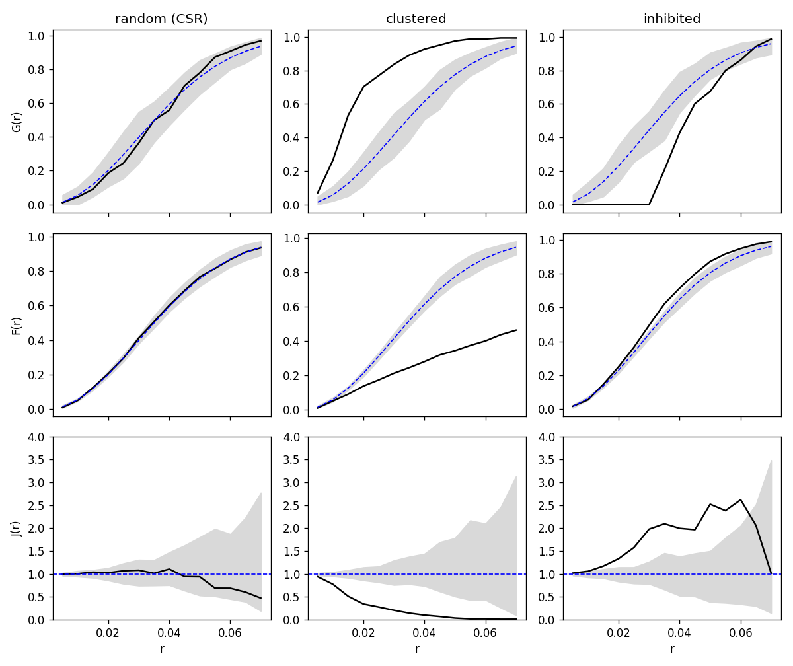

In Figure 10.3, the random pattern stays within the bands in all three rows. In the clustered pattern, $\hat{G}$ lies far above the band and $\hat{F}$ far below it, and $\hat{J}$ falls to near zero. In the inhibited pattern, $\hat{G}$ is zero until the minimum spacing of 0.03 and then catches up; $\hat{F}$ is a little above the band; and $\hat{J}$ is above 1 for most of the range, until noise takes over beyond $r = 0.06$, where the envelope for $J$ widens because $1 - \hat{F}$ is close to zero.

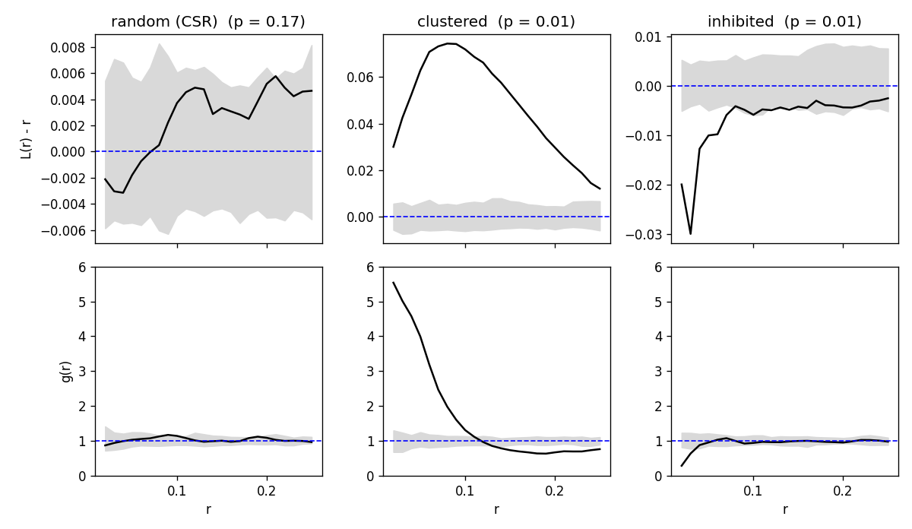

Figure 10.4 shows the same story on the second-order scale. The clustered pattern has $\hat{L}(r) - r$ well above zero over the whole range, peaking near $r = 0.08$, and $\hat{g}$ is large at short distances and decays to 1 by about $r = 0.12$: the clusters have a radius of around 0.1, in line with the spread of 0.03 (offspring lie within about three standard deviations, 0.09, of their parent). The inhibited pattern has $\hat{L}(r) - r$ below the band at short distances and $\hat{g}$ dropping below 1 at distances shorter than about 0.04, where the minimum spacing of 0.03 is felt. The random pattern wanders slightly above zero in $\hat{L}(r) - r$ but stays inside the band.

### 10.10.2 Case-Control Data: Relative Risk and Random Labelling

The second half of the lab uses the cases and controls of Section 10.7.3. The code relabels the pooled events at random 99 times, computes $\hat{K}_{12}$ (with Ripley's weights, from cases to controls) and $\hat{G}_{12}$ (with Kaplan-Meier, from cases to their nearest control) for each relabelling, and tests the maximum deviation from the relabelled mean. It then draws the five panels of Figure 10.5.

```python
def g12_km(P1, P2, r):
    """Nearest type-2 point from each type-1 point, Kaplan-Meier."""
    return km_cdf(dist(P1, P2).min(axis=1), boundary_dist(P1), r)


r_c = np.linspace(0.02, 0.25, 12)
r_gc = np.linspace(0.01, 0.15, 15)
n1 = len(cases)
labels_pool = np.vstack([cases, controls])


def cc_stats(idx_case):
    mask = np.zeros(len(labels_pool), dtype=bool)
    mask[idx_case] = True
    A, B = labels_pool[mask], labels_pool[~mask]
    return k12_ripley(A, B, r_c), g12_km(A, B, r_gc)


rng = np.random.default_rng(2092)
k_obs, g_obs = cc_stats(np.arange(n1))
perm = [cc_stats(rng.permutation(len(labels_pool))[:n1])
        for _ in range(99)]
k_sim = np.array([p[0] for p in perm])
g_sim = np.array([p[1] for p in perm])
for label, obs_, sim_ in (("K12", k_obs, k_sim), ("G12", g_obs, g_sim)):
    centre = sim_.mean(axis=0)
    t_obs = np.abs(obs_ - centre).max()
    t_sim = np.abs(sim_ - centre).max(axis=1)
    p = (1 + (t_sim >= t_obs).sum()) / 100
    print(f"{label}: max deviation from the relabelled mean = {t_obs:.4f}, "
          f"95th pct of relabelled = {np.quantile(t_sim, 0.95):.4f}, "
          f"Monte Carlo p = {p:.2f}")
k_pt = np.abs(r_c - 0.10).argmin()
print(f"K12(0.10): observed {k_obs[k_pt]:.4f}, relabelled mean "
      f"{k_sim[:, k_pt].mean():.4f}, band "
      f"[{k_sim[:, k_pt].min():.4f}, {k_sim[:, k_pt].max():.4f}], "
      f"pi r^2 = {np.pi * 0.1**2:.4f}")
```

Neither omnibus test rejects random labelling. For $K_{12}$ the maximum deviation from the relabelled mean is 0.0140, against a 95th percentile of 0.0169, with $p = 0.10$. For $G_{12}$ it is 0.0729 against 0.1467 and $p = 0.57$. At $r = 0.10$ the observed $\hat{K}_{12}$ is 0.0370 and the relabelled mean 0.0390, with a band from 0.0337 to 0.0447.

This is the correct conclusion. In this data set the plant adds about four expected cases to a baseline of 54, and an overall comparison of cases with controls cannot see so small a departure. The figure code draws the maps for both sample sizes.

```python
def show_map(ax, values, title, vmax=None):
    im = ax.imshow(values.reshape(50, 50).T, origin="lower",
                   extent=(0, 1, 0, 1), cmap="viridis", vmin=0, vmax=vmax)
    ax.set_title(title, fontsize=9)
    ax.set_aspect("equal")
    return im


fig, axes = plt.subplots(2, 3, figsize=(10, 6.4))
vmax = truth50.max()
show_map(axes[0, 0], truth50, "true intensity", vmax)
axes[0, 1].plot(crashes[:, 0], crashes[:, 1], "k.", ms=3)
axes[0, 1].plot([0, 1], [0.3, 0.7], "r-", lw=1)
axes[0, 1].set_title(f"{len(crashes)} crashes (highway in red)", fontsize=9)
axes[0, 1].set_aspect("equal")
for ax, ps in ((axes[0, 2], 0.02), (axes[1, 0], psi_lcv),
               (axes[1, 1], 0.2)):
    show_map(ax, kernel_intensity(crashes, ps, G50), f"psi = {ps:.3f}", vmax)
ax = axes[1, 2]
ax.semilogx(psi_grid, lcv - lcv.max(), "k-")
ax.set_xlabel("bandwidth psi")
ax.set_ylabel("LCV minus its maximum")
ax2 = ax.twinx()
ax2.semilogx(psi_grid, ise, "r--")
ax2.set_yscale("log")
ax2.set_ylabel("integrated squared error", color="r")
fig.tight_layout()
fig.savefig("figures/ch10/fig_10_2_kernel.png", dpi=120)

fig, axes = plt.subplots(3, 3, figsize=(10, 8.4), sharex=True)
for col, name in enumerate(patterns):
    for row, key in enumerate(("G", "F", "J")):
        ax = axes[row, col]
        lo_, hi_ = env[name][key]
        ax.fill_between(r_G, lo_, hi_, color="0.85")
        ax.plot(r_G, obs[name][key], "k-")
        if key != "J":
            ax.plot(r_G, 1 - np.exp(-len(patterns[name]) * np.pi * r_G**2),
                    "b--", lw=1)
        else:
            ax.axhline(1.0, color="b", ls="--", lw=1)
            ax.set_ylim(0, 4)
        if row == 0:
            ax.set_title(name)
        if col == 0:
            ax.set_ylabel(f"{key}(r)")
for ax in axes[-1]:
    ax.set_xlabel("r")
fig.tight_layout()
fig.savefig("figures/ch10/fig_10_3_distance.png", dpi=120)

fig, axes = plt.subplots(2, 3, figsize=(10, 5.8), sharex=True)
for col, name in enumerate(patterns):
    for row, (key, rr_, ref) in enumerate((("L", r_L, 0.0),
                                           ("g", r_g2, 1.0))):
        ax = axes[row, col]
        lo_, hi_ = env[name][key]
        ax.fill_between(rr_, lo_, hi_, color="0.85")
        ax.plot(rr_, obs[name][key], "k-")
        ax.axhline(ref, color="b", ls="--", lw=1)
        if row == 0:
            ax.set_title(f"{name}  (p = {p_global[name]:.2f})")
        if col == 0:
            ax.set_ylabel("L(r) - r" if key == "L" else "g(r)")
        if key == "g":
            ax.set_ylim(0, 6)
for ax in axes[-1]:
    ax.set_xlabel("r")
fig.tight_layout()
fig.savefig("figures/ch10/fig_10_4_second_order.png", dpi=120)

rr_map1 = (kernel_intensity(cases, psi_rr, G50)
           / kernel_intensity(controls, psi_rr, G50))
rr_map10 = (kernel_intensity(cases10, 0.05, G50)
            / kernel_intensity(controls10, 0.05, G50))
vmax = max(rr_map1.max(), rr_map10.max(), true_rr.max())
fig, axes = plt.subplots(2, 3, figsize=(10, 6.6))
ax = axes[0, 0]
ax.plot(controls[:, 0], controls[:, 1], ".", color="0.6", ms=3)
ax.plot(cases[:, 0], cases[:, 1], "r.", ms=6)
ax.plot(0.3, 0.6, "k*", ms=12)
ax.set_title(f"{len(cases)} cases (red), {len(controls)} controls; "
             "plant = star", fontsize=8)
ax.set_aspect("equal")
show_map(axes[0, 1], true_rr, "true relative risk", vmax)
show_map(axes[0, 2], rr_map1, f"estimate, shared size (psi = {psi_rr:.3f})",
         vmax)
show_map(axes[1, 0], rr_map10, "estimate, ten times the data (psi = 0.05)",
         vmax)
centre = k_sim.mean(axis=0)
ax = axes[1, 1]
ax.fill_between(r_c, k_sim.min(axis=0) - centre,
                k_sim.max(axis=0) - centre, color="0.85")
ax.plot(r_c, k_obs - centre, "k-")
ax.axhline(0, color="b", ls="--", lw=1)
ax.set_xlabel("r")
ax.set_ylabel("K12(r) minus relabelled mean", fontsize=8)
ax.set_title("random labelling envelope, K12", fontsize=9)
centre_g = g_sim.mean(axis=0)
ax = axes[1, 2]
ax.fill_between(r_gc, g_sim.min(axis=0) - centre_g,
                g_sim.max(axis=0) - centre_g, color="0.85")
ax.plot(r_gc, g_obs - centre_g, "k-")
ax.axhline(0, color="b", ls="--", lw=1)
ax.set_xlabel("r")
ax.set_ylabel("G12(r) minus relabelled mean", fontsize=8)
ax.set_title("random labelling envelope, G12", fontsize=9)
fig.tight_layout()
fig.savefig("figures/ch10/fig_10_5_relative_risk.png", dpi=120)
print("figures saved")
```


In Figure 10.5 the true relative risk is flat at 0.15 with one bump around the plant, rising to about 0.4. The estimate from the shared data (top right) misses the bump entirely: its highest value is in the upper left corner, where a handful of cases happen to sit. The estimate from ten times the data (bottom left) shows a local maximum near $(0.25, 0.55)$, close to the plant, among other lumps of comparable size that are noise. Both envelopes (bottom middle and right) contain the observed curve at every distance.

The chapter ends here with an honest limit. The exploratory tools of this chapter are good at showing broad structure in a pattern, as the three patterns showed, and they are poor at finding a small local excess, as the case-control data showed. The right tool for a known suspect location is a model with the source built in, which the next chapter develops: a Poisson regression for the intensity, an offset for the population, a logistic regression for case-control labels, and a scan statistic for local excess.

---

<a id="ch10-exercises"></a>

## Exercises

**Analytical**

1. **Poisson limit.** For a Binomial$(N, p)$ variable with $Np = \mu$ held fixed, show that the probability function converges to the Poisson($\mu$) probability function as $N \to \infty$, directly from $\binom{N}{k}p^k(1-p)^{N-k}$ without generating functions. Then find the leading correction, of order $1/N$, to $\Pr(N(B) = 0)$ in Section 10.2.1.

2. **Conditional uniformity with a varying intensity.** For an inhomogeneous Poisson process with intensity $\lambda(\mathbf{s})$, repeat the calculation of Section 10.2.2 and show that, given $N(\mathcal{D}) = n$, the events are independent with density $\lambda(\mathbf{s})/\int_{\mathcal{D}}\lambda$. What does this say about the number of events needed to estimate the shape of $\lambda$?

3. **Pearson's statistic.** Show that for multinomial counts with $n_q$ equal cell probabilities, $\operatorname{E}[X^2] = n_q - 1$ exactly, as stated in Section 10.2.3. Then show that the index of dispersion $s_n^2/\bar{n}$ has expectation 1.

4. **Thinning.** Using the Bernoulli-grid argument of Section 10.3.2, show that if candidates come from a homogeneous process with intensity $\lambda_{\max}$ and are kept independently with probability $p(\mathbf{s})$, the number of retained events in a region $B$ is Poisson with mean $\lambda_{\max}\int_B p(\mathbf{s})\,d\mathbf{s}$. Extend the argument to show that the retained and the deleted events form independent Poisson processes.

5. **Kernel mean and variance.** Starting from the Bernoulli-grid description, derive the mean and variance formulas for $\hat{\lambda}(\mathbf{s})$ in Section 10.4.1, and verify that $\int\mathcal{K}_\psi(\mathbf{u})^2\,d\mathbf{u} = 1/(4\pi\psi^2)$ for the bivariate Gaussian kernel. Show that the mean squared error $(\psi^2\nabla^2\lambda/2)^2 + \lambda/(4\pi\psi^2)$ is minimized at $\psi = \left(\lambda/(2\pi(\nabla^2\lambda)^2)\right)^{1/6}$. If the intensity is multiplied by a constant $c$, both $\lambda$ and $\nabla^2\lambda$ are multiplied by $c$; show that the best bandwidth then scales like $c^{-1/6}$, and explain in words why more data, and a rougher surface, both call for a smaller bandwidth.

6. **Edge correction when the intensity varies.** For an intensity $\lambda(x, y) = c\,e^{\beta x}$ on the unit square, find the expected value of the edge-corrected estimator at a point on the line $x = 0$, in terms of $\psi$, and compare it with $\lambda(0, y)$. For which sign of $\beta$ is the estimate too high?

7. **Nearest-neighbor distances.** Verify that $\operatorname{E}[d^{\text{nn}}] = 1/(2\sqrt{\lambda})$ under CSR, and find the median. The Clark-Evans ratio is $\bar{d}^{\text{nn}}/(1/(2\sqrt{\hat{\lambda}}))$. Compute its value for the four-point example of Section 10.5.1 and interpret it.

8. **The J-function.** Show that $J(r) = 1$ for every $r$ under CSR. Then use the definition as a ratio of survival functions to explain why $J(r) < 1$ whenever $G(r) > F(r)$, and why a pattern with $G(r) < F(r)$ at every $r$ has $J(r) > 1$.

9. **The $K$-function of a clustered pattern.** For a pattern with pair correlation $g(r) = 1 + c\,e^{-r^2/s^2}$, use $K(r) = \int_0^r2\pi t\,g(t)\,dt$ to find $K(r)$ and $L(r)$, and show that $K(r) - \pi r^2$ tends to $c\pi s^2$ as $r \to \infty$.

10. **Ripley's weight.** For an event at distance $a$ from a single straight edge, show that the fraction of the circle of radius $h > a$ inside the half-plane is $1 - \arccos(a/h)/\pi$, and verify that the weight $1/f$ is between 1 and 2. Then find the largest weight possible for an event at a corner of the unit square with $h \le 1$.

11. **Unbiasedness of the edge-corrected estimator.** Show that under CSR with intensity $\lambda$, $\operatorname{E}\left[\sum_{j \ne i}\omega_{ij}\mathbb{1}(h_{ij} \le r)\,\middle|\,\mathbf{s}_i\right] = \lambda\pi r^2$ for every event position $\mathbf{s}_i$, using the Poisson property that counts in disjoint regions are independent.

12. **Cross-type summaries.** Show that under random labelling, $K_{12}(r) = K_{11}(r) = K_{22}(r)$, each equal to the $K$-function of the pooled pattern. (Hint: under random labelling every ordered pair of events is equally likely to be of types (1, 2), (1, 1), or (2, 2) given its locations.)

13. **Kaplan-Meier by hand.** Five events have nearest-neighbor distances $d = (0.05, 0.08, 0.12, 0.12, 0.2)$ and boundary distances $b = (0.2, 0.06, 0.15, 0.1, 0.3)$. Find the censored times $t_i$, the indicators $\delta_i$, and $\hat{G}_{\text{KM}}$ at $r = 0.05, 0.1, 0.15, 0.2$. Compare with the naive $\hat{G}$.

14. **Envelope levels.** Show that if the data are exchangeable with $m$ simulated patterns at a fixed $r$, the probability of falling outside the envelope is $2/(m + 1)$. For $k$ independent distances and $m = 39$, find the probability that the data fall outside the envelope at one or more, and compare with the 32% found in Section 10.9.2 for 15 correlated distances.

**Computational and simulation**

15. **Quadrat size.** For the three patterns of Section 10.3.4, compute the quadrat test for $m \times m$ grids with $m = 2, 3, \dots, 10$. At which grid size does the test first detect the inhibited pattern? How does this relate to the minimum spacing 0.03?

16. **Bandwidth rules.** Simulate 100 crash patterns as in Section 10.3.2. For each, choose a bandwidth by the normal-reference rule, by likelihood cross-validation, and by minimizing the integrated squared error, and report the average integrated squared error that each rule achieves. How much does the oracle choice gain?

17. **Edge effects and sample size.** Repeat the comparison of Section 10.8.4 for $n = 30$ and $n = 400$. How do the biases of the naive, guard-area, and Ripley estimators change, and at what $r$ does the guard-area estimator become useless?

18. **The pair correlation bandwidth.** Estimate $\hat{g}$ for the Thomas pattern with $b = 0.005$, $0.01$, and $0.02$, averaging over 200 patterns. Plot the average and the standard deviation against $r$. Describe the bias and variance trade-off.

19. **Clark-Evans against L.** Implement the Clark-Evans test of Exercise 7, with an edge correction of your choice, and estimate its power against the clustered and inhibited patterns of Section 10.3.4 at 200 events, by simulation. Compare with the maximum-deviation test for $L$.

20. **Local excess.** Simulate the case-control data 100 times. For each data set compute the kernel relative risk at the plant with $\psi = 0.05$, $0.10$, and $0.20$, and the random labelling test for $K_{11}$. Report the share of data sets in which each method detects the plant, and the average number of cases within 0.15 of the plant. Repeat for ten times the data.

21. **A shot chart.** Simulate shot attempts as an inhomogeneous Poisson process, with intensity highest near the basket and along the three-point line. Label each shot as made with probability $p(\mathbf{s})$ that falls with distance from the basket. Estimate the made and missed intensities by kernel smoothing with a shared bandwidth and plot the ratio $\hat{\lambda}_{\text{made}}/\hat{\lambda}_{\text{missed}}$. How does it relate to $p/(1 - p)$?

---

<a id="ch10-what-comes-next"></a>

## What Comes Next

This chapter described patterns. It found structure in them with distances, with the $K$ and $g$ functions, and with a kernel map of intensity, and it judged that structure against simulation. It also met its limits: a small local excess is invisible to omnibus tests, the choice of bandwidth is a problem in itself, and the first-order and second-order explanations of a pattern cannot be told apart without a model.

Chapter 11 supplies the model. It writes the log-likelihood of an inhomogeneous Poisson process, discretizes it with the Berman-Turner device so that it becomes a weighted Poisson regression, fits intensities that depend on covariates such as distance to the highway, and shows that comparing cases with controls is a logistic regression. It also builds the scan statistic for local excess, the inhomogeneous $K$-function that separates trend from interaction, and honest standard errors for clustered data. Chapter 12 then derives the cluster and inhibition models whose simulated patterns appeared here.


---

<a id="ch11"></a>

# Chapter 11: Point Processes as Generalized Linear Models

Chapter 10 described point patterns with summaries: kernel maps of the intensity, distance functions, and Ripley's $K$. Those tools say what a pattern looks like. This chapter asks the questions of a regression course. Which covariates explain where the events occur? By how much? How uncertain is that answer? Is there an excess of events near a suspected source, and where is it?

The answer is a pleasant surprise. A point process with a log-linear intensity is a generalized linear model in disguise. After a short derivation, fitting it means running the iteratively reweighted least squares (IRLS) algorithm of Chapter 9 on a data set built from the events and a grid of extra points. Case-control data turn into logistic regression. A known baseline becomes an offset. Almost nothing needs to be learned from scratch; the work is in seeing why these familiar tools apply.

The same machinery also shows where the familiar tools stop working. Chapters 1 and 9 each ended with a warning: when observations are dependent, the standard errors of a model that ignores the dependence are too small. Point patterns repeat the warning in a new form. If events cluster, the standard errors from the Poisson GLM are too small by a factor of two or more. We end the chapter by measuring the damage and repairing it.

Three running stories carry the chapter. A traffic safety office has the locations of crashes and wants to know how road layout and population explain them. A health department has the addresses of disease cases and of a sample of healthy controls, and a suspected industrial plant. An outbreak surveillance team has a stream of event locations and wants to know whether some small area has too many. As in earlier chapters, every data set is simulated, so each method can be checked against the truth.

> **Chapter at a Glance**
>
> - **Intensity as a Regression Function (§11.1):** The log-linear model $\lambda(\mathbf{s}) = \exp(\mathbf{x}(\mathbf{s})'\boldsymbol{\beta})$, its link to the count regressions of Chapter 9, and the crash data.
> - **The Exact Likelihood (§11.2):** The point process log-likelihood derived as the limit of Bernoulli trials on a finer and finer grid, with its score equations and information.
> - **The Berman-Turner Device (§11.3):** Replacing the integral by quadrature turns the likelihood into a weighted Poisson regression. A three-event example is worked by hand, and the crash pattern is fitted.
> - **Offsets (§11.4):** Modeling the excess over a known baseline, with the plant story.
> - **Case-Control Data (§11.5):** Why the log-odds of being a case is the log relative risk, so that logistic regression fits the problem and the unknown baseline drops out.
> - **Scan Statistics (§11.6):** A likelihood ratio for every circular window, and why the p-value of the best window must come from simulation.
> - **Trend Versus Interaction (§11.7):** Why Ripley's $K$ reports clustering for a pattern whose only structure is a trend, and the inhomogeneous $K$ that fixes it.
> - **Inference Under Clustering (§11.8):** Why Poisson GLM standard errors fail for clustered events, and three repairs: a pair-correlation sandwich, a block sandwich, and a parametric bootstrap.
> - **Walkthrough and Lab (§11.9):** Repeated-sampling experiments for each of the claims above.

---

<a id="s11-1"></a>

## 11.1 Intensity as a Regression Function

### 11.1.1 The Model and Its Parts

A point pattern is a random collection of locations in a study region $\mathcal{D}$. In this chapter $\mathcal{D}$ is the unit square, so $\operatorname{area}(\mathcal{D}) = 1$. For a subset $B$ of the region, $N(B)$ is the number of events that fall in $B$, and the **intensity** $\lambda(\mathbf{s})$ is the expected number of events per unit area near the location $\mathbf{s}$. Chapter 10 introduced these as the language of point patterns, and its basic model is the one we use here. In a **Poisson process** with intensity $\lambda(\mathbf{s})$:

- the count $N(B)$ in any region $B$ has a Poisson distribution with mean $\int_B\lambda(\mathbf{s})\,d\mathbf{s}$, and
- counts in regions that do not overlap are independent.

The second property is the point-pattern version of independent errors. It says that where one event falls tells us nothing about where another falls, beyond what the intensity says. It is the property that will fail in Section 11.8.

To explain the intensity with covariates, write it as a log-linear function:

$$
\lambda(\mathbf{s}) = \exp\!\left(\mathbf{x}(\mathbf{s})'\boldsymbol{\beta}\right)
$$

Here $\mathbf{x}(\mathbf{s})$ is a vector of covariates evaluated at location $\mathbf{s}$, such as an intercept, the distance from $\mathbf{s}$ to a highway, and the population density at $\mathbf{s}$, and $\boldsymbol{\beta}$ is a vector of coefficients. The exponential keeps the intensity positive, and it makes effects multiplicative: raising a covariate by one unit multiplies the rate of events by $\exp(\beta_j)$. This is the log link of Poisson regression, applied to a surface instead of a table of counts.

### 11.1.2 The Crash Data

A city traffic safety office has the locations of crashes in a square district and two covariates measured everywhere on the map: the distance to the main highway and the local population density. The highway is the line $y = 0.3 + 0.4x$, and the population is concentrated downtown, around the point $(0.7, 0.7)$. We simulate crashes with intensity

$$
\lambda(\mathbf{s}) = \exp\!\left(\beta_0 + \beta_1\,\text{road distance}(\mathbf{s}) + \beta_2\,\text{population density}(\mathbf{s})\right)
$$

with $\beta_1 = -3$ and $\beta_2 = 1.5$, and with $\beta_0$ set so that the expected number of crashes is 400. The three functions below define the setting that Chapters 10 to 12 share, so that results connect across the part. The crash pattern itself is a new simulation from a richer model than the crash example of Chapter 10, which used the intensity $600\exp\{-6\operatorname{dist}(\mathbf{s})\}$ (road distance only, about 199 expected crashes). Here the intensity also depends on population density and the expected count is 400, and Chapter 10's pattern is not reused.

```python
import numpy as np
from scipy import optimize, special, stats


def road_distance(P):
    """Distance from points P (n x 2) to the 'highway' y = 0.3 + 0.4 x."""
    return np.abs(0.4 * P[:, 0] - P[:, 1] + 0.3) / np.sqrt(0.4**2 + 1.0)


def pop_density(P):
    """Relative population density: a downtown bump on a flat base."""
    d2 = (P[:, 0] - 0.7)**2 + (P[:, 1] - 0.7)**2
    return 0.3 + 0.7 * np.exp(-d2 / (2 * 0.2**2))


def excess_risk(P):
    """Relative risk around an industrial plant at (0.3, 0.6)."""
    d2 = (P[:, 0] - 0.3)**2 + (P[:, 1] - 0.6)**2
    return np.exp(np.exp(-d2 / (2 * 0.1**2)))
```

A coefficient of $-3$ for road distance means that moving 0.1 units farther from the highway multiplies the crash rate by $e^{-0.3} = 0.74$. A coefficient of $1.5$ for population density means that an increase of 0.1 multiplies the rate by $e^{0.15} = 1.16$.

To simulate an inhomogeneous Poisson process we use **thinning**, which Chapter 10 introduced as the Lewis-Shedler algorithm. Propose events from a homogeneous Poisson process whose rate $\lambda_{\max}$ is at least the largest intensity, then keep an event at $\mathbf{s}$ with probability $\lambda(\mathbf{s})/\lambda_{\max}$. Independent thinning of a Poisson process gives a Poisson process whose intensity is the original rate times the retention probability, which is $\lambda(\mathbf{s})$.

```python
def grid_points(m):
    """Centers of an m-by-m grid of cells in the unit square."""
    g = (np.arange(m) + 0.5) / m
    xx, yy = np.meshgrid(g, g)
    return np.column_stack([xx.ravel(), yy.ravel()])


def design(P):
    """Covariates [1, road distance, population density]."""
    return np.column_stack([np.ones(len(P)), road_distance(P),
                            pop_density(P)])


def simulate_poisson(rate_fn, rate_max, rng):
    """Inhomogeneous Poisson process on the unit square, by thinning."""
    P = rng.uniform(size=(rng.poisson(rate_max), 2))
    return P[rng.uniform(size=len(P)) < rate_fn(P) / rate_max]


G = grid_points(200)
X_G = design(G)
b1, b2 = -3.0, 1.5
b0 = np.log(400) - np.log(np.mean(np.exp(X_G[:, 1:] @ [b1, b2])))
beta_true = np.array([b0, b1, b2])
rate = lambda P: np.exp(design(P) @ beta_true)
rate_max = 1.05 * rate(G).max()
print("true coefficients:", np.round(beta_true, 3))
print("expected number of crashes:", round(rate(G).mean(), 1))
rng = np.random.default_rng(2090)
P_crash = simulate_poisson(rate, rate_max, rng)
print("simulated crashes:", len(P_crash))
```

The true coefficients are $(5.846, -3, 1.5)$ and the expected count is 400. The simulation produced 403 crashes.

### 11.1.3 The Link to Chapter 9

Chapter 9 modeled a count $Y_i$ in region $i$ as Poisson with mean $E_i\exp(\mathbf{x}_i'\boldsymbol{\beta} + u_i)$, where the expected count $E_i$ entered as an offset. A region is only one way to cut up the map. Under the Poisson process, the number of events in a small region of area $a$ around $\mathbf{s}$ is Poisson with mean close to $a\lambda(\mathbf{s})$, so

$$
\log\operatorname{E}[N(B)] \approx \log a + \mathbf{x}(\mathbf{s})'\boldsymbol{\beta}
$$

That is exactly a Poisson regression with offset $\log a$. A point process is what this model becomes when the regions shrink until each holds at most one event. The next section makes that limit precise, and the section after it shows that the limit does not require any new fitting algorithm.

---

<a id="s11-2"></a>

## 11.2 The Exact Likelihood From a Refining Grid

### 11.2.1 Bernoulli Trials on a Pixel Grid

To fit $\boldsymbol{\beta}$ by maximum likelihood we need the probability of the observed pattern. Rather than state it, we derive it, using only independent coin flips.

Cut the region into $M$ square pixels of area $c_M = \operatorname{area}(\mathcal{D})/M$, with centers $\mathbf{s}_1, \dots, \mathbf{s}_M$. Under a Poisson process with intensity $\lambda$, the number of events in pixel $j$ is Poisson with mean $\int_{\text{pixel } j}\lambda \approx \lambda(\mathbf{s}_j)c_M$. For a Poisson variable with a small mean $\mu$, the probability of one event is $\mu e^{-\mu} = \mu + O(\mu^2)$, the probability of two or more is $O(\mu^2)$, and the probability of none is $1 - \mu + O(\mu^2)$. So when the pixels are small each holds zero or one event, and we can record it with an indicator $\mathbb{1}_j$ that equals 1 when pixel $j$ holds an event. The indicators are independent across pixels, because counts in disjoint regions are independent. The pixel contains an event with probability

$$
p_j = \lambda(\mathbf{s}_j)\,c_M
$$

up to terms of order $c_M^2$. The log-likelihood of the pixel indicators is the log-likelihood of independent Bernoulli trials:

$$
\ell_M(\boldsymbol{\beta}) = \sum_{j=1}^M\left[\mathbb{1}_j\log p_j + (1 - \mathbb{1}_j)\log(1 - p_j)\right]
$$

Now let the pixels shrink. Split the sum into the pixels that hold events and the pixels that do not.

**Pixels with events.** There are $n$ of them, one per event. If event $i$ lies in the pixel centered at $\mathbf{s}_{(i)}$, its term is $\log p = \log\lambda(\mathbf{s}_{(i)}) + \log c_M$. Summing over events,

$$
\sum_j\mathbb{1}_j\log p_j = \sum_{i=1}^n\log\lambda(\mathbf{s}_{(i)}) + n\log c_M
$$

As $c_M \to 0$ the pixel center $\mathbf{s}_{(i)}$ approaches the event $\mathbf{s}_i$, so the first sum tends to $\sum_i\log\lambda(\mathbf{s}_i)$.

**Pixels without events.** The second part of the log-likelihood is $\sum_j(1 - \mathbb{1}_j)\log(1 - p_j)$. Compare it with the sum over all pixels, $\sum_j\log(1 - p_j)$. The two differ by the $n$ terms for pixels that hold events, each of size at most $2\max_jp_j$, which tends to zero. For $p \le \tfrac{1}{2}$ we have $-p - p^2 \le \log(1 - p) \le -p$, so

$$
-\sum_j p_j - \sum_j p_j^2 \;\le\; \sum_j\log(1 - p_j) \;\le\; -\sum_j p_j
$$

The sum $\sum_jp_j = \sum_j\lambda(\mathbf{s}_j)c_M$ is a Riemann sum and tends to $\int_{\mathcal{D}}\lambda(\mathbf{s})\,d\mathbf{s}$. The sum $\sum_jp_j^2 \le (\max_jp_j)\sum_jp_j$ tends to zero because $\max_jp_j = O(c_M)$. So the second part of $\ell_M$ tends to $-\int\lambda$.

**Putting the parts together.** The term $n\log c_M$ does not involve $\boldsymbol{\beta}$, so it does not affect the maximizer. Subtracting it, we get

$$
\ell_M(\boldsymbol{\beta}) - n\log c_M \;\longrightarrow\; \ell(\boldsymbol{\beta}) = \sum_{i=1}^n\log\lambda(\mathbf{s}_i) - \int_{\mathcal{D}}\lambda(\mathbf{s})\,d\mathbf{s}
$$

This is the **log-likelihood of a point process**: the log-intensity summed over the events, minus the total expected number of events. Its two terms have a plain reading. The first rewards intensities that are high where events occurred. The second penalizes intensities that are high anywhere, because that predicts more events than we saw.

A small example makes the limit visible. Three events lie at $(0.1, 0.2)$, $(0.4, 0.3)$, and $(0.8, 0.9)$, and the intensity is $\lambda(\mathbf{s}) = \exp(1 + 0.5\,s_1)$, where $s_1$ is the east coordinate. The integral is $e(e^{0.5} - 1)/0.5 = 3.527$ and the three log-intensities sum to $3 + 0.5(0.1 + 0.4 + 0.8) = 3.65$, so the point process log-likelihood is $3.65 - 3.527 = 0.123$. The code builds the Bernoulli log-likelihood on $4 \times 4$, $8 \times 8$, up to $128 \times 128$ pixels and subtracts $n\log c_M$.

```python
pts3 = np.array([[0.1, 0.2], [0.4, 0.3], [0.8, 0.9]])
beta_ex = np.array([1.0, 0.5])
lam_ex = lambda P: np.exp(beta_ex[0] + beta_ex[1] * P[:, 0])
exact = np.sum(np.log(lam_ex(pts3))) - lam_ex(grid_points(400)).mean()
print("point process log-likelihood:", round(exact, 4))
for m in (4, 8, 16, 32, 64, 128):
    cell = (np.floor(pts3[:, 1] * m) * m + np.floor(pts3[:, 0] * m))
    z = np.zeros(m * m)
    z[cell.astype(int)] = 1
    c_m = 1.0 / m**2
    p = lam_ex(grid_points(m)) * c_m
    bern = np.sum(z * np.log(p) + (1 - z) * np.log(1 - p))
    print(f"M={m * m:6d}  Bernoulli log-lik={bern:9.4f}  "
          f"minus n log c_M={bern - 3 * np.log(c_m):8.4f}")
```

| Pixels $M$ | 16 | 64 | 256 | 1,024 | 4,096 | 16,384 |
| :--- | :--- | :--- | :--- | :--- | :--- | :--- |
| $\ell_M - n\log c_M$ | 0.4280 | 0.1919 | 0.1290 | 0.1254 | 0.1265 | 0.1238 |

The values approach the exact value of 0.1232. They do not decrease steadily because the event sits at a different offset from its pixel center at each resolution, so $\log\lambda(\mathbf{s}_{(i)})$ differs from $\log\lambda(\mathbf{s}_i)$ by a little more or a little less each time.

### 11.2.2 The Log-Likelihood for a Log-Linear Intensity

Put $\lambda(\mathbf{s}) = \exp(\mathbf{x}(\mathbf{s})'\boldsymbol{\beta})$ into $\ell(\boldsymbol{\beta})$. The log-intensity is linear in $\boldsymbol{\beta}$, so

$$
\ell(\boldsymbol{\beta}) = \sum_{i=1}^n\mathbf{x}(\mathbf{s}_i)'\boldsymbol{\beta} - \int_{\mathcal{D}}\exp\!\left(\mathbf{x}(\mathbf{s})'\boldsymbol{\beta}\right)d\mathbf{s}
$$

Differentiate with respect to $\boldsymbol{\beta}$, moving the derivative inside the integral. The score vector is

$$
\mathbf{U}(\boldsymbol{\beta}) = \frac{\partial\ell}{\partial\boldsymbol{\beta}} = \sum_{i=1}^n\mathbf{x}(\mathbf{s}_i) - \int_{\mathcal{D}}\mathbf{x}(\mathbf{s})\,\lambda(\mathbf{s})\,d\mathbf{s}
$$

and the maximum likelihood estimate solves $\mathbf{U}(\hat{\boldsymbol{\beta}}) = \mathbf{0}$. In words, **the total of the covariate vector over the observed events equals the total expected under the fitted model.** This is the point-pattern version of the score equation $\mathbf{X}'(\mathbf{y} - \boldsymbol{\mu}) = \mathbf{0}$ for a GLM with a canonical link (Section 9.1.3): the residual vanishes when summed against each covariate. With an intercept in the model, the first component says the fitted intensity integrates to the observed number of events, $\int\hat{\lambda} = n$.

Differentiate once more:

$$
\frac{\partial^2\ell}{\partial\boldsymbol{\beta}\,\partial\boldsymbol{\beta}'} = -\int_{\mathcal{D}}\mathbf{x}(\mathbf{s})\mathbf{x}(\mathbf{s})'\,\lambda(\mathbf{s})\,d\mathbf{s} = -\mathcal{I}(\boldsymbol{\beta})
$$

This matrix is not random: it does not involve the events. For any vector $\mathbf{a}$, $\mathbf{a}'\mathcal{I}(\boldsymbol{\beta})\mathbf{a} = \int(\mathbf{a}'\mathbf{x}(\mathbf{s}))^2\lambda(\mathbf{s})\,d\mathbf{s} \ge 0$, so the log-likelihood is concave and, when the covariates are not collinear, has a unique maximum, which IRLS (Newton's method here) finds in a handful of steps. The matrix $\mathcal{I}(\boldsymbol{\beta})$ is the Fisher information, as in Chapters 5 and 9, and for a Poisson process $\operatorname{Var}(\hat{\boldsymbol{\beta}}) \approx \mathcal{I}(\boldsymbol{\beta})^{-1}$.

### 11.2.3 By Hand: The Homogeneous Case

Take only an intercept, $\mathbf{x} = 1$, so $\lambda$ is a constant. The score equation reads $n = \lambda\operatorname{area}(\mathcal{D})$, so $\hat{\lambda} = n/\operatorname{area}(\mathcal{D})$: the estimated intensity is the number of events per unit area. The information for $\beta_0 = \log\lambda$ is $\lambda\operatorname{area}(\mathcal{D})$, the expected count, so $\operatorname{Var}(\hat{\beta}_0) \approx 1/\operatorname{E}[n]$. This agrees with a delta-method calculation for the Poisson count: $\operatorname{Var}(\log n) \approx \operatorname{Var}(n)/(\operatorname{E}n)^2 = 1/\operatorname{E}n$. The likelihood framework reproduces the answer from a first course, as a check should.

---

<a id="s11-3"></a>

## 11.3 The Berman-Turner Quadrature Device

### 11.3.1 The Integral Is the Obstacle

The likelihood of Section 11.2 has one difficulty: the integral $\int\exp(\mathbf{x}(\mathbf{s})'\boldsymbol{\beta})\,d\mathbf{s}$. For covariates like road distance and a population surface it has no closed form, and it changes every time $\boldsymbol{\beta}$ changes. The standard remedy is **quadrature**: approximate the integral by a weighted sum over a set of points,

$$
\int_{\mathcal{D}}f(\mathbf{s})\,d\mathbf{s} \approx \sum_k a_kf(\mathbf{s}_k^{*})
$$

where the **quadrature points** $\mathbf{s}_k^{*}$ are locations and the **weights** $a_k \ge 0$ are areas that sum to $\operatorname{area}(\mathcal{D})$. Each weight is the area of the part of the region that its point stands for.

Berman and Turner's idea was to choose the quadrature points cleverly: use the $n$ data points together with $n_d$ extra **dummy points**, usually on a regular grid. Putting the data points in the set pays off in the first term of the log-likelihood. Every data point is a quadrature point, so the sum of log-intensities over events is a sum over quadrature points as well. Both terms of $\ell$ then live on the same set of locations, and that is what turns the likelihood into a regression.

### 11.3.2 Data-Point Indicators and Pseudo-Responses

Number the $n + n_d$ quadrature points $k = 1, \dots, n + n_d$, and let $\mathbb{1}_k = 1$ if point $k$ is a data point and $\mathbb{1}_k = 0$ if it is a dummy point. The first term of the log-likelihood is exactly

$$
\sum_{i=1}^n\log\lambda(\mathbf{s}_i) = \sum_{k}\mathbb{1}_k\log\lambda(\mathbf{s}_k^{*})
$$

and the second is approximately $\sum_ka_k\lambda(\mathbf{s}_k^{*})$. Define the **pseudo-response** $y_k = \mathbb{1}_k/a_k$, so that $a_ky_k = \mathbb{1}_k$. Then

$$
\ell(\boldsymbol{\beta}) \approx \sum_{k=1}^{n+n_d}a_k\left(y_k\log\lambda(\mathbf{s}_k^{*}) - \lambda(\mathbf{s}_k^{*})\right)
$$

The pseudo-response is large (the reciprocal of a small area) at data points and zero at dummy points. It is not a count and not an integer. It is a device that makes the algebra come out right.

**Choosing the weights.** Two rules are common. For **counting weights**, lay a grid over the region; the area of each grid cell is shared equally among the quadrature points, data or dummy, that fall in the cell. If a cell holds only its own dummy point, that point gets the whole cell. For **tile weights**, give each quadrature point the area of the region closer to it than to any other point: its Dirichlet (Voronoi) tile. Both rules give weights that are positive and sum to the area. Section 11.3.5 compares them.

### 11.3.3 A Weighted Poisson Regression, and IRLS

For a response $y$ with a Poisson mean $\mu$ and a prior weight $a$, the expression $a(y\log\mu - \mu)$ is the Poisson log-likelihood contribution, except for terms that do not involve $\mu$, of $a$ identical observations: each contributes $y\log\mu - \mu$ minus $\log y!$, and the weight multiplies it. So the approximate log-likelihood above is the log-likelihood of a **weighted Poisson regression** with responses $y_k$, means $\mu_k = \lambda(\mathbf{s}_k^{*}) = \exp(\mathbf{x}_k'\boldsymbol{\beta})$, and prior weights $a_k$. That is a problem for any GLM routine with a weights argument. The responses are not integers, but the algorithm only needs the objective and its derivatives.

Recall from Section 9.1.5 that IRLS updates $\boldsymbol{\beta}$ by solving a weighted least squares problem with working weights and a working response. With prior weights, for the Poisson with log link, the working weights are $v_k = a_k\mu_k$ and the working response is $z_k = \eta_k + (y_k - \mu_k)/\mu_k$, where $\eta_k = \mathbf{x}_k'\boldsymbol{\beta}$:

$$
\mathbf{X}'\mathbf{V}\mathbf{X}\,\boldsymbol{\beta}^{\text{new}} = \mathbf{X}'\mathbf{V}\mathbf{z}, \qquad \mathbf{V} = \operatorname{diag}(a_k\mu_k)
$$

where $\mathbf{X}$ now has one row for each quadrature point.

Two checks confirm that this is the same problem as Section 11.2. The score of the weighted regression is $\mathbf{X}'\operatorname{diag}(a)(\mathbf{y} - \boldsymbol{\mu})$, whose $p$th component is $\sum_ka_kx_{kp}(y_k - \mu_k) = \sum_{i}x_p(\mathbf{s}_i) - \sum_ka_kx_{kp}\mu_k$, using $a_ky_k = \mathbb{1}_k$. This is the exact score of Section 11.2.2 with the integral replaced by quadrature. Likewise, $\mathbf{X}'\mathbf{V}\mathbf{X} = \sum_ka_k\mu_k\mathbf{x}_k\mathbf{x}_k'$ is the quadrature approximation of $\mathcal{I}(\boldsymbol{\beta}) = \int\mathbf{x}\mathbf{x}'\lambda$. So the standard errors from the GLM, the square roots of the diagonal of $(\mathbf{X}'\mathbf{V}\mathbf{X})^{-1}$, estimate the standard errors of the point process estimate, **provided the process is Poisson**. Section 11.8 shows what happens when it is not.

The function below implements IRLS with prior weights and an optional offset (Section 11.4). The working response excludes the offset, as it did in Chapter 9.

```python
def irls_poisson(X, y, a, offset=None, tol=1e-10, maxit=50):
    """Weighted Poisson regression by IRLS: mean mu_k = exp(offset_k +
    x_k'b), prior weights a_k, response y_k. Returns the estimate, its
    covariance, the log-likelihood sum a_k (y_k log mu_k - mu_k), and the
    number of iterations."""
    off = np.zeros(len(y)) if offset is None else offset
    b = np.zeros(X.shape[1])
    b[0] = np.log(np.sum(a * y) / np.sum(a * np.exp(off)))
    for it in range(1, maxit + 1):
        eta = off + X @ b
        mu = np.exp(eta)
        v = a * mu
        z = (eta - off) + (y - mu) / mu
        info = X.T @ (v[:, None] * X)
        b_new = np.linalg.solve(info, X.T @ (v * z))
        done = np.max(np.abs(b_new - b)) < tol
        b = b_new
        if done:
            break
    mu = np.exp(off + X @ b)
    ll = np.sum(a * (y * (off + X @ b) - mu))
    cov = np.linalg.inv(X.T @ ((a * mu)[:, None] * X))
    return b, cov, ll, it


def quadrature_counting(P_data, m):
    """Data points plus an m-by-m dummy grid. Each grid cell's area is
    shared equally by the points (data and dummy) that fall in it."""
    pts = np.vstack([P_data, grid_points(m)])
    cell = np.floor(pts[:, 1] * m) * m + np.floor(pts[:, 0] * m)
    cell = cell.astype(int)
    count = np.bincount(cell, minlength=m * m)
    a = (1.0 / m**2) / count[cell]
    ind = np.r_[np.ones(len(P_data)), np.zeros(m * m)]
    return pts, a, ind
```

### 11.3.4 By Hand: Three Data Points and Four Dummy Points

Use the three events of Section 11.2.1, at $(0.1, 0.2)$, $(0.4, 0.3)$, and $(0.8, 0.9)$, and a single covariate, the east coordinate, so $\mathbf{X}$ has an intercept column and an east column. Lay a $2 \times 2$ grid over the unit square, with cells of area $0.25$, and put one dummy point at the center of each cell: $(0.25, 0.25)$, $(0.75, 0.25)$, $(0.25, 0.75)$, and $(0.75, 0.75)$. Use counting weights.

The first two events and the dummy point $(0.25, 0.25)$ all fall in the south-west cell. Three points share an area of 0.25, so each gets $0.25/3 = 0.0833$. The third event and the dummy point $(0.75, 0.75)$ share the north-east cell and get $0.125$ each. The dummy points $(0.75, 0.25)$ and $(0.25, 0.75)$ are alone in their cells and get $0.25$ each. The weights sum to 1. The pseudo-response is $y = 1/a$ for the events, which gives $12$, $12$, and $8$, and $0$ for the dummy points.

| $k$ | Point | $a_k$ | $\mathbb{1}_k$ | $y_k$ |
| :--- | :--- | :--- | :--- | :--- |
| 1 | event $(0.1, 0.2)$ | 0.0833 | 1 | 12 |
| 2 | event $(0.4, 0.3)$ | 0.0833 | 1 | 12 |
| 3 | event $(0.8, 0.9)$ | 0.125 | 1 | 8 |
| 4 | dummy $(0.25, 0.25)$ | 0.0833 | 0 | 0 |
| 5 | dummy $(0.75, 0.25)$ | 0.25 | 0 | 0 |
| 6 | dummy $(0.25, 0.75)$ | 0.25 | 0 | 0 |
| 7 | dummy $(0.75, 0.75)$ | 0.125 | 0 | 0 |

Start from the homogeneous fit $\boldsymbol{\beta} = (\log 3, 0)'$: three events per unit area. Then $\mu_k = 3$ for every point, $\eta_k = \log 3 = 1.0986$, and the working weights are $v_k = 3a_k = (0.25, 0.25, 0.375, 0.25, 0.75, 0.75, 0.375)$. The working responses are $z_k = 1.0986 + (y_k - 3)/3$. For the events with $y = 12$ this is $1.0986 + 3 = 4.0986$; for the event with $y = 8$ it is $1.0986 + 1.6667 = 2.7653$; for the dummy points it is $1.0986 - 1 = 0.0986$. So

$$
\mathbf{z} = (4.0986,\ 4.0986,\ 2.7653,\ 0.0986,\ 0.0986,\ 0.0986,\ 0.0986)'
$$

The score at the start has intercept component $\sum a_k(y_k - 3) = 3 - 3\sum a_k = 0$, as it should for a fit that matches the event count, and east component $\sum_ix_i - 3\sum_ka_kx_k = 1.3 - 3(0.50625) = -0.2188$. The weighted normal equations are

$$
\mathbf{X}'\mathbf{V}\mathbf{X} = \begin{bmatrix} 3 & 1.5188 \\ 1.5188 & 0.9778 \end{bmatrix}, \qquad \mathbf{X}'\mathbf{V}\mathbf{z} = \begin{bmatrix} 3.2958 \\ 1.4498 \end{bmatrix}
$$

and solving them gives $\boldsymbol{\beta}^{\text{new}} = (1.6286, -1.0469)'$. The code repeats the step to convergence and checks the answer by maximizing the quadrature log-likelihood directly with a general-purpose optimizer.

```python
np.set_printoptions(precision=4, suppress=True)
pts, a, ind = quadrature_counting(pts3, 2)
y = ind / a
X = np.column_stack([np.ones(len(pts)), pts[:, 0]])
print("columns: x1, x2, weight a, indicator, pseudo-response y")
print(np.column_stack([pts, a, ind, y]))
print("weights sum to", a.sum())
b = np.array([np.log(3.0), 0.0])
eta = X @ b
mu = np.exp(eta)
v = a * mu
z = eta + (y - mu) / mu
info = X.T @ (v[:, None] * X)
rhs = X.T @ (v * z)
print("score at the start:", X.T @ (a * (y - mu)))
print("working response z:", z)
print("weights v = a mu:", v)
print("X'VX:\n", info)
print("X'Vz:", rhs)
print("one step:", np.linalg.solve(info, rhs))
b_hat3, cov3, ll3, it3 = irls_poisson(X, y, a)
print("IRLS limit:", b_hat3, "after", it3, "iterations")
fun = lambda b: -np.sum(a * (y * (X @ b) - np.exp(X @ b)))
opt = optimize.minimize(fun, [np.log(3.0), 0.0], method="BFGS")
print("direct maximization:", opt.x)
```

IRLS converges in 5 iterations to $(1.5915, -1.0495)'$, and the direct maximization gives the same numbers. The events are slightly to the west of the center of the square, and the fitted intensity falls toward the east.

### 11.3.5 Choosing the Dummy Points, and the Areal GLM as a Special Case

The quadrature is an approximation, so the number of dummy points $n_d$ matters. The block below defines `fit_bt`, which assembles the quadrature, calls IRLS, and returns the estimate and its covariance (Chapter 12 defines a `fit_bt` with a different interface, taking a ready-made design matrix, indicators, and weights, because its design matrix has an extra column), and `quadrature_tiles`, which computes tile weights by assigning every point of a fine $200 \times 200$ grid to its nearest quadrature point; a point's weight is the share of the fine grid that it owns. It then fits the crash pattern three ways: with counting weights, with tile weights, and by direct maximization of the exact likelihood with a $300 \times 300$ pixel rule, which serves as the reference.

```python
def fit_bt(P_data, m, cov_fn=design, offset_fn=None, quad=None):
    """Fit lambda(s) = exp(offset + x(s)'b) by Berman-Turner quadrature."""
    pts, a, ind = quadrature_counting(P_data, m) if quad is None else quad
    off = None if offset_fn is None else offset_fn(pts)
    return irls_poisson(cov_fn(pts), ind / a, a, off)


def quadrature_tiles(P_data, m, fine=200, chunk=4000):
    """Data points plus an m-by-m dummy grid; the weight of each point is
    the area of its nearest-point (Dirichlet) tile, found on a fine grid."""
    pts = np.vstack([P_data, grid_points(m)])
    F = grid_points(fine)
    owner = np.empty(len(F), dtype=int)
    for s in range(0, len(F), chunk):
        d2 = ((F[s:s + chunk, None, :] - pts[None, :, :])**2).sum(axis=2)
        owner[s:s + chunk] = d2.argmin(axis=1)
    a = np.bincount(owner, minlength=len(pts)) / fine**2
    ind = np.r_[np.ones(len(P_data)), np.zeros(m * m)]
    return pts, a, ind


b_hat, cov, ll, it = fit_bt(P_crash, 40)
se = np.sqrt(np.diag(cov))
print("counting weights, m = 40:", np.round(b_hat, 3), "in", it, "steps")
print("model-based SE:          ", np.round(se, 3))
print("truth:                   ", np.round(beta_true, 3))
print("z-scores of the error:   ", np.round((b_hat - beta_true) / se, 2))
b_tile = fit_bt(P_crash, 40, quad=quadrature_tiles(P_crash, 40))[0]
print("Dirichlet tiles, m = 40: ", np.round(b_tile, 3))

G2 = grid_points(300)
X_G2 = design(G2)
sumx = design(P_crash).sum(axis=0)
negll = lambda b: -(sumx @ b - np.mean(np.exp(X_G2 @ b)))
opt = optimize.minimize(negll, np.r_[np.log(400), 0, 0], method="BFGS")
print("exact likelihood, 300 x 300 pixel rule:", np.round(opt.x, 3))

print("   m    n_d     b0      b1      b2   SE(b1)")
for m in (5, 10, 20, 40, 80):
    bm, cm = fit_bt(P_crash, m)[:2]
    print(f"{m:4d} {m * m:6d} {bm[0]:7.3f} {bm[1]:7.3f} {bm[2]:7.3f}"
          f"   {np.sqrt(cm[1, 1]):.3f}")

m = 20
cell = np.floor(P_crash[:, 1] * m) * m + np.floor(P_crash[:, 0] * m)
counts = np.bincount(cell.astype(int), minlength=m * m)
c_m = 1.0 / m**2
b_pix = irls_poisson(design(grid_points(m)), counts / c_m,
                     np.full(m * m, c_m))[0]
print("Poisson GLM on 20 x 20 pixel counts:", np.round(b_pix, 3))
```

With counting weights and a $40 \times 40$ dummy grid ($n_d = 1{,}600$) the estimate is $\hat{\boldsymbol{\beta}} = (5.584, -2.267, 1.758)$ with standard errors $(0.183, 0.412, 0.239)$. The truth is $(5.846, -3, 1.5)$, so the errors are $-1.43$, $1.78$, and $1.08$ standard errors: within what chance allows. Tile weights give $(5.581, -2.259, 1.761)$, and the near-exact likelihood gives $(5.581, -2.260, 1.762)$. The three agree to within $0.01$.

How many dummy points are enough?

| Grid $m \times m$ | $n_d$ | $\hat{\beta}_0$ | $\hat{\beta}_1$ | $\hat{\beta}_2$ |
| :--- | :--- | :--- | :--- | :--- |
| $5 \times 5$ | 25 | 5.618 | $-1.982$ | 1.537 |
| $10 \times 10$ | 100 | 5.576 | $-2.150$ | 1.719 |
| $20 \times 20$ | 400 | 5.571 | $-2.256$ | 1.781 |
| $40 \times 40$ | 1,600 | 5.584 | $-2.267$ | 1.758 |
| $80 \times 80$ | 6,400 | 5.581 | $-2.261$ | 1.762 |

The estimates stop changing in the second decimal at about 400 dummy points. A useful rule is to use a grid fine enough that the covariates are close to constant within a cell. The standard error of $\hat{\beta}_1$ is $0.412$ for every grid with 100 or more dummy points: it is determined by the 403 events, not by the quadrature.

The last two lines of the block show something that links this chapter to the last one. Count the events in each cell of a $20 \times 20$ grid and fit a Poisson GLM with offset $\log c_M$, where $c_M$ is the cell area, with the covariates evaluated at the cell centers. This is the regional count model of Chapter 9 with $E_i$ equal to the cell area. The estimate is $(5.569, -2.268, 1.784)$, close to the Berman-Turner fit. In the code the cell counts enter as response $\text{count}_j/c_M$ with prior weight $c_M$, which is the Berman-Turner form with the cell centers as the quadrature points and no data points. So **the areal GLM is a special case of the Berman-Turner device**, and the Berman-Turner device is the limit of the areal GLM as the regions shrink. Putting the data points in the quadrature set keeps the first term of the log-likelihood exact, because the events are not binned.

### 11.3.6 The Crash Pattern

Figure 11.1 shows the 403 crashes, the true intensity, and the fitted intensity on the same color scale. The fit recovers the main features of the truth: the ridge along the highway, and the peak where the highway passes through the populated downtown.

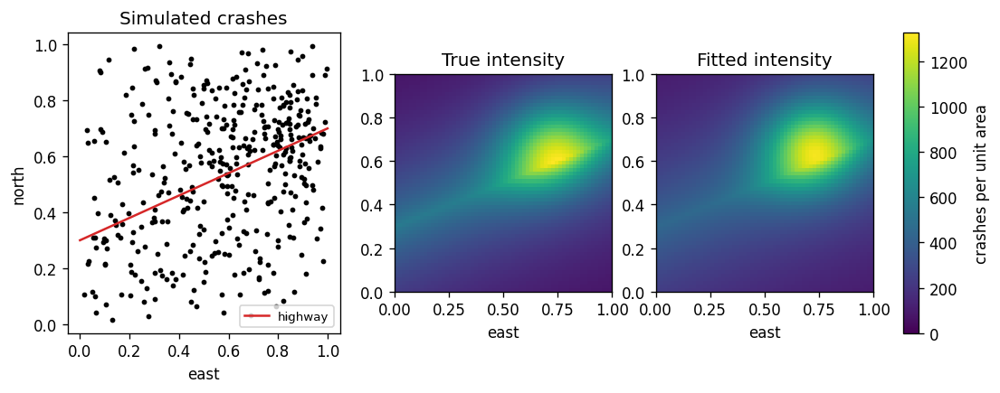

```python
import os
import matplotlib
matplotlib.use("Agg")
import matplotlib.pyplot as plt

os.makedirs("figures/ch11", exist_ok=True)
G60 = grid_points(60)
lam_true = rate(G60).reshape(60, 60)
lam_fit = np.exp(design(G60) @ b_hat).reshape(60, 60)
vmax = max(lam_true.max(), lam_fit.max())
fig, axes = plt.subplots(1, 3, figsize=(11, 3.6))
axes[0].scatter(P_crash[:, 0], P_crash[:, 1], s=6, color="black")
xs = np.array([0.0, 1.0])
axes[0].plot(xs, 0.3 + 0.4 * xs, color="tab:red", lw=1.5, label="highway")
axes[0].set_title("Simulated crashes")
axes[0].legend(loc="lower right", fontsize=8)
for ax, field, title in ((axes[1], lam_true, "True intensity"),
                         (axes[2], lam_fit, "Fitted intensity")):
    im = ax.imshow(field, origin="lower", extent=(0, 1, 0, 1),
                   cmap="viridis", vmin=0, vmax=vmax)
    ax.set_title(title)
for ax in axes:
    ax.set_xlabel("east")
axes[0].set_ylabel("north")
fig.colorbar(im, ax=axes[1:], label="crashes per unit area")
fig.savefig("figures/ch11/fig_11_1_crash_fit.png", dpi=120,
            bbox_inches="tight")
```

---

<a id="s11-4"></a>

## 11.4 Offsets: Modeling Excess Over a Known Baseline

### 11.4.1 The Offset Model

Often the question is not where events occur but where there are more of them than expected. A health department does not ask why cases cluster downtown; the people live downtown. It asks whether there are more cases than the population explains.

Suppose a baseline intensity $\lambda_{\text{pop}}(\mathbf{s})$, proportional to the number of people at risk near $\mathbf{s}$, is known. Model the intensity of cases as the baseline times a relative risk:

$$
\lambda(\mathbf{s}) = \lambda_{\text{pop}}(\mathbf{s})\exp\!\left(\mathbf{x}(\mathbf{s})'\boldsymbol{\beta}\right), \qquad \log\lambda(\mathbf{s}) = \log\lambda_{\text{pop}}(\mathbf{s}) + \mathbf{x}(\mathbf{s})'\boldsymbol{\beta}
$$

The term $\log\lambda_{\text{pop}}(\mathbf{s})$ has no coefficient to estimate, so it is an **offset**. In the Berman-Turner regression it enters the mean, $\mu_k = \exp(o_k + \mathbf{x}_k'\boldsymbol{\beta})$ with $o_k = \log\lambda_{\text{pop}}(\mathbf{s}_k^{*})$, but not the working response $z_k = \eta_k - o_k + (y_k - \mu_k)/\mu_k$, which is the same bookkeeping as in Section 9.4.2. The function `irls_poisson` already accepts an offset.

This is the point-pattern version of the expected count $E_i$ of Chapter 9. There, $E_i$ was the baseline risk integrated over region $i$; here the baseline enters at each point and the regions have shrunk away.

### 11.4.2 Reading the Coefficients

The factor $\exp(\mathbf{x}(\mathbf{s})'\boldsymbol{\beta})$ is the relative risk at $\mathbf{s}$: the intensity of cases there compared with what the baseline predicts. (This is a ratio of intensities, like the case-to-control ratio of Chapter 10; Chapter 9's relative risk was a county's mean count divided by its expected count.) With an intercept $\beta_0$ and a covariate that vanishes far from the source, $\exp(\beta_0)$ is the background level, the number of cases per unit of baseline. The other coefficients describe the excess.

### 11.4.3 The Plant Story

A suspected industrial plant stands at $(0.3, 0.6)$. If it raises the risk of a disease, the excess should be largest at the plant and fade with distance. We model this with a Gaussian bump covariate with a reach $h$,

$$
\text{bump}_h(\mathbf{s}) = \exp\!\left(-\frac{\lVert\mathbf{s} - (0.3, 0.6)'\rVert^2}{2h^2}\right)
$$

so that the model is $\log\lambda = \log\lambda_{\text{pop}} + \beta_0 + \beta_1\text{bump}_h(\mathbf{s})$. In the simulation the cases have intensity $120\,\lambda_{\text{pop}}(\mathbf{s})\,\text{excess}(\mathbf{s})$ per year, where the population baseline is the density defined in Section 11.1 (`pop_density` in the code), and the excess (`excess_risk` in the code) is $\exp(\text{bump}_{0.1}(\mathbf{s}))$. The truth is therefore $\beta_0 = \log 120 = 4.787$ and $\beta_1 = 1$ with $h = 0.1$: the risk at the plant is $e^1 = 2.72$ times the baseline. The controls, a sample of the population, have intensity $800\,\lambda_{\text{pop}}(\mathbf{s})$.

Two data sets are simulated. The first is a single year of cases, and the second pools five years, which multiplies the case intensity by 5. The pooled data set has five times the information, and its intercept should move by $\log 5$ to $\log 600 = 6.397$.

For each data set the code fits the offset model with $h = 0.1$, taking the plume's reach as known from the plant's emissions report. It tests the excess against a model with the intercept only, using a likelihood ratio test. For the pooled data it then profiles the log-likelihood over $h$.

```python
def bump(P, h):
    """Gaussian bump of spread h around the plant at (0.3, 0.6)."""
    d2 = (P[:, 0] - 0.3)**2 + (P[:, 1] - 0.6)**2
    return np.exp(-d2 / (2 * h**2))


rate_ctrl = lambda P: 800 * pop_density(P)
rate_case = lambda P: 120 * pop_density(P) * excess_risk(P)
max_case = 1.05 * (120 * pop_density(G) * excess_risk(G)).max()
P_ctrl = simulate_poisson(rate_ctrl, 800.0, rng)
yearly = [simulate_poisson(rate_case, max_case, rng) for _ in range(5)]
P_case1, P_case5 = yearly[0], np.vstack(yearly)
print("controls:", len(P_ctrl), " cases in one year:", len(P_case1),
      " cases in five years:", len(P_case5))

log_pop = lambda P: np.log(pop_density(P))
cov_bump = lambda h: (lambda P: np.column_stack([np.ones(len(P)),
                                                 bump(P, h)]))
cov_one = lambda P: np.ones((len(P), 1))
print("truth: b0 = log(120 k) =", np.round(np.log([120, 600]), 3),
      " b1 = 1")
for name, Pc in (("one year", P_case1), ("five years", P_case5)):
    b_o, cov_o, ll_o, _ = fit_bt(Pc, 30, cov_bump(0.1), log_pop)
    ll_0 = fit_bt(Pc, 30, cov_one, log_pop)[2]
    lr = 2 * (ll_o - ll_0)
    print(f"{name:10s} b = {np.round(b_o, 3)}  SE = "
          f"{np.round(np.sqrt(np.diag(cov_o)), 3)}  "
          f"LR = {lr:6.2f}  p = {stats.chi2.sf(lr, 1):.4f}")

print("profile over the plume spread h (five years):")
print("    h   log-lik      b0     b1")
profile = {}
for h in (0.05, 0.075, 0.1, 0.15, 0.2, 0.3):
    profile[h] = fit_bt(P_case5, 30, cov_bump(h), log_pop)
    print(f"{h:5.3f} {profile[h][2]:9.2f} {profile[h][0][0]:7.3f} "
          f"{profile[h][0][1]:6.3f}")
```

The one-year data have 58 cases and the pooled data 296 cases, and there are 385 controls (363 expected). These are new draws, not the sample of Section 10.7.3, which had 46 cases and 349 controls in one year; here a second, five-year pooled data set is added because one year gives too few cases to say anything about the plant.

| Data | $\hat{\beta}_0$ | $\hat{\beta}_1$ | SE($\hat{\beta}_1$) | LR statistic | p-value |
| :--- | :--- | :--- | :--- | :--- | :--- |
| One year (58 cases) | 4.815 | 0.573 | 0.716 | 0.58 | 0.448 |
| Five years (296 cases) | 6.406 | 1.053 | 0.276 | 12.08 | 0.0005 |

With one year of data the estimated excess is $0.573$ (a factor of 1.77 at the plant) with a standard error of $0.716$: the data cannot distinguish this from no excess, even though the simulated excess is real. Five years of data estimate the amplitude at $1.053$ (a factor of 2.87, against a true 2.72) with a standard error of $0.276$, and reject no excess firmly. The lesson is about power, not about the method: 58 cases is too few to see a bump of this size, and that is useful to know before spending money to look for one. The intercept shifts as predicted: $6.406 - 4.815 = 1.591$, close to $\log 5 = 1.609$.

The profile over $h$ is the second lesson. The log-likelihood is 1424.96 at $h = 0.05$, 1425.16 at $h = 0.075$, and 1424.97 at $h = 0.1$, and the amplitude estimate falls from $1.665$ to $1.053$ across that range. A narrow, tall bump and a wider, lower one explain the data about equally well. The reach of the plume cannot be read off these data, and any p-value that selects $h$ by maximizing the likelihood is optimistic, because the test statistic is no longer a $\chi^2$ with one degree of freedom. We fixed $h$ in advance to avoid this.

---

<a id="s11-5"></a>

## 11.5 Case-Control Data and the Logistic Bridge

### 11.5.1 Pooling Cases and Controls

The offset model needs the baseline $\lambda_{\text{pop}}(\mathbf{s})$ at every location, which means a population map. Often there is none. What there is, instead, is a sample of **controls**: locations of people who did not have the disease, drawn so that they follow the population. If the controls follow the population, their density is the baseline, up to a constant, and we can use them in place of the map. Case-control data are of this form.

Pool the cases and the controls into a single coordinate matrix $\mathbf{S}$ with $n_1 + n_0$ rows, and attach a label $Y_i = 1$ for a case and $Y_i = 0$ for a control. The locations of the controls carry information about the baseline, and the labels carry information about whether cases and controls are spread differently.

### 11.5.2 Deriving the Bridge

Let the cases form a Poisson process with intensity $\lambda_1(\mathbf{s})$ and the controls an independent Poisson process with intensity $\lambda_0(\mathbf{s})$. Chapter 10 called the ratio $\operatorname{RR}(\mathbf{s}) = \lambda_1(\mathbf{s})/\lambda_0(\mathbf{s})$ the relative risk. Return to the pixel picture of Section 11.2.1. In a small pixel of area $c$ around $\mathbf{s}$, the probability of a case is $\lambda_1(\mathbf{s})c$, the probability of a control is $\lambda_0(\mathbf{s})c$, and the probability of both is of order $c^2$. Given that the pixel contains an event of either kind, the probability that it is a case is

$$
\Pr(Y = 1 \mid \text{event at }\mathbf{s}) = \frac{\lambda_1(\mathbf{s})c}{\lambda_1(\mathbf{s})c + \lambda_0(\mathbf{s})c} = \frac{\lambda_1(\mathbf{s})}{\lambda_1(\mathbf{s}) + \lambda_0(\mathbf{s})}
$$

The pixel size cancels. Take the log-odds:

$$
\operatorname{logit}\Pr(Y = 1 \mid \mathbf{s}) = \log\frac{\lambda_1(\mathbf{s})}{\lambda_0(\mathbf{s})} = \log\operatorname{RR}(\mathbf{s})
$$

**The log-odds that an event at $\mathbf{s}$ is a case is the log relative risk at $\mathbf{s}$.** Now suppose the cases have intensity $\lambda_1(\mathbf{s}) = \kappa_1\lambda_{\text{pop}}(\mathbf{s})\theta(\mathbf{s})$ and the controls $\lambda_0(\mathbf{s}) = \kappa_0\lambda_{\text{pop}}(\mathbf{s})$, where $\theta(\mathbf{s})$ is the excess risk and $\kappa_1$, $\kappa_0$ are constants that reflect how many cases and controls were collected. The unknown baseline cancels from the ratio:

$$
\log\operatorname{RR}(\mathbf{s}) = \log\frac{\kappa_1}{\kappa_0} + \log\theta(\mathbf{s})
$$

If we model the log relative risk as $\beta_0 + \mathbf{x}(\mathbf{s})'\boldsymbol{\beta}$, we have an ordinary logistic regression of the label on the covariates. We never need to estimate or even know $\lambda_{\text{pop}}$. The population density, the thing that made cases cluster downtown in the first place, drops out.

In our simulation, $\lambda_1/\lambda_0 = (120/800)\exp(\text{bump}_{0.1}(\mathbf{s}))$, so the true logit is $\log 0.15 + \text{bump}_{0.1}(\mathbf{s})$, with intercept $-1.897$ and slope 1.

The logistic likelihood is a conditional likelihood: it is the probability of the labels given the locations of all the events. The other factor of the full likelihood, the probability of the pooled locations, depends on $\lambda_1 + \lambda_0$ and carries little information about the relative risk once the baseline is unknown. Section 11.9.1 measures what it costs to throw that factor away.

### 11.5.3 Binomial IRLS, and the Sampling Ratio

The logistic model is a GLM with binomial responses and a logit link, and IRLS applies as in Section 9.1.5. With $p_i = 1/(1 + e^{-\eta_i})$, the working weights are $v_i = p_i(1 - p_i)$ and the working response is $z_i = \eta_i + (y_i - p_i)/(p_i(1 - p_i))$.

```python
def irls_logistic(X, y, tol=1e-10, maxit=50):
    """Logistic regression by IRLS: weights p(1 - p), working response
    z = eta + (y - p) / (p (1 - p))."""
    b = np.zeros(X.shape[1])
    b[0] = np.log(y.mean() / (1 - y.mean()))
    for it in range(1, maxit + 1):
        eta = X @ b
        p = 1 / (1 + np.exp(-eta))
        v = p * (1 - p)
        z = eta + (y - p) / v
        info = X.T @ (v[:, None] * X)
        b_new = np.linalg.solve(info, X.T @ (v * z))
        done = np.max(np.abs(b_new - b)) < tol
        b = b_new
        if done:
            break
    p = 1 / (1 + np.exp(-(X @ b)))
    ll = np.sum(y * np.log(p) + (1 - y) * np.log(1 - p))
    return b, np.linalg.inv(info), ll, it


def pooled(P_cases, P_controls):
    P = np.vstack([P_cases, P_controls])
    return P, np.r_[np.ones(len(P_cases)), np.zeros(len(P_controls))]


print("truth: b0 = log(120 k / 800) =", np.round(np.log([120 / 800,
                                                         600 / 800]), 3))
for name, Pc in (("one year", P_case1), ("five years", P_case5)):
    P_all, label = pooled(Pc, P_ctrl)
    X_l = cov_bump(0.1)(P_all)
    b_l, cov_l, ll_l, _ = irls_logistic(X_l, label)
    ll_0 = irls_logistic(X_l[:, :1], label)[2]
    lr = 2 * (ll_l - ll_0)
    print(f"{name:10s} b = {np.round(b_l, 3)}  SE = "
          f"{np.round(np.sqrt(np.diag(cov_l)), 3)}  "
          f"LR = {lr:6.2f}  p = {stats.chi2.sf(lr, 1):.4f}")

P_all, label = pooled(P_case5, P_ctrl)
b_l5 = irls_logistic(cov_bump(0.1)(P_all), label)[0]
```

The intercept absorbs the sampling ratio $\kappa_1/\kappa_0$. Pooling five years of cases multiplies $\kappa_1$ by 5, so the true intercept moves from $\log 0.15 = -1.897$ to $\log 0.75 = -0.288$, while the slope stays at 1.

| Data | $\hat{\beta}_0$ | $\hat{\beta}_1$ | SE($\hat{\beta}_1$) | LR statistic | p-value |
| :--- | :--- | :--- | :--- | :--- | :--- |
| One year | $-1.926$ | 0.523 | 0.783 | 0.42 | 0.519 |
| Five years | $-0.336$ | 1.012 | 0.428 | 5.78 | 0.016 |

The fitted intercept moves by $1.590$, against $\log 5 = 1.609$, and the slope barely changes: it is $1.012$ for the pooled data against a true $1$. This is why the intercept of a case-control model has no interpretation as a risk. Its value reflects how many controls were sampled per case, a decision made by the investigator. The slopes are the interpretable part.

Compare the standard error with the offset model of Section 11.4.3: $0.428$ for the logistic fit against $0.276$ for the offset fit with five years of cases. The logistic regression pays for not knowing the baseline.

### 11.5.4 Against the Kernel Map

Chapter 10 estimated the relative risk without a model, as a ratio of two kernel intensity estimates, $\hat{\lambda}_1(\mathbf{s})/\hat{\lambda}_0(\mathbf{s})$ with a shared bandwidth. The code does the same here, with bandwidth $0.08$ (its `kernel_intensity` has no edge correction and a different argument order from Chapter 10's, which divides by the kernel mass inside the window; the plant is more than three bandwidths from the border, so the difference does not matter here), for the pooled data, and compares it with two logistic fits: a cubic polynomial in the coordinates (an intercept and nine terms), which is a flexible smooth surface that does not use the plant's location, and the bump model, which does use the plant's location and reach.

```python
def kernel_intensity(P_data, grid, psi):
    """Gaussian kernel intensity estimate, no edge correction."""
    d2 = ((grid[:, None, :] - P_data[None, :, :])**2).sum(axis=2)
    return np.exp(-d2 / (2 * psi**2)).sum(axis=1) / (2 * np.pi * psi**2)


def cubic(P):
    """Intercept and all monomials x^i y^j with 1 <= i + j <= 3."""
    cols = [np.ones(len(P))]
    cols += [P[:, 0]**i * P[:, 1]**j for i in range(4) for j in range(4 - i)
             if 0 < i + j]
    return np.column_stack(cols)


G50 = grid_points(50)
log_rr_true = np.log(600 / 800) + bump(G50, 0.1)
log_rr_kernel = np.log(kernel_intensity(P_case5, G50, 0.08)
                       / kernel_intensity(P_ctrl, G50, 0.08))
b_cub = irls_logistic(cubic(P_all), label)[0]
log_rr_cubic = cubic(G50) @ b_cub
log_rr_bump = b_l5[0] + b_l5[1] * bump(G50, 0.1)
rmse = lambda e: np.sqrt(np.mean(e**2))
const = np.full(len(G50), log_rr_true.mean())
print("no spatial pattern (best constant): RMSE =",
      f"{rmse(const - log_rr_true):.3f}")
for name, f in (("kernel ratio", log_rr_kernel),
                ("cubic logistic", log_rr_cubic),
                ("bump logistic", log_rr_bump)):
    print(f"{name:15s} RMSE of log RR = {rmse(f - log_rr_true):.3f}  "
          f"correlation with truth = {np.corrcoef(f, log_rr_true)[0, 1]:.3f}")

for psi in (0.04, 0.08, 0.16):
    f = np.log(kernel_intensity(P_case5, G50, psi)
               / kernel_intensity(P_ctrl, G50, psi))
    print(f"kernel bandwidth {psi:4.2f}: RMSE = {rmse(f - log_rr_true):.3f}"
          f"  correlation = {np.corrcoef(f, log_rr_true)[0, 1]:.3f}")

fig, axes = plt.subplots(2, 2, figsize=(8, 7))
panels = ((log_rr_true, "True log relative risk"),
          (log_rr_kernel, "Kernel ratio (bandwidth 0.08)"),
          (log_rr_cubic, "Logistic, cubic in location"),
          (log_rr_bump, "Logistic, plume bump"))
lims = (-1.0, 0.8)
for ax, (f, title) in zip(axes.ravel(), panels):
    im = ax.imshow(f.reshape(50, 50), origin="lower", extent=(0, 1, 0, 1),
                   cmap="viridis", vmin=lims[0], vmax=lims[1])
    ax.plot(0.3, 0.6, marker="+", color="white", ms=10)
    ax.set_title(title, fontsize=10)
fig.colorbar(im, ax=axes, extend="min",
             label="log relative risk (cases to controls)")
fig.savefig("figures/ch11/fig_11_2_case_control.png", dpi=120,
            bbox_inches="tight")
```

Figure 11.2 shows the true log relative risk and the three estimates. The color scale is limited to $[-1, 0.8]$ so the true bump is visible.


The result is sobering. A map with no spatial pattern at all, the constant equal to the average of the truth, has an RMSE of $0.166$ against the true log relative risk. The kernel ratio has an RMSE of $0.462$ and the cubic logistic fit $0.390$, both worse than the constant. Their correlations with the truth are low: $0.292$ and $0.259$. Changing the kernel bandwidth does not help: the correlation is $0.210$ at $0.04$, $0.292$ at $0.08$, and $0.252$ at $0.16$, while the RMSE falls with smoothing only because heavily smoothed maps approach the constant. With 296 cases a local ratio is mostly noise. The bump model has an RMSE of $0.048$ and, since its shape is the truth's shape, a correlation of $1.000$.

This is not an argument for the bump model over the kernel map. The bump model succeeds because we gave it the right shape and the right center. A bump placed in the wrong spot, or a true excess shaped like a ridge, would do badly (Exercise 17). The honest summary is that parametric structure buys power if it is right, and that the nonparametric map is the safer first look but needs far more data to find a localized excess.

---

<a id="s11-6"></a>

## 11.6 Where Is the Excess? Spatial Scan Statistics

A regression like the one in Section 11.4 tests a specific alternative: excess near a known source. Outbreak surveillance asks a different question. Event locations arrive, and the team wants to know whether any small area has more events than usual, without saying in advance where. The **spatial scan statistic** answers by testing every area of a certain shape and size.

### 11.6.1 Windows and Expected Counts

A **window** is a disc of radius $r$ around a center. The scan considers many centers on a grid and several radii, a few thousand windows in all. For each window, we compare the number of events inside, $n_w$, with the number $e_w$ we would expect inside if the events followed a known baseline. If $n$ events were observed in total and $\lambda_{\text{bg}}(\mathbf{s})$ is the baseline intensity, then

$$
e_w = n\,\frac{\int_w\lambda_{\text{bg}}(\mathbf{s})\,d\mathbf{s}}{\int_{\mathcal{D}}\lambda_{\text{bg}}(\mathbf{s})\,d\mathbf{s}}
$$

This conditions on the total count: the baseline determines only the shape of the intensity, and the scale comes from the data.

### 11.6.2 The Log-Likelihood Ratio

Condition on $n$. Under the baseline, each event independently falls inside window $w$ with probability $p_w = e_w/n$. Under the alternative that the window holds an excess, each event falls inside with some larger probability $q$. Within the window and outside it, the distribution of the locations is still the baseline's shape, so the shape terms cancel in the ratio of likelihoods, and

$$
\frac{L_1}{L_0} = \frac{q^{n_w}(1 - q)^{n - n_w}}{p_w^{n_w}(1 - p_w)^{n - n_w}}
$$

The maximum over $q$ is at $\hat{q} = n_w/n$, as for any binomial proportion. Substituting, and using $p_w = e_w/n$, gives the log-likelihood ratio of the window:

$$
\operatorname{LLR}_w = n_w\log\frac{n_w}{e_w} + (n - n_w)\log\frac{n - n_w}{n - e_w}, \qquad \text{kept only if } n_w > e_w
$$

and set to zero otherwise, because we look only for excesses. This is the same expression one obtains from a Poisson model with the rate multiplied by a constant inside the window and a different constant outside: the $-\text{mean}$ terms of the Poisson log-likelihood cancel because both fits have the same total.

A small check: with $n = 100$ events, a window that was expected to hold $e_w = 10$ and holds $n_w = 20$ has $\operatorname{LLR} = 20\log 2 + 80\log(80/90) = 13.863 - 9.423 = 4.440$. (Papers on scan statistics usually report $\operatorname{LLR}$ itself. A likelihood ratio statistic compared with a $\chi^2$ distribution is twice this value, so we compare $2\operatorname{LLR}$ with $\chi^2$ quantiles.)

### 11.6.3 Computing All Windows at Once

The statistic has two logarithms of counts that can be zero. When a window holds no events, $n_w\log(n_w/e_w)$ is $0\log 0$, which should be zero and which NumPy reports as `nan`. The function `scipy.special.xlogy(x, y)` computes $x\log y$ and returns 0 when $x = 0$. With it, the whole table of statistics for every center and radius is one vectorized expression on a table of counts.

The outbreak story: a surveillance system sees $n = 350$ events over a district. The background intensity is proportional to population density, $600\,\lambda_{\text{pop}}$. The simulated data have 315 background events plus 35 extra events in a tight Gaussian cluster, spread $0.04$, centered at $(0.25, 0.2)$, a sparsely populated corner. The scan uses 441 centers on a $21 \times 21$ grid and 7 radii from $0.05$ to $0.3$: 3,087 windows. The expected counts integrate the baseline over each window on a fine grid. The code, which appears in the next subsection together with the p-value computation, scans all windows and reports the most likely cluster.

### 11.6.4 Inference: Why the Maximum Needs a Simulation

For one window fixed in advance, the one-sided LLR has a known large-sample distribution: $2\operatorname{LLR}$ is zero when $n_w \le e_w$, which happens about half the time, and otherwise follows a $\chi^2$ distribution with one degree of freedom. So a single window is a boundary test like those of Section 5.5.2, and one rejects at 5% when $2\operatorname{LLR}$ exceeds the $\chi^2_1$ quantile $2.71$ (the 0.90 quantile, because only half of the mass is positive).

The scan does not test one window. It tests 3,087 overlapping windows and reports the largest statistic. The maximum of many statistics is larger than a typical one, exactly as the largest of many $t$ statistics is, and the windows overlap, so the statistics are strongly dependent and no tidy reference distribution exists. The reference distribution has to be simulated: generate data sets from the baseline with the same $n$, compute the largest $2\operatorname{LLR}$ of each, and see where the observed maximum falls. The Monte Carlo p-value is $(1 + \#\{\max_{\text{sim}} \ge \max_{\text{obs}}\})/(B + 1)$, which is valid for the reasons given in Section 6.8.1.

The code simulates $B = 999$ data sets from the baseline.

```python
def llr_table(n_w, e_w, n):
    """Log-likelihood ratio for elevated-risk windows (zero otherwise)."""
    out = (special.xlogy(n_w, n_w / e_w)
           + special.xlogy(n - n_w, (n - n_w) / (n - e_w)))
    return np.where(n_w > e_w, out, 0.0)


print("hand check, n_w = 20, e_w = 10, n = 100:",
      round(float(llr_table(20.0, 10.0, 100.0)), 4))

cg = np.linspace(0.0, 1.0, 21)
centers = np.column_stack([a.ravel() for a in np.meshgrid(cg, cg)])
radii = np.array([0.05, 0.075, 0.1, 0.15, 0.2, 0.25, 0.3])
F = grid_points(100)
lam_bg = lambda P: 600 * pop_density(P)
d2_F = ((centers[:, None, :] - F[None, :, :])**2).sum(axis=2)
mass = np.stack([((d2_F <= r**2) * lam_bg(F)).sum(axis=1) / len(F)
                 for r in radii], axis=1)
mass_total = lam_bg(F).mean()


def scan(P):
    """LLR of every (center, radius) window; expected counts use the
    baseline mass and the total number of events n."""
    n = len(P)
    d2 = ((centers[:, None, :] - P[None, :, :])**2).sum(axis=2)
    n_w = np.stack([(d2 <= r**2).sum(axis=1) for r in radii], axis=1)
    e_w = n * mass / mass_total
    return llr_table(n_w.astype(float), e_w, n), n_w, e_w


def sample_baseline(n, rng):
    """n events from the baseline density, proportional to pop_density."""
    out = np.empty((0, 2))
    while len(out) < n:
        C = rng.uniform(size=(2 * n, 2))
        out = np.vstack([out, C[rng.uniform(size=2 * n) < pop_density(C)]])
    return out[:n]


def inject(n_bg, n_extra, rng):
    """Baseline events plus a Gaussian cluster of extra events."""
    P = sample_baseline(n_bg, rng)
    if n_extra:
        extra = rng.normal([0.25, 0.2], 0.04, (n_extra, 2))
        P = np.vstack([P, np.clip(extra, 0, 1)])
    return P


P_out = inject(315, 35, rng)
llr, n_w, e_w = scan(P_out)
i, j = np.unravel_index(llr.argmax(), llr.shape)
print("events:", len(P_out), " windows scanned:", llr.size)
print("best window: center", centers[i], "radius", radii[j],
      " n_w =", n_w[i, j], " e_w =", np.round(e_w[i, j], 2),
      " LLR =", np.round(llr[i, j], 2))

B = 999
null_max = np.empty(B)
null_one = np.empty(B)
mid = np.argmin(np.abs(centers - 0.5).sum(axis=1))
for k in range(B):
    lk = scan(sample_baseline(len(P_out), rng))[0]
    null_max[k] = lk.max()
    null_one[k] = lk[mid, 3]
p_mc = (1 + np.sum(null_max >= llr.max())) / (B + 1)
print("Monte Carlo p-value:", p_mc)
print("2 * LLR, maximum over windows: median",
      np.round(2 * np.median(null_max), 2), " 95th percentile",
      np.round(2 * np.quantile(null_max, 0.95), 2))
print("2 * LLR, one fixed window:     median",
      np.round(2 * np.median(null_one), 2), " 95th percentile",
      np.round(2 * np.quantile(null_one, 0.95), 2))
print("fixed window: e_w =", np.round(scan(P_out)[2][mid, 3], 1),
      " share of 2 * LLR above 3.84:",
      np.round(np.mean(2 * null_one > 3.84), 3))
print("share of data sets whose maximum 2 * LLR exceeds 3.84:",
      np.round(np.mean(2 * null_max > 3.84), 3))
print("chi-square(1) quantiles: median", np.round(stats.chi2.ppf(0.5, 1), 2),
      " 95th percentile", np.round(stats.chi2.ppf(0.95, 1), 2))
print("naive chi-square p-value of the observed maximum:",
      f"{stats.chi2.sf(2 * llr.max(), 1):.1e}")

fig, axes = plt.subplots(1, 2, figsize=(10, 4))
axes[0].scatter(P_out[:, 0], P_out[:, 1], s=6, color="black")
axes[0].add_patch(plt.Circle(centers[i], radii[j], fill=False,
                             color="tab:red", lw=2))
axes[0].plot(0.25, 0.2, marker="+", color="tab:blue", ms=12)
axes[0].set_xlim(0, 1)
axes[0].set_ylim(0, 1)
axes[0].set_aspect("equal")
axes[0].set_title("Events and the most likely cluster")
axes[1].hist(2 * null_max, bins=30, color="lightgray", edgecolor="gray")
axes[1].axvline(stats.chi2.ppf(0.95, 1), color="tab:blue", ls="--",
                label="chi-square(1), 95%")
axes[1].set_xlim(0, 30)
axes[1].annotate(f"observed: {2 * llr.max():.0f}\n(off the scale)",
                 xy=(29.5, 5), ha="right", color="tab:red")
axes[1].set_xlabel("2 * largest LLR over all windows, no cluster present")
axes[1].set_ylabel("simulated data sets")
axes[1].legend(fontsize=8)
fig.tight_layout()
fig.savefig("figures/ch11/fig_11_3_scan.png", dpi=120)
```

The most likely cluster is centered at $(0.25, 0.2)$, the true center, with radius $0.05$: it holds $n_w = 31$ events where $e_w = 1.87$ were expected, with $\operatorname{LLR} = 59.17$ ($2\operatorname{LLR} = 118.3$). None of the 999 simulated data sets has a maximum that large, so the Monte Carlo p-value is $0.001$, the smallest value 999 simulations can give. A $\chi^2_1$ p-value for the same statistic would be $1.5 \times 10^{-27}$, which is meaningless.

Under the baseline, the maximum of $2\operatorname{LLR}$ over all windows has median $9.77$ and 95th percentile $15.0$. A $\chi^2_1$ variable has median $0.45$ and 95th percentile $3.84$. The reference distribution of the maximum sits far above the one for a single window. For one fixed window near the center of the map, with $e_w = 30.7$ expected events, the share of simulations with $2\operatorname{LLR} > 3.84$ is $0.013$. That is below the $0.025$ the boundary theory predicts, because conditioning on $n$ and the discreteness of counts make the single-window test a little conservative, but it is in the right region, and nowhere near the behavior of the maximum. Using the single-window critical value for the scan's maximum would flag every data set: in all 999 simulated data sets with no cluster, the largest $2\operatorname{LLR}$ exceeds $3.84$.

Figure 11.3 shows the events with the most likely cluster circled and the null distribution of the maximum.


### 11.6.5 Cautions

The scan tests departures from the baseline, and its power depends on how good the baseline is. If the baseline leaves out something real, such as a hospital that makes nearby cases more likely to be reported, the scan finds it and reports a cluster. If the baseline is wrong because the population map is outdated, the same thing happens (Exercise 18). The most likely cluster is a hypothesis to investigate, not a finding. Section 11.9.2 measures the size and power of the scan by repeated simulation.

---

<a id="s11-7"></a>

## 11.7 Separating Trend From Interaction

### 11.7.1 Why the Ordinary $K$-Function Reports Clustering

In Section 3.4 we saw a trend in the mean produce a variogram that looked like spatial dependence. Point patterns have the same trap. Ripley's $K$-function, from Chapter 10, measures interaction by counting extra events near a typical event. The estimator reads: the expected number of other events within distance $r$ of a typical event, divided by the intensity. It assumes that the intensity is the same everywhere. If it is not, then a typical event is more likely to be in a dense area, where its neighbors are also more numerous, and $K$ mistakes this for attraction.

To see how large the effect is, take an inhomogeneous Poisson process with no interaction at all. Pairs of events at locations $\mathbf{s}$ and $\mathbf{t}$ occur at rate $\lambda(\mathbf{s})\lambda(\mathbf{t})$. The ordinary estimator divides by the square of the average intensity $\bar{\lambda}$ and counts all pairs closer than $r$, so its expected value is roughly

$$
K_{\text{ord}}(r) \approx \frac{1}{\bar{\lambda}^2\operatorname{area}(\mathcal{D})}\int\!\!\int_{\lVert\mathbf{s} - \mathbf{t}\rVert \le r}\lambda(\mathbf{s})\lambda(\mathbf{t})\,d\mathbf{s}\,d\mathbf{t} \approx \pi r^2\,\frac{\operatorname{E}[\lambda^2]}{\bar{\lambda}^2} = \pi r^2\left(1 + \operatorname{CV}^2\right)
$$

for small $r$. The middle expression replaces $\lambda(\mathbf{t})$ by $\lambda(\mathbf{s})$ inside a small disc, and $\operatorname{CV}^2 = \operatorname{Var}(\lambda)/\bar{\lambda}^2$ is the squared coefficient of variation of the intensity over the map, with the average taken over the region. Under no interaction, the ordinary $K$ is inflated by $1 + \operatorname{CV}^2$, and this has nothing to do with the events attracting each other. It is only the variation in the intensity.

For the crash intensity, $\operatorname{CV}^2 = 0.433$. Then $K_{\text{ord}} \approx 1.433\pi r^2$, and $L(r) - r = \sqrt{K/\pi} - r$ should be about $(\sqrt{1.433} - 1)r = 0.197\,r$ for small $r$, positive and growing in proportion to $r$. Section 11.7.3 tests the prediction.

### 11.7.2 The Inhomogeneous $K$-Function

The remedy is to weight each pair by the reciprocal of the intensities at its two events:

$$
\hat{K}_{\text{inhom}}(r) = \frac{1}{\operatorname{area}(\mathcal{D})}\sum_{i=1}^n\sum_{j \ne i}\frac{\omega_{ij}\,\mathbb{1}(h_{ij} \le r)}{\hat{\lambda}(\mathbf{s}_i)\hat{\lambda}(\mathbf{s}_j)}
$$

where $h_{ij}$ is the distance between events $i$ and $j$ and $\omega_{ij} \ge 1$ is an edge-correction weight. A pair in a dense area is worth less, because pairs there are expected to be frequent. If the intensity were constant and equal to $n/\operatorname{area}(\mathcal{D})$, this would reduce to an ordinary $K$ estimator (with $n^2$ in the denominator in place of $n(n-1)$).

Why is it right? For a Poisson process, the expected sum over ordered pairs of any function $f(\mathbf{s}_i, \mathbf{s}_j)$ is $\int\!\!\int f(\mathbf{s}, \mathbf{t})\lambda(\mathbf{s})\lambda(\mathbf{t})\,d\mathbf{s}\,d\mathbf{t}$, because pairs occur at rate $\lambda(\mathbf{s})\lambda(\mathbf{t})$. Take $f = \omega\,\mathbb{1}(\lVert\mathbf{s} - \mathbf{t}\rVert \le r)/(\lambda(\mathbf{s})\lambda(\mathbf{t}))$. The intensities cancel, leaving $\int\!\!\int\omega\,\mathbb{1}(\cdot)\,d\mathbf{s}\,d\mathbf{t}$, which the edge weights make equal to $\operatorname{area}(\mathcal{D})\,\pi r^2$. So $\operatorname{E}[\hat{K}_{\text{inhom}}(r)] = \pi r^2$ whatever the intensity, as long as there is no interaction. Departures of $\hat{K}_{\text{inhom}}$ from $\pi r^2$ are then evidence of interaction.

**Edge weights.** Chapter 10 corrected edges with Ripley's weights, built from the length of a circle that lies inside the region. (The estimator below also normalizes differently: it divides each pair by the product of the intensities, so with a constant intensity it is smaller than Chapter 10's $\hat{K}$ by the factor $(n - 1)/n$, in addition to the difference in edge weights, and values at small $r$ differ slightly.) For a rectangle there is a simpler correct choice, the **translation correction**: $\omega_{ij} = \operatorname{area}(\mathcal{D})/\operatorname{area}(\mathcal{D} \cap (\mathcal{D} + \mathbf{h}_{ij}))$, where $\mathcal{D} + \mathbf{h}$ is the region shifted by the vector $\mathbf{h}_{ij}$ from event $j$ to event $i$. For the unit square the overlap of the square with its shifted copy is $(1 - \lvert\Delta x\rvert)(1 - \lvert\Delta y\rvert)$, where $\Delta x$ and $\Delta y$ are the coordinate differences, so $\omega_{ij} = 1/((1 - \lvert\Delta x\rvert)(1 - \lvert\Delta y\rvert))$. Why does this make the expectation come out right? The integral $\int\!\!\int_{\mathcal{D} \times \mathcal{D}}\omega(\mathbf{s}, \mathbf{t})\mathbb{1}(\lVert\mathbf{s} - \mathbf{t}\rVert \le r)\,d\mathbf{s}\,d\mathbf{t}$ can be rewritten by setting $\mathbf{h} = \mathbf{t} - \mathbf{s}$. For fixed $\mathbf{h}$, the pairs $(\mathbf{s}, \mathbf{s} + \mathbf{h})$ with both points in $\mathcal{D}$ sweep out exactly $\operatorname{area}(\mathcal{D} \cap (\mathcal{D} - \mathbf{h}))$ of starting points, the weight $\omega$ is the reciprocal of this overlap times $\operatorname{area}(\mathcal{D})$, and the product is $\operatorname{area}(\mathcal{D})$ for every $\mathbf{h}$ in the disc. Integrating over the disc of radius $r$ gives $\operatorname{area}(\mathcal{D})\,\pi r^2$. Both edge corrections work; this one is easier to code.

### 11.7.3 In Practice

The estimator needs $\hat{\lambda}(\mathbf{s}_i)$ at the events. For the crash pattern we use the fitted GLM intensity of Section 11.3.6. We compare $L(r) - r$ for the ordinary and the inhomogeneous estimators against envelopes: for the ordinary $K$, the envelope comes from 99 patterns with complete spatial randomness and the same $n$; for the inhomogeneous $K$, from 99 patterns simulated from the fitted intensity, with the intensity re-fitted to each simulated pattern, so the envelope includes the effect of estimating $\hat{\lambda}$.

```python
def dist(S):
    """Matrix of Euclidean distances between the rows of S."""
    q = np.sum(S**2, axis=1)
    H = np.sqrt(np.maximum(q[:, None] - 2 * S @ S.T + q[None, :], 0.0))
    np.fill_diagonal(H, 0.0)
    return H


def k_hat(P, r_grid, lam):
    """Inhomogeneous K on the unit square with translation edge weights
    omega_ij = 1 / ((1 - |dx|)(1 - |dy|)). A constant lam = n gives the
    ordinary K."""
    H = dist(P)
    dx = np.abs(P[:, 0][:, None] - P[:, 0][None, :])
    dy = np.abs(P[:, 1][:, None] - P[:, 1][None, :])
    W = 1.0 / ((1 - dx) * (1 - dy)) / np.outer(lam, lam)
    np.fill_diagonal(W, 0.0)
    return np.array([W[H <= r].sum() for r in r_grid])


l_minus_r = lambda K, r: np.sqrt(K / np.pi) - r

r_grid = np.linspace(0.01, 0.15, 15)
n = len(P_crash)
lam_fit = np.exp(design(P_crash) @ b_hat)
lm_ord = l_minus_r(k_hat(P_crash, r_grid, np.full(n, float(n))), r_grid)
lm_inh = l_minus_r(k_hat(P_crash, r_grid, lam_fit), r_grid)

env_ord, env_inh = [], []
for s in range(99):
    Pu = rng.uniform(size=(n, 2))
    env_ord.append(l_minus_r(k_hat(Pu, r_grid, np.full(n, float(n))),
                             r_grid))
    r_fit = lambda P: np.exp(design(P) @ b_hat)
    Ps = simulate_poisson(r_fit, 1.05 * r_fit(G).max(), rng)
    bs = fit_bt(Ps, 20)[0]
    env_inh.append(l_minus_r(k_hat(Ps, r_grid,
                                   np.exp(design(Ps) @ bs)), r_grid))
env_ord, env_inh = np.array(env_ord), np.array(env_inh)
print("   r   ordinary L - r (CSR band)       inhomogeneous L - r (band)")
for q in (1, 3, 5, 7, 9, 14):
    print(f"{r_grid[q]:5.2f} {lm_ord[q]:8.4f} "
          f"({env_ord[:, q].min():7.4f}, {env_ord[:, q].max():7.4f})   "
          f"{lm_inh[q]:8.4f} "
          f"({env_inh[:, q].min():7.4f}, {env_inh[:, q].max():7.4f})")

cv2 = np.mean(rate(G)**2) / np.mean(rate(G))**2 - 1
print("squared coefficient of variation of the intensity:", round(cv2, 3))
print("predicted (L - r) / r for small r:", round(np.sqrt(1 + cv2) - 1, 3))
print("observed (L - r) / r at r = 0.04, 0.08:",
      np.round(lm_ord[[3, 7]] / r_grid[[3, 7]], 3))

fig, axes = plt.subplots(1, 2, figsize=(10, 3.8), sharey=True)
for ax, obs, env, title in ((axes[0], lm_ord, env_ord, "Ordinary K"),
                            (axes[1], lm_inh, env_inh,
                             "Inhomogeneous K, fitted intensity")):
    ax.fill_between(r_grid, env.min(axis=0), env.max(axis=0),
                    color="lightgray", label="envelope, 99 simulations")
    ax.plot(r_grid, obs, color="tab:red", lw=2, label="crash pattern")
    ax.axhline(0, color="black", lw=0.8)
    ax.set_xlabel("distance r")
    ax.set_title(title)
axes[0].set_ylabel("L(r) - r")
axes[0].legend(fontsize=8)
fig.tight_layout()
fig.savefig("figures/ch11/fig_11_4_trend_interaction.png", dpi=120)
```

| $r$ | Ordinary $L - r$ | CSR envelope | Inhomogeneous $L - r$ | Envelope |
| :--- | :--- | :--- | :--- | :--- |
| 0.02 | 0.0040 | $(-0.0025, 0.0026)$ | 0.0005 | $(-0.0046, 0.0041)$ |
| 0.06 | 0.0135 | $(-0.0019, 0.0023)$ | $-0.0004$ | $(-0.0038, 0.0046)$ |
| 0.10 | 0.0231 | $(-0.0032, 0.0049)$ | 0.0022 | $(-0.0045, 0.0058)$ |
| 0.15 | 0.0336 | $(-0.0047, 0.0066)$ | 0.0040 | $(-0.0062, 0.0056)$ |

The ordinary $K$ is far outside the envelope at every distance: it reports clustering. The inhomogeneous $K$ is inside the envelope at every distance: it reports nothing. The pattern was generated with no interaction, so the second answer is the right one. The prediction of Section 11.7.1 is close: $(L - r)/r$ is $0.206$ at $r = 0.04$ and $0.232$ at $r = 0.08$, against the predicted $0.197$.


**Estimating the intensity and the interaction from the same data.** The inhomogeneous $K$ uses $\hat{\lambda}$ from the same events whose interaction it assesses. A flexible $\hat{\lambda}$ can absorb the clusters it is supposed to detect: an estimate that follows every bump of the pattern will explain interaction away. How much this matters depends on the flexibility. Section 11.9.3 compares estimates in 100 Poisson patterns. The estimator is nearly unbiased with a GLM fit of three parameters, and biased downward, sometimes severely, when the intensity is a kernel estimate that includes the event itself.

---

<a id="s11-8"></a>

## 11.8 Inference Under Clustering

### 11.8.1 What Clustering Does to Counts

The Poisson GLM of Section 11.3 assumes that counts in disjoint regions are independent. Crashes violate this when they cluster at dangerous intersections: one bad intersection produces many crashes in a small area. We model this with a **Thomas process**, a standard cluster model, in its inhomogeneous form:

1. Parents form a homogeneous Poisson process with intensity $\kappa$ (parents per unit area).
2. Each parent has a Poisson number of offspring with mean $\mu_c$, placed around it with independent Gaussian displacements of standard deviation $\sigma_c$ in each coordinate.
3. Every offspring is kept with probability $\lambda(\mathbf{s})/(\kappa\mu_c)$, so that the events we observe have intensity $\lambda(\mathbf{s})$. This requires $\kappa\mu_c \ge \max\lambda$.

Chapter 12 develops this model, with a tissue-slide story. Here the clusters are the dangerous intersections, and the thinning in step 3 gives them the trend of the crash intensity.

We take $\kappa = 100$ and $\sigma_c = 0.03$, with the crash intensity of Section 11.1.2 as the trend. (This is the same family as the clustered pattern of Section 10.3.4, with its own parameters: 20 parents per unit area there, 100 here, and here an inhomogeneous trend.) Each parent has about $\mu_c = 14$ offspring before thinning, the expected number of events is again about 400, and the counts are more variable than Poisson counts. The function below simulates the process. Parents are placed on a window enlarged by $4\sigma_c$ on every side, so that offspring of parents just outside the square can still land inside it.

```python
def simulate_cluster(rate_fn, rate_max, kappa, sigma_c, rng):
    """Inhomogeneous Thomas process on the unit square, by thinning.
    Parents have intensity kappa on an enlarged window; each has
    Poisson(rate_max / kappa) offspring, Gaussian with spread sigma_c;
    offspring inside the square are kept with probability rate / rate_max."""
    margin = 4 * sigma_c
    lo, hi = -margin, 1 + margin
    n_par = rng.poisson(kappa * (hi - lo)**2)
    parents = rng.uniform(lo, hi, size=(n_par, 2))
    counts = rng.poisson(rate_max / kappa, size=n_par)
    kids = np.repeat(parents, counts, axis=0)
    kids = kids + sigma_c * rng.standard_normal(kids.shape)
    kids = kids[np.all((kids >= 0) & (kids <= 1), axis=1)]
    return kids[rng.uniform(size=len(kids)) < rate_fn(kids) / rate_max]


kappa, sigma_c = 100.0, 0.03
rate_max_c = 1.05 * rate(grid_points(300) * 1.24 - 0.12).max()
sim_p = lambda: simulate_poisson(rate, rate_max, rng)
sim_c = lambda: simulate_cluster(rate, rate_max_c, kappa, sigma_c, rng)
print("offspring per parent before thinning:",
      round(rate_max_c / kappa, 1))
```

**The variance of a sum over events.** Chapter 10 defined the pair correlation function $g(h)$: the expected number of ordered pairs of events in small areas $d\mathbf{s}$ and $d\mathbf{t}$, at distance $h$ apart, is $\lambda(\mathbf{s})\lambda(\mathbf{t})g(h)\,d\mathbf{s}\,d\mathbf{t}$. For a Poisson process $g \equiv 1$, and $g > 1$ at distance $h$ means pairs at that distance are more common than chance. (With a constant intensity this is the $g$ of Chapter 10; here the intensity may vary, and $g$ compares pairs with what independence would give at the local intensities.) For any function $f$, consider the sum $T = \sum_if(\mathbf{s}_i)$ over the events. Its mean is $\int f\lambda$. Its second moment separates into the terms with $i = j$ and with $i \ne j$:

$$
\operatorname{E}[T^2] = \operatorname{E}\sum_if(\mathbf{s}_i)^2 + \operatorname{E}\sum_{i \ne j}f(\mathbf{s}_i)f(\mathbf{s}_j) = \int f^2\lambda + \int\!\!\int f(\mathbf{s})f(\mathbf{t})\lambda(\mathbf{s})\lambda(\mathbf{t})g\,d\mathbf{s}\,d\mathbf{t}
$$

Subtracting the square of the mean,

$$
\operatorname{Var}(T) = \int f^2\lambda + \int\!\!\int f(\mathbf{s})f(\mathbf{t})\lambda(\mathbf{s})\lambda(\mathbf{t})\left(g - 1\right)d\mathbf{s}\,d\mathbf{t}
$$

The first term is the Poisson variance. The second is the effect of interaction: it is positive when $g > 1$ (clustering) and negative when $g < 1$ (inhibition). With $f \equiv 1$, $T = N(\mathcal{D})$ and the second term is the extra variance of the count.

For the Thomas process,

$$
g(h) = 1 + \frac{\exp\!\left(-h^2/(4\sigma_c^2)\right)}{4\pi\kappa\sigma_c^2}
$$

The next subsection derives this, and it can be skipped. The function starts at $1 + 1/(4\pi\kappa\sigma_c^2) = 1.88$ at $h = 0$, so pairs of events very close together are almost twice as common as chance, and falls to 1 over a distance of about $2\sigma_c$. Because $\int(g - 1)\,d\mathbf{h} = 1/\kappa$, the count in a region much larger than a cluster has variance $\int\lambda + (1/\kappa)\int\lambda^2$, a variance-to-mean ratio of $1 + \int\lambda^2/(\kappa\int\lambda)$. The code computes this ratio, and a second version that respects the boundary of the square (a pair with one event outside the square is not counted), and compares both with the variance-to-mean ratio of the number of events in 300 simulated clustered patterns. The boundary version is a double sum over grid cells, which separates into a product over the two coordinates and so costs very little.

```python
def pair_integral(A, sigma, m=60):
    """c^2 * sum_ij A_ip A_jq phi(s_i - s_j) over the m x m grid, where
    phi(h) = exp(-h^2 / (4 sigma^2)) / (4 pi sigma^2). Separable in x, y."""
    g = (np.arange(m) + 0.5) / m
    K1 = np.exp(-(g[:, None] - g[None, :])**2 / (4 * sigma**2))
    K1 = K1 / np.sqrt(4 * np.pi * sigma**2)
    A3 = A.reshape(m, m, -1)
    out = np.empty((A3.shape[2], A3.shape[2]))
    for p in range(A3.shape[2]):
        T = K1 @ A3[:, :, p] @ K1.T
        for q in range(A3.shape[2]):
            out[p, q] = np.sum(A3[:, :, q] * T) / m**4
    return out


sizes = np.array([len(sim_c()) for _ in range(300)])
lam60 = rate(grid_points(60))
mean_n = np.mean(lam60)
exact_var = mean_n + pair_integral(lam60[:, None], sigma_c)[0, 0] / kappa
print("clustered counts: mean", round(sizes.mean(), 1), " variance",
      round(sizes.var(ddof=1), 1), " variance / mean",
      round(sizes.var(ddof=1) / sizes.mean(), 2))
print("formula, ignoring the boundary:",
      round(1 + np.mean(rate(G)**2) / np.mean(rate(G)) / kappa, 2),
      " formula with the boundary:", round(exact_var / mean_n, 2))
```

The simulated variance-to-mean ratio of the count is $6.58$, against $6.73$ for the formula that ignores the boundary and $6.51$ for the formula that respects it. A Poisson process has a ratio of 1. The count of crashes in the district has more than six times the Poisson variance, so the effective sample size for the overall rate is about a sixth of $n$. This is the same effect as the effective sample size of Chapter 1.

Figure 11.5 compares a Poisson pattern and a clustered pattern with the same trend and about the same number of events. The clustered pattern looks lumpy.

```python
fig, axes = plt.subplots(1, 2, figsize=(9, 4.4))
for ax, sim, title in ((axes[0], sim_p, "Poisson"),
                       (axes[1], sim_c, "Clustered")):
    P = sim()
    ax.scatter(P[:, 0], P[:, 1], s=6, color="black")
    ax.set_title(f"{title}: {len(P)} crashes")
    ax.set_xlim(0, 1)
    ax.set_ylim(0, 1)
    ax.set_aspect("equal")
fig.tight_layout()
fig.savefig("figures/ch11/fig_11_5_patterns.png", dpi=120)
```

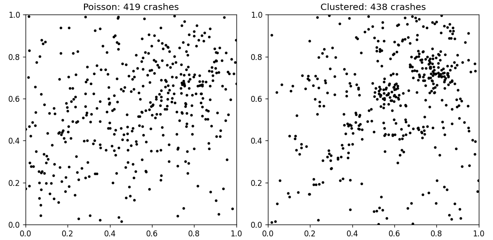

### 11.8.2 The Pair Correlation of the Thomas Process (Optional)

*This subsection derives the formula for $g$ used above. It can be skipped on a first reading.*

Two offspring of the same parent are displaced from it by independent $N(\mathbf{0}, \sigma_c^2\mathbf{I})$ vectors, so the difference between their locations is $N(\mathbf{0}, 2\sigma_c^2\mathbf{I})$, with density $\mathcal{N}_c(\mathbf{h}) = \exp(-\lVert\mathbf{h}\rVert^2/(4\sigma_c^2))/(4\pi\sigma_c^2)$. Before thinning, a parent has $M$ offspring (here $M$ is the number of offspring of one parent, not the pixel count of Section 11.2), where $M$ is Poisson with mean $\mu_c$, so the number of ordered pairs of offspring of one parent is $M(M - 1)$, with mean $\operatorname{E}[M(M-1)] = \mu_c^2$. The parents occur at rate $\kappa$ per unit area, so the expected number of ordered pairs from a common parent, per unit area and per unit of displacement density, is $\kappa\mu_c^2\mathcal{N}_c(\mathbf{h})$. Pairs with offspring of different parents occur at rate $(\kappa\mu_c)^2$, as in a Poisson process, because the parents are independent. Therefore the total pair rate is $(\kappa\mu_c)^2 + \kappa\mu_c^2\mathcal{N}_c(\mathbf{h})$, and dividing by the squared intensity $(\kappa\mu_c)^2$,

$$
g(h) = 1 + \frac{\kappa\mu_c^2\mathcal{N}_c}{(\kappa\mu_c)^2} = 1 + \frac{\mathcal{N}_c}{\kappa}
$$

Independent thinning with retention probability $p(\mathbf{s})$ multiplies the intensity at $\mathbf{s}$ by $p(\mathbf{s})$ and the pair rate at $(\mathbf{s}, \mathbf{t})$ by $p(\mathbf{s})p(\mathbf{t})$, so it leaves $g$ unchanged. This is why the thinned process has a pair correlation that does not depend on location, and why the trend $\lambda(\mathbf{s})$ and the clustering can be modeled separately.

### 11.8.3 The Sandwich for a Point Process

The same calculation gives the variance of $\hat{\boldsymbol{\beta}}$. The estimating equation is $\mathbf{U}(\hat{\boldsymbol{\beta}}) = \mathbf{0}$ with the score $\mathbf{U}(\boldsymbol{\beta}) = \sum_i\mathbf{x}(\mathbf{s}_i) - \int\mathbf{x}\lambda$ of Section 11.2.2. Expand around the true $\boldsymbol{\beta}$. The derivative of the score is $-\mathcal{I}(\boldsymbol{\beta})$ and does not involve the events, so to first order

$$
\mathbf{0} = \mathbf{U}(\hat{\boldsymbol{\beta}}) \approx \mathbf{U}(\boldsymbol{\beta}) - \mathcal{I}(\boldsymbol{\beta})(\hat{\boldsymbol{\beta}} - \boldsymbol{\beta}) \qquad \Longrightarrow \qquad \hat{\boldsymbol{\beta}} - \boldsymbol{\beta} \approx \mathcal{I}^{-1}\mathbf{U}(\boldsymbol{\beta})
$$

The score has mean zero, and applying the variance formula with $f = \mathbf{a}'\mathbf{x}$ for each vector $\mathbf{a}$ gives its covariance matrix:

$$
\operatorname{Var}(\mathbf{U}) = \mathcal{I}(\boldsymbol{\beta}) + \boldsymbol{\Xi}, \qquad \boldsymbol{\Xi} = \int\!\!\int\mathbf{x}(\mathbf{s})\mathbf{x}(\mathbf{t})'\lambda(\mathbf{s})\lambda(\mathbf{t})\left(g - 1\right)d\mathbf{s}\,d\mathbf{t}
$$

Therefore

$$
\operatorname{Var}(\hat{\boldsymbol{\beta}}) \approx \mathcal{I}^{-1}\left(\mathcal{I} + \boldsymbol{\Xi}\right)\mathcal{I}^{-1}
$$

This is the sandwich of Section 1.3.2 in a new setting. The outer pieces are what the Poisson GLM computes, and the middle has an extra term for the dependence. If $g \equiv 1$ then $\boldsymbol{\Xi} = \mathbf{0}$ and the sandwich collapses to $\mathcal{I}^{-1}$, the GLM's answer. For the Thomas process, $g - 1 = \mathcal{N}_c/\kappa$ is a positive definite function, so $\boldsymbol{\Xi}$ is positive semi-definite and the true variance is at least the naive one in every direction. The inflation is largest for covariates that are smooth, because a smooth covariate takes similar values on the events of a cluster, so its sum over the cluster does not average out. These are the same two conditions, positive dependence and a smooth covariate, that made the OLS standard errors of Chapter 1 too small.

### 11.8.4 Estimating the Middle

The matrix $\boldsymbol{\Xi}$ involves the unknown $g$. There are two routes.

**A pair-correlation estimate.** Choose a parametric form for $g$ and plug in estimates. For the Thomas process $g - 1 = \mathcal{N}_c/\kappa$, and $\boldsymbol{\Xi}$ becomes $(1/\kappa)\int\!\!\int\mathbf{x}(\mathbf{s})\mathbf{x}(\mathbf{t})'\lambda(\mathbf{s})\lambda(\mathbf{t})\mathcal{N}_c(\mathbf{s} - \mathbf{t})\,d\mathbf{s}\,d\mathbf{t}$: a double integral over a grid, computed with the separable trick of Section 11.8.1. The parameters $\kappa$ and $\sigma_c$ are estimated by **minimum contrast**: fit the model's $K$-function to the observed inhomogeneous $K$ by least squares, in the way that a parametric variogram is fitted to a binned one in Chapter 3, as Chapter 12 develops in full. The model's $K$-function is

$$
K_{\text{Thomas}}(r) = \pi r^2 + \frac{1}{\kappa}\left(1 - e^{-r^2/(4\sigma_c^2)}\right)
$$

and we compare the fourth roots of the observed and fitted curves, which stabilizes the variance.

**A block estimate.** Cut the region into $J \times J$ blocks and compute the score contribution of each block, $\mathbf{U}_b = \sum_{i \in b}\mathbf{x}(\mathbf{s}_i) - \int_b\mathbf{x}\hat{\lambda}$. If blocks were independent, $\operatorname{Var}(\mathbf{U}) = \sum_b\operatorname{Var}(\mathbf{U}_b)$, which is estimated by $\sum_b\mathbf{U}_b\mathbf{U}_b'$ with a small-sample factor $J^2/(J^2 - 1)$. This needs no model for the clustering. Its weakness is that clusters straddle block boundaries, which makes neighboring blocks dependent and, we expect, the estimate too small, and with few blocks the estimate is noisy.

### 11.8.5 The Parametric Bootstrap

A third way avoids formulas. Fit the Thomas model: the trend by the GLM and $(\kappa, \sigma_c)$ by minimum contrast. Simulate many patterns from the fitted model, refit the GLM to each, and take the standard deviation of the refitted coefficients as the standard error. The bootstrap must simulate **clusters**. A bootstrap that simulates a Poisson process from the fitted trend reproduces the naive standard errors, because it has no clustering to reproduce (Exercise 20).

### 11.8.6 One Clustered Pattern

The code defines the block and pair-correlation sandwiches and the minimum contrast fit, then computes every standard error for one clustered pattern, with 299 bootstrap replicates for the last.

```python
def block_sandwich(P, b, m=30, J=4):
    """Covariance of the Berman-Turner fit with a block-score 'meat'."""
    pts, a, ind = quadrature_counting(P, m)
    X = design(pts)
    mu = np.exp(X @ b)
    info = X.T @ ((a * mu)[:, None] * X)
    contrib = X * (ind - a * mu)[:, None]
    blk = np.floor(pts[:, 1] * J) * J + np.floor(pts[:, 0] * J)
    U = np.zeros((J * J, X.shape[1]))
    np.add.at(U, blk.astype(int), contrib)
    inv = np.linalg.inv(info)
    return inv @ ((J * J / (J * J - 1)) * U.T @ U) @ inv


def pc_sandwich(b, kappa, sigma, m=60):
    """Covariance when pairs of events have pair correlation
    g(h) = 1 + exp(-h^2 / (4 sigma^2)) / (4 pi kappa sigma^2)."""
    Gm = grid_points(m)
    X = design(Gm)
    lam = np.exp(X @ b)
    info = X.T @ (lam[:, None] * X) / m**2
    A = X * lam[:, None]
    inv = np.linalg.inv(info)
    return inv @ (info + pair_integral(A, sigma, m) / kappa) @ inv


def thomas_k(r, kappa, sigma):
    return np.pi * r**2 + (1 - np.exp(-r**2 / (4 * sigma**2))) / kappa


def min_contrast(P, b, r_grid):
    """Fit (kappa, sigma) of an inhomogeneous Thomas process by matching
    K_inhom^(1/4) to the model's K^(1/4)."""
    k_obs = k_hat(P, r_grid, np.exp(design(P) @ b))
    obj = lambda t: np.sum((k_obs**0.25 - thomas_k(
        r_grid, np.exp(t[0]), np.exp(t[1]))**0.25)**2)
    res = optimize.minimize(obj, np.log([50.0, 0.05]), method="Nelder-Mead")
    return np.exp(res.x)


P_cl = sim_c()
b_cl, cov_cl, _, _ = fit_bt(P_cl, 30)
kap_hat, sig_hat = min_contrast(P_cl, b_cl, r_grid)
r_hat = lambda P: np.exp(design(P) @ b_cl)
max_hat = 1.05 * r_hat(grid_points(300) * 1.24 - 0.12).max()
boot = np.array([fit_bt(simulate_cluster(r_hat, max_hat, kap_hat, sig_hat,
                                         rng), 30)[0] for _ in range(299)])
ses = {"naive Poisson GLM": np.sqrt(np.diag(cov_cl)),
       "block sandwich": np.sqrt(np.diag(block_sandwich(P_cl, b_cl))),
       "pair correlation, true (kappa, sigma)":
           np.sqrt(np.diag(pc_sandwich(b_cl, kappa, sigma_c))),
       "pair correlation, estimated":
           np.sqrt(np.diag(pc_sandwich(b_cl, kap_hat, sig_hat))),
       "parametric bootstrap": boot.std(axis=0, ddof=1)}
print("one clustered pattern: n =", len(P_cl), " estimate",
      np.round(b_cl, 3), " truth", np.round(beta_true, 3))
print("minimum contrast: kappa =", round(kap_hat, 1), " sigma =",
      round(sig_hat, 4), " (true 100 and 0.03)")
for name, v in ses.items():
    print(f"{name:38s} SE = {np.round(v, 3)}")
```

The 424-event pattern gives $\hat{\boldsymbol{\beta}} = (5.842, -3.312, 1.698)$ against the truth $(5.846, -3, 1.5)$. Minimum contrast estimates $\hat{\kappa} = 181.7$ and $\hat{\sigma}_c = 0.0323$, against the true $100$ and $0.03$. The cluster size is right, but the parent density is too high, which makes the clustering look weaker than it is.

| Method | SE($\hat{\beta}_0$) | SE($\hat{\beta}_1$) | SE($\hat{\beta}_2$) |
| :--- | :--- | :--- | :--- |
| Naive Poisson GLM | 0.174 | 0.419 | 0.228 |
| Block sandwich ($4 \times 4$ blocks) | 0.311 | 0.480 | 0.559 |
| Pair correlation, true $(\kappa, \sigma_c)$ | 0.436 | 0.920 | 0.648 |
| Pair correlation, estimated | 0.342 | 0.733 | 0.502 |
| Parametric bootstrap | 0.331 | 0.777 | 0.492 |

The naive standard errors are too small by a factor of 2.2 to 2.8 against the pair-correlation values with the true parameters. The estimated-parameter versions fall in between: the overestimate of $\kappa$ shrinks the correction. The block estimate is erratic, as expected with 16 blocks. A single pattern cannot tell which method is right; the repeated experiment of Section 11.9.4 can.

---

<a id="s11-9"></a>

## 11.9 Walkthrough and Lab 11

The sections above each ended with a worked example. This section collects the repeated-sampling experiments behind the claims made along the way: that the logistic fit pays a price for an unknown baseline, that the scan test has the stated size and power, that estimating the intensity from the same data biases the $K$-function, and that the corrected standard errors cover.

### 11.9.1 The Price of an Unknown Baseline

For 200 simulated data sets, fit the plume amplitude $\beta_1$ with the offset model (the baseline known) and with logistic regression (the baseline unknown, estimated by controls), for one year of cases and for five. The true amplitude is 1.

```python
rows = []
for r in range(200):
    P0 = simulate_poisson(rate_ctrl, 800.0, rng)
    cases = [simulate_poisson(rate_case, max_case, rng) for _ in range(5)]
    row = []
    for Pc in (cases[0], np.vstack(cases)):
        b_o = fit_bt(Pc, 30, cov_bump(0.1), log_pop)[0]
        Pa, ya = pooled(Pc, P0)
        b_l = irls_logistic(cov_bump(0.1)(Pa), ya)[0]
        row += [b_o[1], b_l[1]]
    rows.append(row)
rows = np.array(rows)
print("200 replications, true b1 = 1")
for k, name in enumerate(("one year, offset", "one year, logistic",
                          "five years, offset", "five years, logistic")):
    print(f"{name:21s} mean {rows[:, k].mean():.3f}  "
          f"sd {rows[:, k].std(ddof=1):.3f}")
```

| Cases | Method | Mean of $\hat{\beta}_1$ | SD |
| :--- | :--- | :--- | :--- |
| One year | Offset (baseline known) | 0.963 | 0.780 |
| One year | Logistic | 1.012 | 0.860 |
| Five years | Offset (baseline known) | 1.008 | 0.282 |
| Five years | Logistic | 1.055 | 0.475 |

Both methods are close to unbiased. The logistic fit loses 10% in standard deviation with one year of cases and 68% with five. The reason is that the baseline is estimated from 385 controls, and the logistic variance has two parts, one from the cases and one from the controls. With 58 cases, the cases' part dominates. With 296 cases, the controls' part is as large as the cases'. More controls would close the gap (Exercise 16).

### 11.9.2 Size and Power of the Scan Test

Using the reference distribution of Section 11.6.4, run 200 data sets for each of four cluster sizes, with $n = 350$ events in all, and record how often the Monte Carlo p-value is below $0.05$, and, among the rejections, how often the best window's center lies within $0.1$ of the true center.

```python
print("extra  reject  localized")
for extra in (0, 10, 20, 35):
    rej = loc = 0
    for rep in range(200):
        lk = scan(inject(350 - extra, extra, rng))[0]
        i, j = np.unravel_index(lk.argmax(), lk.shape)
        if (1 + np.sum(null_max >= lk.max())) / (B + 1) < 0.05:
            rej += 1
            loc += np.hypot(*(centers[i] - [0.25, 0.2])) < 0.1
    print(f"{extra:5d} {rej / 200:7.3f} {loc / max(rej, 1):9.3f}")
```

| Extra events | Rejection rate | Best window near true center |
| :--- | :--- | :--- |
| 0 | 0.065 | not applicable |
| 10 | 0.535 | 0.869 |
| 20 | 1.000 | 0.990 |
| 35 | 1.000 | 1.000 |

With no cluster the test rejects in 6.5% of the 200 data sets, near the nominal 5% (a standard error of about 1.5%). Ten extra events in a window that expects about two are detected half the time, and twenty are always detected and nearly always located correctly. These numbers describe this cluster size and this baseline, and say how much power one can expect, not that the method is always this sensitive.

### 11.9.3 Plug-In Intensities and the Inhomogeneous $K$

In 100 Poisson crash patterns, compute $\hat{K}_{\text{inhom}}(r)/(\pi r^2)$ at $r = 0.04$ and $0.08$ with six intensity estimates. The correct value is 1. The kernel estimates are edge corrected and use a Gaussian kernel of bandwidth $0.10$ or $0.03$, either including the event itself or leaving it out.

```python
def kernel_at_points(P, psi, leave_out):
    """Kernel intensity estimate at the data points, edge corrected."""
    phi = np.exp(-dist(P)**2 / (2 * psi**2)) / (2 * np.pi * psi**2)
    if leave_out:
        np.fill_diagonal(phi, 0.0)
    edge = lambda c: special.ndtr((1 - c) / psi) - special.ndtr(-c / psi)
    return phi.sum(axis=1) / (edge(P[:, 0]) * edge(P[:, 1]))


r_chk = np.array([0.04, 0.08])
ratio = {k: [] for k in ("true intensity", "fitted GLM",
                         "kernel 0.10, own point", "kernel 0.10, left out",
                         "kernel 0.03, own point", "kernel 0.03, left out")}
for s in range(100):
    Ps = sim_p()
    bs = fit_bt(Ps, 20)[0]
    lam_options = {"true intensity": rate(Ps),
                   "fitted GLM": np.exp(design(Ps) @ bs),
                   "kernel 0.10, own point": kernel_at_points(Ps, .10, False),
                   "kernel 0.10, left out": kernel_at_points(Ps, .10, True),
                   "kernel 0.03, own point": kernel_at_points(Ps, .03, False),
                   "kernel 0.03, left out": kernel_at_points(Ps, .03, True)}
    for k, lam in lam_options.items():
        ratio[k].append(k_hat(Ps, r_chk, lam) / (np.pi * r_chk**2))
print("mean K_inhom / (pi r^2) at r = 0.04, 0.08 (1 is correct):")
for k, v in ratio.items():
    print(f"  {k:24s}", np.round(np.mean(v, axis=0), 3))
```

| Intensity estimate | $r = 0.04$ | $r = 0.08$ |
| :--- | :--- | :--- |
| True intensity | 1.012 | 0.999 |
| Fitted GLM | 1.008 | 0.995 |
| Kernel 0.10, includes the event | 0.794 | 0.801 |
| Kernel 0.10, event left out | 0.885 | 0.893 |
| Kernel 0.03, includes the event | 0.358 | 0.453 |
| Kernel 0.03, event left out | 0.806 | 2.016 |

The GLM estimate, with three parameters, gives the same answer as the true intensity. A kernel estimate that includes the event itself is biased downward, because every event contributes to its own estimated intensity; the smaller the bandwidth, the larger the contribution and the bias. Leaving the event out reduces the bias but does not remove it, and with a small bandwidth the estimate at an isolated event can be close to zero, which makes some pair weights enormous and the result unstable, as the value $2.016$ shows. A parsimonious parametric intensity is the safer plug-in.

### 11.9.4 Coverage Under Clustering

Simulate 300 clustered patterns. For each, fit the Poisson GLM and compute four standard errors: the naive one, the block sandwich, and the pair-correlation sandwich with the true and with the estimated $(\kappa, \sigma_c)$. A 95% interval covers when $\lvert\hat{\beta} - \beta\rvert < 1.96\,\text{SE}$.

```python
rows = []
for r in range(300):
    P = sim_c()
    b, cv, _, _ = fit_bt(P, 30)
    kh, sh = min_contrast(P, b, r_grid)
    se = [np.sqrt(np.diag(cv)), np.sqrt(np.diag(block_sandwich(P, b))),
          np.sqrt(np.diag(pc_sandwich(b, kappa, sigma_c))),
          np.sqrt(np.diag(pc_sandwich(b, kh, sh)))]
    rows.append(np.concatenate([b] + se))
rows = np.array(rows)
bh, sd = rows[:, :3], rows[:, :3].std(axis=0, ddof=1)
print("300 clustered patterns: mean estimate", np.round(bh.mean(axis=0), 3),
      " sd", np.round(sd, 3))
for k, name in enumerate(("naive Poisson", "block sandwich",
                          "pair corr., true", "pair corr., estimated")):
    se = rows[:, 3 + 3 * k:6 + 3 * k]
    cover = (np.abs(bh - beta_true) < 1.96 * se).mean(axis=0)
    print(f"{name:22s} mean SE {np.round(se.mean(axis=0), 3)}  "
          f"coverage {np.round(cover, 3)}")
```

For comparison, 300 Poisson patterns from the same trend:

```python
p_rows = []
for r in range(300):
    P = sim_p()
    b, cv, _, _ = fit_bt(P, 30)
    p_rows.append(np.concatenate([b, np.sqrt(np.diag(cv))]))
p_rows = np.array(p_rows)
cover = (np.abs(p_rows[:, :3] - beta_true) < 1.96 * p_rows[:, 3:]).mean(axis=0)
print("300 Poisson patterns: mean estimate",
      np.round(p_rows[:, :3].mean(axis=0), 3), " sd",
      np.round(p_rows[:, :3].std(axis=0, ddof=1), 3), " naive coverage",
      np.round(cover, 3))
```

With Poisson data, the estimates are centered on the truth, $(5.854, -3.024, 1.487)$, the standard deviations are $(0.172, 0.420, 0.237)$, the naive standard errors are right, and the intervals cover 95.7%, 95.3%, and 96.3% of the time. With clustered data, the estimates are still centered on the truth, at $(5.858, -3.034, 1.435)$, so **clustering does not bias the coefficients**. It makes them more variable: the standard deviations are $(0.400, 0.856, 0.639)$, more than twice the Poisson values.

| Method | Mean SE | Coverage of 95% intervals |
| :--- | :--- | :--- |
| Naive Poisson | $(0.181, 0.425, 0.243)$ | $(0.620, 0.680, 0.600)$ |
| Block sandwich | $(0.331, 0.734, 0.456)$ | $(0.867, 0.877, 0.803)$ |
| Pair correlation, true $(\kappa, \sigma_c)$ | $(0.437, 0.906, 0.649)$ | $(0.970, 0.957, 0.940)$ |
| Pair correlation, estimated | $(0.423, 0.881, 0.628)$ | $(0.960, 0.947, 0.937)$ |

The naive intervals cover only 60% to 68% of the time. The block sandwich helps but is still too small. The pair-correlation sandwich is almost exactly right, whether the cluster parameters are known or estimated by minimum contrast, because the formula $\mathcal{I}^{-1}(\mathcal{I} + \boldsymbol{\Xi})\mathcal{I}^{-1}$ is right when $g$ is. The price is that one must model the interaction.

### 11.9.5 The Bootstrap Over Repeated Patterns

For 50 clustered patterns, run the parametric bootstrap of Section 11.8.5 with 99 resamples each, and compare its mean standard error with the spread of the estimates.

```python
boot_rows = []
for r in range(50):
    P = sim_c()
    b = fit_bt(P, 30)[0]
    kh, sh = min_contrast(P, b, r_grid)
    rh = lambda Q, b=b: np.exp(design(Q) @ b)
    mh = 1.05 * rh(grid_points(300) * 1.24 - 0.12).max()
    bb = np.array([fit_bt(simulate_cluster(rh, mh, kh, sh, rng), 30)[0]
                   for _ in range(99)])
    boot_rows.append(np.concatenate([b, bb.std(axis=0, ddof=1)]))
boot_rows = np.array(boot_rows)
cover = (np.abs(boot_rows[:, :3] - beta_true)
         < 1.96 * boot_rows[:, 3:]).mean(axis=0)
print("50 clustered patterns, bootstrap: mean SE",
      np.round(boot_rows[:, 3:].mean(axis=0), 3), " sd of estimates",
      np.round(boot_rows[:, :3].std(axis=0, ddof=1), 3),
      " coverage", np.round(cover, 3))
```

The mean bootstrap standard errors are $(0.432, 0.894, 0.651)$, close to the pair-correlation values and to the standard deviations of the estimates over the 50 patterns, $(0.479, 0.808, 0.792)$, which are noisy with only 50 patterns. Coverage is $0.90$, $0.98$, and $0.92$, with a standard error of 3% to 4% on each. The bootstrap is slower than the sandwich and needs a model for the clustering, and in return it makes no first-order approximation.

---

<a id="ch11-exercises"></a>

## Exercises

**Analytical**

1. Show that for a homogeneous Poisson process on $\mathcal{D}$, conditioning on $N(\mathcal{D}) = n$ makes the locations $n$ independent uniform points, so the locations carry no information about $\lambda$. Which factor of the likelihood carries all of it?

2. For $\lambda(s) = \exp(\beta_0 + \beta_1 s)$ on $[0, 1]$ (one dimension), compute $\mathcal{I}(\boldsymbol{\beta})$ in closed form. Show that it is positive definite when $\beta_1$ is any real number, and find its determinant.

3. Verify the second component of the score at the starting value in Section 11.3.4: $\sum_ix_i - 3\sum_ka_kx_k = 1.3 - 1.51875 = -0.2188$. Compute $\sum_ka_kx_k$ by hand from the table.

4. Show that counting weights are nonnegative and sum to $\operatorname{area}(\mathcal{D})$. If no data points fall in a cell, what rule do the weights reduce to?

5. Show that if $a$ is a positive integer, $a(y\log\mu - \mu)$ equals the sum of the Poisson log-likelihood contributions of $a$ observations, each equal to $y$, up to a constant that does not involve $\mu$.

6. With only an intercept and an offset $\log\lambda_{\text{pop}}(\mathbf{s})$, show that $\hat{\beta}_0 = \log\bigl(n/\int\lambda_{\text{pop}}\bigr)$. Explain why this is the maximum likelihood estimate of the overall relative risk.

7. Let cases have intensity $\kappa_1\lambda_{\text{pop}}(\mathbf{s})\theta(\mathbf{s})$ and controls $\kappa_0\lambda_{\text{pop}}(\mathbf{s})$. Show that multiplying the number of years of cases by $k$ adds $\log k$ to the true intercept of the logistic model and leaves the slopes unchanged.

8. Derive the scan statistic from a Poisson model: inside window $w$ the intensity is multiplied by $r_1$, outside by $r_0$, with expected counts $e_w$ and $n_{\text{tot}} - e_w$ under the baseline. Maximize over $(r_1, r_0)$ and show the maximized log-likelihood minus the null log-likelihood is $\operatorname{LLR}_w$ when the baseline's total expected count equals $n$.

9. For a fixed window, expand $\operatorname{LLR}_w$ around $n_w = e_w$ and show that $2\operatorname{LLR}_w \approx (n_w - e_w)^2/e_w$ when $n$ is large and $e_w/n$ is small. Why does this imply that $2\operatorname{LLR}_w$ is approximately $\chi^2_1$ for a fixed window?

10. For the unit square, derive the translation weight $\omega_{ij} = 1/((1 - \lvert\Delta x\rvert)(1 - \lvert\Delta y\rvert))$ by computing the area of $\mathcal{D} \cap (\mathcal{D} + \mathbf{h})$.

11. Derive $K_{\text{ord}}(r) \approx \pi r^2(1 + \operatorname{CV}^2)$ for an inhomogeneous Poisson process. For $\lambda(\mathbf{s}) = \bar{\lambda}(1 + a\cos(2\pi s_1))$, compute $\operatorname{CV}^2$ and the predicted $(L - r)/r$.

12. Show that for the Thomas process before thinning, $\int(g(h) - 1)\,d\mathbf{h} = 1/\kappa$, and conclude that the variance-to-mean ratio of the count in a very large region is $1 + \lambda/\kappa = 1 + \mu_c$.

13. For an intercept-only log-linear model fitted to a clustered process in a large region, show that $\operatorname{Var}(\hat{\beta}_0) \approx (1 + \lambda/\kappa)/(\lambda\operatorname{area}(\mathcal{D}))$. By what factor are the naive standard errors too small when $\lambda = 400$ and $\kappa = 100$?

14. In the sandwich $\mathcal{I}^{-1}(\mathcal{I} + \boldsymbol{\Xi})\mathcal{I}^{-1}$ for an intercept-only model, show that $\boldsymbol{\Xi}$ is negative when $g < 1$ everywhere (inhibition), so that the naive standard error is too large. Chapter 12 develops models with $g < 1$.

**Computational and simulation**

15. Add a covariate with no effect (the north coordinate) to the crash model and fit it to 500 Poisson patterns. What fraction of the z-tests for its coefficient reject at 5%? Repeat with 500 clustered patterns.

16. In the case-control experiment of Section 11.9.1, replace the 385 controls (363 expected) by about 4,000 expected controls (intensity $8{,}000\,\lambda_{\text{pop}}$) and repeat the five-year comparison. Does the standard deviation of the logistic fit approach that of the offset fit?

17. Fit the bump logistic model with the wrong center, $(0.5, 0.5)$ instead of $(0.3, 0.6)$, and with the right center but a ridge-shaped true excess along a line. How well does each recover the pattern, and what does the likelihood ratio test say?

18. Run the scan statistic on data from the baseline of Section 11.6.3 but with a homogeneous baseline $\lambda_{\text{bg}} \equiv$ constant. Where does the scan find clusters, and how often does it reject at 5%?

19. Make a figure of $\hat{K}_{\text{inhom}}(r)/(\pi r^2)$ at $r = 0.08$ against the kernel bandwidth, from $0.02$ to $0.3$, with and without leaving the event out, for 100 Poisson patterns.

20. Replace the parametric bootstrap of Section 11.8.5 by one that simulates a Poisson process from the fitted trend. Show that its standard errors are close to the naive Poisson GLM standard errors and that its coverage under clustering is poor.

21. Vary the cluster strength: $\kappa \in \{50, 100, 400, 1{,}600\}$ with the same trend. For each, plot the ratio of the standard deviation of $\hat{\beta}_1$ to its naive standard error against the variance-to-mean ratio of the counts. Does the ratio of standard errors track the square root of the variance-to-mean ratio?

22. Vary the number of blocks $J$ in the block sandwich from 2 to 8 and report the coverage of the intervals for $\beta_1$ under clustering. Is there a $J$ that works?

---

<a id="ch11-what-comes-next"></a>

## What Comes Next

This chapter treated the structure of a point pattern as known or as a nuisance. Trends were modeled and clustering was corrected for, but the clusters themselves were never described. Chapter 12 turns to them. It develops the Thomas process that we used here and the Matérn cluster process, and fits them by minimum contrast, as a preview did in Section 11.8. It introduces the log-Gaussian Cox process, which puts a spatial random effect $u(\mathbf{s})$ into the log-intensity and so connects point patterns with the geostatistics of Part II. And it treats inhibition with hard-core and Strauss processes, where the interaction term enters the Berman-Turner design matrix as one more column, so that the IRLS of this chapter fits them as well.


---

<a id="ch12"></a>

# Chapter 12: Models for Clustering and Inhibition

Chapter 10 gave us tools for looking at a point pattern: kernel intensity maps, the nearest-neighbor and empty-space functions, Ripley's $K$-function and the pair correlation function, and Monte Carlo envelopes. Chapter 11 turned the first-order part of the story into a regression: if the intensity depends on covariates, a Poisson GLM, fitted through the Berman-Turner device, estimates how. What neither chapter did is *model the way points relate to each other*. When the envelope for $L(r) - r$ is left behind, the pattern is saying something, and so far all we can do is describe it.

This chapter supplies models for that something. A pattern can depart from complete spatial randomness in three ways. The intensity can vary from place to place, which Chapter 11 handled. Points can attract each other, so that they come in clumps. Or points can repel each other, so that they keep their distance. The chapter builds one family of models for attraction (cluster processes, and their cousin the log-Gaussian Cox process) and one for repulsion (hard-core processes and Gibbs processes, of which the Strauss model is the simplest). For each family we ask the same questions: how is it simulated, what does it imply for $K(r)$, how are its parameters estimated, and how do we check that it fits.

Two threads from earlier chapters come together here. The model equation $Y = \mu + u + \varepsilon$ returns in Section 12.3 as the log-intensity of a Cox process, where the spatial random effect $u$ of Part II creates the clustering. And the estimation methods are old friends in new clothes: fitting a cluster process is the nonlinear least squares of Chapter 3 applied to $\hat{K}$ in place of a variogram, and fitting an inhibition process is the weighted Poisson regression of Chapter 11 with one extra column in the design matrix.

> **Chapter at a Glance**
>
> - **Three Explanations (§12.1):** Trend, clustering, and inhibition, and what each predicts for $g(r)$ and $K(r)$.
> - **Cluster Processes (§12.2):** Neyman-Scott processes (parents, offspring), the Thomas and Matérn cluster models, simulation with a buffer, the closed-form $K$ of the Thomas process, fitting by minimum contrast, and inhomogeneous cluster models.
> - **The Log-Gaussian Cox Process (§12.3):** The model equation once more, with the pair correlation function $g(r) = \exp(C_u(r))$ and a pixel-grid fit that combines Parts II and III with the Poisson GLM.
> - **Inhibition (§12.4):** Matérn hard-core processes and sequential inhibition, the Strauss model as a Gibbs process, the neighbor count as one more covariate column, and maximum pseudolikelihood.
> - **Checking a Fitted Model (§12.5):** Smoothed residual fields, envelopes simulated from the fitted model, and what a table of goodness-of-fit tests can and cannot tell apart.
> - **Walkthrough and Lab (§12.6):** Seven figures that put the pieces side by side.

---

<a id="s12-1"></a>

## 12.1 Three Explanations for a Departure From CSR

Suppose you have a slide of cells and an envelope plot in which $L(r) - r$ rises above the Monte Carlo band. What does that mean? Three different stories produce the same picture, and the rest of the chapter exists to tell them apart.

- **Heterogeneity.** The intensity is not constant. A region of the slide is more densely populated than another, and points are placed independently given that intensity. Pairs of points are close to each other mostly because both sit in the dense region, not because one attracts the other. This is the situation of Chapter 11, where the intensity $\lambda(\mathbf{s}) = \exp(\mathbf{x}(\mathbf{s})'\boldsymbol{\beta})$ is explained by covariates.
- **Clustering.** Points attract each other. Given the position of one point, a second point is more likely to be nearby than a uniformly placed point would be. Immune cells gather around tumor nests; seedlings grow near parent trees; disease cases spread from a source.
- **Inhibition.** Points repel each other. Given the position of one point, a second is *less* likely to be nearby. Cells cannot overlap, shops avoid opening next door to each other, and tumor cells compete for space.

Recall from Chapter 10 the pair correlation function $g(r)$, which compares the density of pairs at distance $r$ with what independence would give, and its cumulative version $K(r) = \int_0^r 2\pi s\,g(s)\,ds$. Under complete spatial randomness $g(r) = 1$ and $K(r) = \pi r^2$. The three explanations leave different fingerprints.

| Explanation | How the points arise | $g(r)$ after accounting for $\lambda(\mathbf{s})$ | Ordinary $K(r)$ against $\pi r^2$ | Model, and where |
| :--- | :--- | :--- | :--- | :--- |
| Heterogeneity | Independent given a varying intensity | Equal to 1 | Above (an artifact) | Inhomogeneous Poisson, Chapter 11 |
| Clustering | Points attract | Above 1 at short distances | Above | Cluster processes (§12.2), Cox processes (§12.3) |
| Inhibition | Points repel | Below 1 at short distances | Below | Hard-core and Gibbs processes (§12.4) |

Two cautions come with this table. First, the third column is the one that distinguishes heterogeneity from clustering, and it requires knowing $\lambda(\mathbf{s})$. Chapter 11 showed that an ordinary $K$-function applied to a pattern with a trend looks clustered, which is why the inhomogeneous $K$-function reweights each pair by the inverse intensities. We will see the same trap again in Section 12.5.3.

Second, the line between heterogeneity and clustering is partly a matter of what you measured. If the dense region is explained by a covariate you observed, it is a trend. If it comes from a driver you did not observe and cannot name, the model has to treat it as random, and a random intensity looks exactly like clustering. That observation is the idea behind the Cox processes of Section 12.3, and it is why the cluster models of Section 12.2 can be read either mechanistically (points really do gather around parents) or as a convenient description of unexplained heterogeneity.

Figure 12.1 in Section 12.6 puts the three side by side: three patterns, with the *same ordinary* $L(r) - r$ plotted below each. The first two rise above zero and the third falls below it.

The tools we carry over are the ones from Chapters 10 and 11. We write $\lambda(\mathbf{s})$ for the intensity and $\mathcal{D}$ for the unit square (so $\operatorname{area}(\mathcal{D}) = 1$). The estimator is

$$
\hat{K}(r) = \frac{1}{n(n-1)}\sum_{i=1}^n\sum_{j \ne i}\omega_{ij}\,\mathbb{1}(h_{ij} \le r)
$$

where $h_{ij}$ is the distance between points $i$ and $j$ and $\omega_{ij}$ corrects for edges. Chapter 10 derived Ripley's isotropic weights. On a rectangle there is a simpler choice, the *translation correction*, which gives each pair the weight $\omega_{ij} = 1/\left[(1 - \lvert\Delta x_{ij}\rvert)(1 - \lvert\Delta y_{ij}\rvert)\right]$, where $\Delta x_{ij}$ and $\Delta y_{ij}$ are the coordinate differences. The weight is the reciprocal of the fraction of the window that stays inside the window when it is shifted by the pair's separation vector, and it can be computed in one line. We use it throughout this chapter.

---

<a id="s12-2"></a>

## 12.2 Cluster Processes

### 12.2.1 Neyman-Scott Processes

A **Neyman-Scott process** builds a clustered pattern in three steps.

1. **Parents.** Place unobserved *parent* points as a homogeneous Poisson process with intensity $\kappa$.
2. **Offspring counts.** Give each parent an independent number of offspring, Poisson with mean $\mu_c$.
3. **Dispersal.** Place each offspring at the parent's location plus an independent random displacement with a fixed density $f(\mathbf{d})$ that is symmetric around the origin.

The observed pattern is the set of offspring only. The parents are never seen.

Our running story is a slide of tissue from a tumor. The parents are small tumor nests that the stain did not reveal. The offspring are immune cells, which gather around the nests. The unit square is a $1\text{ mm} \times 1\text{ mm}$ field of view, so a displacement spread of $0.03$ is $30\ \mu\text{m}$. (The data are simulated; the numbers are chosen for readability and are not measurements.)

**The intensity of the offspring process.** The process of offspring is stationary, and its intensity is $\lambda = \kappa\mu_c$. The derivation is a short calculation and a first example of an argument we will use again for $K$.

*A tool: Campbell's formula for a Poisson process.* If $\Phi$ is a Poisson process with intensity $\kappa$ and $q$ is a function, then the expected sum of $q$ over the points of $\Phi$ is $\operatorname{E}\left[\sum_{\mathbf{c} \in \Phi} q(\mathbf{c})\right] = \kappa\int q(\mathbf{c})\,d\mathbf{c}$. In words, the expected sum is the intensity times the integral, because the expected number of points in a small area $d\mathbf{c}$ is $\kappa\,d\mathbf{c}$.

Let $B$ be a region and $N(B)$ the number of offspring in $B$. A parent at $\mathbf{c}$ contributes, on average, $\mu_c$ offspring, each landing in $B$ with probability $\int \mathbb{1}(\mathbf{c} + \mathbf{d} \in B)\,f(\mathbf{d})\,d\mathbf{d}$. Writing the sum over parents and applying Campbell's formula to $q(\mathbf{c}) = \mu_c\int \mathbb{1}(\mathbf{c} + \mathbf{d} \in B)\,f(\mathbf{d})\,d\mathbf{d}$,

$$
\operatorname{E}[N(B)] = \kappa\mu_c\int\!\!\int \mathbb{1}(\mathbf{c} + \mathbf{d} \in B)\,f(\mathbf{d})\,d\mathbf{d}\,d\mathbf{c} = \kappa\mu_c\int f(\mathbf{d})\left[\int \mathbb{1}(\mathbf{c} + \mathbf{d} \in B)\,d\mathbf{c}\right]d\mathbf{d} = \kappa\mu_c\operatorname{area}(B)
$$

The inner integral is the area of $B$ shifted by $-\mathbf{d}$, which is $\operatorname{area}(B)$ whatever $\mathbf{d}$ is, and then $\int f = 1$. So the intensity is $\lambda = \kappa\mu_c$: parents per unit area times offspring per parent.

**The variance of the count.** The number of offspring in the whole window is a compound Poisson sum: $M \sim \text{Poisson}(\kappa\operatorname{area}(\mathcal{D}))$ parents, each with an independent $\text{Poisson}(\mu_c)$ number of offspring (ignoring offspring that fall outside the window). For a compound sum, $\operatorname{Var}\left(\sum_{i=1}^M N_i\right) = \operatorname{E}[M]\operatorname{Var}(N_i) + \operatorname{Var}(M)\operatorname{E}[N_i]^2$, which gives

$$
\operatorname{Var}(N(\mathcal{D})) = \kappa\mu_c + \kappa\mu_c^2 = \lambda(1 + \mu_c)
$$

on the unit square. A Poisson process has variance equal to the mean, $\lambda$. The cluster process has variance $(1 + \mu_c)$ times as large: the more points per cluster, the more the count varies from slide to slide. For $\kappa = 25$ and $\mu_c = 8$, the mean is $200$ and the standard deviation is $\sqrt{200 \times 9} \approx 42$. That is why two slides from the same process can have very different numbers of cells, and why a single slide cannot pin down $\kappa$ and $\mu_c$ separately very well; there are only about $25$ clusters on it.

### 12.2.2 The Thomas and Matérn Cluster Processes

The two standard Neyman-Scott models differ only in the dispersal density $f$.

- **The Thomas process** displaces each offspring by an independent bivariate normal, $\mathbf{d} \sim N(\mathbf{0}, \sigma_c^2\mathbf{I}_2)$. Its parameters are the parent intensity $\kappa$, the mean cluster size $\mu_c$, and the spread $\sigma_c$. Clusters have no sharp boundary: most offspring fall within about $2\sigma_c$ of the parent, and a few fall much farther.
- **The Matérn cluster process** places each offspring uniformly on a disc of radius $R$ around its parent. Its parameters are $\kappa$, $\mu_c$, and $R$. Clusters are discs with a sharp edge.

In this chapter $\sigma_c$ always denotes the spread of the Gaussian dispersal, and $R$ the radius of the disc. The Matérn cluster process shares its name with the Matérn covariance family of Chapter 2 and the Matérn hard-core processes of Section 12.4, and has nothing mathematical in common with them except the originator.

### 12.2.3 Simulation With a Buffer

To simulate a Neyman-Scott process on the unit square, a first idea is: draw parents in the square, draw offspring around them, and keep the offspring. This is wrong near the edges. A parent just *outside* the square can have offspring *inside* it, and those offspring are lost if parents are only drawn inside. The pattern ends up with too few points near the boundary, and the intensity is not constant.

The fix is to draw parents on a buffered window that extends beyond the square by a margin large enough that parents farther out have a negligible chance of reaching in. For the Thomas process, a displacement has standard deviation $\sigma_c$ in each coordinate, so the chance that a normal variable exceeds $4\sigma_c$ in magnitude is about $6 \times 10^{-5}$. A buffer of $4\sigma_c$ is plenty. For the Matérn cluster process the buffer is exactly $R$.

The code below implements both simulators and checks the buffer. With $\kappa = 25$, $\mu_c = 8$, and $\sigma_c = 0.03$, the intensity is $200$. We simulate many patterns with and without the buffer and compare mean counts, and we count points in the strip within $0.03$ of an edge. Without a buffer, the expected fraction of offspring that stay inside is $1 - 4\sigma_c/\sqrt{2\pi}$, because each edge loses a strip of area equivalent to $\sigma_c/\sqrt{2\pi}$ per unit length of edge (the mean of $\max(0, Z)\sigma_c$ for a standard normal $Z$), so the four edges lose $4\sigma_c/\sqrt{2\pi}$ of the total.

```python
import numpy as np
from scipy import optimize


def sim_thomas(kappa, mu_c, sigma_c, rng, buffer=4.0):
    """Thomas process on the unit square; parents live in a buffered window.

    The simulator of Section 10.3.4 with the buffer width as an argument."""
    b = buffer * sigma_c
    n_par = rng.poisson(kappa * (1 + 2 * b) ** 2)
    parents = rng.uniform(-b, 1 + b, size=(n_par, 2))
    counts = rng.poisson(mu_c, size=n_par)
    centers = np.repeat(parents, counts, axis=0)
    pts = centers + sigma_c * rng.standard_normal(centers.shape)
    return pts[np.all((pts >= 0) & (pts <= 1), axis=1)]


def sim_matern_cluster(kappa, mu_c, R, rng):
    """Matern cluster process: offspring uniform on discs of radius R."""
    n_par = rng.poisson(kappa * (1 + 2 * R) ** 2)
    parents = rng.uniform(-R, 1 + R, size=(n_par, 2))
    counts = rng.poisson(mu_c, size=n_par)
    centers = np.repeat(parents, counts, axis=0)
    rad = R * np.sqrt(rng.uniform(size=len(centers)))
    ang = rng.uniform(0, 2 * np.pi, size=len(centers))
    pts = centers + np.column_stack([rad * np.cos(ang), rad * np.sin(ang)])
    return pts[np.all((pts >= 0) & (pts <= 1), axis=1)]
```

Now the check, with $6000$ patterns of each kind.

```python
rng = np.random.default_rng(2100)
kappa, mu_c, sigma_c = 25.0, 8.0, 0.03
n_with = [len(sim_thomas(kappa, mu_c, sigma_c, rng)) for _ in range(6000)]
n_without = [len(sim_thomas(kappa, mu_c, sigma_c, rng, buffer=0.0))
             for _ in range(6000)]
print(f"expected intensity kappa*mu_c = {kappa * mu_c:.0f}")
print(f"mean count with buffer:    {np.mean(n_with):6.1f} "
      f"(se {np.std(n_with) / np.sqrt(6000):.1f})")
print(f"mean count without buffer: {np.mean(n_without):6.1f} "
      f"(se {np.std(n_without) / np.sqrt(6000):.1f})")
loss = 4 * sigma_c / np.sqrt(2 * np.pi)
print(f"predicted loss without buffer: {100 * loss:.1f}% "
      f"-> {kappa * mu_c * (1 - loss):.1f}")
# edge profile: points within 0.03 of an edge, per unit area
def edge_density(P):
    near = np.minimum.reduce([P[:, 0], 1 - P[:, 0], P[:, 1], 1 - P[:, 1]])
    return np.sum(near < 0.03)
ring = 1 - (1 - 0.06) ** 2
e_with = np.mean([edge_density(sim_thomas(kappa, mu_c, sigma_c, rng))
                  for _ in range(500)]) / ring
e_without = np.mean([edge_density(sim_thomas(kappa, mu_c, sigma_c, rng, 0.0))
                     for _ in range(500)]) / ring
print(f"intensity in the outer 0.03 strip: with {e_with:.0f}, "
      f"without {e_without:.0f}")
```

With the buffer, the mean count over $6000$ patterns is $199.6$ (standard error $0.5$), indistinguishable from the expected $200$. Without it the mean is $190.0$, matching the predicted $4.8\%$ loss ($190.4$). The damage is concentrated at the edges: the intensity in the strip within $0.03$ of an edge is $194$ with the buffer (within simulation error of $200$) and only $131$ without it. An unbuffered pattern is not stationary, and a $K$-function estimated from it would be biased. We use the buffer from here on.

### 12.2.4 Deriving the $K$-Function of the Thomas Process

The goal is the closed form

$$
K(r) = \pi r^2 + \frac{1}{\kappa}\left(1 - \exp\!\left(-\frac{r^2}{4\sigma_c^2}\right)\right)
$$

It contains the Poisson value $\pi r^2$ plus an excess that grows from $0$ at $r = 0$ to $1/\kappa$ at large $r$. The derivation goes through the pairs of points, so we start with a tool.

**A tool we need: the second-order product density.** Let $\rho^{(2)}(\mathbf{s}, \mathbf{s}')\,d\mathbf{s}\,d\mathbf{s}'$ be the expected number of *ordered pairs* of distinct points with one in the small area $d\mathbf{s}$ and the other in $d\mathbf{s}'$. For a homogeneous Poisson process the two points are independent, so $\rho^{(2)} = \lambda^2$. For a stationary process $\rho^{(2)}$ depends only on the separation $\mathbf{h} = \mathbf{s} - \mathbf{s}'$, and the pair correlation function is the ratio to the Poisson value,

$$
g(\mathbf{h}) = \frac{\rho^{(2)}(\mathbf{h})}{\lambda^2}
$$

This is the definition of $g$ from Chapter 10 seen through pairs: $g > 1$ means pairs at that separation are more common than independence predicts. Given a point at the origin, the intensity of other points at $\mathbf{h}$ is $\rho^{(2)}(\mathbf{h})/\lambda$, so the expected number of other points within distance $r$ of a typical point is $\int_{\lVert\mathbf{h}\rVert \le r}\rho^{(2)}(\mathbf{h})/\lambda\,d\mathbf{h}$. By the definition of $K$, $\lambda K(r)$ is that expected number,

$$
K(r) = \int_{\lVert\mathbf{h}\rVert \le r} g(\mathbf{h})\,d\mathbf{h} = \int_0^r 2\pi s\,g(s)\,ds
$$

where the last form assumes $g$ depends only on distance.

**Step 1: split the pairs.** An ordered pair of distinct offspring comes either from two *different* parents or from the *same* parent. We find the expected number of each kind.

*Different parents.* A parent at $\mathbf{c}$ produces offspring with intensity function $\mu_c f(\mathbf{s} - \mathbf{c})$: the mean number of offspring times the density of where each lands. Two different parents are distinct points of a Poisson process, and the second-order version of Campbell's formula says that the expected sum over ordered pairs of distinct points of a Poisson process is $\kappa^2$ times the double integral. So the expected number of such pairs in $d\mathbf{s}\,d\mathbf{s}'$ is

$$
\kappa^2\int\!\!\int\mu_c f(\mathbf{s} - \mathbf{c}_1)\,\mu_c f(\mathbf{s}' - \mathbf{c}_2)\,d\mathbf{c}_1\,d\mathbf{c}_2 = \kappa^2\mu_c^2\cdot 1\cdot 1 = \lambda^2
$$

because each integral of a density is 1. Pairs from different parents behave exactly like pairs from a Poisson process.

*The same parent.* A parent at $\mathbf{c}$ has $N$ offspring, Poisson with mean $\mu_c$. The number of ordered pairs of distinct offspring is $N(N-1)$, with expectation $\operatorname{E}[N(N-1)] = \operatorname{E}[N^2] - \operatorname{E}[N] = (\mu_c + \mu_c^2) - \mu_c = \mu_c^2$. Each pair's two displacements are independent, so a pair lands in $d\mathbf{s}\,d\mathbf{s}'$ with density $f(\mathbf{s} - \mathbf{c})f(\mathbf{s}' - \mathbf{c})$. Summing over parents with Campbell's formula,

$$
\kappa\mu_c^2\int f(\mathbf{s} - \mathbf{c})\,f(\mathbf{s}' - \mathbf{c})\,d\mathbf{c} = \kappa\mu_c^2\,f_2(\mathbf{s} - \mathbf{s}')
$$

where $f_2(\mathbf{h}) = \int f(\mathbf{d})f(\mathbf{d} - \mathbf{h})\,d\mathbf{d}$ is the density of the *difference* $\mathbf{D}_1 - \mathbf{D}_2$ of two independent displacements.

**Step 2: add and divide.** The two contributions give $\rho^{(2)}(\mathbf{h}) = \lambda^2 + \kappa\mu_c^2 f_2(\mathbf{h})$, and since $\lambda^2 = \kappa^2\mu_c^2$,

$$
g(\mathbf{h}) = 1 + \frac{\kappa\mu_c^2 f_2(\mathbf{h})}{\kappa^2\mu_c^2} = 1 + \frac{f_2(\mathbf{h})}{\kappa}
$$

Integrating over a disc of radius $r$,

$$
K(r) = \pi r^2 + \frac{1}{\kappa}\operatorname{P}\!\left(\lVert\mathbf{D}_1 - \mathbf{D}_2\rVert \le r\right)
$$

This holds for every Neyman-Scott process with Poisson offspring counts: the excess over $\pi r^2$ is $1/\kappa$ times the probability that two siblings are within $r$ of each other. Only the dispersal density enters, through the distribution of the distance between two siblings.

**Step 3: the Thomas case.** If $\mathbf{D}_1$ and $\mathbf{D}_2$ are independent $N(\mathbf{0}, \sigma_c^2\mathbf{I}_2)$, their difference is $N(\mathbf{0}, 2\sigma_c^2\mathbf{I}_2)$. The distance of a bivariate normal $N(\mathbf{0}, s^2\mathbf{I}_2)$ from the origin has $\operatorname{P}(\text{distance} \le r) = 1 - e^{-r^2/(2s^2)}$ (the squared distance is $s^2$ times a $\chi^2_2$ variable, which is exponential with mean $2s^2$). With $s^2 = 2\sigma_c^2$ this is $1 - e^{-r^2/(4\sigma_c^2)}$, which is the claimed formula. The pair correlation function is $g(r) = 1 + \dfrac{1}{4\pi\kappa\sigma_c^2}e^{-r^2/(4\sigma_c^2)}$.

Two readings of the result help later.

- **The long-range limit.** As $r \to \infty$, $K(r) - \pi r^2 \to 1/\kappa$, so $\lambda K(r) - \lambda\pi r^2 \to \lambda/\kappa = \mu_c$. A typical point has, on average, $\mu_c$ more neighbors than a Poisson process would give it, and these are its siblings.
- **What the data can identify.** $K(r)$ depends on $\kappa$ and $\sigma_c$ but not on $\mu_c$. The mean cluster size is recovered from the intensity, $\hat{\mu}_c = \hat{\lambda}/\hat{\kappa}$, as in Section 12.2.5.

**A numerical check.** The code below defines $\hat{K}$ with the translation correction of Section 12.1, then simulates $300$ Thomas patterns and compares the average of $\hat{K}(r)$ with the formula at four radii. The Matérn cluster process is checked the same way in Section 12.2.7.

```python
def khat(P, r):
    """Translation-corrected K-hat for the unit square at radii r.

    The weight of a pair is 1 / [(1 - |dx|)(1 - |dy|)], the reciprocal of
    the share of the window that a shift by the pair's separation keeps.
    """
    n = len(P)
    if n < 2:
        return np.zeros(len(r))
    dx = np.abs(P[:, None, 0] - P[None, :, 0])
    dy = np.abs(P[:, None, 1] - P[None, :, 1])
    h = np.hypot(dx, dy)
    w = 1.0 / ((1 - dx) * (1 - dy))
    off = ~np.eye(n, dtype=bool)
    h, w = h[off], w[off]
    order = np.argsort(h)
    cw = np.concatenate([[0.0], np.cumsum(w[order])])
    idx = np.searchsorted(h[order], r, side="right")
    return cw[idx] / (n * (n - 1))


def K_thomas(r, kappa, sigma_c):
    return np.pi * r**2 + (1 - np.exp(-r**2 / (4 * sigma_c**2))) / kappa
```

```python
r_grid = np.linspace(0.005, 0.15, 59)
K_runs = np.array([khat(sim_thomas(kappa, mu_c, sigma_c, rng), r_grid)
                   for _ in range(300)])
print("   r     pi r^2   mean K-hat   Thomas K")
for rr in (0.02, 0.05, 0.10, 0.15):
    i = np.argmin(np.abs(r_grid - rr))
    print(f"{r_grid[i]:5.3f}  {np.pi * r_grid[i]**2:7.4f}  "
          f"{K_runs[:, i].mean():10.4f}  "
          f"{K_thomas(r_grid[i], kappa, sigma_c):8.4f}")
```

| $r$ | $\pi r^2$ | mean $\hat{K}(r)$ | Thomas $K(r)$ |
| :--- | :--- | :--- | :--- |
| 0.02 | 0.0013 | 0.0056 | 0.0055 |
| 0.05 | 0.0079 | 0.0286 | 0.0279 |
| 0.10 | 0.0314 | 0.0695 | 0.0689 |
| 0.15 | 0.0707 | 0.1108 | 0.1106 |

The Thomas $K$-function is unbiased in the sense that matters here: the average of $\hat{K}$ over many simulated patterns tracks the formula at every radius, to within $0.001$, on a scale where $K$ itself ranges from $0.001$ to $0.11$. (The ratio estimator $\hat{K}$ has a small positive bias for $n$ near $200$, visible at $r = 0.05$ as $0.0286$ against $0.0279$.) The excess over $\pi r^2$ is large: at $r = 0.05$ the Thomas $K$ is $3.5$ times the Poisson value, and by $r = 0.15$ it is still $1.6$ times.

### 12.2.5 Fitting by Minimum Contrast

The parameters $\kappa$ and $\sigma_c$ can be recovered from an estimated $K$-function by choosing the values whose theoretical $K$ comes closest to $\hat{K}$. This is the **minimum contrast** method, and if it sounds familiar it should: it is what Chapter 3 did with the variogram. There we estimated $\hat{\gamma}(h_k)$ in bins, chose a parametric family $\gamma(h;\boldsymbol{\theta})$, and fitted $\boldsymbol{\theta}$ by weighted nonlinear least squares. Here we have an estimated summary function $\hat{K}(r)$ on a grid of radii, a parametric family $K(r;\kappa,\sigma_c)$, and we choose the parameters to minimize the **contrast**

$$
D(\kappa, \sigma_c) = \sum_{k}\left[\hat{K}(r_k)^{c} - K(r_k;\kappa,\sigma_c)^{c}\right]^2\Delta r
$$

where $r_1 < \dots < r_M$ is a grid of radii with spacing $\Delta r$. The power $c$ is the same kind of power transformation as the fourth root in the Cressie-Hawkins estimator of Chapter 3, although the motivation here is different: $\hat{K}(r)$ is far more variable at large $r$ than at small $r$, because it counts more pairs, and raising to a power below one pulls the large values in, so that the contrast is not dominated by the largest radii. The usual choice is $c = 1/4$.

Two choices have to be made before fitting.

- **The radii.** The lower limit should avoid the smallest distances, where $\hat{K}$ is built from a handful of pairs. The upper limit should stay short enough that $\hat{K}$ is still reliable, with a common guideline of about one quarter of the shorter side of the window, and long enough to see the cluster structure: here $0.15$ is five times $\sigma_c$. We use $59$ radii from $0.005$ to $0.15$.
- **What is fitted.** For the Thomas process $K$ depends on $\kappa$ and $\sigma_c$ only. The third parameter follows from the intensity: since $\lambda = \kappa\mu_c$, $\hat{\mu}_c = \hat{\lambda}/\hat{\kappa}$ with $\hat{\lambda} = n/\operatorname{area}(\mathcal{D})$.

**A hand-sized example.** Take the simulated slide of tumor-nest immune cells and evaluate the contrast at the true parameters at two radii, $r = 0.05$ and $r = 0.10$. At $r = 0.05$, $r^2/(4\sigma_c^2) = 0.0025/0.0036 = 0.694$, so $1 - e^{-0.694} = 0.501$, the excess is $0.501/25 = 0.0200$, and $K = \pi(0.05)^2 + 0.0200 = 0.00785 + 0.0200 = 0.0279$, whose fourth root is $0.4086$. At $r = 0.10$, $r^2/(4\sigma_c^2) = 2.78$, $1 - e^{-2.78} = 0.938$, the excess is $0.0375$, $K = 0.0314 + 0.0375 = 0.0689$, and the fourth root is $0.5124$. The code reports these model values next to the slide's own $\hat{K}$, and the squared differences that enter $D$.

```python
slide = sim_thomas(kappa, mu_c, sigma_c, rng)
n_slide = len(slide)
K_obs = khat(slide, r_grid)
print(f"slide: {n_slide} immune cells")

# two radii by hand
print("\n   r   pi r^2  exp-term  K model  K^(1/4)   K-hat  "
      "K-hat^(1/4)  sq. diff")
for rr in (0.05, 0.10):
    i = np.argmin(np.abs(r_grid - rr))
    e = 1 - np.exp(-r_grid[i]**2 / (4 * sigma_c**2))
    km = K_thomas(r_grid[i], kappa, sigma_c)
    print(f"{r_grid[i]:5.3f} {np.pi * r_grid[i]**2:7.4f} {e / kappa:8.4f} "
          f"{km:8.4f} {km**0.25:8.4f} {K_obs[i]:8.4f} {K_obs[i]**0.25:10.4f} "
          f"{(K_obs[i]**0.25 - km**0.25)**2:10.2e}")
```

The slide has $137$ cells, well below the expected $200$ (the standard deviation of the count is $42$, Section 12.2.1). At $r = 0.05$ the contrast contribution is tiny, $7.8 \times 10^{-6}$; at $r = 0.10$ it is $2.7 \times 10^{-4}$, because this slide has fewer pairs than the truth predicts at larger distances. Now fit.

```python
def contrast(params, K_hat, r, c=0.25):
    """Minimum contrast residuals for the Thomas model."""
    kap, sig = np.exp(params)
    return K_hat**c - K_thomas(r, kap, sig)**c


def fit_thomas(K_hat, r, n_obs, c=0.25, start=(10.0, 0.05)):
    sol = optimize.least_squares(contrast, np.log(start), args=(K_hat, r, c),
                                 bounds=(np.log([0.5, 0.002]),
                                         np.log([5000.0, 0.2])))
    kap, sig = np.exp(sol.x)
    return kap, sig, n_obs / kap, np.sum(sol.fun**2) * (r[1] - r[0])


k_hat, s_hat, m_hat, D_min = fit_thomas(K_obs, r_grid, n_slide)
print(f"\nfit: kappa={k_hat:.1f} (truth {kappa:.0f}), "
      f"sigma_c={s_hat:.4f} (truth {sigma_c}), "
      f"mu_c={m_hat:.2f} (truth {mu_c:.0f}), contrast={D_min:.2e}")
D_true = np.sum(contrast(np.log([kappa, sigma_c]), K_obs, r_grid)**2)
print("contrast at the true parameters: "
      f"{D_true * (r_grid[1] - r_grid[0]):.2e}")
for start in ((3.0, 0.2), (50.0, 0.01), (100.0, 0.1)):
    kk, ss, _, _ = fit_thomas(K_obs, r_grid, n_slide, start=start)
    print(f"start {start}: kappa={kk:.1f}, sigma_c={ss:.4f}")
```

The fitted parameters are $\hat\kappa = 33.5$, $\hat\sigma_c = 0.0248$, and $\hat\mu_c = 137/33.5 = 4.09$, against the truth of $25$, $0.03$, and $8$. The minimum contrast is $1.76 \times 10^{-6}$, an order of magnitude below the value at the true parameters, $2.15 \times 10^{-5}$: on this slide the fitted curve is closer to $\hat{K}$ than the truth is, which is what minimization should do. Three very different starting values all converge to the same answer, so the objective has a single basin here.

The estimates look poor, and the reason is not the method. A slide of this process has about $25$ clusters. Estimating a cluster intensity from $25$ clusters, and a cluster size from the ratio of two noisy quantities, is inherently imprecise, and the particular slide has fewer points than average. Figure 12.2 in Section 12.6 shows how little the curves differ even though the parameters do: many parameter pairs give nearly the same $K^{1/4}$.

**How good is the method?** The honest answer needs many slides, not one. The next block simulates $200$ slides from the true model, fits each with $c = 1/4$, $1/2$, and $1$, and summarizes the estimates by their median and by the root-mean-square error of the logarithm of each estimate (a relative error: $0.3$ means typically about 30% off).

```python
# which power c?
true_vals = np.array([kappa, sigma_c, mu_c])
fits = {c: [] for c in (0.25, 0.5, 1.0)}
for _ in range(200):
    P = sim_thomas(kappa, mu_c, sigma_c, rng)
    Kh = khat(P, r_grid)
    for c in fits:
        fits[c].append(fit_thomas(Kh, r_grid, len(P), c=c)[:3])
print("\n  c   median kappa  median sigma_c  median mu_c   rms log error "
      "(kappa, sigma_c, mu_c)")
for c, v in fits.items():
    v = np.array(v)
    rms = np.sqrt(np.mean(np.log(v / true_vals)**2, axis=0))
    med = np.median(v, axis=0)
    print(f"{c:4.2f}  {med[0]:10.1f}  {med[1]:13.4f}  {med[2]:10.2f}   "
          f"{rms[0]:.3f} {rms[1]:.3f} {rms[2]:.3f}")
```

| $c$ | median $\hat\kappa$ | median $\hat\sigma_c$ | median $\hat\mu_c$ | rms log error of $\hat\kappa$, $\hat\sigma_c$, $\hat\mu_c$ |
| :--- | :--- | :--- | :--- | :--- |
| 0.25 | 25.9 | 0.0296 | 7.58 | 0.310, 0.142, 0.296 |
| 0.50 | 26.2 | 0.0295 | 7.50 | 0.319, 0.156, 0.305 |
| 1.00 | 26.3 | 0.0294 | 7.46 | 0.333, 0.192, 0.320 |

The medians are close to the truth: $25.9$, $0.0296$, and $7.6$ against $25$, $0.03$, and $8$. The typical relative error of $\hat\kappa$ and $\hat\mu_c$ is about $30\%$, and that of $\hat\sigma_c$ about $14\%$. A plausible reason for the smaller spread of $\hat\sigma_c$ is that the location of the shoulder of $K$ is determined by the many sibling pairs at short distances, while $\kappa$ rests on the height of the plateau, which depends on the number of clusters.

The power $c = 1/4$ gives the smallest errors for all three parameters, but not by much; $c = 1$, which is plain least squares on $\hat{K}$, is about $35\%$ worse for $\sigma_c$. The gain is real but small: transforming the summary function before fitting helps a little.

Minimum contrast gives point estimates and no standard errors. The contrast is a descriptive criterion, not a likelihood, and the values $\hat{K}(r_k)$ at neighboring radii are strongly dependent, so the Hessian of $D$ says nothing reliable about uncertainty. Uncertainty comes from simulation: simulate from the fitted model, refit each pattern, and read the spread of the refitted estimates (Exercise 18). This is the same parametric bootstrap that Chapter 11 recommends for the Poisson GLM under clustering.

### 12.2.6 Inhomogeneous Cluster Models

Real slides have trends *and* clusters. Immune cells are denser in some regions of the slide, and within those regions they still gather around nests. A cluster model with a trend should have two parts: a model for the first-order intensity, fitted as in Chapter 11, and a model for the interaction, fitted as in Section 12.2.5.

The simplest such model is an **independently thinned Neyman-Scott process**. Simulate a stationary cluster process with intensity $\kappa\mu_c$, then keep each point $\mathbf{s}$ independently with probability $p(\mathbf{s})$. The observed intensity is $\lambda(\mathbf{s}) = \kappa\mu_c\,p(\mathbf{s})$. Because thinning is independent, it does not change the *pair correlation function*: by Exercise 4 the thinned process has the same $g$ as the unthinned one, and therefore the same inhomogeneous $K$-function: Chapter 11's $K_{\text{inhom}}$ divides each pair by $\lambda(\mathbf{s}_i)\lambda(\mathbf{s}_j)$, and for a thinned process its expectation is the $K$ of the unthinned one. So the two parts separate cleanly:

1. Fit $\lambda(\mathbf{s}) = \exp(\mathbf{x}(\mathbf{s})'\boldsymbol{\beta})$ by the weighted Poisson regression of Chapter 11. This estimates $\boldsymbol{\beta}$ consistently *even though the points cluster*. (The estimating equation is unbiased whatever the interaction, so the estimate is consistent; its *standard error* is another matter, as the experiment below shows.)
2. Estimate the inhomogeneous $K$-function with $\hat\lambda(\mathbf{s}_i)$ plugged in, and fit $\kappa$ and $\sigma_c$ to it by minimum contrast.

We use the relative density `pop_density` of the shared setting as the covariate: a slide with a densely cellular region centered near $(0.7, 0.7)$ on a sparser background. (The name comes from the shared setting of Part IV; here read it as the local density of tissue.) A point at $\mathbf{s}$ is kept with probability $p(\mathbf{s}) = \text{pop\_density}(\mathbf{s})^2$, so the observed intensity is $\lambda(\mathbf{s}) = 750\,\text{pop\_density}(\mathbf{s})^2$ with $\kappa = 25$, $\mu_c = 30$, and $\sigma_c = 0.03$. Taking logs, $\log\lambda(\mathbf{s}) = \log 750 + 2\log\text{pop\_density}(\mathbf{s})$: a log-linear model with $\beta_0 = \log 750 = 6.62$ and $\beta_1 = 2$ on the covariate $\log\text{pop\_density}$.

The code below restates the pieces from earlier chapters that we need. The Berman-Turner device of Chapter 11 writes the Poisson log-likelihood as a sum over $n$ data points and $n_d$ dummy points $\mathbf{s}_k^*$ on a grid, with weights $a_k$. Here the weights split the area of each grid cell equally among the quadrature points in it. The function `fit_bt` is the IRLS of Chapter 9 with prior weights $a_k$, with a simpler interface than the `fit_bt` of Section 11.3 because here the caller builds the design matrix (and, in Section 12.4, appends the Strauss column): with working response $z_k = \eta_k + (y_k - \mu_k)/\mu_k$ and working weights $a_k\mu_k$, where $y_k = \mathbb{1}_k/a_k$. The function `khat_inhom` reweights each pair by $1/(\hat\lambda_i\hat\lambda_j)$ in place of the constant $1/\hat\lambda^2$.

```python
def pop_density(P):
    """Relative density: a bump centered at (0.7, 0.7) on a flat base."""
    d2 = (P[:, 0] - 0.7)**2 + (P[:, 1] - 0.7)**2
    return 0.3 + 0.7 * np.exp(-d2 / (2 * 0.2**2))


def quad_scheme(P, m=30):
    """Data points plus an m-by-m grid of dummy points, counting weights."""
    g = (np.arange(m) + 0.5) / m
    gx, gy = np.meshgrid(g, g)
    dummy = np.column_stack([gx.ravel(), gy.ravel()])
    ij = np.minimum((P * m).astype(int), m - 1)
    cell_data = ij[:, 1] * m + ij[:, 0]
    count = np.bincount(cell_data, minlength=m * m)
    cell = np.concatenate([cell_data, np.arange(m * m)])
    a = (1.0 / m**2) / (1 + count[cell])
    ind = np.concatenate([np.ones(len(P)), np.zeros(len(dummy))])
    return np.vstack([P, dummy]), ind, a


def fit_bt(X, ind, a, iters=40):
    """IRLS for the Berman-Turner weighted Poisson regression.

    The fit of Section 11.3 with a simpler interface: the caller builds X."""
    y = ind / a
    beta = np.zeros(X.shape[1])
    beta[0] = np.log(ind.sum())
    for _ in range(iters):
        eta = X @ beta
        mu = np.exp(eta)
        z = eta + (y - mu) / mu
        W = a * mu
        new = np.linalg.solve(X.T @ (W[:, None] * X), X.T @ (W * z))
        done = np.max(np.abs(new - beta)) < 1e-10
        beta = new
        if done:
            break
    mu = np.exp(X @ beta)
    cov = np.linalg.inv(X.T @ ((a * mu)[:, None] * X))
    loglik = np.sum(ind * (X @ beta)) - np.sum(a * mu)
    return beta, cov, loglik


def sim_thinned_thomas(kappa, mu_c, sigma_c, rng):
    P = sim_thomas(kappa, mu_c, sigma_c, rng)
    return P[rng.uniform(size=len(P)) < pop_density(P)**2]


def khat_inhom(P, r, lam):
    """K-hat with each pair weighted by 1 / (lam_i lam_j); unit area."""
    n = len(P)
    dx = np.abs(P[:, None, 0] - P[None, :, 0])
    dy = np.abs(P[:, None, 1] - P[None, :, 1])
    h = np.hypot(dx, dy)
    w = 1.0 / ((1 - dx) * (1 - dy) * lam[:, None] * lam[None, :])
    off = ~np.eye(n, dtype=bool)
    h, w = h[off], w[off]
    order = np.argsort(h)
    cw = np.concatenate([[0.0], np.cumsum(w[order])])
    return cw[np.searchsorted(h[order], r, side="right")]


def fit_trend(P, m=30):
    """Log-linear intensity in log pop_density; returns beta, cov, lam_i."""
    Q, ind, a = quad_scheme(P, m)
    X = np.column_stack([np.ones(len(Q)), np.log(pop_density(Q))])
    beta, cov, _ = fit_bt(X, ind, a)
    lam = np.exp(beta[0] + beta[1] * np.log(pop_density(P)))
    return beta, cov, lam
```

First one pattern.

```python
kap2, mu2 = 25.0, 30.0                 # kappa * mu_c = 750 before thinning
P = sim_thinned_thomas(kap2, mu2, sigma_c, rng)
beta_h, cov_h, lam_i = fit_trend(P)
print(f"\nthinned Thomas pattern: n = {len(P)}")
print(f"beta0 = {beta_h[0]:.3f} (truth {np.log(kap2 * mu2):.3f}), "
      f"beta1 = {beta_h[1]:.3f} (truth 2), naive se(beta1) = "
      f"{np.sqrt(cov_h[1, 1]):.3f}")
Kh_ord = khat(P, r_grid)
Kh_inh = khat_inhom(P, r_grid, lam_i)
for name, Kh in (("ordinary K-hat", Kh_ord), ("K-hat inhom ", Kh_inh)):
    kk, ss, _, _ = fit_thomas(Kh, r_grid, len(P))
    print(f"{name}: kappa={kk:.1f}, sigma_c={ss:.4f}")
```

The log-linear fit recovers the trend: $\hat\beta_0 = 6.58$ (truth $6.62$) and $\hat\beta_1 = 2.24$ (truth $2$), with a naive standard error for $\hat\beta_1$ of $0.207$, so the estimate is about one standard error from the truth. For the clustering, fitting the ordinary $\hat{K}$ gives $\hat\kappa = 5.6$ and $\hat\sigma_c = 0.038$, while fitting $\hat{K}_{\text{inhom}}$ gives $\hat\kappa = 13.0$ and $\hat\sigma_c = 0.034$. They differ by a factor of $2$ in $\kappa$ and the truth is $25$, but a single pattern with $153$ points is a small sample. Repeat $100$ times.

```python
bs, naive, kk_o, kk_i, ss_o, ss_i = [], [], [], [], [], []
for _ in range(100):
    P = sim_thinned_thomas(kap2, mu2, sigma_c, rng)
    b, cv, lam_i = fit_trend(P)
    bs.append(b[1]); naive.append(np.sqrt(cv[1, 1]))
    ko, so, _, _ = fit_thomas(khat(P, r_grid), r_grid, len(P))
    ki, si, _, _ = fit_thomas(khat_inhom(P, r_grid, lam_i), r_grid, len(P))
    kk_o.append(ko); kk_i.append(ki); ss_o.append(so); ss_i.append(si)
print(f"\n100 patterns: mean beta1 = {np.mean(bs):.3f}, "
      f"sd = {np.std(bs):.3f}, "
      f"mean naive se = {np.mean(naive):.3f}")
print(f"median kappa: ordinary {np.median(kk_o):.1f}, inhomogeneous "
      f"{np.median(kk_i):.1f} (truth {kap2:.0f})")
print(f"median sigma_c: ordinary {np.median(ss_o):.4f}, inhomogeneous "
      f"{np.median(ss_i):.4f} (truth {sigma_c})")
```

| | Ordinary $\hat{K}$ | $\hat{K}_{\text{inhom}}$ | Truth |
| :--- | :--- | :--- | :--- |
| median $\hat\kappa$ | 9.5 | 24.5 | 25 |
| median $\hat\sigma_c$ | 0.0356 | 0.0298 | 0.03 |

The Poisson regression over the same $100$ patterns: mean $\hat\beta_1 = 1.913$ (truth $2$), standard deviation $0.775$, average reported standard error $0.201$.

Two things stand out.

- **The cluster fit needs $K_{\text{inhom}}$.** The median $\hat\kappa$ from the *ordinary* $K$ is $9.5$: the trend is mistaken for additional clustering, and the fit reports fewer, larger clusters ($\hat\sigma_c = 0.036$ against the truth $0.030$). The median from the *inhomogeneous* $K$ is $24.5$ and $0.0298$, almost exactly the truth of $25$ and $0.030$. This is Chapter 11's trap seen from the modeling side: a model fitted to the wrong summary is wrong in a specific way.
- **The naive standard error of $\hat\beta_1$ is far too small.** The estimates average $1.91$ (consistent for $\beta_1 = 2$), but their standard deviation across patterns is $0.775$, while the standard error reported by the Poisson regression averages $0.201$. The true variability is $3.9$ times what the GLM reports, because the GLM assumes independent points and the cluster process has positively correlated ones. This is the failure of Chapter 1, in a new setting: a correct estimate, with a standard error from a formula that does not apply. Chapter 11 offered a sandwich estimator and a parametric bootstrap as fixes; the inhomogeneous cluster model supplies the bootstrap's simulator.

### 12.2.7 The $K$-Function of the Matérn Cluster Process (Optional)

*This subsection gives the closed form of $K$ for the Matérn cluster process and checks it by simulation. It can be skipped on a first reading.*

The derivation of Section 12.2.4 holds for any dispersal density: $K(r) = \pi r^2 + P_{\text{sib}}(r)/\kappa$, where $P_{\text{sib}}(r)$ is the probability that two siblings are within $r$ of each other. For the Matérn cluster process each sibling is uniform on a disc of radius $R$ around the parent, so two siblings have a displacement-difference density proportional to the area of overlap of two discs of radius $R$ whose centers are $\lVert\mathbf{h}\rVert$ apart. That overlap (a "lens") has area $2R^2\arccos\!\left(\dfrac{\lVert\mathbf{h}\rVert}{2R}\right) - \dfrac{\lVert\mathbf{h}\rVert}{2}\sqrt{4R^2 - \lVert\mathbf{h}\rVert^2}$, and the density of $\mathbf{X}_1 - \mathbf{X}_2$ at $\mathbf{h}$ is the lens area divided by $(\pi R^2)^2$. Integrating over $\lVert\mathbf{h}\rVert \le r$ in polar coordinates and substituting $u = s/(2R)$ gives, with $z = r/(2R)$,

$$
P_{\text{sib}}(r) = \frac{16}{\pi}\int_0^z\left(u\arccos u - u^2\sqrt{1 - u^2}\right)du = 1 + \frac{2}{\pi}\left[(4z^2 - 1)\arccos z - z(1 + 2z^2)\sqrt{1 - z^2}\right]
$$

for $z \le 1$, and $P_{\text{sib}}(r) = 1$ for $r \ge 2R$ (siblings are never more than $2R$ apart). The second form follows from elementary integration (by parts for the first term). Two checks: at $z = 0$ the bracket is $-\pi/2$ and $P_{\text{sib}} = 0$, and at $z = 1$ the bracket is $0$ and $P_{\text{sib}} = 1$; and for small $z$, $P_{\text{sib}} \approx 4z^2 = r^2/R^2$, the chance that a sibling falls within $r$ of a given point of the disc, which is the ratio of areas $\pi r^2/(\pi R^2)$. The code compares the formula with simulation for $R = 0.06$.

```python
def K_matern_cluster(r, kappa, R):
    """K of the Matern cluster process; P_sib is the sibling-distance cdf."""
    z = np.minimum(r / (2 * R), 1.0)
    P_sib = 1 + (2 / np.pi) * ((4 * z**2 - 1) * np.arccos(z)
                               - z * (1 + 2 * z**2) * np.sqrt(1 - z**2))
    return np.pi * r**2 + P_sib / kappa


R_disc = 0.06
K_mat = np.array([khat(sim_matern_cluster(kappa, mu_c, R_disc, rng), r_grid)
                  for _ in range(300)])
print("   r     pi r^2   mean K-hat   Matern cluster K")
for rr in (0.02, 0.05, 0.10, 0.15):
    i = np.argmin(np.abs(r_grid - rr))
    print(f"{r_grid[i]:5.3f}  {np.pi * r_grid[i]**2:7.4f}  "
          f"{K_mat[:, i].mean():10.4f}  "
          f"{K_matern_cluster(r_grid[i], kappa, R_disc):12.4f}")
```

| $r$ | $\pi r^2$ | mean $\hat{K}(r)$ | Matérn cluster $K(r)$ |
| :--- | :--- | :--- | :--- |
| 0.02 | 0.0013 | 0.0052 | 0.0051 |
| 0.05 | 0.0079 | 0.0263 | 0.0260 |
| 0.10 | 0.0314 | 0.0694 | 0.0699 |
| 0.15 | 0.0707 | 0.1080 | 0.1107 |

The formula tracks the simulated average to the accuracy seen for the Thomas process, and the cluster boundary shows in $K$: for $r \ge 2R = 0.12$ the excess is exactly $1/\kappa = 0.04$, a plateau that the Thomas $K$ reaches only in the limit.

---

<a id="s12-3"></a>

## 12.3 The Log-Gaussian Cox Process

The cluster processes of Section 12.2 are *mechanistic*: there are parents, and offspring gather around them. A second way to produce clustering needs no parents at all. Let the intensity itself be random.

### 12.3.1 The Model Equation Once More

A **Cox process** is a Poisson process whose intensity function $\Lambda(\mathbf{s})$ is itself a random surface. First the surface is drawn, then, given the surface, points are placed as an inhomogeneous Poisson process with that intensity. The **log-Gaussian Cox process** (LGCP) takes the log of the surface to be a Gaussian random field:

$$
\log\Lambda(\mathbf{s}) = \mathbf{x}(\mathbf{s})'\boldsymbol{\beta} + u(\mathbf{s})
$$

This is the model equation of the book, $Y = \mu + u + \varepsilon$, with $Y$ the log-intensity, $\mu(\mathbf{s}) = \mathbf{x}(\mathbf{s})'\boldsymbol{\beta}$ the trend of Chapter 11, and $u(\mathbf{s})$ the spatial random effect of Part II, a mean-zero Gaussian process with covariance function $C_u(h)$. There is no separate nugget term $\varepsilon$, because the Poisson variation of the point counts plays that role. In this section we take the trend to be a constant, $\mathbf{x}(\mathbf{s})'\boldsymbol{\beta} = \beta_0$, and give $u$ the exponential covariance $C_u(h) = \sigma^2 e^{-h/\phi}$ of Chapter 2.

An LGCP clusters for a reason you already know. Where $u$ is large the intensity is high, and points pile up; where $u$ is small there are few points. Nearby locations have similar values of $u$, so points close together tend to sit in the same high-intensity patch.

**The intensity.** Given the surface, the expected number of points in a small area is $\Lambda(\mathbf{s})\,d\mathbf{s}$. The unconditional intensity is the average of $\Lambda$ over the randomness of $u$. For a normal variable $U \sim N(0, v)$, the lognormal mean is $\operatorname{E}[e^U] = e^{v/2}$, so

$$
\lambda = \operatorname{E}[\Lambda(\mathbf{s})] = e^{\beta_0}\operatorname{E}[e^{u(\mathbf{s})}] = e^{\beta_0 + \sigma^2/2}
$$

The mean intensity is *not* $e^{\beta_0}$. This is the same lognormal correction we met in Chapter 4 when back-transforming log rents.

**The pair correlation function.** Given the surface, two distinct points at $\mathbf{x}$ and $\mathbf{y}$ are independent with intensities $\Lambda(\mathbf{x})$ and $\Lambda(\mathbf{y})$, so the expected number of ordered pairs is $\operatorname{E}[\Lambda(\mathbf{x})\Lambda(\mathbf{y})]$, averaged over the surface. Writing $\Lambda(\mathbf{x})\Lambda(\mathbf{y}) = e^{2\beta_0}e^{u(\mathbf{x}) + u(\mathbf{y})}$:

$$
\rho^{(2)}(\mathbf{x}, \mathbf{y}) = e^{2\beta_0}\operatorname{E}\!\left[e^{u(\mathbf{x}) + u(\mathbf{y})}\right]
$$

The sum $u(\mathbf{x}) + u(\mathbf{y})$ is normal with mean $0$ and variance $\sigma^2 + \sigma^2 + 2C_u(h) = 2\sigma^2 + 2C_u(h)$, where $h = \lVert\mathbf{x} - \mathbf{y}\rVert$. Applying the lognormal mean again with $v = 2\sigma^2 + 2C_u(h)$,

$$
\rho^{(2)} = e^{2\beta_0}\,e^{\sigma^2 + C_u(h)} = \left(e^{\beta_0 + \sigma^2/2}\right)^2 e^{C_u(h)} = \lambda^2 e^{C_u(h)}
$$

and therefore

$$
g(r) = \exp\!\big(C_u(r)\big), \qquad K(r) = \int_0^r 2\pi s\,\exp\!\big(\sigma^2 e^{-s/\phi}\big)\,ds
$$

Three things to read off. At $r = 0$, $g(0) = e^{\sigma^2} > 1$. Far apart, $C_u \to 0$ and $g \to 1$, so the process looks Poisson at large distances. And the clustering has the same covariance structure as the latent field: the range $\phi$ of the field is the range of the clustering. The integral for $K$ has no elementary closed form for the exponential covariance, but it is a one-dimensional integral that is easy to evaluate numerically, as the code in Section 12.3.2 does with the trapezoid rule.

**The Thomas process is also a Cox process.** Given the parent locations, the offspring of a Thomas process are independent points with intensity $\Lambda(\mathbf{s}) = \mu_c\sum_{\mathbf{c}}f(\mathbf{s} - \mathbf{c})$, where $f$ is the bivariate normal density with spread $\sigma_c$ of Section 12.2.2, summed over the parents. (Poisson offspring numbers with independent placements are the same as an inhomogeneous Poisson process with this intensity.) So the Thomas process is a Cox process whose random surface is a sum of bumps, one at each parent. The LGCP is a Cox process whose surface is the exponential of a Gaussian field. Both are random intensities; they differ in how the randomness is generated.

### 12.3.2 Simulating and Fitting an LGCP

An LGCP is simulated on a pixel grid. Divide the square into $m \times m$ pixels. Draw the field $u$ at the pixel centers with the Cholesky method of Chapter 2, set $\Lambda_k = \exp\!\big(\log\lambda - \sigma^2/2 + u_k\big)$ so that the mean intensity is $\lambda$, draw a Poisson count in each pixel with mean $\Lambda_k/m^2$, and scatter each pixel's points uniformly inside it. The discretization makes the intensity constant within a pixel, which slightly lowers $K$ at distances comparable to the pixel width; with $m = 40$ the pixel width is $0.025$, well below the field's range.

Our running story is the same tissue slide. Immune cells sometimes respond to a smooth, unobserved gradient of inflammatory signals instead of to discrete nests. Take mean intensity $\lambda = 200$, log-intensity variance $\sigma^2 = 1$, and range $\phi = 0.06$ (a practical range of $3\phi = 0.18$).

Fitting is minimum contrast again, with the LGCP $K$ in place of the Thomas $K$. The code below checks the formula against simulation, fits the two parameters, and then asks a question that will matter in Section 12.5: if we fit *both* models to *both* kinds of pattern, which fits better?

```python
def pixel_centers(m):
    g = (np.arange(m) + 0.5) / m
    gx, gy = np.meshgrid(g, g)
    return np.column_stack([gx.ravel(), gy.ravel()])


def exp_chol(m, sigma2, phi):
    C = pixel_centers(m)
    d = np.hypot(C[:, None, 0] - C[None, :, 0], C[:, None, 1] - C[None, :, 1])
    return np.linalg.cholesky(sigma2 * np.exp(-d / phi) + 1e-8 * np.eye(m * m))


def sim_lgcp(lam, L, rng, m=40, with_field=False):
    """LGCP on m x m pixels with mean intensity lam; L = chol(Var(u))."""
    s2 = np.sum(L[0]**2)                       # Var(u) at one pixel
    u = L @ rng.standard_normal(m * m)
    Lam = np.exp(np.log(lam) - s2 / 2 + u)
    counts = rng.poisson(Lam / m**2)
    cell = np.repeat(np.arange(m * m), counts)
    P = np.column_stack([(cell % m + rng.uniform(size=len(cell))) / m,
                         (cell // m + rng.uniform(size=len(cell))) / m])
    return (P, Lam) if with_field else P


def K_lgcp(r, sigma2, phi):
    """K for an exponential-covariance LGCP: integral of 2 pi s exp(C(s))."""
    s = np.linspace(0.0, r.max(), 2001)
    f = 2 * np.pi * s * np.exp(sigma2 * np.exp(-s / phi))
    cum = np.concatenate([[0.0], np.cumsum((f[1:] + f[:-1]) / 2 * np.diff(s))])
    return np.interp(r, s, cum)
```

**What the functions do.** `sim_lgcp` takes the Cholesky factor `L` of the covariance matrix of $\mathbf{u}$ on the pixel grid (Chapter 2) and returns the points, and optionally the intensity surface used to draw them, so that the truth is available for checking. `K_lgcp` evaluates the integral for $K(r)$ by the trapezoid rule on a fine grid of distances. Now the first check: does the average of $\hat{K}$ over simulated LGCP patterns follow the integral?

```python
lam_c, s2_c, phi_c, m_c = 200.0, 1.0, 0.06, 40
L_c = exp_chol(m_c, s2_c, phi_c)
K_lg = np.array([khat(sim_lgcp(lam_c, L_c, rng), r_grid) for _ in range(200)])
print("\n   r   pi r^2   mean K-hat   LGCP K   Thomas K (kappa=25)")
for rr in (0.02, 0.05, 0.10, 0.15):
    i = np.argmin(np.abs(r_grid - rr))
    print(f"{r_grid[i]:5.3f} {np.pi * r_grid[i]**2:7.4f} "
          f"{K_lg[:, i].mean():10.4f} "
          f"{K_lgcp(r_grid, s2_c, phi_c)[i]:8.4f} "
          f"{K_thomas(r_grid[i], kappa, sigma_c):9.4f}")
```

| $r$ | $\pi r^2$ | mean $\hat{K}(r)$ | LGCP $K(r)$ | Thomas $K(r)$ ($\kappa = 25$) |
| :--- | :--- | :--- | :--- | :--- |
| 0.02 | 0.0013 | 0.0027 | 0.0028 | 0.0055 |
| 0.05 | 0.0079 | 0.0136 | 0.0142 | 0.0279 |
| 0.10 | 0.0314 | 0.0442 | 0.0455 | 0.0689 |
| 0.15 | 0.0707 | 0.0877 | 0.0900 | 0.1106 |

The LGCP formula follows the simulated average closely: at $r = 0.05$, $0.0142$ against $0.0136$; at $r = 0.15$, $0.0900$ against $0.0877$. The simulation sits a few percent lower, as expected from the piecewise-constant intensity. The Thomas $K$ for the same intensity is about twice as large at short distances, because the Thomas parameters $\kappa = 25$ and $\sigma_c = 0.03$ were chosen for a much tighter kind of clustering.

Now fit. The contrast is the same as before, with $K_{\text{LGCP}}(r;\sigma^2,\phi)$ in place of $K_{\text{Thomas}}$. The block also fits both models to both kinds of pattern, to answer a question that matters for Section 12.5: if the data are clustered, can the $K$-function tell a Thomas process from a log-Gaussian Cox process?

```python
def fit_lgcp(K_hat, r, c=0.25):
    def res(p):
        return K_hat**c - K_lgcp(r, *np.exp(p))**c
    sol = optimize.least_squares(res, np.log([0.5, 0.05]),
                                 bounds=(np.log([0.01, 0.005]),
                                         np.log([10.0, 1.0])))
    return np.exp(sol.x), np.sum(sol.fun**2) * (r[1] - r[0])


est = np.array([fit_lgcp(Kh, r_grid)[0] for Kh in K_lg[:100]])
print(f"100 patterns: median sigma2 = {np.median(est[:, 0]):.2f} "
      f"(truth {s2_c}), median phi = {np.median(est[:, 1]):.3f} "
      f"(truth {phi_c})")

# the same two models fitted to each kind of pattern
P_lg, Lam_true = sim_lgcp(lam_c, L_c, rng, with_field=True)
K_lgp = khat(P_lg, r_grid)
K_thp = khat(slide, r_grid)
print("\npattern        model     minimum contrast")
for pname, Kh, npts in (("Thomas slide", K_thp, n_slide),
                        ("LGCP slide", K_lgp, len(P_lg))):
    D_t = fit_thomas(Kh, r_grid, npts)[3]
    D_l = fit_lgcp(Kh, r_grid)[1]
    print(f"{pname:13s}  Thomas    {D_t:.2e}")
    print(f"{'':13s}  LGCP      {D_l:.2e}")
```

| Pattern | Thomas contrast | LGCP contrast |
| :--- | :--- | :--- |
| Thomas slide | $1.76 \times 10^{-6}$ | $1.55 \times 10^{-5}$ |
| LGCP slide | $6.02 \times 10^{-6}$ | $5.15 \times 10^{-6}$ |

Across $100$ simulated patterns, the median estimates are $\hat\sigma^2 = 0.91$ and $\hat\phi = 0.058$, against the truth $1$ and $0.06$: the same slight underestimate of the variance as in the Thomas fit, and the range essentially right.

The comparison of the two models is the surprise. On the Thomas slide, the Thomas model has the smaller contrast, $1.8 \times 10^{-6}$ against $1.6 \times 10^{-5}$, a ratio of nearly nine. That fits the truth. On the LGCP slide, though, the contrast is $6.0 \times 10^{-6}$ for the Thomas model and $5.2 \times 10^{-6}$ for the LGCP: the true model wins by a margin of about $15\%$, which is within the noise of a single pattern. With about $200$ points and a two-parameter fit to $K$, the Gaussian-cluster and Gaussian-field descriptions are hard to tell apart. This should not be surprising: the Thomas process is a Cox process too (Section 12.3.1), and two random surfaces with similar length scales and variability produce similar pair statistics. What separates them is higher-order structure, such as nearest-neighbor distances, which the $K$-function does not see.

### 12.3.3 A Pixel Grid: Parts II and III Meet the Poisson GLM

The LGCP is the place where three parts of the book meet. On a grid of $m \times m$ pixels, let $y_k$ be the number of points in pixel $k$ and $|\text{pixel}| = 1/m^2$ its area. The LGCP says that given the field,

$$
y_k \mid u_k \sim \text{Poisson}\!\left(|\text{pixel}|\,\exp(\beta_0 + u_k)\right)
$$

which is the spatial Poisson GLMM of Chapter 9 with the pixel area playing the role of the expected count $E_k$. The random effect $\mathbf{u}$ can be given a prior in two ways. In Part II's way, $\mathbf{u} \sim N(\mathbf{0}, \boldsymbol{\Sigma})$ with the exponential covariance, and fitting needs the dense $\boldsymbol{\Sigma}$ and its inverse. In Part III's way, $\mathbf{u}$ gets a Gaussian Markov random field prior with sparse precision $\mathbf{Q}$, for example the Leroux precision $\mathbf{Q} = \sigma^{-2}\left[\rho(\mathbf{D} - \mathbf{A}) + (1 - \rho)\mathbf{I}\right]$ of Chapter 9 on the rook adjacency of the pixels. The GMRF is only an approximation to the exponential covariance field, but it is a good one for smooth fields and it leads to fast computation. It is the $\alpha = 1$ member of the family of Section 13.5: a practical smoother, not a Matérn field with finite variance as the grid is refined, and Chapter 13 explains what a closer Matérn match needs. Fitting is the penalized IRLS of Chapter 9: with working weights $\mathbf{V} = \operatorname{diag}(\mu_k)$ and working response $z_k = \eta_k + (y_k - \mu_k)/\mu_k$, one solves Henderson's equations

$$
\begin{bmatrix}\mathbf{1}'\mathbf{V}\mathbf{1} & \mathbf{1}'\mathbf{V} \\ \mathbf{V}\mathbf{1} & \mathbf{V} + \mathbf{Q}\end{bmatrix}\begin{bmatrix}\beta_0 \\ \mathbf{u}\end{bmatrix} = \begin{bmatrix}\mathbf{1}'\mathbf{V}\mathbf{z} \\ \mathbf{V}\mathbf{z}\end{bmatrix}
$$

repeatedly, and the variance scale $\sigma^2$ is chosen by maximizing the Laplace approximation of the marginal likelihood of Chapter 9, $\ell(\hat\beta_0, \hat{\mathbf{u}}) - \tfrac{1}{2}\hat{\mathbf{u}}'\mathbf{Q}\hat{\mathbf{u}} + \tfrac{1}{2}\log\lvert\mathbf{Q}\rvert - \tfrac{1}{2}\log\lvert\mathbf{V} + \mathbf{Q}\rvert$, with the constants that do not depend on $\sigma^2$ dropped. The code restates these two pieces, then fits the LGCP slide of the previous block on a $20 \times 20$ grid of pixels, with $\rho = 0.95$ fixed. The truth was simulated on a $40 \times 40$ grid, so each fitting pixel contains four of the finer pixels and the target is the log of their average intensity.

```python
# the same field on a coarser pixel grid, as a Poisson GLMM with a GMRF
g_fit = 20
ij = np.minimum((P_lg * g_fit).astype(int), g_fit - 1)
y_pix = np.bincount(ij[:, 1] * g_fit + ij[:, 0],
                    minlength=g_fit**2).astype(float)
true_pix = Lam_true.reshape(g_fit, m_c // g_fit, g_fit, m_c // g_fit)
true_log = np.log(true_pix.mean(axis=(1, 3)).ravel())


def rook_laplacian(g):
    n = g * g
    A = np.zeros((n, n))
    for i in range(g):
        for j in range(g):
            k = i * g + j
            if i + 1 < g:
                A[k, k + g] = A[k + g, k] = 1
            if j + 1 < g:
                A[k, k + 1] = A[k + 1, k] = 1
    return np.diag(A.sum(axis=1)) - A


def fit_pixel_glmm(y, Lap, sigma2, rho=0.95, iters=60):
    """Penalized IRLS for log mu = log(area) + b0 + u, Leroux precision Q."""
    n = len(y)
    area = 1.0 / n
    Q = (rho * Lap + (1 - rho) * np.eye(n)) / sigma2
    b0, u = np.log(y.sum() / n / area), np.zeros(n)
    for _ in range(iters):
        eta = b0 + u
        mu = area * np.exp(eta)
        z = eta + (y - mu) / mu
        H = np.zeros((n + 1, n + 1))
        H[0, 0], H[0, 1:], H[1:, 0] = mu.sum(), mu, mu
        H[1:, 1:] = np.diag(mu) + Q
        sol = np.linalg.solve(H, np.concatenate([[mu @ z], mu * z]))
        done = np.max(np.abs(sol[0] - b0)) + np.max(np.abs(sol[1:] - u)) < 1e-9
        b0, u = sol[0], sol[1:]
        if done:
            break
    eta = b0 + u
    mu = area * np.exp(eta)
    # Laplace approximation to the log marginal likelihood (up to constants)
    _, logdet_Q = np.linalg.slogdet(Q)
    _, logdet_H = np.linalg.slogdet(np.diag(mu) + Q)
    marg = (np.sum(y * eta - mu) - 0.5 * u @ Q @ u
            + 0.5 * logdet_Q - 0.5 * logdet_H)
    return b0, u, marg


Lap = rook_laplacian(g_fit)
print(f"\n{len(P_lg)} points, {g_fit * g_fit} pixels, "
      f"{np.mean(y_pix == 0):.0%} of pixels empty")
print("sigma2   Laplace log marginal   corr with true log intensity")
best = None
for s2 in (0.1, 0.3, 1.0, 3.0, 10.0):
    b0, u, marg = fit_pixel_glmm(y_pix, Lap, s2)
    corr = np.corrcoef(b0 + u, true_log)[0, 1]
    print(f"{s2:6.1f}   {marg:19.2f}   {corr:20.3f}")
    if best is None or marg > best[0]:
        best = (marg, s2, b0, u)
raw_corr = np.corrcoef(np.log(y_pix + 0.5), true_log)[0, 1]
print(f"best sigma2 = {best[1]}; "
      f"raw log(count + 0.5) correlates {raw_corr:.3f}")
```

| $\sigma^2$ | Laplace log marginal | correlation with true log intensity |
| :--- | :--- | :--- |
| 0.1 | 978.82 | 0.619 |
| 0.3 | 989.16 | 0.667 |
| 1.0 | 995.51 | 0.721 |
| 3.0 | 983.69 | 0.722 |
| 10.0 | 940.29 | 0.672 |

The slide has $220$ points on $400$ pixels, and $62\%$ of the pixels are empty, so each pixel carries little information. The Laplace marginal likelihood is largest at $\sigma^2 = 1.0$ (log marginal $995.5$, against $989.2$ at $0.3$ and $983.7$ at $3.0$), and at that value the fitted log-intensity has a correlation of $0.72$ with the true one. The raw counts, $\log(y_k + 0.5)$, correlate only $0.53$: borrowing strength from neighbors through the GMRF prior improves the reconstruction substantially, as Chapter 9's disease maps did. The correlation is highest near the marginal-likelihood optimum, $0.721$ at $\sigma^2 = 1$ and $0.722$ at $\sigma^2 = 3$, and falls to $0.62$ at $\sigma^2 = 0.1$ when the small variance over-smooths the fit; the marginal likelihood picks a good value without knowing the truth. Figure 12.7 in Section 12.6 shows the result: the fitted surface finds the high-intensity patches in the upper left, along the right edge, and in the lower left, but it is smoother and lower in resolution than the truth.

---

<a id="s12-4"></a>

## 12.4 Inhibition

Clustering says that points attract. Inhibition says the opposite: given a point at some location, other points are *less* likely to appear nearby. Tumor cells cannot overlap, so a slide of them has a minimum spacing. Trees compete for light and water, so seedlings near a mature tree die. Chain restaurants avoid opening next door to each other. In each case $g(r) < 1$ for small $r$, and $K(r) < \pi r^2$.

Here our story is the tumor cells themselves. Immune cells (Section 12.2) gather; the tumor cells they gather around keep their distance from each other. All the examples in this section are simulated, with interaction distances in millimeters on the same $1\text{ mm} \times 1\text{ mm}$ field.

### 12.4.1 Matérn Hard-Core Processes

The simplest inhibition model starts with a Poisson pattern and *deletes* points that are too close to one another. Fix a **hard-core distance** $r_0$. Start from a homogeneous Poisson process with intensity $\lambda_{\text{par}}$, the **parent** pattern (a name borrowed from Section 12.2, though nothing here has offspring). Matérn proposed two ways to delete.

- **Type I.** Delete *every* point that has another point within distance $r_0$. If two points are close, both go.
- **Type II.** Give each point an independent random mark $t$ uniform on $(0, 1)$, think of it as an arrival time. Delete a point when another point lies within $r_0$ *and has an earlier mark*. Of a close pair, only the later arrival is deleted, and a point survives if no earlier point is within $r_0$ of it.

Both leave a pattern in which no two points are closer than $r_0$: a hard core. They differ in how many points survive, and we can compute it.

**The intensity of Type I.** A parent point survives if no other parent is within $r_0$. The other parents form a Poisson process, so the number of them in a disc of area $\pi r_0^2$ is Poisson with mean $\lambda_{\text{par}}\pi r_0^2$, and the chance of none is $e^{-\lambda_{\text{par}}\pi r_0^2}$. The intensity of survivors is therefore

$$
\lambda_I = \lambda_{\text{par}}\,e^{-\lambda_{\text{par}}\pi r_0^2}
$$

**The intensity of Type II.** A parent with mark $t$ survives if no *earlier* parent is within $r_0$. The earlier parents, those with mark below $t$, form a thinned Poisson process with intensity $\lambda_{\text{par}} t$. So the survival probability given $t$ is $e^{-\lambda_{\text{par}} t\pi r_0^2}$. Averaging over $t \sim \text{Uniform}(0, 1)$ with $a = \lambda_{\text{par}}\pi r_0^2$,

$$
\int_0^1 e^{-at}\,dt = \frac{1 - e^{-a}}{a}, \qquad\text{so}\qquad \lambda_{II} = \lambda_{\text{par}}\cdot\frac{1 - e^{-a}}{a} = \frac{1 - e^{-\lambda_{\text{par}}\pi r_0^2}}{\pi r_0^2}
$$

**Why both cap the intensity.** However many parents we start with, the number of survivors is limited.

- $\lambda_I = \lambda_{\text{par}} e^{-a}$ with $a = \lambda_{\text{par}}\pi r_0^2$ rises, peaks, and then *falls*: it is maximal at $\lambda_{\text{par}} = 1/(\pi r_0^2)$ with value $1/(e\pi r_0^2)$. Past that, so many points are crowded that almost every one has a neighbor, and Type I deletes nearly everything. Starting with more points gives fewer points.
- $\lambda_{II} = (1 - e^{-a})/(\pi r_0^2)$ increases with $\lambda_{\text{par}}$ and approaches the ceiling $1/(\pi r_0^2)$ without reaching it.

Neither comes close to the densest possible arrangement of discs, hexagonal packing with intensity $2/(\sqrt{3}r_0^2)$: points with a minimum distance $r_0$ can be at most that dense. Matérn's thinnings are far from packing, because they are *random* and never rearrange points to make room.

We take $r_0 = 0.05$. The code simulates both types on the unit square, buffered by $r_0$ so that points near the edge are treated like the rest, and compares the average number of survivors with the formulas.

```python
def sim_matern_hc(lam0, r0, rng, kind=1):
    """Matern hard-core I (kind=1) or II (kind=2) on the unit square."""
    lo, hi = -r0, 1 + r0                      # buffer so edges are not special
    n = rng.poisson(lam0 * (hi - lo) ** 2)
    P = rng.uniform(lo, hi, size=(n, 2))
    d = np.hypot(P[:, None, 0] - P[None, :, 0], P[:, None, 1] - P[None, :, 1])
    close = (d < r0) & ~np.eye(n, dtype=bool)
    if kind == 1:
        keep = ~close.any(axis=1)             # any neighbor: delete
    else:
        marks = rng.uniform(size=n)           # earlier neighbor: delete
        keep = ~(close & (marks[None, :] < marks[:, None])).any(axis=1)
    P = P[keep]
    return P[np.all((P >= 0) & (P <= 1), axis=1)]


def sim_ssi(r0, attempts, rng):
    """Simple sequential inhibition on the unit square."""
    P = np.empty((attempts, 2))
    n = 0
    for u in rng.uniform(size=(attempts, 2)):
        if n == 0 or np.all(np.hypot(P[:n, 0] - u[0], P[:n, 1] - u[1]) >= r0):
            P[n] = u
            n += 1
    return P[:n]
```

```python
r0_hc = 0.05
disc = np.pi * r0_hc**2
print("\nlam0   type I: mean n   formula    type II: mean n   formula")
for lam0 in (100, 300, 1000, 2000):
    n1 = np.mean([len(sim_matern_hc(lam0, r0_hc, rng, 1)) for _ in range(100)])
    n2 = np.mean([len(sim_matern_hc(lam0, r0_hc, rng, 2)) for _ in range(100)])
    print(f"{lam0:5d}  {n1:12.1f}  {lam0 * np.exp(-lam0 * disc):8.1f}  "
          f"{n2:15.1f}  {(1 - np.exp(-lam0 * disc)) / disc:8.1f}")
print(f"largest possible type I intensity  1/(e pi r0^2) = "
      f"{1 / (np.e * disc):.1f}")
print(f"supremum for type II               1/(pi r0^2)   = {1 / disc:.1f}")
print(f"densest packing of discs           2/(sqrt(3) r0^2) = "
      f"{2 / (np.sqrt(3) * r0_hc**2):.1f}")
```

| $\lambda_{\text{par}}$ | Type I, simulated | Type I, formula | Type II, simulated | Type II, formula |
| :--- | :--- | :--- | :--- | :--- |
| 100 | 44.3 | 45.6 | 68.6 | 69.3 |
| 300 | 28.5 | 28.4 | 115.4 | 115.3 |
| 1000 | 0.3 | 0.4 | 127.4 | 127.3 |
| 2000 | 0.0 | 0.0 | 126.7 | 127.3 |

The simulated mean counts follow the formulas. The two types then go in opposite directions as $\lambda_{\text{par}}$ grows. Type I has already peaked: the largest intensity it can reach is $1/(e\pi r_0^2) = 46.8$, near $\lambda_{\text{par}} = 1/(\pi r_0^2) = 127$, and by $\lambda_{\text{par}} = 1000$ almost everything is deleted, and by $2000$ nothing survives. Type II climbs toward its ceiling of $1/(\pi r_0^2) = 127.3$. Hexagonal packing would allow $461.9$, more than three times as many: Matérn's thinnings leave a great deal of room unused.

### 12.4.2 Simple Sequential Inhibition

A third process fills space more efficiently. **Simple sequential inhibition** (SSI) proposes points one at a time, uniformly in the window, and *accepts* a proposal only if it is at least $r_0$ from every point accepted so far. Rejected proposals are discarded. It continues for a fixed number of proposals, or until nothing more can be added.

The intensity depends on how long we keep trying. Early proposals are nearly always accepted. As the window fills, gaps that are big enough for a new disc get scarcer, and acceptance falls toward zero. The pattern saturates at the **jamming limit**, a famous constant of random sequential packing: for discs of diameter $r_0$ placed at random, the covered fraction approaches $0.5472$ in the plane, so the intensity approaches $0.5472/(\pi r_0^2/4) = 0.6967/r_0^2$. (This is a result from the literature, which we quote and check by simulation.) In a finite window, points near the edge have fewer neighbors to avoid, and a few more points fit; the count at the limit is a little higher than the planar formula.

The code below counts the points kept after $500$ up to $100{,}000$ proposals.

```python
print("\nattempts   points kept (mean of 5)")
for att in (500, 2000, 10000, 50000, 100000):
    kept = np.mean([len(sim_ssi(r0_hc, att, rng)) for _ in range(5)])
    print(f"{att:8d}   {kept:8.1f}")
print(f"random sequential adsorption limit 0.5472/(pi r0^2/4) = "
      f"{0.5472 / (np.pi * r0_hc**2 / 4):.1f}")
```

| Proposals | 500 | 2000 | 10,000 | 50,000 | 100,000 |
| :--- | :--- | :--- | :--- | :--- | :--- |
| Points kept (mean of 5) | 171.4 | 230.4 | 266.8 | 278.8 | 287.0 |

The count grows quickly at first and then flattens. The planar jamming limit is $278.7$. The finite window lets the count creep a few percent above it ($287.0$ is $3\%$ over) because points near an edge have fewer neighbors to avoid. At about $280$ to $290$ points, sequential inhibition packs more than twice as many points as Matérn Type II can reach ($127$), and still less than two thirds of the hexagonal $461.9$.

### 12.4.3 Gibbs Processes and the Strauss Model

Matérn's hard-core processes are defined by a *recipe* (thin a Poisson process). A **Gibbs process** is defined by a *probability density* and so can be fitted by a likelihood-type method. The **Strauss process** is the simplest Gibbs process with soft repulsion.

For a configuration $\mathbf{S} = \{\mathbf{s}_1, \dots, \mathbf{s}_n\}$ of $n$ points in $\mathcal{D}$, let

$$
\operatorname{pairs}(\mathbf{S}) = \text{the number of pairs } \{i, j\} \text{ with } \lVert\mathbf{s}_i - \mathbf{s}_j\rVert \le r_0
$$

be the number of *close pairs*. The Strauss process has density, with respect to a unit-intensity Poisson process,

$$
f(\mathbf{S}) = \frac{1}{Z(b, \gamma)}\,b^{n}\,\gamma^{\operatorname{pairs}(\mathbf{S})}, \qquad 0 \le \gamma \le 1
$$

where $b > 0$ controls the overall number of points and $\gamma$ is the penalty per close pair. The normalizing constant is $Z(b, \gamma) = \sum_{n \ge 0}\dfrac{b^n}{n!}\int_{\mathcal{D}^n}\gamma^{\operatorname{pairs}(\mathbf{S})}\,d\mathbf{s}_1\cdots d\mathbf{s}_n$. We write $\zeta = \log\gamma \le 0$ for the **interaction parameter**.

Three special cases show what $\gamma$ does. With $\gamma = 1$ the density is $b^n/Z$ and the process is Poisson with intensity $b$. With $0 < \gamma < 1$ each close pair multiplies the density by $\gamma$, so patterns with many close pairs are rarer. With $\gamma = 0$ any pattern with a close pair has density zero: a hard core. Letting $\zeta \to -\infty$ approaches the hard-core process.

**Why $\gamma \le 1$.** Suppose $\gamma > 1$. Consider configurations with all $n$ points inside one disc of diameter $r_0$ (which fits in $\mathcal{D}$). Every pair is close, so $\operatorname{pairs}(\mathbf{S}) = n(n-1)/2$ and these configurations contribute at least $\dfrac{b^n}{n!}\gamma^{n(n-1)/2}(\pi r_0^2/4)^n$ to $Z$. For large $n$, $\gamma^{n(n-1)/2}$, which grows like $\gamma^{n^2/2}$, overwhelms the factorial $n!$, so the series for $Z$ diverges and no probability distribution exists. A model that rewards close pairs would run away into one giant clump. That is why $\zeta \le 0$ is a requirement of the model, not just a convention, and why the Strauss model describes inhibition only. (Clustering needs the models of Sections 12.2 and 12.3.)

**Why $Z$ is intractable.** To evaluate $Z$ we would integrate $\gamma^{\operatorname{pairs}(\mathbf{S})}$ over all positions of $n$ points, for every $n$. The close-pair count couples all the points together, so the integral does not separate into $n$ one-dimensional integrals. With $n = 100$ points it is a $200$-dimensional integral of a function that jumps whenever a pair crosses distance $r_0$. There is no closed form, and numerical evaluation is hopeless. Maximizing $\log f(\mathbf{S}) = n\log b + \operatorname{pairs}(\mathbf{S})\zeta - \log Z$ over $(b, \zeta)$ would need $\log Z$ at every trial value.

**The conditional intensity.** The device that avoids $Z$ is to describe the process through *ratios* of densities. For a configuration $\mathbf{S}$ and a new location $\mathbf{u} \notin \mathbf{S}$, adding $\mathbf{u}$ adds one point and creates as many new close pairs as there are points of $\mathbf{S}$ within $r_0$ of $\mathbf{u}$. Call that number

$$
t(\mathbf{u}, \mathbf{S}) = \sum_{j}\mathbb{1}\big(\lVert\mathbf{u} - \mathbf{s}_j\rVert \le r_0\big)
$$

Then $\operatorname{pairs}(\mathbf{S} \cup \mathbf{u}) = \operatorname{pairs}(\mathbf{S}) + t(\mathbf{u}, \mathbf{S})$, and the normalizing constant cancels in the ratio:

$$
\lambda(\mathbf{u} \mid \mathbf{S}) = \frac{f(\mathbf{S} \cup \mathbf{u})}{f(\mathbf{S})} = b\,\gamma^{\,t(\mathbf{u}, \mathbf{S})}, \qquad \log\lambda(\mathbf{u} \mid \mathbf{S}) = \log b + \zeta\,t(\mathbf{u}, \mathbf{S})
$$

This **conditional intensity** is the intensity of a point at $\mathbf{u}$ *given the rest of the pattern*. Read it as a Poisson rule with a penalty: with no neighbors within $r_0$ the intensity is the base value $b$; each neighbor multiplies it by $\gamma$. When $\mathbf{u}$ is itself a point of the pattern we use the rest of the pattern, $\lambda(\mathbf{s}_i \mid \mathbf{S} \setminus \mathbf{s}_i)$, so a point is never its own neighbor.

To let the base intensity depend on covariates, replace $\log b$ by $\mathbf{x}(\mathbf{u})'\boldsymbol{\beta}$:

$$
\log\lambda(\mathbf{u} \mid \mathbf{S}) = \mathbf{x}(\mathbf{u})'\boldsymbol{\beta} + \zeta\,t(\mathbf{u}, \mathbf{S}), \qquad \zeta \le 0
$$

This inhomogeneous Strauss model is the one fitted, with a constant base intensity, in Section 12.4.5.

**Simulating a Strauss process.** Because $Z$ is unknown, we cannot draw from $f$ directly. A Markov chain can: the **birth-death Metropolis-Hastings** algorithm moves between patterns by adding or removing one point at a time. At each step, with probability $1/2$ propose a *birth*, a new point $\mathbf{u}$ uniform on $\mathcal{D}$, or with probability $1/2$ propose a *death*, removing one of the $n$ current points chosen uniformly. To find acceptance probabilities, consider a pattern $\mathbf{S}$ with $n$ points and the pattern $\mathbf{S} \cup \mathbf{u}$ with $n + 1$. Detailed balance requires

$$
f(\mathbf{S})\cdot\tfrac{1}{2}\cdot\frac{1}{\operatorname{area}(\mathcal{D})}\cdot a_{\text{birth}} = f(\mathbf{S} \cup \mathbf{u})\cdot\tfrac{1}{2}\cdot\frac{1}{n + 1}\cdot a_{\text{death}}
$$

which is solved by accepting a birth with probability $\min\!\Big\{1, \dfrac{\lambda(\mathbf{u} \mid \mathbf{S})\operatorname{area}(\mathcal{D})}{n + 1}\Big\}$ and a death of $\mathbf{s}_i$ with probability $\min\!\Big\{1, \dfrac{n}{\operatorname{area}(\mathcal{D})\,\lambda(\mathbf{s}_i \mid \mathbf{S} \setminus \mathbf{s}_i)}\Big\}$. Only the conditional intensity appears, so $Z$ is never needed. After enough steps the chain's pattern is a draw from the Strauss process.

### 12.4.4 The Matrix View: One More Column

Section 12.4.3 defined $t(\mathbf{u}, \mathbf{S})$ as a count. In matrix terms it is a row sum. Let $\mathbf{H}$ be the matrix of distances between the $n$ data points, as in Chapter 10, and let

$$
\mathbf{I}_{r_0} = \big[\mathbb{1}(h_{ij} \le r_0)\big]_{i \ne j}
$$

be the indicator matrix of close pairs, with zeros on the diagonal. Row $i$ lists the neighbors of point $i$, and the row sum $t_i = \sum_j (\mathbf{I}_{r_0})_{ij}$ is the neighbor count at data point $i$, excluding the point itself. For a dummy point $\mathbf{u}$ not in the pattern, the count is the row sum of the *cross* indicator matrix between $\mathbf{u}$ and the data points.

Now recall the Berman-Turner device of Chapter 11. The Poisson log-likelihood $\sum_i\log\lambda(\mathbf{s}_i) - \int_{\mathcal{D}}\lambda(\mathbf{u})\,d\mathbf{u}$ is approximated on a set of $n + n_d$ quadrature points $\mathbf{s}_k^*$ (the data points plus $n_d$ dummy points on a grid) with area weights $a_k$, and maximizing

$$
\sum_{k=1}^{n + n_d}a_k\Big(y_k\log\lambda(\mathbf{s}_k^*) - \lambda(\mathbf{s}_k^*)\Big), \qquad y_k = \frac{\mathbb{1}_k}{a_k}
$$

($\mathbb{1}_k = 1$ for data points, $0$ for dummy points) is a weighted Poisson regression, solved by IRLS. In Chapter 11 the log-intensity was $\mathbf{x}(\mathbf{s})'\boldsymbol{\beta}$ with covariates known at every location. For the Strauss model the log-intensity is $\log b + \zeta\,t(\mathbf{s}_k^*, \mathbf{S})$, and for every quadrature point $t$ is a number we can compute from the data and $r_0$. So $t$ is *one more covariate column*:

$$
\mathbf{X}_{\text{quad}} = \begin{bmatrix} 1 & t(\mathbf{s}_1^*, \mathbf{S}) \\ \vdots & \vdots \\ 1 & t(\mathbf{s}_{n + n_d}^*, \mathbf{S}) \end{bmatrix}, \qquad \log\boldsymbol{\lambda} = \mathbf{X}_{\text{quad}}\begin{bmatrix}\log b \\ \zeta\end{bmatrix}
$$

Nothing else changes. The interaction is not a new kind of model that needs new software; it is a covariate that happens to be computed from the response. Covariates $\mathbf{x}(\mathbf{u})$ for an inhomogeneous Strauss model would be added as further columns.

**A hand-sized example.** Four points at $(0.20, 0.20)$, $(0.23, 0.22)$, $(0.26, 0.18)$, and $(0.70, 0.60)$, and $r_0 = 0.06$. The distances are $0.036$ between the first two points, $0.050$ between the second and third, and $0.063$ between the first and third, which is just over $r_0$; the fourth point is far from the others. So the first and second points are neighbors, and so are the second and third. Add two dummy points, $(0.24, 0.20)$ in the middle of the group and $(0.50, 0.50)$ in empty space. The code builds the indicator matrix, the neighbor counts, and the relative conditional intensities $\gamma^t$ for $\gamma = 0.15$.

```python
S4 = np.array([[0.20, 0.20], [0.23, 0.22], [0.26, 0.18], [0.70, 0.60]])
r0_toy = 0.06
H4 = np.hypot(S4[:, None, 0] - S4[None, :, 0], S4[:, None, 1] - S4[None, :, 1])
I4 = (H4 <= r0_toy) & ~np.eye(4, dtype=bool)
print("\nindicator matrix of pairs within 0.06 (diagonal excluded):")
print(I4.astype(int))
print("t at the data points (row sums):", I4.sum(axis=1))
dummy_toy = np.array([[0.24, 0.20], [0.50, 0.50]])
Hd = np.hypot(dummy_toy[:, None, 0] - S4[None, :, 0],
              dummy_toy[:, None, 1] - S4[None, :, 1])
print("t at two dummy points:", (Hd <= r0_toy).sum(axis=1))
gamma_toy = 0.15
print("conditional intensity / beta = gamma^t:",
      np.round(gamma_toy ** np.concatenate([I4.sum(axis=1),
                                            (Hd <= r0_toy).sum(axis=1)]), 4))
```

The indicator matrix has a $1$ for the pair of points $1$ and $2$ ($0.036$ apart) and for the pair $2$ and $3$ ($0.050$ apart). The first and third points are $0.063$ apart, just over $r_0$, so they are not neighbors, and the fourth point is alone. The row sums are the neighbor counts $t = (1, 2, 1, 0)$. The dummy point in the middle of the group has all three nearby points within $0.06$, so $t = 3$; the dummy point in empty space has $t = 0$. The last line prints $\gamma^t$, the multiplier on the base intensity $b$: at the second point, which has two neighbors, it is $0.15^2 = 0.0225$; at the dummy point in the middle of the group it is $0.15^3 = 0.0034$. The model says that a new point at the center of that group is about $300$ times less likely than a point in open space. That is what inhibition means in the fitted intensity.

The function below builds the design matrix for a whole pattern. It reuses `quad_scheme` from Section 12.2.6 and computes the neighbor counts for every quadrature point, subtracting $1$ at the data points, where the distance to themselves is zero and would otherwise count.

```python
def strauss_X(P, r0, m=30):
    """Berman-Turner design matrix [1, t] for the Strauss model."""
    Q, ind, a = quad_scheme(P, m)
    d = np.hypot(Q[:, None, 0] - P[None, :, 0], Q[:, None, 1] - P[None, :, 1])
    t = (d <= r0).sum(axis=1) - ind           # a point is not its own neighbor
    return np.column_stack([np.ones(len(Q)), t]), ind, a
```

### 12.4.5 Maximum Pseudolikelihood

**The idea.** The full likelihood of a Strauss pattern is $\log f(\mathbf{S}) = n\log b + \zeta\operatorname{pairs}(\mathbf{S}) - \log Z$, and $Z$ cannot be computed. The **pseudolikelihood** replaces the likelihood by a product of conditional probabilities in which $Z$ cancels. To see it, divide $\mathcal{D}$ into many small cells $c$ of area $A_0$ around locations $\mathbf{u}_c$, and let $I_c = 1$ if the pattern has a point in cell $c$ and $0$ otherwise. Given the rest of the pattern, the chance that cell $c$ holds a point is, for small $A_0$, approximately $\lambda(\mathbf{u}_c \mid \mathbf{S})\,A_0$. This conditional probability involves only the ratio $f(\mathbf{S} \cup \mathbf{u}_c)/f(\mathbf{S})$ of Section 12.4.3, in which $Z$ cancels. Multiplying the conditional probabilities over cells,

$$
\log\text{PL} = \sum_c\Big[I_c\log\big(\lambda(\mathbf{u}_c \mid \mathbf{S})A_0\big) + (1 - I_c)\log\big(1 - \lambda(\mathbf{u}_c \mid \mathbf{S})A_0\big)\Big]
$$

Cells with a point contribute $\log\lambda + \log A_0$, and the second term for empty cells is $\approx -\lambda A_0$. Letting $A_0 \to 0$, and dropping the constant $n\log A_0$,

$$
\log\text{PL}(\boldsymbol{\beta}, \zeta) = \sum_{i=1}^n\log\lambda\big(\mathbf{s}_i \mid \mathbf{S}\setminus\mathbf{s}_i\big) - \int_{\mathcal{D}}\lambda(\mathbf{u} \mid \mathbf{S})\,d\mathbf{u}
$$

This is the Poisson log-likelihood of Chapter 11, $\sum_i\log\lambda(\mathbf{s}_i) - \int\lambda$, with the *conditional intensity* $\lambda(\mathbf{u} \mid \mathbf{S})$ in the place of the intensity. When $\zeta = 0$ the conditional intensity does not depend on the pattern and $\log\text{PL}$ is exactly the Poisson log-likelihood. That is the sense in which the pseudolikelihood is "Poisson-type": it treats the conditional intensity as if it were a fixed intensity function.

**Fitting is the Berman-Turner regression with the extra column.** The integral is approximated on the quadrature points exactly as in Section 12.4.4, and the pseudolikelihood is maximized by the same IRLS, with the design matrix $[\mathbf{1}, t]$. No new algorithm is needed. Under standard conditions the maximizer is consistent as the window grows (a result we take from the literature, Exercise 9 gives the estimating equation).

**What the pseudolikelihood is not.** It is not a likelihood. The conditional probabilities it multiplies are not independent, so the Fisher information of the Poisson regression, the matrix $\mathbf{X}'\operatorname{diag}(a_k\mu_k)\mathbf{X}$ from which the GLM reports standard errors, does not describe the uncertainty of $\hat\zeta$. The experiment below shows how far off it is. Differences in $\log\text{PL}$ cannot be used for likelihood-ratio tests either. Uncertainty comes from simulation: simulate from the fitted model with the birth-death algorithm of Section 12.4.3, refit each simulated pattern, and read the spread. This is a **parametric bootstrap**.

We simulate a slide of tumor cells with $b = 300$, $\gamma = 0.15$ (so $\zeta = \log 0.15 = -1.90$), and $r_0 = 0.06$ (a $60\ \mu\text{m}$ interaction distance), fit the model with the true $r_0$, run a parametric bootstrap with $60$ replicates, and then run $100$ fresh slides from the true model to learn the actual sampling variability.

```python
def sim_strauss(base, gamma, r0, rng, steps=10000, start=None):
    """Birth-death Metropolis-Hastings for a Strauss process on [0,1]^2."""
    P = np.empty((0, 2)) if start is None else start.copy()
    for _ in range(steps):
        n = len(P)
        if rng.uniform() < 0.5:                       # propose a birth
            u = rng.uniform(size=2)
            t = 0 if n == 0 else np.sum(np.hypot(*(P - u).T) <= r0)
            if rng.uniform() < base * gamma**t / (n + 1):
                P = np.vstack([P, u])
        elif n > 0:                                   # propose a death
            i = rng.integers(n)
            others = np.delete(P, i, axis=0)
            t = np.sum(np.hypot(*(others - P[i]).T) <= r0)
            if rng.uniform() < n / (base * gamma**t):
                P = others
    return P
```

```python
base_s, gamma_s, r0_s = 300.0, 0.15, 0.06
zeta_s = np.log(gamma_s)
tumor = sim_strauss(base_s, gamma_s, r0_s, rng)
X, ind, a = strauss_X(tumor, r0_s)
b_hat, cov_hat, ll_hat = fit_bt(X, ind, a)
n_pairs = int(X[:len(tumor), 1].sum() / 2)
print(f"\ntumor slide: {len(tumor)} cells, {n_pairs} pairs within {r0_s}")
print(f"b-hat = {np.exp(b_hat[0]):.0f} (truth {base_s:.0f}), "
      f"gamma-hat = {np.exp(b_hat[1]):.3f} (truth {gamma_s}), "
      f"zeta-hat = {b_hat[1]:.3f} (truth {zeta_s:.3f})")
print(f"naive se(zeta-hat) = {np.sqrt(cov_hat[1, 1]):.3f}")

boot = []
for _ in range(60):
    Pb = sim_strauss(np.exp(b_hat[0]), np.exp(b_hat[1]), r0_s, rng, steps=8000)
    Xb, ib, ab = strauss_X(Pb, r0_s)
    boot.append(fit_bt(Xb, ib, ab)[0])
boot = np.array(boot)
print(f"parametric bootstrap (60): sd(zeta-hat) = {boot[:, 1].std():.3f}, "
      f"sd(log b-hat) = {boot[:, 0].std():.3f}")

rep = []
for _ in range(100):
    Pr = sim_strauss(base_s, gamma_s, r0_s, rng, steps=8000)
    Xr, ir, ar = strauss_X(Pr, r0_s)
    br, cr, _ = fit_bt(Xr, ir, ar)
    rep.append((br[1], np.sqrt(cr[1, 1])))
rep = np.array(rep)
print(f"100 fresh slides: median zeta-hat = {np.median(rep[:, 0]):.3f}, "
      f"sd = {rep[:, 0].std():.3f}, "
      f"median naive se = {np.median(rep[:, 1]):.3f}")
```

The simulated slide has $91$ cells and $12$ pairs within $0.06$ of each other. The fit gives $\hat\gamma = 0.218$ and $\hat\zeta = -1.52$, against the truth $\gamma = 0.15$ and $\zeta = -1.90$. The estimate of the base intensity is $\hat{b} = 205$ against $300$: the two parameters trade off, since a weaker penalty can be partly compensated by a lower base intensity, and one slide with $12$ close pairs cannot pin both down.

The key numbers are the three standard deviations. The GLM's own standard error for $\hat\zeta$ is $0.215$. The parametric bootstrap gives $0.266$. And the standard deviation of $\hat\zeta$ over $100$ fresh slides from the true model is $0.327$, while the GLM standard error averages (median) $0.211$ over those slides. So the naive standard error understates the real variability by about a third, the bootstrap recovers most of the gap on this slide, and the lesson of Chapter 1 appears again: a correct point estimate with an uncertainty from a formula that assumes independence. The median $\hat\zeta$ over fresh slides is $-1.76$, a little closer to zero than the truth: the pseudolikelihood slightly understates the strength of inhibition when there are few close pairs, which is what to expect when $\zeta$ is estimated from a dozen pairs. When a slide has *no* pair closer than $r_0$ at all, the estimate of $\zeta$ runs off to $-\infty$, the hard-core limit.

**Choosing $r_0$.** The distance $r_0$ is not smooth in the likelihood: moving it changes the neighbor counts in jumps. The standard approach is to profile: for each $r_0$ on a grid, fit the model and record the maximized log pseudolikelihood, then choose the best.

```python
print("\n   r0    zeta-hat   log pseudolikelihood")
prof = []
for r0 in (0.02, 0.03, 0.04, 0.05, 0.06, 0.07, 0.08, 0.10):
    Xp, ip, ap = strauss_X(tumor, r0)
    bp, _, llp = fit_bt(Xp, ip, ap)
    prof.append((r0, bp[1], llp))
    print(f"{r0:5.2f}  {bp[1]:9.3f}  {llp:12.2f}")
```

| $r_0$ | $\hat\zeta$ | log pseudolikelihood |
| :--- | :--- | :--- |
| 0.02 | $-1.178$ | 321.54 |
| 0.03 | $-1.651$ | 328.55 |
| 0.04 | $-2.028$ | 342.03 |
| 0.05 | $-2.013$ | 354.92 |
| 0.06 | $-1.524$ | 356.65 |
| 0.07 | $-0.868$ | 340.16 |
| 0.08 | $-0.453$ | 327.44 |
| 0.10 | $-0.486$ | 334.12 |

The log pseudolikelihood climbs from $321.5$ at $r_0 = 0.02$ to $356.7$ at $r_0 = 0.06$ and falls to $340.2$ at $0.07$ and $327.4$ at $0.08$. The maximizer, $0.06$, is the true interaction distance. The value at $0.05$ is close behind ($354.9$), so the data cannot separate $0.05$ from $0.06$. The profile rises again at $r_0 = 0.10$ ($334.1$, above the values at $0.08$): when the distance is large and the interaction weak, the Strauss model absorbs the overall regularity of the pattern, and a profile should be examined over its whole range instead of hill-climbed from one starting value. Because the log pseudolikelihood is not a log-likelihood, we use the profile only to pick $r_0$, not to build a confidence interval.

---

<a id="s12-5"></a>

## 12.5 Checking a Fitted Point Process Model

A fitted model is a claim about how the data were generated. This section gives three ways of testing the claim, in increasing order of what they can detect: residual fields (is the intensity right?), envelopes (are the pair statistics right?), and a table of goodness-of-fit tests (which model families survive?).

### 12.5.1 Residuals: Smoothed Residual Fields

For a regression, the residual is the data minus the fitted value, and a map of residuals shows where the model misses. For a point pattern, the analogue compares the observed points with the fitted intensity, but points are not numbers on a grid. We make them comparable by smoothing both with the same kernel. With a Gaussian kernel $\mathcal{K}_\psi$ of bandwidth $\psi$ (as in Chapter 10), the **smoothed residual field** is

$$
R(\mathbf{s}) = \sum_{i=1}^n \mathcal{K}_\psi(\mathbf{s} - \mathbf{s}_i) - \int_{\mathcal{D}}\mathcal{K}_\psi(\mathbf{s} - \mathbf{u})\,\hat\lambda(\mathbf{u})\,d\mathbf{u}
$$

The first term is the kernel estimate of the intensity of Chapter 10 *without* edge correction; the second is the same kernel applied to the fitted intensity. Using the same kernel on both means that smoothing bias cancels, edge effects included, and if the fitted intensity is correct the expectation of $R(\mathbf{s})$ is zero at every $\mathbf{s}$: the expected value of a kernel sum over the points is the kernel integrated against the true intensity, whatever the interaction between points. The residual field therefore estimates the difference $\lambda(\mathbf{s}) - \hat\lambda(\mathbf{s})$, smoothed.

For a Poisson process with intensity $\lambda$ the kernel sum has variance $\lambda\int \mathcal{K}_\psi^2 = \lambda/(4\pi\psi^2)$, so under a correct Poisson model $R$ has a standard deviation of about $\sqrt{n/(4\pi\psi^2)}$ at each location. We report residuals in multiples of this "noise standard deviation".

We compute fields for three fits with bandwidth $\psi = 0.08$. The first is a pattern with a pure trend: an inhomogeneous Poisson process with intensity $750\,\text{pop\_density}(\mathbf{s})^2$ (a dense region around $(0.7, 0.7)$), fitted by a *constant* intensity. The second is the same pattern fitted with the correct log-linear model of Chapter 11. The third is the Thomas slide of Section 12.2.5, fitted by a constant intensity, which is the right first-order model for it.

```python
def sim_inhom_poisson(intensity, rng, n_grid=50):
    """Poisson process with intensity function, by thinning (unit square)."""
    G = pixel_centers(n_grid)
    lam_max = 1.02 * intensity(G).max()
    n = rng.poisson(lam_max)
    P = rng.uniform(size=(n, 2))
    return P[rng.uniform(size=n) < intensity(P) / lam_max]


trend = sim_inhom_poisson(lambda P: 750 * pop_density(P)**2, rng)
print(f"\ntrend pattern: {len(trend)} points")
```

```python
def smoothed_residual(P, intensity, h=0.08, n_grid=40):
    """Kernel-smoothed (data - fitted) on a grid; same kernel on both."""
    G = pixel_centers(n_grid)
    def kern(A, B):
        d2 = ((A[:, None, 0] - B[None, :, 0])**2
              + (A[:, None, 1] - B[None, :, 1])**2)
        return np.exp(-d2 / (2 * h**2)) / (2 * np.pi * h**2)
    data_part = kern(G, P).sum(axis=1)
    model_part = kern(G, G) @ intensity(G) / n_grid**2
    return (data_part - model_part).reshape(n_grid, n_grid)


beta_t, cov_t, _ = fit_trend(trend)
fits = {
    "trend pattern, constant intensity":
        (trend, lambda G: np.full(len(G), len(trend))),
    "trend pattern, log-linear in log density":
        (trend, lambda G: np.exp(beta_t[0]
                                 + beta_t[1] * np.log(pop_density(G)))),
    "Thomas slide, constant intensity":
        (slide, lambda G: np.full(len(G), n_slide)),
}
res_fields = {}
for name, (P, f) in fits.items():
    R = smoothed_residual(P, f)
    res_fields[name] = R
    noise = np.sqrt(len(P) / (4 * np.pi * 0.08**2))
    print(f"{name:42s} rms = {np.sqrt(np.mean(R**2)) / noise:4.2f}, "
          f"max |R| = {np.abs(R).max() / noise:4.2f} (in noise sd units)")
print(f"log-linear fit: beta0 = {beta_t[0]:.3f} (truth {np.log(750):.3f}), "
      f"beta1 = {beta_t[1]:.3f} (truth 2), naive se = "
      f"{np.sqrt(cov_t[1, 1]):.3f}")
```

The Poisson fit with the trend recovers the truth: $\hat\beta_0 = 6.65$ (truth $6.62$) and $\hat\beta_1 = 1.89$ (truth $2$), with naive standard error $0.176$ (the standard error is valid here, since the pattern is Poisson).

- **Trend, constant intensity.** The residual field has root-mean-square $3.0$ noise standard deviations and a maximum of $10.2$. Figure 12.6 shows a single large positive blob where the dense region is: the model has put too few points there and too many elsewhere.
- **Trend, correct model.** The root-mean-square falls to $0.79$ and the maximum to $1.9$: the field looks like noise. (A root-mean-square below $1$ is typical, because smoothing correlates neighboring values and the maximum is the extreme of a smooth field.)
- **Thomas slide, constant intensity.** The first-order model is right, but the field has a root-mean-square of $2.0$ noise standard deviations and a maximum of $4.5$. There is no single blob; Figure 12.6 shows a scatter of positive patches at the cluster locations. The excess variability is the signature of clustering: a cluster process has more variance in its smoothed intensity than a Poisson process of the same intensity (Section 12.2.1 gave the factor $1 + \mu_c$ for counts).

So a residual field detects a wrong *trend* reliably. It cannot say whether excess variability is clustering, and it cannot detect inhibition at all, since inhibition leaves the first-order intensity untouched and reduces variance only slightly. For those we need second-order summaries.

### 12.5.2 Goodness of Fit With Envelopes From the Fitted Model

Chapter 10 compared $\hat{L}(r) - r$ to an envelope from *complete spatial randomness*, which asks whether the pattern is Poisson. The same recipe works for any fitted model: simulate $B$ patterns from the fitted model, compute $\hat{L}(r) - r$ for each, and plot the pointwise minimum and maximum. If the model is adequate, the observed curve should stay inside the envelope; if the model is inadequate in a way that $K$ can see, the curve leaves it.

The next block computes four envelopes with $B = 99$, using $\hat{L}(r) - r$ with $L(r) = \sqrt{K(r)/\pi}$ as in Chapter 10: the Thomas slide against a Poisson process and against the fitted Thomas process, and the tumor slide of Section 12.4.5 against a Poisson process and against the fitted Strauss process. For each it reports the fraction of the $59$ radii at which the observed curve is outside the envelope.

```python
def l_minus_r(P, r):
    return np.sqrt(khat(P, r) / np.pi) - r


def envelope(sim, r, B):
    """Pointwise min and max of L(r) - r over B simulated patterns."""
    runs = np.array([l_minus_r(sim(), r) for _ in range(B)])
    return runs.min(axis=0), runs.max(axis=0)


n_t = len(tumor)
env = {
    "Thomas slide vs. Poisson": envelope(
        lambda: rng.uniform(size=(rng.poisson(n_slide), 2)), r_grid, 99),
    "Thomas slide vs. fitted Thomas": envelope(
        lambda: sim_thomas(k_hat, m_hat, s_hat, rng), r_grid, 99),
    "Tumor slide vs. Poisson": envelope(
        lambda: rng.uniform(size=(rng.poisson(n_t), 2)), r_grid, 99),
    "Tumor slide vs. fitted Strauss": envelope(
        lambda: sim_strauss(np.exp(b_hat[0]), np.exp(b_hat[1]), r0_s, rng,
                            steps=8000), r_grid, 99),
}
obs_L = {"Thomas slide": l_minus_r(slide, r_grid),
         "Tumor slide": l_minus_r(tumor, r_grid)}
for name, (lo, hi) in env.items():
    key = name.split(" vs.")[0]
    L_o = obs_L[key]
    outside = np.mean((L_o < lo) | (L_o > hi))
    print(f"{name:32s} observed outside the envelope at "
          f"{outside:4.0%} of radii")
```

Against the Poisson envelope, the Thomas slide is outside at $98\%$ of radii and the tumor slide at $58\%$. Against the fitted-model envelopes, they are outside at $0\%$ and $2\%$ (one radius of $59$) of the radii. Figure 12.5 shows the four panels. Two features stand out. The fitted-Thomas envelope is *much wider* than the Poisson envelope, about $0.06$ wide at $r = 0.1$ against $0.02$: a cluster process has more variable pair counts, because the number and size of clusters vary from slide to slide. And the tumor slide's curve dips below the Poisson band for $r$ between about $0.02$ and $0.07$, where pairs are missing, precisely the range of $r_0 = 0.06$.

A caution about reading envelopes. Each envelope is pointwise: at a single radius, a $99$-simulation envelope has a $2\%$ chance of excluding a curve from the true model, and over $59$ correlated radii the chance of crossing *somewhere* is considerably higher. Envelopes are for looking; they are not tests. A formal test uses a single statistic for the whole curve, which is the subject of the next subsection. And because the parameters were estimated from the same pattern, the fitted-model envelope is optimistic: the data are, by construction, close to the fitted model.

### 12.5.3 Choosing Among Trend, Cluster, Cox, and Gibbs Models

With four model families available, a table of goodness-of-fit tests can show which are consistent with a given pattern. For each pattern and each fitted model we compute a Monte Carlo p-value from a single statistic over the whole range of radii. The statistic compares $\hat{K}^{1/4}$ with the average of $\hat{K}^{1/4}$ across the simulations:

$$
T = \sum_k\left[\hat{K}(r_k)^{1/4} - \bar{K}(r_k)^{1/4}\right]^2\Delta r
$$

where $\bar{K}^{1/4}$ is the mean of the simulated values. Simulate $B$ patterns from the fitted model, compute $T$ for each against the same mean, and let $p = (1 + \#\{T_b \ge T_{\text{obs}}\})/(B + 1)$. With $B = 39$ the smallest possible p-value is $1/40 = 0.025$. (This statistic is in the family of tests proposed by Diggle, Cressie, and by Loosmore and Ford; we name them only for orientation.)

The five columns are:

- **Poisson with covariate, ordinary $K$:** the log-linear model of Chapter 11, simulated by thinning, compared on the ordinary $K$-function.
- **Poisson with covariate, $K_{\text{inhom}}$:** the same model, compared on the inhomogeneous $K$-function, re-fitting the intensity inside every simulation so that the estimation is accounted for.
- **Thomas:** fitted by minimum contrast (Section 12.2.5), with $\kappa \in [0.5, 5000]$ and $\sigma_c \in [0.002, 0.2]$ so that the fit stays in a sensible range.
- **LGCP:** fitted by minimum contrast (Section 12.3.2).
- **Strauss:** pseudolikelihood fit with $r_0$ chosen by profiling (Section 12.4.5), with $\gamma$ capped at $1$.

The three patterns are the Thomas slide, the tumor slide of Section 12.4.5, and the trend pattern of Section 12.5.1. We know the truth for each: clustering, inhibition, and a trend with no interaction.

```python
def mc_pvalue(stat_obs, stat_fn, sim, B):
    """Monte Carlo p-value of sum_r (K^(1/4) - mean of simulated)^2."""
    runs = np.array([stat_fn(sim()) for _ in range(B)])
    ref = runs.mean(axis=0)
    t_sim = np.sum((runs - ref)**2, axis=1)
    t_obs = np.sum((stat_obs - ref)**2)
    return (1 + np.sum(t_sim >= t_obs)) / (B + 1)


def k4(P):
    return khat(P, r_grid)**0.25


def best_strauss(P):
    """Strauss pseudolikelihood fit with r0 chosen by profiling."""
    best = None
    for r0 in (0.02, 0.03, 0.04, 0.05, 0.06, 0.07, 0.08, 0.10):
        Xp, ip, ap = strauss_X(P, r0)
        bp, _, llp = fit_bt(Xp, ip, ap)
        if best is None or llp > best[0]:
            best = (llp, r0, bp)
    return best


def p_values(P, B=39):
    n = len(P)
    out = {}
    # Poisson with covariate, ordinary K and inhomogeneous K (re-fitted)
    b, _, _ = fit_trend(P)
    lam_fn = lambda G: np.exp(b[0] + b[1] * np.log(pop_density(G)))
    sim = lambda: sim_inhom_poisson(lam_fn, rng)
    out["Poisson + covariate, K"] = mc_pvalue(k4(P), k4, sim, B)

    def kinh4(Q):
        _, _, lam = fit_trend(Q)
        return khat_inhom(Q, r_grid, lam)**0.25
    out["Poisson + covariate, K-inhom"] = mc_pvalue(kinh4(P), kinh4, sim, B)
    # Thomas
    kp, sg, mc, _ = fit_thomas(khat(P, r_grid), r_grid, n)
    out["Thomas"] = mc_pvalue(
        k4(P), k4, lambda: sim_thomas(kp, mc, sg, rng), B)
    # LGCP
    (s2, ph), _ = fit_lgcp(khat(P, r_grid), r_grid)
    L_f = exp_chol(m_c, s2, ph)
    out["LGCP"] = mc_pvalue(k4(P), k4, lambda: sim_lgcp(n, L_f, rng), B)
    # Strauss
    _, r0b, bs = best_strauss(P)
    g_hat = min(np.exp(bs[1]), 1.0)
    out["Strauss"] = mc_pvalue(
        k4(P), k4, lambda: sim_strauss(np.exp(bs[0]), g_hat, r0b, rng,
                                       steps=8000), B)
    return out
```

```python
patterns = {"Thomas slide": slide, "Tumor slide (Strauss)": tumor,
            "Trend pattern": trend}
table = {name: p_values(P) for name, P in patterns.items()}
cols = list(next(iter(table.values())).keys())
print("\n" + " " * 24 + "".join(f"{c:>30s}" for c in cols))
for name, row in table.items():
    print(f"{name:24s}" + "".join(f"{row[c]:30.3f}" for c in cols))

print("\nThomas fits: kappa, sigma_c, mu_c")
for name, P in patterns.items():
    kp, sg, mc, _ = fit_thomas(khat(P, r_grid), r_grid, len(P))
    print(f"{name:24s} {kp:8.1f} {sg:8.4f} {mc:8.2f}")
```

| Pattern (truth) | Poisson + covariate, $K$ | Poisson + covariate, $K_{\text{inhom}}$ | Thomas | LGCP | Strauss |
| :--- | :--- | :--- | :--- | :--- | :--- |
| Thomas slide (clustering) | 0.025 | 0.025 | 0.950 | 0.650 | 0.025 |
| Tumor slide (inhibition) | 0.025 | 0.025 | 0.025 | 0.025 | 0.525 |
| Trend pattern (trend only) | 1.000 | 0.450 | 0.800 | 0.125 | 0.025 |

Read the table by rows.

- **Clustering.** The Poisson models are rejected by either $K$ ($p = 0.025$, the smallest possible), so even after the covariate there is interaction. The Strauss model is also rejected. The Thomas model (the truth) and the LGCP both fit.
- **Inhibition.** Every model except Strauss is rejected. The Thomas and LGCP fits degenerate to Poisson patterns in disguise (the printed Thomas fit has $\hat\kappa = 5000$ and $\hat\mu_c = 0.02$: almost every parent has no offspring), because $K$ below $\pi r^2$ is something a cluster model can only mimic by switching clustering off.
- **Trend only.** The correct model, Poisson with the covariate, passes with both $K$ ($p = 1.000$) and $K_{\text{inhom}}$ ($p = 0.45$). The Strauss model is rejected. But the **Thomas model also fits** ($p = 0.80$), and the LGCP is borderline ($p = 0.125$). The printed Thomas fit shows how: $\hat\kappa = 2.4$ and $\hat\sigma_c = 0.2$ (the upper bound), with $\hat\mu_c = 83$. That is a few very large clusters, which is how a clustering model explains a single dense region. The $K$-function of that fit is close enough to the trend pattern's $K$ that the test cannot tell them apart.

The last row is the same trap that Chapter 11 and Section 12.1 warned about, now in the form of a model choice. A clustering model can fit a pattern whose only feature is a trend, because $K$ does not know about the covariate. What separated the models was not a Thomas fit but the *covariate-aware* column: for the trend pattern, the Poisson model with a covariate passes the $K_{\text{inhom}}$ test, so no interaction is needed; for the Thomas slide it fails the same test, so interaction remains after the trend is removed. When a trend is plausible, the right order is: fit the first-order model, compute $K_{\text{inhom}}$ with it, and only then ask whether an interaction model is needed.

Two further caveats. First, for the Thomas, LGCP, and Strauss columns the parameters were estimated from the data being tested, and the Monte Carlo reference distribution does not account for that. Such tests are conservative: p-values tend to be larger than they should be, and a model is rejected less often than the nominal rate. Exercise 19 asks you to measure this. (The $K_{\text{inhom}}$ column re-fits the intensity within each simulation and avoids this problem for the first-order part.) Second, $K$ summarizes only part of a pattern. Passing a $K$-based test does not show a model is correct, as the Thomas row for the trend pattern demonstrates.

---

<a id="s12-6"></a>

## 12.6 Walkthrough and Lab 12

Most of the code of this chapter appeared next to the derivations that motivate it. The lab collects its output in seven figures, each produced from objects already computed above, so that the three explanations, the three kinds of fit, and the checking tools can be seen side by side. Run the code from the top folder of the repository so that the figures are written to `figures/ch12/`.

**Three explanations (Figure 12.1).** The first block also sets up the plotting helper used by all the figures.

```python
import os
import matplotlib
matplotlib.use("Agg")
import matplotlib.pyplot as plt

os.makedirs("figures/ch12", exist_ok=True)


def draw_points(ax, P, title, color="tab:blue"):
    ax.scatter(P[:, 0], P[:, 1], s=9, color=color)
    ax.set_xlim(0, 1)
    ax.set_ylim(0, 1)
    ax.set_aspect("equal")
    ax.set_xticks([0, 0.5, 1])
    ax.set_yticks([0, 0.5, 1])
    ax.set_title(title, fontsize=10)


# Figure 12.1: three explanations, same ordinary L(r) - r
fig, axes = plt.subplots(2, 3, figsize=(10, 6.2))
three = (("Trend (Poisson)", trend), ("Clustering (Thomas)", slide),
         ("Inhibition (Strauss)", tumor))
for j, (name, P) in enumerate(three):
    draw_points(axes[0, j], P, f"{name}, n = {len(P)}")
    axes[1, j].plot(r_grid, l_minus_r(P, r_grid), color="tab:red")
    axes[1, j].axhline(0, color="gray", lw=1)
    axes[1, j].set_ylim(-0.04, 0.07)
    axes[1, j].set_xlabel("r")
    axes[1, j].set_ylabel("L(r) - r")
fig.tight_layout()
fig.savefig("figures/ch12/fig_12_1_three_explanations.png", dpi=120)
plt.close(fig)
```


In Figure 12.1 the first two curves rise above zero and the third falls below it. The trend pattern's curve climbs steadily, almost linearly, to about $0.05$ at $r = 0.15$ with no plateau: a pattern whose points crowd into one region has more pairs at *every* distance up to the size of the region. The Thomas curve rises faster, reaches about $0.045$ by $r = 0.06$, and then declines slowly: the excess pairs are within-cluster pairs, and their share falls once $r$ exceeds the cluster size. The Strauss curve dips to $-0.033$ near $r = 0.055$, where pairs are missing, and then recovers part of the way ($-0.011$ at $r = 0.08$, about $-0.01$ to $-0.02$ at larger $r$). The shapes distinguish the stories, but only when there is enough data to see them, and the trend pattern is the least distinctive of the three (Section 12.5.3 showed that $K$ alone cannot separate it from clustering).

**Minimum contrast (Figure 12.2).**

```python
# Figure 12.2: minimum contrast fit of the Thomas model
fig, axes = plt.subplots(1, 2, figsize=(10, 4.2))
draw_points(axes[0], slide, f"Simulated slide, n = {n_slide}")
axes[1].plot(r_grid, K_obs**0.25, color="black", label="K-hat")
axes[1].plot(r_grid, K_thomas(r_grid, k_hat, s_hat)**0.25,
             color="tab:red", label="fitted Thomas")
axes[1].plot(r_grid, K_thomas(r_grid, kappa, sigma_c)**0.25,
             color="tab:green", ls="--", label="true Thomas")
axes[1].plot(r_grid, (np.pi * r_grid**2)**0.25, color="gray", ls=":",
             label="complete spatial randomness")
axes[1].set_xlabel("r")
axes[1].set_ylabel("K(r)^(1/4)")
axes[1].legend(fontsize=8)
fig.tight_layout()
fig.savefig("figures/ch12/fig_12_2_min_contrast.png", dpi=120)
plt.close(fig)
```

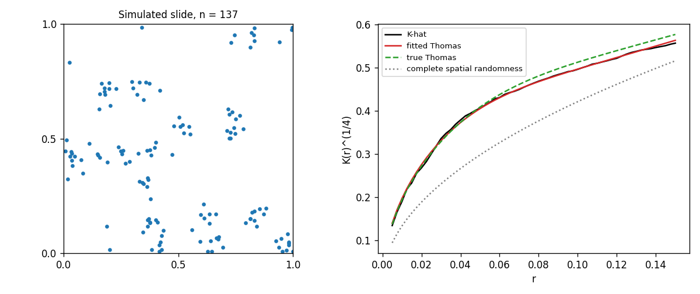

The slide on the left shows clear groups of cells. On the right the fitted Thomas curve lies almost exactly on $\hat{K}^{1/4}$, and the true Thomas curve lies a little above both at larger distances (about $0.577$ against $0.558$ at $r = 0.15$): this slide has fewer pairs than the process averages. The parameters behind the fitted and true curves differ substantially ($\hat\kappa = 33.5$ against $25$, $\hat\sigma_c = 0.0248$ against $0.03$), and yet the two curves are close. That is the practical meaning of imprecise cluster parameters: many parameter pairs give nearly the same $K^{1/4}$. The CSR curve, far below, shows how strong the clustering is.

**Inhibition mechanisms (Figure 12.3).**

```python
# Figure 12.3: three inhibition mechanisms
fig, axes = plt.subplots(1, 3, figsize=(10, 3.6))
for ax, (name, P) in zip(axes, (
        ("Matern I, lambda0 = 100", sim_matern_hc(100, r0_hc, rng, 1)),
        ("Matern II, lambda0 = 300", sim_matern_hc(300, r0_hc, rng, 2)),
        ("Sequential, 3000 attempts", sim_ssi(r0_hc, 3000, rng)))):
    draw_points(ax, P, f"{name}, n = {len(P)}")
    for p in P:
        ax.add_patch(plt.Circle(p, r0_hc / 2, fill=False, lw=0.4,
                                color="tab:blue"))
fig.tight_layout()
fig.savefig("figures/ch12/fig_12_3_inhibition.png", dpi=120)
plt.close(fig)
```


In Figure 12.3 no two discs overlap, in any panel. Type I (left) leaves large empty patches: whenever two parents are close, both are removed, so the survivors are sparse and the gaps are where pairs were. Type II (middle) is denser, since one of each close pair stays. Sequential inhibition (right) is the densest, with $245$ points and discs that almost tile the square; it keeps trying until the window is nearly full.

**The Strauss slide and the profile (Figure 12.4).**

```python
# Figure 12.4: the Strauss slide and the profile pseudolikelihood
fig, axes = plt.subplots(1, 2, figsize=(10, 4.2))
draw_points(axes[0], tumor, f"Tumor cells, n = {len(tumor)}")
dd = np.hypot(tumor[:, None, 0] - tumor[None, :, 0],
              tumor[:, None, 1] - tumor[None, :, 1])
for i, j in zip(*np.where(np.triu(dd <= r0_s, 1))):
    axes[0].plot(*tumor[[i, j]].T, color="tab:red", lw=1.5)
pr = np.array(prof)
axes[1].plot(pr[:, 0], pr[:, 2], "o-", color="tab:blue")
axes[1].axvline(r0_s, color="tab:green", ls="--", label="true r0")
axes[1].set_xlabel("r0")
axes[1].set_ylabel("log pseudolikelihood")
axes[1].legend()
fig.tight_layout()
fig.savefig("figures/ch12/fig_12_4_strauss_profile.png", dpi=120)
plt.close(fig)
```

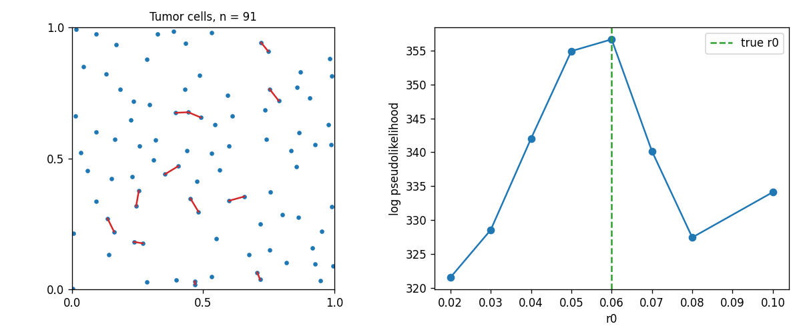

On the left of Figure 12.4, the $12$ close pairs (red) are short segments, with a few chains of three cells; the rest of the cells are well separated. On the right, the log pseudolikelihood peaks at $r_0 = 0.06$ (the true value, marked), with $r_0 = 0.05$ nearly as high, then drops, and shows a smaller second rise at $0.10$.

**Envelopes (Figure 12.5).**

```python
# Figure 12.5: envelopes from the Poisson and from the fitted models
fig, axes = plt.subplots(2, 2, figsize=(9, 6.4), sharex=True)
for ax, (name, (lo, hi)) in zip(axes.ravel(), env.items()):
    ax.fill_between(r_grid, lo, hi, color="lightgray")
    ax.plot(r_grid, obs_L[name.split(" vs.")[0]], color="tab:red")
    ax.axhline(0, color="gray", lw=0.8)
    ax.set_title(name, fontsize=10)
    ax.set_ylabel("L(r) - r")
for ax in axes[1]:
    ax.set_xlabel("r")
fig.tight_layout()
fig.savefig("figures/ch12/fig_12_5_envelopes.png", dpi=120)
plt.close(fig)
```

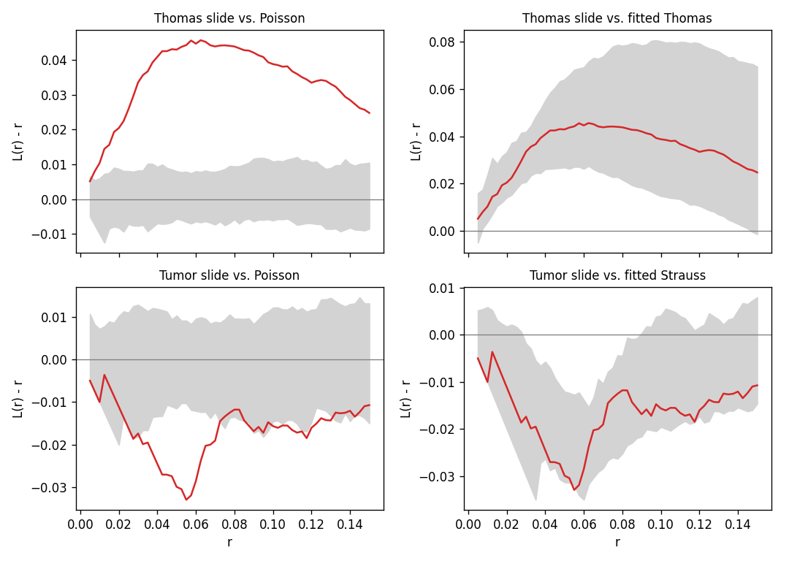

In Figure 12.5 the top left panel shows the Thomas slide's curve far above a narrow Poisson band at every radius. In the top right, the same curve sits inside the much wider fitted-Thomas band. In the bottom left the tumor slide's curve dips below the Poisson band for $r$ from about $0.02$ to $0.07$ and then runs along its lower edge. In the bottom right the curve is inside the fitted-Strauss band except for a brief touch of its lower edge near $r = 0.055$.

**Residual fields (Figure 12.6).**

```python
# Figure 12.6: smoothed residual fields
fig, axes = plt.subplots(1, 3, figsize=(11, 3.6))
vmax = max(np.abs(R).max() for R in res_fields.values())
for ax, (name, R) in zip(axes, res_fields.items()):
    im = ax.imshow(R, origin="lower", extent=(0, 1, 0, 1), cmap="RdBu_r",
                   vmin=-vmax, vmax=vmax)
    ax.set_title(name, fontsize=8)
fig.colorbar(im, ax=axes, label="smoothed residual intensity")
fig.savefig("figures/ch12/fig_12_6_residual_fields.png", dpi=120,
            bbox_inches="tight")
plt.close(fig)
```

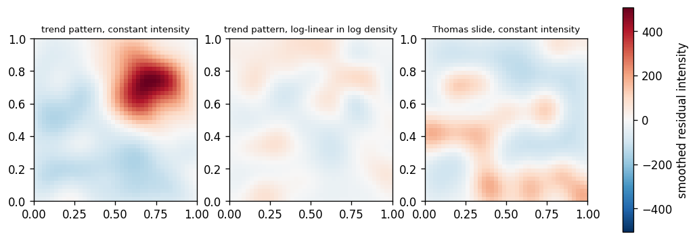

In Figure 12.6 the left panel has a large red region near $(0.7, 0.75)$ on a pale blue background: a trend left unmodeled. The middle panel is almost uniformly pale, with small patches of both signs. The right panel shows scattered positive and negative patches of moderate size and no large single region, the signature of excess variability without a trend.

**LGCP and the pixel GMRF (Figure 12.7).**

```python
# Figure 12.7: LGCP, truth and the pixel GMRF fit
fig, axes = plt.subplots(1, 3, figsize=(11, 3.6))
log_true_fine = np.log(Lam_true).reshape(m_c, m_c)
for ax, (name, img) in zip(axes[[0, 2]], (
        ("True log intensity", log_true_fine),
        ("Fitted log intensity (GMRF)",
         (best[2] + best[3]).reshape(g_fit, g_fit)))):
    im = ax.imshow(img, origin="lower", extent=(0, 1, 0, 1), cmap="viridis",
                   vmin=log_true_fine.min(), vmax=log_true_fine.max())
    ax.set_title(name, fontsize=10)
draw_points(axes[1], P_lg, f"Simulated points, n = {len(P_lg)}")
fig.colorbar(im, ax=axes, label="log intensity")
fig.savefig("figures/ch12/fig_12_7_lgcp.png", dpi=120, bbox_inches="tight")
plt.close(fig)
print("figures saved")
```

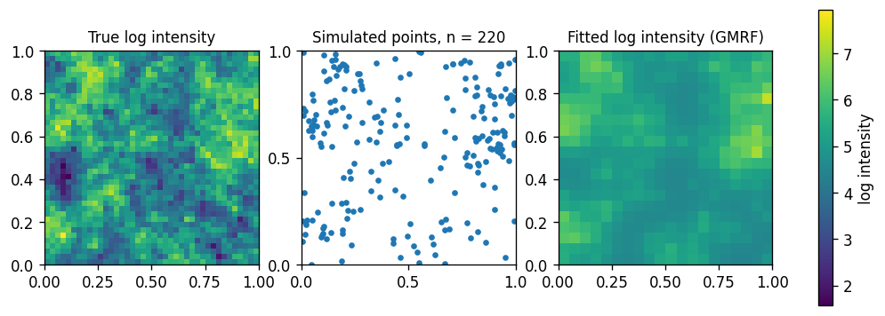

In Figure 12.7 the middle panel shows points concentrated in a few places: the upper left, a band near the right edge, and a patch in the lower left. The true log intensity (left) has high values in those places and a low region around $(0.1, 0.4)$. The fitted surface (right) reproduces the large-scale pattern, with highs in the upper left, along the right edge, and in the lower left, but as a much smoother, coarser picture: each $0.05 \times 0.05$ pixel holds on average $0.55$ points, so the data support only a smoothed reconstruction.

**Which tool for which question.** The chapter's models answer different questions:

| Question | Model | Estimated by |
| :--- | :--- | :--- |
| Does intensity depend on covariates? | Inhomogeneous Poisson | Weighted Poisson GLM (Chapter 11) |
| Do points gather around unobserved parents? | Thomas, Matérn cluster | Minimum contrast on $K$ or $K_{\text{inhom}}$ |
| Is there a smooth unobserved driver of intensity? | LGCP | Minimum contrast; or a pixel GLMM with a GMRF prior |
| Do points keep their distance? | Hard-core, Strauss | Pseudolikelihood (weighted Poisson GLM with a neighbor-count column) |
| Is the fitted model adequate? | Any | Residual fields, envelopes, Monte Carlo tests from the fitted model |

---

<a id="ch12-exercises"></a>

## Exercises

**Analytical**

1. Show that for any Neyman-Scott process with Poisson offspring counts and any dispersal density, the intensity is $\kappa\mu_c$, and that the number of offspring in a window of area $A$ (ignoring edge effects) has variance $\kappa A\mu_c(1 + \mu_c)$. The ratio of variance to mean is called the Fano factor. What does a Fano factor of $1 + \mu_c$ imply for the index of dispersion of quadrat counts in Chapter 10?

2. Using the difference of two independent $N(\mathbf{0}, \sigma_c^2\mathbf{I}_2)$ displacements, derive the pair correlation function of the Thomas process and confirm that integrating $2\pi s\,g(s)$ from $0$ to $r$ gives the $K$-function of Section 12.2.4. Evaluate $g(0)$ for $\kappa = 25$ and $\sigma_c = 0.03$ and explain what the number means in terms of pairs.

3. Suppose the number of offspring per parent is not Poisson but has mean $\mu_c$ and variance $v$. Redo the "same parent" step of Section 12.2.4 with $\operatorname{E}[N(N-1)] = v + \mu_c^2 - \mu_c$ and show that

   $$
   g(\mathbf{h}) = 1 + \frac{\operatorname{E}[N(N-1)]}{\kappa\mu_c^2}f_2(\mathbf{h})
   $$

   What is $\operatorname{E}[N(N-1)]$ when every parent has exactly $m$ offspring? Why does the Poisson assumption make $\mu_c$ unidentifiable from $K(r)$ alone?

4. Let $\Phi$ be a stationary point process with pair correlation function $g$, and thin it independently with retention probability $p(\mathbf{s})$. Show that the thinned process has intensity $p(\mathbf{s})\lambda$ and the same pair correlation function $g$. Why does this make the inhomogeneous $K$-function of Section 12.2.6 the right summary for a thinned Thomas process?

5. For the Matérn cluster process, the sibling-distance distribution function is $P_{\text{sib}}(r) = (16/\pi)\int_0^{z}\left(u\arccos u - u^2\sqrt{1-u^2}\right)du$ with $z = r/(2R)$. Show that $P_{\text{sib}} \approx 4z^2 = r^2/R^2$ for small $z$ and explain this with the area of the overlap of two discs. Verify that $P_{\text{sib}} = 1$ at $z = 1$.

6. For a log-Gaussian Cox process with constant trend, the count in a region $B$ has variance $\operatorname{Var}(N(B)) = \lambda\operatorname{area}(B) + \lambda^2\int_B\int_B\left(e^{C_u(\lVert\mathbf{s} - \mathbf{s}'\rVert)} - 1\right)d\mathbf{s}\,d\mathbf{s}'$. Derive it from the law of total variance and the pair correlation function $g = e^{C_u}$. Why is the variance larger than the Poisson value $\lambda\operatorname{area}(B)$?

7. For a Matérn Type I process with parent intensity $\lambda_{\text{par}}$, show that the intensity is maximized at $\lambda_{\text{par}} = 1/(\pi r_0^2)$, where it equals $1/(e\pi r_0^2)$, and that at that value only a fraction $1/e$ of parents survive. For Type II, show that $\lambda_{II}$ increases with $\lambda_{\text{par}}$ and tends to $1/(\pi r_0^2)$.

8. For $n = 2$ points on the unit square, write the normalizing constant of the Strauss process as $Z_2 = 1 + b\cdot 1 + \dfrac{b^2}{2}\left[1 - (1 - \gamma)\,p(r_0)\right]$, where $p(r_0)$ is the probability that two uniform points are within $r_0$. (The terms are $n = 0$, $n = 1$, and $n = 2$ of the series for $Z$, truncated.) Compute $p(r_0)$ approximately for small $r_0$, ignoring edge effects, and explain why the same calculation for $n = 100$ is not feasible.

9. Show that the score equation of the pseudolikelihood in $\zeta$ is $\sum_{i=1}^n t(\mathbf{s}_i, \mathbf{S}\setminus\mathbf{s}_i) = \int_{\mathcal{D}}t(\mathbf{u}, \mathbf{S})\,\lambda(\mathbf{u} \mid \mathbf{S})\,d\mathbf{u}$. Interpret it: the observed total neighbor count is matched by the count the fitted conditional intensity expects. Check that it reduces to a familiar equation in the Poisson case $\gamma = 1$.

10. Verify the acceptance probability for a death move in Section 12.4.3 from detailed balance, and check that for $n = 0$ and $n = 1$ the chain moves between the empty pattern and a single point with the right stationary ratio $b\operatorname{area}(\mathcal{D})$.

**Computational and simulation**

11. Keep $\lambda = \kappa\mu_c = 200$ and $\sigma_c = 0.03$ fixed and vary $\kappa \in \{10, 25, 50, 100\}$ (so $\mu_c$ changes). For each, simulate $200$ slides, fit by minimum contrast, and plot the root-mean-square log error of $\hat\kappa$ and $\hat\sigma_c$ against $\kappa$. Explain the pattern in terms of the number of clusters on a slide.

12. Refit the slide of Section 12.2.5 using fitting ranges $[0.005, 0.08]$, $[0.005, 0.15]$, and $[0.005, 0.25]$. Report the three estimates of $(\kappa, \sigma_c)$ and discuss why the upper limit matters.

13. Fit a Matérn cluster process by minimum contrast to a Thomas pattern, and a Thomas process to a Matérn cluster pattern, using the $K$-functions of Sections 12.2.4 and 12.2.7. Compare the minimum contrast values over $200$ patterns of each kind. Can the $K$-function tell Gaussian dispersal from disc dispersal?

14. Use the function `road_distance` of the shared setting (Section 11.1.2) as a covariate: simulate an inhomogeneous Poisson process with intensity $500\exp(-6\,\text{road\_distance}(\mathbf{s}))$, fit it with the Berman-Turner code of Section 12.2.6 (replacing the covariate), and compare the ordinary and inhomogeneous $K$-functions of the pattern. Then thin a Thomas process with the same retention probability and repeat the cluster-parameter estimation.

15. Write an inhomogeneous Strauss simulator by changing the birth acceptance probability to use $b(\mathbf{u}) = \exp(\beta_0 + \beta_1\log\text{pop\_density}(\mathbf{u}))$. Fit it with the design matrix $[1, \log\text{pop\_density}, t]$ and recover $(\beta_0, \beta_1, \zeta)$ from $100$ simulated slides. How do the three estimates correlate across slides?

16. Fit the Strauss model, with $r_0$ chosen by profiling, to $100$ Matérn Type II patterns with $\lambda_{\text{par}} = 300$ and $r_0 = 0.05$. Report the median $\hat\zeta$, the profile maximizer $\hat{r}_0$, and the fraction of patterns for which $\hat\zeta < -5$ (a near hard core). Does the pseudolikelihood fit know it is looking at a hard core?

17. Repeat the pixel-grid GMRF fit of Section 12.3.3 with $10 \times 10$, $20 \times 20$, and $40 \times 40$ pixels. For each size, report the Laplace-optimal $\sigma^2$ and the correlation with the true log-intensity. What limits the accuracy at the finest grid?

18. Build a parametric bootstrap for the minimum contrast estimates of the slide in Section 12.2.5: simulate $200$ Thomas patterns from the fitted parameters, refit each, and report standard deviations of $\hat\kappa$, $\hat\sigma_c$, and $\hat\mu_c$. Compare with the standard deviations across $200$ fresh slides from the true model.

19. Check the calibration of the goodness-of-fit test in Section 12.5.3: simulate $100$ Thomas slides from the true model, fit the Thomas model to each, and run the Monte Carlo test (with $B = 39$) using the fitted parameters. What fraction of tests reject at the 5% level? Explain why it is below 5%, and describe how re-fitting the model within each simulation would fix it.

---

<a id="ch12-what-comes-next"></a>

## What Comes Next

This chapter closes Part IV. A pattern of points can now be explored (Chapter 10), related to covariates through a Poisson or logistic GLM (Chapter 11), and modeled for clustering or inhibition, with the fit checked against simulation (this chapter). The same pattern of ideas runs through all of Parts II to IV: write down a model with a spatial random effect or an interaction, find the function that summarizes it (the variogram, the covariance, $K$), fit by matching or by a likelihood-type criterion, and check the fit against simulated data from the fitted model.

Part V turns to a different limit: what happens to these methods when $n$ is not hundreds but hundreds of thousands. Chapter 13 shows how the dense covariance matrix $\boldsymbol{\Sigma}$ of Part II, and its sparse cousin the precision matrix $\mathbf{Q}$ of Part III, can be approximated so that the likelihoods of Chapter 5 and the predictions of Chapter 4 remain computable.


---

<!-- manuscript:part:begin {"label": "Part V", "title": "Matrix Scalability for Large Spatial Systems", "description": "What to do when the matrices no longer fit.", "chapters": [13]} -->
<a id="part-5"></a>

# Part V: Matrix Scalability for Large Spatial Systems

*What to do when the matrices no longer fit.*

<!-- manuscript:part:end -->

---

<a id="ch13"></a>

# Chapter 13: Matrix Approximations and Fast Algorithms for Large $n$

Every method in Parts II to IV ends with the same two computations. To fit a spatial model we evaluate the Gaussian log-likelihood, which needs $\log\lvert\boldsymbol{\Sigma}\rvert$ and the quadratic form $\mathbf{r}'\boldsymbol{\Sigma}^{-1}\mathbf{r}$ of a residual vector $\mathbf{r}$. To predict, we solve $\boldsymbol{\Sigma}\mathbf{x} = \mathbf{r}$ and multiply by a covariance vector. Chapter 5 did both with a Cholesky factorization of the $n \times n$ covariance matrix, and for the 250 listings of the running rent example that cost next to nothing.

Now picture the same model for a metropolitan area with tens of thousands of rental listings. The covariance matrix of 20,000 listings has 400 million entries and takes 3.2 GB in double precision. Factoring it takes time that grows with the cube of $n$, and a maximum likelihood fit needs the factorization hundreds of times. Nothing in the statistics changes at that size. The difficulty is purely computational, and it has a computational answer: find structure in $\boldsymbol{\Sigma}$ or in $\boldsymbol{\Sigma}^{-1}$ and use it.

This chapter presents four kinds of structure. A covariance matrix can be close to **low rank**, because a smooth neighborhood effect is determined by its values at a modest number of knot locations (Section 13.2). It can be close to **sparse**, if we multiply the correlation function by one that vanishes beyond some distance (Section 13.3). Its inverse, or the factor of its inverse, can be sparse, because each observation depends on only a few earlier neighbors once we condition on them (Sections 13.4 and 13.5). And on a grid in space and time it can have **Kronecker** structure, which is exact instead of approximate (Section 13.6). Three of the four are approximations, so we measure how good they are against the exact answer on data sets small enough to compute it, and then we run them at sizes where the exact answer is out of reach.

The tools are ones we already have. The Woodbury identity of Section 13.2 follows from the block inversion of Chapter 4. The tapering of Section 13.3 is the product rule for covariance functions of Chapter 2. Vecchia's approximation is the kriging weights of Chapter 4 used as regression coefficients, and the conditional independence it imposes is the idea behind the precision matrices of Chapter 8. The bridge of Section 13.5 shows that a grid version of the SAR model of Chapter 7 is a Matérn field, which connects the covariance models of Part II with the lattice models of Part III. This is the last chapter of the book, so it also gathers threads from every part.

> **Chapter at a Glance**
>
> - **The Bottleneck (§13.1):** What one exact likelihood evaluation costs in time and memory, measured up to $n = 5{,}000$ and extrapolated beyond, and the four structures the rest of the chapter exploits.
> - **Low-Rank Models (§13.2):** A random effect built from $q \ll n$ knots, the Woodbury identity and determinant lemma derived from block inversion, a four-listing hand example, likelihood and kriging in $O(nq^2)$ time, and what a low-rank model loses.
> - **Covariance Tapering (§13.3):** Multiplying by a compactly supported correlation keeps the matrix valid and makes it sparse. Sparse factorization with SciPy, and an honest account of when it pays.
> - **Vecchia's Approximation (§13.4):** The likelihood as a product of conditionals on a few neighbors, the sparse factor it induces, the effect of the ordering, and a fit to 20,000 listings.
> - **Matérn Fields as Markov Fields (§13.5):** A grid precision matrix that is a SAR model and also a Matérn field, checked numerically, and the Woodbury identity again with a sparse precision.
> - **Kronecker Products (§13.6):** Space-time covariances that factor, the determinant and solve in closed form, and what separability assumes.
> - **Walkthrough and Lab (§13.7):** A benchmark of the four methods against the exact computation, timings at 20,000 and 50,000 listings, and four figures.

---

<a id="s13-1"></a>

## 13.1 The $O(n^3)$ Bottleneck

### 13.1.1 What One Likelihood Evaluation Costs

Suppose $\mathbf{Y} \sim N(\mathbf{X}\boldsymbol{\beta}, \boldsymbol{\Sigma})$ with $\boldsymbol{\Sigma} = \sigma^2\mathbf{R}(\phi) + \tau^2\mathbf{I}_n$, the rent model of Chapters 3 to 5. For fixed $\boldsymbol{\theta} = (\sigma^2, \tau^2, \phi)'$ the profile log-likelihood of Section 5.2 takes four steps.

1. **Build** the $n \times n$ matrix $\boldsymbol{\Sigma}$ from the distances. This costs $O(n^2)$ operations and $n^2$ stored numbers.
2. **Factor** $\boldsymbol{\Sigma} = \mathbf{L}\mathbf{L}'$ with the Cholesky factorization of Section 2.7. This costs about $n^3/3$ multiplications and additions, and it dominates everything else.
3. **Solve** $\boldsymbol{\Sigma}\mathbf{x} = \mathbf{b}$ for the $p + 1$ right-hand sides we need (the residual and the columns of $\mathbf{X}$), by two triangular solves each. Each solve costs $O(n^2)$.
4. **Read off** the log-determinant as $2\sum_i\log L_{ii}$ in $O(n)$ operations.

The factorization is the problem. Doubling $n$ multiplies its cost by eight. The memory is a second problem that arrives sooner: the matrix takes $8n^2$ bytes, so it stops fitting in the memory of an ordinary computer well before the time becomes unreasonable.

An optimizer needs many evaluations. Fisher scoring from a poor start needed 12 iterations in Chapter 5, and the Nelder-Mead searches of this chapter take about 200 evaluations. Every evaluation pays the cost of Step 2 again, because $\boldsymbol{\Sigma}$ changes with $\boldsymbol{\theta}$.

### 13.1.2 Measuring It

The code below times the Cholesky factorization for random listings in the unit square, at six sample sizes up to $n = 5{,}000$. It also defines the helper functions used throughout the chapter: a distance matrix, the exponential and Matérn correlation functions (Section 2.5), and a timer. Each timing is the best of three runs. The timings depend on the machine and on what else it is running, so treat the seconds as indicative and the ratios between sizes as the finding. The code imports `scipy.spatial` (the k-d tree `cKDTree` and the pairwise distance function `cdist`), which is part of SciPy and so within the book's rule of using no spatial packages; it is used here for speed and for nearest-neighbor search at sizes where a hand-built search would be slow, and the `dist` function of Chapter 1 would work at the smaller sizes.

```python
import time
import numpy as np
from scipy import linalg, optimize, sparse, special
from scipy.sparse import linalg as spla
from scipy.spatial import cKDTree
from scipy.spatial.distance import cdist

sigma2, tau2, phi = 4.0, 1.0, 0.15      # the rent model of Chapters 3 to 5


def dist(S):
    """Matrix of Euclidean distances between the rows of S."""
    q = np.sum(S**2, axis=1)
    H2 = q[:, None] - 2 * S @ S.T + q[None, :]
    H = np.sqrt(np.maximum(H2, 0.0))
    np.fill_diagonal(H, 0.0)
    return H


def r_exp(h, ph):
    """Exponential correlation."""
    return np.exp(-h / ph)


def r_m52(h, ph):
    """Matern correlation with smoothness 5/2."""
    x = h / ph
    return (1.0 + x + x**2 / 3.0) * np.exp(-x)


def exp_cov(H, s2=sigma2, t2=tau2, ph=phi):
    """Covariance matrix of the rents: exponential plus nugget."""
    return s2 * r_exp(H, ph) + t2 * np.eye(len(H))


def design(S):
    """Design matrix: intercept and the east coordinate."""
    return np.column_stack([np.ones(len(S)), S[:, 0]])


def timed(f, *args, repeat=1, **kwargs):
    """Result of f and the best wall-clock time over repeat calls."""
    best = np.inf
    for _ in range(repeat):
        t0 = time.perf_counter()
        out = f(*args, **kwargs)
        best = min(best, time.perf_counter() - t0)
    return out, best


rng = np.random.default_rng(2110)
ns = [500, 1000, 2000, 3000, 4000, 5000]
chol_times = []
for n in ns:
    S = rng.uniform(size=(n, 2))
    Sigma = exp_cov(dist(S))
    _, t = timed(np.linalg.cholesky, Sigma, repeat=3)
    chol_times.append(t)
    print(f"n={n:5d}  matrix={8 * n**2 / 1e6:6.1f} MB  "
          f"Cholesky={t:6.3f} s")
chol_times = np.array(chol_times)
big = np.array(ns) >= 2000
slope = np.polyfit(np.log(np.array(ns)[big]), np.log(chol_times[big]), 1)[0]
print(f"fitted exponent for n >= 2000: {slope:.2f}")

c3 = chol_times[-1] / ns[-1]**3           # seconds per n^3 at n = 5,000
for n in (10_000, 20_000, 50_000, 100_000):
    print(f"n={n:7d}  matrix={8 * n**2 / 1e9:7.1f} GB  "
          f"Cholesky (extrapolated) = {c3 * n**3 / 60:8.1f} min")
```

The fitted exponent is about 3, as the operation count predicts. A log-log plot makes the same point (Figure 13.1, left): measured times follow a line of slope 3, and the matrix size grows with slope 2 (Figure 13.1, right).


The last four lines of output are **extrapolations**, not measurements. They assume that the cubic law continues and ignore everything that changes at large sizes: cache effects, memory limits, and virtual memory. Memory reaches its limit first. At $n = 20{,}000$ the matrix needs 3.2 GB, which many laptops can hold, and the extrapolated factorization takes a little over a minute. At $n = 50{,}000$ the matrix needs 20 GB and the extrapolated factorization takes about 18.5 minutes, for one likelihood evaluation. At $n = 100{,}000$ the matrix needs 80 GB. A metropolitan data set with tens of thousands of listings is therefore beyond the exact method on a laptop, and a fit with hundreds of evaluations is beyond it on nearly any machine.

### 13.1.3 Four Structures

The remaining sections each exploit one structure of the model. The table says what is approximated and what the cost becomes.

| Structure | What is approximated | Cost of a likelihood evaluation | Section |
| :--- | :--- | :--- | :--- |
| Low rank | The random effect, by its values at $q$ knots | $O(nq^2 + q^3)$ | 13.2 |
| Sparse covariance | The covariance matrix, by tapering its long-range entries | Sparse factorization; depends on the fill-in | 13.3 |
| Sparse factor of the precision | The joint density, by conditioning each point on $k$ earlier neighbors | $O(nk^3)$ | 13.4 |
| Sparse precision | The Matérn field, by a Markov field on a grid | Sparse factorization of the precision | 13.5 |
| Kronecker | Nothing, if the covariance is separable | $O(n_S^3 + n_T^3 + n_Sn_T(n_S + n_T))$ | 13.6 |

The listings in the story come from the rent model of Chapters 3 to 5. The benchmarks use the exact simulation up to $n = 5{,}000$, because only there can we compute the true answer. For the 20,000 listings of Section 13.4.4 the data cannot be simulated exactly, and the text says how they are generated.

---

<a id="s13-2"></a>

## 13.2 Low-Rank Spatial Models

### 13.2.1 The Idea

Two listings on the same block carry nearly the same information about the unexplained neighborhood effect $u$. If $u$ is smooth, then its values at 20,000 listing locations are determined, to a good approximation, by its values at a few hundred well-spread locations. A low-rank model builds that into the covariance: it writes the random effect as a combination of $q \ll n$ quantities.

Choose $q$ **knot** locations $\boldsymbol{\kappa}_1, \dots, \boldsymbol{\kappa}_q$ in the study region. (In this section $\boldsymbol{\kappa}_j$ is a knot location. The symbol $\kappa$ is also the inverse range in Section 13.5 and the parent intensity of Chapters 11 and 12.) Let $\boldsymbol{\alpha}$ be the vector of $u$ at the knots, with covariance matrix $\boldsymbol{\Sigma}_\alpha = \sigma^2\mathbf{R}_K$, where $\mathbf{R}_K$ is the $q \times q$ correlation matrix of the knots. Approximate the effect at any location by kriging it from the knots, in the sense of Chapter 4. By Section 4.2, the best linear predictor of $u(\mathbf{s})$ from $\boldsymbol{\alpha}$ is $\mathbf{r}(\mathbf{s})'\mathbf{R}_K^{-1}\boldsymbol{\alpha}$, where $\mathbf{r}(\mathbf{s})$ is the vector of correlations between $\mathbf{s}$ and the knots. Stacking the $n$ listings gives

$$
\mathbf{u} \approx \mathbf{B}\boldsymbol{\alpha}, \qquad \mathbf{B} = \mathbf{R}_{nK}\mathbf{R}_K^{-1}
$$

where $\mathbf{R}_{nK}$ is the $n \times q$ matrix of correlations between listings and knots. The matrix $\mathbf{B}$ is an $n \times q$ matrix of kriging weights. The model for the rents becomes

$$
\mathbf{Y} = \mathbf{X}\boldsymbol{\beta} + \mathbf{B}\boldsymbol{\alpha} + \boldsymbol{\varepsilon}, \qquad \operatorname{Var}(\boldsymbol{\alpha}) = \boldsymbol{\Sigma}_\alpha, \qquad \operatorname{Var}(\boldsymbol{\varepsilon}) = \tau^2\mathbf{I}_n
$$

and the covariance matrix of $\mathbf{Y}$ is

$$
\boldsymbol{\Sigma} = \tau^2\mathbf{I}_n + \mathbf{B}\boldsymbol{\Sigma}_\alpha\mathbf{B}'
$$

This is the linear mixed model of Section 2.1.5 with $q$ random effects instead of $n$: the matrix $\mathbf{B}$ plays the role of the matrix $\mathbf{Z}_b$ there. The matrix $\mathbf{B}\boldsymbol{\Sigma}_\alpha\mathbf{B}' = \sigma^2\mathbf{R}_{nK}\mathbf{R}_K^{-1}\mathbf{R}_{Kn}$ has rank at most $q$. It is positive semi-definite by the Gramian rule of Section 2.4.3, which Chapter 2 promised to use here. This particular choice of $\mathbf{B}$ and $\boldsymbol{\Sigma}_\alpha$ is called the **predictive process** [@banerjee2008]. The matrices $\mathbf{B}$ and $\boldsymbol{\alpha}$ here have the local meaning just defined; they are unrelated to the generic matrix $\mathbf{B}$ of Chapter 1 and the kernel ridge coefficients of Chapter 4.

More general low-rank models let $\mathbf{B}$ be any matrix of basis functions evaluated at the listings, such as Gaussian bumps or splines, with $\boldsymbol{\Sigma}_\alpha$ a free covariance matrix to be estimated. That is called fixed-rank kriging [@cressie2008]. Everything in the rest of this section holds for any $\mathbf{B}$ and $\boldsymbol{\Sigma}_\alpha$, and Exercise 4 builds a bump basis. We use the predictive process because its covariance is tied to the exponential model of Chapters 3 to 5, which lets us compare with the exact answer.

For knots we use a regular $g \times g$ grid over the unit square, so that $q = g^2$.

### 13.2.2 A Tool We Need: the Woodbury Identity and the Determinant Lemma

We need $\boldsymbol{\Sigma}^{-1}$ and $\log\lvert\boldsymbol{\Sigma}\rvert$ for a matrix of the form "diagonal plus low rank". It is useful to allow a general diagonal matrix $\boldsymbol{\Omega} = \operatorname{diag}(d_1, \dots, d_n)$ in place of $\tau^2\mathbf{I}_n$, because Section 13.2.5 needs that generality:

$$
\boldsymbol{\Sigma} = \boldsymbol{\Omega} + \mathbf{B}\boldsymbol{\Sigma}_\alpha\mathbf{B}'
$$

**Block inversion, restated.** Section 4.3.4 inverted a partitioned matrix with the Schur complement of the upper-left block, and noted that exchanging the roles of the two blocks gives the same formula. For a matrix $\mathbf{N}$ with blocks $\mathbf{N}_{11}, \mathbf{N}_{12}, \mathbf{N}_{21}, \mathbf{N}_{22}$, the upper-left block of $\mathbf{N}^{-1}$ is therefore given by the formula with the roles exchanged (first form) and by the formula of Section 4.3.4 (second form):

$$
\left(\mathbf{N}^{-1}\right)_{11} = \left(\mathbf{N}_{11} - \mathbf{N}_{12}\mathbf{N}_{22}^{-1}\mathbf{N}_{21}\right)^{-1} = \mathbf{N}_{11}^{-1} + \mathbf{N}_{11}^{-1}\mathbf{N}_{12}\left(\mathbf{N}_{22} - \mathbf{N}_{21}\mathbf{N}_{11}^{-1}\mathbf{N}_{12}\right)^{-1}\mathbf{N}_{21}\mathbf{N}_{11}^{-1}
$$

The first form eliminates the lower-right block, the second eliminates the upper-left block, which is the form of Section 4.3.4. Both are the same matrix, and Appendix A.1 will state both forms and verify them by multiplication.

**The identity.** Apply this to the $(n + q) \times (n + q)$ matrix

$$
\mathbf{N} = \begin{bmatrix} \boldsymbol{\Omega} & \mathbf{B} \\ -\mathbf{B}' & \boldsymbol{\Sigma}_\alpha^{-1} \end{bmatrix}
$$

with $\mathbf{N}_{11} = \boldsymbol{\Omega}$, $\mathbf{N}_{12} = \mathbf{B}$, $\mathbf{N}_{21} = -\mathbf{B}'$, and $\mathbf{N}_{22} = \boldsymbol{\Sigma}_\alpha^{-1}$. The first form gives $(\boldsymbol{\Omega} + \mathbf{B}\boldsymbol{\Sigma}_\alpha\mathbf{B}')^{-1} = \boldsymbol{\Sigma}^{-1}$. The second gives $\boldsymbol{\Omega}^{-1} - \boldsymbol{\Omega}^{-1}\mathbf{B}\left(\boldsymbol{\Sigma}_\alpha^{-1} + \mathbf{B}'\boldsymbol{\Omega}^{-1}\mathbf{B}\right)^{-1}\mathbf{B}'\boldsymbol{\Omega}^{-1}$. Equating them is the **Sherman-Morrison-Woodbury identity**:

$$
\boldsymbol{\Sigma}^{-1} = \boldsymbol{\Omega}^{-1} - \boldsymbol{\Omega}^{-1}\mathbf{B}\,\mathbf{M}^{-1}\mathbf{B}'\boldsymbol{\Omega}^{-1}, \qquad \mathbf{M} = \boldsymbol{\Sigma}_\alpha^{-1} + \mathbf{B}'\boldsymbol{\Omega}^{-1}\mathbf{B}
$$

The matrix $\mathbf{M}$ is only $q \times q$. With $\boldsymbol{\Omega} = \tau^2\mathbf{I}_n$ the identity becomes $\boldsymbol{\Sigma}^{-1} = \tau^{-2}\mathbf{I}_n - \tau^{-4}\mathbf{B}\left(\boldsymbol{\Sigma}_\alpha^{-1} + \tau^{-2}\mathbf{B}'\mathbf{B}\right)^{-1}\mathbf{B}'$. In words: inverting an $n \times n$ matrix is replaced by inverting a diagonal matrix, which is free, and a $q \times q$ matrix.

**The determinant lemma.** A block matrix factors as

$$
\begin{bmatrix} \mathbf{N}_{11} & \mathbf{N}_{12} \\ \mathbf{N}_{21} & \mathbf{N}_{22} \end{bmatrix} = \begin{bmatrix} \mathbf{I} & \mathbf{0} \\ \mathbf{N}_{21}\mathbf{N}_{11}^{-1} & \mathbf{I} \end{bmatrix}\begin{bmatrix} \mathbf{N}_{11} & \mathbf{0} \\ \mathbf{0} & \mathbf{N}_{22} - \mathbf{N}_{21}\mathbf{N}_{11}^{-1}\mathbf{N}_{12} \end{bmatrix}\begin{bmatrix} \mathbf{I} & \mathbf{N}_{11}^{-1}\mathbf{N}_{12} \\ \mathbf{0} & \mathbf{I} \end{bmatrix}
$$

(multiply the three matrices to check). The outer factors are triangular with ones on the diagonal, so their determinants are 1, and $\lvert\mathbf{N}\rvert = \lvert\mathbf{N}_{11}\rvert\,\lvert\mathbf{N}_{22} - \mathbf{N}_{21}\mathbf{N}_{11}^{-1}\mathbf{N}_{12}\rvert$. Eliminating the other block gives, in the same way, $\lvert\mathbf{N}\rvert = \lvert\mathbf{N}_{22}\rvert\,\lvert\mathbf{N}_{11} - \mathbf{N}_{12}\mathbf{N}_{22}^{-1}\mathbf{N}_{21}\rvert$. For the matrix $\mathbf{N}$ above, the first expression is $\lvert\boldsymbol{\Omega}\rvert\,\lvert\boldsymbol{\Sigma}_\alpha^{-1} + \mathbf{B}'\boldsymbol{\Omega}^{-1}\mathbf{B}\rvert = \lvert\boldsymbol{\Omega}\rvert\,\lvert\mathbf{M}\rvert$, and the second is $\lvert\boldsymbol{\Sigma}_\alpha^{-1}\rvert\,\lvert\boldsymbol{\Omega} + \mathbf{B}\boldsymbol{\Sigma}_\alpha\mathbf{B}'\rvert = \lvert\boldsymbol{\Sigma}_\alpha\rvert^{-1}\lvert\boldsymbol{\Sigma}\rvert$. Equating them,

$$
\lvert\boldsymbol{\Sigma}\rvert = \lvert\boldsymbol{\Omega}\rvert\,\lvert\boldsymbol{\Sigma}_\alpha\rvert\,\lvert\mathbf{M}\rvert, \qquad \log\lvert\boldsymbol{\Sigma}\rvert = \sum_{i=1}^n\log d_i + \log\lvert\boldsymbol{\Sigma}_\alpha\rvert + \log\lvert\mathbf{M}\rvert
$$

With $\boldsymbol{\Omega} = \tau^2\mathbf{I}_n$ the first term is $n\log\tau^2$. Both $\log\lvert\boldsymbol{\Sigma}_\alpha\rvert$ and $\log\lvert\mathbf{M}\rvert$ come from $q \times q$ Cholesky factors.

### 13.2.3 By Hand: Four Listings, Two Knots

Take $n = 4$ listings and $q = 2$ knots with

$$
\mathbf{B} = \begin{bmatrix} 1 & 0 \\ 0.8 & 0.2 \\ 0.2 & 0.8 \\ 0 & 1 \end{bmatrix}, \qquad \boldsymbol{\Sigma}_\alpha = \begin{bmatrix} 2 & 1 \\ 1 & 2 \end{bmatrix}, \qquad \tau^2 = 1
$$

Each row of $\mathbf{B}$ says how much a listing leans on each knot: the first listing sits on knot 1 and the last on knot 2. The code builds $\boldsymbol{\Sigma} = \tau^2\mathbf{I}_4 + \mathbf{B}\boldsymbol{\Sigma}_\alpha\mathbf{B}'$, forms the $2 \times 2$ matrix $\mathbf{M}$, and compares the Woodbury inverse with the dense inverse.

```python
np.set_printoptions(precision=4, suppress=True)
B4 = np.array([[1.0, 0.0], [0.8, 0.2], [0.2, 0.8], [0.0, 1.0]])
Sa4 = np.array([[2.0, 1.0], [1.0, 2.0]])
t24 = 1.0
Sigma4 = t24 * np.eye(4) + B4 @ Sa4 @ B4.T
print("Sigma =\n", Sigma4)
Sa_inv4 = np.linalg.inv(Sa4)
M4 = Sa_inv4 + B4.T @ B4 / t24
print("Sa^-1 =\n", Sa_inv4)
print("B'B / tau2 =\n", B4.T @ B4 / t24)
print("M = Sa^-1 + B'B / tau2 =\n", M4)
W4 = np.eye(4) / t24 - B4 @ np.linalg.inv(M4) @ B4.T / t24**2
print("Woodbury inverse =\n", W4)
print("dense inverse =\n", np.linalg.inv(Sigma4))
print("largest difference:", np.abs(W4 - np.linalg.inv(Sigma4)).max())
print("|Sa| =", round(np.linalg.det(Sa4), 4), " |M| =",
      round(np.linalg.det(M4), 4), " |Sigma| =",
      round(np.linalg.det(Sigma4), 4))
print("log|Sigma|, dense:", round(np.linalg.slogdet(Sigma4)[1], 6),
      " lemma:", round(4 * np.log(t24) + np.log(np.linalg.det(Sa4))
                       + np.log(np.linalg.det(M4)), 6))
```

The matrix $\mathbf{M} = \boldsymbol{\Sigma}_\alpha^{-1} + \mathbf{B}'\mathbf{B}/\tau^2$ has $2.3467$ on its diagonal and $-0.0133$ off it. Its inverse, applied through the formula $\boldsymbol{\Sigma}^{-1} = \mathbf{I} - \mathbf{B}\mathbf{M}^{-1}\mathbf{B}'$ (here $\tau^2 = 1$), reproduces the dense $4 \times 4$ inverse to machine precision. The determinants confirm the lemma: $\lvert\boldsymbol{\Sigma}_\alpha\rvert = 3$ and $\lvert\mathbf{M}\rvert = 5.5067$, so $\lvert\boldsymbol{\Sigma}\rvert = 1 \times 3 \times 5.5067 = 16.52$, and $\log\lvert\boldsymbol{\Sigma}\rvert = 2.804572$ both ways.

### 13.2.4 Likelihood and Kriging in $O(nq^2)$ Time

With $\boldsymbol{\Sigma}^{-1}$ and $\log\lvert\boldsymbol{\Sigma}\rvert$ available cheaply, the profile likelihood of Section 5.2 goes through unchanged. Count the cost. Forming $\mathbf{B}'\boldsymbol{\Omega}^{-1}\mathbf{B}$ takes $O(nq^2)$ operations, factoring $\mathbf{M}$ takes $O(q^3)$, and each solve $\boldsymbol{\Sigma}^{-1}\mathbf{v}$ costs $O(nq)$ because it multiplies by $\mathbf{B}'$, solves with $\mathbf{M}$, and multiplies by $\mathbf{B}$. In all, a likelihood evaluation costs $O(nq^2 + q^3)$ time and $O(nq)$ memory, instead of $O(n^3)$ and $O(n^2)$.

Kriging also carries over. The noise-free value at a new location $\mathbf{s}_0$ is $\mu(\mathbf{s}_0) + \mathbf{b}_0'\boldsymbol{\alpha}$, where $\mathbf{b}_0 = \mathbf{R}_K^{-1}\mathbf{r}(\mathbf{s}_0)$ are the kriging weights for $\mathbf{s}_0$. Its covariance with the data is $\mathbf{B}\boldsymbol{\Sigma}_\alpha\mathbf{b}_0$. By Section 4.4.3 the predictor is $\mathbf{x}_0'\hat{\boldsymbol{\beta}} + \mathbf{b}_0'\boldsymbol{\Sigma}_\alpha\mathbf{B}'\boldsymbol{\Sigma}^{-1}(\mathbf{y} - \mathbf{X}\hat{\boldsymbol{\beta}})$, that is, $\mathbf{b}_0'\hat{\boldsymbol{\alpha}}$ with $\hat{\boldsymbol{\alpha}} = \boldsymbol{\Sigma}_\alpha\mathbf{B}'\boldsymbol{\Sigma}^{-1}\mathbf{r}$. So the knot values are estimated once, and every prediction is then a product of a $1 \times q$ and a $q \times 1$ vector.

The code implements the class `LowRank`, which stores the Cholesky factor of $\mathbf{M}$ and applies the Woodbury formula, and the function `lowrank_fit`, which evaluates the likelihood and kriging. It also computes the quantity `deficit` that Section 13.2.5 explains. We compare against the exact computation on the $n = 2{,}000$ rent data set of Section 13.1, with 200 held-out listings. The exact answer is from the function `exact_fit` (the Chapter 5 likelihood with GLS and kriging), defined in the block below together with the simulator. The simulator `simulate_rents` draws data and held-out listings jointly from the rent model with exact Cholesky simulation (Section 2.7), so we know the true noise-free rent at the held-out listings.

```python
def simulate_rents(n, n_test, seed, ph=phi):
    """Exact simulation at n + n_test sites (n data, n_test held out)."""
    rng = np.random.default_rng(seed)
    S_all = rng.uniform(size=(n + n_test, 2))
    H = dist(S_all)
    L = np.linalg.cholesky(sigma2 * r_exp(H, ph) + 1e-8 * np.eye(len(H)))
    u = L @ rng.standard_normal(len(H))
    eps = np.sqrt(tau2) * rng.standard_normal(len(H))
    mu = 18.0 + 6.0 * S_all[:, 0]
    y = mu + u + eps
    return S_all[:n], y[:n], S_all[n:], (mu + u)[n:]


def exact_fit(S, y, X, S0, X0, corr=r_exp, s2=sigma2, t2=tau2, ph=phi):
    """Gaussian log-likelihood (beta profiled out by GLS) and kriging."""
    Sigma = s2 * corr(dist(S), ph) + t2 * np.eye(len(S))
    c = linalg.cho_factor(Sigma)
    Sx, Sy = linalg.cho_solve(c, X), linalg.cho_solve(c, y)
    beta = np.linalg.solve(X.T @ Sx, X.T @ Sy)
    r = y - X @ beta
    Sr = linalg.cho_solve(c, r)
    logdet = 2.0 * np.sum(np.log(np.diag(c[0])))
    ll = -0.5 * (len(y) * np.log(2 * np.pi) + logdet + r @ Sr)
    pred = X0 @ beta + s2 * corr(cdist(S0, S), ph) @ Sr
    return dict(ll=ll, pred=pred, beta=beta)


S, y, S0, truth0 = simulate_rents(2000, 200, 2110)
X, X0 = design(S), design(S0)
ex, t_ex = timed(exact_fit, S, y, X, S0, X0)
print(f"exact: loglik={ex['ll']:.2f}  beta={np.round(ex['beta'], 3)}  "
      f"time={t_ex:.3f} s")
print("exact kriging, rmse against the true surface:",
      round(np.sqrt(np.mean((ex["pred"] - truth0)**2)), 3))
```

```python
def knots_grid(g):
    """Centers of a g-by-g grid of cells in the unit square."""
    c = (np.arange(g) + 0.5) / g
    xx, yy = np.meshgrid(c, c)
    return np.column_stack([xx.ravel(), yy.ravel()])


class LowRank:
    """Sigma = diag(d) + B Sa B', inverted and factored by Woodbury."""

    def __init__(self, d, B, Sa):
        self.B, self.Dinv = B, 1.0 / d
        cSa = linalg.cho_factor(Sa)
        Sa_inv = linalg.cho_solve(cSa, np.eye(len(Sa)))
        M = Sa_inv + B.T @ (B * self.Dinv[:, None])
        self.cM = linalg.cho_factor(M)
        self.logdet = (np.sum(np.log(d))
                       + 2.0 * np.sum(np.log(np.diag(cSa[0])))
                       + 2.0 * np.sum(np.log(np.diag(self.cM[0]))))

    def solve(self, V):
        """Sigma^{-1} V for a vector or matrix V, in O(n q^2) time."""
        w = self.Dinv if V.ndim == 1 else self.Dinv[:, None]
        DV = w * V
        return DV - w * (self.B @ linalg.cho_solve(self.cM, self.B.T @ DV))


def lowrank_fit(S, y, X, S0, X0, g, corr=r_exp, ph=phi, modified=True):
    """Predictive-process likelihood and kriging with g*g knots."""
    K = knots_grid(g)
    Rk = corr(dist(K), ph) + 1e-10 * np.eye(len(K))
    cRk = linalg.cho_factor(Rk)
    Rnk = corr(cdist(S, K), ph)
    B = linalg.cho_solve(cRk, Rnk.T).T          # kriging weights, Chapter 4
    deficit = 1.0 - np.sum(B * Rnk, axis=1)      # 1 - r' Rk^{-1} r
    d = tau2 + sigma2 * deficit if modified else np.full(len(S), tau2)
    model = LowRank(d, B, sigma2 * Rk)
    Sx, Sy = model.solve(X), model.solve(y)
    beta = np.linalg.solve(X.T @ Sx, X.T @ Sy)
    r = y - X @ beta
    Sr = model.solve(r)
    ll = -0.5 * (len(y) * np.log(2 * np.pi) + model.logdet + r @ Sr)
    alpha = sigma2 * (Rk @ (B.T @ Sr))           # E[alpha | y]
    B0 = linalg.cho_solve(cRk, corr(cdist(S0, K), ph).T).T
    return dict(ll=ll, pred=X0 @ beta + B0 @ alpha, deficit=deficit)


phi_m52 = 0.45 / 5.919       # same practical range as phi = 0.15
lowrank_rows = {}
for name, corr, ph in (("exponential", r_exp, phi),
                       ("Matern 5/2", r_m52, phi_m52)):
    exk = exact_fit(S, y, X, S0, X0, corr, ph=ph)
    print(name, "- exact loglik", round(exk["ll"], 2), "  exact rmse vs",
          "truth", round(np.sqrt(np.mean((exk["pred"] - truth0)**2)), 3),
          "  sd of exact predictions", round(np.std(exk["pred"]), 3))
    print("     q   plain  modified  rmse/exact  rmse/truth  sd(pred) "
          " deficit")
    rows = []
    for g in (4, 6, 8, 12, 16, 20, 25):
        plain = lowrank_fit(S, y, X, S0, X0, g, corr, ph, modified=False)
        mod = lowrank_fit(S, y, X, S0, X0, g, corr, ph, modified=True)
        rows.append((g * g, plain["ll"] - exk["ll"], mod["ll"] - exk["ll"],
                     mod["deficit"].mean()))
        rmse_ex = np.sqrt(np.mean((mod["pred"] - exk["pred"])**2))
        rmse_tr = np.sqrt(np.mean((mod["pred"] - truth0)**2))
        print(f"{g * g:6d} {rows[-1][1]:8.1f} {rows[-1][2]:9.1f} "
              f"{rmse_ex:11.3f} {rmse_tr:11.3f} {np.std(mod['pred']):9.3f} "
              f"{rows[-1][3]:8.3f}")
    lowrank_rows[name] = rows
```

**Reading the tables.** The first column is the number of knots. The next two give how far the low-rank log-likelihood is below the exact one, for the plain model $\boldsymbol{\Omega} = \tau^2\mathbf{I}_n$ and for the modified model of Section 13.2.5. The "rmse/exact" column is the root mean squared difference between the low-rank and the exact predictions at the 200 held-out listings, and "rmse/truth" is the error of the low-rank prediction against the true noise-free rent (the exact kriging has 0.741). The "sd(pred)" column is the standard deviation of the predictions, which is 2.219 for exact kriging.

For the exponential model the approximation is poor at modest ranks. With 144 knots the log-likelihood is still $80$ below the exact value for the modified model and $250$ below for the plain one, on a data set of 2,000 listings. Even 625 knots leave a shortfall of $10.9$ for the modified model. The predictions behave better than the likelihood: with 256 knots the prediction error against the true rent is $0.812$, against $0.741$ for exact kriging. The predictions are also smoother than the exact ones, with a standard deviation of $2.157$ against $2.219$ at 256 knots, and the gap shrinks as knots are added.

For the smooth Matérn model the picture is different. The same $q = 256$ knots leave a shortfall of only $5.9$, and $625$ knots leave $0.4$. The practical range of the two models is the same ($0.45$), so the difference is smoothness, not range, and Section 13.2.5 explains why.

### 13.2.5 The Cost of Low Rank

**The variance deficit.** The low-rank model replaces $u(\mathbf{s})$ by its kriging prediction from the knots. A prediction has less variance than the quantity it predicts. By the simple kriging variance of Section 4.2.2, the part of $u(\mathbf{s})$ that the knots do not determine has variance

$$
\sigma^2\left(1 - \mathbf{r}(\mathbf{s})'\mathbf{R}_K^{-1}\mathbf{r}(\mathbf{s})\right) \ge 0
$$

and the low-rank model puts none of it in $\boldsymbol{\Sigma}$. The deficit is zero at a knot, where $\mathbf{r}(\mathbf{s})$ is a column of $\mathbf{R}_K$ and the expression is $\sigma^2(1 - 1) = 0$, and it is largest in the gaps between knots and at the edges of the region. Figure 13.2 (left) shows it for 64 knots: the colors run from about 0.1 for listings next to a knot, through about 0.4 for listings in the gaps between knots, to about 0.6 for listings in the corners of the unit square. The average deficit in the table is the average of this quantity as a fraction of $\sigma^2$: 0.359 for 64 knots, falling to 0.118 for 625.

**What the likelihood does about it.** In the plain model the missing variance is absent. The data show it as extra scatter that the model attributes to nothing, and the likelihood suffers. The common remedy is the **modified predictive process**: add the deficit back on the diagonal, which is the reason for the general diagonal matrix $\boldsymbol{\Omega} = \tau^2\mathbf{I}_n + \sigma^2\operatorname{diag}(\text{deficit})$ in Section 13.2.2. The modified process has the correct variance at every listing, and only the correlations between listings are approximated. The table shows how much that matters: for the exponential model the modified likelihood is closer to the exact one than the plain one at every number of knots, by a factor of about $2.5$ with 16 knots and $6.5$ with 625.

**Why smoothness matters.** The exponential model is rough (Section 2.5.3): the variance of $u(\mathbf{s}) - u(\mathbf{s}')$ grows linearly with the distance between the two locations. Nearby listings that are far from every knot differ from their kriged values by an amount that shrinks only slowly as knots are added. The Matérn model with smoothness $5/2$ is smooth, and a handful of knots determines the surface in between them, so the deficit vanishes quickly (0.007 at 144 knots against 0.245 for the exponential). That is the general rule: low-rank models are good at the smooth, large-scale part of a spatial effect and poor at its small-scale roughness. In rent terms, they capture the broad pattern of neighborhoods and lose the block-to-block variation.

**Oversmoothing.** Because a low-rank prediction is a combination of $q$ smooth basis functions, its predictions are smoother than the exact ones. The shrinking standard deviations in the tables (2.004 with 16 knots up to 2.213 with 625, against 2.219 exact) are one symptom.


---

<a id="s13-3"></a>

## 13.3 Covariance Tapering

### 13.3.1 The Idea and Why It Stays Valid

The exponential correlation is positive at every distance. Two listings at a distance of $20\phi$ have a correlation of $e^{-20} \approx 2 \times 10^{-9}$, which is zero for every practical purpose. Tapering sets such entries exactly to zero.

Let $\mathcal{T}_\theta(h)$ be a correlation function that is 1 at $h = 0$ and exactly zero for $h \ge \theta$. The **Wendland** function

$$
\mathcal{T}_\theta(h) = \left(1 - \frac{h}{\theta}\right)^4\left(4\frac{h}{\theta} + 1\right) \quad \text{for } 0 \le h < \theta, \qquad \mathcal{T}_\theta(h) = 0 \text{ for } h \ge \theta
$$

is a valid correlation function in up to three dimensions [@wendland1995], and the spherical model of Section 2.5.2 would also serve. (In this section $\theta$ is the taper range, not the parameter vector $\boldsymbol{\theta}$ of Chapter 5.) The **tapered covariance** is the product

$$
C_\theta(h) = \sigma^2 r(h;\phi)\,\mathcal{T}_\theta(h) \quad (h > 0), \qquad C_\theta(0) = \sigma^2 + \tau^2
$$

The product of two valid covariance functions is valid (Section 2.4.3), so the tapered matrix is positive definite whatever the locations. The proof there built a process whose covariance is the product, namely the product of two independent processes. Chapter 2 promised that this rule would be used here.

**A hand example.** Take three listings on a street at positions 0, 0.3, and 0.7, with exponential correlation and $\phi = 0.5$, tapered with range $\theta = 0.5$. The pair at distance $0.7$ is beyond the taper range, so its entry becomes exactly zero.

```python
def wendland(h, theta):
    """Compactly supported correlation, valid in up to three dimensions."""
    t = np.minimum(h / theta, 1.0)
    return (1.0 - t)**4 * (4.0 * t + 1.0)


t3 = np.array([0.0, 0.3, 0.7])
h3 = np.abs(t3[:, None] - t3[None, :])
R3 = np.exp(-h3 / 0.5)
T3 = wendland(h3, 0.5)
print("exponential correlation =\n", R3)
print("taper with range 0.5 =\n", T3)
print("tapered correlation =\n", R3 * T3)
print("eigenvalues of the tapered matrix:", np.linalg.eigvalsh(R3 * T3))
```

The tapered correlations are $0.0478$ for the first two listings, $0.003$ for the second and third, and exactly $0$ for the first and third. The eigenvalues are $0.9521$, $1$, and $1.0479$, all positive, as the product rule guarantees. The taper is strong at this range: it cuts the correlation of the first two listings from $0.5488$ to $0.0478$. This is a general feature of the taper, and it drives the results below.

### 13.3.2 Computation

The number of nonzero entries per row stays bounded only if the density of listings per unit area is fixed while the region grows. In the unit square with $n$ listings, a listing has about $n\pi\theta^2$ neighbors within $\theta$, so the fraction of nonzero entries is about $\pi\theta^2$ (less near the boundary).

SciPy has sparse storage and sparse solvers, but it has no sparse Cholesky factorization. It has a sparse LU factorization (`scipy.sparse.linalg.splu`), which for a symmetric positive definite matrix needs no pivoting and does roughly twice the work of a Cholesky factorization. The log-determinant is the sum of the logarithms of the absolute diagonal entries of the triangular factor $\mathbf{U}$, because the factor $\mathbf{L}$ has a unit diagonal. The code finds the pairs within distance $\theta$ with a k-d tree (SciPy's `cKDTree`), builds the sparse matrix, factors it, and evaluates the likelihood and kriging. It reports the **fill-in**: the number of nonzero entries in $\mathbf{L}$ and $\mathbf{U}$ relative to the number in $\boldsymbol{\Sigma}$. Factoring a sparse matrix creates new nonzeros, and the quality of the fill-reducing ordering decides how many. For the kriging weights, the cross-covariances between held-out and data listings are tapered in the same way.

We compare with exact computations on three data sets. The first two have $n = 2{,}000$: one simulated at $\phi = 0.15$, the model of Chapters 3 to 5, and one simulated at the shorter range $\phi = 0.03$, where listings are correlated only within a small neighborhood. The third has $n = 5{,}000$ at $\phi = 0.15$.

```python
def taper_matrix(S, theta, ph):
    """Sparse covariance: sigma2 * exp(-h/ph) * wendland(h/theta) + nugget."""
    n = len(S)
    pairs = cKDTree(S).query_pairs(theta, output_type="ndarray")
    i, j = pairs[:, 0], pairs[:, 1]
    h = np.sqrt(np.sum((S[i] - S[j])**2, axis=1))
    v = sigma2 * r_exp(h, ph) * wendland(h, theta)
    rows = np.concatenate([i, j, np.arange(n)])
    cols = np.concatenate([j, i, np.arange(n)])
    vals = np.concatenate([v, v, np.full(n, sigma2 + tau2)])
    return sparse.csc_matrix((vals, (rows, cols)), shape=(n, n))


def taper_fit(S, y, X, S0, X0, theta, ph=phi):
    """Tapered likelihood and kriging with a sparse LU factorization."""
    Sigma = taper_matrix(S, theta, ph)
    lu = spla.splu(Sigma, permc_spec="MMD_AT_PLUS_A", diag_pivot_thresh=0.0)
    logdet = np.sum(np.log(np.abs(lu.U.diagonal())))
    Sx, Sy = lu.solve(X), lu.solve(y)
    beta = np.linalg.solve(X.T @ Sx, X.T @ Sy)
    r = y - X @ beta
    Sr = lu.solve(r)
    ll = -0.5 * (len(y) * np.log(2 * np.pi) + logdet + r @ Sr)
    Hc = cdist(S0, S)
    c0 = sigma2 * r_exp(Hc, ph) * wendland(Hc, theta)
    return dict(ll=ll, pred=X0 @ beta + c0 @ Sr, density=Sigma.nnz / len(S)**2,
                fill=(lu.L.nnz + lu.U.nnz) / Sigma.nnz)


taper_rows = []
for n_t, ph, thetas in ((2000, 0.15, (0.05, 0.1, 0.2, 0.3, 0.45)),
                        (2000, 0.03, (0.05, 0.1, 0.2, 0.3, 0.45)),
                        (5000, 0.15, (0.1, 0.2, 0.3))):
    St, yt, S0t, _ = simulate_rents(n_t, 200, 2110, ph)
    Xt, X0t = design(St), design(S0t)
    ext, t_dense = timed(exact_fit, St, yt, Xt, S0t, X0t, ph=ph)
    print(f"n={n_t}, phi={ph}: dense Cholesky time {t_dense:.2f} s")
    print("  theta  density  loglik error  rmse/exact  LU fill   time (s)")
    for theta in thetas:
        tp, t_sp = timed(taper_fit, St, yt, Xt, S0t, X0t, theta, ph)
        rmse = np.sqrt(np.mean((tp["pred"] - ext["pred"])**2))
        taper_rows.append((n_t, ph, theta, tp["ll"] - ext["ll"]))
        print(f"  {theta:5.2f} {tp['density']:8.3f} "
              f"{tp['ll'] - ext['ll']:13.1f} {rmse:11.3f} "
              f"{tp['fill']:8.1f} {t_sp:10.2f}")
```

### 13.3.3 What the Tables Show

**Accuracy is governed by the ratio of the taper range to the correlation range, not by how sparse the matrix is.** With $\phi = 0.15$ and $\theta = 0.2$, the log-likelihood of the 2,000 listings is $61.4$ below the exact value, even though only 10.4% of the entries are nonzero. With $\phi = 0.03$ the same $\theta = 0.2$, now more than six times the correlation range, gives a shortfall of $2.3$ at the same density. The taper multiplies the correlation by $\mathcal{T}_\theta(h)$ at every distance, including short ones, so unless $\theta$ is several times $\phi$ the correlations that matter are distorted (the hand example showed a factor of $0.087$ at $h/\theta = 0.6$).

**Predictions tolerate tapering better than likelihoods do.** At $\phi = 0.15$ and $\theta = 0.2$, the kriging predictions differ from the exact ones by a root mean squared $0.158$, which adds little to the exact kriging error of $0.741$ against the truth. A likelihood shortfall of $61$ would, however, shift the parameters an optimizer chooses. Tapering is more useful for prediction than for fitting, unless the range is short.

**Sparse LU does not beat the dense Cholesky factorization at these sizes unless the matrix is very sparse.** At $n = 5{,}000$ the dense factorization takes about $1.1$ seconds. Tapering with $\theta = 0.1$ (2.9% of the entries) takes under half a second, but at the more accurate $\theta = 0.2$ it takes about $1.2$ seconds, no faster than dense, and at $\theta = 0.3$ about $3$ seconds (timings vary a little from run to run). The fill-in factors of $2$ to $5$ show why: the sparse factors have several times as many nonzeros as the matrix.

**The benefit is for much larger problems.** For $n = 20{,}000$ listings in the same unit square and a taper range of $0.05$ (0.76% of the entries nonzero), the sparse LU factorization of Section 13.7 takes about 29 seconds, with a fill-in of 8.2. That is a sparse problem, but a slow one, and a taper range of $0.05$ is far too short for the exponential model with $\phi = 0.15$. Tapering pays when the study region is large compared with the correlation range, so that $\theta \gg \phi$ still leaves a sparse matrix: a continent of listings, not a city. It also needs a good sparse Cholesky routine, which this book's toolset does not provide. Iterative solvers such as conjugate gradients (Exercise 7) avoid the factorization altogether.

---

<a id="s13-4"></a>

## 13.4 Vecchia's Approximation

### 13.4.1 The Factorization of a Density

The chain rule of probability writes the joint density of $\mathbf{y} = (y_1, \dots, y_n)'$ as

$$
p(\mathbf{y}) = p(y_1)\prod_{i=2}^n p(y_i \mid y_1, \dots, y_{i-1})
$$

for any ordering of the observations. For a Gaussian vector each conditional is a normal distribution whose mean is a linear regression on the earlier values, and these are exactly the kriging predictors of Chapter 4. Write $\boldsymbol{\mu}$ for the mean vector. Then

$$
y_i \mid y_{1:(i-1)} \sim N\!\left(\mu_i + \mathbf{b}_i'(\mathbf{y}_{1:(i-1)} - \boldsymbol{\mu}_{1:(i-1)}),\ F_i\right), \qquad \mathbf{b}_i = \boldsymbol{\Sigma}_{<i}^{-1}\boldsymbol{\Sigma}_{<i,i}, \quad F_i = \Sigma_{ii} - \boldsymbol{\Sigma}_{i,<i}\boldsymbol{\Sigma}_{<i}^{-1}\boldsymbol{\Sigma}_{<i,i}
$$

Here $\boldsymbol{\Sigma}_{<i}$ is the covariance matrix of the first $i - 1$ observations and $\boldsymbol{\Sigma}_{<i,i}$ the covariances between them and $y_i$. The vector $\mathbf{b}_i$ holds the simple kriging weights of Section 4.2.2, and $F_i$ is the simple kriging variance. Collect the weights in a strictly lower triangular $n \times n$ matrix $\boldsymbol{\Gamma}$, whose row $i$ holds $\mathbf{b}_i'$ in columns $1, \dots, i-1$. Then the vector $(\mathbf{I} - \boldsymbol{\Gamma})(\mathbf{y} - \boldsymbol{\mu})$ has independent entries with variances $F_1, \dots, F_n$, so with $\mathbf{F} = \operatorname{diag}(F_i)$,

$$
\boldsymbol{\Sigma}^{-1} = (\mathbf{I} - \boldsymbol{\Gamma})'\mathbf{F}^{-1}(\mathbf{I} - \boldsymbol{\Gamma}), \qquad \log\lvert\boldsymbol{\Sigma}\rvert = \sum_{i=1}^n\log F_i
$$

This is the Cholesky factorization in disguise: $\mathbf{L}^{-1} = \mathbf{F}^{-1/2}(\mathbf{I} - \boldsymbol{\Gamma})$ for the factor $\mathbf{L}$ of Section 2.7. It confirms the column-by-column algorithm of that section, where each $L_{jj}^2$ was the variance of $Y_j$ that earlier values cannot explain. The matrix $\boldsymbol{\Gamma}$ is dense, though, and computing it costs $O(n^3)$.

**The approximation.** Vecchia's idea [@vecchia1988] is to condition each $y_i$ on only a small subset $\mathcal{C}_i \subseteq \{1, \dots, i-1\}$ of earlier observations, with $\lvert\mathcal{C}_i\rvert \le k$:

$$
p(\mathbf{y}) \approx p(y_1)\prod_{i=2}^n p(y_i \mid \mathbf{y}_{\mathcal{C}_i})
$$

Each conditional is again a regression, now on at most $k$ values, with weights $\mathbf{b}_i = \boldsymbol{\Sigma}_{\mathcal{C}_i}^{-1}\boldsymbol{\Sigma}_{\mathcal{C}_i,i}$ and variance $F_i$ computed from $\boldsymbol{\Sigma}_{\mathcal{C}_i}$ alone. The matrix $\boldsymbol{\Gamma}$ now has at most $k$ nonzeros per row. The right-hand side is the density of a Gaussian distribution with precision matrix $\widetilde{\mathbf{Q}} = (\mathbf{I} - \boldsymbol{\Gamma})'\mathbf{F}^{-1}(\mathbf{I} - \boldsymbol{\Gamma})$, which is positive definite because every $F_i$ is positive. So the approximation is a legitimate joint distribution, not merely a likelihood trick. (For the chosen ordering and neighbor sets it is known to minimize the Kullback-Leibler divergence from the exact distribution among Gaussian models with this sparsity; we do not prove that.)

The cost drops sharply. Each $i$ needs one $k \times k$ solve, $O(k^3)$ operations, so the likelihood costs $O(nk^3)$, linear in $n$.

**The connection to Chapter 8.** In a precision matrix a zero entry means conditional independence (Section 8.1.4). The approximation imposes conditional independence: given its $k$ neighbors in $\mathcal{C}_i$, the value $y_i$ is independent of every other earlier value. The precision matrix $\widetilde{\mathbf{Q}}$ is sparse. Entry $(j, l)$ can be nonzero only if $j$ and $l$ are both parents of the same observation, or one is a parent of the other, so the part of $\widetilde{\mathbf{Q}}$ contributed by observation $i$ has at most $(k + 1)^2$ nonzeros, and the whole matrix has at most $n(k + 1)^2$. An individual row can be longer, because one point can be a neighbor of many later points, and in a maximin ordering a few early points can be neighbors of many later ones (Exercise 9 asks you to count the nonzeros per row and in total for 1,000 random locations and $k = 3$). The weights $\mathbf{b}_i$ are the same kind of weights as $-Q_{ij}/Q_{ii}$ in Section 8.1.2, a regression of a value on its neighbors, but they are sequential: only earlier points enter, so they differ from the full-conditional weights of Section 8.1.2, and the neighborhood is chosen from the data locations instead of fixed by a map.

**Estimating $\boldsymbol{\beta}$.** With a mean $\mathbf{X}\boldsymbol{\beta}$, the filter $(\mathbf{I} - \boldsymbol{\Gamma})$ is applied to $\mathbf{y}$ and to the columns of $\mathbf{X}$ alike, and the profile GLS estimate is the ordinary least squares fit of the filtered response on the filtered design, scaled by $F_i^{-1/2}$. This is the decorrelation argument of Section 1.3.5 with $\mathbf{L}^{-1}$ replaced by the sparse filter, at a cost of $O(nkp)$.

### 13.4.2 By Hand: Four Points on a Line, and the Block

On a line the exponential covariance has a special property: $r(h_1 + h_2) = r(h_1)r(h_2)$. Given $y_{i-1}$, the earlier values add no information about $y_i$, so the process is a Markov chain. Vecchia's approximation with $k = 1$ and $\mathcal{C}_i = \{i - 1\}$ is therefore exact. The first block of the code checks this for four points at positions $0, 0.3, 0.7, 1.2$ with $\phi = 0.5$ and no nugget, and prints $\mathbf{I} - \boldsymbol{\Gamma}$, $\mathbf{F}$, and the resulting precision matrix. The second block takes the four apartments at the corners of a unit block from Chapters 1 and 2, where the process is not Markov, and measures how far the Vecchia model is from the truth with the Kullback-Leibler divergence.

```python
def vecchia_factor_dense(Sigma, parents):
    """Dense (I - B), F for a covariance matrix and parent sets C_i."""
    n = len(Sigma)
    IB = np.eye(n)
    F = np.empty(n)
    for i in range(n):
        C = parents[i]
        if len(C) == 0:
            F[i] = Sigma[i, i]
            continue
        b = np.linalg.solve(Sigma[np.ix_(C, C)], Sigma[C, i])
        IB[i, C] = -b
        F[i] = Sigma[i, i] - Sigma[i, C] @ b
    return IB, F


# Four points on a line, exponential correlation (no nugget).
t4 = np.array([0.0, 0.3, 0.7, 1.2])
Sig_line = np.exp(-np.abs(t4[:, None] - t4[None, :]) / 0.5)
IB, F = vecchia_factor_dense(Sig_line, [[], [0], [1], [2]])
Q_vec = IB.T @ np.diag(1.0 / F) @ IB
print("I - B =\n", IB)
print("F =", F)
print("Vecchia precision =\n", Q_vec)
print("exact precision =\n", np.linalg.inv(Sig_line))
print("largest difference:", np.abs(Q_vec - np.linalg.inv(Sig_line)).max())

# The four apartments at the corners of the block (Chapters 1 and 2).
S_blk = np.array([[0.0, 0.0], [1.0, 0.0], [0.0, 1.0], [1.0, 1.0]])
Sig_blk = np.exp(-dist(S_blk))
for name, parents in (("k=1", [[], [0], [0], [1]]),
                      ("k=2", [[], [0], [0, 1], [1, 2]])):
    IB, F = vecchia_factor_dense(Sig_blk, parents)
    Q_vec = IB.T @ np.diag(1.0 / F) @ IB
    Sig_vec = np.linalg.inv(Q_vec)
    kl = 0.5 * (np.trace(np.linalg.solve(Sig_vec, Sig_blk)) - 4
                + np.linalg.slogdet(Sig_vec)[1]
                - np.linalg.slogdet(Sig_blk)[1])
    print(name, "KL divergence of the Vecchia model from the exact one:",
          f"{kl:.5f}")
```

The weights are $\Gamma_{21} = e^{-0.3/0.5} = 0.5488$, $\Gamma_{32} = e^{-0.4/0.5} = 0.4493$, and $\Gamma_{43} = e^{-0.5/0.5} = 0.3679$, each a correlation between neighbors, and the conditional variances are $F_i = 1 - \Gamma_{i,i-1}^2$. The Vecchia precision matrix is tridiagonal and matches the exact precision matrix to $2 \times 10^{-16}$: the exact inverse of this covariance matrix has zeros where it has no conditional dependence, which is Chapter 8's lesson in miniature.

For the four apartments of the block, the first-order approximation has a divergence of $0.0584$ from the exact distribution and the second-order approximation (each apartment conditioned on up to two earlier ones) has $0.0005$. Adding a second neighbor makes the approximation about a hundred times better.

### 13.4.3 Orderings, Neighbors, and a Fast Implementation

Two choices define a Vecchia approximation: the order of the observations and the neighbor sets. We take $\mathcal{C}_i$ to be the $k$ earlier observations nearest to $\mathbf{s}_i$. Nearby points carry most of the information, and the points beyond them are largely screened by the points between (the negative and near-zero weights of Section 4.2.3). The ordering matters because it determines which points are "earlier". Three orderings are common.

- **Random.** Early points are spread over the region, but a late point's neighbors are close by, since most points are already placed.
- **Coordinate.** Sorting by the east coordinate puts every neighbor to one side, so a point is predicted from a half-plane of neighbors.
- **Maximin.** Start from the point nearest the center and repeatedly add the point farthest from all points chosen so far. The first points cover the region sparsely, and each later point fills a gap. This gives early points good neighbors at all scales.

The code implements the greedy maximin ordering, the search for the $k$ nearest earlier points (by a blocked brute-force search, which is $O(n^2)$ in this teaching implementation; production codes use tree searches), and the vectorized computation of all $\mathbf{b}_i$ and $F_i$ at once. The last step stacks the $k \times k$ covariance matrices of all neighbor sets into a three-dimensional array, so that one call to `np.linalg.solve` replaces $n$ small solves. Padded neighbor slots (for the first few points, which have fewer than $k$ predecessors) are given an identity row and zero cross-covariance, so they receive weight zero. The table compares the three orderings on the $n = 2{,}000$ data set, at the true parameters.

```python
def maximin_order(S):
    """Greedy ordering: each point is the farthest from those before it."""
    first = np.argmin(np.sum((S - S.mean(axis=0))**2, axis=1))
    order = np.empty(len(S), dtype=int)
    order[0] = first
    mind = np.sqrt(np.sum((S - S[first])**2, axis=1))
    for i in range(1, len(S)):
        j = int(np.argmax(mind))
        order[i] = j
        mind = np.minimum(mind, np.sqrt(np.sum((S - S[j])**2, axis=1)))
        mind[j] = -1.0
    return order


def previous_neighbors(S, k, chunk=500):
    """For each row i, its k nearest rows j < i (padded with -1)."""
    n = len(S)
    idx = -np.ones((n, k), dtype=int)
    for a in range(0, n, chunk):
        b = min(a + chunk, n)
        D = cdist(S[a:b], S[:b])
        later = np.arange(b)[None, :] >= a + np.arange(b - a)[:, None]
        D[later] = np.inf
        kk = min(k, b)
        part = np.argpartition(D, kk - 1, axis=1)[:, :kk]
        part[~np.isfinite(np.take_along_axis(D, part, axis=1))] = -1
        idx[a:b, :kk] = part
    return idx


def vecchia_parts(S, idx, s2, t2, ph):
    """Regression weights b_i and conditional variances F_i, all i at once."""
    n, k = idx.shape
    valid = idx >= 0
    Sn = S[np.where(valid, idx, 0)]
    D = np.sqrt(((Sn[:, :, None, :] - Sn[:, None, :, :])**2).sum(axis=3))
    C = np.where(valid[:, :, None] & valid[:, None, :],
                 s2 * r_exp(D, ph), 0.0)
    C[:, np.arange(k), np.arange(k)] = np.where(valid, s2 + t2, 1.0)
    d0 = np.sqrt(((Sn - S[:, None, :])**2).sum(axis=2))
    c = np.where(valid, s2 * r_exp(d0, ph), 0.0)
    b = np.linalg.solve(C, c[:, :, None])[:, :, 0]
    return b, s2 + t2 - np.sum(b * c, axis=1)


def vecchia_filter(M, idx, b):
    """Apply (I - B) to a vector or to the columns of a matrix."""
    safe = np.where(idx >= 0, idx, 0)
    if M.ndim == 1:
        return M - np.sum(b * M[safe], axis=1)
    return M - np.einsum("ik,ikm->im", b, M[safe])


def vecchia_loglik(y, X, S, idx, s2, t2, ph):
    """Vecchia log-likelihood; beta by OLS on the filtered data."""
    b, F = vecchia_parts(S, idx, s2, t2, ph)
    ys = vecchia_filter(y, idx, b) / np.sqrt(F)
    Xs = vecchia_filter(X, idx, b) / np.sqrt(F)[:, None]
    beta = np.linalg.solve(Xs.T @ Xs, Xs.T @ ys)
    r = ys - Xs @ beta
    ll = -0.5 * (len(y) * np.log(2 * np.pi) + np.sum(np.log(F)) + r @ r)
    return ll, beta


orders = {"random": np.random.default_rng(1).permutation(len(S)),
          "x-sorted": np.argsort(S[:, 0]),
          "maximin": maximin_order(S)}
vecchia_rows = {}
print("loglik error against the exact likelihood (n = 2,000)")
print("  k   random   x-sorted   maximin")
for k in (1, 2, 5, 10, 20, 40):
    errs = []
    for name, o in orders.items():
        So, yo, Xo = S[o], y[o], X[o]
        ll, _ = vecchia_loglik(yo, Xo, So, previous_neighbors(So, k),
                               sigma2, tau2, phi)
        errs.append(ll - ex["ll"])
        vecchia_rows.setdefault(name, []).append((k, ll - ex["ll"]))
    print(f"{k:3d} {errs[0]:8.2f} {errs[1]:9.2f} {errs[2]:9.2f}")
```

With one or two neighbors the approximation is poor for every ordering (errors between $-340$ and $-130$). From five neighbors on it improves quickly. With $k = 10$ the error is about $-7$ for random and maximin ordering and $-9$ for coordinate ordering; with $k = 20$ the maximin error is $-0.02$, random is $+0.35$, and coordinate ordering is still $-3.9$. (The error can be positive because the approximation is a different probability model, not a lower bound on the exact likelihood.) The ordering by coordinate lags because every point's neighbors sit on one side.

Compare with the earlier approximations at the same $n = 2{,}000$ and the same parameters. Maximin Vecchia with $k = 10$ is within $7$ of the exact log-likelihood, while the modified low-rank model with 625 knots is $11$ below it and the tapered model with $\theta = 0.3$ is $29$ below it. Vecchia is more accurate for much less computation, as the benchmark of Section 13.7 shows. Figure 13.3 (right) shows the three orderings.


### 13.4.4 A City With 20,000 Listings

Now the metropolitan data set. We cannot simulate 20,000 listings from the exponential model exactly. We use the Vecchia model itself with $k = 30$ neighbors as the data-generating process: sample $y_1$, then each $y_i$ given its 30 earlier neighbors, in the maximin order, which is a sequential loop of $O(n)$ small steps. Section 13.4.3 showed that maximin Vecchia matches the exact likelihood closely with 20 or 40 neighbors (errors of $0.04$ or less at $n = 2{,}000$), but this data set is **not** an exact draw from the exponential model, and the parameters recovered below are the parameters of that approximate model.

We then fit $\sigma^2$, $\tau^2$, and $\phi$ by maximizing the Vecchia likelihood with $k = 10$, with the Nelder-Mead search over the logarithms of the parameters used in Chapter 3. Finally we evaluate the likelihood at the fitted parameters with $k = 5, 10, 20$, and $30$ to see how much the approximation matters.

```python
# A city with 20,000 listings. Exact simulation is out of reach, so the rents
# are drawn from the Vecchia model with k = 30 neighbors (a close approximation
# to the exponential model; see the text) and fitted with k = 10.
n_big = 20_000
rng = np.random.default_rng(2110)
S_big = rng.uniform(size=(n_big, 2))
t0 = time.perf_counter()
S_big = S_big[maximin_order(S_big)]
t_order = time.perf_counter() - t0
X_big = design(S_big)
t0 = time.perf_counter()
idx30 = previous_neighbors(S_big, 30)
t_nb = time.perf_counter() - t0
print(f"maximin ordering {t_order:.1f} s; 30-neighbor search {t_nb:.1f} s")
b30, F30 = vecchia_parts(S_big, idx30, sigma2, tau2, phi)
safe30 = np.where(idx30 >= 0, idx30, 0)
z = rng.standard_normal(n_big)
r_big = np.zeros(n_big)
for i in range(n_big):           # sequential: y_i given its 30 parents
    r_big[i] = b30[i] @ r_big[safe30[i]] + np.sqrt(F30[i]) * z[i]
y_big = X_big @ np.array([18.0, 6.0]) + r_big


def neg_loglik(log_theta, idx):
    s2, t2, ph = np.exp(log_theta)
    return -vecchia_loglik(y_big, X_big, S_big, idx, s2, t2, ph)[0]


idx10 = previous_neighbors(S_big, 10)
start = np.log([1.0, 0.5, 0.05])
fit, t_fit = timed(optimize.minimize, neg_loglik, start, args=(idx10,),
                   method="Nelder-Mead",
                   options=dict(xatol=1e-3, fatol=1e-3, maxiter=300))
s2_hat, t2_hat, ph_hat = np.exp(fit.x)
print(f"n={n_big}: fit with k=10 took {t_fit:.1f} s "
      f"({fit.nfev} likelihood evaluations)")
print(f"estimates: sigma2={s2_hat:.3f} (truth 4), tau2={t2_hat:.3f} "
      f"(truth 1), phi={ph_hat:.4f} (truth 0.15)")
print(f"sigma2/phi = {s2_hat / ph_hat:.2f} (truth {sigma2 / phi:.2f})")
for k in (5, 10, 20, 30):
    idx = previous_neighbors(S_big, k)
    (ll, beta), t_eval = timed(vecchia_loglik, y_big, X_big, S_big, idx,
                               s2_hat, t2_hat, ph_hat)
    print(f"k={k:2d}: loglik at the estimates = {ll:10.1f}, "
          f"one evaluation takes {t_eval:.3f} s")
```

The fit takes about 16 seconds for 212 evaluations, or $0.076$ seconds per evaluation at $k = 10$. One exact evaluation at $n = 20{,}000$ would take over a minute by the extrapolation of Section 13.1.2, and the fit needs 212 of them.

The estimates reproduce the structure we learned in Chapter 5. The nugget $\tau^2 = 1.018$ is recovered almost exactly, which is what we expect when the listings are dense enough to contain many close pairs. The individual estimates $\hat\sigma^2 = 3.52$ and $\hat\phi = 0.136$ are off from the true values of $4$ and $0.15$ in the direction of the ridge of Section 5.4.4, but their ratio $\hat\sigma^2/\hat\phi = 25.84$ is close to the true $26.67$, which is the quantity that infill sampling in a fixed region determines.

The log-likelihood at the fitted parameters rises with $k$: $-32072.7$ for $k = 5$, $-31616.6$ for $k = 10$, $-31500.9$ for $k = 20$, and $-31488.8$ for $k = 30$. The gain from 5 to 10 neighbors is $456$, from 10 to 20 it is $116$, and from 20 to 30 it is $12$. The cost of an evaluation grows from $0.024$ to $0.56$ seconds over the same range. For fitting, $k = 10$ to $20$ is a reasonable compromise on this data set. The maximin ordering and the neighbor search are done once, because they do not depend on the parameters; in this implementation they take $6.0$ and $2.2$ seconds (for the neighbor search with 30 neighbors) at $n = 20{,}000$.

---

<a id="s13-5"></a>

## 13.5 The Bridge Between Parts II and III: Matérn Fields as Markov Fields

### 13.5.1 The Result of Lindgren, Rue, and Lindström

Parts II and III built two families of models: Part II specified a covariance function of distance, such as the Matérn function, and Part III specified a precision matrix through neighbors. The two are less different than they look. A theorem of Lindgren, Rue, and Lindström [@lindgren2011] states that a Matérn field is the solution of a stochastic differential equation, and that a discretization of the equation is a Markov field with a sparse precision matrix. We state the result without the finite-element derivation, which needs tools outside this book.

Let $\nabla^2$ be the Laplace operator (the sum of second derivatives) and let $\mathcal{W}(\mathbf{s})$ be Gaussian white noise. The field $u(\mathbf{s})$ on the plane that solves

$$
\left(\kappa^2 - \nabla^2\right)^{\alpha/2}u(\mathbf{s}) = \mathcal{W}(\mathbf{s})
$$

has a Matérn covariance with smoothness $\nu = \alpha - d/2$ in $d$ dimensions, and range parameter $\phi = 1/\kappa$ in the parameterization of Section 2.5.3. (Here $\kappa$ is the inverse range, and it has nothing to do with the knots of Section 13.2.) In the plane, $d = 2$, and the choice $\alpha = 2$ gives $\nu = 1$. With unit white noise the variance of the field is $1/(4\pi\kappa^2)$ when $\nu = 1$.

**Discretizing on a grid.** On a grid of cells with spacing 1, the graph Laplacian $\mathcal{L} = \mathbf{D} - \mathbf{A}$ of Section 8.3 acts on a vector of cell values by $(\mathcal{L}\mathbf{u})_i = \sum_{j \sim i}(u_i - u_j)$, a sum of differences with the four neighbors. That is minus the standard finite-difference approximation to $\nabla^2 u$ at cell $i$. So the matrix $\kappa^2\mathbf{I} + \mathcal{L}$ approximates the operator $\kappa^2 - \nabla^2$. The equation with $\alpha = 2$ says that $(\kappa^2\mathbf{I} + \mathcal{L})\mathbf{u}$ is a vector of independent standard normal variables, so by Tool 1 of Chapter 0 the precision matrix of $\mathbf{u}$ is

$$
\mathbf{Q} = (\kappa^2\mathbf{I} + \mathcal{L})'(\kappa^2\mathbf{I} + \mathcal{L}) = (\kappa^2\mathbf{I} + \mathcal{L})^2
$$

This matrix has nonzero entries only between cells at most two steps apart in the grid: at most 13 per row, and the field is a Gaussian Markov random field. A precision matrix of that sparsity is what Chapter 8 computed with.

The case $\alpha = 1$ gives $\mathbf{Q} = \kappa^2\mathbf{I} + \mathcal{L}$, which is the proper CAR model of Section 8.2 and the Leroux model of Section 9.3.5 in disguise: on a regular grid $\mathbf{D} = 4\mathbf{I}$ in the interior, and $\mathbf{D} - \rho\mathbf{A} = 4(1 - \rho)\mathbf{I} + \rho\mathcal{L}$ is proportional to $\kappa^2\mathbf{I} + \mathcal{L}$ with $\kappa^2 = 4(1 - \rho)/\rho$. The smoothness is $\nu = 1 - 1 = 0$, which is not a Matérn field with finite variance: its variance grows without bound as the grid is refined (a known result that we do not prove). This is a second reason, beyond the one in Section 8.2.4 (marginal variances differ by region, with an edge effect), why the CAR parameter $\sigma^2$ is not a marginal variance: the variance of the $\alpha = 1$ field is not even defined in the continuum limit, so $\sigma^2$ cannot be compared across maps of different resolution. The square $\alpha = 2$ has $\nu = 1$ and a finite limit.

**It is a SAR model.** In the interior of the grid, $\mathcal{L} = 4\mathbf{I} - \mathbf{A}$, so $\kappa^2\mathbf{I} + \mathcal{L} = (\kappa^2 + 4)(\mathbf{I} - \rho\mathbf{W})$ with $\mathbf{W} = \mathbf{A}/4$ and $\rho = 4/(\kappa^2 + 4)$. Since $\mathbf{W}$ is symmetric, $(\mathbf{I} - \rho\mathbf{W})^2 = (\mathbf{I} - \rho\mathbf{W})'(\mathbf{I} - \rho\mathbf{W})$, and therefore

$$
\mathbf{Q} = (\kappa^2 + 4)^2(\mathbf{I} - \rho\mathbf{W})'(\mathbf{I} - \rho\mathbf{W})
$$

which is the SAR precision of Section 7.2.3 up to scale. So on a regular grid, away from the boundary, the SAR model of Chapter 7 is a discretized Matérn field with smoothness 1 and range $1/\kappa$, and a spatial autoregressive parameter near 1 corresponds to a long range. (For $\kappa = 0.25$, $\rho = 0.9846$.)

### 13.5.2 A Numerical Check

The code builds the precision matrix $\mathbf{Q}$ on a $50 \times 50$ grid with $\kappa = 0.25$ (a range of 4 cells), inverts it densely to see the covariance matrix, and compares the correlations with the Matérn function with $\nu = 1$, which is $x K_1(x)$ with $x = \kappa h$. It also checks that an interior row of $\mathbf{Q}$ equals the SAR precision above, and shows that the sparse factorization remains cheap on a grid of 40,000 cells.

```python
def grid_laplacian(m):
    """Graph Laplacian D - A of an m-by-m grid of cells (rook neighbors)."""
    ii = np.arange(m * m).reshape(m, m)
    a = np.concatenate([ii[:, :-1].ravel(), ii[:-1, :].ravel()])
    b = np.concatenate([ii[:, 1:].ravel(), ii[1:, :].ravel()])
    A = sparse.coo_matrix((np.ones(len(a)), (a, b)), shape=(m * m, m * m))
    A = (A + A.T).tocsr()
    return sparse.diags(np.asarray(A.sum(axis=1)).ravel()) - A, A


m, kappa = 50, 0.25
Lap, A_grid = grid_laplacian(m)
n_g = m * m
Q0 = kappa**2 * sparse.identity(n_g) + Lap
Q_gmrf = (Q0 @ Q0).tocsc()
cov = np.linalg.inv(Q_gmrf.toarray())
center, mid_edge, corner = (m // 2) * m + m // 2, m // 2, 0
print(f"nonzeros per row of Q: {Q_gmrf.nnz / n_g:.1f} "
      f"(interior rows: {Q_gmrf[center].nnz})")
v0 = cov[center, center]
print(f"variance at the center: {v0:.4f}; 1/(4 pi kappa^2) = "
      f"{1 / (4 * np.pi * kappa**2):.4f}")
print(f"variance on an edge / center: {cov[mid_edge, mid_edge] / v0:.3f}; "
      f"in a corner / center: {cov[corner, corner] / v0:.3f}")
print("lag   GMRF  Matern(nu=1)  (center row)   GMRF  Matern  (edge row)")
for h in (1, 2, 4, 8, 12):
    x = kappa * h
    mat = x * special.kv(1, x)
    c_in = cov[center, center + h] / v0
    c_ed = cov[mid_edge, mid_edge + h] / cov[mid_edge, mid_edge]
    print(f"{h:3d}  {c_in:6.4f}  {mat:6.4f}                  "
          f"{c_ed:6.4f}  {mat:6.4f}")

# Interior rows of Q equal a SAR precision (Chapter 7) with rho = 4/(kappa^2+4)
rho_sar = 4.0 / (kappa**2 + 4.0)
W_sym = A_grid / 4.0
IW = sparse.identity(n_g) - rho_sar * W_sym
Q_sar = ((kappa**2 + 4.0)**2 * (IW @ IW)).tocsr()
diff_row = np.abs(Q_gmrf[center].toarray() - Q_sar[center].toarray()).max()
print(f"SAR with rho = {rho_sar:.4f}: largest difference in a center row "
      f"of Q = {diff_row:.1e}")

# A grid of 40,000 cells: the precision is still cheap to factor.
Lap2, _ = grid_laplacian(200)
Q2 = ((0.25**2 * sparse.identity(40_000) + Lap2) @
      (0.25**2 * sparse.identity(40_000) + Lap2)).tocsc()
e_c = np.zeros(40_000)
e_c[20_100] = 1.0
lu2, t_q = timed(spla.splu, Q2, permc_spec="MMD_AT_PLUS_A")
col = lu2.solve(e_c)                 # one column of the covariance matrix
print(f"n=40,000: LU of Q takes {t_q:.2f} s, "
      f"fill {(lu2.L.nnz + lu2.U.nnz) / Q2.nnz:.1f}; the variance of the "
      f"cell is {col[20_100]:.3f} and the correlation 8 cells east is "
      f"{col[20_108] / col[20_100]:.4f}")
```

**The correlations.** In the center of the grid the correlation falls from $0.9218$ at one cell to $0.5846$ at four and $0.2712$ at eight, against $0.9368$, $0.6019$, and $0.2797$ for the Matérn function. The agreement is within $0.02$ everywhere. The finite-difference Laplacian is least accurate at short distances, which is where the largest differences are. The variance at the center is $1.3147$ against the theoretical $1/(4\pi\kappa^2) = 1.2732$, which is 3% higher.

**The boundary.** The graph Laplacian treats each edge of the grid as a wall with no flow, so the variance near the boundary is larger: $1.922$ times the central variance in the middle of an edge, and $3.716$ in a corner. These are close to 2 and 4, the factors from reflecting the field across one wall or two. Figure 13.4 (right) shows the variance rising towards the boundary. The practical lesson is to extend the grid beyond the study region by several ranges, so that the study region sits in the interior. The correlations along the edge (the open squares in Figure 13.4, left) match the Matérn curve even better than the interior ones: $0.6015$ at four cells against $0.6019$.

**The SAR check.** The largest difference between a center row of $\mathbf{Q}$ and the SAR precision with $\rho = 0.9846$ is $3.6 \times 10^{-15}$, which is rounding error. The two are the same matrix.

**Scale.** On a grid of 40,000 cells, the sparse LU factorization of $\mathbf{Q}$ takes about $0.20$ seconds, with fill-in $13.1$, and one solve gives a column of the covariance: the variance at a cell $(1.315)$ and the correlation at eight cells east $(0.2710)$, the same as in the small grid. This is the cost of sparse precision matrices: a few tenths of a second for 40,000 cells, where the dense covariance matrix of 40,000 cells would need 12.8 GB.


### 13.5.3 Listings on a Grid: Woodbury With a Sparse Precision

Listings do not sit at the centers of grid cells, but we can assign each listing to its cell. Let $\mathbf{E}$ be the $n \times n_g$ matrix with $E_{ij} = 1$ if listing $i$ lies in cell $j$ and $0$ otherwise, where $n_g$ is the number of cells, and let the cell values $\mathbf{u}$ have the precision matrix $\mathbf{Q}$ scaled to give variance $\sigma^2$. Then $\mathbf{Y} = \mathbf{X}\boldsymbol{\beta} + \mathbf{E}\mathbf{u} + \boldsymbol{\varepsilon}$, with

$$
\boldsymbol{\Sigma} = \tau^2\mathbf{I}_n + \mathbf{E}\mathbf{Q}^{-1}\mathbf{E}'
$$

This is a diagonal plus low-rank matrix, with $\mathbf{B} = \mathbf{E}$ and $\boldsymbol{\Sigma}_\alpha^{-1} = \mathbf{Q}$. Section 13.2.2 applies unchanged: with $\boldsymbol{\Omega} = \tau^2\mathbf{I}_n$,

$$
\boldsymbol{\Sigma}^{-1} = \tau^{-2}\mathbf{I}_n - \tau^{-4}\mathbf{E}\left(\mathbf{Q} + \tau^{-2}\mathbf{E}'\mathbf{E}\right)^{-1}\mathbf{E}', \qquad \log\lvert\boldsymbol{\Sigma}\rvert = n\log\tau^2 - \log\lvert\mathbf{Q}\rvert + \log\lvert\mathbf{Q} + \tau^{-2}\mathbf{E}'\mathbf{E}\rvert
$$

The matrix $\mathbf{Q}$ is sparse, and $\mathbf{E}'\mathbf{E}$ is diagonal (it counts the listings in each cell), so $\mathbf{Q} + \tau^{-2}\mathbf{E}'\mathbf{E}$ is sparse too, and both log-determinants come from sparse factorizations. The role of the dense $q \times q$ matrix $\mathbf{M}$ is played by a sparse $n_g \times n_g$ matrix, and the number of cells can be much larger than the number of knots would be. The check below uses 2,000 listings placed at random in the cells of the $50 \times 50$ grid, and compares the dense computation with the sparse one.

```python
# Listings on the grid: Woodbury with a sparse precision (Section 13.5.3).
rng = np.random.default_rng(2110)
n_l = 2000
cell = rng.integers(0, n_g, n_l)               # the cell of each listing
A_map = sparse.csr_matrix((np.ones(n_l), (np.arange(n_l), cell)),
                          shape=(n_l, n_g))
scale = 4 * np.pi * kappa**2 / sigma2           # variance sigma2 at the center
Qs = Q_gmrf * scale                             # precision of u
Sigma_l = tau2 * np.eye(n_l) + (A_map @ (cov / scale)) @ A_map.T
y_l = rng.standard_normal(n_l)


def logdet_sparse(Msp):
    lu = spla.splu(Msp.tocsc(), permc_spec="MMD_AT_PLUS_A",
                   diag_pivot_thresh=0.0)
    return np.sum(np.log(np.abs(lu.U.diagonal()))), lu


ld_Q, _ = logdet_sparse(Qs)
ld_M, lu_M = logdet_sparse(Qs + A_map.T @ A_map / tau2)
ld_fast = n_l * np.log(tau2) - ld_Q + ld_M
w = A_map.T @ y_l / tau2
quad_fast = y_l @ y_l / tau2 - w @ lu_M.solve(w)
print(f"log|Sigma|: dense {np.linalg.slogdet(Sigma_l)[1]:.6f}, "
      f"sparse Woodbury {ld_fast:.6f}")
print(f"y'Sigma^-1 y: dense {y_l @ np.linalg.solve(Sigma_l, y_l):.6f}, "
      f"sparse Woodbury {quad_fast:.6f}")
```

The two log-determinants agree to six decimal places ($1263.826506$), and so do the quadratic forms ($1406.591908$). This closes a loop that began in Chapter 9: a latent Gaussian field with a sparse precision, observed with noise, is handled by one sparse factorization of the posterior precision $\mathbf{Q} + \tau^{-2}\mathbf{E}'\mathbf{E}$, which is the matrix $\mathbf{V} + \mathbf{Q}$ of the Laplace approximation of Section 9.5 with Gaussian errors. For irregular listings, the grid is replaced by a triangulated mesh and the finite-element method (Appendix D), but the algebra is the same.

---

<a id="s13-6"></a>

## 13.6 Kronecker Products for Separable Space-Time Data

### 13.6.1 Separable Covariance

Suppose the rent of each of $n_S = 400$ neighborhoods is recorded in each of $n_T = 50$ weeks, giving $n = n_Sn_T = 20{,}000$ values. A **separable** space-time covariance assumes that the covariance between neighborhood $s$ in week $t$ and neighborhood $s'$ in week $t'$ factors:

$$
\operatorname{Cov}\!\left(Y(s, t), Y(s', t')\right) = C_T(t, t')\,C_S(s, s')
$$

If we stack the values week by week into a vector of length $n_Sn_T$, the covariance matrix is the **Kronecker product** $\boldsymbol{\Sigma} = \boldsymbol{\Sigma}_T \otimes \boldsymbol{\Sigma}_S$ of the $n_T \times n_T$ temporal covariance matrix and the $n_S \times n_S$ spatial one. The Kronecker product of an $a \times b$ matrix $\mathbf{A}$ and a $c \times d$ matrix $\mathbf{B}$ is the $ac \times bd$ matrix whose $(i, j)$ block is $A_{ij}\mathbf{B}$. (Here $\mathbf{A}$ and $\mathbf{B}$ are generic matrices, unrelated to the adjacency and basis matrices.)

**By hand.** For $\mathbf{A} = \begin{bmatrix} 1 & 0.5 \\ 0.5 & 1 \end{bmatrix}$ and $\mathbf{B} = \begin{bmatrix} 1 & 0.2 \\ 0.2 & 1 \end{bmatrix}$ the product is the $4 \times 4$ matrix printed first in the code below: four blocks, each a copy of $\mathbf{B}$ scaled by the entry of $\mathbf{A}$ at that position, so the upper left block is $\mathbf{B}$, the upper right block is $0.5\,\mathbf{B}$, and so on.

### 13.6.2 Four Properties, With Proofs

**Mixed product.** For conformable matrices, $(\mathbf{A} \otimes \mathbf{B})(\mathbf{C} \otimes \mathbf{D}) = (\mathbf{A}\mathbf{C}) \otimes (\mathbf{B}\mathbf{D})$. Proof: the $(i, j)$ block of the left side is $\sum_l (A_{il}\mathbf{B})(C_{lj}\mathbf{D}) = \left(\sum_l A_{il}C_{lj}\right)\mathbf{B}\mathbf{D}$, which is the $(i, j)$ block of the right side. Taking $\mathbf{C} = \mathbf{A}^{-1}$ and $\mathbf{D} = \mathbf{B}^{-1}$ shows that

$$
(\boldsymbol{\Sigma}_T \otimes \boldsymbol{\Sigma}_S)^{-1} = \boldsymbol{\Sigma}_T^{-1} \otimes \boldsymbol{\Sigma}_S^{-1}
$$

The same property shows that $(\mathbf{L}_T \otimes \mathbf{L}_S)(\mathbf{L}_T \otimes \mathbf{L}_S)' = \boldsymbol{\Sigma}_T \otimes \boldsymbol{\Sigma}_S$ when $\mathbf{L}_T$ and $\mathbf{L}_S$ are the Cholesky factors of the two matrices, so $\mathbf{L}_T \otimes \mathbf{L}_S$ is a lower triangular factor of $\boldsymbol{\Sigma}$.

**Determinant.** For a $p \times p$ matrix $\mathbf{A}$ and a $q \times q$ matrix $\mathbf{B}$, $\lvert\mathbf{A} \otimes \mathbf{B}\rvert = \lvert\mathbf{A}\rvert^q\lvert\mathbf{B}\rvert^p$. Proof: by the mixed product, $\mathbf{A} \otimes \mathbf{B} = (\mathbf{A} \otimes \mathbf{I}_q)(\mathbf{I}_p \otimes \mathbf{B})$. The matrix $\mathbf{I}_p \otimes \mathbf{B}$ is block diagonal with $p$ copies of $\mathbf{B}$, so its determinant is $\lvert\mathbf{B}\rvert^p$. The matrix $\mathbf{A} \otimes \mathbf{I}_q$ becomes block diagonal with $q$ copies of $\mathbf{A}$ after reordering rows and columns by the same permutation, which does not change a determinant, so its determinant is $\lvert\mathbf{A}\rvert^q$. For $\boldsymbol{\Sigma}_T \otimes \boldsymbol{\Sigma}_S$ with sizes $n_T$ and $n_S$,

$$
\log\lvert\boldsymbol{\Sigma}\rvert = n_S\log\lvert\boldsymbol{\Sigma}_T\rvert + n_T\log\lvert\boldsymbol{\Sigma}_S\rvert
$$

The exponent of each factor is the size of the other, because each factor is repeated once for every row of the other.

**The vec identity.** Let $\operatorname{vec}(\mathbf{X})$ stack the columns of a matrix $\mathbf{X}$ into one long vector. Then for conformable $\mathbf{A}$, $\mathbf{X}$, $\mathbf{B}$,

$$
(\mathbf{B}' \otimes \mathbf{A})\operatorname{vec}(\mathbf{X}) = \operatorname{vec}(\mathbf{A}\mathbf{X}\mathbf{B})
$$

Proof: column $j$ of $\mathbf{A}\mathbf{X}\mathbf{B}$ is $\sum_l B_{lj}\mathbf{A}\mathbf{x}_l$, where $\mathbf{x}_l$ is column $l$ of $\mathbf{X}$. The $j$th block of the vector $(\mathbf{B}' \otimes \mathbf{A})\operatorname{vec}(\mathbf{X})$ is $\sum_l (\mathbf{B}')_{jl}\mathbf{A}\mathbf{x}_l$, and $(\mathbf{B}')_{jl} = B_{lj}$. They agree.

**Consequences.** Arrange the data as an $n_S \times n_T$ matrix $\mathbf{Y}$ whose column $t$ is week $t$, so that $\operatorname{vec}(\mathbf{Y})$ is the stacked vector. The vec identity with $\mathbf{A} = \boldsymbol{\Sigma}_S$ and $\mathbf{B} = \boldsymbol{\Sigma}_T$ (symmetric) gives $\boldsymbol{\Sigma}\operatorname{vec}(\mathbf{Y}) = \operatorname{vec}(\boldsymbol{\Sigma}_S\mathbf{Y}\boldsymbol{\Sigma}_T)$, and with the inverses,

$$
\boldsymbol{\Sigma}^{-1}\operatorname{vec}(\mathbf{Y}) = \operatorname{vec}\!\left(\boldsymbol{\Sigma}_S^{-1}\mathbf{Y}\boldsymbol{\Sigma}_T^{-1}\right)
$$

A solve with an $n \times n$ matrix becomes two small solves, one with each factor. Simulation is equally cheap: if $\mathbf{Z}$ is an $n_S \times n_T$ matrix of independent standard normals, then $\mathbf{Y} = \mathbf{L}_S\mathbf{Z}\mathbf{L}_T'$ has $\operatorname{vec}(\mathbf{Y}) = (\mathbf{L}_T \otimes \mathbf{L}_S)\operatorname{vec}(\mathbf{Z})$, and its covariance is $\boldsymbol{\Sigma}_T \otimes \boldsymbol{\Sigma}_S$ by Tool 1.

The cost of the log-likelihood is $O(n_S^3 + n_T^3)$ for the two Cholesky factorizations plus $O(n_Sn_T(n_S + n_T))$ for the two solves, against $O\big((n_Sn_T)^3\big)$ for the dense computation.

The first block of code checks the determinant identity, the solve identity, and the vec identity against the dense $20 \times 20$ matrix for $n_S = 5$ sites and $n_T = 4$ weeks, and shows that the Kronecker log-likelihood equals the dense one. The second block does the same computation for the full $400 \times 50$ data set, which is $n = 20{,}000$.

```python
def corr_time(t, rate):
    """Exponential correlation matrix over time points."""
    return np.exp(-np.abs(t[:, None] - t[None, :]) / rate)


# Two tiny factors, by hand: every entry of the Kronecker product is visible.
A2 = np.array([[1.0, 0.5], [0.5, 1.0]])
B2 = np.array([[1.0, 0.2], [0.2, 1.0]])
print("A kron B =\n", np.kron(A2, B2))

# Small case: check the identities against the dense matrices.
rng = np.random.default_rng(2110)
nS, nT = 5, 4
S_k = rng.uniform(size=(nS, 2))
Sig_S = sigma2 * r_exp(dist(S_k), phi) + tau2 * np.eye(nS)
Sig_T = corr_time(np.arange(nT, dtype=float), 2.0)
Sig_ST = np.kron(Sig_T, Sig_S)                # index = time * nS + site
Y = rng.standard_normal((nS, nT))            # column j holds week j
vecY = Y.reshape(-1, order="F")
print("log|Sigma|, dense:", round(np.linalg.slogdet(Sig_ST)[1], 5),
      " with the exponents:",
      round(nS * np.linalg.slogdet(Sig_T)[1]
            + nT * np.linalg.slogdet(Sig_S)[1], 5))
dense_solve = np.linalg.solve(Sig_ST, vecY)
fast_solve = (np.linalg.solve(Sig_S, Y) @ np.linalg.inv(Sig_T)
              ).reshape(-1, order="F")
print("solve, largest difference:", np.abs(dense_solve - fast_solve).max())
print("vec identity, largest difference:",
      np.abs(Sig_ST @ vecY
             - (Sig_S @ Y @ Sig_T).reshape(-1, order="F")).max())


def kron_loglik(Y, Sig_S, Sig_T):
    """Log-likelihood of vec(Y) with covariance Sig_T kron Sig_S."""
    nS, nT = Y.shape
    cS, cT = linalg.cho_factor(Sig_S), linalg.cho_factor(Sig_T)
    Z = linalg.cho_solve(cT, linalg.cho_solve(cS, Y).T).T
    logdet = (nT * 2 * np.sum(np.log(np.diag(cS[0])))
              + nS * 2 * np.sum(np.log(np.diag(cT[0]))))
    return -0.5 * (nS * nT * np.log(2 * np.pi) + logdet + np.sum(Y * Z))


from scipy import stats
print("log-likelihood, Kronecker:", round(kron_loglik(Y, Sig_S, Sig_T), 5),
      " dense:", round(stats.multivariate_normal(
          np.zeros(nS * nT), Sig_ST).logpdf(vecY), 5))

# 400 neighborhoods observed for 50 weeks: n = 20,000.
nS, nT = 400, 50
S_k = rng.uniform(size=(nS, 2))
Sig_S = sigma2 * r_exp(dist(S_k), phi) + tau2 * np.eye(nS)
Sig_T = corr_time(np.arange(nT, dtype=float), 5.0)
Y = (np.linalg.cholesky(Sig_S) @ rng.standard_normal((nS, nT))
     @ np.linalg.cholesky(Sig_T).T)          # Chapter 2, one factor per side
ll_k, t_k = timed(kron_loglik, Y, Sig_S, Sig_T, repeat=3)
print(f"n={nS * nT}: Kronecker log-likelihood {ll_k:.1f} in {t_k:.4f} s; "
      f"dense Cholesky extrapolated: {c3 * (nS * nT)**3:.0f} s")

# How separable is a space-time covariance? Rearrange it and look at its
# singular values (a separable matrix has exactly one).
def rearranged(Sig, nT, nS):
    return (Sig.reshape(nT, nS, nT, nS).transpose(0, 2, 1, 3)
            .reshape(nT * nT, nS * nS))


nS, nT = 20, 10
H_s = dist(rng.uniform(size=(nS, 2)))
u_lag = np.abs(np.arange(nT)[:, None] - np.arange(nT)[None, :])
sep = np.kron(corr_time(np.arange(nT, dtype=float), 3.0), np.exp(-H_s / 0.2))
nonsep = np.exp(-np.sqrt((u_lag[:, None, :, None] / 3.0)**2
                         + (H_s[None, :, None, :] / 0.2)**2)
                ).reshape(nT * nS, nT * nS)
for name, M in (("separable", sep), ("nonseparable", nonsep)):
    sv = np.linalg.svd(rearranged(M, nT, nS), compute_uv=False)
    print(f"{name:13s} share of the first singular value: "
          f"{sv[0]**2 / np.sum(sv**2):.4f}")
for u in (0.0, 3.0, 9.0):                  # space-time correlation at h = 0.2
    print(f"time lag {u:3.0f}: correlation at h = 0.2, relative to h = 0: "
          f"separable {np.exp(-1.0):.3f}, "
          f"nonseparable {np.exp(-np.sqrt((u / 3.0)**2 + 1.0) + u / 3.0):.3f}")
```

The determinant of the dense matrix is $25.06972$ on the log scale, and the formula with exponents gives $25.06972$. The two solves agree to $3 \times 10^{-16}$, the vec identity to $2 \times 10^{-15}$, and the log-likelihoods are both $-32.8442$. For the full data set the Kronecker log-likelihood is $-26821.3$ and takes under a millisecond ($0.0006$ seconds), while the dense Cholesky factorization of a $20{,}000 \times 20{,}000$ matrix would take about $71$ seconds by the extrapolation of Section 13.1.2, if it fit in memory.

### 13.6.3 The Limits of Separability

Separability is an assumption, and it is a strong one. In a separable model the spatial correlation pattern is the same at every time lag, up to a factor: the ratio $C(h, u)/C(0, u)$ of the correlation at spatial distance $h$ to the correlation at distance 0 does not depend on the time lag $u$. For rents, a separable model says that the neighborhood effect has the same geographic range for a rent measured this week and rent measured last year. In many processes the range changes with the lag.

The last block above builds a nonseparable covariance, $\exp\{-\sqrt{(u/3)^2 + (h/0.2)^2}\}$, and shows the ratio at $h = 0.2$: $0.368$ at lag 0 for both the separable and nonseparable models, but at time lag 3 the separable ratio is still $0.368$ while the nonseparable ratio has risen to $0.661$, and at lag 9 it is $0.850$. A separability check on a covariance matrix is available by rearranging it into a matrix whose rows are indexed by the pairs of time points and whose columns by pairs of sites. The matrix has rank one exactly when the covariance is separable, so the share of the first squared singular value is a measure of how separable it is: $1.0000$ for the separable matrix and $0.9878$ for the nonseparable one. The nonseparable example is close to separable in that sense but still differs in the way the ratios show, and the Kronecker structure is lost.

Two other conditions are needed. The data must form a complete rectangle, every site observed in every week, because a missing value breaks the Kronecker structure of $\boldsymbol{\Sigma}$ (an imbalanced panel needs the Woodbury identity or an iterative solver). And a sum of a few Kronecker products, $\sum_r\boldsymbol{\Sigma}_{T,r} \otimes \boldsymbol{\Sigma}_{S,r}$, can represent some nonseparable covariances, but inverting such a sum is not as cheap. The same Kronecker structure holds for multivariate data on a common set of sites, with $\boldsymbol{\Sigma}_T$ replaced by the covariance matrix among the variables. Appendix D points to the literature on nonseparable and multivariate models.

---

<a id="s13-7"></a>

## 13.7 Walkthrough and Lab 13

The hand checks of this chapter are placed where the methods are derived: the Woodbury identity in Section 13.2.3, the tapered matrix in Section 13.3.1, the Vecchia factor in Section 13.4.2, the Kronecker product in Section 13.6.1. This section runs the four methods on the same data and compares their cost and accuracy, then shows what happens beyond the sizes where the exact computation is possible.

### 13.7.1 A Benchmark Against the Exact Computation

For each of four sample sizes the code simulates data from the rent model exactly (up to 5,000 listings plus 200 held-out ones) and evaluates the profile log-likelihood at the true parameters by five methods. The "exact" column includes building the matrix and factoring it. Low-rank is the modified predictive process with $12 \times 12 = 144$ knots. Taper is the Wendland taper with $\theta = 0.2$. Vecchia is the maximin ordering with $k = 10$. The "setup" column is the one-time cost of the maximin ordering and neighbor search, which is not repeated for each evaluation. Each number in parentheses is the shortfall of the approximate log-likelihood against the exact one. The seconds are machine dependent, and the ratios between methods are the finding.

```python
print("seconds per likelihood evaluation, and loglik error against exact")
print("    n   exact  low-rank (err)   taper (err)   Vecchia (err)  setup")
bench = []
for n_b in (1000, 2000, 3000, 5000):
    Sb, yb, S0b, _ = simulate_rents(n_b, 200, 2110)
    Xb, X0b = design(Sb), design(S0b)
    exb, t_ex = timed(exact_fit, Sb, yb, Xb, S0b, X0b)
    lrb, t_lr = timed(lowrank_fit, Sb, yb, Xb, S0b, X0b, 12)
    tpb, t_tp = timed(taper_fit, Sb, yb, Xb, S0b, X0b, 0.2)
    t0 = time.perf_counter()
    ob = maximin_order(Sb)
    idxb = previous_neighbors(Sb[ob], 10)
    t_setup = time.perf_counter() - t0
    (llb, _), t_vc = timed(vecchia_loglik, yb[ob], Xb[ob], Sb[ob], idxb,
                           sigma2, tau2, phi)
    bench.append((n_b, t_ex, t_lr, t_tp, t_vc))
    print(f"{n_b:5d} {t_ex:7.2f} {t_lr:8.2f} ({lrb['ll'] - exb['ll']:6.1f}) "
          f"{t_tp:7.2f} ({tpb['ll'] - exb['ll']:5.1f}) "
          f"{t_vc:7.2f} ({llb - exb['ll']:5.1f}) {t_setup:6.2f}")
```

At $n = 5{,}000$, one exact evaluation takes about $1.1$ seconds. The low-rank evaluation takes $0.02$ seconds, about 55 times faster, but its log-likelihood is $396$ below the exact one, and the shortfall grows faster than the sample size ($-32$, $-80$, $-175$, $-396$ at 1,000 to 5,000 listings, or $0.03$ per listing at 1,000 and $0.08$ at 5,000); we have not investigated why. The tapered evaluation with $\theta = 0.2$ takes about as long as the exact one ($1.21$ seconds) and is $71$ below. The Vecchia evaluation takes $0.02$ seconds, also about 55 times faster, and is $15$ below the exact value at $n = 5{,}000$ (and $0.8$ at $n = 1{,}000$), which is about $0.003$ per listing. The one-time setup costs $0.45$ seconds. For this model and this task, Vecchia dominates the others: it is as cheap as the low-rank model and nearly as accurate as the exact computation.

### 13.7.2 Sizes Beyond the Exact Computation

The next block measures the cost of one likelihood evaluation at $n = 20{,}000$ and $n = 50{,}000$ for the low-rank model (144 knots), using random data because only the time is of interest, and the sparse LU factorization of a tapered matrix at $n = 20{,}000$ with the very short range $0.05$.

```python
# Cost of one likelihood evaluation for the low-rank model (144 knots) and
# for a tapered matrix, at sizes where the dense matrix is out of reach.
for n_h in (20_000, 50_000):
    rng = np.random.default_rng(2110)
    Sh = rng.uniform(size=(n_h, 2))
    yh = 18.0 + 6.0 * Sh[:, 0] + rng.standard_normal(n_h)   # timing only
    Xh = design(Sh)
    out, t_lr = timed(lowrank_fit, Sh, yh, Xh, Sh[:10], Xh[:10], 12)
    print(f"n={n_h:6d}: low-rank likelihood with q=144 takes {t_lr:.2f} s; "
          f"dense Cholesky would take about {c3 * n_h**3:.0f} s")
Sh = np.random.default_rng(2110).uniform(size=(20_000, 2))
Sig_t = taper_matrix(Sh, 0.05, phi)
lu, t_lu = timed(spla.splu, Sig_t, permc_spec="MMD_AT_PLUS_A",
                 diag_pivot_thresh=0.0)
print(f"n=20000, taper 0.05: {Sig_t.nnz / 20000**2:.4f} of the entries, "
      f"sparse LU {t_lu:.1f} s, fill {(lu.L.nnz + lu.U.nnz) / Sig_t.nnz:.1f}")
```

The low-rank evaluation takes $0.07$ seconds at 20,000 listings and $0.19$ seconds at 50,000, which is the linear growth in $n$ that the operation count predicts ($O(nq^2)$ with $q$ fixed). The dense Cholesky factorization would take about $71$ seconds and $1{,}113$ seconds at these sizes, by extrapolation. The tapered matrix with $\theta = 0.05$ has $0.76\%$ of its entries nonzero, and its sparse LU takes about $29$ seconds with a fill-in of $8.2$: sparse, but slower than the whole Vecchia fit of Section 13.4.4, and with the accuracy problems of Section 13.3.3. The Vecchia fit at $n = 20{,}000$ in Section 13.4.4 used 212 evaluations in 16 seconds. The neighbor search in this teaching implementation is $O(n^2)$ and would be the bottleneck at $n = 50{,}000$.

### 13.7.3 Which Method for Which Problem

| Situation | Method | Why |
| :--- | :--- | :--- |
| Smooth, large-scale spatial effect; moderate range | Low-rank (modified predictive process) | Cheap and accurate when the field is smooth (Matérn 5/2 above); poor for rough fields |
| Short correlation range and a very large region; need exact zeros | Tapering with a good sparse Cholesky routine | Accurate only when the taper range is several times the correlation range |
| General geostatistical likelihood, any smoothness, up to hundreds of thousands of points with a tree-based neighbor search (not shown) | Vecchia, maximin ordering, $k$ from 10 to 30 | Linear cost, close to exact |
| Regular grid or lattice, or a latent field observed with noise | Sparse precision (GMRF), Woodbury with sparse factorizations | Exact for the Markov model; the Matérn field is a close relative |
| Complete space-time grid | Kronecker | Exact; assumes separability |

### 13.7.4 Figures

The figure code uses the results stored by the earlier blocks. It saves the four figures of this chapter to `figures/ch13/`; run it from the top folder of the repository.

```python
import os
import matplotlib
matplotlib.use("Agg")
import matplotlib.pyplot as plt

os.makedirs("figures/ch13", exist_ok=True)

# Figure 13.1: the cost of the exact computation.
fig, axes = plt.subplots(1, 2, figsize=(10, 3.6))
axes[0].loglog(ns, chol_times, "o-", label="measured")
axes[0].loglog(ns, c3 * np.array(ns)**3, "--", label="slope 3 (cubic)")
axes[0].set_xlabel("number of listings n")
axes[0].set_ylabel("Cholesky time (seconds)")
axes[0].legend()
grid_n = np.array([1e3, 3e3, 1e4, 3e4, 1e5])
axes[1].loglog(grid_n, 8 * grid_n**2 / 1e9, "o-")
axes[1].set_xlabel("number of listings n")
axes[1].set_ylabel("dense covariance matrix (GB)")
fig.tight_layout()
fig.savefig("figures/ch13/fig_13_1_scaling.png", dpi=120)

# Figure 13.2: what a low-rank model loses.
lr8 = lowrank_fit(S, y, X, S0, X0, 8)
fig, axes = plt.subplots(1, 2, figsize=(10, 3.8))
sc = axes[0].scatter(S[:, 0], S[:, 1], c=lr8["deficit"], s=8, cmap="viridis")
K8 = knots_grid(8)
axes[0].plot(K8[:, 0], K8[:, 1], "r+", ms=8)
axes[0].set_title("variance deficit, 64 knots (red crosses)")
fig.colorbar(sc, ax=axes[0])
for name, rows in lowrank_rows.items():
    qs = [r[0] for r in rows]
    axes[1].loglog(qs, [-r[1] for r in rows], "o--",
                   label=f"{name}, plain")
    axes[1].loglog(qs, [-r[2] for r in rows], "o-",
                   label=f"{name}, modified")
axes[1].set_xlabel("number of knots q")
axes[1].set_ylabel("loglik shortfall (exact minus approximate)")
axes[1].legend(fontsize=7)
fig.tight_layout()
fig.savefig("figures/ch13/fig_13_2_lowrank.png", dpi=120)

# Figure 13.3: tapering and Vecchia against the exact likelihood.
fig, axes = plt.subplots(1, 2, figsize=(10, 3.6))
for ph in (0.15, 0.03):
    rows = [r for r in taper_rows if r[0] == 2000 and r[1] == ph]
    axes[0].semilogy([r[2] for r in rows], [-r[3] for r in rows], "o-",
                     label=f"phi = {ph}")
axes[0].set_xlabel("taper range theta")
axes[0].set_ylabel("loglik shortfall")
axes[0].legend()
for name, rows in vecchia_rows.items():
    axes[1].semilogy([r[0] for r in rows],
                     [max(abs(r[1]), 1e-3) for r in rows], "o-", label=name)
axes[1].set_xlabel("number of neighbors k")
axes[1].set_ylabel("absolute loglik error")
axes[1].legend()
fig.tight_layout()
fig.savefig("figures/ch13/fig_13_3_taper_vecchia.png", dpi=120)

# Figure 13.4: a grid GMRF against the Matern field with smoothness 1.
fig, axes = plt.subplots(1, 2, figsize=(10, 3.8))
lags = np.arange(0, 25)
xx = kappa * lags
mat = np.where(lags == 0, 1.0, xx * special.kv(1, np.maximum(xx, 1e-12)))
axes[0].plot(lags, mat, "k-", label="Matern, nu = 1")
axes[0].plot(lags, cov[center, center:center + 25] / v0, "o",
             label="GMRF, center row")
axes[0].plot(lags, cov[mid_edge, mid_edge:mid_edge + 25]
             / cov[mid_edge, mid_edge], "s", mfc="none", label="GMRF, edge")
axes[0].set_xlabel("distance in cells")
axes[0].set_ylabel("correlation")
axes[0].legend()
im = axes[1].imshow(np.diag(cov).reshape(m, m) / v0, origin="lower")
axes[1].set_title("marginal variance relative to the center")
fig.colorbar(im, ax=axes[1])
fig.tight_layout()
fig.savefig("figures/ch13/fig_13_4_gmrf.png", dpi=120)
print("figures saved")
```

---

<a id="ch13-exercises"></a>

## Exercises

**Analytical**

1. Show that the Sherman-Morrison formula for a rank-one update, $(\mathbf{A} + \mathbf{u}\mathbf{v}')^{-1} = \mathbf{A}^{-1} - \dfrac{\mathbf{A}^{-1}\mathbf{u}\mathbf{v}'\mathbf{A}^{-1}}{1 + \mathbf{v}'\mathbf{A}^{-1}\mathbf{u}}$, is the case $q = 1$ of the Woodbury identity of Section 13.2.2. Use the determinant lemma to show that $\lvert\mathbf{A} + \mathbf{u}\mathbf{v}'\rvert = \lvert\mathbf{A}\rvert(1 + \mathbf{v}'\mathbf{A}^{-1}\mathbf{u})$.

2. For the model $\boldsymbol{\Sigma} = \tau^2\mathbf{I}_n + \mathbf{B}\boldsymbol{\Sigma}_\alpha\mathbf{B}'$ with $\mathbf{B} = \mathbf{1}_n$ (one knot, $q = 1$) and $\boldsymbol{\Sigma}_\alpha = \sigma^2$, write $\boldsymbol{\Sigma}^{-1}$ and $\log\lvert\boldsymbol{\Sigma}\rvert$ in closed form. This is the equal-correlation model of Exercise 2 in Chapter 1. Check that your formula reproduces $\operatorname{Var}(\bar{Y}) = (\sigma^2 + \tau^2/n)$.

3. Prove that the variance deficit $\sigma^2(1 - \mathbf{r}(\mathbf{s})'\mathbf{R}_K^{-1}\mathbf{r}(\mathbf{s}))$ of Section 13.2.5 is non-negative and is zero at the knots. (Hint: it is a simple kriging variance, and Chapter 4 showed what that is.) Show that the modified predictive process has the exact variance $\sigma^2 + \tau^2$ at every listing.

4. Fixed-rank kriging with a bump basis. Let $\mathbf{B}$ contain Gaussian bumps $B_{ij} = \exp(-\lVert\mathbf{s}_i - \boldsymbol{\kappa}_j\rVert^2/(2w^2))$ centered at the knots, and let $\boldsymbol{\Sigma}_\alpha = \sigma_\alpha^2\mathbf{I}_q$. Write the covariance function this model implies and say how its smoothness differs from the exponential model's. Use the code of Section 13.2.4, with `LowRank` and a bump basis, to compare the likelihood at the same parameters with the exact exponential likelihood.

5. Show that the tapered covariance matrix of Section 13.3.1 is positive definite for any set of distinct locations. (Hint: write the entrywise product of two positive semi-definite matrices as a Gram matrix, or use the process construction of Section 2.4.3.) Why does the proof fail if the taper function is only required to be non-negative?

6. In a region of area $A$ with $n$ listings placed uniformly, find the expected number of nonzero entries per row of the tapered matrix, ignoring the boundary, as a function of $\theta$. For what taper range is the matrix 1% dense when $n = 20{,}000$ and $A = 1$? When $A = 100$ with the same density of listings per unit area?

7. The conjugate gradient method solves $\boldsymbol{\Sigma}\mathbf{x} = \mathbf{b}$ by repeated multiplication by $\boldsymbol{\Sigma}$. State the cost per iteration for a tapered matrix with $m$ nonzero entries and explain why the number of iterations grows with the condition number of $\boldsymbol{\Sigma}$. Compare the condition number of $\boldsymbol{\Sigma}$ with a nugget $\tau^2 = 1$ and with $\tau^2 = 0.01$ for the unit-square rent model.

8. Prove that Vecchia's approximation with $\mathcal{C}_i = \{i - 1\}$ is exact for four points on a line with exponential correlation, using $r(h_1 + h_2) = r(h_1)r(h_2)$, by showing that $\operatorname{Cov}(y_i, y_j \mid y_{i-1}) = 0$ for $j < i - 1$. Then explain why the same argument fails in two dimensions.

9. Show that the matrix $\widetilde{\mathbf{Q}} = (\mathbf{I} - \boldsymbol{\Gamma})'\mathbf{F}^{-1}(\mathbf{I} - \boldsymbol{\Gamma})$ of Section 13.4.1 has entry $(j, l)$ equal to zero unless $j = l$, one of $j, l$ is in the parent set of the other, or $j$ and $l$ share a child. Use this to bound the number of nonzeros in row $j$ by $(k + 1)(c + 1)$ when every point has at most $k$ parents and at most $c$ children, and describe what "children" means here. Then show that the whole matrix has at most $n(k + 1)^2$ nonzeros, and explain why this does not bound an individual row by $(k + 1)^2$. Build $\widetilde{\mathbf{Q}}$ for 1,000 random locations in a maximin ordering with $k = 3$ and compare the largest row and the total with these bounds.

10. Derive the variance $1/(4\pi\kappa^2)$ of the Matérn field with $\nu = 1$ from the spectral density: the covariance of the solution of $(\kappa^2 - \nabla^2)u = \mathcal{W}$ is the inverse Fourier transform of $1/(\kappa^2 + \lVert\boldsymbol{\omega}\rVert^2)^2$ times the white-noise intensity. (Evaluate the integral $\int(2\pi)^{-2}(\kappa^2 + \lVert\boldsymbol{\omega}\rVert^2)^{-2}\,d\boldsymbol{\omega}$ in polar coordinates.)

11. For the precision $\mathbf{Q} = (\kappa^2\mathbf{I} + \mathcal{L})^2$ on a grid, show that the row of $\mathbf{Q}$ for an interior cell has 13 nonzero entries and compute them as functions of $\kappa^2$. Check them against the SAR precision $(\kappa^2 + 4)^2(\mathbf{I} - \rho\mathbf{W})^2$ with $\rho = 4/(\kappa^2 + 4)$.

12. Prove that the Kronecker product of two Cholesky factors $\mathbf{L}_T \otimes \mathbf{L}_S$ is lower triangular. Then show that if $\boldsymbol{\Sigma}_S$ is $n_S \times n_S$ and $\boldsymbol{\Sigma}_T$ is $n_T \times n_T$, simulating $\operatorname{vec}(\mathbf{Y})$ as $(\mathbf{L}_T \otimes \mathbf{L}_S)\operatorname{vec}(\mathbf{Z})$ takes $O(n_Sn_T(n_S + n_T))$ operations when computed as $\mathbf{L}_S\mathbf{Z}\mathbf{L}_T'$, and $O\big((n_Sn_T)^2\big)$ when the Kronecker product is formed.

**Computational and simulation**

13. Repeat the low-rank comparison of Section 13.2.4 for the exponential model with a nugget of $\tau^2 = 4$ instead of $1$. Does a larger nugget make the low-rank approximation more or less accurate, and why? Then fit $(\sigma^2, \tau^2, \phi)$ by maximizing the low-rank likelihood (modified model, 144 knots) on the $n = 2{,}000$ data set and compare with the exact maximum likelihood estimates. Does the low-rank fit overstate or understate the nugget?

14. Taper experiment. For the $n = 5{,}000$ data set of Section 13.3.2, find the smallest taper range $\theta$ for which the tapered log-likelihood is within 10 of the exact one at $\phi = 0.15$, and report its density, fill-in, and time. Then repeat at $\phi = 0.03$. Fit the covariance parameters by maximizing the tapered likelihood and compare with the exact estimates.

15. Vecchia experiment. For the $n = 2{,}000$ data set, find by trial the smallest $k$ for each of the three orderings at which the Vecchia log-likelihood is within 0.5 of the exact one. Then repeat with the neighbor sets chosen as the $k$ nearest earlier points in the maximin ordering but with half of them replaced by random earlier points, and explain what changes.

16. Predictions with Vecchia's model. Extend the code of Section 13.4.3 to predict at held-out listings: for a new location $\mathbf{s}_0$, condition on the $k$ nearest data listings, using the weights $\mathbf{b}_0 = \boldsymbol{\Sigma}_{\mathcal{C}}^{-1}\boldsymbol{\Sigma}_{\mathcal{C},0}$. Compare the prediction error with that of exact kriging and of the low-rank model on the $n = 2{,}000$ data set.

17. The grid and the Matérn function. Repeat the check of Section 13.5.2 with $\kappa = 0.5$ and with $\kappa = 0.1$ on a grid of $50 \times 50$ cells. For which $\kappa$ is the agreement with the Matérn correlation best? What goes wrong when the range $1/\kappa$ is comparable to the width of the grid? Estimate the factor by which the corner variance exceeds the central variance in each case.

18. Replace the graph Laplacian in Section 13.5 by $\kappa^2\mathbf{I} + \mathcal{L}$ alone ($\alpha = 1$) on the same grid and compute its marginal variance at the center for grids of $25 \times 25$, $50 \times 50$, and $100 \times 100$ cells. Does it converge as the grid grows? Compare with the $\alpha = 2$ precision.

19. Space-time. Generate a data set with $n_S = 100$ sites and $n_T = 30$ weeks from the nonseparable covariance of Section 13.6.3. Fit a separable model by maximum likelihood with the Kronecker computations and compare its predictions at a held-out week with those of the true model. How much does separability cost?

20. For a data set with 5% of the cells of a $400 \times 50$ space-time rectangle missing at random, explain why the Kronecker computation of Section 13.6.2 no longer applies, and implement the likelihood with the Woodbury identity: write the observed covariance matrix as a submatrix of $\boldsymbol{\Sigma}_T \otimes \boldsymbol{\Sigma}_S$ and use a conjugate gradient solver with Kronecker matrix-vector products.

---

<a id="ch13-what-comes-next"></a>

## What Comes Next

This chapter has completed the toolbox. A spatial model is a covariance matrix, a precision matrix, or a pair of them, and every method in the book is a way of computing with one of those matrices: Cholesky factors for simulation and likelihoods (Chapters 2 and 5), the Schur complement for kriging (Chapter 4), eigenvalues for lattice models (Chapters 6 to 8), iteratively reweighted least squares for counts and point patterns (Chapters 9 and 11), and in this chapter the four structures that let the same computations run at sizes where the exact versions cannot.

The appendices collect the supporting material. Appendix A gathers the matrix algebra used throughout, including the block inversion and determinant identities of Section 13.2.2 and the Kronecker identities of Section 13.6.2. Appendix B collects the Python patterns used in the labs. Appendix C translates the jargon of the field into the language of linear models; the correspondence between this book's notation and that of Schabenberger and Gotway is in the notation section at the front of the book. Appendix D points beyond the book: cokriging and multivariate fields, nonseparable space-time models, non-Gaussian geostatistics, Bayesian computation (MCMC and INLA, including the finite-element mesh form of the SPDE bridge of Section 13.5), alternatives to plug-in prediction, spatial confounding and causal inference, the Spatial Durbin model, the deeper theory of covariance validity, and spatial machine learning.

If there is one idea to take from the book, it is the one Chapter 0 began with: nearby observations share information, so a spatial data set is worth less than its size suggests, and a spatial model is the machinery for saying how much less. Everything after Chapter 1 was an answer to the follow-up question, which is what to do about it.

