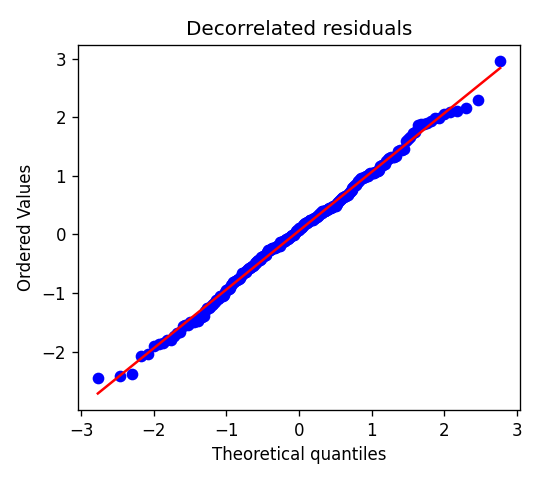

# Chapter 5: Likelihood Inference, Model Selection, and Diagnostics

Chapter 3 estimated the covariance parameters by fitting a curve to an empirical variogram, and Chapter 4 used them to predict rents at unlisted buildings, treating them as known. This chapter estimates everything at once from the likelihood: the regression coefficients $\boldsymbol{\beta}$ and the covariance parameters, which, as in Section 3.3, we collect in a vector $\boldsymbol{\theta} = (\sigma^2, \tau^2, \phi)'$.

Likelihood is the method you already know from mathematical statistics: write the density of the data as a function of the parameters and find the parameters that make the observed data most probable. For spatial data the density is multivariate normal with a covariance matrix that depends on $\boldsymbol{\theta}$, so every tool from Chapters 0 through 2 comes back: quadratic forms, determinants, the Cholesky factorization, and generalized least squares. The new ingredients are two derivatives of matrices, which give us standard errors, and one correction, restricted maximum likelihood, which fixes the tendency of maximum likelihood to underestimate variances.

The chapter also asks the questions an analyst faces after fitting. Which covariance family fits best? Is there spatial structure at all, or a nugget at all? Do the residuals look like the model says they should? And what goes wrong when several apartments in one building share the same coordinates?

The running example throughout is a simulated data set of 250 rent listings scattered over a district, with true parameters $\sigma^2 = 4$, $\tau^2 = 1$, $\phi = 0.15$, and a trend that rises toward the east. Because the data are simulated, we can always compare the estimates with the truth.

> **Chapter at a Glance**
>
> - **The Log-Likelihood (§5.1):** From the multivariate normal density to $\ell(\boldsymbol{\beta}, \boldsymbol{\theta})$, evaluated by hand on four apartments.
> - **Profile Likelihood (§5.2):** $\boldsymbol{\beta}$ and $\sigma^2$ have closed-form estimates for fixed $(\phi, \delta)$, which reduces the search to two dimensions.
> - **REML (§5.3):** Why maximum likelihood underestimates variances, and how likelihood for error contrasts fixes it without depending on the contrasts chosen.
> - **Optimization and Standard Errors (§5.4):** Cholesky evaluation, the score and the information matrix, Fisher scoring, and why $\sigma^2$ and $\phi$ are hard to separate.
> - **Model Selection and Tests (§5.5):** AIC and BIC across Matérn smoothness values, and likelihood ratio tests when the null value lies on the boundary.
> - **Diagnostics (§5.6):** Decorrelated residuals, spatial confounding, and duplicate locations.
> - **Walkthrough and Lab (§5.7):** A symbolic check of the information formula, a small-sample comparison of ML and REML, and figures of the likelihood surface.

---

## 5.1 The Multivariate Normal Log-Likelihood

Under the model of Chapter 2, the vector of $n$ responses is multivariate normal:

$$
\mathbf{Y} \sim N\!\left(\mathbf{X}\boldsymbol{\beta},\ \boldsymbol{\Sigma}(\boldsymbol{\theta})\right), \qquad \boldsymbol{\Sigma}(\boldsymbol{\theta}) = \sigma^2\mathbf{R}(\phi) + \tau^2\mathbf{I}_n
$$

Its density, evaluated at the observed data $\mathbf{y}$, is

$$
f(\mathbf{y}) = (2\pi)^{-n/2}\lvert\boldsymbol{\Sigma}(\boldsymbol{\theta})\rvert^{-1/2}\exp\!\left\{-\tfrac{1}{2}(\mathbf{y} - \mathbf{X}\boldsymbol{\beta})'\boldsymbol{\Sigma}(\boldsymbol{\theta})^{-1}(\mathbf{y} - \mathbf{X}\boldsymbol{\beta})\right\}
$$

Read as a function of the parameters with the data fixed, this is the likelihood. Its logarithm is the **log-likelihood**, written $\ell$:

$$
\ell(\boldsymbol{\beta}, \boldsymbol{\theta}) = -\frac{n}{2}\log(2\pi) - \frac{1}{2}\log\lvert\boldsymbol{\Sigma}(\boldsymbol{\theta})\rvert - \frac{1}{2}(\mathbf{y} - \mathbf{X}\boldsymbol{\beta})'\boldsymbol{\Sigma}(\boldsymbol{\theta})^{-1}(\mathbf{y} - \mathbf{X}\boldsymbol{\beta})
$$

This is Tool 3 of Section 0.4.3, now with parameters inside $\boldsymbol{\Sigma}$. The two parts still compete. The determinant term penalizes covariance matrices that allow a lot of spread. The quadratic form, a Mahalanobis distance, rewards covariance matrices under which the residuals look typical. Maximum likelihood estimation (ML) chooses the $\boldsymbol{\beta}$ and $\boldsymbol{\theta}$ that maximize $\ell$.

**A hand-sized example.** Return to the four apartments at the corners of a block (Sections 1.3.2 and 1.3.3), with $\boldsymbol{\Sigma}$ having entries $e^{-h_{ij}}$ ($\sigma^2 = 1$, $\tau^2 = 0$, $\phi = 1$). Suppose the residuals from a known mean are

$$
\mathbf{y} - \mathbf{X}\boldsymbol{\beta} = (0.5,\ 1.5,\ -0.5,\ 0.5)'
$$

for apartments at $(0,0)$, $(1,0)$, $(0,1)$, and $(1,1)$. We can evaluate $\ell$ by hand using the eigenvectors of Section 1.3.3, because they make both terms easy.

*The determinant.* The determinant of a matrix is the product of its eigenvalues, so its logarithm is the sum of their logarithms:

$$
\log\lvert\boldsymbol{\Sigma}\rvert = \log 1.9789 + 2\log 0.7569 + \log 0.5074 = 0.6825 - 0.5570 - 0.6785 = -0.5530
$$

*The quadratic form.* With $\boldsymbol{\Sigma} = \mathbf{U}\boldsymbol{\Lambda}\mathbf{U}'$, the inverse is $\boldsymbol{\Sigma}^{-1} = \mathbf{U}\boldsymbol{\Lambda}^{-1}\mathbf{U}'$, so for any vector $\mathbf{e}$,

$$
\mathbf{e}'\boldsymbol{\Sigma}^{-1}\mathbf{e} = \sum_{k} \frac{(\mathbf{v}_k'\mathbf{e})^2}{\lambda_k}
$$

The four patterns of Section 1.3.3, scaled to length 1, are $(1,1,1,1)'/2$, $(-1,1,-1,1)'/2$, $(-1,-1,1,1)'/2$, and $(1,-1,-1,1)'/2$. Their inner products with $\mathbf{e} = (0.5, 1.5, -0.5, 0.5)'$ are $1$, $1$, $-1$, and $0$. So

$$
\mathbf{e}'\boldsymbol{\Sigma}^{-1}\mathbf{e} = \frac{1}{1.9789} + \frac{1}{0.7569} + \frac{1}{0.7569} + \frac{0}{0.5074} = 0.5053 + 1.3212 + 1.3212 = 3.1477
$$

*The log-likelihood.* Putting the pieces together, with $-2\log(2\pi) = -3.6758$,

$$
\ell = -3.6758 - \tfrac{1}{2}(-0.5530) - \tfrac{1}{2}(3.1477) = -3.6758 + 0.2765 - 1.5739 = -4.9732
$$

For comparison, if the four residuals were independent with variance 1, then $\boldsymbol{\Sigma} = \mathbf{I}_4$, the determinant term is 0, the quadratic form is $0.25 + 2.25 + 0.25 + 0.25 = 3$, and $\ell = -3.6758 - 1.5 = -5.1758$. The spatial model has the higher likelihood.

It is worth seeing why. The spatial model's quadratic form (3.1477) is slightly worse than the independent model's (3.0), because the data put weight on the east-west and north-south patterns, which the spatial model expects to be smaller than 1. But the spatial model's determinant is smaller than 1, since correlated values occupy less "volume," and that earns it $+0.2765$. The determinant reward outweighs the slightly worse fit.

The code below repeats the calculation with a Cholesky factorization, the method used for real data (Section 5.4.1). The small differences in the fourth decimal place come from rounding the hand calculation.

```python
import numpy as np
from scipy import linalg, optimize, stats

S4 = np.array([[0.0, 0.0], [1.0, 0.0], [0.0, 1.0], [1.0, 1.0]])
H4 = np.sqrt(((S4[:, None, :] - S4[None, :, :])**2).sum(axis=2))
Sigma4 = np.exp(-H4)
y4 = np.array([0.5, 1.5, -0.5, 0.5])


def gauss_loglik(y, mean, Sigma):
    """Multivariate normal log-likelihood, evaluated with Cholesky."""
    n = len(y)
    c = linalg.cho_factor(Sigma, lower=True)
    r = y - mean
    quad = r @ linalg.cho_solve(c, r)
    logdet = 2 * np.sum(np.log(np.diag(c[0])))
    return -0.5 * n * np.log(2 * np.pi) - 0.5 * logdet - 0.5 * quad


print("eigenvalues:", np.round(np.linalg.eigvalsh(Sigma4), 4))
print("log|Sigma| =", round(np.linalg.slogdet(Sigma4)[1], 4))
print("quadratic form =", round(y4 @ np.linalg.solve(Sigma4, y4), 4))
print("loglik, spatial:", round(gauss_loglik(y4, 0.0, Sigma4), 4))
print("loglik, independent:", round(gauss_loglik(y4, 0.0, np.eye(4)), 4))
```

The code gives $\log\lvert\boldsymbol{\Sigma}\rvert = -0.5531$, a quadratic form of 3.1478, and log-likelihoods of $-4.9731$ (spatial) and $-5.1758$ (independent).

---

## 5.2 Profile Maximum Likelihood

The log-likelihood has five unknowns in the rent example: two regression coefficients and three covariance parameters. Maximizing over all five numerically is possible but slow and fragile. Two of them can be solved for exactly, which leaves a search over two.

### 5.2.1 Factoring Out the Scale

Section 2.1.4 introduced the noise-to-signal ratio $\delta = \tau^2/\sigma^2$ and wrote

$$
\boldsymbol{\Sigma} = \sigma^2\boldsymbol{\Psi}(\phi, \delta), \qquad \boldsymbol{\Psi}(\phi, \delta) = \mathbf{R}(\phi) + \delta\mathbf{I}_n
$$

We now reparameterize from $(\sigma^2, \tau^2, \phi)$ to $(\sigma^2, \phi, \delta)$. Two facts about scalar multiples simplify the log-likelihood. The determinant of $\sigma^2\boldsymbol{\Psi}$ is $(\sigma^2)^n\lvert\boldsymbol{\Psi}\rvert$, because multiplying an $n \times n$ matrix by a scalar multiplies each of its $n$ eigenvalues by that scalar. And the inverse is $\boldsymbol{\Sigma}^{-1} = \boldsymbol{\Psi}^{-1}/\sigma^2$. Substituting,

$$
\ell = -\frac{n}{2}\log(2\pi) - \frac{n}{2}\log\sigma^2 - \frac{1}{2}\log\lvert\boldsymbol{\Psi}\rvert - \frac{1}{2\sigma^2}(\mathbf{y} - \mathbf{X}\boldsymbol{\beta})'\boldsymbol{\Psi}^{-1}(\mathbf{y} - \mathbf{X}\boldsymbol{\beta})
$$

where $\boldsymbol{\Psi}$ depends on $(\phi, \delta)$ only.

### 5.2.2 Closed-Form Estimates of $\boldsymbol{\beta}$ and $\sigma^2$

Hold $\phi$ and $\delta$ fixed for the moment.

**The coefficients.** Only the last term involves $\boldsymbol{\beta}$, and maximizing $\ell$ means minimizing $(\mathbf{y} - \mathbf{X}\boldsymbol{\beta})'\boldsymbol{\Psi}^{-1}(\mathbf{y} - \mathbf{X}\boldsymbol{\beta})$. That is the generalized least squares problem of Section 1.3.5, with $\boldsymbol{\Psi}$ in place of $\boldsymbol{\Sigma}$. Setting its gradient $-2\mathbf{X}'\boldsymbol{\Psi}^{-1}(\mathbf{y} - \mathbf{X}\boldsymbol{\beta})$ to zero,

$$
\hat{\boldsymbol{\beta}}(\phi, \delta) = (\mathbf{X}'\boldsymbol{\Psi}^{-1}\mathbf{X})^{-1}\mathbf{X}'\boldsymbol{\Psi}^{-1}\mathbf{y}
$$

The scale $\sigma^2$ cancels, so this is exactly the GLS estimator with $\boldsymbol{\Sigma}$.

**The scale.** Write $\mathrm{RSS}_\Psi(\phi, \delta) = (\mathbf{y} - \mathbf{X}\hat{\boldsymbol{\beta}})'\boldsymbol{\Psi}^{-1}(\mathbf{y} - \mathbf{X}\hat{\boldsymbol{\beta}})$ for the generalized residual sum of squares. Differentiating $\ell$ with respect to $\sigma^2$, with $\boldsymbol{\beta} = \hat{\boldsymbol{\beta}}$,

$$
\frac{\partial\ell}{\partial\sigma^2} = -\frac{n}{2\sigma^2} + \frac{\mathrm{RSS}_\Psi}{2\sigma^4} = 0 \quad\Longrightarrow\quad \hat{\sigma}^2(\phi, \delta) = \frac{\mathrm{RSS}_\Psi(\phi, \delta)}{n}
$$

This is the calculation of Section 0.4.4, with a mean added.

**The profile log-likelihood.** Substituting both estimates back, the quadratic term becomes $\mathrm{RSS}_\Psi/(2\hat{\sigma}^2) = n/2$, and

$$
\ell_p(\phi, \delta) = -\frac{n}{2}\left[\log\!\left(2\pi\hat{\sigma}^2(\phi, \delta)\right) + 1\right] - \frac{1}{2}\log\lvert\boldsymbol{\Psi}(\phi, \delta)\rvert
$$

This is the **profile log-likelihood**: for each $(\phi, \delta)$, the best value of $\ell$ over $\boldsymbol{\beta}$ and $\sigma^2$. Maximizing it over two parameters gives the same answer as maximizing $\ell$ over all five. We search over $\log\phi$ and $\log\delta$ rather than $\phi$ and $\delta$, so that the search can never step to a negative value, and we use SciPy's bounded L-BFGS-B method.

The code below defines the running data set, the profile log-likelihood (with a switch for REML, which Section 5.3 explains), and the optimizer, and then fits the rent data. The design matrix has an intercept and the east coordinate, so $p = 2$.

```python
def dist(S):
    """Matrix of Euclidean distances between the rows of S."""
    q = np.sum(S**2, axis=1)
    H2 = q[:, None] - 2 * S @ S.T + q[None, :]
    H = np.sqrt(np.maximum(H2, 0.0))
    np.fill_diagonal(H, 0.0)
    return H


def rent_district(n=250, seed=2030):
    """Simulated rent listings: locations, trend, effect, noise, rent."""
    rng = np.random.default_rng(seed)
    S = rng.uniform(size=(n, 2))
    mu = 18.0 + 6.0 * S[:, 0]
    R = np.exp(-dist(S) / 0.15)
    L = np.linalg.cholesky(4.0 * R + 1e-10 * np.eye(n))
    u = L @ rng.standard_normal(n)
    eps = rng.standard_normal(n)
    return S, mu, u, eps, mu + u + eps


def matern(H, phi, nu):
    """Matern correlation for nu = 1/2, 3/2, 5/2 (closed forms)."""
    x = H / phi
    if nu == 0.5:
        return np.exp(-x)
    if nu == 1.5:
        return (1 + x) * np.exp(-x)
    return (1 + x + x**2 / 3) * np.exp(-x)


def profile_fit(phi, delta, y, X, H, nu=0.5, reml=False):
    """Profile out beta and sigma2 for fixed (phi, delta)."""
    n, p = X.shape
    Psi = matern(H, phi, nu) + delta * np.eye(n)
    c = linalg.cho_factor(Psi, lower=True)
    PsiX = linalg.cho_solve(c, X)
    XtPX = X.T @ PsiX
    beta = np.linalg.solve(XtPX, PsiX.T @ y)
    r = y - X @ beta
    quad = r @ linalg.cho_solve(c, r)
    logdet = 2 * np.sum(np.log(np.diag(c[0])))
    m = n - p if reml else n
    sigma2 = quad / m
    ll = -0.5 * m * (np.log(2 * np.pi * sigma2) + 1) - 0.5 * logdet
    if reml:
        ll -= 0.5 * np.linalg.slogdet(XtPX)[1]
    return dict(ll=ll, beta=beta, sigma2=sigma2, tau2=delta * sigma2,
                phi=phi, delta=delta)


def fit(y, X, H, nu=0.5, reml=False, start=(0.2, 0.5)):
    """Maximize the profile log-likelihood over log(phi), log(delta)."""
    def neg(lp):
        try:
            return -profile_fit(np.exp(lp[0]), np.exp(lp[1]), y, X, H,
                                nu, reml)["ll"]
        except linalg.LinAlgError:
            return 1e10
    bounds = [(np.log(1e-3), np.log(5.0)), (np.log(1e-6), np.log(1e3))]
    res = optimize.minimize(neg, np.log(start), method="L-BFGS-B",
                            bounds=bounds)
    return profile_fit(np.exp(res.x[0]), np.exp(res.x[1]), y, X, H, nu,
                       reml)


S, mu, u, eps, y = rent_district()
n = len(y)
H = dist(S)
X = np.column_stack([np.ones(n), S[:, 0]])
fit_ml = fit(y, X, H, reml=False)
fit_reml = fit(y, X, H, reml=True)
for name, f in (("ML", fit_ml), ("REML", fit_reml)):
    print(f"{name:5s} sigma2={f['sigma2']:.3f}  tau2={f['tau2']:.3f}  "
          f"phi={f['phi']:.4f}  beta=({f['beta'][0]:.3f}, "
          f"{f['beta'][1]:.3f})  loglik={f['ll']:.3f}")
```

| Method | $\hat{\sigma}^2$ | $\hat{\tau}^2$ | $\hat{\phi}$ | $\hat{\beta}_0$ | $\hat{\beta}_1$ (east) | Maximized log-likelihood |
| :--- | :--- | :--- | :--- | :--- | :--- | :--- |
| Truth | 4 | 1 | 0.15 | 18 | 6 | |
| ML | 4.672 | 1.202 | 0.1880 | 16.873 | 7.101 | $-490.949$ |
| REML | 7.193 | 1.267 | 0.3266 | 16.918 | 6.770 | $-488.560$ |
| Chapter 3: WLS on OLS residuals (plane trend) | 3.736 | 1.342 | 0.178 | | | |

The last row repeats the estimates of Chapter 3 (Section 3.5.1), where Cressie's weighted least squares was applied to the variogram of the OLS residuals from a plane trend in both coordinates. The trend model differs from the east-only trend used here, so the comparison is rough. Those residuals have covariance $\boldsymbol{\Sigma}_e = (\mathbf{I}_n - \mathbf{P}_{\mathbf{X}})\boldsymbol{\Sigma}(\mathbf{I}_n - \mathbf{P}_{\mathbf{X}})$ (Section 3.4.3): the estimated mean absorbs smooth variation, which biases the residual variogram downward at long distances. The likelihood methods avoid the binning and the separate detrending step, and REML in particular is built to account for the part of the variation that the estimated mean absorbs (Section 5.3). On this one data set the weighted least squares estimates of $\sigma^2$ and $\phi$ happen to be closer to the truth than either likelihood estimate; that is a property of this realization, and of the ridge described in Section 5.4.4, not a ranking of the methods. The ML estimates of $\sigma^2$, $\tau^2$, and $\phi$ are all in the right neighborhood. The REML estimates, explained in the next section, put $\sigma^2$ and $\phi$ much higher. That is not a mistake in either method; Section 5.4.4 shows that this data set barely distinguishes between the two answers. (The two log-likelihoods are on different scales and cannot be compared with each other; Section 5.5.1 explains why.)

---

## 5.3 Restricted Maximum Likelihood (REML)

### 5.3.1 Why ML Underestimates Variance Parameters

Start with the simplest case: independent observations with an unknown mean, $\mathbf{X} = \mathbf{1}$ and $\boldsymbol{\Psi} = \mathbf{I}_n$. Then $\hat{\boldsymbol{\beta}} = \bar{y}$ and the ML estimate of the variance is

$$
\hat{\sigma}^2_{\text{ML}} = \frac{1}{n}\sum_{i=1}^n (y_i - \bar{y})^2
$$

which, as you know from mathematical statistics, has expectation $\sigma^2(n - 1)/n$. The familiar fix is to divide by $n - 1$. The reason is that the residuals $y_i - \bar{y}$ are measured from an estimated mean, which is placed to make them as small as possible. One of the $n$ dimensions of the data has been spent estimating the mean, and only $n - 1$ remain to estimate the variance.

The same thing happens in general. With $\boldsymbol{\Psi}$ known, write the generalized residual sum of squares as a quadratic form. Since $\mathbf{y} - \mathbf{X}\hat{\boldsymbol{\beta}} = \left(\mathbf{I}_n - \mathbf{X}(\mathbf{X}'\boldsymbol{\Psi}^{-1}\mathbf{X})^{-1}\mathbf{X}'\boldsymbol{\Psi}^{-1}\right)\mathbf{y}$, a short calculation gives

$$
\mathrm{RSS}_\Psi = \mathbf{y}'\boldsymbol{\Pi}_\Psi\mathbf{y}, \qquad \boldsymbol{\Pi}_\Psi = \boldsymbol{\Psi}^{-1} - \boldsymbol{\Psi}^{-1}\mathbf{X}(\mathbf{X}'\boldsymbol{\Psi}^{-1}\mathbf{X})^{-1}\mathbf{X}'\boldsymbol{\Psi}^{-1}
$$

This $\boldsymbol{\Pi}_\Psi$ is the residual precision matrix of Section 4.7, built from $\boldsymbol{\Psi}$ instead of $\boldsymbol{\Sigma}$. It satisfies $\boldsymbol{\Pi}_\Psi\mathbf{X} = \mathbf{0}$, so the mean term of the quadratic-form expectation (Section 1.1.1) vanishes, and with $\operatorname{Var}(\mathbf{Y}) = \sigma^2\boldsymbol{\Psi}$,

$$
\operatorname{E}[\mathrm{RSS}_\Psi] = \operatorname{tr}(\boldsymbol{\Pi}_\Psi\,\sigma^2\boldsymbol{\Psi}) = \sigma^2\left[n - \operatorname{tr}\!\left((\mathbf{X}'\boldsymbol{\Psi}^{-1}\mathbf{X})^{-1}\mathbf{X}'\boldsymbol{\Psi}^{-1}\mathbf{X}\right)\right] = \sigma^2(n - p)
$$

using a cycle of the trace in the last step. So $\operatorname{E}[\hat{\sigma}^2_{\text{ML}}] = \sigma^2(n - p)/n$: ML divides by $n$ when only $n - p$ dimensions of the data carry information about the variance.

When $\phi$ and $\delta$ are also estimated, the problem grows. The estimated mean absorbs some of the smooth spatial variation, the residuals look less variable and less correlated than the process really is, and the estimates of $\sigma^2$, $\tau^2$, and $\phi$ are all pulled down. Section 5.7.2 measures this: with 60 locations, the median ML estimates are $\hat{\sigma}^2 = 3.620$, $\hat{\tau}^2 = 0.546$, and $\hat{\phi} = 0.1011$, against true values of 4, 1, and 0.15.

### 5.3.2 Filtering Out the Mean With Error Contrasts

Restricted (or residual) maximum likelihood, REML, removes the mean from the problem before estimating the variance. The idea is to base the likelihood on linear combinations of the data whose distribution does not involve $\boldsymbol{\beta}$ at all.

Let $\mathbf{T}$ be an $n \times (n - p)$ matrix of full column rank with

$$
\mathbf{T}'\mathbf{X} = \mathbf{0}
$$

Its columns are called **error contrasts**. Each column $\mathbf{t}$ satisfies $\operatorname{E}[\mathbf{t}'\mathbf{Y}] = \mathbf{t}'\mathbf{X}\boldsymbol{\beta} = 0$ for every $\boldsymbol{\beta}$, so the vector $\mathbf{T}'\mathbf{Y}$ has mean zero no matter what $\boldsymbol{\beta}$ is. By Tool 1 its covariance is $\mathbf{T}'\boldsymbol{\Sigma}\mathbf{T}$, so

$$
\mathbf{T}'\mathbf{Y} \sim N\!\left(\mathbf{0},\ \mathbf{T}'\boldsymbol{\Sigma}(\boldsymbol{\theta})\mathbf{T}\right)
$$

The mean has disappeared and only $\boldsymbol{\theta}$ remains. Why $n - p$ columns? The condition $\mathbf{T}'\mathbf{X} = \mathbf{0}$ says each column of $\mathbf{T}$ is perpendicular to the $p$ columns of $\mathbf{X}$. The vectors perpendicular to $p$ independent vectors in $n$ dimensions form a space of dimension $n - p$, so that is the largest number of independent contrasts available. These are the $n - p$ dimensions left over after estimating $\boldsymbol{\beta}$.

A convenient choice is an orthonormal $\mathbf{T}$, with $\mathbf{T}'\mathbf{T} = \mathbf{I}_{n-p}$. Then $\mathbf{T}\mathbf{T}' = \mathbf{I}_n - \mathbf{P}_{\mathbf{X}}$, the projection onto the space perpendicular to the columns of $\mathbf{X}$. One way to construct it is the QR decomposition of $[\mathbf{X}\ \ \mathbf{I}_n]$: the first $p$ columns of the orthonormal factor span the columns of $\mathbf{X}$, and the remaining $n - p$ columns are perpendicular to them.

Two identities connect contrasts back to quantities we already know. Recall the residual precision matrix of Section 4.7,

$$
\boldsymbol{\Pi} = \boldsymbol{\Sigma}^{-1} - \boldsymbol{\Sigma}^{-1}\mathbf{X}(\mathbf{X}'\boldsymbol{\Sigma}^{-1}\mathbf{X})^{-1}\mathbf{X}'\boldsymbol{\Sigma}^{-1}
$$

Then, for any $\mathbf{T}$ with $\mathbf{T}'\mathbf{X} = \mathbf{0}$ and $n - p$ independent columns,

$$
\boldsymbol{\Pi} = \mathbf{T}(\mathbf{T}'\boldsymbol{\Sigma}\mathbf{T})^{-1}\mathbf{T}'
$$

and, if $\mathbf{T}$ is orthonormal,

$$
\lvert\mathbf{T}'\boldsymbol{\Sigma}\mathbf{T}\rvert = \frac{\lvert\boldsymbol{\Sigma}\rvert\,\lvert\mathbf{X}'\boldsymbol{\Sigma}^{-1}\mathbf{X}\rvert}{\lvert\mathbf{X}'\mathbf{X}\rvert}
$$

Section 5.3.4 proves both. The first says that the quadratic form of the contrasts, $(\mathbf{T}'\mathbf{y})'(\mathbf{T}'\boldsymbol{\Sigma}\mathbf{T})^{-1}(\mathbf{T}'\mathbf{y})$, equals $\mathbf{y}'\boldsymbol{\Pi}\mathbf{y}$. There is a second useful form of this quantity. Multiplying out $\boldsymbol{\Pi}\mathbf{y}$ gives $\boldsymbol{\Sigma}^{-1}(\mathbf{y} - \mathbf{X}\hat{\boldsymbol{\beta}}_{\text{GLS}})$, as Section 4.7 noted, so

$$
\mathbf{y}'\boldsymbol{\Pi}\mathbf{y} = (\mathbf{y} - \mathbf{X}\hat{\boldsymbol{\beta}}_{\text{GLS}})'\boldsymbol{\Sigma}^{-1}(\mathbf{y} - \mathbf{X}\hat{\boldsymbol{\beta}}_{\text{GLS}})
$$

using the fact that $\mathbf{X}'\boldsymbol{\Sigma}^{-1}(\mathbf{y} - \mathbf{X}\hat{\boldsymbol{\beta}}_{\text{GLS}}) = \mathbf{0}$ by the GLS normal equations. The contrasts never need to be formed in practice.

### 5.3.3 The REML Log-Likelihood

The REML log-likelihood is the log-likelihood of the contrasts $\mathbf{T}'\mathbf{y}$, which is multivariate normal of dimension $n - p$:

$$
\ell_{\text{REML}}(\boldsymbol{\theta}) = -\frac{n-p}{2}\log(2\pi) - \frac{1}{2}\log\lvert\mathbf{T}'\boldsymbol{\Sigma}\mathbf{T}\rvert - \frac{1}{2}\mathbf{y}'\mathbf{T}(\mathbf{T}'\boldsymbol{\Sigma}\mathbf{T})^{-1}\mathbf{T}'\mathbf{y}
$$

**The choice of contrasts does not matter.** Any two valid contrast matrices $\mathbf{T}$ and $\mathbf{T}_2$ have columns spanning the same space, the space perpendicular to the columns of $\mathbf{X}$. So $\mathbf{T}_2 = \mathbf{T}\mathbf{F}$ for some invertible $(n - p) \times (n - p)$ matrix $\mathbf{F}$. Substituting,

$$
\lvert\mathbf{T}_2'\boldsymbol{\Sigma}\mathbf{T}_2\rvert = \lvert\mathbf{F}'\rvert\,\lvert\mathbf{T}'\boldsymbol{\Sigma}\mathbf{T}\rvert\,\lvert\mathbf{F}\rvert = \lvert\mathbf{F}\rvert^2\,\lvert\mathbf{T}'\boldsymbol{\Sigma}\mathbf{T}\rvert
$$

and

$$
\mathbf{T}_2(\mathbf{T}_2'\boldsymbol{\Sigma}\mathbf{T}_2)^{-1}\mathbf{T}_2' = \mathbf{T}\mathbf{F}\,\mathbf{F}^{-1}(\mathbf{T}'\boldsymbol{\Sigma}\mathbf{T})^{-1}(\mathbf{F}')^{-1}\,\mathbf{F}'\mathbf{T}' = \mathbf{T}(\mathbf{T}'\boldsymbol{\Sigma}\mathbf{T})^{-1}\mathbf{T}'
$$

The quadratic form is unchanged, and the determinant term changes by $-\log\lvert\mathbf{F}\rvert$, a constant that does not depend on $\boldsymbol{\theta}$. Different contrasts give log-likelihoods that differ by a constant, so they have the same maximizer and the same curvature. REML is a well-defined method, not a family of methods indexed by $\mathbf{T}$.

**The form used in practice.** With an orthonormal $\mathbf{T}$, the two identities of Section 5.3.2 rewrite everything in terms of $\boldsymbol{\Sigma}$:

$$
\ell_{\text{REML}}(\boldsymbol{\theta}) = -\frac{n-p}{2}\log(2\pi) - \frac{1}{2}\log\lvert\boldsymbol{\Sigma}\rvert - \frac{1}{2}\log\lvert\mathbf{X}'\boldsymbol{\Sigma}^{-1}\mathbf{X}\rvert - \frac{1}{2}\mathbf{y}'\boldsymbol{\Pi}\mathbf{y} + \frac{1}{2}\log\lvert\mathbf{X}'\mathbf{X}\rvert
$$

The last term does not depend on $\boldsymbol{\theta}$ and is usually dropped, which is why the REML log-likelihood is described as unique up to an additive constant. Compared with the ML log-likelihood, REML has $n - p$ in place of $n$, the GLS residuals in the quadratic form, and one extra term, $-\frac{1}{2}\log\lvert\mathbf{X}'\boldsymbol{\Sigma}^{-1}\mathbf{X}\rvert$. That term is the log-determinant of the inverse variance of $\hat{\boldsymbol{\beta}}_{\text{GLS}}$. It corrects for the degrees of freedom used up by estimating $\boldsymbol{\beta}$: it favors covariance parameters under which the estimated mean is less precise, which offsets ML's downward bias in the variance parameters.

**Profiling REML.** The scale factors out exactly as in Section 5.2. With $\boldsymbol{\Sigma} = \sigma^2\boldsymbol{\Psi}$, the terms become $\log\lvert\boldsymbol{\Sigma}\rvert = n\log\sigma^2 + \log\lvert\boldsymbol{\Psi}\rvert$, $\log\lvert\mathbf{X}'\boldsymbol{\Sigma}^{-1}\mathbf{X}\rvert = -p\log\sigma^2 + \log\lvert\mathbf{X}'\boldsymbol{\Psi}^{-1}\mathbf{X}\rvert$, and $\mathbf{y}'\boldsymbol{\Pi}\mathbf{y} = \mathrm{RSS}_\Psi/\sigma^2$. The terms involving $\sigma^2$ are $-\frac{n-p}{2}\log\sigma^2 - \mathrm{RSS}_\Psi/(2\sigma^2)$, maximized at

$$
\hat{\sigma}^2_{\text{REML}}(\phi, \delta) = \frac{\mathrm{RSS}_\Psi(\phi, \delta)}{n - p}
$$

the divisor that makes the known-$\boldsymbol{\Psi}$ estimate unbiased (Section 5.3.1). The profile REML log-likelihood, up to the constant, is

$$
\ell_{\text{REML},p}(\phi, \delta) = -\frac{n-p}{2}\left[\log\!\left(2\pi\hat{\sigma}^2_{\text{REML}}\right) + 1\right] - \frac{1}{2}\log\lvert\boldsymbol{\Psi}\rvert - \frac{1}{2}\log\lvert\mathbf{X}'\boldsymbol{\Psi}^{-1}\mathbf{X}\rvert
$$

which is what `profile_fit` computes when `reml=True`. The estimates of $\boldsymbol{\beta}$ reported with REML are the GLS estimates at the REML values of $(\phi, \delta)$.

The code below builds an orthonormal $\mathbf{T}$ for the rent data from a QR decomposition and checks both identities numerically at the REML estimates.

```python
Q_full, _ = np.linalg.qr(np.column_stack([X, np.eye(n)]))
T = Q_full[:, 2:n]
print("T'X is zero:", np.allclose(T.T @ X, 0.0))
print("T T' = I - P_X:",
      np.allclose(T @ T.T, np.eye(n) - X @ np.linalg.solve(X.T @ X, X.T)))
Sig = fit_reml["sigma2"] * (np.exp(-H / fit_reml["phi"])
                            + fit_reml["delta"] * np.eye(n))
Si = np.linalg.inv(Sig)
Pi = Si - Si @ X @ np.linalg.solve(X.T @ Si @ X, X.T @ Si)
Pi_T = T @ np.linalg.solve(T.T @ Sig @ T, T.T)
print("Pi equals T (T' Sigma T)^{-1} T':", np.allclose(Pi, Pi_T))
lhs = np.linalg.slogdet(T.T @ Sig @ T)[1]
rhs = (np.linalg.slogdet(Sig)[1] + np.linalg.slogdet(X.T @ Si @ X)[1]
       - np.linalg.slogdet(X.T @ X)[1])
print("log|T' Sigma T| =", round(lhs, 4), " identity gives", round(rhs, 4))
```

All three checks print `True`, and both sides of the determinant identity equal 264.778. (This check forms $\boldsymbol{\Sigma}^{-1}$ explicitly for clarity; Section 5.4.1 explains why the fitting code never does.)

### 5.3.4 Proofs of the Two Identities (Optional)

*This subsection proves the identities used in Sections 5.3.2 and 5.3.3. It can be skipped on a first reading.*

**The residual precision identity.** Form the $n \times n$ matrix $\mathbf{J}_1 = [\mathbf{T}\ \ \boldsymbol{\Sigma}^{-1}\mathbf{X}]$, placing the $n - p$ columns of $\mathbf{T}$ next to the $p$ columns of $\boldsymbol{\Sigma}^{-1}\mathbf{X}$. It is invertible: a combination $\mathbf{T}\mathbf{a} + \boldsymbol{\Sigma}^{-1}\mathbf{X}\mathbf{b} = \mathbf{0}$ multiplied on the left by $\mathbf{X}'$ gives $\mathbf{X}'\boldsymbol{\Sigma}^{-1}\mathbf{X}\mathbf{b} = \mathbf{0}$, so $\mathbf{b} = \mathbf{0}$, and then $\mathbf{T}\mathbf{a} = \mathbf{0}$ forces $\mathbf{a} = \mathbf{0}$. (Here $\mathbf{J}_1$ is a local name for this proof only.)

For any invertible $\mathbf{J}_1$,

$$
\mathbf{J}_1(\mathbf{J}_1'\boldsymbol{\Sigma}\mathbf{J}_1)^{-1}\mathbf{J}_1' = \mathbf{J}_1\mathbf{J}_1^{-1}\boldsymbol{\Sigma}^{-1}(\mathbf{J}_1')^{-1}\mathbf{J}_1' = \boldsymbol{\Sigma}^{-1}
$$

Now compute $\mathbf{J}_1'\boldsymbol{\Sigma}\mathbf{J}_1$ in blocks. The off-diagonal block is $\mathbf{T}'\boldsymbol{\Sigma}\boldsymbol{\Sigma}^{-1}\mathbf{X} = \mathbf{T}'\mathbf{X} = \mathbf{0}$, so the matrix is block diagonal:

$$
\mathbf{J}_1'\boldsymbol{\Sigma}\mathbf{J}_1 = \begin{bmatrix} \mathbf{T}'\boldsymbol{\Sigma}\mathbf{T} & \mathbf{0} \\ \mathbf{0} & \mathbf{X}'\boldsymbol{\Sigma}^{-1}\mathbf{X} \end{bmatrix}
$$

Its inverse is block diagonal with the inverse blocks, and multiplying out,

$$
\boldsymbol{\Sigma}^{-1} = \mathbf{T}(\mathbf{T}'\boldsymbol{\Sigma}\mathbf{T})^{-1}\mathbf{T}' + \boldsymbol{\Sigma}^{-1}\mathbf{X}(\mathbf{X}'\boldsymbol{\Sigma}^{-1}\mathbf{X})^{-1}\mathbf{X}'\boldsymbol{\Sigma}^{-1}
$$

Moving the second term to the left side gives $\boldsymbol{\Pi} = \mathbf{T}(\mathbf{T}'\boldsymbol{\Sigma}\mathbf{T})^{-1}\mathbf{T}'$. $\square$

**The determinant identity.** Now let $\mathbf{T}$ be orthonormal and form $\mathbf{J}_2 = [\mathbf{T}\ \ \mathbf{X}]$, which does not depend on $\boldsymbol{\Sigma}$. Because $\mathbf{T}'\mathbf{X} = \mathbf{0}$ and $\mathbf{T}'\mathbf{T} = \mathbf{I}$, $\mathbf{J}_2'\mathbf{J}_2$ is block diagonal with blocks $\mathbf{I}_{n-p}$ and $\mathbf{X}'\mathbf{X}$, so $\lvert\mathbf{J}_2\rvert^2 = \lvert\mathbf{X}'\mathbf{X}\rvert$, and its inverse is $\mathbf{J}_2^{-1} = (\mathbf{J}_2'\mathbf{J}_2)^{-1}\mathbf{J}_2'$, whose rows are $\mathbf{T}'$ and $(\mathbf{X}'\mathbf{X})^{-1}\mathbf{X}'$.

Let $\mathbf{M}_2 = \mathbf{J}_2'\boldsymbol{\Sigma}\mathbf{J}_2$. On one hand, $\lvert\mathbf{M}_2\rvert = \lvert\mathbf{J}_2\rvert^2\lvert\boldsymbol{\Sigma}\rvert = \lvert\mathbf{X}'\mathbf{X}\rvert\,\lvert\boldsymbol{\Sigma}\rvert$. On the other, the block-determinant formula of Appendix A.1 says that for a partitioned matrix, $\lvert\mathbf{M}_2\rvert$ equals the determinant of its upper-left block times the reciprocal of the determinant of the lower-right block of $\mathbf{M}_2^{-1}$. The upper-left block of $\mathbf{M}_2$ is $\mathbf{T}'\boldsymbol{\Sigma}\mathbf{T}$. The lower-right block of $\mathbf{M}_2^{-1} = \mathbf{J}_2^{-1}\boldsymbol{\Sigma}^{-1}(\mathbf{J}_2^{-1})'$ is $(\mathbf{X}'\mathbf{X})^{-1}\mathbf{X}'\boldsymbol{\Sigma}^{-1}\mathbf{X}(\mathbf{X}'\mathbf{X})^{-1}$, with determinant $\lvert\mathbf{X}'\boldsymbol{\Sigma}^{-1}\mathbf{X}\rvert/\lvert\mathbf{X}'\mathbf{X}\rvert^2$. So

$$
\lvert\mathbf{X}'\mathbf{X}\rvert\,\lvert\boldsymbol{\Sigma}\rvert = \lvert\mathbf{T}'\boldsymbol{\Sigma}\mathbf{T}\rvert\,\frac{\lvert\mathbf{X}'\mathbf{X}\rvert^2}{\lvert\mathbf{X}'\boldsymbol{\Sigma}^{-1}\mathbf{X}\rvert}
$$

and rearranging gives the identity. $\square$

---

## 5.4 Numerical Optimization and Asymptotic Standard Errors

### 5.4.1 Evaluating the Likelihood Safely With Cholesky

Every evaluation of the log-likelihood needs $\log\lvert\boldsymbol{\Sigma}\rvert$ and the quadratic form $\mathbf{e}'\boldsymbol{\Sigma}^{-1}\mathbf{e}$, where $\mathbf{e} = \mathbf{y} - \mathbf{X}\boldsymbol{\beta}$. The Cholesky factor $\mathbf{L}$ of Section 2.7.1 provides both.

**The determinant.** Since $\boldsymbol{\Sigma} = \mathbf{L}\mathbf{L}'$, $\lvert\boldsymbol{\Sigma}\rvert = \lvert\mathbf{L}\rvert^2$. The determinant of a triangular matrix is the product of its diagonal entries, so

$$
\log\lvert\boldsymbol{\Sigma}\rvert = 2\sum_{i=1}^n \log L_{ii}
$$

This is a sum of $n$ moderate numbers. Computing $\lvert\boldsymbol{\Sigma}\rvert$ itself and then taking its logarithm is risky: for the rent data, $\lvert\boldsymbol{\Sigma}\rvert$ at the REML estimates is about $4.5 \times 10^{119}$. That still fits in double precision, whose largest number is about $1.8 \times 10^{308}$, but a data set a few times larger would overflow, and a covariance matrix with small eigenvalues would underflow to zero.

**The quadratic form.** Solve $\mathbf{L}\mathbf{z} = \mathbf{e}$ by forward substitution, which is fast because $\mathbf{L}$ is triangular. Then $\mathbf{z} = \mathbf{L}^{-1}\mathbf{e}$ and

$$
\mathbf{e}'\boldsymbol{\Sigma}^{-1}\mathbf{e} = \mathbf{e}'(\mathbf{L}')^{-1}\mathbf{L}^{-1}\mathbf{e} = \mathbf{z}'\mathbf{z}
$$

No inverse is ever formed. Forming $\boldsymbol{\Sigma}^{-1}$ explicitly costs more and loses accuracy when $\boldsymbol{\Sigma}$ is poorly conditioned. SciPy's `cho_factor` and `cho_solve`, used in `profile_fit`, do exactly this. One factorization of $\boldsymbol{\Psi}$ serves the determinant, the GLS estimate, and the quadratic form.

```python
print("det(Sigma) computed directly:", np.linalg.det(Sig))
c = linalg.cho_factor(Sig, lower=True)
print("log|Sigma| from Cholesky:", round(2 * np.sum(np.log(np.diag(c[0]))), 3))
```

The direct determinant is $4.45 \times 10^{119}$; the Cholesky log-determinant is 275.5.

### 5.4.2 The Score and the Information Matrix

To get standard errors, and to optimize with derivatives, we need the derivatives of $\ell$ with respect to $\boldsymbol{\theta}$. Write $\dot{\boldsymbol{\Sigma}}_j = \partial\boldsymbol{\Sigma}/\partial\theta_j$ for the matrix of derivatives of the entries of $\boldsymbol{\Sigma}$ with respect to the $j$th parameter. Two identities from matrix calculus do all the work (Appendix A.2 collects them).

**Derivative of an inverse.** Differentiate both sides of $\boldsymbol{\Sigma}\boldsymbol{\Sigma}^{-1} = \mathbf{I}$ with the product rule: $\dot{\boldsymbol{\Sigma}}_j\boldsymbol{\Sigma}^{-1} + \boldsymbol{\Sigma}\,\partial(\boldsymbol{\Sigma}^{-1})/\partial\theta_j = \mathbf{0}$. Solving,

$$
\frac{\partial\boldsymbol{\Sigma}^{-1}}{\partial\theta_j} = -\boldsymbol{\Sigma}^{-1}\dot{\boldsymbol{\Sigma}}_j\boldsymbol{\Sigma}^{-1}
$$

the matrix version of $d(1/x) = -dx/x^2$.

**Derivative of a log-determinant.** For a small change $t$ in $\theta_j$, $\boldsymbol{\Sigma}$ changes to approximately $\boldsymbol{\Sigma} + t\dot{\boldsymbol{\Sigma}}_j = \boldsymbol{\Sigma}(\mathbf{I} + t\boldsymbol{\Sigma}^{-1}\dot{\boldsymbol{\Sigma}}_j)$. The determinant of a product is the product of determinants, and $\lvert\mathbf{I} + t\mathbf{B}\rvert \approx 1 + t\operatorname{tr}(\mathbf{B})$ for small $t$, because the eigenvalues of $\mathbf{I} + t\mathbf{B}$ are $1 + t\lambda_k(\mathbf{B})$ and their product is $1 + t\sum_k\lambda_k(\mathbf{B}) + O(t^2)$. Taking logarithms, with $\log(1 + x) \approx x$,

$$
\frac{\partial\log\lvert\boldsymbol{\Sigma}\rvert}{\partial\theta_j} = \operatorname{tr}\!\left(\boldsymbol{\Sigma}^{-1}\dot{\boldsymbol{\Sigma}}_j\right)
$$

the matrix version of $d\log x = dx/x$.

**The score.** Applying both identities to $\ell$, with $\boldsymbol{\beta}$ held fixed and $\mathbf{e} = \mathbf{y} - \mathbf{X}\boldsymbol{\beta}$,

$$
\frac{\partial\ell}{\partial\theta_j} = -\frac{1}{2}\operatorname{tr}\!\left(\boldsymbol{\Sigma}^{-1}\dot{\boldsymbol{\Sigma}}_j\right) + \frac{1}{2}\mathbf{e}'\boldsymbol{\Sigma}^{-1}\dot{\boldsymbol{\Sigma}}_j\boldsymbol{\Sigma}^{-1}\mathbf{e}
$$

This is the **score** for $\theta_j$. Its expectation is zero at the true parameters, as a score should be: by the quadratic-form expectation of Section 1.1.1 with $\operatorname{E}[\mathbf{e}] = \mathbf{0}$ and $\operatorname{Var}(\mathbf{e}) = \boldsymbol{\Sigma}$, $\operatorname{E}[\mathbf{e}'\boldsymbol{\Sigma}^{-1}\dot{\boldsymbol{\Sigma}}_j\boldsymbol{\Sigma}^{-1}\mathbf{e}] = \operatorname{tr}(\boldsymbol{\Sigma}^{-1}\dot{\boldsymbol{\Sigma}}_j\boldsymbol{\Sigma}^{-1}\boldsymbol{\Sigma}) = \operatorname{tr}(\boldsymbol{\Sigma}^{-1}\dot{\boldsymbol{\Sigma}}_j)$, which cancels the first term.

**The expected information.** The Fisher information is the expected value of minus the second derivative of $\ell$. For the covariance parameters it is

$$
\mathcal{I}_{\text{ML}}(\boldsymbol{\theta})_{jk} = \frac{1}{2}\operatorname{tr}\!\left(\boldsymbol{\Sigma}^{-1}\dot{\boldsymbol{\Sigma}}_j\boldsymbol{\Sigma}^{-1}\dot{\boldsymbol{\Sigma}}_k\right)
$$

Section 5.4.6 derives this formula, and Section 5.7.1 checks it symbolically. Two further facts complete the picture. The information between $\boldsymbol{\beta}$ and $\boldsymbol{\theta}$ is zero (the cross derivatives are linear in $\mathbf{e}$, which has mean zero), so the two sets of parameters can be treated separately. And the information for $\boldsymbol{\beta}$ is $\mathbf{X}'\boldsymbol{\Sigma}^{-1}\mathbf{X}$, so the estimated variance of $\hat{\boldsymbol{\beta}}_{\text{GLS}}$ is $(\mathbf{X}'\boldsymbol{\Sigma}^{-1}\mathbf{X})^{-1}$ evaluated at $\hat{\boldsymbol{\theta}}$, as in Section 1.3.5.

**REML.** The REML log-likelihood is the ordinary log-likelihood of the contrasts $\mathbf{T}'\mathbf{y}$, which have covariance $\mathbf{T}'\boldsymbol{\Sigma}\mathbf{T}$ and derivatives $\mathbf{T}'\dot{\boldsymbol{\Sigma}}_j\mathbf{T}$. Applying the formulas above to the contrasts and using $\mathbf{T}(\mathbf{T}'\boldsymbol{\Sigma}\mathbf{T})^{-1}\mathbf{T}' = \boldsymbol{\Pi}$ (Section 5.3.2) with the cyclic property of the trace,

$$
\frac{\partial\ell_{\text{REML}}}{\partial\theta_j} = -\frac{1}{2}\operatorname{tr}\!\left(\boldsymbol{\Pi}\dot{\boldsymbol{\Sigma}}_j\right) + \frac{1}{2}\mathbf{y}'\boldsymbol{\Pi}\dot{\boldsymbol{\Sigma}}_j\boldsymbol{\Pi}\mathbf{y}, \qquad \mathcal{I}_{\text{REML}}(\boldsymbol{\theta})_{jk} = \frac{1}{2}\operatorname{tr}\!\left(\boldsymbol{\Pi}\dot{\boldsymbol{\Sigma}}_j\boldsymbol{\Pi}\dot{\boldsymbol{\Sigma}}_k\right)
$$

The REML formulas are the ML formulas with $\boldsymbol{\Pi}$ in place of $\boldsymbol{\Sigma}^{-1}$.

**The derivatives for the exponential model.** With $\boldsymbol{\theta} = (\sigma^2, \tau^2, \phi)'$ and $\boldsymbol{\Sigma} = \sigma^2\mathbf{R}(\phi) + \tau^2\mathbf{I}_n$, $R_{ij} = e^{-h_{ij}/\phi}$:

$$
\dot{\boldsymbol{\Sigma}}_{\sigma^2} = \mathbf{R}(\phi), \qquad \dot{\boldsymbol{\Sigma}}_{\tau^2} = \mathbf{I}_n, \qquad \left(\dot{\boldsymbol{\Sigma}}_{\phi}\right)_{ij} = \sigma^2\,\frac{h_{ij}}{\phi^2}\,e^{-h_{ij}/\phi}
$$

The last follows from $\frac{d}{d\phi}e^{-h/\phi} = \frac{h}{\phi^2}e^{-h/\phi}$.

### 5.4.3 Fisher Scoring and Standard Errors

**Standard errors.** Under standard conditions, the maximum likelihood estimator is approximately normal with covariance matrix equal to the inverse of the information. So the estimated standard errors are the square roots of the diagonal of $[\mathcal{I}(\hat{\boldsymbol{\theta}})]^{-1}$. (Spatial data stretch the usual conditions, because the observations are not independent. Section 5.4.4 explains when the approximation is poor, and Section 5.5.3 uses the bootstrap as a check.)

**Fisher scoring.** The information also gives an optimization method. Newton-Raphson updates a parameter by $\boldsymbol{\theta}_{\text{new}} = \boldsymbol{\theta} - [\nabla^2\ell]^{-1}\nabla\ell$, using the matrix of second derivatives, the **observed information** with a sign change. Fisher scoring replaces the observed information by its expectation:

$$
\boldsymbol{\theta}_{\text{new}} = \boldsymbol{\theta} + [\mathcal{I}(\boldsymbol{\theta})]^{-1}\,\text{score}(\boldsymbol{\theta})
$$

The expected information is always positive semi-definite and has the simple trace formula above, so scoring is easier to program and more stable far from the maximum. If a step would make a variance negative, we halve it until it does not. Near the maximum both methods converge quickly.

The code below computes the derivative matrices, the ML and REML information, and the standard errors; runs Fisher scoring for REML from a poor starting point; and computes the observed information numerically, by finite differences of the REML log-likelihood, for comparison.

```python
def dSigma(theta, H):
    """Derivatives of Sigma for theta = (sigma2, tau2, phi), exponential."""
    sigma2, tau2, phi = theta
    R = np.exp(-H / phi)
    return [R, np.eye(len(H)), sigma2 * R * H / phi**2]


def sigma_of(theta, H):
    sigma2, tau2, phi = theta
    return sigma2 * np.exp(-H / phi) + tau2 * np.eye(len(H))


def reml_parts(theta, y, X, H):
    """REML score vector and expected information at theta."""
    Si = np.linalg.inv(sigma_of(theta, H))
    Pi = Si - Si @ X @ np.linalg.solve(X.T @ Si @ X, X.T @ Si)
    D = dSigma(theta, H)
    PD = [Pi @ Dj for Dj in D]
    Py = Pi @ y
    score = np.array([-0.5 * np.trace(PDj) + 0.5 * Py @ Dj @ Py
                      for PDj, Dj in zip(PD, D)])
    info = np.array([[0.5 * np.sum(PDj * PDk.T) for PDk in PD]
                     for PDj in PD])
    return score, info


def ml_info(theta, H):
    Si = np.linalg.inv(sigma_of(theta, H))
    SD = [Si @ Dj for Dj in dSigma(theta, H)]
    return np.array([[0.5 * np.sum(a * b.T) for b in SD] for a in SD])


theta_ml = np.array([fit_ml["sigma2"], fit_ml["tau2"], fit_ml["phi"]])
theta_re = np.array([fit_reml["sigma2"], fit_reml["tau2"], fit_reml["phi"]])
for name, th, I in (("ML", theta_ml, ml_info(theta_ml, H)),
                    ("REML", theta_re, reml_parts(theta_re, y, X, H)[1])):
    V = np.linalg.inv(I)
    se = np.sqrt(np.diag(V))
    corr_sp = V[0, 2] / (se[0] * se[2])
    print(f"{name:5s} SE(sigma2)={se[0]:.3f}  SE(tau2)={se[1]:.3f}  "
          f"SE(phi)={se[2]:.4f}  corr(sigma2, phi)={corr_sp:.3f}")

theta = np.array([1.0, 1.0, 0.3])
for it in range(12):
    score, info = reml_parts(theta, y, X, H)
    step = np.linalg.solve(info, score)
    t = 1.0
    while np.any(theta + t * step <= 0):
        t /= 2
    theta = theta + t * step
    if it in (0, 1, 2, 5, 11):
        print(f"iteration {it + 1:2d}: sigma2={theta[0]:.4f}  "
              f"tau2={theta[1]:.4f}  phi={theta[2]:.4f}")


def reml_loglik(theta, y, X, H):
    Sg = sigma_of(theta, H)
    Si = np.linalg.inv(Sg)
    XtSX = X.T @ Si @ X
    Pi = Si - Si @ X @ np.linalg.solve(XtSX, X.T @ Si)
    return -0.5 * (np.linalg.slogdet(Sg)[1] + np.linalg.slogdet(XtSX)[1]
                   + y @ Pi @ y)


eps_fd = 1e-4 * theta_re
Hobs = np.zeros((3, 3))
for j in range(3):
    for k in range(3):
        ej = np.eye(3)[j] * eps_fd[j]
        ek = np.eye(3)[k] * eps_fd[k]
        Hobs[j, k] = (reml_loglik(theta_re + ej + ek, y, X, H)
                      - reml_loglik(theta_re + ej - ek, y, X, H)
                      - reml_loglik(theta_re - ej + ek, y, X, H)
                      + reml_loglik(theta_re - ej - ek, y, X, H)
                      ) / (4 * eps_fd[j] * eps_fd[k])
se_obs = np.sqrt(np.diag(np.linalg.inv(-Hobs)))
print("observed-information SEs:", np.round(se_obs, 4))
```

In the information code, `np.sum(A * B.T)` computes $\operatorname{tr}(\mathbf{A}\mathbf{B})$ without forming the product, since $\operatorname{tr}(\mathbf{A}\mathbf{B}) = \sum_{i,j}A_{ij}B_{ji}$. The code forms $\boldsymbol{\Sigma}^{-1}$ explicitly because the trace formulas need it entry by entry; for 250 locations that is fast and accurate enough.

**Fisher scoring.** Starting from $(\sigma^2, \tau^2, \phi) = (1, 1, 0.3)$:

| Iteration | $\sigma^2$ | $\tau^2$ | $\phi$ |
| :--- | :--- | :--- | :--- |
| 1 | 3.3904 | 1.1169 | 0.1132 |
| 2 | 4.9206 | 1.3829 | 0.2143 |
| 3 | 6.1880 | 1.2607 | 0.2751 |
| 6 | 7.1454 | 1.2661 | 0.3240 |
| 12 | 7.1929 | 1.2666 | 0.3266 |

After 12 iterations scoring reaches the REML estimates of Section 5.2, found there by a different optimizer over a different parameterization. Agreement between two independent routes is a good check on both.

**Standard errors.**

| Method | SE($\hat{\sigma}^2$) | SE($\hat{\tau}^2$) | SE($\hat{\phi}$) | Correlation of $\hat{\sigma}^2$ and $\hat{\phi}$ |
| :--- | :--- | :--- | :--- | :--- |
| ML, expected information | 1.365 | 0.282 | 0.0729 | 0.686 |
| REML, expected information | 4.666 | 0.271 | 0.2535 | 0.940 |
| REML, observed information | 5.7222 | 0.2687 | 0.3089 | |

The nugget is estimated well: $\hat{\tau}^2$ is about 1.2 to 1.3 with a standard error near 0.27 under every method. The partial sill and range are not. Their standard errors are large relative to the estimates, especially under REML, and the two estimates are strongly correlated. The observed and expected information give noticeably different standard errors for $\sigma^2$ and $\phi$, another sign that the likelihood is far from the ideal quadratic shape in those directions. The next section explains why.

### 5.4.4 Practical Identifiability: Why $\sigma^2$ and $\phi$ Travel Together

The ML and REML estimates of Section 5.2 look very different: $\hat{\sigma}^2 = 4.672$ and $\hat{\phi} = 0.188$ against $\hat{\sigma}^2 = 7.193$ and $\hat{\phi} = 0.327$. But their ratios are close:

$$
\frac{\hat{\sigma}^2}{\hat{\phi}} = 24.85 \ (\text{ML}), \qquad 22.03 \ (\text{REML}), \qquad \text{truth } 26.67
$$

The individual estimates differ by more than 50%; the ratios differ by about 13%.

To see what is going on, fix $\phi$ at a sequence of values, maximize the profile REML log-likelihood over $\delta$ at each one, and record the resulting $\hat{\sigma}^2$.

```python
ratio_ml = fit_ml["sigma2"] / fit_ml["phi"]
ratio_re = fit_reml["sigma2"] / fit_reml["phi"]
print(f"sigma2/phi: ML {ratio_ml:.2f}  REML {ratio_re:.2f}  truth "
      f"{4.0 / 0.15:.2f}")
phis = np.array([0.1, 0.15, 0.2, 0.3, 0.4, 0.6])
for phi in phis:
    best = optimize.minimize_scalar(
        lambda ld: -profile_fit(phi, np.exp(ld), y, X, H,
                                reml=True)["ll"],
        bounds=(np.log(1e-4), np.log(10.0)), method="bounded")
    f = profile_fit(phi, np.exp(best.x), y, X, H, reml=True)
    print(f"phi={phi:4.2f}  sigma2={f['sigma2']:6.3f}  "
          f"sigma2/phi={f['sigma2'] / phi:6.2f}  loglik={f['ll']:.3f}")
```

| $\phi$ | 0.10 | 0.15 | 0.20 | 0.30 | 0.40 | 0.60 |
| :--- | :--- | :--- | :--- | :--- | :--- | :--- |
| $\hat{\sigma}^2$ | 3.770 | 4.317 | 5.047 | 6.723 | 8.519 | 12.247 |
| $\hat{\sigma}^2/\phi$ | 37.70 | 28.78 | 25.24 | 22.41 | 21.30 | 20.41 |
| Profile REML log-likelihood | $-491.498$ | $-489.394$ | $-488.800$ | $-488.565$ | $-488.578$ | $-488.662$ |

Between $\phi = 0.2$ and $\phi = 0.6$ the log-likelihood changes by less than 0.25, while $\hat{\sigma}^2$ more than doubles. A change of 0.25 in log-likelihood is far too small to matter (the 95% likelihood ratio threshold for one parameter is 1.92). So the data say almost nothing about where along this stretch the truth lies. They do constrain the ratio, which changes much less over the same stretch. Figure 5.1 in Section 5.7.3 shows the ridge.

The reason is a feature of sampling in a fixed region. Over short distances, the exponential correlation behaves like $e^{-h/\phi} \approx 1 - h/\phi$, so the covariance $\sigma^2 e^{-h/\phi} \approx \sigma^2 - (\sigma^2/\phi)h$ and the semivariogram near the origin is approximately $\tau^2 + (\sigma^2/\phi)h$. Within a fixed district, most of the information comes from pairs of nearby listings, and those pairs see only the slope $\sigma^2/\phi$ of the semivariogram near zero. A larger partial sill with a longer range produces almost the same short-distance behavior as a smaller sill with a shorter range. Separating $\sigma^2$ from $\phi$ requires seeing where the semivariogram levels off, which needs pairs much farther apart than the range, and a fixed region supplies few of them.

For the exponential model this is more than a numerical inconvenience. A known theoretical result is that under infill sampling of a fixed region, which is the setting of Section 1.4.3, no estimator can estimate $\sigma^2$ and $\phi$ separately with increasing precision, while the ratio $\sigma^2/\phi$ can be estimated consistently [@zhang2004]. We take this result from the literature.

The practical lessons are three. Do not interpret $\hat{\sigma}^2$ and $\hat{\phi}$ separately without looking at their joint uncertainty. Report the ratio, or the semivariogram slope near zero, when that is the quantity of interest. And take comfort that spatial prediction depends mainly on the well-determined combination, as the next subsection shows.

### 5.4.5 Plug-In Prediction

Chapter 4 derived kriging predictions and their variances assuming $\boldsymbol{\theta}$ known. In practice we substitute $\hat{\boldsymbol{\theta}}$, which is called **plug-in** prediction. The code below computes the simple kriging variance of Section 4.2.2 for the noise-free target at the center of the district, $(0.5, 0.5)$, using the true parameters, the ML estimates, and the REML estimates.

```python
s0 = np.array([[0.5, 0.5]])
h0 = np.sqrt(((S - s0)**2).sum(axis=1))
for name, th in (("truth", np.array([4.0, 1.0, 0.15])),
                 ("ML", theta_ml), ("REML", theta_re)):
    c0 = th[0] * np.exp(-h0 / th[2])
    v = th[0] - c0 @ np.linalg.solve(sigma_of(th, H), c0)
    print(f"{name:5s} simple kriging variance at (0.5, 0.5): {v:.3f}")
```

The three variances are 0.895 (truth), 0.896 (ML), and 0.841 (REML). Although the ML and REML values of $\sigma^2$ and $\phi$ are far apart, the prediction variances are close, because prediction at a location surrounded by data depends mostly on the short-distance behavior that the data determine well.

Plug-in prediction has a limitation, though: the kriging variance treats $\hat{\boldsymbol{\theta}}$ as if it were the truth, and so it ignores the uncertainty in the estimates. The reported prediction intervals are therefore somewhat too narrow. With 250 listings the effect at this location is small, but it grows with fewer data or with predictions far from any data. Two remedies are a parametric bootstrap, which refits the model on data simulated from $\hat{\boldsymbol{\theta}}$ and adds the variation in the predictions, and Bayesian methods, which average over the uncertainty in $\boldsymbol{\theta}$ (Appendix D).

### 5.4.6 Deriving the Information Formula (Optional)

*This subsection derives the trace formula for the expected information in Section 5.4.2. It can be skipped on a first reading.*

Differentiate the score of Section 5.4.2 with respect to $\theta_k$. Write $\ddot{\boldsymbol{\Sigma}}_{jk}$ for the matrix of second derivatives $\partial^2\boldsymbol{\Sigma}/\partial\theta_j\partial\theta_k$. Using the product rule and the two identities of Section 5.4.2,

$$
\begin{aligned}
\frac{\partial^2\ell}{\partial\theta_j\partial\theta_k} = &-\frac{1}{2}\operatorname{tr}\!\left(-\boldsymbol{\Sigma}^{-1}\dot{\boldsymbol{\Sigma}}_k\boldsymbol{\Sigma}^{-1}\dot{\boldsymbol{\Sigma}}_j + \boldsymbol{\Sigma}^{-1}\ddot{\boldsymbol{\Sigma}}_{jk}\right) \\
&+ \frac{1}{2}\mathbf{e}'\left(-\boldsymbol{\Sigma}^{-1}\dot{\boldsymbol{\Sigma}}_k\boldsymbol{\Sigma}^{-1}\dot{\boldsymbol{\Sigma}}_j\boldsymbol{\Sigma}^{-1} + \boldsymbol{\Sigma}^{-1}\ddot{\boldsymbol{\Sigma}}_{jk}\boldsymbol{\Sigma}^{-1} - \boldsymbol{\Sigma}^{-1}\dot{\boldsymbol{\Sigma}}_j\boldsymbol{\Sigma}^{-1}\dot{\boldsymbol{\Sigma}}_k\boldsymbol{\Sigma}^{-1}\right)\mathbf{e}
\end{aligned}
$$

Now take expectations. Each quadratic form $\mathbf{e}'\mathbf{M}\mathbf{e}$ has expectation $\operatorname{tr}(\mathbf{M}\boldsymbol{\Sigma})$ (Section 1.1.1, with mean zero). The three quadratic forms give

$$
-\operatorname{tr}\!\left(\boldsymbol{\Sigma}^{-1}\dot{\boldsymbol{\Sigma}}_k\boldsymbol{\Sigma}^{-1}\dot{\boldsymbol{\Sigma}}_j\right) + \operatorname{tr}\!\left(\boldsymbol{\Sigma}^{-1}\ddot{\boldsymbol{\Sigma}}_{jk}\right) - \operatorname{tr}\!\left(\boldsymbol{\Sigma}^{-1}\dot{\boldsymbol{\Sigma}}_j\boldsymbol{\Sigma}^{-1}\dot{\boldsymbol{\Sigma}}_k\right)
$$

after cancelling $\boldsymbol{\Sigma}^{-1}\boldsymbol{\Sigma}$ and cycling the trace. The first and third traces are equal (cycle the trace), so the expected quadratic part is $\frac{1}{2}\left[\operatorname{tr}(\boldsymbol{\Sigma}^{-1}\ddot{\boldsymbol{\Sigma}}_{jk}) - 2\operatorname{tr}(\boldsymbol{\Sigma}^{-1}\dot{\boldsymbol{\Sigma}}_j\boldsymbol{\Sigma}^{-1}\dot{\boldsymbol{\Sigma}}_k)\right]$. Adding the first line,

$$
\operatorname{E}\!\left[\frac{\partial^2\ell}{\partial\theta_j\partial\theta_k}\right] = \frac{1}{2}\operatorname{tr}\!\left(\boldsymbol{\Sigma}^{-1}\dot{\boldsymbol{\Sigma}}_j\boldsymbol{\Sigma}^{-1}\dot{\boldsymbol{\Sigma}}_k\right) - \frac{1}{2}\operatorname{tr}\!\left(\boldsymbol{\Sigma}^{-1}\ddot{\boldsymbol{\Sigma}}_{jk}\right) + \frac{1}{2}\operatorname{tr}\!\left(\boldsymbol{\Sigma}^{-1}\ddot{\boldsymbol{\Sigma}}_{jk}\right) - \operatorname{tr}\!\left(\boldsymbol{\Sigma}^{-1}\dot{\boldsymbol{\Sigma}}_j\boldsymbol{\Sigma}^{-1}\dot{\boldsymbol{\Sigma}}_k\right)
$$

The second-derivative terms cancel, and

$$
\mathcal{I}_{\text{ML}}(\boldsymbol{\theta})_{jk} = -\operatorname{E}\!\left[\frac{\partial^2\ell}{\partial\theta_j\partial\theta_k}\right] = \frac{1}{2}\operatorname{tr}\!\left(\boldsymbol{\Sigma}^{-1}\dot{\boldsymbol{\Sigma}}_j\boldsymbol{\Sigma}^{-1}\dot{\boldsymbol{\Sigma}}_k\right)
$$

Notice that the second derivatives of $\boldsymbol{\Sigma}$ dropped out. The expected information needs only first derivatives, which is one reason Fisher scoring is easier to implement than Newton-Raphson. $\square$

---

## 5.5 Model Selection and Tests for Spatial Structure

### 5.5.1 Comparing Covariance Families With AIC and BIC

Which correlation family should we use for the rents? Chapter 2 offered the exponential, Gaussian, spherical, and Matérn families. The likelihood gives a way to compare them, as long as we pay for extra parameters.

The **Akaike information criterion** and the **Bayesian information criterion** are

$$
\text{AIC} = -2\hat{\ell} + 2k, \qquad \text{BIC} = -2\hat{\ell} + k\log n
$$

where $\hat{\ell}$ is the maximized log-likelihood and $k$ is the number of estimated parameters. Smaller is better. The penalty $2k$ or $k\log n$ offsets the fact that a model with more parameters can always fit at least as well. A common rule of thumb treats AIC differences below about 2 as weak evidence.

The code below fits the Matérn family with $\nu = 1/2$ (the exponential), $3/2$, and $5/2$ by ML. Each model has $k = 5$ parameters: two regression coefficients plus $\sigma^2$, $\tau^2$, and $\phi$. Fixing $\nu$ at each value and comparing the fits is a coarse profile over smoothness, which is more stable than estimating $\nu$ directly.

```python
for nu in (0.5, 1.5, 2.5):
    f = fit(y, X, H, nu=nu, reml=False, start=(0.1, 0.5))
    k = X.shape[1] + 3
    aic = -2 * f["ll"] + 2 * k
    bic = -2 * f["ll"] + k * np.log(n)
    print(f"nu={nu}  loglik={f['ll']:.3f}  AIC={aic:.2f}  BIC={bic:.2f}  "
          f"phi={f['phi']:.4f}  sigma2={f['sigma2']:.3f}  "
          f"tau2={f['tau2']:.3f}")
```

| Smoothness $\nu$ | Log-likelihood | AIC | BIC | $\hat{\phi}$ | $\hat{\sigma}^2$ | $\hat{\tau}^2$ |
| :--- | :--- | :--- | :--- | :--- | :--- | :--- |
| 1/2 (exponential) | $-490.949$ | 991.90 | 1009.51 | 0.1880 | 4.672 | 1.202 |
| 3/2 | $-490.583$ | 991.17 | 1008.77 | 0.0737 | 3.820 | 1.668 |
| 5/2 | $-490.854$ | 991.71 | 1009.32 | 0.0516 | 3.619 | 1.751 |

The data were generated from the exponential model, yet the Matérn model with $\nu = 3/2$ has the lowest AIC and BIC. The differences are under 1, well below the threshold of 2, so the honest conclusion is that this data set cannot tell the three smoothness values apart. That is typical. Smoothness is a property of the process at very short distances, and with listings spread over a district, few pairs are close enough to reveal it. Notice also how the other estimates adjust: the smoother models attribute more variation to the nugget and use a shorter range parameter (recall from Section 2.5 that $\phi$ means something different for each $\nu$).

**A caveat for REML.** REML log-likelihoods can be used the same way to compare covariance models, but only when the design matrix $\mathbf{X}$ is the same. The REML likelihood is the density of the contrasts $\mathbf{T}'\mathbf{y}$, and the contrasts depend on $\mathbf{X}$. Two models with different covariates are likelihoods for different data, and their REML values are not comparable. To compare mean structures, for example whether to include distance to transit, use ML. This is also why the ML and REML log-likelihoods in Section 5.2 cannot be compared with each other.

### 5.5.2 Testing on the Boundary

Is there a nugget at all? Is there any spatial structure? Both questions are hypotheses about a variance being zero: $\tau^2 = 0$, or $\sigma^2 = 0$. The natural tool is the likelihood ratio test,

$$
\text{LRT} = 2\left[\hat{\ell}_{\text{full}} - \hat{\ell}_{\text{null}}\right]
$$

which for one restricted parameter is usually compared with a $\chi^2_1$ distribution. That reference distribution is wrong here, and the reason is worth understanding.

A variance cannot be negative, so the null value 0 sits on the **boundary** of the parameter space. Suppose the null is true, so the true $\tau^2$ is 0. If we could estimate $\tau^2$ without the constraint, the estimate would be roughly normal and centered at 0, falling below 0 about half the time. In those data sets the constrained estimate is exactly 0, the full model reduces to the null model, and the likelihood ratio statistic is exactly 0. In the other half, the estimate is positive and the usual argument applies, so the statistic behaves like a $\chi^2_1$ variable. The null distribution is therefore a 50:50 mixture:

$$
\text{LRT} \sim \tfrac{1}{2}\chi^2_0 + \tfrac{1}{2}\chi^2_1
$$

where $\chi^2_0$ is a point mass at zero. In practice this halves the p-value: $p = \frac{1}{2}P(\chi^2_1 > \text{LRT})$. Equivalently, the 5% critical value is 2.706, the 90th percentile of $\chi^2_1$, instead of 3.841. Using $\chi^2_1$ makes the test too conservative: it rejects too rarely.

```python
def fit_no_nugget(y, X, H):
    """ML fit with tau2 = 0: optimize over phi only."""
    res = optimize.minimize_scalar(
        lambda lp: -profile_fit(np.exp(lp), 0.0, y, X, H)["ll"],
        bounds=(np.log(1e-3), np.log(5.0)), method="bounded")
    return profile_fit(np.exp(res.x), 0.0, y, X, H)


fit0 = fit_no_nugget(y, X, H)
lrt = 2 * (fit_ml["ll"] - fit0["ll"])
print(f"tau2 = 0 fit: loglik={fit0['ll']:.3f}  phi={fit0['phi']:.4f}  "
      f"sigma2={fit0['sigma2']:.3f}")
print(f"LRT = {lrt:.2f}  naive p = {stats.chi2.sf(lrt, 1):.1e}  "
      f"mixture p = {0.5 * stats.chi2.sf(lrt, 1):.1e}")
b_ols = np.linalg.lstsq(X, y, rcond=None)[0]
rss = np.sum((y - X @ b_ols)**2)
ll_iid = -0.5 * n * (np.log(2 * np.pi * rss / n) + 1)
print(f"sigma2 = 0 (independent errors): LRT = "
      f"{2 * (fit_ml['ll'] - ll_iid):.2f}")
print("mixture critical value:", round(stats.chi2.isf(0.10, 1), 3),
      " chi2_1 critical value:", round(stats.chi2.isf(0.05, 1), 3))
```

**Is there a nugget?** Without a nugget, the best fit has log-likelihood $-503.418$, with $\hat{\phi} = 0.0653$ and $\hat{\sigma}^2 = 5.315$. Notice how the model compensates: with no independent noise term, it shortens the range so that nearby listings can still differ. The likelihood ratio statistic is 24.94, with a mixture p-value of $3.0 \times 10^{-7}$ (the naive $\chi^2_1$ value is twice that, $5.9 \times 10^{-7}$). The data leave no doubt that a nugget is needed.

**Is there spatial structure?** Setting $\sigma^2 = 0$ gives the ordinary regression model with independent errors. Its likelihood ratio statistic against the spatial model is 123.17, overwhelming evidence of spatial structure. This test has an extra complication: when $\sigma^2 = 0$ the range $\phi$ disappears from the model, so it is not defined under the null, and the mixture result does not apply exactly. With a statistic this large the conclusion is not in doubt, but in borderline cases the bootstrap of the next subsection is the safe choice.

### 5.5.3 Checking Boundary Results by Parametric Bootstrap

The mixture distribution is an approximation for large samples. A **parametric bootstrap** checks it directly for our data: simulate many data sets from the fitted null model, fit both models to each, and use the simulated likelihood ratio statistics as the reference distribution. We use 200 simulated data sets; the computation takes well under a minute.

```python
rng = np.random.default_rng(55)
Sig0 = fit0["sigma2"] * np.exp(-H / fit0["phi"])
L0 = np.linalg.cholesky(Sig0 + 1e-10 * np.eye(n))
lrt_boot = []
for b in range(200):
    yb = X @ fit0["beta"] + L0 @ rng.standard_normal(n)
    f1 = fit(yb, X, H, start=(fit0["phi"], 0.05))
    f0 = fit_no_nugget(yb, X, H)
    lrt_boot.append(max(2 * (f1["ll"] - f0["ll"]), 0.0))
lrt_boot = np.array(lrt_boot)
print(f"bootstrap: share of LRT below 0.01 = "
      f"{np.mean(lrt_boot < 0.01):.3f}, 95th percentile = "
      f"{np.quantile(lrt_boot, 0.95):.3f}, p-value = "
      f"{np.mean(lrt_boot >= lrt):.3f}")
```

The bootstrap broadly confirms the mixture picture, with a twist. A share of 0.675 of the simulated statistics are essentially zero, more than the half the mixture predicts, and the bootstrap 95th percentile is 1.739, below the mixture's 2.706. In this finite spatial sample the true null distribution has even more mass at zero than the asymptotic mixture, so the mixture is itself somewhat conservative. Either way, the observed statistic of 24.94 is larger than all 200 bootstrap values, so the bootstrap p-value is below $1/200$, and the conclusion stands.

The general lesson: the mixture is a much better guide than $\chi^2_1$, and the bootstrap is the check when a conclusion depends on the details.

---

## 5.6 Spatial Regression Diagnostics and Confounding

### 5.6.1 Decorrelated Residuals

In ordinary regression we check a model by looking at its residuals: are they centered, normally distributed, free of pattern? Spatial residuals $\mathbf{e} = \mathbf{y} - \mathbf{X}\hat{\boldsymbol{\beta}}_{\text{GLS}}$ are correlated by design, so the usual plots are hard to read. The fix is to decorrelate them with the Cholesky factor of the fitted covariance matrix, $\hat{\boldsymbol{\Sigma}} = \mathbf{L}\mathbf{L}'$:

$$
\mathbf{r}^* = \mathbf{L}^{-1}(\mathbf{y} - \mathbf{X}\hat{\boldsymbol{\beta}}_{\text{GLS}})
$$

If the model is right, then (ignoring the estimation of $\boldsymbol{\beta}$ and $\boldsymbol{\theta}$) $\operatorname{Var}(\mathbf{r}^*) = \mathbf{L}^{-1}\boldsymbol{\Sigma}(\mathbf{L}^{-1})' = \mathbf{I}_n$ by Tool 1, the same calculation as GLS in Section 1.3.5. So the decorrelated residuals should look like independent standard normal values, and all the familiar checks apply.

Because $\mathbf{L}$ is lower triangular, the decorrelated residuals have a concrete meaning. The first is the first residual, standardized. The $i$th is the standardized error in predicting residual $i$ from residuals $1$ through $i - 1$. The ordering of the locations is arbitrary, so $\mathbf{r}^*$ is a tool for checking the model as a whole, not for locating a problem on the map.

```python
Sig_hat = sigma_of(theta_re, H)
L_hat = np.linalg.cholesky(Sig_hat)
b_gls = fit_reml["beta"]
e_gls = y - X @ b_gls
r_star = linalg.solve_triangular(L_hat, e_gls, lower=True)
print(f"decorrelated residuals: mean={r_star.mean():.3f}  "
      f"sd={r_star.std(ddof=2):.3f}  "
      f"Shapiro-Wilk p={stats.shapiro(r_star).pvalue:.3f}")
close = (H > 0) & (H < 0.05)
i, j = np.where(np.triu(close))
for name, e in (("OLS residuals", y - X @ b_ols),
                ("decorrelated", r_star)):
    z = (e - e.mean()) / e.std()
    print(f"{name:14s} correlation of pairs closer than 0.05: "
          f"{np.mean(z[i] * z[j]):.3f}  ({len(i)} pairs)")
```

For the REML fit, the decorrelated residuals have mean 0.064 and standard deviation 0.998, and a Shapiro-Wilk test of normality gives $p = 0.735$. Figure 5.2 in Section 5.7.3 shows their normal quantile plot, which follows the line closely. To see the decorrelation at work, compare the 223 pairs of listings closer than 0.05 apart. The OLS residuals of those pairs have correlation 0.536: neighbors still share their neighborhood effect. The decorrelated residuals of the same pairs have correlation $-0.029$, essentially none.

Chapter 4 offered a second residual check that needs no Cholesky factor. Section 4.7.2 showed that the leave-one-out residual of listing $i$, the difference between its rent and its prediction from all the other listings, is $(\boldsymbol{\Pi}\mathbf{y})_i/\Pi_{ii}$ with variance $1/\Pi_{ii}$, so the standardized leave-one-out residual is $(\boldsymbol{\Pi}\mathbf{y})_i/\sqrt{\Pi_{ii}}$. Here $\boldsymbol{\Pi} = \boldsymbol{\Sigma}^{-1} - \boldsymbol{\Sigma}^{-1}\mathbf{X}(\mathbf{X}'\boldsymbol{\Sigma}^{-1}\mathbf{X})^{-1}\mathbf{X}'\boldsymbol{\Sigma}^{-1}$ is computed at the REML estimates. The code builds it and compares the two kinds of standardized residual by their mean square (near 1 if the model is right) and the share beyond 1.96 in absolute value (near 5%).

```python
Sig_inv = linalg.cho_solve(linalg.cho_factor(Sig_hat, lower=True),
                           np.eye(n))
Sig_inv_X = Sig_inv @ X
Pi = Sig_inv - Sig_inv_X @ np.linalg.solve(X.T @ Sig_inv_X, Sig_inv_X.T)
loo_std = (Pi @ y) / np.sqrt(np.diag(Pi))
for name, e in (("leave-one-out", loo_std), ("decorrelated", r_star)):
    print(f"{name:14s} mean square={np.mean(e**2):.3f}  "
          f"share beyond 1.96={np.mean(np.abs(e) > 1.96):.3f}")
print("correlation of the two kinds:",
      round(np.corrcoef(loo_std, r_star)[0, 1], 3))
```

For the REML fit the leave-one-out residuals have mean square 1.014 and 6.0% of them lie beyond 1.96, and the decorrelated residuals have mean square 0.992 and 5.2%: both checks say the fitted model is consistent with the data, as it should be for data simulated from this model family. The two kinds of residual are related (their correlation is 0.898) but they answer different questions. The decorrelated residuals depend on the order of the locations and check the joint model as a whole. The leave-one-out residuals do not depend on any ordering, and each belongs to one listing, so they can be plotted on the map to locate a listing that the model predicts badly. This is the diagnostic Section 4.7.3 promised.

### 5.6.2 Spatial Confounding

The east coordinate is a smooth covariate, exactly the kind Section 1.3.4 warned about. Compare the OLS and GLS estimates of its coefficient, whose true value is 6.

```python
XtX_inv = np.linalg.inv(X.T @ X)
V_ols = XtX_inv @ X.T @ Sig_hat @ X @ XtX_inv
V_gls = np.linalg.inv(X.T @ np.linalg.solve(Sig_hat, X))
se_naive = np.sqrt(rss / (n - 2) * XtX_inv[1, 1])
print(f"OLS slope {b_ols[1]:.3f}  naive SE {se_naive:.3f}  "
      f"sandwich SE {np.sqrt(V_ols[1, 1]):.3f}")
print(f"GLS slope {b_gls[1]:.3f}  SE {np.sqrt(V_gls[1, 1]):.3f}")
eig_sigma, U = np.linalg.eigh(Sig_hat)
xc = S[:, 0] - S[:, 0].mean()
share = (U.T @ xc)**2 / (xc @ xc)
print(f"share of the east coordinate on the 5 largest eigenvectors: "
      f"{share[-5:].sum():.3f}")
```

| Estimator | Slope for east | Standard error |
| :--- | :--- | :--- |
| OLS, naive SE | 7.631 | 0.487 |
| OLS, sandwich SE | 7.631 | 2.998 |
| GLS | 6.770 | 2.443 |

Three things stand out. First, the naive OLS standard error, 0.487, is about six times too small, as Chapter 1 predicted for a smooth covariate. Second, the honest standard errors are large: an east-west rise of 6 (hundreds of dollars across the district) is estimated with a standard error of about 2.4 to 3.0. Third, OLS and GLS give noticeably different estimates, though the difference of 0.86 is well within their standard errors.

The eigenvectors explain all three. Of the east coordinate's squared length, 0.901 lies along the five eigenvectors of $\hat{\boldsymbol{\Sigma}}$ with the largest eigenvalues, the smoothest patterns in the district. Those are exactly the patterns in which the neighborhood effect $\mathbf{u}$ has the most variance. The data cannot easily tell whether an east-west rise in rents comes from the covariate or from a large, smooth neighborhood effect that happens to slope east-west. This is **spatial confounding**: a smooth covariate competes with the smooth spatial random effect for the same patterns. GLS gives less weight to those high-variance patterns, which is why its estimate and its standard error differ from OLS.

In this simulation the neighborhood effect was generated independently of the east coordinate, so both OLS and GLS are unbiased and the difference between them is chance. In real data the spatial random effect often stands in for unmeasured variables, such as the age of the housing stock, that may themselves vary smoothly with the covariates. Then the random effect and the covariate are genuinely related, the model's assumption that $\mathbf{u}$ is independent of $\mathbf{X}$ fails, and both estimators can be biased. How best to handle this is an active research question, and Appendix D points to it. The practical advice is to be cautious when interpreting coefficients of smooth covariates in spatial models, and to report how much the estimate changes between OLS and GLS.

### 5.6.3 Duplicate Locations

Rental listings often include several units in one building, all with the same coordinates. Suppose a building has five listed units. What happens to $\boldsymbol{\Sigma}$?

Two listings at the same location are at distance zero, so their correlation is $r(0;\phi) = 1$. Their rows of $\mathbf{R}$ are identical. A matrix with two identical rows is singular, so without a nugget, $\sigma^2\mathbf{R}$ has a zero eigenvalue and no Cholesky factor. The meaning is the transitivity argument of Section 2.4.2 in its extreme form: the model insists that the two units have exactly the same rent, and the data will contradict that.

The nugget repairs this. With $\tau^2 > 0$, the covariance matrix $\sigma^2\mathbf{R} + \tau^2\mathbf{I}$ has every eigenvalue at least $\tau^2$, so it is positive definite. In the language of Section 2.1.3, units in one building differ by the independent noise term, which is exactly what the nugget represents. Duplicate locations are in fact the best possible data for estimating the nugget: for two units at the same location, $\operatorname{Var}(Y_i - Y_j) = 2\tau^2$, with no contribution from $u$.

The code takes the first 20 listings and adds four more units at the location of the first, making a building of five.

```python
S_dup = np.vstack([S[:20], np.repeat(S[[0]], 4, axis=0)])
D_dup = S_dup[:, None, :] - S_dup[None, :, :]
H_dup = np.sqrt((D_dup**2).sum(axis=2))
R_dup = np.exp(-H_dup / 0.15)
print("smallest eigenvalue, tau2 = 0:",
      f"{np.linalg.eigvalsh(R_dup).min():.1e}")
try:
    np.linalg.cholesky(4.0 * R_dup)
    print("Cholesky with tau2 = 0 succeeded")
except np.linalg.LinAlgError:
    print("Cholesky with tau2 = 0 failed")
Sig_dup = 4.0 * R_dup + 1.0 * np.eye(len(H_dup))
print("condition number with tau2 = 1:",
      f"{np.linalg.cond(Sig_dup):.1f}")
```

Without a nugget, the smallest eigenvalue is $1.6 \times 10^{-46}$, zero to machine precision, and the Cholesky factorization fails. With $\tau^2 = 1$ the condition number is 25.2, perfectly safe.

One numerical detail: this code computes distances from explicit coordinate differences rather than with the `dist` function of Section 1.6.1. The quadratic-expansion trick in `dist` leaves rounding errors of about $10^{-8}$ in the distance between two identical locations that are not on the diagonal, which would make the duplicate rows almost, but not exactly, identical and hide the problem. With duplicates in the data, compute distances directly or round them.

---

## 5.7 Walkthrough and Lab 5

### 5.7.1 Checking the Information Formula Symbolically

Section 5.4.6 derived the expected information by hand. SymPy can check it on a small case. Take two locations with $\boldsymbol{\Sigma} = \begin{bmatrix} \sigma^2 + \tau^2 & \sigma^2 r \\ \sigma^2 r & \sigma^2 + \tau^2 \end{bmatrix}$, a fixed correlation $r$, and data $\mathbf{y} = (y_1, y_2)'$ with mean zero. For each pair of parameters in $(\sigma^2, \tau^2)$, the code computes minus the second derivative of the log-likelihood, takes its expectation by replacing each product $y_iy_j$ with $\Sigma_{ij}$, and subtracts the trace formula.

```python
import sympy as sp

s2, t2, r_, y1, y2 = sp.symbols("sigma2 tau2 r y1 y2", real=True)
Sig_s = sp.Matrix([[s2 + t2, s2 * r_], [s2 * r_, s2 + t2]])
yv = sp.Matrix([y1, y2])
ll_s = (-sp.log(Sig_s.det()) / 2
        - (yv.T * Sig_s.inv() * yv)[0, 0] / 2)
params = (s2, t2)


def expect(expr):
    """Replace y_i y_j by Sigma_ij: the expectation when E[y] = 0."""
    expr = sp.expand(expr)
    poly = sp.Poly(expr, y1, y2)
    out = 0
    for (a, b), coef in poly.terms():
        if (a, b) == (2, 0):
            out += coef * Sig_s[0, 0]
        elif (a, b) == (0, 2):
            out += coef * Sig_s[1, 1]
        elif (a, b) == (1, 1):
            out += coef * Sig_s[0, 1]
        else:
            out += coef
    return out


Si_s = Sig_s.inv()
D_s = [Sig_s.diff(t) for t in params]
for j in range(2):
    for k in range(2):
        info_hess = expect(-sp.diff(ll_s, params[j], params[k]))
        info_trace = (Si_s * D_s[j] * Si_s * D_s[k]).trace() / 2
        print(f"entry ({j + 1},{k + 1}) difference:",
              sp.simplify(info_hess - info_trace))
```

All four differences simplify to 0: the trace formula agrees with the expected second derivative, symbolically, for every value of $\sigma^2$, $\tau^2$, and $r$.

### 5.7.2 ML Versus REML in Small Samples

Section 5.3.1 claimed that ML pulls variance estimates down and REML reduces the problem. To check, simulate 200 small data sets of 60 listings each, with the same true parameters as the running example ($\sigma^2 = 4$, $\tau^2 = 1$, $\phi = 0.15$, $\boldsymbol{\beta} = (18, 6)'$), and fit both methods to each.

```python
rng = np.random.default_rng(77)
S_small = rng.uniform(size=(60, 2))
H_small = dist(S_small)
X_small = np.column_stack([np.ones(60), S_small[:, 0]])
L_small = np.linalg.cholesky(4.0 * np.exp(-H_small / 0.15) + np.eye(60))
est = {"ML": [], "REML": []}
for b in range(200):
    yb = X_small @ np.array([18.0, 6.0]) + L_small @ rng.standard_normal(60)
    for name, flag in (("ML", False), ("REML", True)):
        f = fit(yb, X_small, H_small, reml=flag, start=(0.15, 0.25))
        est[name].append((f["sigma2"], f["tau2"], f["phi"]))
for name in est:
    a = np.array(est[name])
    print(f"{name:5s} median sigma2={np.median(a[:, 0]):.3f}  "
          f"median tau2={np.median(a[:, 1]):.3f}  "
          f"median phi={np.median(a[:, 2]):.4f}  "
          f"median sigma2+tau2={np.median(a[:, 0] + a[:, 1]):.3f}")
```

| Method | Median $\hat{\sigma}^2$ | Median $\hat{\tau}^2$ | Median $\hat{\phi}$ | Median $\hat{\sigma}^2 + \hat{\tau}^2$ |
| :--- | :--- | :--- | :--- | :--- |
| Truth | 4 | 1 | 0.15 | 5 |
| ML | 3.620 | 0.546 | 0.1011 | 4.235 |
| REML | 4.447 | 0.723 | 0.1469 | 5.028 |

We report medians because the estimates of $\sigma^2$ and $\phi$ have long right tails, a consequence of the ridge in Section 5.4.4. ML is pulled down in every component: the median total variance is 4.235 against a true 5. REML's median total variance is 5.028 and its median range is 0.1469, both close to the truth. Neither method estimates the nugget well with only 60 listings, though REML is closer.

### 5.7.3 Figures: The Likelihood Surface and the Residuals

The last block draws the profile REML log-likelihood over $(\phi, \delta)$ for the rent data, the path of $\hat{\sigma}^2$ along the ridge, and a normal quantile plot of the decorrelated residuals. It saves the figures to `figures/ch05/`; run it from the top folder of the repository.

```python
import os
import matplotlib
matplotlib.use("Agg")
import matplotlib.pyplot as plt

os.makedirs("figures/ch05", exist_ok=True)
phi_grid = np.exp(np.linspace(np.log(0.05), np.log(1.0), 40))
delta_grid = np.exp(np.linspace(np.log(0.02), np.log(1.0), 40))
LL = np.array([[profile_fit(p, d, y, X, H, reml=True)["ll"]
                for p in phi_grid] for d in delta_grid])
fig, axes = plt.subplots(1, 2, figsize=(10, 3.8))
cs = axes[0].contour(phi_grid, delta_grid, LL - LL.max(),
                     levels=[-6, -4, -2, -1, -0.5], cmap="viridis")
axes[0].clabel(cs, fontsize=8)
axes[0].plot(fit_reml["phi"], fit_reml["delta"], "k+", ms=10,
             label="REML estimate")
axes[0].plot(0.15, 0.25, "ro", label="truth")
axes[0].set_xscale("log")
axes[0].set_yscale("log")
axes[0].set_xlabel("range phi")
axes[0].set_ylabel("noise-to-signal ratio delta")
axes[0].legend(fontsize=8)
best = LL.argmax(axis=0)
sig_path = [profile_fit(p, delta_grid[k], y, X, H, reml=True)["sigma2"]
            for p, k in zip(phi_grid, best)]
axes[1].plot(phi_grid, sig_path, label="sigma2 along the ridge")
axes[1].plot(phi_grid, np.array(sig_path) / phi_grid / 4,
             label="(sigma2 / phi) / 4")
axes[1].set_xscale("log")
axes[1].set_xlabel("range phi")
axes[1].legend(fontsize=8)
fig.tight_layout()
fig.savefig("figures/ch05/fig_5_1_reml_surface.png", dpi=120)

fig, ax = plt.subplots(figsize=(4.5, 4))
stats.probplot(r_star, dist="norm", plot=ax)
ax.set_title("Decorrelated residuals")
fig.tight_layout()
fig.savefig("figures/ch05/fig_5_2_residual_qq.png", dpi=120)
print("figures saved")
```

![Figure 5.1. Left: contours of the profile REML log-likelihood for the simulated rent data, relative to its maximum, over the range phi and the noise-to-signal ratio delta (both on log scales). The true values (dot) and the REML estimate (cross) both lie inside the highest contour, along a ridge that stretches toward long ranges. Right: along that ridge, the estimated sigma2 rises steadily with phi, while the ratio sigma2/phi (scaled by 1/4 to share the axis) changes much less once phi exceeds about 0.2.](../figures/ch05/fig_5_1_reml_surface.png)

In the left panel of Figure 5.1, the contours stretch into a long ridge that runs from the truth toward larger ranges and smaller noise-to-signal ratios. The truth and the REML estimate both sit inside the contour half a unit below the maximum, so the data cannot distinguish them. The right panel follows the ridge: as $\phi$ goes from 0.05 to 1, the estimated $\sigma^2$ rises from under 4 to about 20, while the scaled ratio $\sigma^2/\phi$ falls steeply at first and then levels off between about 5 and 6.3 (a ratio of about 20 to 25) for ranges above 0.2. This is the picture behind Section 5.4.4.



Figure 5.2 shows the decorrelated residuals of Section 5.6.1 against normal quantiles. The points lie close to the line throughout, with only slight departures in the extreme tails, consistent with the Shapiro-Wilk p-value of 0.735.

---

## Exercises

**Analytical**

1. Starting from the multivariate normal density, derive the log-likelihood of Section 5.1. Then show that when $\boldsymbol{\Sigma} = \tau^2\mathbf{I}_n$, maximizing it over $\boldsymbol{\beta}$ and $\tau^2$ gives the OLS estimate and $\hat{\tau}^2 = \mathbf{e}'\mathbf{e}/n$.

2. In the hand example of Section 5.1, change the residuals to $(1, 1, 1, 1)'$ and then to $(1, -1, -1, 1)'$. For each, compute the spatial and independent log-likelihoods by hand using the eigenvector method. Explain which model each residual pattern favors and why.

3. Show that $\mathrm{RSS}_\Psi = \mathbf{y}'\boldsymbol{\Pi}_\Psi\mathbf{y}$, as claimed in Section 5.3.1. (Write $\mathbf{y} - \mathbf{X}\hat{\boldsymbol{\beta}}$ as a matrix times $\mathbf{y}$ and multiply out.)

4. For the intercept-only model with $\boldsymbol{\Psi} = \mathbf{I}_n$, show that the profile REML log-likelihood is maximized at $\hat{\sigma}^2 = \frac{1}{n-1}\sum_i(y_i - \bar{y})^2$. Then write down an explicit contrast matrix $\mathbf{T}$ for $n = 3$ that is not orthonormal, and verify by hand that it gives the same estimate.

5. Using the identity $\boldsymbol{\Pi} = \mathbf{T}(\mathbf{T}'\boldsymbol{\Sigma}\mathbf{T})^{-1}\mathbf{T}'$, show that $\boldsymbol{\Pi}\boldsymbol{\Sigma}\boldsymbol{\Pi} = \boldsymbol{\Pi}$ and $\operatorname{tr}(\boldsymbol{\Pi}\boldsymbol{\Sigma}) = n - p$.

6. Derive the REML score of Section 5.4.2 directly from the profile-free REML log-likelihood, using the two matrix-calculus identities and the derivative $\partial\boldsymbol{\Pi}/\partial\theta_j = -\boldsymbol{\Pi}\dot{\boldsymbol{\Sigma}}_j\boldsymbol{\Pi}$. (Prove this derivative first.)

7. For the exponential model, compute the expected information entry $\mathcal{I}_{\text{ML}}(\boldsymbol{\theta})_{\tau^2\tau^2}$ when $\sigma^2 = 0$, and interpret the result.

8. Explain, using the expansion $e^{-h/\phi} \approx 1 - h/\phi$, why the semivariogram of the exponential model near the origin depends on $\sigma^2$ and $\phi$ only through $\sigma^2/\phi$. What combination plays the same role for the Matérn model with $\nu = 3/2$? (Use the expansion in Section 2.5.3.)

9. Suppose a likelihood ratio test of $\tau^2 = 0$ gives LRT $= 3.2$. Compute the p-value using $\chi^2_1$ and using the mixture. At the 5% level, do the two approaches agree?

10. For two units at the same location, show that $\operatorname{Var}(Y_i - Y_j) = 2\tau^2$ under the model of Section 2.1. Explain why a data set with many buildings containing several units can estimate $\tau^2$ well even when $\phi$ is poorly determined.

**Computational and simulation**

11. Implement Newton-Raphson for the REML log-likelihood using the finite-difference Hessian of Section 5.4.3, starting from $(1, 1, 0.3)$. Compare the number of iterations and the stability with Fisher scoring. What happens if you start from $(1, 1, 3)$?

12. Repeat the small-sample comparison of Section 5.7.2 with 30, 60, and 120 listings. Plot the median ML and REML estimates of $\sigma^2 + \tau^2$ against the number of listings.

13. Extend the parametric bootstrap of Section 5.5.3 to the test of $\sigma^2 = 0$. Simulate from the fitted independent-errors model, fit both models to each data set, and describe the null distribution of the likelihood ratio statistic. How much of it is at zero?

14. Fit the rent data with an anisotropic exponential model (Section 2.6), adding two parameters for the direction and ratio of anisotropy. Use a likelihood ratio test (with ML) to decide whether anisotropy is needed. Is this test on the boundary?

15. Add 30 duplicate units to the rent data (several units in each of 10 buildings, simulated from the model with $\tau^2 = 1$). Refit by REML and compare the standard error of $\hat{\tau}^2$ with and without the duplicates.

16. Compute the condition number of $\mathbf{R}$ for the rent data with $\tau^2 = 0$ as $\phi$ grows from 0.05 to 2. At what range does the Cholesky factorization fail? Repeat with $\tau^2 = 0.01$.

---

## What Comes Next

This chapter completes Part II. We can now model continuous spatial data from start to finish: explore with the variogram (Chapter 3), estimate the covariance parameters by likelihood or REML (this chapter), predict with uncertainty by kriging (Chapter 4), and check the fit with decorrelated residuals and model comparisons. Part III turns to data on regions, such as counties and census tracts, where the natural description of space is not distance but adjacency. Chapter 6 begins with how such data are defined, why the choice of regions matters, and how to test for spatial pattern with Moran's $I$.
